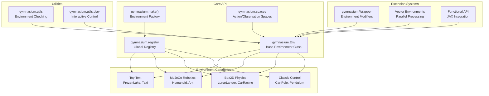
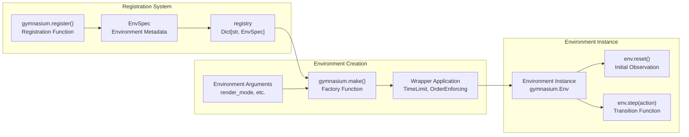
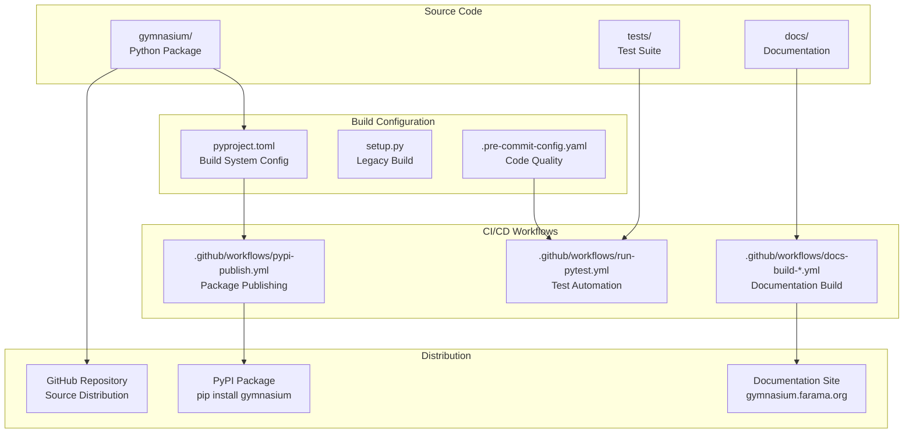

<!-- source: DeepWiki mcp.deepwiki.com · repo Farama-Foundation/Gymnasium · page 1 Overview · fetched 2026-10-14 -->

# Overview

<details>
<summary>Relevant source files</summary>

The following files were used as context for generating this wiki page:

- [CITATION.cff](CITATION.cff)
- [README.md](README.md)
- [assets/wispr-flow.svg](assets/wispr-flow.svg)
- [docs/.gitignore](docs/.gitignore)
- [docs/README.md](docs/README.md)
- [docs/conf.py](docs/conf.py)
- [docs/index.md](docs/index.md)
- [docs/requirements.txt](docs/requirements.txt)
- [gymnasium/__init__.py](gymnasium/__init__.py)
- [gymnasium/envs/registration.py](gymnasium/envs/registration.py)
- [gymnasium/experimental/__init__.py](gymnasium/experimental/__init__.py)
- [setup.py](setup.py)
- [tests/envs/registration/test_make_vec.py](tests/envs/registration/test_make_vec.py)
- [tests/vector/utils/utils.py](tests/vector/utils/utils.py)

</details>


This document introduces the Gymnasium library, explaining its purpose as a reinforcement learning environment standard, its core architecture, and its relationship to the broader ecosystem. This covers the high-level system design and key components that make up the library.

For detailed API documentation, see [Core API](#2). For specific environment implementations, see [Environment Categories](#5). For installation instructions, see [Installation and Setup](#1.1).

## What is Gymnasium

Gymnasium is an open-source Python library that provides a standard API for reinforcement learning environments. It serves as a maintained fork of OpenAI's Gym library and establishes the de facto standard for agent-environment interaction in reinforcement learning research and development.

The library's primary purposes are:
- **Standardization**: Provides a consistent interface through the `gymnasium.Env` class for all reinforcement learning environments [gymnasium/__init__.py:5-11]()
- **Environment Collection**: Includes implementations of classic RL environments across multiple domains (control, physics, games) [README.md:20-27]()
- **Extensibility**: Supports custom environments and third-party integrations through a registration system [gymnasium/envs/registration.py:36-41]()
- **Research Enablement**: Facilitates reproducible research through environment versioning and standardized APIs [README.md:61-63]()

Sources: [README.md:15-17](), [docs/index.md:20-21](), [CITATION.cff:94-102](), [gymnasium/__init__.py:5-11](), [README.md:20-27](), [gymnasium/envs/registration.py:36-41](), [README.md:61-63]()

## Core Architecture

The Gymnasium library is built around a central registry system that manages environment creation and configuration, with modular components for different types of environments and utilities.

### System Architecture Overview



Sources: [README.md:39-53](), [docs/index.md:59-67](), [docs/index.md:72-80]()

### Environment Registration and Creation Flow



Sources: [README.md:42-43](), [docs/index.md:26-27](), [gymnasium/envs/registration.py:71-119]()

## Key Components

### Core API Classes

| Component | Location | Purpose |
|-----------|----------|---------|
| `gymnasium.Env` | `gymnasium.core.Env` | Defines standard interface with `reset()`, `step()`, `render()` methods |
| `gymnasium.Wrapper` | `gymnasium.core.Wrapper` | Enables composable environment transformations |
| `gymnasium.Space` | `gymnasium.spaces.space.Space` | Defines valid actions and observations |
| `gymnasium.make()` | `gymnasium.envs.registration.make` | Creates and configures environment instances |

Sources: [gymnasium/__init__.py:5-12](), [gymnasium/__init__.py:14](), [gymnasium/envs/registration.py:38]()

### Environment Categories

The library includes several built-in environment families:

- **Classic Control**: Traditional control problems like `CartPole-v1`, `MountainCar-v0` [README.md:21]()
- **Box2D**: Physics-based environments using Box2D engine like `LunarLander-v3`, `CarRacing-v3` [README.md:23]()
- **MuJoCo**: Robotics simulations using MuJoCo physics like `Humanoid-v5`, `Ant-v5` [README.md:25]()
- **Toy Text**: Simple discrete environments like `FrozenLake-v1`, `Taxi-v3` [README.md:24]()

Sources: [README.md:22-27](), [docs/index.md:74-79]()

### Extension Systems

- **Vector Environments**: `SyncVectorEnv` and `AsyncVectorEnv` for parallel environment execution [tests/envs/registration/test_make_vec.py:12]()
- **Wrappers**: Modular environment modifications through `gymnasium.Wrapper` subclasses [gymnasium/__init__.py:6]()
- **Functional API**: JAX-compatible functional interface for high-performance computing [docs/index.md:67]()

Sources: [README.md:59-61](), [docs/index.md:79](), [tests/envs/registration/test_make_vec.py:12](), [gymnasium/__init__.py:6](), [docs/index.md:67]()

## Environment Ecosystem

Gymnasium serves as the foundation for a broader ecosystem of reinforcement learning environments and tools.

### Farama Foundation Ecosystem

```mermaid
graph TB
    subgraph "Core Gymnasium"
        GYMNASIUM["gymnasium<br/>Standard RL Interface"]
        CORE_ENVS["Built-in Environments<br/>Classic Control, Box2D, MuJoCo"]
    end
    
    subgraph "Extended Ecosystem"
        PETTINGZOO["PettingZoo<br/>Multi-Agent RL"]
        MINIGRID["Minigrid<br/>Grid World Environments"]
        MINARI["Minari<br/>Offline RL Datasets"]
        ROBOTICS["Gymnasium-Robotics<br/>Robot Learning Tasks"]
    end
    
    subgraph "Third-Party Integration"
        ALE["ALE (Atari)<br/>Atari 2600 Games"]
        COMMUNITY["Community Environments<br/>Domain-Specific"]
        RESEARCH["Research Environments<br/>Academic Projects"]
    end
    
    subgraph "Training Libraries"
        CLEANRL["CleanRL<br/>Reference Implementations"]
        STABLE_BASELINES["Stable Baselines3<br/>Algorithm Library"]
        OTHER_LIBS["Other Libraries<br/>RLLib, Tianshou"]
    end
    
    GYMNASIUM --> CORE_ENVS
    GYMNASIUM --> PETTINGZOO
    GYMNASIUM --> MINIGRID
    GYMNASIUM --> MINARI
    GYMNASIUM --> ROBOTICS
    GYMNASIUM --> ALE
    GYMNASIUM --> COMMUNITY
    GYMNASIUM --> RESEARCH
    
    GYMNASIUM --> CLEANRL
    GYMNASIUM --> STABLE_BASELINES
    GYMNASIUM --> OTHER_LIBS
```



Sources: [README.md:59-61](), [docs/index.md:79]()

## Development and Distribution

### Build and Distribution Pipeline



Sources: [setup.py:36](), [docs/conf.py:33](), [docs/requirements.txt:1-9](), [docs/README.md:25-41]()

### Python Version Support

Gymnasium supports Python 3.10, 3.11, 3.12, and 3.13 on Linux and macOS platforms. The library uses modern Python packaging with `pyproject.toml` configuration and maintains backward compatibility through careful API design.

Sources: [README.md:35](), [docs/conf.py:33]()

## Installation and Basic Usage

Installation is straightforward using pip:

```bash
pip install gymnasium
```

For additional environment dependencies:
```bash
pip install "gymnasium[all]"  # All environments
pip install "gymnasium[atari]"  # Specific environment family
```

Basic usage follows a standard pattern:

```python
import gymnasium as gym

env = gym.make("CartPole-v1")
observation, info = env.reset(seed=42)

for _ in range(1000):
    action = env.action_space.sample()
    observation, reward, terminated, truncated, info = env.step(action)
    
    if terminated or truncated:
        observation, info = env.reset()

env.close()
```

Sources: [README.md:31-33](), [README.md:41-53](), [docs/index.md:26-42]()

---

