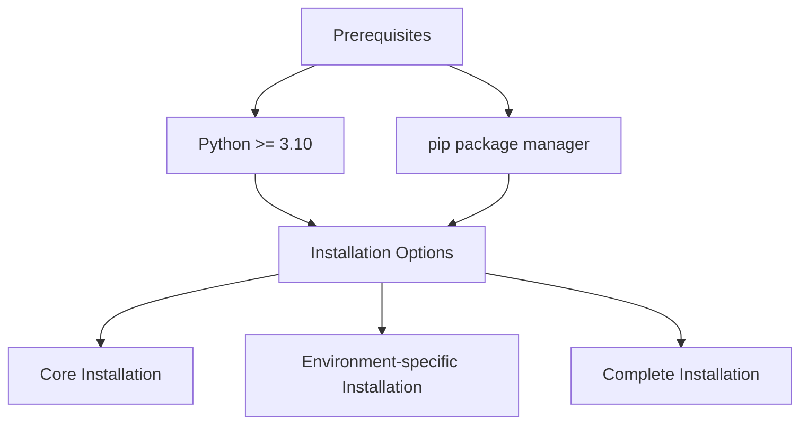
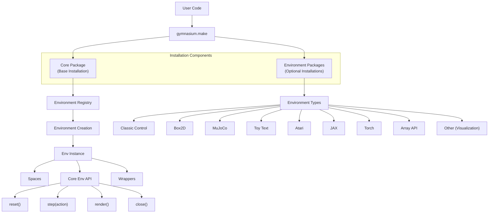

<!-- source: DeepWiki mcp.deepwiki.com · repo Farama-Foundation/Gymnasium · page 1.1 Installation and Setup · fetched 2026-10-14 -->

# Installation and Setup

<details>
<summary>Relevant source files</summary>

The following files were used as context for generating this wiki page:

- [.pre-commit-config.yaml](.pre-commit-config.yaml)
- [CITATION.cff](CITATION.cff)
- [README.md](README.md)
- [assets/wispr-flow.svg](assets/wispr-flow.svg)
- [gymnasium/envs/mujoco/assets/pusher_v5.xml](gymnasium/envs/mujoco/assets/pusher_v5.xml)
- [gymnasium/wrappers/transform_reward.py](gymnasium/wrappers/transform_reward.py)
- [pyproject.toml](pyproject.toml)
- [setup.py](setup.py)
- [tests/envs/mujoco/test_mujoco_v5.py](tests/envs/mujoco/test_mujoco_v5.py)

</details>


This page describes how to install Gymnasium and set up your environment to work with various reinforcement learning environments. For information about using Gymnasium's core API after installation, see [Core API](#2).

## Overview

Gymnasium is a Python library for developing and comparing reinforcement learning algorithms. It provides a standard API for environments, along with a diverse set of reference environments to test and develop algorithms.

## Requirements

Before installing Gymnasium, ensure your system meets these requirements:

- Python 3.10 or newer [pyproject.toml:11]()
- pip package manager (usually comes with Python)



Sources: [pyproject.toml:11]()

## Basic Installation

### Core Installation

To install the core Gymnasium package:

```bash
pip install gymnasium
```

This installs Gymnasium with only the core dependencies:

| Dependency | Version Requirement |
|------------|---------------------|
| numpy | >=1.22.0 |
| cloudpickle | >=1.2.0 |
| typing-extensions | >=4.3.0 |
| farama-notifications | >=0.0.1 |

Sources: [pyproject.toml:27-32]()

## Environment-Specific Installation

Gymnasium supports several categories of environments, each with its own dependencies. Install only what you need to minimize dependencies.

### Environment Categories and Installation

```mermaid
graph TD
    A["Gymnasium Environment Categories"] --> B["Classic Control"]
    A --> C["Box2D"]
    A --> D["MuJoCo"]
    A --> E["Toy Text"]
    A --> F["Atari"]
    A --> G["JAX"]
    A --> H["Torch"]
    A --> I["Array API"]
    A --> J["Other (Visualization)"]
    
    B --> B1["pip install gymnasium[classic-control]"]
    C --> C1["pip install gymnasium[box2d]"]
    D --> D1["pip install gymnasium[mujoco]"]
    E --> E1["pip install gymnasium[toy-text]"]
    F --> F1["pip install gymnasium[atari]"]
    G --> G1["pip install gymnasium[jax]"]
    H --> H1["pip install gymnasium[torch]"]
    I --> I1["pip install gymnasium[array-api]"]
    J --> J1["pip install gymnasium[other]"]
    
    B1 --> P1["pygame-ce >=2.1.3"]
    
    C1 --> P2["pygame-ce >=2.1.3"]
    C1 --> P3["box2d ==2.3.10; python_version < '3.14'"]
    C1 --> P4["box2d-py ==2.3.8; python_version >= '3.14'"]
    C1 --> P5["swig ==4.*; python_version >= '3.14'"]
    
    D1 --> P6["mujoco >=2.1.5"]
    D1 --> P7["imageio >=2.14.1"]
    D1 --> P8["packaging >=23.0"]
    
    E1 --> P9["pygame-ce >=2.1.3"]
    
    F1 --> P10["ale_py >=0.9"]
    
    G1 --> P11["jax >=0.4.16"]
    G1 --> P12["jaxlib >=0.4.16"]
    G1 --> P13["flax >=0.5.0"]
    G1 --> P14["array-api-compat >=1.11.0"]
    
    H1 --> P15["torch >=1.13.0"]
    H1 --> P16["array-api-compat >=1.11.0"]
    
    I1 --> P17["array-api-compat >=1.11.0"]
    I1 --> P18["packaging >=23.0"]
    
    J1 --> P19["moviepy >=1.0.0"]
    J1 --> P20["matplotlib >=3.0"]
    J1 --> P21["opencv-python >=3.0"]
    J1 --> P22["seaborn >= 0.13"]
```



For specific environment categories, use the following installation commands:

| Environment Category | Installation Command | Description |
|----------------------|----------------------|-------------|
| Classic Control | `pip install "gymnasium[classic-control]"` | Simple physics-based control tasks (CartPole, MountainCar, etc.) |
| Box2D | `pip install "gymnasium[box2d]"` | 2D physics environments (LunarLander, CarRacing, etc.) |
| MuJoCo | `pip install "gymnasium[mujoco]"` | 3D physics simulation environments (Humanoid, Ant, HalfCheetah, etc.) |
| Toy Text | `pip install "gymnasium[toy-text]"` | Simple text-based environments (FrozenLake, Blackjack, etc.) |
| Atari | `pip install "gymnasium[atari]"` | Atari 2600 game environments |

Sources: [pyproject.toml:36-46]()

## Machine Learning Framework Support

Gymnasium provides optional dependencies for specific machine learning frameworks:

| Framework | Installation Command | Dependencies |
|-----------|----------------------|-------------|
| JAX | `pip install "gymnasium[jax]"` | jax >=0.4.16, jaxlib >=0.4.16, flax >=0.5.0, array-api-compat >=1.11.0 |
| PyTorch | `pip install "gymnasium[torch]"` | torch >=1.13.0, array-api-compat >=1.11.0 |
| Array API | `pip install "gymnasium[array-api]"` | array-api-compat >=1.11.0, packaging >=23.0 |

Sources: [pyproject.toml:47-54]()

## Visualization Support

For visualization tools and utilities:

```bash
pip install "gymnasium[other]"
```

This installs:
- moviepy >=1.0.0
- matplotlib >=3.0
- opencv-python >=3.0
- seaborn >=0.13

Sources: [pyproject.toml:55-60]()

## Complete Installation

To install Gymnasium with all dependencies (except those requiring ROM licenses):

```bash
pip install "gymnasium[all]"
```

This includes all environment categories and frameworks mentioned above.

Sources: [pyproject.toml:61-63]()

## Development Installation

If you plan to contribute to Gymnasium or need the latest development version:

1. Clone the repository:
   ```bash
   git clone https://github.com/Farama-Foundation/Gymnasium.git
   cd Gymnasium
   ```

2. Install in development mode:
   ```bash
   pip install -e .
   ```

3. Install development dependencies:
   ```bash
   pip install -e ".[testing]"
   ```
   The `testing` extra includes:
   - pytest >=7.1.3
   - scipy >=1.7.3
   - dill >=0.3.7
   - array_api_extra >=0.7.0
   Sources: [pyproject.toml:65-70]()

4. Set up pre-commit hooks (optional but recommended for contributors):
   ```bash
   pip install pre-commit
   pre-commit install
   ```
   The pre-commit configuration (`.pre-commit-config.yaml`) includes hooks for:
   - `check-symlinks`, `destroyed-symlinks`, `trailing-whitespace`, `end-of-file-fixer`, `check-yaml`, `check-toml`, `check-ast`, `check-added-large-files`, `check-merge-conflict`, `check-executables-have-shebangs`, `check-shebang-scripts-are-executable`, `detect-private-key`, `debug-statements` from `pre-commit/pre-commit-hooks` [.pre-commit-config.yaml:3-20]()
   - `codespell` for spell checking [.pre-commit-config.yaml:21-25]()
   - `ruff-check` and `ruff-format` for linting and formatting [.pre-commit-config.yaml:26-35]()
   - `ty` for type checking [.pre-commit-config.yaml:48-51]()

Sources: [README.md:65-68](), [.pre-commit-config.yaml:1-51]()

## Verifying Installation

After installation, verify that Gymnasium is working correctly:

```python
import gymnasium as gym

# Create a simple environment
env = gym.make("CartPole-v1")

# Reset the environment
observation, info = env.reset()

# Take a random action
action = env.action_space.sample()
observation, reward, terminated, truncated, info = env.step(action)

# Close the environment
env.close()

print("Gymnasium is installed correctly!")
```

Sources: [README.md:40-51]()

## Architecture Integration

The following diagram shows how Gymnasium's installation components map to the system architecture:



Sources: [pyproject.toml:36-60]()

## Troubleshooting

### Common Issues

1.  **Missing Dependencies**: If you get import errors when using certain environments, ensure you've installed the corresponding optional dependencies.

    ```
    ImportError: No module named 'box2d'
    ```
    Solution: `pip install "gymnasium[box2d]"`

2.  **Pygame Display Issues**: If using environments that require rendering with Pygame and you're working in a headless environment:

    ```
    pygame.error: No available video device
    ```
    Solution: You may need to configure a virtual framebuffer like Xvfb.

3.  **Version Conflicts**: Dependency conflicts can occur with other packages.

    Solution: Consider using virtual environments to isolate Gymnasium installations.

### Environment-Specific Issues

-   **MuJoCo**: The MuJoCo physics engine might require additional setup on some systems. Refer to the MuJoCo documentation for platform-specific instructions.

-   **Atari**: Atari environments require ROM files that cannot be distributed with Gymnasium due to licensing restrictions. See the `ale_py` documentation for information about obtaining ROMs legally.

## What's Next

Once you have Gymnasium installed, you can:

1.  Explore the [Core API](#2) to understand how to use Gymnasium's interfaces
2.  Learn about [Spaces](#3) that define the format of observations and actions
3.  Discover the various [Environment Categories](#5) available in Gymnasium

---

