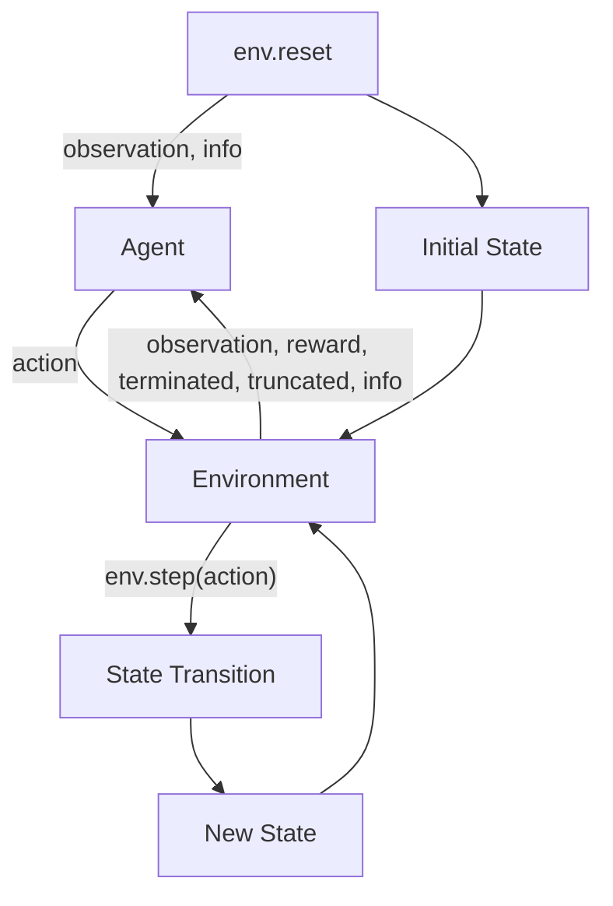
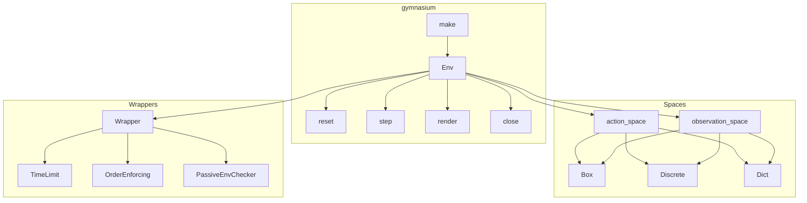
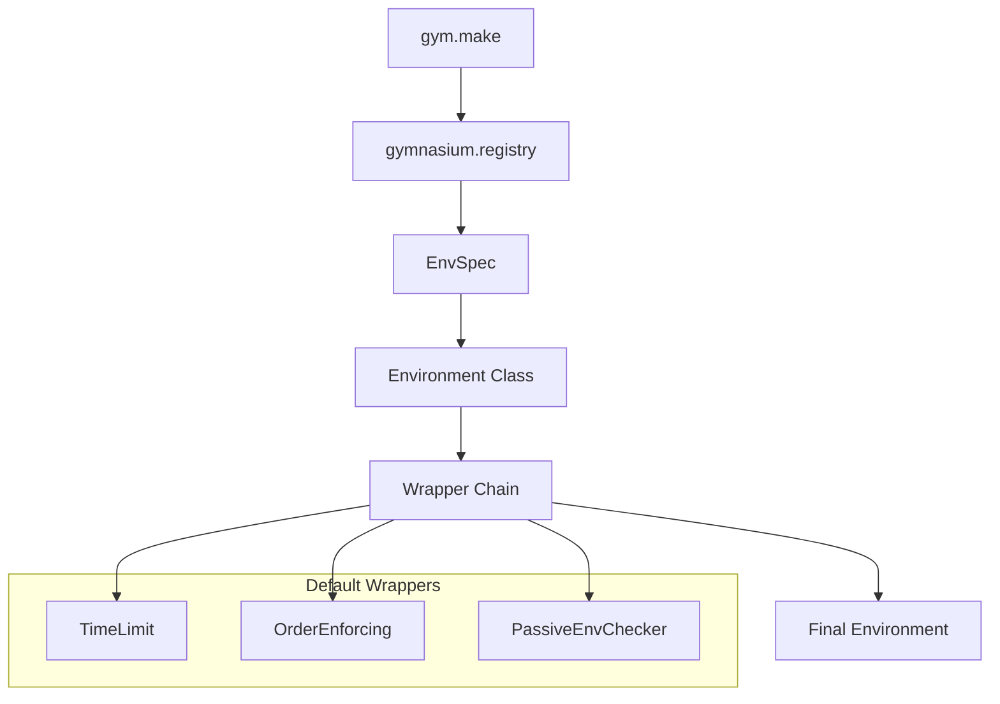

<!-- source: DeepWiki mcp.deepwiki.com · repo Farama-Foundation/Gymnasium · page 1.2 Getting Started with Gymnasium · fetched 2026-10-14 -->

# Getting Started with Gymnasium

<details>
<summary>Relevant source files</summary>

The following files were used as context for generating this wiki page:

- [.gitignore](.gitignore)
- [docs/_static/img/tutorials/mujoco_reinforce_fig4.png](docs/_static/img/tutorials/mujoco_reinforce_fig4.png)
- [docs/_static/videos/tutorials/environment-creation-example-episode.gif](docs/_static/videos/tutorials/environment-creation-example-episode.gif)
- [docs/api/functional.md](docs/api/functional.md)
- [docs/introduction/basic_usage.md](docs/introduction/basic_usage.md)
- [docs/introduction/create_custom_env.md](docs/introduction/create_custom_env.md)
- [docs/introduction/migration_guide.md](docs/introduction/migration_guide.md)
- [docs/introduction/record_agent.md](docs/introduction/record_agent.md)
- [docs/introduction/speed_up_env.md](docs/introduction/speed_up_env.md)
- [docs/introduction/train_agent.md](docs/introduction/train_agent.md)
- [docs/tutorials/README.rst](docs/tutorials/README.rst)
- [docs/tutorials/gymnasium_basics/README.rst](docs/tutorials/gymnasium_basics/README.rst)
- [docs/tutorials/gymnasium_basics/environment_creation.py](docs/tutorials/gymnasium_basics/environment_creation.py)
- [docs/tutorials/gymnasium_basics/implementing_custom_wrappers.py](docs/tutorials/gymnasium_basics/implementing_custom_wrappers.py)
- [docs/tutorials/gymnasium_basics/load_quadruped_model.py](docs/tutorials/gymnasium_basics/load_quadruped_model.py)
- [docs/tutorials/training_agents/README.rst](docs/tutorials/training_agents/README.rst)
- [docs/tutorials/training_agents/blackjack_q_learning.py](docs/tutorials/training_agents/blackjack_q_learning.py)
- [docs/tutorials/training_agents/frozenlake_q_learning.py](docs/tutorials/training_agents/frozenlake_q_learning.py)
- [docs/tutorials/training_agents/mujoco_reinforce.py](docs/tutorials/training_agents/mujoco_reinforce.py)
- [docs/tutorials/training_agents/vector_a2c.py](docs/tutorials/training_agents/vector_a2c.py)

</details>


This page provides a tutorial-style introduction to Gymnasium, covering basic usage patterns, agent-environment interaction, and common workflows that form the foundation of reinforcement learning development.

For detailed installation instructions, see [Installation and Setup](#1.1). For comprehensive API documentation, see [Core API](#2). For training your first agent, see [Train an Agent](docs/introduction/train_agent.md).

## What is Gymnasium?

Gymnasium is an open source Python library that provides a standard API for reinforcement learning environments. It serves as the interface between learning algorithms and environments, offering a consistent way to interact with diverse RL problems ranging from simple control tasks to complex simulations.

The library includes built-in environment families (Classic Control, Box2D, MuJoCo, Toy Text) and supports third-party environments through a unified registration system.

**Sources:** [README.md:15-17](), [docs/introduction/basic_usage.md:16-24]()

## Core Concepts

### The Agent-Environment Loop

The fundamental interaction pattern in Gymnasium follows the standard reinforcement learning agent-environment loop:



This loop represents the core interaction where:
1. Agent observes the current state
2. Agent selects an action based on what it sees
3. Environment processes the action and transitions to a new state
4. Environment returns feedback (reward, new observation, episode status)
5. Process repeats until episode terminates

**Sources:** [docs/introduction/basic_usage.md:52-62]()

### Key API Components

The Gymnasium API centers around several core components:



| Component | Purpose | Key Methods |
|-----------|---------|-------------|
| `gym.make()` | Environment factory | Creates environment instances |
| `Env` | Base environment class | `reset()`, `step()`, `render()`, `close()` |
| `action_space` | Defines valid actions | `sample()`, `contains()` |
| `observation_space` | Defines observation format | `sample()`, `contains()` |
| `Wrapper` | Environment modifier | Modifies behavior without changing core env |

**Sources:** [docs/introduction/basic_usage.md:26-50](), [gymnasium/core.py]()

## Basic Usage Patterns

### Creating and Interacting with Environments

```python
import gymnasium as gym

# Create environment
env = gym.make("CartPole-v1")

# Start episode
observation, info = env.reset()

# Take actions
for _ in range(1000):
    action = env.action_space.sample()  # Random action
    observation, reward, terminated, truncated, info = env.step(action)
    
    if terminated or truncated:
        observation, info = env.reset()

env.close()
```

This pattern demonstrates the essential workflow:
1. **Environment Creation**: `gym.make()` [docs/introduction/basic_usage.md:31-38]() instantiates environments from the registry.
2. **Episode Initialization**: `env.reset()` [docs/introduction/basic_usage.md:86-87]() starts new episodes and returns initial observations.
3. **Action Execution**: `env.step(action)` [docs/introduction/basic_usage.md:103]() processes actions and returns the standard 5-tuple (`observation`, `reward`, `terminated`, `truncated`, `info`).
4. **Episode Management**: Check termination conditions (`terminated` or `truncated`) and reset when needed [docs/introduction/basic_usage.md:110-111]().
5. **Cleanup**: `env.close()` [docs/introduction/basic_usage.md:113]() releases resources.

**Sources:** [README.md:41-53](), [docs/introduction/basic_usage.md:79-114]()

### Understanding Spaces

Action and observation spaces define the interface between agents and environments:

```python
# Examine spaces
print(f"Action space: {env.action_space}")        # Discrete(2)
print(f"Observation space: {env.observation_space}")  # Box(4,)

# Sample from spaces
action = env.action_space.sample()      # Random valid action
obs = env.observation_space.sample()    # Random valid observation

# Check validity
valid_action = env.action_space.contains(action)
valid_obs = env.observation_space.contains(obs)
```

Common space types:
- `Discrete(n)`: Integer actions from 0 to n-1 [gymnasium/spaces/discrete.py]()
- `Box(low, high, shape)`: Continuous values within bounds [gymnasium/spaces/box.py]()
- `Dict`: Structured observations with named components [gymnasium/spaces/dict.py]()
- `MultiDiscrete`: Multiple discrete choices [gymnasium/spaces/multi_discrete.py]()
- `MultiBinary`: Binary vectors [gymnasium/spaces/multi_binary.py]()

**Sources:** [docs/introduction/basic_usage.md:134-176]()

### Environment Registry and Creation



The registry system manages environment creation and configuration:

```python
# Register custom environment
gym.register(
    id="MyEnv-v0",
    entry_point="my_package:MyEnv",
    max_episode_steps=1000
)

# Create with parameters
env = gym.make("CartPole-v1", render_mode="human")

# View available environments
gym.pprint_registry()
```

The `gym.make()` function [docs/introduction/basic_usage.md:31-38]() is the primary way to create environments. It uses the `gymnasium.registry` [gymnasium/envs/registration.py:100-100]() to look up environment specifications (`EnvSpec`) [gymnasium/envs/registration.py:10-10](). When an environment is created, a chain of default wrappers is often applied, including `TimeLimit` [gymnasium/wrappers/time_limit.py:10-10](), `OrderEnforcing` [gymnasium/wrappers/order_enforcing.py:10-10](), and `PassiveEnvChecker` [gymnasium/wrappers/env_checker.py:10-10](), to ensure consistent behavior and API compliance.

You can register your own environments using `gym.register()` [gymnasium/envs/registration.py:100-100](), specifying an `id`, `entry_point`, and optional metadata like `max_episode_steps`. To see all registered environments, use `gym.pprint_registry()` [gymnasium/envs/registration.py:120-120]().

**Sources:** [gymnasium/envs/registration.py](), [docs/introduction/create_custom_env.md:328-347]()

## Common Workflows

### Training Loop Structure

```python
import gymnasium as gym
from collections import defaultdict
import numpy as np

# Define a simple Q-learning agent for demonstration
class SimpleQLearningAgent:
    def __init__(self, action_space, observation_space, learning_rate=0.1, discount_factor=0.99, epsilon=0.1):
        self.action_space = action_space
        self.observation_space = observation_space
        self.lr = learning_rate
        self.gamma = discount_factor
        self.epsilon = epsilon
        # Q-table for discrete states (assuming observation space is discrete or can be discretized)
        # For CartPole, we'd need to discretize the continuous observation space.
        # For simplicity, this example assumes a discrete observation space for the Q-table.
        # For CartPole, a more complex agent (e.g., neural network) would be used.
        self.q_table = defaultdict(lambda: np.zeros(self.action_space.n))

    def get_action(self, observation):
        # Epsilon-greedy policy
        if np.random.rand() < self.epsilon:
            return self.action_space.sample()  # Explore
        else:
            # Exploit: choose action with max Q-value for current state
            # For continuous observation, this would require state discretization or a function approximator
            state_tuple = tuple(observation) # Simple conversion for demonstration
            return np.argmax(self.q_table[state_tuple])

    def update(self, observation, action, reward, next_observation, terminated):
        state_tuple = tuple(observation)
        next_state_tuple = tuple(next_observation)

        current_q = self.q_table[state_tuple][action]
        
        if terminated:
            target_q = reward
        else:
            target_q = reward + self.gamma * np.max(self.q_table[next_state_tuple])
        
        self.q_table[state_tuple][action] += self.lr * (target_q - current_q)


# Setup
env = gym.make("FrozenLake-v1", is_slippery=False) # Using FrozenLake for discrete states
agent = SimpleQLearningAgent(env.action_space, env.observation_space)

num_episodes = 1000
# Training loop
for episode in range(num_episodes):
    observation, info = env.reset()
    episode_reward = 0
    
    while True:
        # Agent decision
        action = agent.get_action(observation)
        
        # Environment step
        next_observation, reward, terminated, truncated, info = env.step(action)
        
        # Agent learning
        agent.update(observation, action, reward, next_observation, terminated)
        
        episode_reward += reward
        observation = next_observation # Update observation for next step
        
        if terminated or truncated:
            break
    
    # Episode complete
    print(f"Episode {episode}: reward = {episode_reward}")

env.close()
```

This workflow represents the standard training pattern used across RL algorithms. The `SimpleQLearningAgent` demonstrates how an agent interacts with the environment by choosing actions (`get_action`) and updating its policy based on feedback (`update`). The `env.reset()` [docs/introduction/basic_usage.md:86-87]() and `env.step()` [docs/introduction/basic_usage.md:103]() methods facilitate this interaction.

**Sources:** [docs/introduction/train_agent.md:238-263](), [docs/tutorials/training_agents/frozenlake_q_learning.py:105-126](), [docs/tutorials/training_agents/frozenlake_q_learning.py:130-149]()

### Environment Modification with Wrappers

```python
from gymnasium.wrappers import TimeLimit, RecordVideo, ClipReward

# Base environment
base_env = gym.make("CartPole-v1", render_mode="rgb_array")

# Add wrappers
env = TimeLimit(base_env, max_episode_steps=500)
env = ClipReward(env, min_reward=-1, max_reward=1) # Example custom wrapper
env = RecordVideo(env, video_folder="videos/", episode_trigger=lambda x: x % 100 == 0)

# Wrapper chain inspection
print(env)  # Shows wrapper hierarchy
print(env.unwrapped)  # Access original environment

env.close()
```

Wrappers modify environment behavior without changing the core implementation. They are applied in a stack, with the outermost wrapper being the first to process calls to `step()`, `reset()`, etc.

- `TimeLimit` [gymnasium/wrappers/time_limit.py:10-10](): Adds episode step limits, causing `truncated=True` if the limit is reached.
- `RecordVideo` [gymnasium/wrappers/record_video.py:10-10](): Saves episode recordings to a specified folder, useful for visualization and debugging.
- `ClipReward` [docs/tutorials/gymnasium_basics/implementing_custom_wrappers.py:95-103](): A custom wrapper example that clips the reward to a specified range.
- `FlattenObservation` [gymnasium/wrappers/flatten_observation.py:10-10](): Converts dictionary observations into a single flat array.
- `RescaleAction` [gymnasium/wrappers/rescale_action.py:10-10](): Rescales actions from one range to another.

You can inspect the wrapper hierarchy by printing the wrapped environment object. The `env.unwrapped` attribute allows direct access to the base environment, bypassing all wrappers.

**Sources:** [docs/introduction/basic_usage.md:178-232](), [docs/tutorials/gymnasium_basics/implementing_custom_wrappers.py:95-103]()

### Multi-Environment Workflows

```python
import gymnasium as gym
import numpy as np

# Create a vectorized environment with 4 parallel instances
vec_env = gym.make_vec("CartPole-v1", num_envs=4)

# Reset all environments
observations, infos = vec_env.reset()
print(f"Initial observations shape: {observations.shape}") # (num_envs, observation_space_shape)

# Take a step in all environments
# Actions must be a batch, one for each environment
actions = np.array([vec_env.action_space.sample() for _ in range(vec_env.num_envs)])
observations, rewards, terminated, truncated, infos = vec_env.step(actions)

print(f"Observations shape after step: {observations.shape}")
print(f"Rewards: {rewards}")
print(f"Terminated flags: {terminated}")
print(f"Truncated flags: {truncated}")

vec_env.close()
```

Vector environments (`VectorEnv` [gymnasium/vector/vector_env.py:10-10]()) allow running multiple environment instances in parallel, significantly speeding up data collection for training. `gym.make_vec()` [gymnasium/vector/__init__.py:10-10]() creates a vectorized environment.

When interacting with a `VectorEnv`, `reset()` and `step()` operate on batches:
- `reset()` returns a batch of observations and a list of info dictionaries, one for each environment.
- `step()` takes a batch of actions (one for each environment) and returns batches of observations, rewards, `terminated` flags, `truncated` flags, and a list of info dictionaries.

This batch-oriented interaction is crucial for efficient training with algorithms that benefit from parallel experience collection, such as A2C [docs/tutorials/training_agents/vector_a2c.py:92-164]() or PPO.

**Sources:** [docs/introduction/speed_up_env.md:12-21](), [docs/tutorials/training_agents/vector_a2c.py:92-164]()

## Environment Categories

Gymnasium includes several built-in environment families:

| Category | Description | Example Environments |
|----------|-------------|---------------------|
| Classic Control | Simple control problems with continuous state and discrete/continuous actions. | CartPole, MountainCar, Pendulum |
| Box2D | 2D physics simulations requiring Box2D library. | LunarLander, CarRacing, BipedalWalker |
| MuJoCo | 3D robotics simulations requiring MuJoCo physics engine. | Humanoid, Ant, Walker2d |
| Toy Text | Discrete, simple problems often used for tabular RL methods. | FrozenLake, Taxi, Blackjack |

Each category targets different aspects of RL research and provides varying levels of complexity.

**Sources:** [README.md:19-28]()

## Next Steps

After mastering these basics, explore these advanced topics:

1.  **Algorithm Implementation**: Learn to implement RL algorithms like Q-learning [docs/tutorials/training_agents/frozenlake_q_learning.py:105-126](), policy gradients, or actor-critic methods [docs/tutorials/training_agents/vector_a2c.py:92-164]().
2.  **Custom Environments**: Create domain-specific environments for your research problems - see [Create a Custom Environment](docs/introduction/create_custom_env.md).
3.  **Performance Optimization**: Use vectorized environments and other techniques - see [Speed Up Training](docs/introduction/speed_up_env.md).
4.  **Evaluation and Recording**: Systematically evaluate and record agent performance - see [Recording Agents](docs/introduction/record_agent.md).
5.  **Advanced Features**: Explore functional environments [docs/api/functional.md](), third-party integrations, and specialized wrappers [docs/tutorials/gymnasium_basics/implementing_custom_wrappers.py:20-138]().

The key to effective RL development is understanding the agent-environment interface and building upon these fundamental interaction patterns.

**Sources:** [docs/introduction/basic_usage.md:252-258]()

---

