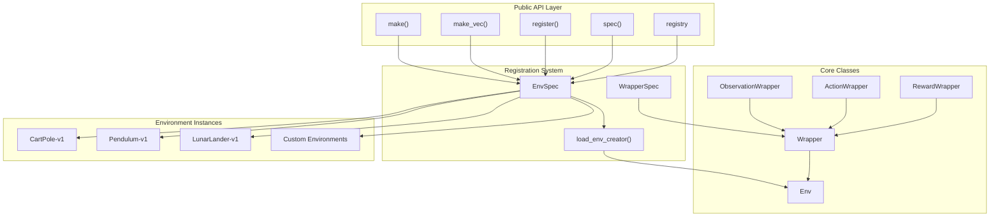
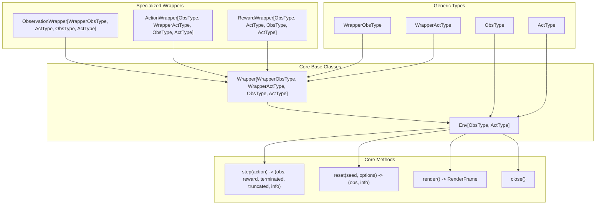
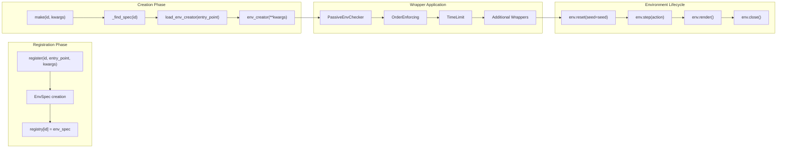

<!-- source: DeepWiki mcp.deepwiki.com · repo Farama-Foundation/Gymnasium · page 2 Core API · fetched 2026-10-14 -->

# Core API

<details>
<summary>Relevant source files</summary>

The following files were used as context for generating this wiki page:

- [gymnasium/core.py](gymnasium/core.py)
- [gymnasium/utils/env_checker.py](gymnasium/utils/env_checker.py)
- [gymnasium/utils/passive_env_checker.py](gymnasium/utils/passive_env_checker.py)
- [gymnasium/wrappers/common.py](gymnasium/wrappers/common.py)
- [tests/test_core.py](tests/test_core.py)
- [tests/testing_env.py](tests/testing_env.py)
- [tests/utils/test_env_checker.py](tests/utils/test_env_checker.py)
- [tests/utils/test_passive_env_checker.py](tests/utils/test_passive_env_checker.py)
- [tests/wrappers/test_passive_env_checker.py](tests/wrappers/test_passive_env_checker.py)

</details>


The Core API provides the fundamental interfaces and classes that define how agents interact with environments in Gymnasium. This includes the base `Env` class that all environments must implement, the `Wrapper` system for modifying environment behavior, and the registration system for creating environments.

For information about specific environment implementations, see [Environment Categories](#5). For details about the spaces system used to define action and observation spaces, see [Spaces](#3). For vector environments that run multiple instances in parallel, see [Vector Environments](#6).

## API Architecture Overview

The Gymnasium Core API is built around several key components that work together to provide a consistent interface for reinforcement learning environments:



Sources: [gymnasium/__init__.py:10-12](), [gymnasium/core.py:25-65](), [gymnasium/envs/registration.py:74-246]()

## Class Hierarchy and Relationships

The core classes follow a clear inheritance hierarchy that enables modular composition of environment behavior:



Sources: [gymnasium/core.py:19-20](), [gymnasium/core.py:25-59](), [gymnasium/core.py:284-291](), [gymnasium/core.py:531-648]()

## Environment Creation and Lifecycle

The environment creation process involves several steps that transform environment specifications into runnable instances:



Sources: [gymnasium/envs/registration.py:564-638](), [gymnasium/envs/registration.py:640-824](), [gymnasium/envs/registration.py:534-546]()

## Key API Functions

### Environment Creation Functions

| Function | Purpose | Returns |
|----------|---------|---------|
| `make(id, **kwargs)` | Creates a single environment instance | `Env` |
| `make_vec(id, num_envs, **kwargs)` | Creates a vectorized environment | `VectorEnv` |
| `spec(id)` | Retrieves environment specification | `EnvSpec` |
| `register(id, entry_point, **kwargs)` | Registers new environment | `None` |

### Registry Management

| Function | Purpose | Returns |
|----------|---------|---------|
| `registry` | Global environment registry | `dict[str, EnvSpec]` |
| `pprint_registry()` | Pretty-prints available environments | `None` |
| `register_envs(module)` | Registers environments from module | `None` |

Sources: [gymnasium/__init__.py:34-50](), [gymnasium/envs/registration.py:32-45]()

## Core Environment Interface

The `Env` class defines the standard interface that all environments must implement. For details, see [Env Class](#2.1).

### Essential Methods

- **`step(action)`**: Executes one environment timestep
  - Returns: `(observation, reward, terminated, truncated, info)`
  - Defined in [gymnasium/core.py:77-112]()

- **`reset(seed=None, options=None)`**: Resets environment to initial state
  - Returns: `(observation, info)`
  - Defined in [gymnasium/core.py:114-158]()

- **`render()`**: Renders the environment for visualization
  - Returns: `RenderFrame | list[RenderFrame] | None`
  - Defined in [gymnasium/core.py:159-191]()

- **`close()`**: Cleanup when environment is no longer needed
  - Defined in [gymnasium/core.py:193-199]()

### Essential Properties

- **`action_space`**: Defines valid actions (`spaces.Space[ActType]`)
- **`observation_space`**: Defines valid observations (`spaces.Space[ObsType]`)
- **`spec`**: Environment specification (`EnvSpec | None`)
- **`metadata`**: Environment metadata (`dict[str, Any]`)
- **`render_mode`**: Current rendering mode (`str | None`)

Sources: [gymnasium/core.py:25-75]()

## Wrapper System Overview

The wrapper system allows modular modification of environment behavior without changing the underlying environment implementation. For details, see [Wrapper System](#2.2).

### Base Wrapper Class

The `Wrapper` class provides the foundation for all environment modifications:

```python
class Wrapper(Env[WrapperObsType, WrapperActType]):
    def __init__(self, env: Env[ObsType, ActType])
    def step(self, action: WrapperActType) -> tuple[WrapperObsType, SupportsFloat, bool, bool, dict]
    def reset(self, *, seed: int | None = None, options: dict | None = None) -> tuple[WrapperObsType, dict]
```

### Specialized Wrapper Types

| Wrapper Type | Purpose | Key Method |
|--------------|---------|------------|
| `ObservationWrapper` | Modifies observations | `observation(obs) -> modified_obs` |
| `ActionWrapper` | Modifies actions | `action(action) -> modified_action` |
| `RewardWrapper` | Modifies rewards | `reward(reward) -> modified_reward` |

### Wrapper Attribute Access

The wrapper system provides methods for accessing attributes through the wrapper stack:

- **`has_wrapper_attr(name)`**: Check if attribute exists in wrapper stack
- **`get_wrapper_attr(name)`**: Get attribute from wrapper stack
- **`set_wrapper_attr(name, value)`**: Set attribute in wrapper stack

Sources: [gymnasium/core.py:288-529](), [gymnasium/core.py:531-648]()

## Environment Specification System

The `EnvSpec` class contains metadata and configuration for environment creation:

### Core EnvSpec Attributes

| Attribute | Type | Purpose |
|-----------|------|---------|
| `id` | `str` | Environment identifier |
| `entry_point` | `EnvCreator \| str \| None` | Environment constructor |
| `reward_threshold` | `float \| None` | Reward threshold for solving |
| `nondeterministic` | `bool` | Whether environment is nondeterministic |
| `max_episode_steps` | `int \| None` | Maximum episode length |
| `order_enforce` | `bool` | Whether to enforce call order |
| `disable_env_checker` | `bool` | Whether to disable environment checker |
| `additional_wrappers` | `tuple[WrapperSpec, ...]` | Additional wrappers to apply |

### Environment ID Format

Environment IDs follow the pattern: `[namespace/](env-name)[-v(version)]`

- **Namespace**: Optional namespace for organization
- **Environment name**: The core environment identifier
- **Version**: Optional version number

Examples: `CartPole-v1`, `ALE/Breakout-v5`, `MyNamespace/CustomEnv-v0`

Sources: [gymnasium/envs/registration.py:74-246](), [gymnasium/envs/registration.py:27-29](), [gymnasium/envs/registration.py:261-282]()

---

