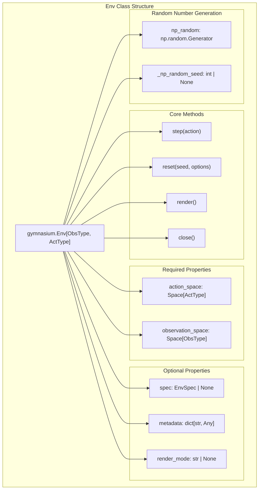
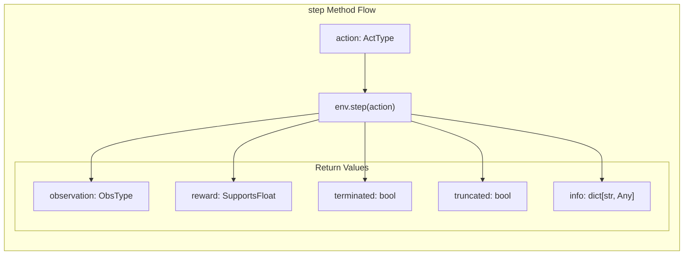
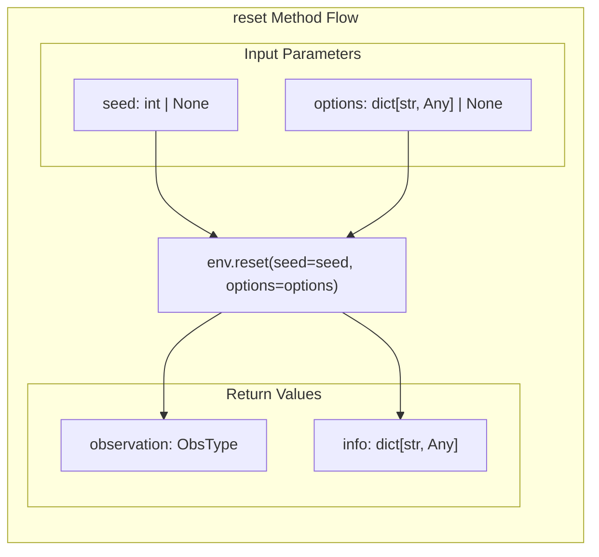
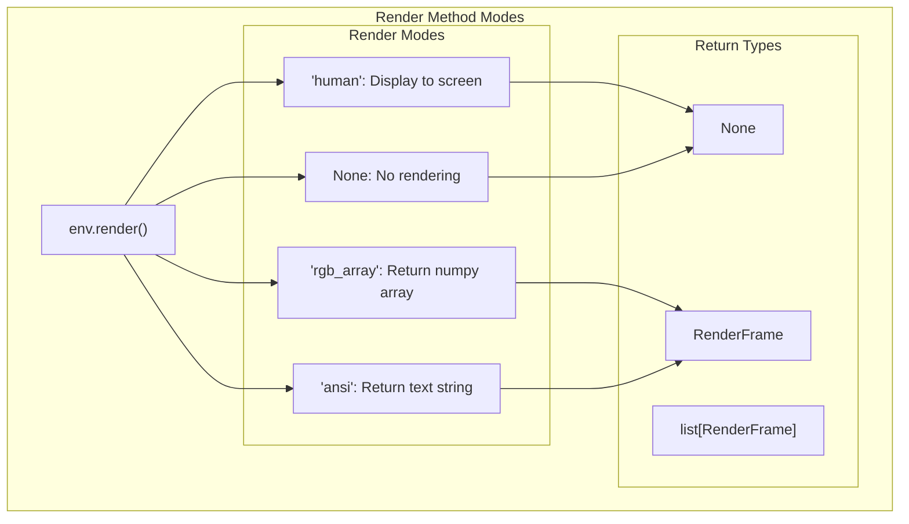
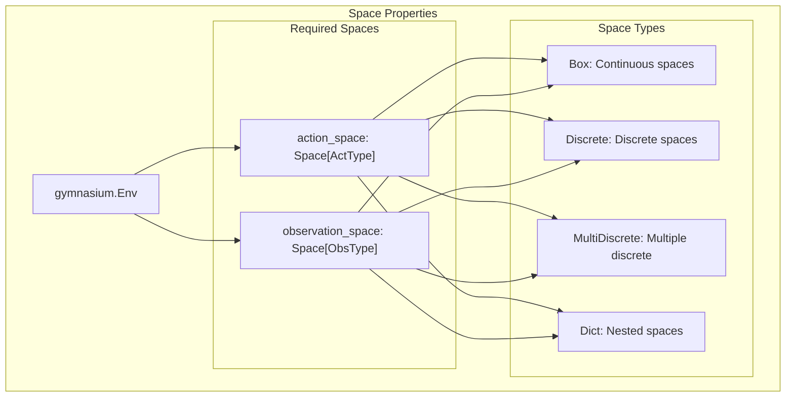
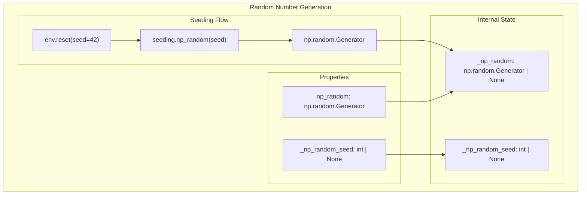
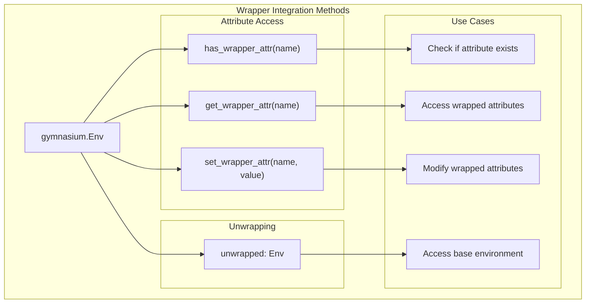

<!-- source: DeepWiki mcp.deepwiki.com · repo Farama-Foundation/Gymnasium · page 2.1 Env Class · fetched 2026-10-14 -->

# Env Class

<details>
<summary>Relevant source files</summary>

The following files were used as context for generating this wiki page:

- [gymnasium/core.py](gymnasium/core.py)
- [gymnasium/utils/env_checker.py](gymnasium/utils/env_checker.py)
- [gymnasium/utils/passive_env_checker.py](gymnasium/utils/passive_env_checker.py)
- [gymnasium/wrappers/common.py](gymnasium/wrappers/common.py)
- [tests/test_core.py](tests/test_core.py)
- [tests/testing_env.py](tests/testing_env.py)
- [tests/utils/test_env_checker.py](tests/utils/test_env_checker.py)
- [tests/utils/test_passive_env_checker.py](tests/utils/test_passive_env_checker.py)
- [tests/utils/test_seeding.py](tests/utils/test_seeding.py)
- [tests/wrappers/test_passive_env_checker.py](tests/wrappers/test_passive_env_checker.py)

</details>


The `Env` class is the fundamental base class for all reinforcement learning environments in Gymnasium. It defines the standard interface that all environments must implement, providing the core methods for agent-environment interaction, observation and action space definitions, and environment lifecycle management.

For information about extending environments through wrappers, see [Wrapper System](). For details on creating and registering custom environments, see [Environment Registration]().

## Class Overview

The `Env` class is a generic base class parameterized by observation type (`ObsType`) and action type (`ActType`). It establishes the contract that all Gymnasium environments must follow, ensuring consistent behavior across different environment implementations.



Sources: [gymnasium/core.py:25-75]()

## Core Methods

### step Method

The `step` method is the primary interface for advancing the environment by one timestep. It takes an action and returns the next observation, reward, termination signals, and additional information.



The method signature is:
```python
def step(
    self, action: ActType
) -> tuple[ObsType, SupportsFloat, bool, bool, dict[str, Any]]:
```

Key aspects:
- **Action**: Must be a valid element of the environment's `action_space`
- **Observation**: Must be a valid element of the environment's `observation_space`
- **Reward**: A scalar value representing the reward for the action
- **Terminated**: Indicates if the episode has ended due to task completion
- **Truncated**: Indicates if the episode has ended due to time limits or other constraints
- **Info**: Dictionary containing auxiliary diagnostic information

Sources: [gymnasium/core.py:77-116]()

### reset Method

The `reset` method initializes the environment to a starting state, typically called at the beginning of each episode or when the environment needs to be restarted.



The method signature is:
```python
def reset(
    self, *, seed: int | None = None, options: dict[str, Any] | None = None
) -> tuple[ObsType, dict[str, Any]]:
```

Key aspects:
- **Seed**: Optional integer for reproducible random number generation. The `super().reset(seed=seed)` call within an environment's `reset` method is crucial for initializing the environment's internal random number generator (`_np_random`) and ensuring deterministic behavior when a seed is provided. [gymnasium/utils/env_checker.py:102-105]()
- **Options**: Optional dictionary for environment-specific configuration
- **Observation**: Initial observation from the environment
- **Info**: Dictionary containing auxiliary information about the reset

Sources: [gymnasium/core.py:118-158]()

### render Method

The `render` method provides visualization of the environment state, supporting various rendering modes for different use cases.



The method signature is:
```python
def render(self) -> RenderFrame | list[RenderFrame] | None:
```

Render modes are specified during environment initialization and stored in `env.render_mode`. The `metadata` attribute should list supported render modes.

Sources: [gymnasium/core.py:160-192]()

### close Method

The `close` method handles cleanup operations when the environment is no longer needed, such as closing rendering windows or releasing resources.

```python
def close(self):
    """Override close in your environment or wrapper to perform any necessary cleanup.

    Environments will automatically close() themselves when garbage collected or when the program exits.
    """
    pass
```

Sources: [gymnasium/core.py:194-200]()

## Properties and Attributes

### Space Properties

Every environment must define `action_space` and `observation_space` properties that specify the valid ranges for actions and observations.



Sources: [gymnasium/core.py:68-69]()
The `check_observation_space` and `check_action_space` utilities in `gymnasium.utils.passive_env_checker` are used to validate these spaces. They ensure that the spaces inherit from `gymnasium.spaces.Space` and have sensible configurations (e.g., positive number of elements for `Discrete` spaces, correct shapes for `Box` spaces). [gymnasium/utils/passive_env_checker.py:61-116]()

### Metadata and Specification

The `metadata` attribute provides information about the environment's capabilities, while `spec` contains registration information.

| Attribute | Type | Description |
|-----------|------|-------------|
| `metadata` | `dict[str, Any]` | Environment metadata (e.g., render modes, FPS) |
| `spec` | `EnvSpec \| None` | Environment specification from registration |
| `render_mode` | `str \| None` | Current rendering mode |

Sources: [gymnasium/core.py:61-65]()

## Random Number Generation

Gymnasium environments use a standardized random number generation system to ensure reproducibility and proper seeding.



Key aspects:
- **np_random**: Provides access to the environment's random number generator. This property ensures that if `_np_random` is `None`, a new `np.random.Generator` is created using a random seed, and this seed is stored in `_np_random_seed`. [gymnasium/core.py:210-226]()
- **_np_random_seed**: Stores the seed used to initialize the current `np.random.Generator`. It is set to -1 if the seed is unknown. [gymnasium/core.py:73-74]()
- **Automatic initialization**: If `env.reset(seed=None)` is called, a random seed is generated internally.
- **Seed persistence**: The seed is maintained across reset calls unless explicitly changed. The `check_reset_seed_determinism` utility verifies that calling `reset` with the same seed produces deterministic results for observations and the internal random number generator state. [gymnasium/utils/env_checker.py:79-157]()

Sources: [gymnasium/core.py:71-74](), [gymnasium/core.py:202-246]()

## Wrapper Integration

The `Env` class provides methods for interacting with the wrapper system, allowing wrappers to modify environment behavior while maintaining access to underlying functionality.



These methods enable:
- **Attribute traversal**: Access attributes through wrapper chains. For example, `env.get_wrapper_attr("gravity")` will search through the wrapper stack to find the `gravity` attribute. [tests/test_core.py:177-179]()
- **Dynamic modification**: Modify attributes at any wrapper level. `env.set_wrapper_attr("gravity", 10.0)` will set the `gravity` attribute on the first environment in the stack that has it. [tests/test_core.py:188-192]()
- **Base environment access**: Direct access to the underlying environment using `env.unwrapped`. [gymnasium/core.py:278-282]()

Sources: [gymnasium/core.py:268-282]()

## Context Manager Support

The `Env` class supports Python's context manager protocol, enabling automatic resource cleanup.

```python
# Context manager usage
with gym.make("CartPole-v1") as env:
    obs, info = env.reset()
    # Environment is automatically closed when exiting the with block
```

The implementation uses `__enter__` and `__exit__` methods to ensure proper cleanup. The `__enter__` method returns `self`, allowing the environment object to be used within the `with` statement. The `__exit__` method calls `self.close()` to release resources. [gymnasium/core.py:258-266]()

Sources: [gymnasium/core.py:258-266]()

## Implementation Guidelines

### Custom Environment Implementation

When creating custom environments, inherit from `Env` and implement the required methods:

```python
class CustomEnv(gym.Env[ObsType, ActType]):
    def __init__(self):
        # Define action and observation spaces
        self.action_space = ...
        self.observation_space = ...
        
        # Optional: Set metadata
        self.metadata = {"render_modes": ["human", "rgb_array"]}
    
    def step(self, action):
        # Implement environment dynamics
        return observation, reward, terminated, truncated, info
    
    def reset(self, *, seed=None, options=None):
        # Call parent reset for proper seeding
        super().reset(seed=seed, options=options)
        # Initialize environment state
        return observation, info
```
It is critical that the `reset` method calls `super().reset(seed=seed, options=options)` to ensure proper seeding of the environment's internal random number generator. Failure to do so can lead to non-deterministic behavior even when a seed is provided. [gymnasium/utils/env_checker.py:102-105]()

Environments should also ensure that the observations and info dictionaries returned by `reset` and `step` are new objects and not reused buffers. The `PassiveEnvChecker` wrapper and `data_shares_objects` utility function can detect such issues. [gymnasium/utils/passive_env_checker.py:30](), [tests/wrappers/test_passive_env_checker.py:134-166]()

### Type Safety

The `Env` class supports static type checking through generic type parameters:

```python
# Type-safe environment definition
class TypedEnv(gym.Env[np.ndarray, int]):
    def __init__(self):
        self.observation_space: gym.spaces.Space[np.ndarray] = gym.spaces.Box(...)
        self.action_space: gym.spaces.Space[int] = gym.spaces.Discrete(...)
```

Sources: [gymnasium/core.py:53-56]()

---

