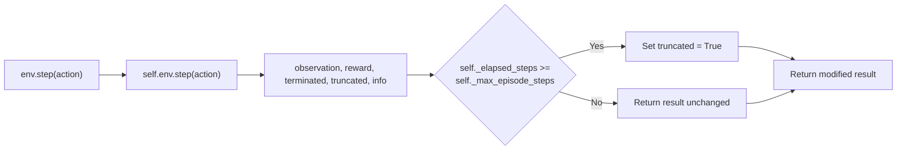
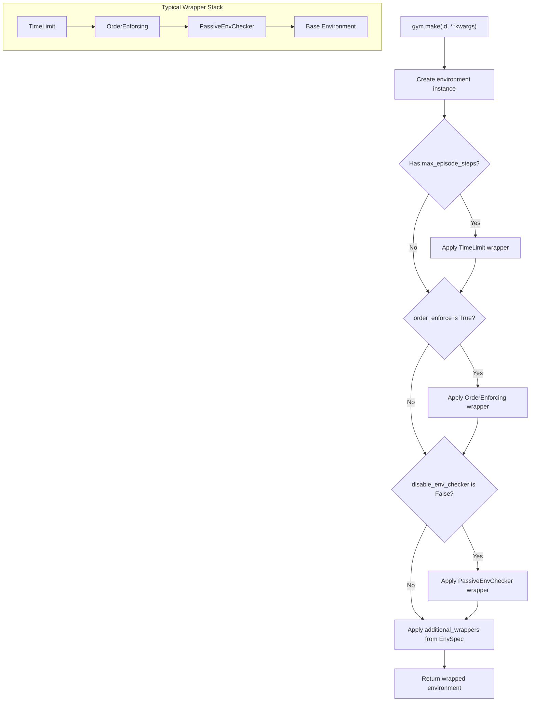

<!-- source: DeepWiki mcp.deepwiki.com · repo Farama-Foundation/Gymnasium · page 2.2 Wrapper System · fetched 2026-10-14 -->

# Wrapper System

<details>
<summary>Relevant source files</summary>

The following files were used as context for generating this wiki page:

- [docs/api/wrappers/action_wrappers.md](docs/api/wrappers/action_wrappers.md)
- [docs/api/wrappers/table.md](docs/api/wrappers/table.md)
- [gymnasium/core.py](gymnasium/core.py)
- [gymnasium/error.py](gymnasium/error.py)
- [gymnasium/utils/env_checker.py](gymnasium/utils/env_checker.py)
- [gymnasium/utils/passive_env_checker.py](gymnasium/utils/passive_env_checker.py)
- [gymnasium/wrappers/__init__.py](gymnasium/wrappers/__init__.py)
- [gymnasium/wrappers/common.py](gymnasium/wrappers/common.py)
- [gymnasium/wrappers/stateful_action.py](gymnasium/wrappers/stateful_action.py)
- [tests/test_core.py](tests/test_core.py)
- [tests/testing_env.py](tests/testing_env.py)
- [tests/utils/test_env_checker.py](tests/utils/test_env_checker.py)
- [tests/utils/test_passive_env_checker.py](tests/utils/test_passive_env_checker.py)
- [tests/wrappers/test_action_repeat.py](tests/wrappers/test_action_repeat.py)
- [tests/wrappers/test_passive_env_checker.py](tests/wrappers/test_passive_env_checker.py)
- [tests/wrappers/test_sticky_action.py](tests/wrappers/test_sticky_action.py)
- [tests/wrappers/test_white_noise_rendering.py](tests/wrappers/test_white_noise_rendering.py)

</details>


The Wrapper System is a key component of Gymnasium that enables modifying environment behavior without altering the underlying environment code. Wrappers provide a standardized mechanism to customize environment aspects such as observations, actions, rewards, and more. They serve as a powerful abstraction layer that makes it easy to implement common functionality like episode termination conditions, preprocessing steps, and monitoring tools.

## Architecture Overview

The Wrapper System is built on a simple but powerful inheritance and composition pattern. All wrappers inherit from the base `Wrapper` class, which itself inherits from the `Env` class. This design ensures that wrappers maintain the same interface as environments, allowing them to be used interchangeably.

```mermaid
classDiagram
    direction TB
    class Env {
        +step(action: ActType) tuple[ObsType, SupportsFloat, bool, bool, dict]
        +reset(seed: int|None, options: dict|None) tuple[ObsType, dict]
        +render() RenderFrame|list[RenderFrame]|None
        +close()
        +action_space: spaces.Space[ActType]
        +observation_space: spaces.Space[ObsType]
        +unwrapped: Env
        +has_wrapper_attr(name: str) bool
        +get_wrapper_attr(name: str) Any
        +set_wrapper_attr(name: str, value: Any, force: bool) bool
    }
    
    class Wrapper {
        -env: Env[ObsType, ActType]
        +step(action: WrapperActType) tuple[WrapperObsType, SupportsFloat, bool, bool, dict]
        +reset(seed: int|None, options: dict|None) tuple[WrapperObsType, dict]
        +render() RenderFrame|list[RenderFrame]|None
        +close()
        +action_space: spaces.Space
        +observation_space: spaces.Space
        +unwrapped: Env[ObsType, ActType]
        +spec: EnvSpec|None
        +wrapper_spec(**kwargs) WrapperSpec
    }
    
    class ActionWrapper {
        +action(action: WrapperActType) ActType
        +step(action: WrapperActType) tuple[ObsType, SupportsFloat, bool, bool, dict]
    }
    
    class ObservationWrapper {
        +observation(observation: ObsType) WrapperObsType
        +step(action: ActType) tuple[WrapperObsType, SupportsFloat, bool, bool, dict]
        +reset(seed: int|None, options: dict|None) tuple[WrapperObsType, dict]
    }
    
    class RewardWrapper {
        +reward(reward: SupportsFloat) SupportsFloat
        +step(action: ActType) tuple[ObsType, SupportsFloat, bool, bool, dict]
    }
    
    class TimeLimit {
        -_max_episode_steps: int
        -_elapsed_steps: int|None
        +step(action: ActType) tuple[ObsType, SupportsFloat, bool, bool, dict]
        +reset(seed: int|None, options: dict|None) tuple[ObsType, dict]
        +spec: EnvSpec|None
    }
    
    class OrderEnforcing {
        -_has_reset: bool
        -_disable_render_order_enforcing: bool
        +step(action: ActType) tuple[ObsType, SupportsFloat, bool, bool, dict]
        +reset(seed: int|None, options: dict|None) tuple[ObsType, dict]
        +render() RenderFrame|list[RenderFrame]|None
        +has_reset: bool
    }
    
    class PassiveEnvChecker {
        +checked_reset: bool
        +checked_step: bool
        +checked_render: bool
        +close_called: bool
        +step(action: ActType) tuple[ObsType, SupportsFloat, bool, bool, dict]
        +reset(seed: int|None, options: dict|None) tuple[ObsType, dict]
        +render() RenderFrame|list[RenderFrame]|None
    }
    
    class Autoreset {
        +autoreset: bool
        +step(action: ActType) tuple[ObsType, SupportsFloat, bool, bool, dict]
        +reset(seed: int|None, options: dict|None) tuple[WrapperObsType, dict]
    }
    
    class RecordEpisodeStatistics {
        +episode_count: int
        +episode_start_time: float
        +episode_returns: float
        +episode_lengths: int
        +time_queue: deque[float]
        +return_queue: deque[float]
        +length_queue: deque[int]
        +step(action: ActType) tuple[ObsType, SupportsFloat, bool, bool, dict]
        +reset(seed: int|None, options: dict|None) tuple[ObsType, dict]
    }
    
    Env <|-- Wrapper
    Wrapper <|-- ActionWrapper
    Wrapper <|-- ObservationWrapper
    Wrapper <|-- RewardWrapper
    Wrapper <|-- TimeLimit
    Wrapper <|-- OrderEnforcing
    Wrapper <|-- PassiveEnvChecker
    Wrapper <|-- Autoreset
    Wrapper <|-- RecordEpisodeStatistics
    Wrapper o-- Env : wraps
```



Sources: [gymnasium/core.py:23-647](), [gymnasium/wrappers/common.py:34-550]()

## Wrapper Base Class

The `Wrapper` class forms the foundation of the wrapper system. It encapsulates an environment instance and delegates most method calls to the wrapped environment, potentially modifying the inputs or outputs.

### Key Properties

- `env`: The wrapped environment
- `unwrapped`: Property that returns the base non-wrapped environment
- `action_space`: The wrapper's action space (defaults to the wrapped env's space)
- `observation_space`: The wrapper's observation space (defaults to the wrapped env's space)

### Key Methods

- `step(action)`: Executes the environment step and returns the result
- `reset(seed=None, options=None)`: Resets the environment
- `render()`: Renders the environment
- `close()`: Closes the environment
- `has_wrapper_attr(name)`: Checks if an attribute exists in the wrapper chain
- `get_wrapper_attr(name)`: Gets an attribute from the wrapper chain
- `set_wrapper_attr(name, value, force=True)`: Sets an attribute in the wrapper chain

Sources: [gymnasium/core.py:288-529]()

## Specialized Wrapper Types

Gymnasium provides three specialized wrapper types, each designed to modify a specific aspect of environment interaction.

### ActionWrapper

The `ActionWrapper` modifies actions before they are passed to the environment. Subclasses override the `action(action)` method to implement the desired transformation.

```python
def step(self, action):
    return self.env.step(self.action(action))
```

Sources: [gymnasium/core.py:610-647]()

### ObservationWrapper

The `ObservationWrapper` modifies observations returned by the environment. Subclasses override the `observation(observation)` method to implement the transformation.

```python
def reset(self, *, seed=None, options=None):
    obs, info = self.env.reset(seed=seed, options=options)
    return self.observation(obs), info

def step(self, action):
    observation, reward, terminated, truncated, info = self.env.step(action)
    return self.observation(observation), reward, terminated, truncated, info
```

Sources: [gymnasium/core.py:531-572]()

### RewardWrapper

The `RewardWrapper` modifies rewards returned by the environment. Subclasses override the `reward(reward)` method to implement the desired transformation.

```python
def step(self, action):
    observation, reward, terminated, truncated, info = self.env.step(action)
    return observation, self.reward(reward), terminated, truncated, info
```

Sources: [gymnasium/core.py:575-607]()

## Common Wrappers

Gymnasium provides several common wrappers that implement frequently needed functionality:

### TimeLimit

Limits the number of steps in an episode. If the maximum number of steps is reached, the episode is truncated.



Sources: [gymnasium/wrappers/common.py:43-166]()

### OrderEnforcing

Ensures that methods are called in the correct order (reset must be called before step or render). Raises a `ResetNeeded` exception if methods are called out of order.

Sources: [gymnasium/wrappers/common.py:340-434]()

### Autoreset

Automatically resets the environment when a terminated or truncated state is reached. This follows the vector autoreset API where on the step after an episode terminates or truncates, the environment is reset.

```python
def step(self, action: ActType) -> tuple[ObsType, SupportsFloat, bool, bool, dict[str, Any]]:
    if self.autoreset:
        obs, info = self.env.reset()
        reward, terminated, truncated = 0.0, False, False
    else:
        obs, reward, terminated, truncated, info = self.env.step(action)
    
    self.autoreset = terminated or truncated
    return obs, reward, terminated, truncated, info
```

Sources: [gymnasium/wrappers/common.py:169-218]()

### PassiveEnvChecker

Passively checks that the environment follows the Gymnasium API. Unlike active checking (with `check_env`), this wrapper does not interfere with environment operation and only performs checks on the first call to each method.

| Check Type | Method | Description |
|------------|--------|-------------|
| `checked_reset` | `reset()` | Validates reset return format on first call |
| `checked_step` | `step()` | Validates step return format on first call |
| `checked_render` | `render()` | Validates render return format on first call |

Sources: [gymnasium/wrappers/common.py:220-338]()

### RecordEpisodeStatistics

Records statistics about episodes, including episode rewards, lengths, and duration. The statistics are made available in the info dictionary returned by `step()`.

| Attribute | Type | Description |
|-----------|------|-------------|
| `episode_count` | `int` | Total number of completed episodes |
| `episode_start_time` | `float` | Start time of current episode |
| `episode_returns` | `float` | Cumulative reward for current episode |
| `episode_lengths` | `int` | Number of steps in current episode |
| `time_queue` | `deque[float]` | Duration of recent episodes |
| `return_queue` | `deque[float]` | Returns of recent episodes |
| `length_queue` | `deque[int]` | Lengths of recent episodes |

Sources: [gymnasium/wrappers/common.py:437-550]()

## Wrapper Registry

The `gymnasium.wrappers` module acts as a registry for all available wrappers. It categorizes wrappers into several groups based on their primary function:

```mermaid
graph TD
    A["gymnasium.wrappers"] --> B["Observation Wrappers"]
    A --> C["Action Wrappers"]
    A --> D["Reward Wrappers"]
    A --> E["Common Wrappers"]
    A --> F["Rendering Wrappers"]
    A --> G["Array Conversion Wrappers"]

    B --> B1["AtariPreprocessing"]
    B --> B2["FrameStackObservation"]
    B --> B3["NormalizeObservation"]
    B --> B4["ResizeObservation"]
    B --> B5["GrayscaleObservation"]
    B --> B6["TimeAwareObservation"]
    B --> B7["MaxAndSkipObservation"]
    B --> B8["DelayObservation"]
    B --> B9["DtypeObservation"]
    B --> B10["DiscretizeObservation"]
    B --> B11["FilterObservation"]
    B --> B12["FlattenObservation"]
    B --> B13["AddRenderObservation"]
    B --> B14["ReshapeObservation"]
    B --> B15["RescaleObservation"]
    B --> B16["TransformObservation"]

    C --> C1["ClipAction"]
    C --> C2["DiscretizeAction"]
    C --> C3["RescaleAction"]
    C --> C4["StickyAction"]
    C --> C5["RepeatAction"]
    C --> C6["TransformAction"]

    D --> D1["ClipReward"]
    D --> D2["NormalizeReward"]
    D --> D3["TransformReward"]

    E --> E1["TimeLimit"]
    E --> E2["Autoreset"]
    E --> E3["PassiveEnvChecker"]
    E --> E4["OrderEnforcing"]
    E --> E5["RecordEpisodeStatistics"]

    F --> F1["HumanRendering"]
    F --> F2["RecordVideo"]
    F --> F3["AddWhiteNoise"]
    F --> F4["ObstructView"]
    F --> F5["RenderCollection"]

    G --> G1["ArrayConversion"]
    G --> G2["JaxToNumpy"]
    G --> G3["JaxToTorch"]
    G --> G4["NumpyToTorch"]
```



Sources: [gymnasium/wrappers/__init__.py:97-144]()

Some wrappers, particularly those for array conversion, are loaded dynamically at runtime to avoid unnecessary dependencies like JAX or PyTorch if they are not used. This is handled by the `__getattr__` method in the `gymnasium.wrappers` module. [gymnasium/wrappers/__init__.py:165-186]()

## Wrapper Application Process

When using `gym.make()`, Gymnasium automatically applies several wrappers based on the environment specification and parameters. The wrappers are applied in a specific order to ensure proper functionality:



Sources: [gymnasium/envs/registration.py:1-600](), [tests/envs/registration/test_env_spec.py:18-75]()

## Applying Wrappers Manually

Wrappers can also be applied manually by instantiating them directly:

```python
env = gym.make("CartPole-v1")
env = gym.wrappers.RecordEpisodeStatistics(env)
env = gym.wrappers.ClipAction(env)
```

Multiple wrappers can be chained, with each wrapper modifying the behavior of all inner wrappers. The order of application matters:

1. The innermost wrapper (applied first) interacts directly with the base environment
2. Each subsequent wrapper interacts with the previously wrapped environment
3. The outermost wrapper (applied last) is what the user code interacts with

Sources: [gymnasium/wrappers/__init__.py:19-27]()

## Accessing the Unwrapped Environment

Wrappers provide access to the underlying base environment through the `unwrapped` property, which recursively unwraps all layers:

```python
env = gym.make("CartPole-v1")
# env might be wrapped with TimeLimit, OrderEnforcing, etc.
base_env = env.unwrapped  # Gets the raw CartPoleEnv instance
```

### Wrapper Attribute Access

The wrapper system provides methods to access and modify attributes across the wrapper stack:

| Method | Description |
|--------|-------------|
| `has_wrapper_attr(name)` | Check if attribute exists in wrapper stack |
| `get_wrapper_attr(name)` | Get attribute value from wrapper stack |
| `set_wrapper_attr(name, value, force=True)` | Set attribute value in wrapper stack |

These methods search through the wrapper hierarchy, allowing access to environment-specific properties without needing to unwrap the environment.

Sources: [gymnasium/core.py:348-354](), [gymnasium/core.py:405-454](), [tests/test_core.py:170-227]()

## Common Wrapper Usage Patterns

| Wrapper Type | Common Use Cases | Key Method |
|--------------|-----------------|------------|
| ActionWrapper | Clipping actions to valid ranges, rescaling action spaces | `action()` |
| ObservationWrapper | Normalization, flattening hierarchical observations, image preprocessing | `observation()` |
| RewardWrapper | Reward scaling, reward clipping, custom reward functions | `reward()` |
| TimeLimit | Setting maximum episode length | `step()` with truncation logic |
| OrderEnforcing | Ensuring proper method call sequence | `step()`, `reset()`, `render()` |
| PassiveEnvChecker | API compliance validation | All methods with passive checking |
| Autoreset | Automatic environment reset after episodes | `step()` with autoreset logic |
| RecordEpisodeStatistics | Tracking performance metrics across episodes | `step()`, `reset()` with statistics |

## Creating Custom Wrappers

To create a custom wrapper, inherit from the appropriate wrapper class and override the relevant methods:

1. For action modification: inherit from `ActionWrapper` and override `action(self, action)`
2. For observation modification: inherit from `ObservationWrapper` and override `observation(self, observation)`
3. For reward modification: inherit from `RewardWrapper` and override `reward(self, reward)`
4. For more complex behavior: inherit directly from `Wrapper` and override `step`, `reset`, etc.

Custom wrappers should maintain the same interface as the base environment, particularly regarding the shapes and types of returned values.

Sources: [gymnasium/core.py:531-647]()

## Summary

The Wrapper System is a powerful extension mechanism in Gymnasium that enables flexible modification of environment behavior. By using wrappers, you can customize environments without changing their underlying code, implement common preprocessing steps, and monitor environment performance. Understanding the wrapper system is essential for effectively working with Gymnasium environments, particularly when adapting them for specific reinforcement learning tasks.

For detailed documentation on specific wrapper categories, refer to the following child pages:
- [Transform and Stateful Wrappers](#2.2.1)
- [Rendering and Recording Wrappers](#2.2.2)
- [Array Conversion Wrappers (Jax/Torch/NumPy)](#2.2.3)

---

