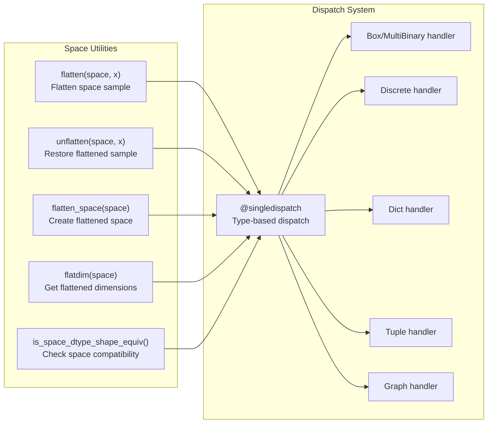
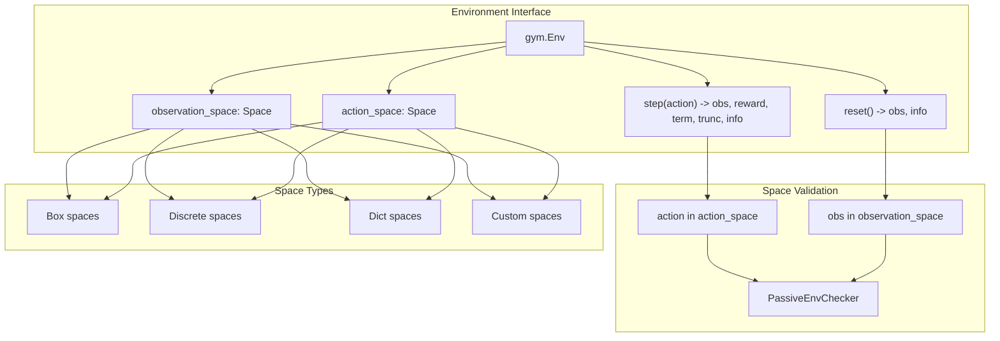

<!-- source: DeepWiki mcp.deepwiki.com · repo Farama-Foundation/Gymnasium · page 3 Spaces · fetched 2026-10-14 -->

# Spaces

<details>
<summary>Relevant source files</summary>

The following files were used as context for generating this wiki page:

- [CONTRIBUTING.md](CONTRIBUTING.md)
- [docs/api/spaces.md](docs/api/spaces.md)
- [docs/api/spaces/composite.md](docs/api/spaces/composite.md)
- [gymnasium/spaces/__init__.py](gymnasium/spaces/__init__.py)
- [gymnasium/spaces/graph.py](gymnasium/spaces/graph.py)
- [gymnasium/spaces/multi_binary.py](gymnasium/spaces/multi_binary.py)
- [gymnasium/spaces/oneof.py](gymnasium/spaces/oneof.py)
- [gymnasium/spaces/sequence.py](gymnasium/spaces/sequence.py)
- [gymnasium/spaces/space.py](gymnasium/spaces/space.py)
- [gymnasium/spaces/tuple.py](gymnasium/spaces/tuple.py)

</details>


## Purpose and Scope

This document covers the Gymnasium spaces system, which provides a standardized way to define and work with observation and action spaces in reinforcement learning environments. Spaces define the valid format and structure of data that environments can produce as observations or accept as actions.

For information about how spaces are used in environment registration, see [Environment Registration](#4). For details on how to implement custom environments that use spaces, see [Env Class](#2.1).

## Space Fundamentals

The spaces system is built around the abstract `Space` base class, which provides the common interface for all space types. All spaces inherit from `Space[T]` where `T` is the type of values that belong to the space.

```mermaid
graph TD
    Space["Space[T]<br/>Base Abstract Class"]
    
    subgraph "Core Methods"
        sample["sample()"]
        contains["contains()"]
        seed["seed()"]
        is_np_flattenable["is_np_flattenable"]
    end
    
    subgraph "Primitive Spaces"
        Box["Box<br/>Continuous values"]
        Discrete["Discrete<br/>Finite integers"]
        MultiDiscrete["MultiDiscrete<br/>Multiple discrete"]
        MultiBinary["MultiBinary<br/>Binary vectors"]
        Text["Text<br/>String values"]
    end
    
    subgraph "Composite Spaces"
        Dict["Dict<br/>Named subspaces"]
        Tuple["Tuple<br/>Ordered subspaces"]
        Graph["Graph<br/>Node-edge structures"]
        Sequence["Sequence<br/>Variable length"]
        OneOf["OneOf<br/>Union of spaces"]
    end
    
    Space --> sample
    Space --> contains
    Space --> seed
    Space --> is_np_flattenable
    
    Space --> Box
    Space --> Discrete
    Space --> MultiDiscrete
    Space --> MultiBinary
    Space --> Text
    
    Space --> Dict
    Space --> Tuple
    Space --> Graph
    Space --> Sequence
    Space --> OneOf
```



Sources: [gymnasium/spaces/space.py:20-165]()

The `Space` class defines the fundamental interface that all spaces must implement:

| Method | Purpose | Returns |
|--------|---------|---------|
| `sample()` | Generate random sample from space | `T` |
| `contains(x)` | Check if `x` is valid member | `bool` |
| `seed(seed)` | Seed the space's RNG | `int \| list[int] \| dict[str, int]` |
| `is_np_flattenable` | Check if space can be flattened to numpy array | `bool` |

## Space Type Hierarchy

Gymnasium spaces are organized into two main categories: primitive spaces that represent basic data types, and composite spaces that combine multiple subspaces.

```mermaid
graph TB
    subgraph "Primitive Spaces"
        Box_impl["Box<br/>numpy arrays with bounds<br/>gymnasium/spaces/box.py"]
        Discrete_impl["Discrete<br/>single integer from finite set<br/>gymnasium/spaces/discrete.py"]
        MultiDiscrete_impl["MultiDiscrete<br/>multiple discrete values<br/>gymnasium/spaces/multi_discrete.py"]
        MultiBinary_impl["MultiBinary<br/>binary vectors<br/>gymnasium/spaces/multi_binary.py"]
        Text_impl["Text<br/>strings with charset<br/>gymnasium/spaces/text.py"]
    end
    
    subgraph "Composite Spaces"
        Dict_impl["Dict<br/>named subspaces<br/>gymnasium/spaces/dict.py"]
        Tuple_impl["Tuple<br/>ordered subspaces<br/>gymnasium/spaces/tuple.py"]
        Graph_impl["Graph<br/>nodes and edges<br/>gymnasium/spaces/graph.py"]
        Sequence_impl["Sequence<br/>variable length sequences<br/>gymnasium/spaces/sequence.py"]
        OneOf_impl["OneOf<br/>union of spaces<br/>gymnasium/spaces/oneof.py"]
    end
    
    subgraph "Space Utilities"
        utils["flatten()<br/>unflatten()<br/>flatten_space()<br/>gymnasium/spaces/utils.py"]
    end
    
    Box_impl --> utils
    Discrete_impl --> utils
    MultiDiscrete_impl --> utils
    Dict_impl --> utils
    Tuple_impl --> utils
```



Sources: [gymnasium/spaces/__init__.py:31-35](), [gymnasium/spaces/__init__.py:37-42]()

### Primitive Spaces

Primitive spaces represent basic data types. For details, see [Primitive Spaces](#3.1).

- **`Box`**: Represents continuous or discrete n-dimensional arrays with bounds. Supports both bounded and unbounded intervals.
- **`Discrete`**: Represents a finite set of integers `{start, start+1, ..., start+n-1}`.
- **`MultiDiscrete`**: Represents multiple discrete values, useful for multi-dimensional discrete action spaces.
- **`MultiBinary`**: Represents binary vectors where each element is 0 or 1.
- **`Text`**: Represents strings with a specified character set and length constraints.

Sources: [docs/api/spaces.md:51-57]()

### Composite Spaces

Composite spaces combine multiple subspaces. For details, see [Composite Spaces](#3.2).

- **`Dict`**: Maps string keys to subspaces, creating structured observations or actions.
- **`Tuple`**: Ordered sequence of subspaces, representing cartesian products.
- **`Graph`**: Represents graph structures with node and edge features.
- **`Sequence`**: Variable-length sequences of elements from a feature space.
- **`OneOf`**: Union type that can contain values from exactly one of several subspaces.

Sources: [docs/api/spaces.md:66-71]()

## Key Space Operations

### Sampling

All spaces support sampling via the `sample()` method, which can optionally accept `mask` or `probability` parameters for constrained sampling:

```python
# Basic sampling
action = action_space.sample()

# Masked sampling (binary mask)
action = action_space.sample(mask=np.array([1, 0, 1], dtype=np.int8))

# Probability sampling
action = action_space.sample(probability=np.array([0.5, 0.3, 0.2], dtype=np.float64))
```

Sources: [gymnasium/spaces/space.py:94-108](), [gymnasium/spaces/multi_binary.py:72-134]()

### Containment Testing

The `contains()` method (accessible via `in` operator) checks if a value is a valid member of the space:

```python
observation = env.observation_space.sample()
assert observation in env.observation_space
```

Sources: [gymnasium/spaces/space.py:122-128]()

### Seeding

Spaces maintain their own pseudo-random number generators that can be seeded for reproducible sampling:

```python
# Seed with integer
space.seed(42)

# Seed composite spaces with dict/tuple
dict_space.seed({"key1": 123, "key2": 456})
tuple_space.seed([123, 456])
```

Sources: [gymnasium/spaces/space.py:110-120](), [gymnasium/spaces/tuple.py:56-95](), [gymnasium/spaces/graph.py:85-154](), [gymnasium/spaces/sequence.py:83-100](), [gymnasium/spaces/oneof.py:67-109]()

## Space Utilities

The `gymnasium.spaces.utils` module provides utilities for working with spaces, particularly for flattening and transforming space structures. For details, see [Space Utilities](#3.3).



Sources: [gymnasium/spaces/__init__.py:44-47]()

### Key Utility Functions

| Function | Purpose | Input | Output |
|----------|---------|--------|--------|
| `flatten(space, x)` | Convert space sample to flat array | Space and sample | Flattened representation |
| `unflatten(space, x)` | Restore sample from flat array | Space and flat array | Original sample structure |
| `flatten_space(space)` | Create flattened version of space | Space | Flattened space |
| `flatdim(space)` | Get dimensions of flattened space | Space | Integer dimension count |

### Flattening Examples

```python
# Flatten a Dict space sample
dict_space = Dict({"pos": Box(0, 1, (2,)), "vel": Discrete(3)})
sample = dict_space.sample()
flat_sample = flatten(dict_space, sample)  # numpy array

# Flatten the space itself
flat_space = flatten_space(dict_space)  # Box space
```

## Integration with Environments

Spaces are integral to the Gymnasium environment interface, defining the structure of observations and actions:



Sources: [gymnasium/spaces/space.py:20-44](), [gymnasium/core.py:100-200]()

Environments use spaces to:
- Define valid observation and action formats
- Validate inputs and outputs
- Enable automatic sampling for exploration
- Support space transformations via wrappers

The spaces system provides the foundation for type safety and data validation throughout the Gymnasium ecosystem, ensuring consistency between environments and algorithms.

---

