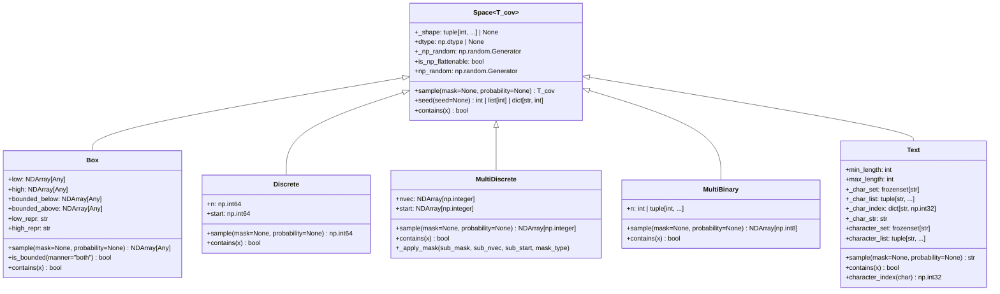
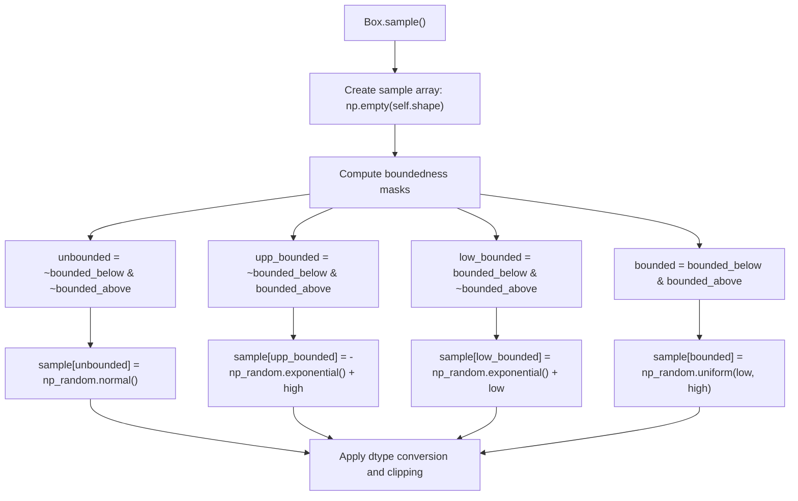
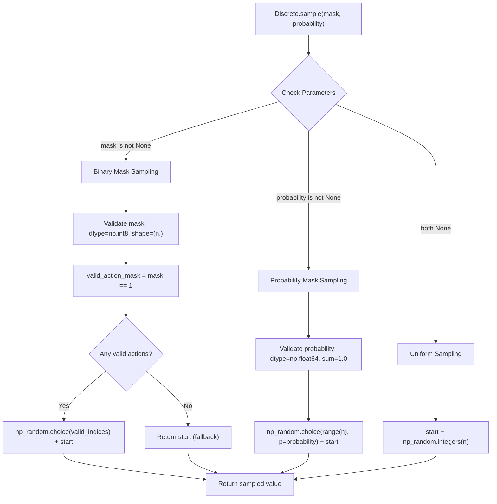
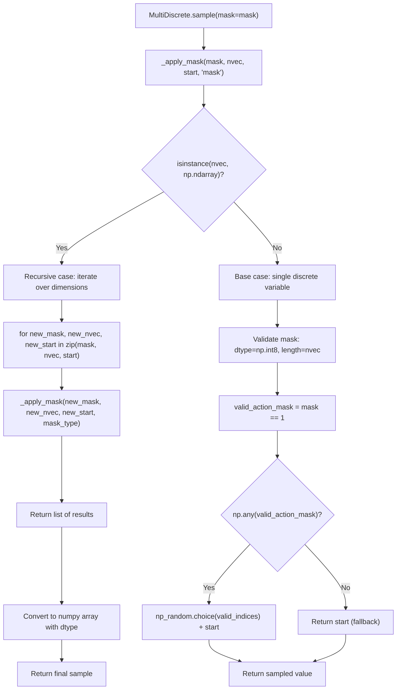
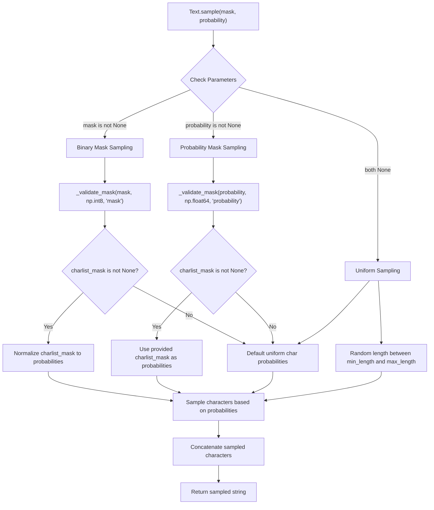
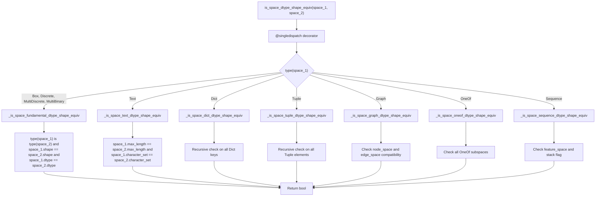
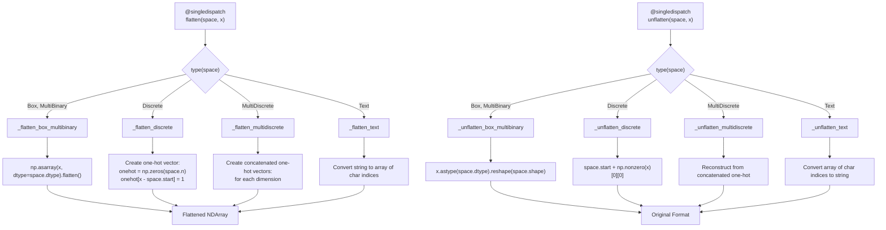

<!-- source: DeepWiki mcp.deepwiki.com · repo Farama-Foundation/Gymnasium · page 3.1 Primitive Spaces · fetched 2026-10-14 -->

# Primitive Spaces

<details>
<summary>Relevant source files</summary>

The following files were used as context for generating this wiki page:

- [gymnasium/spaces/box.py](gymnasium/spaces/box.py)
- [gymnasium/spaces/discrete.py](gymnasium/spaces/discrete.py)
- [gymnasium/spaces/multi_discrete.py](gymnasium/spaces/multi_discrete.py)
- [gymnasium/spaces/text.py](gymnasium/spaces/text.py)
- [tests/spaces/test_box.py](tests/spaces/test_box.py)
- [tests/spaces/test_discrete.py](tests/spaces/test_discrete.py)
- [tests/spaces/test_multidiscrete.py](tests/spaces/test_multidiscrete.py)
- [tests/spaces/test_text.py](tests/spaces/test_text.py)
- [tests/wrappers/vector/test_vector_wrappers.py](tests/wrappers/vector/test_vector_wrappers.py)

</details>


This page documents the primitive space types in Gymnasium, which represent fundamental data formats for observations and actions in reinforcement learning environments. Primitive spaces are the building blocks from which more complex spaces can be constructed. For information about composite spaces like Dict, Tuple, and Graph, see [Composite Spaces](#3.2).

## Space Base Class

All spaces in Gymnasium inherit from the abstract `Space` class, which defines the common interface and functionality that all spaces must implement.

**Primitive Space Class Hierarchy**



Sources:
- [gymnasium/spaces/space.py:20-164]()
- [gymnasium/spaces/box.py:37-476]()
- [gymnasium/spaces/discrete.py:13-187]()
- [gymnasium/spaces/multi_discrete.py:16-281]()
- [gymnasium/spaces/text.py:17-250]()

### Key Properties and Methods

The `Space` base class has several key properties and methods:

- **shape**: The shape of samples from the space (if applicable)
- **dtype**: The data type of samples from the space
- **sample(mask=None, probability=None)**: Generate a random sample from the space
- **contains(x)** or **x in space**: Check if a value is a valid member of the space
- **seed(seed=None)**: Seed the random number generator for reproducible sampling
- **is_np_flattenable**: Whether the space can be flattened to a Box space

## Box Space

The `Box` class represents a continuous n-dimensional box in ℝⁿ, defined by lower and upper bounds for each dimension. It's the most common space for continuous observations and actions.

### Constructor and Properties

The `Box.__init__` method accepts the following parameters:
- `low`: Lower bounds (scalar or array) [gymnasium/spaces/box.py:99-130]()
- `high`: Upper bounds (scalar or array) [gymnasium/spaces/box.py:99-130]()
- `shape`: Optional shape specification [gymnasium/spaces/box.py:99-130]()
- `dtype`: Element data type (defaults to `np.float32`) [gymnasium/spaces/box.py:99-130]()
- `seed`: Optional random seed [gymnasium/spaces/box.py:99-130]()

### Key Attributes

- **`low`**: `NDArray[Any]` - Lower bounds after processing [gymnasium/spaces/box.py:87]()
- **`high`**: `NDArray[Any]` - Upper bounds after processing [gymnasium/spaces/box.py:88]()
- **`bounded_below`**: `NDArray[np.bool_]` - Boolean array indicating finite lower bounds [gymnasium/spaces/box.py:90]()
- **`bounded_above`**: `NDArray[np.bool_]` - Boolean array indicating finite upper bounds [gymnasium/spaces/box.py:91]()
- **`low_repr`**: `str | None` - String representation of bounds for `__repr__` [gymnasium/spaces/box.py:93]()
- **`high_repr`**: `str | None` - String representation of bounds for `__repr__` [gymnasium/spaces/box.py:94]()

### Usage Examples

```python
# Scalar bounds with explicit shape
Box(low=-1.0, high=2.0, shape=(3, 4), dtype=np.float32)

# Array bounds (shape inferred)
Box(low=np.array([-1.0, -2.0]), high=np.array([2.0, 4.0]), dtype=np.float32)

# Unbounded dimensions using infinity
Box(low=-np.inf, high=np.inf, shape=(2,))

# Mixed bounded/unbounded
Box(low=np.array([-np.inf, 0.0]), high=np.array([1.0, np.inf]))
```

### Sampling Algorithm

The `Box.sample()` method uses vectorized sampling based on boundedness patterns:

**Box Sampling Strategy by Interval Type**



The implementation creates boolean masks for each interval type and applies vectorized sampling:
- **`[a, b]`**: `np_random.uniform(low, high)`
- **`[a, ∞)`**: `np_random.exponential() + low`
- **`(-∞, b]`**: `-np_random.exponential() + high`
- **`(-∞, ∞)`**: `np_random.normal()`

Sources:
- [gymnasium/spaces/box.py:346-419]()

## Discrete Space

The `Discrete` class represents a finite set of integers {start, start+1, ..., start+n-1}. By default, this is {0, 1, ..., n-1}.

### Constructor Parameters

- **`n`**: `int | np.integer[Any]` - Number of discrete values (must be positive) [gymnasium/spaces/discrete.py:58-87]()
- **`start`**: `int | np.integer[Any]` - Starting value (default is 0) [gymnasium/spaces/discrete.py:58-87]()
- **`seed`**: Optional random seed [gymnasium/spaces/discrete.py:58-87]()
- **`dtype`**: The space type, for example, `int`, `np.int64`, `np.int32`, or `np.uint8`. [gymnasium/spaces/discrete.py:58-87]()

### Key Attributes

- **`n`**: `_IntegerT_co` - Number of values in the space [gymnasium/spaces/discrete.py:52]()
- **`start`**: `_IntegerT_co` - Starting value of the range [gymnasium/spaces/discrete.py:53]()
- **`shape`**: `()` - Always empty tuple (scalar space) [gymnasium/spaces/discrete.py:120]()
- **`dtype`**: `np.dtype[_IntegerT_co]` - Fixed data type [gymnasium/spaces/discrete.py:51]()

### Usage Examples

```python
# Standard discrete space {0, 1, 2, 3, 4}
Discrete(5)

# Offset discrete space {-1, 0, 1}
Discrete(3, start=-1)

# With seeding for reproducible sampling
Discrete(10, seed=42)
```

### Sampling with Masks and Probabilities

The `Discrete.sample()` method supports three modes of operation:

**Discrete Sampling Flow**



### Implementation Details

1. **Binary Mask Sampling**: Uses `np.int8` arrays where `1` = valid, `0` = invalid [gymnasium/spaces/discrete.py:154-171]()
2. **Probability Mask Sampling**: Uses `np.float64` arrays that sum to 1.0 [gymnasium/spaces/discrete.py:172-200]()
3. **Uniform Sampling**: Default behavior with `np_random.integers(n)` [gymnasium/spaces/discrete.py:202-203]()

Both mask types are validated for correct dtype, shape, and value ranges.

Sources:
- [gymnasium/spaces/discrete.py:66-133]()
- [gymnasium/spaces/discrete.py:145-203]()
- [tests/spaces/test_discrete.py:31-55]()

## MultiDiscrete Space

The `MultiDiscrete` class represents the Cartesian product of multiple `Discrete` spaces. It's commonly used for multi-dimensional discrete action spaces like game controllers.

### Constructor Parameters

- **`nvec`**: `NDArray[np.integer[Any]] | list[int]` - Counts for each categorical variable [gymnasium/spaces/multi_discrete.py:64-91]()
- **`dtype`**: `str | type[np.integer[Any]]` - Integer dtype (default: `np.int64`) [gymnasium/spaces/multi_discrete.py:64-91]()
- **`seed`**: Optional random seed [gymnasium/spaces/multi_discrete.py:64-91]()
- **`start`**: `NDArray[np.integer[Any]] | list[int] | None` - Starting values (default: all zeros) [gymnasium/spaces/multi_discrete.py:64-91]()

### Key Attributes

- **`nvec`**: `NDArray[_IntegerT_co]` - Count array with shape information [gymnasium/spaces/multi_discrete.py:59]()
- **`start`**: `NDArray[_IntegerT_co]` - Starting value array (same shape as `nvec`) [gymnasium/spaces/multi_discrete.py:60]()
- **`shape`**: `tuple[int, ...]` - Shape of the multi-discrete space [gymnasium/spaces/multi_discrete.py:136]()
- **`dtype`**: `np.dtype[_IntegerT_co]` - Integer dtype for all elements [gymnasium/spaces/multi_discrete.py:58]()

### Usage Examples

```python
# Game controller: arrow keys (5 values), button A (2 values), button B (2 values)
MultiDiscrete([5, 2, 2])

# Custom starting values
MultiDiscrete([2, 3, 4], start=[10, 20, 30])

# 2D grid of discrete variables
MultiDiscrete([[2, 3], [4, 5]])
```

### Multi-Dimensional Support and Sampling

The `MultiDiscrete` class supports multi-dimensional `nvec` arrays and implements recursive mask application through `_apply_mask()`:

**MultiDiscrete Sampling with Masks**



### Multi-Dimensional Example

For `MultiDiscrete([[2,3],[4,5]])`:
- Position `[0,0]`: Range `{0,1}` (2 values)
- Position `[0,1]`: Range `{0,1,2}` (3 values)  
- Position `[1,0]`: Range `{0,1,2,3}` (4 values)
- Position `[1,1]`: Range `{0,1,2,3,4}` (5 values)

Sources:
- [gymnasium/spaces/multi_discrete.py:136-200]()
- [tests/spaces/test_multidiscrete.py:10-60]()

## MultiBinary Space

The `MultiBinary` class represents a binary array where each element is either 0 or 1. It's commonly used for multi-binary action spaces or binary observation vectors.

### Constructor Parameters

- **`n`**: `int | tuple[int, ...]` - Shape specification for the binary array [gymnasium/spaces/multi_binary.py:40-41]()
- **`seed`**: Optional random seed [gymnasium/spaces/multi_binary.py:40-41]()

### Key Attributes

- **`n`**: `int | tuple[int, ...]` - Shape specification [gymnasium/spaces/multi_binary.py:49]()
- **`shape`**: `tuple[int, ...]` - Computed shape tuple [gymnasium/spaces/multi_binary.py:50]()
- **`dtype`**: `np.int8` - Fixed binary data type [gymnasium/spaces/multi_binary.py:48]()

### Usage Examples

```python
# 1D binary array of length 5
MultiBinary(5)

# 2D binary array with shape (2, 3)  
MultiBinary([2, 3])

# Multi-dimensional binary space
MultiBinary((4, 3, 2))
```

### Sampling with Masks

The `MultiBinary.sample()` method supports mask-based sampling with a 3-value mask system:

**MultiBinary Mask Values**

| Mask Value | Behavior |
|------------|----------|
| `0` | Force element to be `0` |
| `1` | Force element to be `1` |
| `2` | Random (50% chance of 0 or 1) |

```python
# Control specific elements
mask = np.array([0, 1, 2, 0, 1], dtype=np.int8)
sample = space.sample(mask=mask)  # Result: [0, 1, random, 0, 1]
```

Default sampling (no mask) uses `np_random.integers(2)` for each element.

Sources:
- [gymnasium/spaces/multi_binary.py:62-135]()

## Text Space

The `Text` class represents a string comprised of characters from a given character set. It allows for variable-length strings within specified minimum and maximum lengths.

### Constructor Parameters

- **`max_length`**: `int` - Maximum text length (in characters). [gymnasium/spaces/text.py:35-40]()
- **`min_length`**: `int` - Minimum text length (in characters). Defaults to 1. [gymnasium/spaces/text.py:35-40]()
- **`charset`**: `frozenset[str] | str` - Character set to draw from. Defaults to alphanumeric characters. [gymnasium/spaces/text.py:35-40]()
- **`seed`**: Optional random seed. [gymnasium/spaces/text.py:35-40]()

### Key Attributes

- **`min_length`**: `int` - Minimum text length. [gymnasium/spaces/text.py:72]()
- **`max_length`**: `int` - Maximum text length. [gymnasium/spaces/text.py:73]()
- **`_char_set`**: `frozenset[str]` - The character set as a frozenset. [gymnasium/spaces/text.py:93]()
- **`_char_list`**: `tuple[str, ...]` - The character set as a sorted tuple. [gymnasium/spaces/text.py:94]()
- **`_char_index`**: `dict[str, np.int32]` - Mapping from character to its index in `_char_list`. [gymnasium/spaces/text.py:95-97]()
- **`_char_str`**: `str` - The character set as a sorted string. [gymnasium/spaces/text.py:98]()
- **`character_set`**: `frozenset[str]` - Public accessor for `_char_set`. [gymnasium/spaces/text.py:190]()
- **`character_list`**: `tuple[str, ...]` - Public accessor for `_char_list`. [gymnasium/spaces/text.py:194]()
- **`character_index(char)`**: Returns the index of a character. [gymnasium/spaces/text.py:198]()

### Usage Examples

```python
# Text space with max length 5, default alphanumeric charset
Text(5)

# Text space with min length 1, max length 10, and only digits
import string
Text(min_length=1, max_length=10, charset=string.digits)
```

### Sampling with Masks and Probabilities

The `Text.sample()` method allows for specifying the length and character distribution using masks or probabilities.

**Text Sampling Flow**



### Implementation Details

1. **Character Set Handling**: `charset` can be a `frozenset` (sorted internally for consistency) or a `str` (order preserved). [gymnasium/spaces/text.py:75-98]()
2. **Mask/Probability Structure**: Both `mask` and `probability` are tuples `(length, charlist_mask)`. `length` can be `None` to sample randomly within `min_length` and `max_length`. `charlist_mask` is an `np.ndarray` of the same length as the character set. [gymnasium/spaces/text.py:104-121]()
3. **Empty String Handling**: If `min_length` is 0 and the character mask is all zeros, an empty string can be sampled. [tests/spaces/test_text.py:33-38]()

Sources:
- [gymnasium/spaces/text.py:33-101]()
- [gymnasium/spaces/text.py:103-188]()
- [tests/spaces/test_text.py:12-83]()
- [tests/spaces/test_text.py:86-95]()
- [tests/spaces/test_text.py:97-128]()

## Common Operations

### Checking if Values are Valid

All spaces implement the `contains` method and support the `in` operator:

```python
box_space = Box(0, 1, shape=(2,))
value = np.array([0.5, 0.7])
if value in box_space:
    print("Value is valid")
```

Sources:
- [tests/spaces/test_discrete.py:143-165]()
- [tests/spaces/test_discrete.py:170-183]()
- [tests/spaces/test_discrete.py:188-203]()
- [tests/spaces/test_multidiscrete.py:174-200]()

### Seeding for Reproducibility

All spaces can be seeded for reproducible sampling:

```python
space.seed(42)  # Seed with a fixed value
samples = [space.sample() for _ in range(5)]  # Will be the same every time
```

Sources:
- [tests/spaces/test_multidiscrete.py:86-110]()
- [tests/spaces/test_multidiscrete.py:113-139]()
- [tests/spaces/test_text.py:129-152]()

### Space Compatibility Checking in Vector Environments

The `is_space_dtype_shape_equiv` function uses single dispatch to check space compatibility for vector environments:

**Space Compatibility Checking Flow**



### Implementation Details

For primitive spaces, the function registered at `_is_space_fundamental_dtype_shape_equiv` checks:
1. **Type equality**: `type(space_1) is type(space_2)`
2. **Shape equality**: `space_1.shape == space_2.shape`  
3. **Dtype equality**: `space_1.dtype == space_2.dtype`

Sources:
- [gymnasium/spaces/utils.py:574-671]()
- [tests/wrappers/vector/test_vector_wrappers.py:99-107]()

## Space Conversions and Utilities

All primitive spaces implement the flattening protocol through single dispatch functions in `gymnasium.spaces.utils`:

**Space Flattening System**



### Flattening Behavior by Space Type

| Space Type | Flattening Method | `flatdim()` Result |
|------------|-------------------|-------------------|
| **Box** | `x.flatten()` | `np.prod(space.shape)` |
| **Discrete** | One-hot encoding | `space.n` |
| **MultiDiscrete** | Concatenated one-hot | `np.sum(space.nvec)` |
| **MultiBinary** | `x.flatten()` | `np.prod(space.shape)` |
| **Text** | Array of character indices | `space.max_length` |

### Implementation Functions

- **`flatdim(space)`**: Returns dimensionality of flattened space
- **`flatten(space, x)`**: Converts sample to flat array
- **`unflatten(space, x)`**: Reconstructs original sample format
- **`flatten_space(space)`**: Creates equivalent flattened space

Sources:
- [gymnasium/spaces/utils.py:33-111]()
- [gymnasium/spaces/utils.py:116-276]()
- [gymnasium/spaces/utils.py:278-427]()
- [gymnasium/spaces/utils.py:430-571]()

## Sampling Distribution Properties

All primitive spaces implement sampling distributions that have been verified to produce samples with the expected statistical properties:

- **Box**: Uniform distribution for bounded dimensions, exponential/normal for unbounded
- **Discrete**: Uniform distribution over all values
- **MultiDiscrete**: Independent uniform distributions for each variable
- **MultiBinary**: Independent Bernoulli (coin flip) for each element
- **Text**: Uniform distribution over characters in the charset and lengths between `min_length` and `max_length`.

The sampling distributions are tested for statistical properties in the test suite.

Sources:
- [tests/spaces/test_spaces.py:73-206]()
- [tests/spaces/test_spaces.py:351-503]()

---

