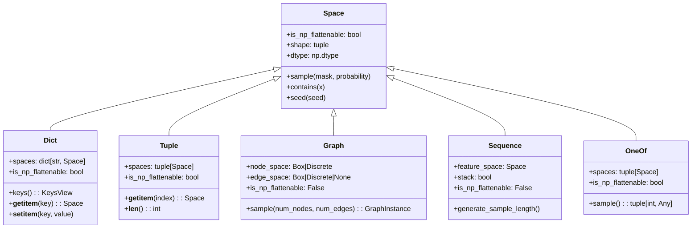
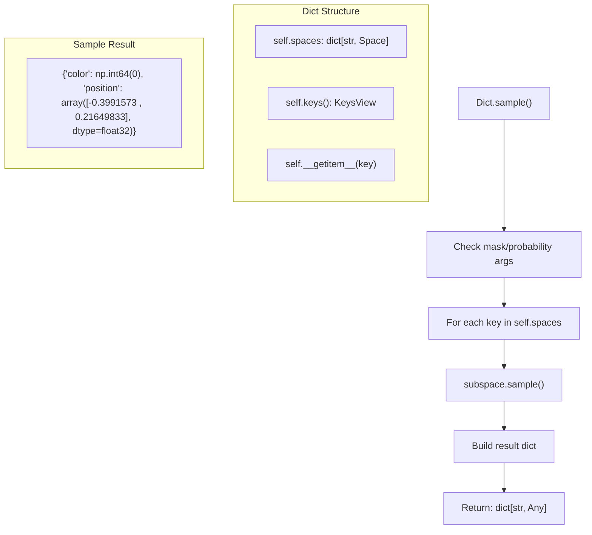
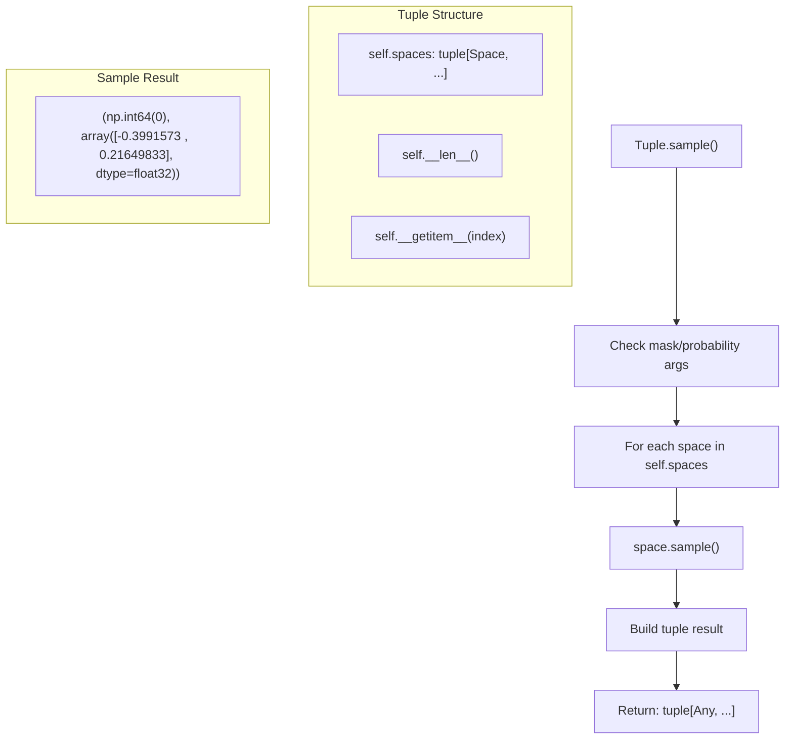
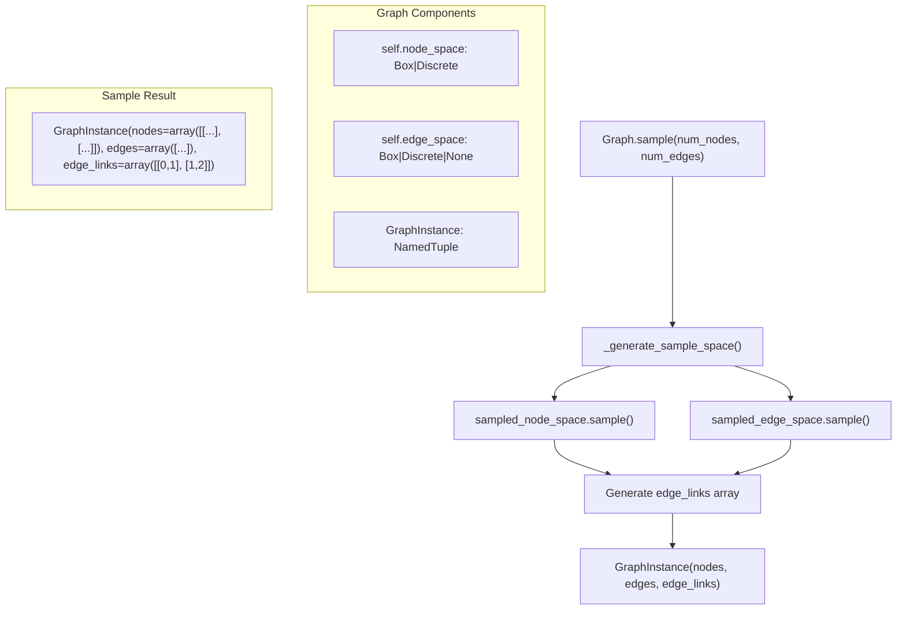
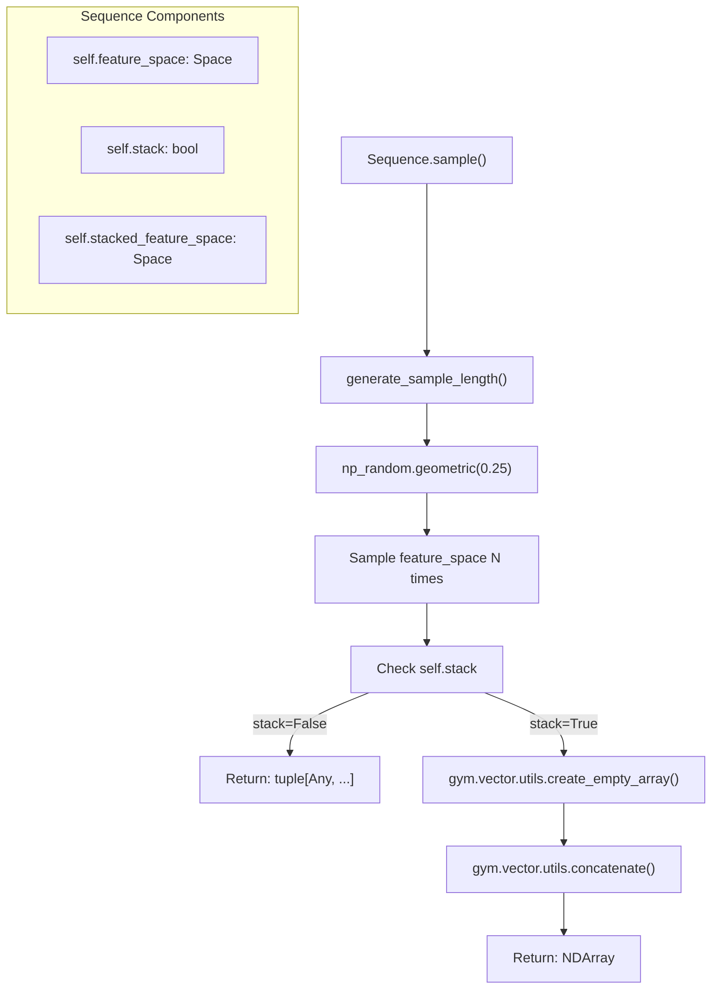
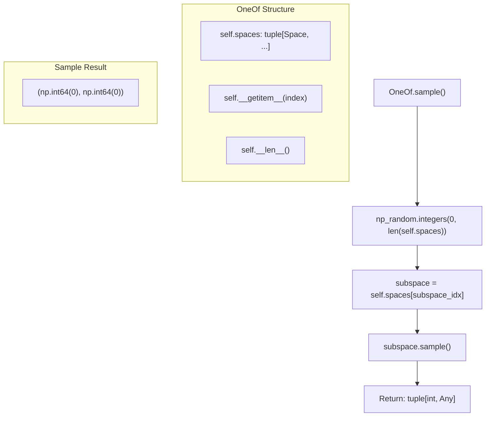
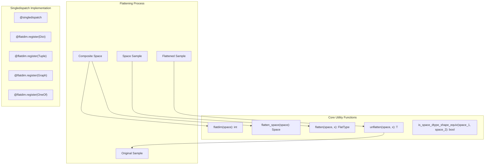

<!-- source: DeepWiki mcp.deepwiki.com · repo Farama-Foundation/Gymnasium · page 3.2 Composite Spaces · fetched 2026-10-14 -->

# Composite Spaces

<details>
<summary>Relevant source files</summary>

The following files were used as context for generating this wiki page:

- [gymnasium/spaces/dict.py](gymnasium/spaces/dict.py)
- [gymnasium/spaces/graph.py](gymnasium/spaces/graph.py)
- [gymnasium/spaces/multi_binary.py](gymnasium/spaces/multi_binary.py)
- [gymnasium/spaces/oneof.py](gymnasium/spaces/oneof.py)
- [gymnasium/spaces/sequence.py](gymnasium/spaces/sequence.py)
- [gymnasium/spaces/space.py](gymnasium/spaces/space.py)
- [gymnasium/spaces/tuple.py](gymnasium/spaces/tuple.py)
- [tests/spaces/test_dict.py](tests/spaces/test_dict.py)
- [tests/spaces/test_oneof.py](tests/spaces/test_oneof.py)
- [tests/spaces/test_tuple.py](tests/spaces/test_tuple.py)
- [tests/vector/utils/test_space_utils.py](tests/vector/utils/test_space_utils.py)

</details>


This page documents the composite spaces available in Gymnasium, which are containers that can hold and organize other spaces. Composite spaces allow for the creation of structured observation and action spaces by composing together primitive spaces (see [Primitive Spaces](#3.1)) and other composite spaces. They are essential for representing complex environments where observations or actions have multiple components with different shapes and types.

## Overview of Composite Spaces

Gymnasium provides several composite space types, each with different characteristics for organizing and representing structured data:



Sources: [gymnasium/spaces/space.py:18-165](), [gymnasium/spaces/dict.py:25-290](), [gymnasium/spaces/tuple.py:16-204](), [gymnasium/spaces/graph.py:29-339](), [gymnasium/spaces/sequence.py:15-231](), [gymnasium/spaces/oneof.py:15-202]()

## Dict Space

The `Dict` space represents a dictionary mapping from keys to spaces. It is useful for environments where observations or actions have named components with different structures.

### Key Features

- Elements are dictionaries with keys corresponding to the defined spaces [gymnasium/spaces/dict.py:30-31]()
- Supports dictionary-like operations (keys, items, etc.) [gymnasium/spaces/dict.py:29]()
- Can be initialized with a dictionary, OrderedDict, sequence of (key, space) tuples, or keyword arguments [gymnasium/spaces/dict.py:71-79]()
- Returns a dictionary when sampled, with each value sampled from its corresponding space [gymnasium/spaces/dict.py:203-230]()

### Example

```python
from gymnasium.spaces import Dict, Box, Discrete

# Create a Dict space representing a robot state
observation_space = Dict({
    'position': Box(-1, 1, shape=(2,)),    # x,y coordinates
    'velocity': Box(-2, 2, shape=(2,)),    # velocity vector 
    'sensor_data': Box(0, 100, shape=(10,)), 
    'camera': Box(0, 255, shape=(64, 64, 3), dtype=np.uint8),
    'status': Discrete(4)  # Operational state
})

# Sample from the space
sample = observation_space.sample()
# Returns a dictionary with keys 'position', 'velocity', etc.
```

### Dict.sample() Method Flow



Sources: [gymnasium/spaces/dict.py:203-230](), [gymnasium/spaces/dict.py:67-68]()

## Tuple Space

The `Tuple` space represents an ordered collection of spaces. It is similar to `Dict` but uses indices instead of keys.

### Key Features

- Elements are tuples of elements from constituent spaces [gymnasium/spaces/tuple.py:20-21]()
- Implements sequence-like operations (length, indexing, etc.) [gymnasium/spaces/tuple.py:16]()
- The length of samples is always equal to the number of spaces in the tuple [gymnasium/spaces/tuple.py:154-155]()
- Each element in the sample is from the corresponding space in the tuple [gymnasium/spaces/tuple.py:128-130]()

### Example

```python
from gymnasium.spaces import Tuple, Box, Discrete

# Create a Tuple space for a robot arm
action_space = Tuple((
    Box(-1, 1, shape=(3,)),  # Movement vector
    Discrete(4),             # Gripper action
    Box(0, 1, shape=(2,))    # Additional parameters
))

# Sample from the space
sample = action_space.sample()
# Returns a tuple with 3 elements, e.g., (array([0.1, -0.7, 0.5]), 2, array([0.8, 0.2]))
```

### Tuple.sample() Method Flow



Sources: [gymnasium/spaces/tuple.py:97-147](), [gymnasium/spaces/tuple.py:28]()

## Graph Space

The `Graph` space represents graph structures with nodes and optionally edges. It's suitable for environments where observations or actions involve graph-structured data, such as molecular structures, social networks, or maps.

### Key Features

- Represents a collection of nodes with optional edges connecting them [gymnasium/spaces/graph.py:30-31]()
- Nodes are represented with features from a `Box` or `Discrete` space [gymnasium/spaces/graph.py:49]()
- Edges can optionally be represented with features from a `Box` or `Discrete` space [gymnasium/spaces/graph.py:50]()
- Returns a `GraphInstance` namedtuple with node features, edge features, and edge connections [gymnasium/spaces/graph.py:29]()
- Allows specifying the number of nodes and edges when sampling [gymnasium/spaces/graph.py:155-161]()

### Example

```python
from gymnasium.spaces import Graph, Box, Discrete

# Create a Graph space for a molecular structure
observation_space = Graph(
    node_space=Box(-1, 1, shape=(3,)),  # 3D atom features
    edge_space=Discrete(4)               # Bond types
)

# Sample with 5 nodes (atoms) and 8 edges (bonds)
sample = observation_space.sample(num_nodes=5, num_edges=8)
# Returns a GraphInstance with nodes, edges, and edge_links
```

### Graph.sample() Method Flow



Sources: [gymnasium/spaces/graph.py:155-269](), [gymnasium/spaces/graph.py:18-27](), [gymnasium/spaces/graph.py:69-70]()

## Sequence Space

The `Sequence` space represents variable-length sequences of elements from a single space. It's useful for environments where observations or actions can have varying lengths, such as text generation or trajectory planning.

### Key Features

- Represents sequences of variable length [gymnasium/spaces/sequence.py:15-16]()
- All elements in the sequence must be from the same space [gymnasium/spaces/sequence.py:50]()
- By default, sampling returns a tuple of elements from the feature space [gymnasium/spaces/sequence.py:147]()
- When `stack=True`, sampling returns a stacked array of elements [gymnasium/spaces/sequence.py:150-155]()
- Can specify a length mask or probability when sampling to control sequence length [gymnasium/spaces/sequence.py:115-125]()

### Example

```python
from gymnasium.spaces import Sequence, Box

# Create a Sequence space for variable-length trajectories
observation_space = Sequence(
    Box(-1, 1, shape=(2,)),  # Each point is a 2D coordinate
    stack=True               # Return as stacked array
)

# Sample from the space (length is random)
sample = observation_space.sample()
# With stack=True: Returns array of shape (n, 2)
# With stack=False: Returns tuple of n arrays of shape (2,)
```

### Sequence.sample() Method Flow



Sources: [gymnasium/spaces/sequence.py:107-157](), [gymnasium/spaces/sequence.py:37-38](), [gymnasium/spaces/sequence.py:60-63]()

## OneOf Space

The `OneOf` space represents a union of spaces, where an element belongs to exactly one of the constituent spaces. It's useful for environments where different types of actions or observations are possible but only one is used at a time.

### Key Features

- Elements are tuples of the form `(space_index, value)` [gymnasium/spaces/oneof.py:15]()
- `space_index` indicates which space was used [gymnasium/spaces/oneof.py:129]()
- `value` is a sample from the space at `space_index` [gymnasium/spaces/oneof.py:144-156]()
- Allows representing heterogeneous types where only one is used at a time [gymnasium/spaces/oneof.py:17-18]()
- Can be used for environments with multiple action modes [gymnasium/spaces/oneof.py:17-18]()

### Example

```python
from gymnasium.spaces import OneOf, Discrete, Box

# Create a OneOf space for a multi-modal agent
action_space = OneOf([
    Discrete(4),                # Discrete actions (e.g., move direction)
    Box(-1, 1, shape=(2,)),     # Continuous control (e.g., velocity vector)
    Box(0, 1, shape=(5,))       # Parameter space (e.g., options configuration)
])

# Sample from the space
sample = action_space.sample()
# Returns a tuple like (0, 2) or (1, array([0.5, -0.3])) or (2, array([0.1, 0.2, 0.7, 0.4, 0.3]))
```

### OneOf.sample() Method Flow



Sources: [gymnasium/spaces/oneof.py:111-158](), [gymnasium/spaces/oneof.py:35-36]()

## Working with Composite Spaces

### Space Utility Functions

The `gymnasium.spaces.utils` module provides functions for working with composite spaces, particularly for flattening and unflattening operations.



**Flattening behavior by space type:**

| Space Type | `flatdim()` | `flatten()` | `is_np_flattenable` |
|------------|-------------|-------------|---------------------|
| Dict       | `sum(flatdim(s) for s in spaces.values())` | `np.concatenate()` if flattenable | `all(space.is_np_flattenable for space in spaces.values())` [gymnasium/spaces/dict.py:137-139]() |
| Tuple      | `sum(flatdim(s) for s in spaces)` | `np.concatenate()` if flattenable | `all(space.is_np_flattenable for space in spaces)` [gymnasium/spaces/tuple.py:52-54]() |
| Graph      | Raises `ValueError` | Returns `GraphInstance` | `False` [gymnasium/spaces/graph.py:80-82]() |
| Sequence   | Not supported | Returns tuple or stacked array | `False` [gymnasium/spaces/sequence.py:103-105]() |
| OneOf      | `1 + max(flatdim(s) for s in spaces)` | Array with index and padded sample | `all(space.is_np_flattenable for space in spaces)` [gymnasium/spaces/oneof.py:63-65]() |

Sources: [gymnasium/spaces/dict.py:137-139](), [gymnasium/spaces/tuple.py:52-54](), [gymnasium/spaces/graph.py:80-82](), [gymnasium/spaces/sequence.py:103-105](), [gymnasium/spaces/oneof.py:63-65]()

### Working with Utility Functions

The utility functions use Python's `singledispatch` decorator to provide type-specific implementations:

```python
from gymnasium.spaces.utils import flatdim, flatten, unflatten, flatten_space

# Get the flattened dimension count for a space
dim_count = flatdim(space)  # Returns int

# Flatten a sample from a composite space for neural networks
flat_sample = flatten(space, sample)  # Returns NDArray or nested structure

# Convert a flattened sample back to the original structure
original_sample = unflatten(space, flat_sample)  # Returns original type

# Get a flattened version of the space itself
flat_space = flatten_space(space)  # Returns Box or simplified space
```

**Key implementation details:**

- `flatdim()` raises `ValueError` for non-flattenable spaces like `Graph` and `Sequence`
- `flatten()` for `Dict` and `Tuple` concatenates subspace samples when `is_np_flattenable=True`
- `unflatten()` uses `np.split()` with cumulative dimensions to reconstruct samples
- `OneOf` flattening includes space index and pads shorter samples to maximum dimension

Sources: [gymnasium/spaces/space.py:93-95]()

### Nested Composite Spaces

Composite spaces can be nested to create complex hierarchical structures:

```python
from gymnasium.spaces import Dict, Tuple, Box, Discrete

# Create a complex nested space
nested_space = Dict({
    'agent': Dict({
        'position': Box(-10, 10, shape=(3,)),
        'inventory': Tuple((
            Discrete(10),  # Number of item 1
            Discrete(5)    # Number of item 2
        ))
    }),
    'world': Dict({
        'weather': Discrete(4),
        'time': Box(0, 24, shape=()),
        'objects': Sequence(Box(-1, 1, shape=(4,)))
    })
})
```

This flexibility allows for representing very complex observation and action spaces that can model real-world environments with hierarchical structure.

Sources: [gymnasium/spaces/dict.py:40-59](), [gymnasium/spaces/tuple.py:22-25]()

## Common Use Cases

### Structured Observations

Composite spaces are commonly used to create structured observations for environments:

```python
observation_space = Dict({
    'agent': Box(-1, 1, shape=(2,)),        # Agent position
    'target': Box(-1, 1, shape=(2,)),       # Target position
    'obstacles': Sequence(Box(-1, 1, shape=(2,))),  # Variable number of obstacles
    'remaining_time': Box(0, 100, shape=())  # Time remaining
})
```

### Multi-Modal Actions

They're also useful for environments with different action modes:

```python
action_space = OneOf([
    Discrete(4),                # Move in cardinal directions
    Box(-1, 1, shape=(2,)),     # Continuous movement
    Dict({                      # Complex action
        'target': Box(-1, 1, shape=(2,)),
        'force': Box(0, 100, shape=())
    })
])
```

### Graph-Based Environments

Graph spaces are ideal for environments involving network structures:

```python
observation_space = Graph(
    node_space=Dict({
        'position': Box(-1, 1, shape=(2,)),
        'type': Discrete(3)
    }),
    edge_space=Box(0, 1, shape=())  # Edge weights
)
```

By combining these composite spaces, Gymnasium enables the creation of environments with rich, structured observations and complex action spaces that can model a wide range of real-world scenarios.

---

