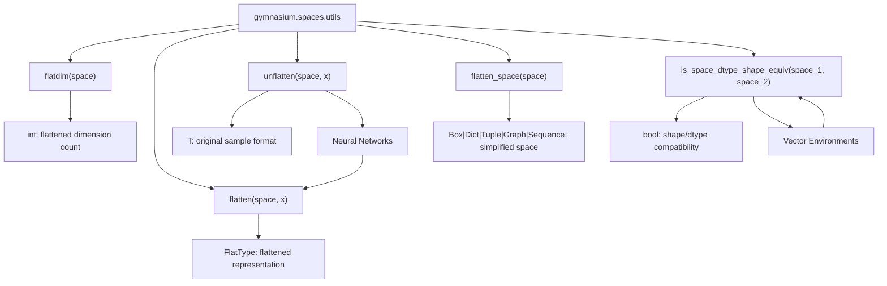
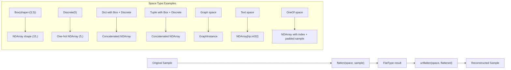
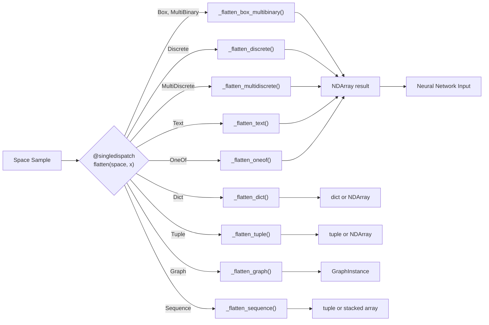
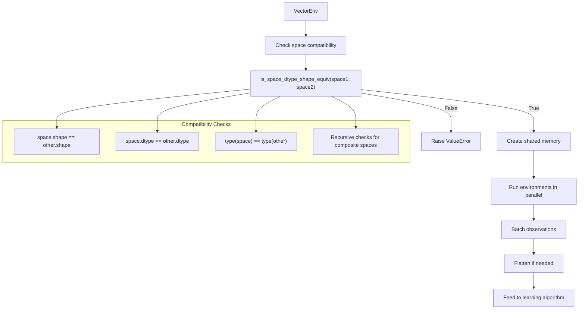
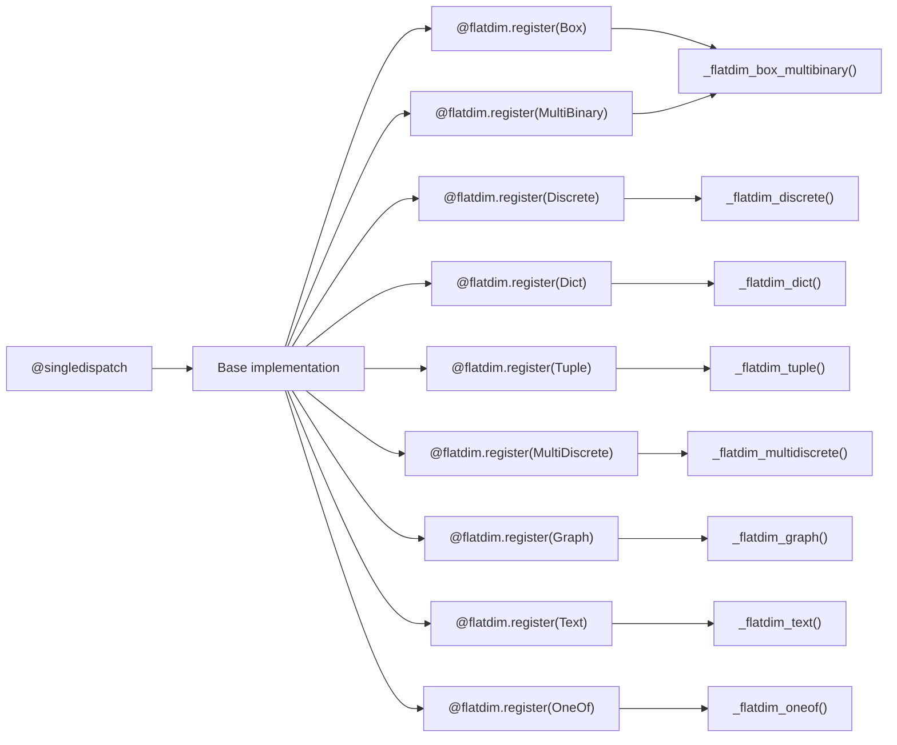

<!-- source: DeepWiki mcp.deepwiki.com · repo Farama-Foundation/Gymnasium · page 3.3 Space Utilities · fetched 2026-10-14 -->

# Space Utilities

<details>
<summary>Relevant source files</summary>

The following files were used as context for generating this wiki page:

- [docs/api/spaces/fundamental.md](docs/api/spaces/fundamental.md)
- [docs/api/spaces/utils.md](docs/api/spaces/utils.md)
- [gymnasium/spaces/utils.py](gymnasium/spaces/utils.py)
- [gymnasium/vector/utils/space_utils.py](gymnasium/vector/utils/space_utils.py)
- [gymnasium/wrappers/utils.py](gymnasium/wrappers/utils.py)
- [tests/spaces/test_spaces.py](tests/spaces/test_spaces.py)
- [tests/spaces/test_utils.py](tests/spaces/test_utils.py)
- [tests/spaces/utils.py](tests/spaces/utils.py)
- [tests/wrappers/test_flatten_observation.py](tests/wrappers/test_flatten_observation.py)

</details>


This page documents the utility functions in `gymnasium.spaces.utils` that operate on spaces. These utilities provide essential mechanisms for flattening and unflattening spaces and their samples, making them compatible with neural networks and other algorithms that require flat arrays of data. They are particularly useful for converting between structured observation/action spaces and the flat arrays that learning algorithms typically expect.

For information about the spaces themselves, see [Primitive Spaces](#3.1) and [Composite Spaces](#3.2).

## Space Utility Functions Overview

The `gymnasium.spaces.utils` module provides five main utility functions for working with spaces, all implemented using Python's `@singledispatch` mechanism to support different space types. These functions handle operations like flattening complex nested spaces, converting samples between formats, and checking space compatibility.

#### Main utility functions in gymnasium.spaces.utils


Sources:
- [gymnasium/spaces/utils.py:34-59]()
- [gymnasium/spaces/utils.py:101-109]()
- [gymnasium/spaces/utils.py:177-179]()
- [gymnasium/spaces/utils.py:278-295]()
- [gymnasium/spaces/utils.py:430-493]()
- [gymnasium/spaces/utils.py:574-593]()

## Core Functions

### flatdim

The `flatdim` function calculates the number of dimensions a flattened equivalent of a space would have. This is useful for determining the size of neural network input/output layers or allocating memory.

```python
# Example usage:
from gymnasium.spaces import Dict, Discrete
space = Dict({"position": Discrete(2), "velocity": Discrete(3)})
flatdim(space)  # Returns 5
```

The function uses `@singledispatch` to handle different space types. For spaces that cannot be flattened to a numpy array (such as `Graph` or `Sequence` spaces), `flatdim` raises a `ValueError` if `space.is_np_flattenable` is `False`.

#### flatdim implementations by space type
| Space Type | Implementation | Line Reference |
|------------|---------------|----------------|
| `Box`, `MultiBinary` | `reduce(op.mul, space.shape, 1)` | [gymnasium/spaces/utils.py:128-131]() |
| `Discrete` | `int(space.n)` | [gymnasium/spaces/utils.py:134-136]() |
| `MultiDiscrete` | `int(np.sum(space.nvec))` | [gymnasium/spaces/utils.py:139-141]() |
| `Tuple` | `sum(flatdim(s) for s in space.spaces)` | [gymnasium/spaces/utils.py:144-151]() |
| `Dict` | `sum(flatdim(s) for s in space.spaces.values())` | [gymnasium/spaces/utils.py:154-159]() |
| `Graph` | Raises `ValueError` | [gymnasium/spaces/utils.py:162-165]() |
| `Text` | `space.max_length` | [gymnasium/spaces/utils.py:168-170]() |
| `OneOf` | `1 + max(flatdim(s) for s in space.spaces)` | [gymnasium/spaces/utils.py:173-175]() |

Sources:
- [gymnasium/spaces/utils.py:101-109]()
- [gymnasium/spaces/utils.py:116-175]()

### flatten and unflatten

The `flatten` function converts a data point from a space into a flat representation, while `unflatten` performs the reverse operation. Both functions use `@singledispatch` to handle different space types.

#### flatten/unflatten data flow


#### flatten/unflatten implementations by space type
| Space Type | flatten returns | unflatten expects | Implementation |
|------------|-----------------|-------------------|----------------|
| `Box`, `MultiBinary` | `NDArray` (flattened) | `NDArray` | [gymnasium/spaces/utils.py:202-205]() |
| `Discrete` | `NDArray` (one-hot) | `NDArray` | [gymnasium/spaces/utils.py:208-212]() |
| `MultiDiscrete` | `NDArray` (concatenated one-hot) | `NDArray` | [gymnasium/spaces/utils.py:215-224]() |
| `Tuple` | `NDArray` or `tuple` | `NDArray` or `tuple` | [gymnasium/spaces/utils.py:227-233]() |
| `Dict` | `NDArray` or `dict` | `NDArray` or `dict` | [gymnasium/spaces/utils.py:236-242]() |
| `Graph` | `GraphInstance` | `GraphInstance` | [gymnasium/spaces/utils.py:245-272]() |
| `Text` | `NDArray[np.int32]` | `NDArray[np.int32]` | [gymnasium/spaces/utils.py:275-282]() |
| `Sequence` | `tuple` or stacked array | `tuple` or stacked array | [gymnasium/spaces/utils.py:285-300]() |
| `OneOf` | `NDArray` | `NDArray` | [gymnasium/spaces/utils.py:303-316]() |

The return type depends on whether the space `is_np_flattenable`. For np-flattenable spaces, both functions work with numpy arrays. For non-np-flattenable spaces, they maintain the original structure.

Sources:
- [gymnasium/spaces/utils.py:177-179]()
- [gymnasium/spaces/utils.py:202-316]()
- [gymnasium/spaces/utils.py:319-427]()

### flatten_space

The `flatten_space` function converts a space to a simpler equivalent space, usually a `Box`, that can capture all possible samples from the original space when flattened. This is useful for converting complex spaces into formats that learning algorithms can handle.

```python
# Example:
from gymnasium.spaces import Box, Dict, Discrete
space = Dict({"position": Discrete(2), "velocity": Box(0, 1, shape=(2, 2))})
flat_space = flatten_space(space)  # Returns Box(0.0, 1.0, (6,), float64)
```

#### flatten_space implementations by space type
| Space Type | Returns | Implementation |
|------------|---------|----------------|
| `Box` | `Box` with flattened shape | [gymnasium/spaces/utils.py:496-498]() |
| `Discrete`, `MultiBinary`, `MultiDiscrete` | `Box` with one-hot bounds | [gymnasium/spaces/utils.py:501-505]() |
| `Tuple` | `Box` (if np-flattenable) or `Tuple` | [gymnasium/spaces/utils.py:508-517]() |
| `Dict` | `Box` (if np-flattenable) or `Dict` | [gymnasium/spaces/utils.py:520-531]() |
| `Graph` | `Graph` with flattened node/edge spaces | [gymnasium/spaces/utils.py:534-541]() |
| `Text` | `Box` with character indices | [gymnasium/spaces/utils.py:544-548]() |
| `Sequence` | `Sequence` with flattened feature space | [gymnasium/spaces/utils.py:551-553]() |
| `OneOf` | `Box` with padded bounds | [gymnasium/spaces/utils.py:556-571]() |

For spaces like `Graph` and `Sequence` that can't be fully flattened to a `Box`, `flatten_space` tries to flatten their subspaces while preserving the overall structure.

Sources:
- [gymnasium/spaces/utils.py:430-493]()
- [gymnasium/spaces/utils.py:496-571]()

### is_space_dtype_shape_equiv

The `is_space_dtype_shape_equiv` function checks whether two spaces share the same shape and dtype. This is critical for vector environments and space compatibility checks. It recursively compares composite spaces.

```python
# Example:
space1 = Box(0, 1, shape=(3, 4))
space2 = Box(-1, 2, shape=(3, 4))
is_space_dtype_shape_equiv(space1, space2)  # Returns True (same shape and dtype)
```

#### is_space_dtype_shape_equiv implementations by space type
| Space Type | Checks | Implementation |
|------------|--------|----------------|
| `Box`, `Discrete`, `MultiDiscrete`, `MultiBinary` | `type`, `shape`, `dtype` | [gymnasium/spaces/utils.py:595-605]() |
| `Text` | `type`, `max_length`, `character_set` | [gymnasium/spaces/utils.py:608-614]() |
| `Dict` | `type`, `keys`, recursive check on values | [gymnasium/spaces/utils.py:617-626]() |
| `Tuple` | `type`, `length`, recursive check on elements | [gymnasium/spaces/utils.py:629-633]() |
| `Graph` | `type`, `node_space`, `edge_space` equivalence | [gymnasium/spaces/utils.py:636-649]() |
| `OneOf` | `type`, `length`, recursive check on spaces | [gymnasium/spaces/utils.py:652-661]() |
| `Sequence` | `type`, `stack`, `feature_space` equivalence | [gymnasium/spaces/utils.py:664-670]() |

This function is primarily used by vector environments to ensure compatibility when batching observations and actions from multiple environment instances.

Sources:
- [gymnasium/spaces/utils.py:574-593]()
- [gymnasium/spaces/utils.py:595-670]()

## Flattening Process Details

The process of flattening and unflattening depends on the space type and uses `@singledispatch` to route to the appropriate implementation:

#### @singledispatch routing for flatten function


For spaces where `is_np_flattenable` is `True`, the result is a numpy array that can be fed directly to neural networks. Other spaces maintain some structure but flatten their components as much as possible.

#### Key flattening behaviors:
- **Box/MultiBinary**: `np.asarray(x, dtype=space.dtype).flatten()`
- **Discrete**: One-hot encoding: `onehot[x - space.start] = 1`
- **MultiDiscrete**: Concatenated one-hot arrays with computed offsets
- **Dict/Tuple**: Recursive flattening with concatenation if np-flattenable
- **Graph**: Special `GraphInstance` format preserving node/edge structure
- **Text**: Character indices: `space.character_index(val)` for each character
- **Sequence**: Handles both stacked and unstacked sequences
- **OneOf**: Index + padded sample format

Sources:
- [gymnasium/spaces/utils.py:177-179]()
- [gymnasium/spaces/utils.py:202-316]()
- [gymnasium/spaces/utils.py:319-427]()

## Space Compatibility and Vector Environments

Space utilities are crucial for vector environments, which run multiple environments in parallel. The `is_space_dtype_shape_equiv` function ensures that spaces are compatible for:

1. Shared memory arrays in parallel environments
2. Batching observations from multiple environments
3. Ensuring space consistency when using wrappers

#### Vector environment space compatibility flow


When working with vector environments, the space utilities ensure that observations from different environments can be properly batched and processed. The compatibility check is essential for creating shared memory arrays that can hold samples from all environments.

Sources:
- [gymnasium/spaces/utils.py:574-593]()
- [gymnasium/spaces/utils.py:595-670]()

## Example Use Cases

### Neural Network Preprocessing

One of the most common uses of space utilities is to preprocess observations for neural networks:

```python
# Convert complex observation spaces to flat arrays for neural networks
observation = env.observation_space.sample()
flat_obs = flatten(env.observation_space, observation)

# Feed to neural network
action_logits = model(flat_obs)

# Convert network output back to action space format
action = unflatten(env.action_space, action_logits)
```

### Space Conversion in Wrappers

Space utilities are frequently used in wrappers to convert between different space representations:

```python
# FlattenObservation wrapper logic
class FlattenObservation(ObservationWrapper):
    def __init__(self, env):
        super().__init__(env)
        self.observation_space = flatten_space(env.observation_space)
    
    def observation(self, observation):
        return flatten(self.env.observation_space, observation)
```

### Vector Environment Shared Memory

In vector environments, space utilities help create and manage shared memory:

```python
# Create shared memory for vector environments
shared_mem = create_shared_memory(space, n=num_envs)

# Write to shared memory
write_to_shared_memory(space, env_idx, sample, shared_mem)

# Read back from shared memory
batch_sample = read_from_shared_memory(space, shared_mem, n=num_envs)
```

Sources:
- [gymnasium/spaces/utils.py:149-160]()
- [gymnasium/vector/utils/space_utils.py:18-23]()
- [gymnasium/wrappers/utils.py:72-193]()
- [tests/wrappers/test_flatten_observation.py:14-31]()

## Space Utility Implementation Details

The space utilities use Python's `@singledispatch` mechanism to provide type-specific implementations for each space type. This allows the utilities to handle different space types appropriately while maintaining a consistent interface.

#### @singledispatch implementation structure


Each space type implements its own version of the utility functions, allowing for specialized handling that maintains the semantic meaning of the space. The pattern is consistent across all utility functions:

#### Function dispatch pattern
| Function | Base decorator | Implementation pattern |
|----------|---------------|----------------------|
| `flatdim` | `@singledispatch` | `@flatdim.register(SpaceType)` |
| `flatten` | `@singledispatch` | `@flatten.register(SpaceType)` |
| `unflatten` | `@singledispatch` | `@unflatten.register(SpaceType)` |
| `flatten_space` | `@singledispatch` | `@flatten_space.register(SpaceType)` |
| `is_space_dtype_shape_equiv` | `@singledispatch` | `@is_space_dtype_shape_equiv.register(SpaceType)` |

This design allows adding new space types without modifying existing utility functions, following the open-closed principle.

Sources:
- [gymnasium/spaces/utils.py:33-35]()
- [gymnasium/spaces/utils.py:116-120]()
- [gymnasium/spaces/utils.py:177-179]()
- [gymnasium/spaces/utils.py:278-282]()
- [gymnasium/spaces/utils.py:430-435]()
- [gymnasium/spaces/utils.py:574-579]()

## Limitations and Edge Cases

There are some limitations and edge cases to be aware of when using space utilities:

1.  **Dynamic Shape Spaces**: `Graph` and `Sequence` spaces have dynamic shapes, making them difficult to fully flatten to a `Box` space.
    Sources: [gymnasium/spaces/utils.py:162-165]()

2.  **OneOf Space**: Requires special handling to track both the selected space index and the flattened sample.
    Sources: [gymnasium/spaces/utils.py:303-316]()

3.  **Information Loss**: The flattening process may lose some structural information, making it important to always unflatten with the same space.

4.  **Non-reversible Operations**: Not all flattening operations are perfectly reversible. For example, flattening a `Discrete` space to one-hot and then unflattening may not work if the one-hot vector is modified.

5.  **Dtype Transitions**: When flattening spaces with mixed dtypes, the resulting flattened space may use a common dtype that could lead to precision loss.
    Sources: [gymnasium/spaces/utils.py:89-97]()

The space utilities are a critical part of Gymnasium's infrastructure, enabling complex space manipulation and compatibility with learning algorithms that require simpler data structures. They bridge the gap between the rich, structured environments and the flat array inputs that most learning algorithms expect.

---

