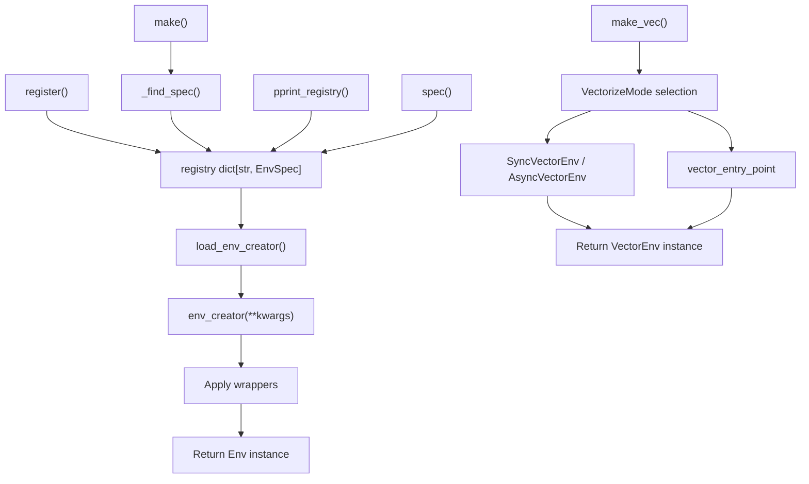
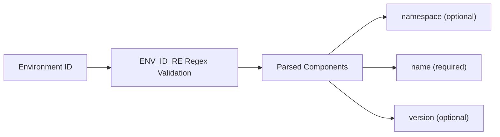
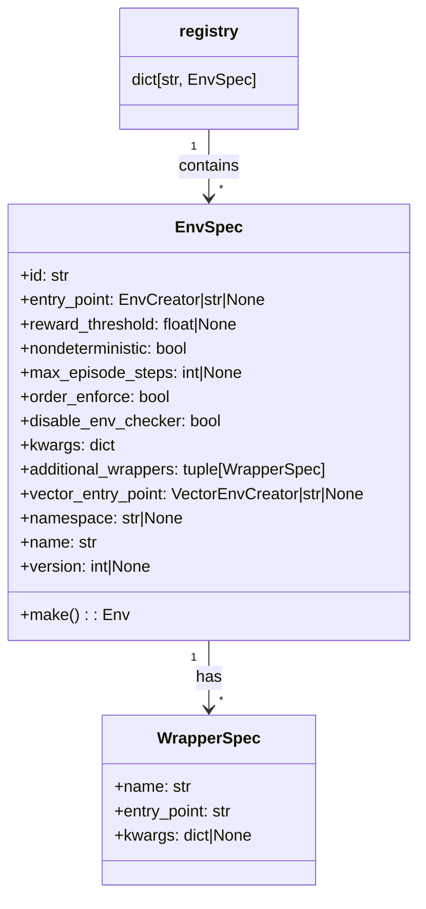
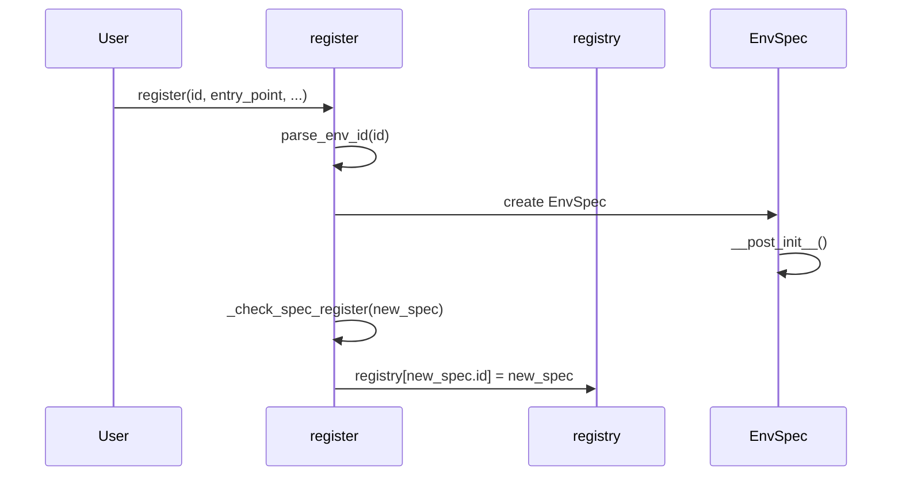
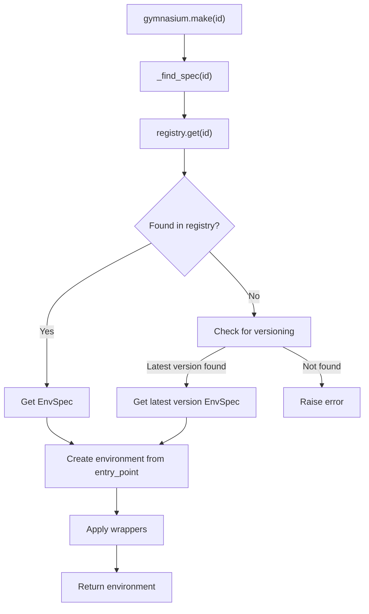
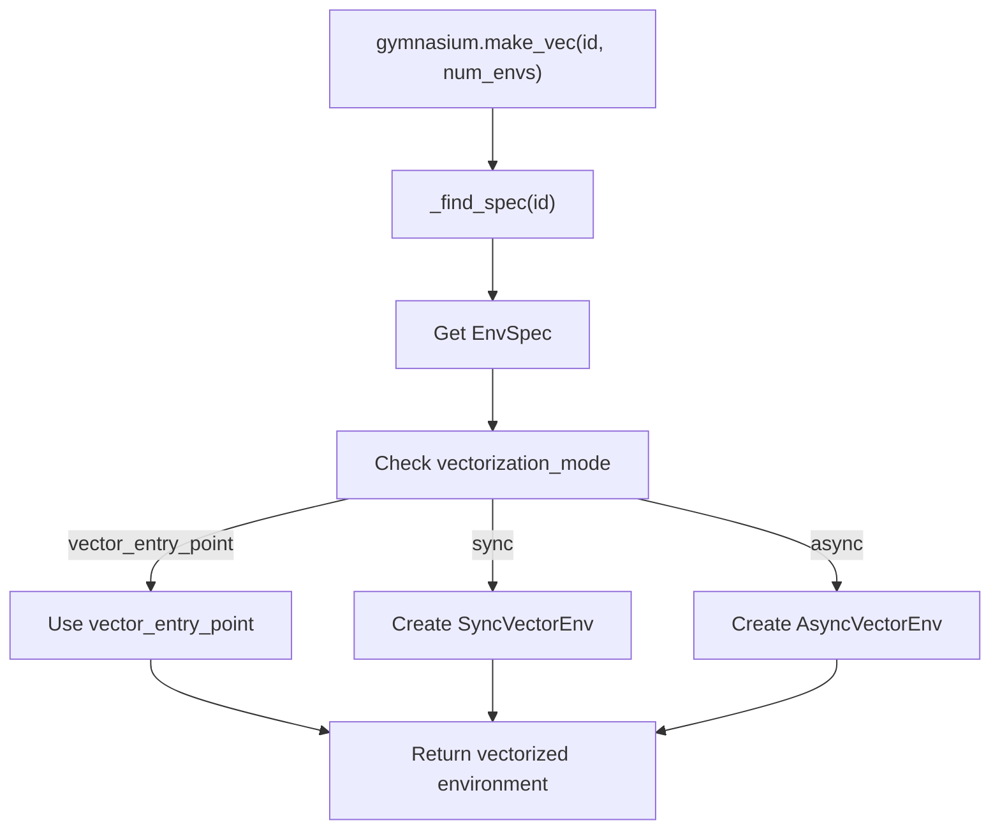
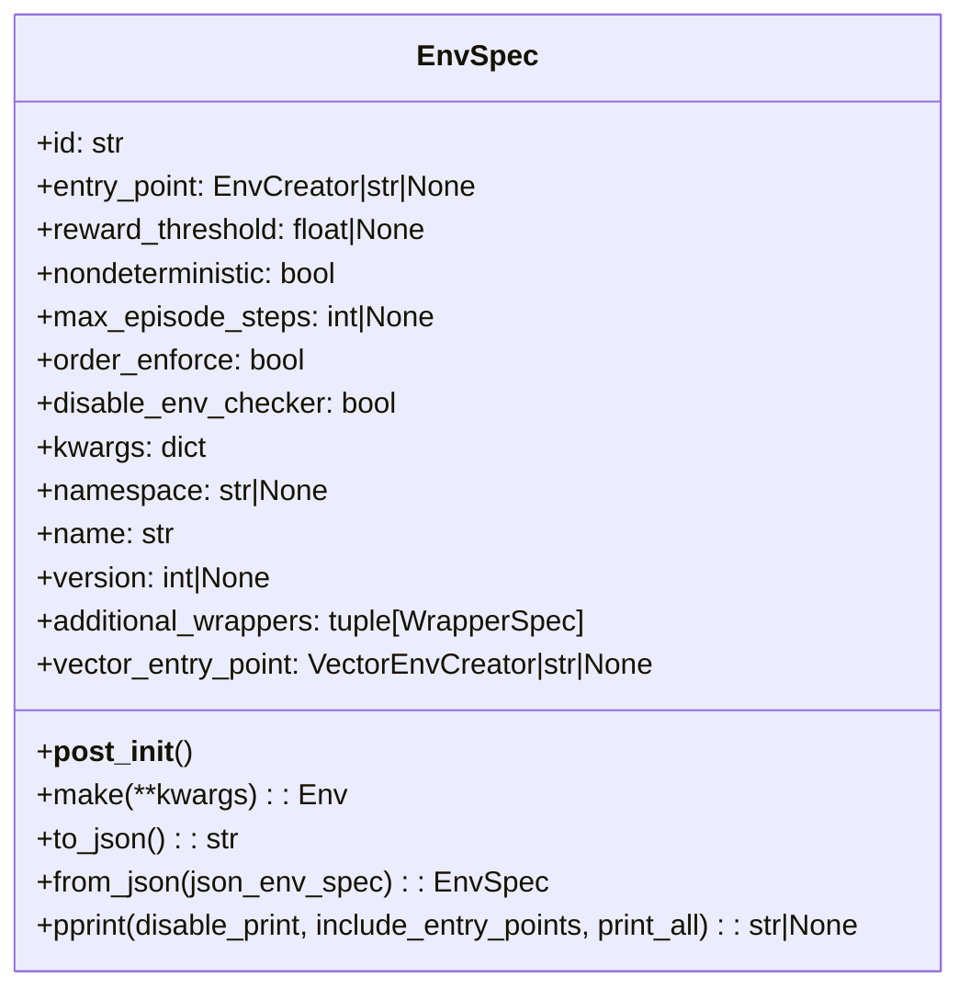
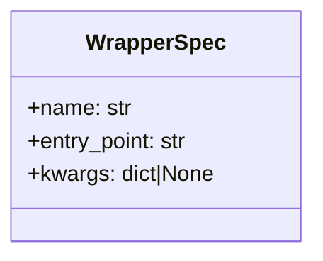
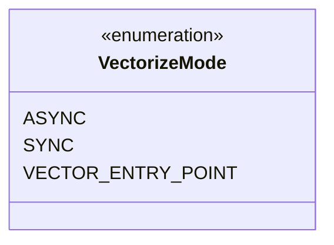
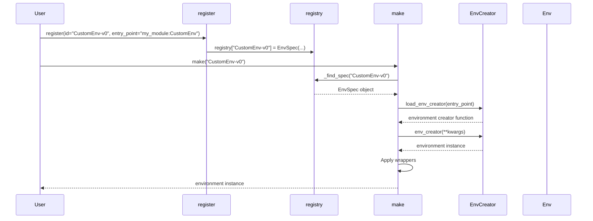

<!-- source: DeepWiki mcp.deepwiki.com · repo Farama-Foundation/Gymnasium · page 4 Environment Registration · fetched 2026-10-14 -->

# Environment Registration

<details>
<summary>Relevant source files</summary>

The following files were used as context for generating this wiki page:

- [gymnasium/__init__.py](gymnasium/__init__.py)
- [gymnasium/envs/__init__.py](gymnasium/envs/__init__.py)
- [gymnasium/envs/registration.py](gymnasium/envs/registration.py)
- [gymnasium/envs/tabular/__init__.py](gymnasium/envs/tabular/__init__.py)
- [gymnasium/experimental/__init__.py](gymnasium/experimental/__init__.py)
- [tests/envs/registration/test_make_vec.py](tests/envs/registration/test_make_vec.py)
- [tests/envs/test_env_implementation.py](tests/envs/test_env_implementation.py)
- [tests/vector/utils/utils.py](tests/vector/utils/utils.py)

</details>


Environment registration is a core system in Gymnasium that enables environments to be registered, discovered, and instantiated. This page documents how environments are registered in Gymnasium and how they can be created using the registration system. For information about creating environments after they've been registered, see [Making Environments](#4.1).

## Overview

The environment registration system serves as a central repository for all available environments in Gymnasium. The system consists of a global `registry` dictionary that maps environment IDs to `EnvSpec` objects, along with functions for registration, creation, and discovery.

Core components:
- `registry`: Global dictionary mapping environment IDs to `EnvSpec` objects [gymnasium/envs/registration.py:264]()
- `register()`: Function to register new environments [gymnasium/envs/registration.py:564-638]()
- `make()`: Function to create environment instances [gymnasium/envs/registration.py:640-825]()
- `make_vec()`: Function to create vectorized environments [gymnasium/envs/registration.py:827-983]()
- `spec()`: Function to retrieve environment specifications [gymnasium/envs/registration.py:985-1009]()



Sources: [gymnasium/__init__.py:13-22](), [gymnasium/envs/registration.py:256-258](), [gymnasium/envs/registration.py:564-638](), [gymnasium/envs/registration.py:640-825](), [gymnasium/envs/registration.py:827-983]()

## Environment IDs

Environments in Gymnasium are identified by unique string IDs that follow a specific format:

```
[namespace/](env-name)[-v(version)]
```

Where:
- `namespace` (optional): Identifies the provider of the environment (e.g., `gymnasium/` or `third_party/`)
- `env-name`: The name of the environment (e.g., `CartPole`)
- `version` (optional): A version number (e.g., `v1`)

Examples:
- `CartPole-v1`: The CartPole environment, version 1
- `gymnasium/MountainCar-v0`: The MountainCar environment from the gymnasium namespace, version 0
- `ThirdParty/CustomEnv`: A custom environment from a third-party namespace with no version specified

The ID format is enforced by a regular expression defined in the registration module: [gymnasium/envs/registration.py:25-26]()



Sources: [gymnasium/envs/registration.py:25-26](), [gymnasium/envs/registration.py:116-118]()

## The Registry

The registry is a global dictionary that maps environment IDs to their specifications: [gymnasium/envs/registration.py:264]()



Sources: [gymnasium/envs/registration.py:68-79](), [gymnasium/envs/registration.py:82-113](), [gymnasium/envs/registration.py:264]()

## Registering Environments

Environments are registered using the `register()` function, which creates an `EnvSpec` object and adds it to the registry: [gymnasium/envs/registration.py:564-638]()



The `register()` function accepts the following parameters: [gymnasium/envs/registration.py:570-607]()

| Parameter | Type | Description |
|-----------|------|-------------|
| `id` | `str` | The environment ID |
| `entry_point` | `str` or callable | The entry point for creating the environment |
| `reward_threshold` | `float` or `None` | The reward threshold for solving the environment |
| `nondeterministic` | `bool` | Whether the environment is nondeterministic |
| `max_episode_steps` | `int` or `None` | Maximum number of steps per episode |
| `order_enforce` | `bool` | Whether to enforce the correct method call order |
| `disable_env_checker` | `bool` | Whether to disable the environment checker |
| `additional_wrappers` | `tuple[WrapperSpec]` | Additional wrappers to apply |
| `vector_entry_point` | `str` or callable | The entry point for creating a vectorized environment |
| `kwargs` | `dict` | Additional arguments to pass to the environment constructor |

Sources: [gymnasium/envs/registration.py:570-607]()

### Example Registrations

The following examples demonstrate how environments are registered in Gymnasium:

```python
# Classic control environment
register(
    id="CartPole-v1",
    entry_point="gymnasium.envs.classic_control.cartpole:CartPoleEnv",
    vector_entry_point="gymnasium.envs.classic_control.cartpole:CartPoleVectorEnv",
    max_episode_steps=500,
    reward_threshold=475.0,
)

# Box2D environment
register(
    id="LunarLander-v3",
    entry_point="gymnasium.envs.box2d.lunar_lander:LunarLander",
    max_episode_steps=1000,
    reward_threshold=200,
)

# Environment with kwargs
register(
    id="BipedalWalkerHardcore-v3",
    entry_point="gymnasium.envs.box2d.bipedal_walker:BipedalWalker",
    kwargs={"hardcore": True},
    max_episode_steps=2000,
    reward_threshold=300,
)
```

Sources: [gymnasium/envs/__init__.py:26-32](), [gymnasium/envs/__init__.py:94-99](), [gymnasium/envs/__init__.py:110-115]()

## Creating Environments

Registered environments can be created using the `make()` function, which looks up the environment specification in the registry and creates an instance of the environment. For details, see [Making Environments](#4.1).



The `make()` function accepts the following parameters: [gymnasium/envs/registration.py:648-825]()

| Parameter | Type | Description |
|-----------|------|-------------|
| `id` | `str` or `EnvSpec` | The environment ID or specification |
| `max_episode_steps` | `int` or `None` | Override for maximum steps per episode |
| `disable_env_checker` | `bool` or `None` | Whether to disable the environment checker |
| `**kwargs` | Any | Additional arguments to pass to the environment constructor |

For vectorized environments, the `make_vec()` function can be used, which creates multiple instances of an environment and combines them into a vectorized environment. For details, see [Making Environments](#4.1).



Sources: [gymnasium/envs/registration.py:648-825](), [gymnasium/envs/registration.py:827-983]()

## Environment Specification (EnvSpec)

The `EnvSpec` class is a dataclass that contains all the information needed to create an environment. For details, see [Environment Specifications](#4.2).



The `__post_init__` method is called after the dataclass is initialized and extracts the namespace, name, and version from the environment ID. [gymnasium/envs/registration.py:116-118]()

The `make()` method creates an instance of the environment using the specification. [gymnasium/envs/registration.py:120-122]()

The `to_json()` and `from_json()` methods allow serializing and deserializing the specification. [gymnasium/envs/registration.py:124-189]()

The `pprint()` method pretty-prints the specification for debugging and inspection. [gymnasium/envs/registration.py:1011-1091]()

Sources: [gymnasium/envs/registration.py:82-189](), [gymnasium/envs/registration.py:1011-1091]()

## Wrapper Specification (WrapperSpec)

The `WrapperSpec` class is a dataclass that contains information about a wrapper to be applied to an environment. For details, see [Environment Specifications](#4.2).



Wrappers can be specified when registering an environment and are applied when the environment is created.

Sources: [gymnasium/envs/registration.py:68-79]()

## Vector Environment Modes

Vectorized environments can be created in different modes, specified by the `VectorizeMode` enum: [gymnasium/envs/registration.py:255-260]()



- `ASYNC`: Creates an asynchronous vectorized environment using `AsyncVectorEnv` [gymnasium/envs/registration.py:257]()
- `SYNC`: Creates a synchronous vectorized environment using `SyncVectorEnv` [gymnasium/envs/registration.py:258]()
- `VECTOR_ENTRY_POINT`: Uses the environment's vectorized entry point if available [gymnasium/envs/registration.py:259]()

Sources: [gymnasium/envs/registration.py:255-260]()

## Registration Process Flow

The following diagram illustrates the complete process of registering and creating an environment:



Sources: [gymnasium/envs/registration.py:570-607](), [gymnasium/envs/registration.py:648-825]()

## Custom Environment Registration

Custom environments can be registered by calling the `register()` function with the appropriate parameters:

```python
import gymnasium as gym

# Register a custom environment
gym.register(
    id="CustomEnv-v0",
    entry_point="my_module:CustomEnv",
    max_episode_steps=1000,
)

# Create an instance of the environment
env = gym.make("CustomEnv-v0")
```

Third-party libraries can register their environments when they're imported, making them available to users without additional setup.

## Finding Registered Environments

The `pprint_registry()` function can be used to print all registered environments: [gymnasium/envs/registration.py:1011-1091]()

```python
import gymnasium as gym

# Print all registered environments
gym.pprint_registry()
```

Alternatively, the keys of the registry dictionary can be accessed directly: [gymnasium/envs/registration.py:264]()

```python
import gymnasium as gym

# Get a list of all registered environment IDs
env_ids = gym.registry.keys()
```

Sources: [gymnasium/envs/registration.py:264](), [gymnasium/envs/registration.py:1011-1091]()

## Conclusion

The environment registration system is a fundamental component of Gymnasium that enables the discovery and creation of reinforcement learning environments. By understanding this system, users can leverage the full range of existing environments and extend Gymnasium with their own custom environments.

---

