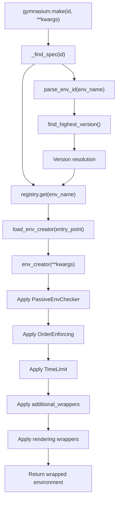
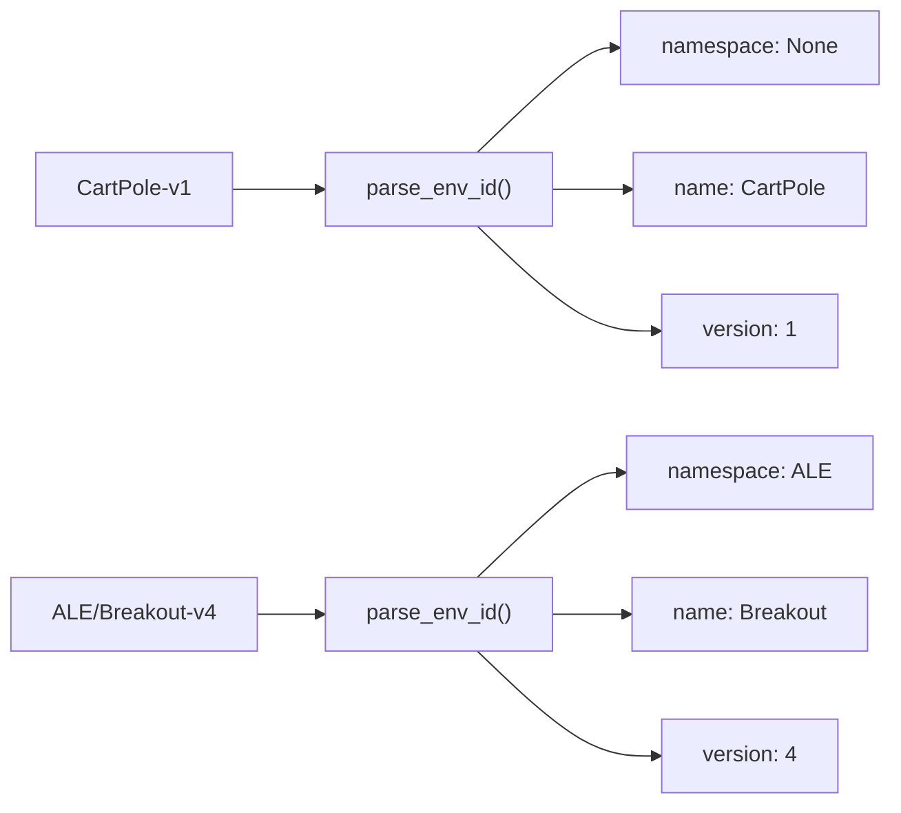
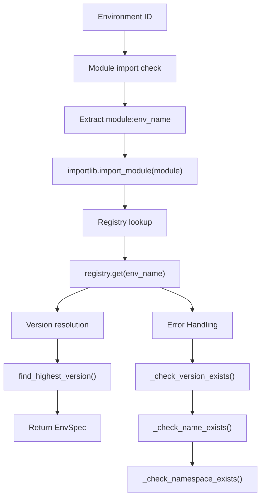
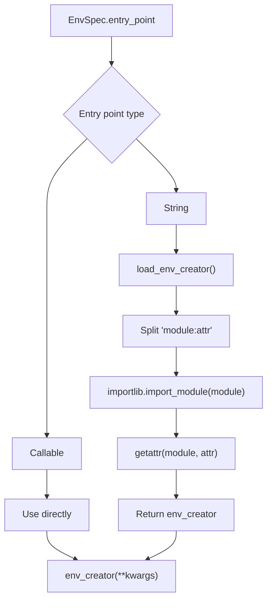
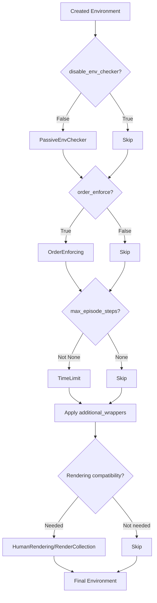
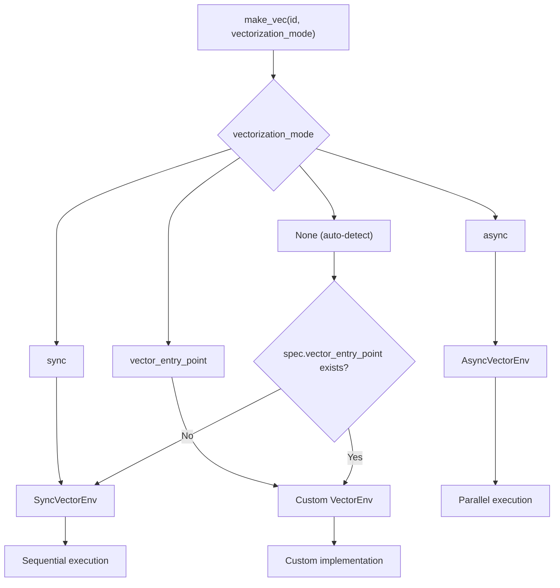
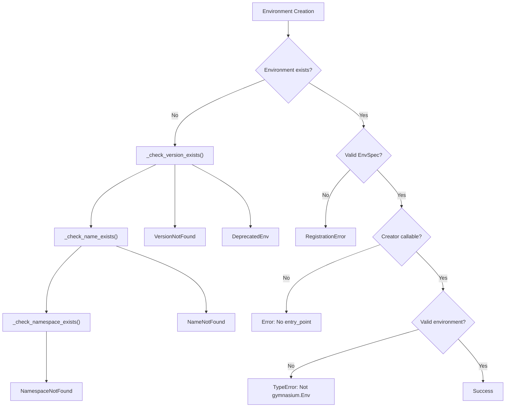

<!-- source: DeepWiki mcp.deepwiki.com · repo Farama-Foundation/Gymnasium · page 4.1 Making Environments · fetched 2026-10-14 -->

# Making Environments

<details>
<summary>Relevant source files</summary>

The following files were used as context for generating this wiki page:

- [gymnasium/__init__.py](gymnasium/__init__.py)
- [gymnasium/envs/registration.py](gymnasium/envs/registration.py)
- [gymnasium/experimental/__init__.py](gymnasium/experimental/__init__.py)
- [tests/envs/registration/test_make.py](tests/envs/registration/test_make.py)
- [tests/envs/registration/test_make_vec.py](tests/envs/registration/test_make_vec.py)
- [tests/vector/utils/utils.py](tests/vector/utils/utils.py)

</details>


This page covers the environment factory system in Gymnasium, focusing on the `gymnasium.make()` and `gymnasium.make_vec()` functions used to create environment instances. For information about environment specifications and metadata, see [Environment Specifications](#4.2). For information about registering environments, see [Environment Registration](#4).

## Overview

The environment factory system provides a standardized way to create environment instances from registered environment specifications. The system handles environment lookup, instantiation, wrapper application, and validation automatically.

## Basic Environment Creation

The primary interface for creating environments is the `gymnasium.make()` function, which accepts either an environment ID string or an `EnvSpec` object:

```python
import gymnasium as gym

# Create environment using ID string
env = gym.make("CartPole-v1")

# Create environment using EnvSpec
spec = gym.spec("CartPole-v1")
env = gym.make(spec)
```

### Environment Factory Flow



**Sources:** [gymnasium/envs/registration.py:640-824]()

## Environment ID Format and Parsing

Environment IDs follow the format `[namespace/](env-name)[-v(version)]` where namespace and version are optional:

| Component | Description | Example |
|-----------|-------------|---------|
| `namespace` | Optional namespace prefix | `ALE/`, `MyEnv/` |
| `env-name` | Environment name | `CartPole`, `Breakout` |
| `version` | Optional version number | `v0`, `v1` |



**Sources:** [gymnasium/envs/registration.py:261-282](), [gymnasium/envs/registration.py:27-29]()

## Environment Lookup and Registry

The `make()` function uses a multi-step lookup process to find environment specifications:

### Lookup Process



**Sources:** [gymnasium/envs/registration.py:489-531](), [gymnasium/envs/registration.py:305-322]()

### Dynamic Module Loading

Environments can be loaded dynamically using the `module:env_name` syntax:

```python
# Load environment from specific module
env = gym.make("my_package.envs:CustomEnv-v0")
```

**Sources:** [gymnasium/envs/registration.py:494-502]()

## Environment Creator Loading

The system loads environment creators from entry points specified in `EnvSpec`:



**Sources:** [gymnasium/envs/registration.py:534-546](), [gymnasium/envs/registration.py:689-696]()

## Wrapper Application During Creation

The `make()` function automatically applies several types of wrappers in a specific order:

### Wrapper Application Order

| Order | Wrapper | Purpose | Control Parameter |
|-------|---------|---------|-------------------|
| 1 | `PassiveEnvChecker` | API compliance validation | `disable_env_checker` |
| 2 | `OrderEnforcing` | Method call order validation | `order_enforce` |
| 3 | `TimeLimit` | Episode step limiting | `max_episode_steps` |
| 4 | Additional wrappers | Custom wrapper stack | `additional_wrappers` |
| 5 | Rendering wrappers | Render mode compatibility | automatic |



**Sources:** [gymnasium/envs/registration.py:794-823]()

## Vector Environment Creation

The `gymnasium.make_vec()` function creates vector environments that can run multiple environment instances:

### Vectorization Modes



**Sources:** [gymnasium/envs/registration.py:827-983]()

### Vector Environment Parameters

| Parameter | Description | Default |
|-----------|-------------|---------|
| `num_envs` | Number of environment instances | 1 |
| `vectorization_mode` | Vectorization strategy | Auto-detect |
| `vector_kwargs` | Arguments for vector constructor | `{}` |
| `wrappers` | Wrapper functions to apply | `[]` |

**Sources:** [gymnasium/envs/registration.py:828-849]()

## Error Handling and Validation

The environment factory system provides detailed error messages for common issues:

### Error Types and Handling



**Sources:** [gymnasium/envs/registration.py:325-430](), [gymnasium/envs/registration.py:750-763]()

### Validation and Compatibility

The system performs several validation checks:

1. **API Compatibility**: Ensures environments inherit from `gymnasium.Env`
2. **Metadata Validation**: Checks render modes and other metadata
3. **Version Compatibility**: Warns about deprecated versions
4. **Wrapper Validation**: Ensures wrappers can be recreated

**Sources:** [gymnasium/envs/registration.py:471-487](), [gymnasium/envs/registration.py:750-763]()

## Advanced Usage Patterns

### Custom Wrapper Application

```python
# Override default wrapper settings
env = gym.make(
    "CartPole-v1",
    max_episode_steps=100,      # Custom time limit
    disable_env_checker=True,   # Skip environment checker
    render_mode="human"         # Enable human rendering
)
```

### EnvSpec-based Creation

```python
# Create environment from modified spec
spec = gym.spec("CartPole-v1")
spec.max_episode_steps = 100
env = gym.make(spec)
```

### Vector Environment with Wrappers

```python
# Create vector environment with custom wrappers
envs = gym.make_vec(
    "CartPole-v1",
    num_envs=4,
    vectorization_mode="sync",
    wrappers=[
        lambda env: gym.wrappers.RecordEpisodeStatistics(env),
        lambda env: gym.wrappers.ClipAction(env)
    ]
)
```

**Sources:** [gymnasium/envs/registration.py:640-824](), [gymnasium/envs/registration.py:827-983](), [tests/envs/registration/test_make_vec.py:136-168]()

---

