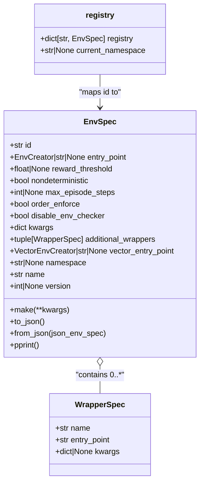
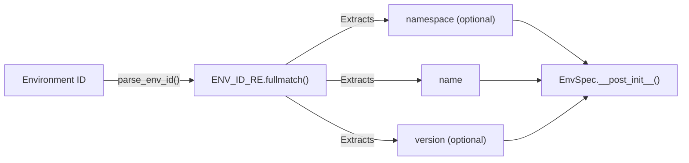
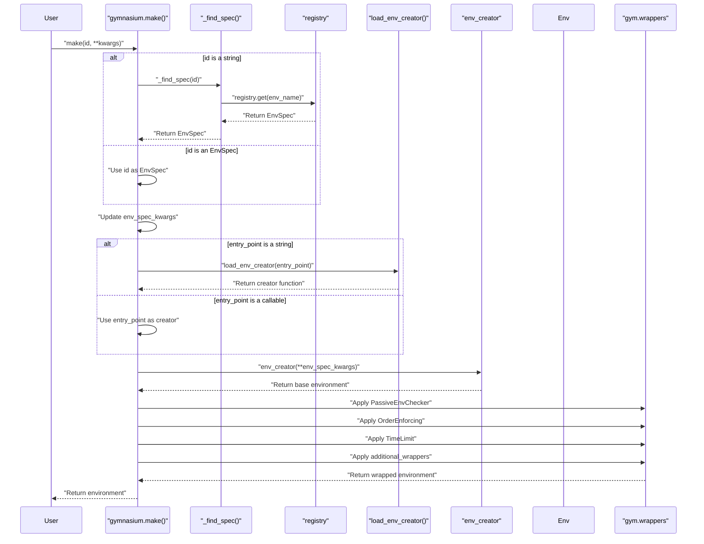
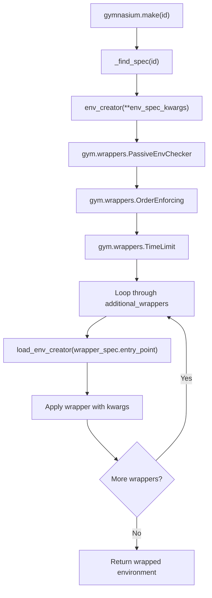
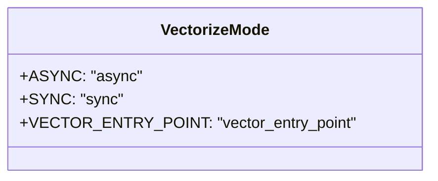
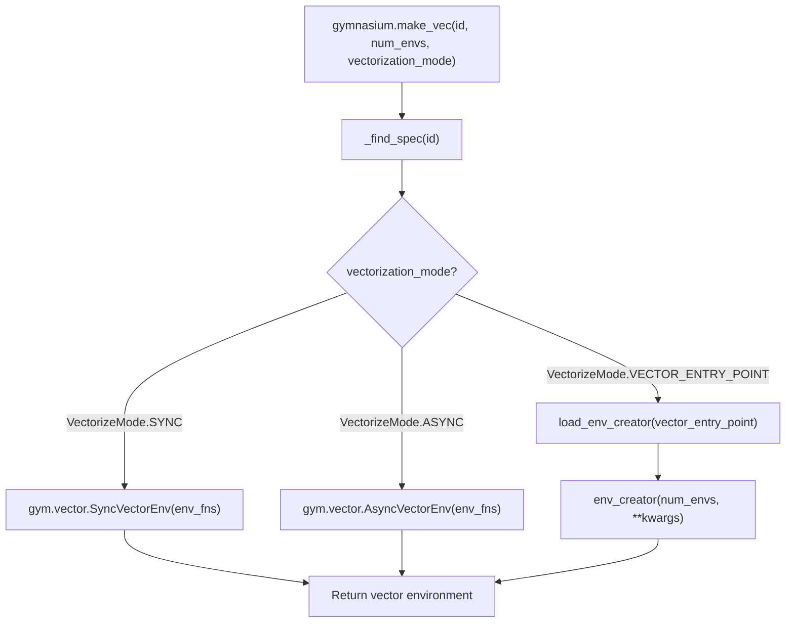

<!-- source: DeepWiki mcp.deepwiki.com · repo Farama-Foundation/Gymnasium · page 4.2 Environment Specifications · fetched 2026-10-14 -->

# Environment Specifications

<details>
<summary>Relevant source files</summary>

The following files were used as context for generating this wiki page:

- [docs/api/registry.md](docs/api/registry.md)
- [tests/envs/registration/__init__.py](tests/envs/registration/__init__.py)
- [tests/envs/registration/test_env_spec.py](tests/envs/registration/test_env_spec.py)
- [tests/envs/registration/test_pprint_registry.py](tests/envs/registration/test_pprint_registry.py)
- [tests/envs/registration/test_register.py](tests/envs/registration/test_register.py)
- [tests/envs/registration/test_spec.py](tests/envs/registration/test_spec.py)
- [tests/envs/registration/utils_envs.py](tests/envs/registration/utils_envs.py)
- [tests/envs/registration/utils_unregistered_env.py](tests/envs/registration/utils_unregistered_env.py)
- [tests/envs/toy_text/__init__.py](tests/envs/toy_text/__init__.py)
- [tests/envs/toy_text/test_taxi.py](tests/envs/toy_text/test_taxi.py)

</details>


## Purpose and Overview

Environment Specifications in Gymnasium define how reinforcement learning environments are registered, configured, and created. Each registered environment has an associated `EnvSpec` object that encapsulates all the information needed to instantiate it, including its identifier, entry point, reward threshold, and various configuration parameters.

When you call `gymnasium.make("CartPole-v1")`, Gymnasium looks up the `EnvSpec` for "CartPole-v1" in its registry and uses it to create the environment. Environment specifications serve as the bridge between environment identifiers and the actual environment implementations.

For information about the process of registering environments, see [Environment Registration](#4) and for creating environments, see [Making Environments](#4.1).

Sources: [docs/api/registry.md:20-21](), [docs/api/registry.md:23-29]()

## The EnvSpec Class

The `EnvSpec` class is defined as a dataclass in the Gymnasium codebase. It encapsulates all the information needed to create an environment.

Here's a summary of its key attributes:

| Attribute | Type | Description |
|-----------|------|-------------|
| `id` | str | The unique identifier for the environment |
| `entry_point` | EnvCreator \| str \| None | A string or callable for creating the environment |
| `reward_threshold` | float \| None | The reward threshold for considering the environment solved |
| `nondeterministic` | bool | Whether the environment is nondeterministic |
| `max_episode_steps` | int \| None | Maximum number of steps before truncation |
| `order_enforce` | bool | Whether to enforce the order of method calls |
| `disable_env_checker` | bool | Whether to disable the environment checker |
| `kwargs` | dict | Additional keyword arguments for environment initialization |
| `additional_wrappers` | tuple[WrapperSpec, ...] | Tuple of additional wrappers to apply |
| `vector_entry_point` | VectorEnvCreator \| str \| None | Entry point for creating vectorized environments |

After initialization, `EnvSpec` also derives and stores `namespace`, `name`, and `version` attributes from the `id` using the `__post_init__` method.

Sources: [docs/api/registry.md:20-21]()

## EnvSpec and WrapperSpec Class Relationships



Sources: [docs/api/registry.md:20-21](), [docs/api/registry.md:23-29]()

## Environment ID Format

The `id` attribute of an `EnvSpec` follows a specific format: `[namespace/](env_name)[-v(version)]`. Here's what each part means:

- `namespace`: An optional namespace for the environment, which can be used to group environments
- `env_name`: The name of the environment
- `version`: An optional version number for the environment

For example, "CartPole-v1" has no namespace, the environment name is "CartPole", and the version is 1.

Sources: [tests/envs/registration/test_register.py:47-61]()

## Environment ID Parsing Flow

Gymnasium parses environment IDs using a regular expression defined in the registration module and the `parse_env_id` function:



Sources: [docs/api/registry.md:35-36]()

## Environment Creation Flow

When you call `gymnasium.make(id)`, Gymnasium uses the `EnvSpec` to create the environment. The flow of environment creation is illustrated in the following diagram:

## gymnasium.make() Function Flow



Here's a more detailed breakdown of what happens when `gymnasium.make` is called:

1. If the `id` is a string, find the corresponding `EnvSpec` in the registry using `_find_spec()`.
2. Update the `EnvSpec`'s `kwargs` with any additional keyword arguments.
3. Load the environment creator from the `entry_point`. If `entry_point` is a string, it's loaded using `load_env_creator()`. If it's a callable, it's used directly.
4. Create the environment using the creator function and the updated `kwargs`.
5. Apply wrappers to the environment, including:
   - The environment checker (`PassiveEnvChecker`) if not disabled
   - The order enforcing wrapper (`OrderEnforcing`) if `order_enforce` is `True`
   - The time limit wrapper (`TimeLimit`) if `max_episode_steps` is not `None`
   - Any additional wrappers specified in `additional_wrappers`
6. Return the wrapped environment.

Sources: [docs/api/registry.md:10-11]()

## Wrapper Specifications

Wrappers are components that modify the behavior of environments. Gymnasium uses the `WrapperSpec` class to define wrappers that can be applied to environments. A `WrapperSpec` has three key attributes:

- `name`: The name of the wrapper
- `entry_point`: The location of the wrapper to create from
- `kwargs`: Additional keyword arguments for the wrapper (can be `None`)

Wrappers are applied in the order they are specified in the `additional_wrappers` attribute of `EnvSpec`.

Sources: [docs/api/registry.md:22]()

## Wrapper Application Flow in gymnasium.make()



Sources: [tests/envs/registration/test_env_spec.py:28-29]()

## Vector Environment Support

Gymnasium supports vector environments, which allow running multiple environments in parallel. The `EnvSpec` class includes a `vector_entry_point` attribute for creating vector environments.

The `VectorizeMode` enum defines the possible vectorization modes:



- `ASYNC`: Create an `AsyncVectorEnv`, which runs environments in parallel using multiple processes.
- `SYNC`: Create a `SyncVectorEnv`, which runs environments sequentially in a single process.
- `VECTOR_ENTRY_POINT`: Use the `vector_entry_point` attribute of the `EnvSpec` to create a custom vector environment.

Sources: [docs/api/registry.md:11]()

## gymnasium.make_vec() Function Flow

The `make_vec` function creates vector environments based on an `EnvSpec` and a vectorization mode:



Sources: [docs/api/registry.md:11]()

## EnvSpec Serialization

`EnvSpec` objects can be serialized to and deserialized from JSON format using the `to_json` and `from_json` methods:

## EnvSpec JSON Serialization Flow

```mermaid
flowchart LR
    A["EnvSpec"] -->|"to_json()"| B["dataclasses.asdict()"]
    B --> C["_check_can_jsonify()"]
    C --> D["json.dumps()"]
    D --> E["JSON string"]
    E -->|"from_json()"| F["json.loads()"]
    F --> G["Parse additional_wrappers"]
    G --> H["EnvSpec(**parsed_env_spec)"]
    H --> I["New EnvSpec"]
```



- `to_json()`: Converts the `EnvSpec` to a JSON string using `dataclasses.asdict()` and `json.dumps()`
- `from_json(json_env_spec)`: Creates an `EnvSpec` from a JSON string using `json.loads()` and the `EnvSpec` constructor

This is useful for saving and loading environment configurations, especially for environments with complex initialization parameters or multiple wrappers. The serialization process includes validation to ensure callable objects are handled properly.

Sources: [tests/envs/registration/test_env_spec.py:33-37](), [tests/envs/registration/test_env_spec.py:87-88](), [tests/envs/registration/test_spec.py:109]()

## Usage Examples

Here's how you might interact with environment specifications in Gymnasium:

1.  **Getting an environment spec:**
    ```python
    env_spec = gym.spec("CartPole-v1")
    ```
    Sources: [tests/envs/registration/test_spec.py:11]()

2.  **Printing an environment spec:**
    ```python
    env_spec.pprint()  # Pretty print information about the environment
    ```
    Sources: [tests/envs/registration/test_env_spec.py:138]()

3.  **Creating an environment from a spec:**
    ```python
    env = env_spec.make()  # Equivalent to gym.make("CartPole-v1")
    ```
    Sources: [tests/envs/registration/test_env_spec.py:44]()

4.  **Serializing and deserializing a spec:**
    ```python
    json_str = env_spec.to_json()  # Convert to JSON string
    new_spec = EnvSpec.from_json(json_str)  # Create from JSON string
    ```
    Sources: [tests/envs/registration/test_env_spec.py:33-37](), [tests/envs/registration/test_env_spec.py:87-88]()

5.  **Creating a vector environment with a specific vectorization mode:**
    ```python
    vec_env = gym.make_vec("CartPole-v1", num_envs=4, vectorization_mode=gym.VectorizeMode.ASYNC)
    ```
    Sources: [docs/api/registry.md:11]()

---

