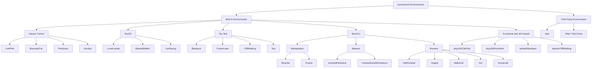
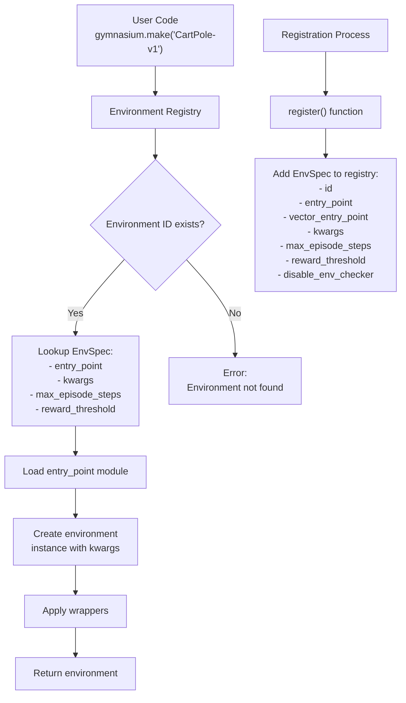
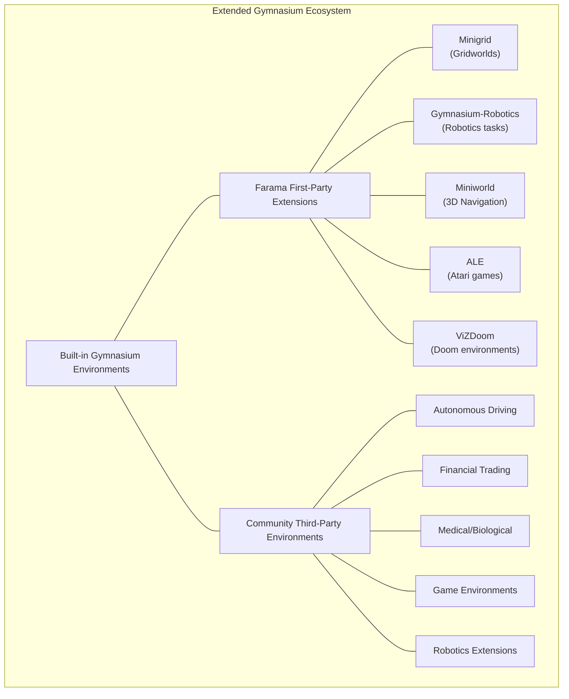

<!-- source: DeepWiki mcp.deepwiki.com · repo Farama-Foundation/Gymnasium · page 5 Environment Categories · fetched 2026-10-14 -->

# Environment Categories

<details>
<summary>Relevant source files</summary>

The following files were used as context for generating this wiki page:

- [docs/environments/atari.md](docs/environments/atari.md)
- [docs/environments/box2d.md](docs/environments/box2d.md)
- [docs/environments/classic_control.md](docs/environments/classic_control.md)
- [gymnasium/envs/__init__.py](gymnasium/envs/__init__.py)
- [gymnasium/envs/tabular/__init__.py](gymnasium/envs/tabular/__init__.py)
- [tests/envs/test_env_implementation.py](tests/envs/test_env_implementation.py)

</details>


## Overview

This document provides a comprehensive overview of the environment categories available in Gymnasium. Gymnasium organizes its environments into distinct categories based on their underlying simulation engines, complexity levels, and domain characteristics. Understanding these categories helps practitioners select appropriate environments for their reinforcement learning experiments.

For information about specific environments within each category, see the respective dedicated pages ([Classic Control Environments](#5.1), [Box2D Environments](#5.2), [MuJoCo Environments](#5.3), and [Toy Text Environments](#5.4)).

## Built-in Environment Categories

Gymnasium includes several families of built-in environments, each with distinct characteristics:

### Environment Category Hierarchy



Sources: 
- [gymnasium/envs/__init__.py:15-253]()
- [gymnasium/envs/tabular/__init__.py:3-9]()
- [docs/environments/box2d.md:6-14]()
- [docs/environments/classic_control.md:8-16]()
- [docs/environments/atari.md:1-138]()

### Classic Control

Classic Control environments implement fundamental control theory problems, typically featuring simplified physics-based tasks with low-dimensional state spaces. For details, see [Classic Control Environments](#5.1).

Key characteristics:
- Based on classic control theory problems
- Simple physics simulations
- Low-dimensional observation spaces
- Discrete or continuous action spaces
- Fast simulation speed
- Lightweight rendering

Examples include:
- `CartPole-v0`, `CartPole-v1` [gymnasium/envs/__init__.py:18-32](): Balance a pole on a cart
- `MountainCar-v0` [gymnasium/envs/__init__.py:35-38](): Drive a car up a mountain
- `Pendulum-v1` [gymnasium/envs/__init__.py:49-52](): Swing up and balance an inverted pendulum
- `Acrobot-v1` [gymnasium/envs/__init__.py:55-59](): Swing a two-link robot to reach a target height

Sources:
- [gymnasium/envs/__init__.py:15-59]()
- [docs/environments/classic_control.md:28-31]()

### Box2D

Box2D environments use the Box2D physics engine to simulate more complex 2D physics interactions with more detailed rendering. For details, see [Box2D Environments](#5.2).

Key characteristics:
- More sophisticated 2D physics using Box2D engine
- PyGame-based rendering
- Medium-dimensional observation spaces
- Continuous control tasks
- Moderate simulation complexity

Examples include:
- `LunarLander-v3` [gymnasium/envs/__init__.py:94-98](): Land a spacecraft on a landing pad
- `BipedalWalker-v3` [gymnasium/envs/__init__.py:110-114](): Train a 2D biped to walk
- `CarRacing-v3` [gymnasium/envs/__init__.py:125-129](): Drive a car around a randomly generated track

Sources:
- [gymnasium/envs/__init__.py:91-129]()
- [docs/environments/box2d.md:24-25]()
- [tests/envs/test_env_implementation.py:5-6]()

### Toy Text

Toy Text environments provide simple discrete state and action spaces with text-based or minimalistic visual representations, designed for testing basic RL algorithms. For details, see [Toy Text Environments](#5.4).

Key characteristics:
- Small discrete state and action spaces
- Simple dynamics
- Fast simulation
- Minimal dependencies
- Often stochastic environments
- Useful for debugging RL algorithms

Examples include:
- `Blackjack-v1` [gymnasium/envs/__init__.py:135-138](): Play the card game blackjack
- `FrozenLake-v1` [gymnasium/envs/__init__.py:141-145](): Navigate to a goal on slippery frozen surface
- `CliffWalking-v1` [gymnasium/envs/__init__.py:157-159](): Navigate to a goal while avoiding falling off a cliff
- `Taxi-v4` [gymnasium/envs/__init__.py:168-172](): Pick up and drop off passengers at designated locations

Sources:
- [gymnasium/envs/__init__.py:132-172]()
- [tests/envs/test_env_implementation.py:7-8]()

### MuJoCo

MuJoCo environments use the MuJoCo physics engine for complex robotic control tasks in 3D simulation with accurate physics. For details, see [MuJoCo Environments](#5.3).

Key characteristics:
- Advanced 3D physics simulation
- Complex continuous control tasks
- High-dimensional observation and action spaces
- Realistic robotic simulations
- Computationally more intensive

MuJoCo environments are organized into subcategories:
- **Manipulation**: Tasks like `Reacher` [gymnasium/envs/__init__.py:207-218]() and `Pusher` [gymnasium/envs/__init__.py:223-234]() that involve controlling a robot arm
- **Balance**: Tasks like `InvertedPendulum` [gymnasium/envs/__init__.py:241-252]() and `InvertedDoublePendulum` that involve balancing systems
- **Runners**: Tasks like `HalfCheetah`, `Ant`, and `Humanoid` that involve locomotion

Sources:
- [gymnasium/envs/__init__.py:191-253]()

### Functional and JAX-based Environments

This category includes environments designed for functional programming paradigms and those leveraging JAX for accelerated computation. For details, see [Functional and JAX-based Environments](#5.5).

Key characteristics:
- Designed for functional programming
- Often leverage JAX for Just-In-Time (JIT) compilation and GPU acceleration
- Can be used for vectorized environments efficiently
- Includes both physics-based and tabular environments

Examples include:
- `phys2d/CartPole-v0`, `phys2d/CartPole-v1` [gymnasium/envs/__init__.py:66-81](): JAX-based CartPole
- `phys2d/Pendulum-v0` [gymnasium/envs/__init__.py:84-89](): JAX-based Pendulum
- `tabular/Blackjack-v0` [gymnasium/envs/__init__.py:179-182](): JAX-based Blackjack
- `tabular/CliffWalking-v0` [gymnasium/envs/__init__.py:185-188](): JAX-based CliffWalking

Sources:
- [gymnasium/envs/__init__.py:62-90]()
- [gymnasium/envs/__init__.py:175-190]()
- [gymnasium/envs/tabular/__init__.py:3-9]()

## Environment Registration System

The following diagram illustrates how environments are registered and loaded in Gymnasium:



Sources:
- [gymnasium/envs/__init__.py:5-12]()
- [gymnasium/envs/__init__.py:18-253]()

### Environment Registration Example

Environments are registered in Gymnasium using the `register` function [gymnasium/envs/__init__.py:10](). For example, the CartPole environment is registered as follows:

```python
register(
    id="CartPole-v1",
    entry_point="gymnasium.envs.classic_control.cartpole:CartPoleEnv",
    vector_entry_point="gymnasium.envs.classic_control.cartpole:CartPoleVectorEnv",
    max_episode_steps=500,
    reward_threshold=475.0,
)
```

This registration includes:
- A unique identifier (`id`)
- The Python path to the environment class (`entry_point`)
- Optional vector implementation (`vector_entry_point`)
- Maximum episode length (`max_episode_steps`)
- Threshold score to consider the environment solved (`reward_threshold`)
- `kwargs` for default environment parameters (not shown in this example, but used in others like `LunarLanderContinuous-v3` [gymnasium/envs/__init__.py:104-107]())
- `disable_env_checker` to skip environment checks (e.g., for JAX environments [gymnasium/envs/__init__.py:71]())

Sources:
- [gymnasium/envs/__init__.py:27-32]()
- [gymnasium/envs/__init__.py:104-107]()
- [gymnasium/envs/__init__.py:71]()

## Comparison of Environment Categories

The following table provides a comparison of the main environment categories:

| Category | Physics Engine | Observation Space | Action Space | Typical Use Cases | Computational Requirements |
|----------|---------------|------------------|-------------|-------------------|----------------------------|
| Classic Control | Custom simple physics | Low-dimensional | Discrete or Continuous | Basic algorithm testing, Educational purposes | Low |
| Box2D | Box2D | Medium-dimensional | Continuous | Intermediate control tasks, Robotics | Medium |
| Toy Text | N/A (rule-based) | Discrete | Discrete | Debugging, Tabular methods | Very Low |
| MuJoCo | MuJoCo | High-dimensional | Continuous | Advanced robotic control, Deep RL | High |
| Functional/JAX | Custom (JAX-based) | Low-dimensional / Discrete | Discrete or Continuous | Accelerated simulation, JAX ecosystem | Low to Medium (with JIT) |

## Third-Party Environments

Beyond the built-in environments, Gymnasium supports a wide ecosystem of third-party environments. These include:

- **First-Party Environments**: Additional environments maintained by the Farama Foundation, such as MiniGrid, Gymnasium-Robotics, MiniWorld, etc.
- **Third-Party Environments**: Environments developed by the community, covering domains such as autonomous driving, robotics, finance, games, and more.

For details on third-party environments, see the [Third Party Environments](#5.6) documentation.



Sources:
- [docs/environments/atari.md:1-138]()

## Selecting an Environment Category

When choosing an environment category for your RL research or applications, consider the following factors:

1. **Problem Complexity**: Start with simpler environments (Toy Text, Classic Control) for algorithm development and testing, then move to more complex environments.

2. **Domain Similarity**: Choose environments that resemble your target application (robotics, finance, etc.).

3. **Computational Resources**: More complex environments like MuJoCo require more computational resources.

4. **Required Features**: Consider whether you need features like partial observability, multi-agent capabilities, or specific rendering options.

5. **Benchmarking**: For comparing against published results, use standard benchmark environments like those in MuJoCo or Atari.

Typically, a learning progression through Gymnasium environments might follow this path:
- Start with Toy Text environments for implementing fundamental algorithms
- Move to Classic Control for testing in simple continuous state spaces
- Proceed to Box2D for more complex physics-based tasks
- Graduate to MuJoCo for advanced robotic control problems
- Consider specialized third-party environments for domain-specific applications

---

