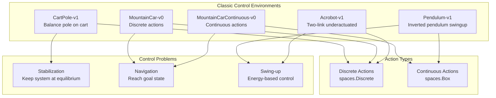
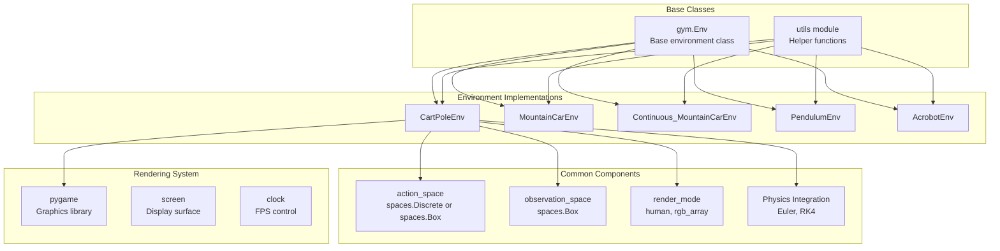
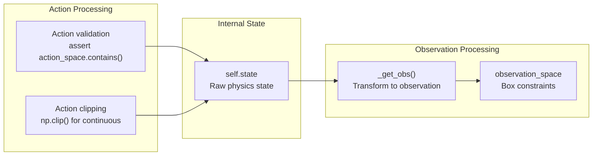
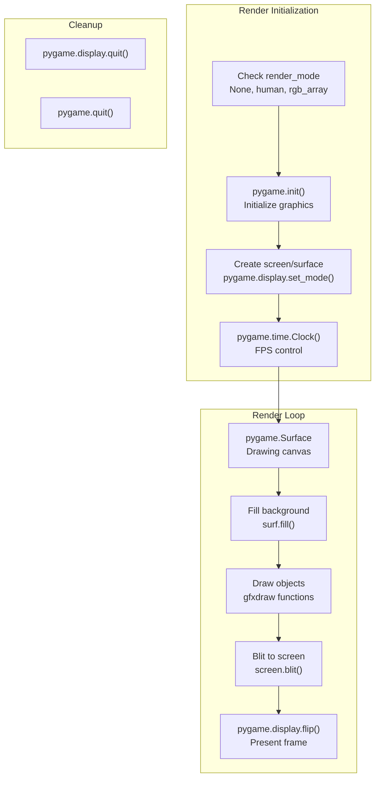

<!-- source: DeepWiki mcp.deepwiki.com · repo Farama-Foundation/Gymnasium · page 5.1 Classic Control Environments · fetched 2026-10-14 -->

# Classic Control Environments

<details>
<summary>Relevant source files</summary>

The following files were used as context for generating this wiki page:

- [docs/_static/videos/classic_control/acrobot.gif](docs/_static/videos/classic_control/acrobot.gif)
- [docs/_static/videos/classic_control/cart_pole.gif](docs/_static/videos/classic_control/cart_pole.gif)
- [docs/_static/videos/classic_control/mountain_car.gif](docs/_static/videos/classic_control/mountain_car.gif)
- [docs/_static/videos/classic_control/mountain_car_continuous.gif](docs/_static/videos/classic_control/mountain_car_continuous.gif)
- [docs/_static/videos/classic_control/pendulum.gif](docs/_static/videos/classic_control/pendulum.gif)
- [gymnasium/envs/box2d/bipedal_walker.py](gymnasium/envs/box2d/bipedal_walker.py)
- [gymnasium/envs/box2d/car_racing.py](gymnasium/envs/box2d/car_racing.py)
- [gymnasium/envs/box2d/lunar_lander.py](gymnasium/envs/box2d/lunar_lander.py)
- [gymnasium/envs/classic_control/acrobot.py](gymnasium/envs/classic_control/acrobot.py)
- [gymnasium/envs/classic_control/cartpole.py](gymnasium/envs/classic_control/cartpole.py)
- [gymnasium/envs/classic_control/continuous_mountain_car.py](gymnasium/envs/classic_control/continuous_mountain_car.py)
- [gymnasium/envs/classic_control/mountain_car.py](gymnasium/envs/classic_control/mountain_car.py)
- [gymnasium/envs/classic_control/pendulum.py](gymnasium/envs/classic_control/pendulum.py)
- [gymnasium/envs/classic_control/utils.py](gymnasium/envs/classic_control/utils.py)

</details>


Classic Control Environments are a collection of fundamental control theory problems implemented as Gymnasium environments. These environments represent well-established benchmarks in reinforcement learning and control theory, featuring continuous state spaces with either discrete or continuous action spaces. They serve as standard testing grounds for RL algorithms due to their relatively simple dynamics and well-understood optimal solutions.

For information about Box2D physics-based environments like LunarLander and CarRacing, see [Box2D Environments](#5.2). For MuJoCo robotics environments, see [MuJoCo Environments](#5.3).

## Environment Overview

Classic Control environments implement fundamental control problems that have been studied extensively in both control theory and reinforcement learning. Each environment represents a different type of dynamical system with specific control challenges.



Sources: [gymnasium/envs/classic_control/cartpole.py:119-183](), [gymnasium/envs/classic_control/mountain_car.py:108-130](), [gymnasium/envs/classic_control/continuous_mountain_car.py:116-148](), [gymnasium/envs/classic_control/pendulum.py:103-125](), [gymnasium/envs/classic_control/acrobot.py:173-184]()

## Environment Architecture

All classic control environments follow a consistent architectural pattern, inheriting from `gym.Env` and implementing the standard Gymnasium interface. They share common patterns for physics simulation, rendering, and state management.



Sources: [gymnasium/envs/classic_control/cartpole.py:20](), [gymnasium/envs/classic_control/mountain_car.py:16](), [gymnasium/envs/classic_control/continuous_mountain_car.py:26](), [gymnasium/envs/classic_control/pendulum.py:17](), [gymnasium/envs/classic_control/acrobot.py:27]()

## Core Environment Interface

Each classic control environment implements the standard Gymnasium interface with consistent method signatures and behavior patterns.

| Method | Purpose | Common Parameters |
|--------|---------|-------------------|
| `__init__` | Initialize environment | `render_mode`, environment-specific parameters |
| `step` | Execute one timestep | `action` (int or np.ndarray) |
| `reset` | Reset environment state | `seed`, `options` for custom bounds |
| `render` | Visualize environment | Uses `render_mode` from init |
| `close` | Clean up resources | Pygame cleanup |

### State Management Pattern

All environments maintain internal state and provide standardized observation transformation:



Sources: [gymnasium/envs/classic_control/cartpole.py:164-170](), [gymnasium/envs/classic_control/pendulum.py:170-172](), [gymnasium/envs/classic_control/acrobot.py:231-236]()

## Individual Environment Details

### CartPole

`CartPoleEnv` implements the classic pole balancing problem where an agent must balance a pole on a cart by applying discrete forces.

**Key Implementation Details:**
- **State:** `[cart_position, cart_velocity, pole_angle, pole_angular_velocity]`
- **Actions:** Discrete(2) - push left (0) or right (1)
- **Physics:** Euler integration with kinematic equations
- **Termination:** Pole angle > ±12° or cart position > ±2.4

**Physics Integration:**
The environment uses Euler integration in `step()` method with force magnitude of 10.0N and timestep of 0.02s. [gymnasium/envs/classic_control/cartpole.py:131-132]()

**Rendering:**
The CartPole environment renders a cart and a pole using `pygame.gfxdraw`.
#### CartPole Rendering Diagram
```mermaid
graph TD
    A[CartPoleEnv.render()] --> B{render_mode == "human" or "rgb_array"?}
    B -- Yes --> C[Initialize Pygame if not already]
    C --> D[Create screen and clock if not exist]
    D --> E[Create drawing surface]
    E --> F[Fill background with white]
    F --> G[Calculate coordinates for cart and pole]
    G --> H[Draw cart as a filled polygon]
    H --> I[Draw pole as a filled polygon]
    I --> J[Draw axle as a filled circle]
    J --> K[Draw track line]
    K --> L{render_mode == "human"?}
    L -- Yes --> M[Update display: pygame.display.flip()]
    L -- No --> N[Return rgb_array from surface]
```
Sources: [gymnasium/envs/classic_control/cartpole.py:257-343]()

#### CartPole Example
```python
import gymnasium as gym
env = gym.make("CartPole-v1", render_mode="rgb_array")
obs, info = env.reset(seed=123)
# Example observation: array([ 0.03647037, -0.0892358 , -0.05592803, -0.06312564], dtype=float32)
```


Sources: [gymnasium/envs/classic_control/cartpole.py:20-162](), [gymnasium/envs/classic_control/cartpole.py:164-226](), [docs/_static/videos/classic_control/cart_pole.gif]()

### MountainCar

`MountainCarEnv` implements the classic mountain car problem where an underpowered car must use momentum to reach a goal on top of a hill.

**Key Implementation Details:**
- **State:** `[position, velocity]` 
- **Actions:** Discrete(3) - accelerate left (0), no action (1), accelerate right (2)
- **Physics:** Simple velocity/position update with gravity
- **Termination:** Reach position ≥ 0.5

**Dynamics Equations:**
- `velocity += (action - 1) * force + cos(3 * position) * (-gravity)` [gymnasium/envs/classic_control/mountain_car.py:138]()
- `position += velocity` [gymnasium/envs/classic_control/mountain_car.py:140]()

**Rendering:**
The MountainCar environment renders a car on a sinusoidal track. The track is generated using `_height` function.
#### MountainCar Rendering Diagram
```mermaid
graph TD
    A[MountainCarEnv.render()] --> B{render_mode == "human" or "rgb_array"?}
    B -- Yes --> C[Initialize Pygame if not already]
    C --> D[Create screen and clock if not exist]
    D --> E[Create drawing surface]
    E --> F[Fill background with light blue]
    F --> G[Draw mountain track using _height function]
    G --> H[Draw car as a polygon]
    H --> I[Draw flag at goal position]
    I --> J{render_mode == "human"?}
    J -- Yes --> K[Update display: pygame.display.flip()]
    J -- No --> L[Return rgb_array from surface]
```
Sources: [gymnasium/envs/classic_control/mountain_car.py:172-173](), [gymnasium/envs/classic_control/mountain_car.py:184-288]()

#### MountainCar Example
```python
import gymnasium as gym
env = gym.make("MountainCar-v0", render_mode="rgb_array")
obs, info = env.reset(seed=123)
# Example observation: array([0.11882224, 0.        ], dtype=float32)
```


Sources: [gymnasium/envs/classic_control/mountain_car.py:16-131](), [gymnasium/envs/classic_control/mountain_car.py:132-154](), [docs/_static/videos/classic_control/mountain_car.gif]()

### Continuous MountainCar

`Continuous_MountainCarEnv` extends the mountain car problem with continuous actions.

**Key Implementation Details:**
- **State:** Same as discrete version
- **Actions:** Box([-1, 1], shape=(1,)) - continuous force
- **Physics:** Force scaled by power parameter (0.0015)
- **Reward:** -0.1 * action² penalty + 100 for reaching goal

**Dynamics Equations:**
- `velocity += force * self.power - 0.0025 * math.cos(3 * position)` [gymnasium/envs/classic_control/continuous_mountain_car.py:155]()
- `position += velocity` [gymnasium/envs/classic_control/continuous_mountain_car.py:160]()

**Rendering:**
The rendering for `Continuous_MountainCarEnv` is identical to `MountainCarEnv`.
#### Continuous MountainCar Example
```python
import gymnasium as gym
env = gym.make("MountainCarContinuous-v0", render_mode="rgb_array")
obs, info = env.reset(seed=123)
# Example observation: array([-0.5635296,  0.       ], dtype=float32)
```


Sources: [gymnasium/envs/classic_control/continuous_mountain_car.py:26-148](), [gymnasium/envs/classic_control/continuous_mountain_car.py:150-183](), [docs/_static/videos/classic_control/mountain_car_continuous.gif]()

### Pendulum

`PendulumEnv` implements the inverted pendulum swing-up problem with continuous control.

**Key Implementation Details:**
- **State:** `[cos(theta), sin(theta), angular_velocity]`
- **Actions:** Box([-2, 2], shape=(1,)) - torque
- **Physics:** Second-order dynamics with gravity
- **Reward:** `-(theta² + 0.1*thetadot² + 0.001*torque²)` [gymnasium/envs/classic_control/pendulum.py:136]()

**Dynamics:**
- `newthdot = thdot + (3 * g / (2 * l) * np.sin(th) + 3.0 / (m * l**2) * u) * dt` [gymnasium/envs/classic_control/pendulum.py:138]()
- `newth = th + newthdot * dt` [gymnasium/envs/classic_control/pendulum.py:140]()

**Rendering:**
The Pendulum environment renders a simple pendulum with a fixed pivot point.
#### Pendulum Rendering Diagram
```mermaid
graph TD
    A[PendulumEnv.render()] --> B{render_mode == "human" or "rgb_array"?}
    B -- Yes --> C[Initialize Pygame if not already]
    C --> D[Create screen and clock if not exist]
    D --> E[Create drawing surface]
    E --> F[Fill background with white]
    F --> G[Draw pendulum arm as a line]
    G --> H[Draw pendulum bob as a circle]
    H --> I[Draw pivot point as a small circle]
    I --> J{render_mode == "human"?}
    J -- Yes --> K[Update display: pygame.display.flip()]
    J -- No --> L[Return rgb_array from surface]
```
Sources: [gymnasium/envs/classic_control/pendulum.py:184-272]()

#### Pendulum Example
```python
import gymnasium as gym
env = gym.make("Pendulum-v1", render_mode="rgb_array")
obs, info = env.reset(seed=123)
# Example observation: array([ 0.8403459 ,  0.54205054, -0.44617897], dtype=float32)
```


Sources: [gymnasium/envs/classic_control/pendulum.py:17-125](), [gymnasium/envs/classic_control/pendulum.py:127-148](), [docs/_static/videos/classic_control/pendulum.gif]()

### Acrobot

`AcrobotEnv` implements a two-link underactuated pendulum where only the second joint is actuated.

**Key Implementation Details:**
- **State:** `[cos(theta1), sin(theta1), cos(theta2), sin(theta2), theta1dot, theta2dot]`
- **Actions:** Discrete(3) - torque values [-1, 0, +1]
- **Physics:** Complex two-link dynamics using RK4 integration
- **Termination:** Free end height > 1.0 (`-cos(theta1) - cos(theta2 + theta1) > 1.0`) [gymnasium/envs/classic_control/acrobot.py:92]()

**Integration:**
Uses Runge-Kutta 4th order integration (`rk4` function) for accurate simulation of complex dynamics. [gymnasium/envs/classic_control/acrobot.py:201-229]()

**Rendering:**
The Acrobot environment renders two connected links, with the first link fixed at one end.
#### Acrobot Rendering Diagram
```mermaid
graph TD
    A[AcrobotEnv.render()] --> B{render_mode == "human" or "rgb_array"?}
    B -- Yes --> C[Initialize Pygame if not already]
    C --> D[Create screen and clock if not exist]
    D --> E[Create drawing surface]
    E --> F[Fill background with white]
    F --> G[Calculate coordinates for links and joints]
    G --> H[Draw first link as a line]
    H --> I[Draw second link as a line]
    I --> J[Draw joints as circles]
    J --> K[Draw target line]
    K --> L{render_mode == "human"?}
    L -- Yes --> M[Update display: pygame.display.flip()]
    L -- No --> N[Return rgb_array from surface]
```
Sources: [gymnasium/envs/classic_control/acrobot.py:345-475]()

#### Acrobot Example
```python
import gymnasium as gym
env = gym.make('Acrobot-v1', render_mode="rgb_array")
obs, info = env.reset(seed=123)
# Example observation: array([ 0.997341  ,  0.07287608,  0.9841162 , -0.17752565, -0.11185605, -0.12625128], dtype=float32)
```


Sources: [gymnasium/envs/classic_control/acrobot.py:27-184](), [gymnasium/envs/classic_control/acrobot.py:201-229](), [docs/_static/videos/classic_control/acrobot.gif]()

## Common Implementation Patterns

### Rendering System

All classic control environments use pygame for visualization with consistent patterns:



Sources: [gymnasium/envs/classic_control/cartpole.py:257-343](), [gymnasium/envs/classic_control/pendulum.py:184-272](), [gymnasium/envs/classic_control/mountain_car.py:184-277]()

### Reset Options Pattern

Classic control environments support customizable reset bounds through the `options` parameter:

```python
# Example usage patterns
env.reset(options={"low": -0.1, "high": 0.1})  # CartPole, Acrobot
env.reset(options={"x_init": 1.2, "y_init": 1.0})  # Pendulum  
env.reset(options={"low": -0.7, "high": -0.5})  # MountainCar variants
```

The `utils.maybe_parse_reset_bounds()` function provides consistent parsing of these options. [gymnasium/envs/classic_control/utils.py:17-46]()

Sources: [gymnasium/envs/classic_control/cartpole.py:237-240](), [gymnasium/envs/classic_control/pendulum.py:157-162](), [gymnasium/envs/classic_control/mountain_car.py:165-166]()

### Error Handling

All environments include dependency checking for pygame with consistent error messages:

```python
try:
    import pygame
    from pygame import gfxdraw
except ImportError as e:
    raise DependencyNotInstalled(
        'pygame is not installed, run `pip install "gymnasium[classic-control]"`'
    ) from e
```

Sources: [gymnasium/envs/classic_control/cartpole.py:257-263](), [gymnasium/envs/classic_control/pendulum.py:184-190](), [gymnasium/envs/classic_control/mountain_car.py:185-191]()

---

