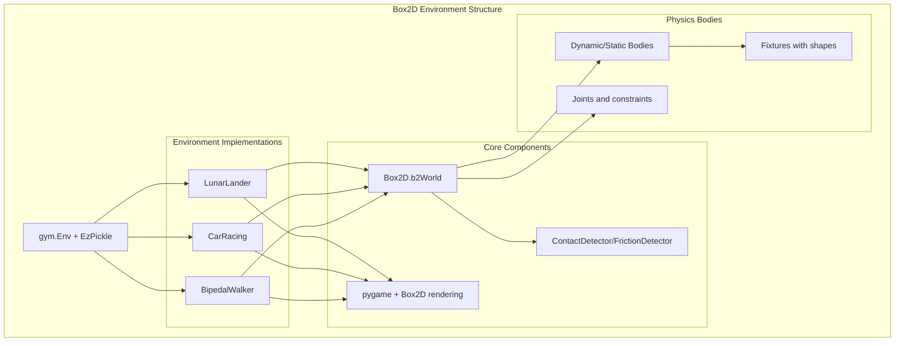
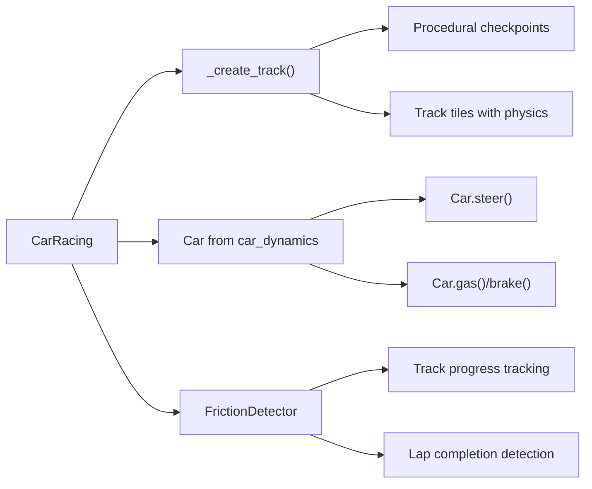
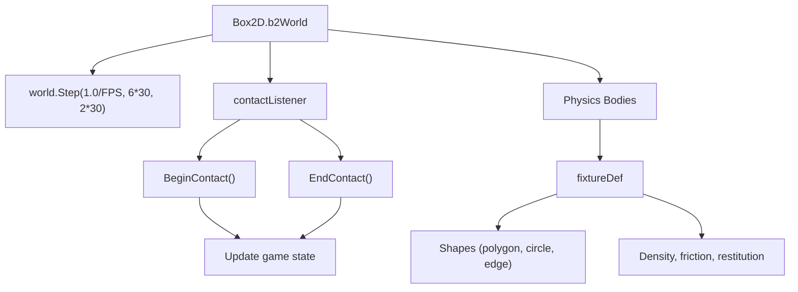

<!-- source: DeepWiki mcp.deepwiki.com · repo Farama-Foundation/Gymnasium · page 5.2 Box2D Environments · fetched 2026-10-14 -->

# Box2D Environments

Relevant source files

The following files were used as context for generating this wiki page:

- [docs/environments/atari.md](docs/environments/atari.md)
- [docs/environments/box2d.md](docs/environments/box2d.md)
- [docs/environments/classic_control.md](docs/environments/classic_control.md)
- [gymnasium/envs/box2d/bipedal_walker.py](gymnasium/envs/box2d/bipedal_walker.py)
- [gymnasium/envs/box2d/car_dynamics.py](gymnasium/envs/box2d/car_dynamics.py)
- [gymnasium/envs/box2d/car_racing.py](gymnasium/envs/box2d/car_racing.py)
- [gymnasium/envs/box2d/lunar_lander.py](gymnasium/envs/box2d/lunar_lander.py)
- [gymnasium/envs/classic_control/acrobot.py](gymnasium/envs/classic_control/acrobot.py)
- [gymnasium/envs/classic_control/cartpole.py](gymnasium/envs/classic_control/cartpole.py)
- [gymnasium/envs/classic_control/continuous_mountain_car.py](gymnasium/envs/classic_control/continuous_mountain_car.py)
- [gymnasium/envs/classic_control/mountain_car.py](gymnasium/envs/classic_control/mountain_car.py)
- [gymnasium/envs/classic_control/pendulum.py](gymnasium/envs/classic_control/pendulum.py)
- [gymnasium/wrappers/vector/array_conversion.py](gymnasium/wrappers/vector/array_conversion.py)
- [gymnasium/wrappers/vector/common.py](gymnasium/wrappers/vector/common.py)
- [gymnasium/wrappers/vector/stateful_observation.py](gymnasium/wrappers/vector/stateful_observation.py)
- [tests/wrappers/vector/test_record_episode_statistics.py](tests/wrappers/vector/test_record_episode_statistics.py)

This document covers the Box2D-based environments in Gymnasium, which provide physics-simulated environments for reinforcement learning. These environments use the Box2D physics engine to create realistic dynamics for vehicles, robots, and other mechanical systems.

For information about other environment categories, see [Classic Control Environments](#5.1), [MuJoCo Environments](#5.3), and [Toy Text Environments](#5.4).

## Overview

Box2D environments in Gymnasium provide physics-based simulations using the Box2D 2D physics engine. The three main environments are:

- **LunarLander** - Spacecraft landing simulation with thrust control
- **CarRacing** - Top-down racing with procedurally generated tracks  
- **BipedalWalker** - Humanoid robot walking simulation

All Box2D environments require the Box2D physics library and pygame for rendering, installed via `pip install "gymnasium[box2d]"`.

Sources: [gymnasium/envs/box2d/lunar_lander.py:15-28](), [gymnasium/envs/box2d/car_racing.py:14-21](), [gymnasium/envs/box2d/bipedal_walker.py:14-27]()

## Environment Architecture

Sources: [gymnasium/envs/box2d/lunar_lander.py:80](), [gymnasium/envs/box2d/car_racing.py:107](), [gymnasium/envs/box2d/bipedal_walker.py:104]()

## LunarLander Environment

The `LunarLander` class implements a spacecraft landing simulation where an agent controls a lander using discrete or continuous thrust actions.

### Key Components

| Component | Purpose | Code Location |
|-----------|---------|---------------|
| `LunarLander` | Main environment class | [gymnasium/envs/box2d/lunar_lander.py:80]() |
| `ContactDetector` | Collision detection for landing/crashing | [gymnasium/envs/box2d/lunar_lander.py:59-78]() |
| `demo_heuristic_lander` | Built-in heuristic agent | [gymnasium/envs/box2d/lunar_lander.py:848-871]() |

### Action and Observation Spaces

- **Discrete Actions**: 4 actions (no-op, left engine, main engine, right engine) [gymnasium/envs/box2d/lunar_lander.py:99-103]()
- **Continuous Actions**: 2D Box space for engine throttle control [gymnasium/envs/box2d/lunar_lander.py:156-163]()
- **Observations**: 8D vector including position, velocity, angle, angular velocity, and leg contact states [gymnasium/envs/box2d/lunar_lander.py:106-109]()

The environment supports various configuration options including gravity adjustment, wind effects, and engine power settings. [gymnasium/envs/box2d/lunar_lander.py:148-170]()

Sources: [gymnasium/envs/box2d/lunar_lander.py:99-105](), [gymnasium/envs/box2d/lunar_lander.py:106-109](), [gymnasium/envs/box2d/lunar_lander.py:214-309]()

## CarRacing Environment

The `CarRacing` class provides a top-down racing simulation with procedurally generated tracks and realistic car dynamics.

### Key Features

The environment features domain randomization for track colors, lap completion detection, and supports both discrete and continuous action spaces. [gymnasium/envs/box2d/car_racing.py:163-167]()

Sources: [gymnasium/envs/box2d/car_racing.py:107](), [gymnasium/envs/box2d/car_racing.py:59-105](), [gymnasium/envs/box2d/car_racing.py:308-496]()

## BipedalWalker Environment

The `BipedalWalker` class simulates a two-legged robot learning to walk across various terrain types.

### Environment Variants

| Variant | Terrain | Difficulty |
|---------|---------|------------|
| Normal | Slightly uneven | Standard |
| Hardcore | Ladders, stumps, pitfalls | Advanced |

### Core Systems

- **Hull and Legs**: 4-joint walker with hip and knee actuators [gymnasium/envs/box2d/bipedal_walker.py:121-122]()
- **Terrain Generation**: Procedural terrain with different obstacle types [gymnasium/envs/box2d/bipedal_walker.py:284-502]()
- **LIDAR**: 10 rangefinder measurements for terrain sensing [gymnasium/envs/box2d/bipedal_walker.py:127]()
- **Contact Detection**: Ground contact detection for legs [gymnasium/envs/box2d/bipedal_walker.py:93-100]()

Sources: [gymnasium/envs/box2d/bipedal_walker.py:104](), [gymnasium/envs/box2d/bipedal_walker.py:177](), [gymnasium/envs/box2d/bipedal_walker.py:284-502]()

## Physics and Collision Detection

All Box2D environments use a common pattern for physics simulation and collision detection:

The physics step runs at 50 FPS with 6 velocity iterations and 2 position iterations for stable simulation. [gymnasium/envs/box2d/lunar_lander.py:621]()

Sources: [gymnasium/envs/box2d/lunar_lander.py:621](), [gymnasium/envs/box2d/car_racing.py:559](), [gymnasium/envs/box2d/bipedal_walker.py:181]()

## Rendering System

Box2D environments use pygame for rendering with a consistent pattern:

### Render Modes
- `"human"`: Interactive display window
- `"rgb_array"`: Numpy array for programmatic use

### Common Rendering Pipeline
1. Create pygame surface
2. Transform Box2D coordinates to screen coordinates  
3. Render physics bodies using their fixture shapes
4. Add environment-specific UI elements
5. Return surface or display to screen

Sources: [gymnasium/envs/box2d/lunar_lander.py:669-784](), [gymnasium/envs/box2d/car_racing.py:589-659](), [gymnasium/envs/box2d/bipedal_walker.py:506-635]()

## Testing and Validation

Box2D environments include comprehensive testing covering:

### Test Categories

| Test Type | Purpose | Example |
|-----------|---------|---------|
| Heuristic Testing | Validate environment dynamics | `test_lunar_lander_heuristics()` |
| Determinism | Ensure reproducible behavior | `test_lunar_lander_random_wind_seed()` |
| Feature Testing | Verify specific features | `test_carracing_domain_randomize()` |
| Hardcore Variants | Test difficulty variations | `test_bipedal_walker_hardcore_creation()` |

The test suite validates that environments work correctly with built-in heuristics and maintain deterministic behavior when seeded.

Sources: [tests/envs/test_env_implementation.py:12-17](), [tests/envs/test_env_implementation.py:19-48](), [tests/envs/test_env_implementation.py:50-87](), [tests/envs/test_env_implementation.py:109-146]()

---

