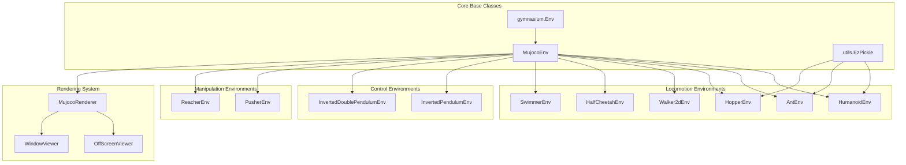
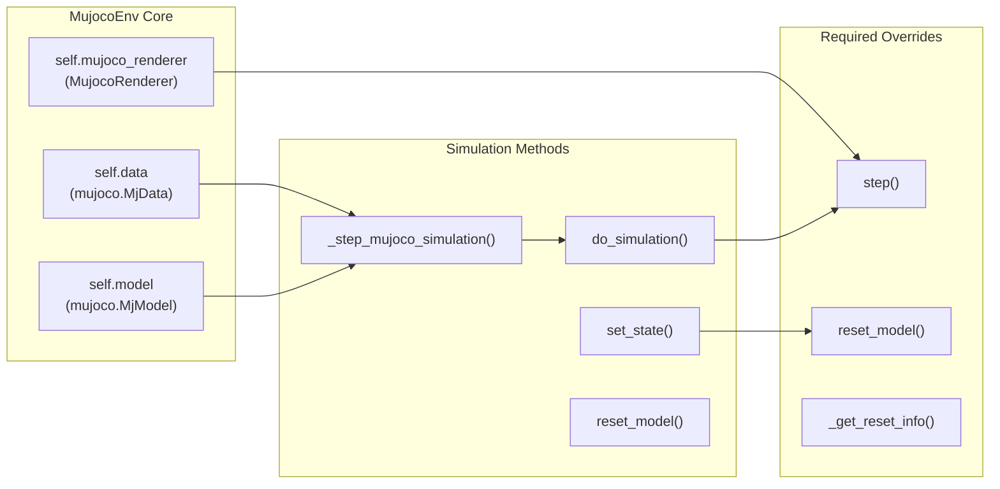
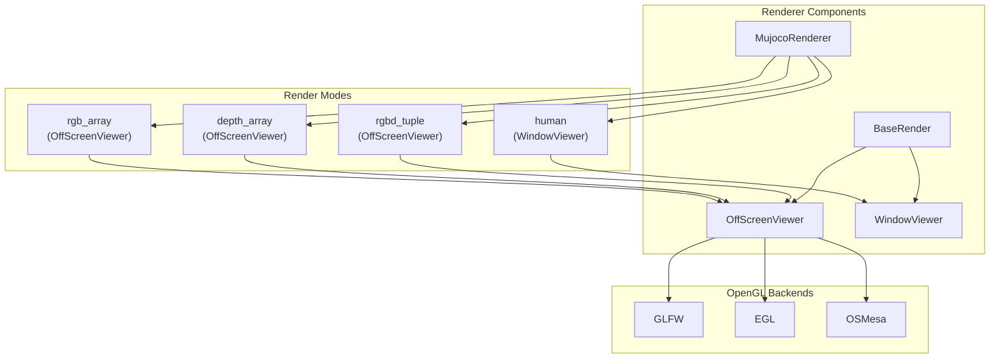
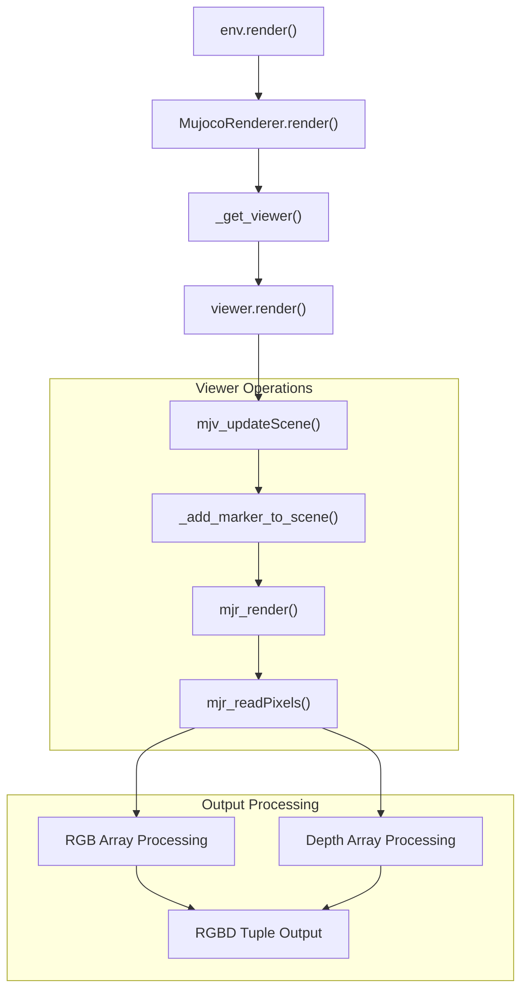
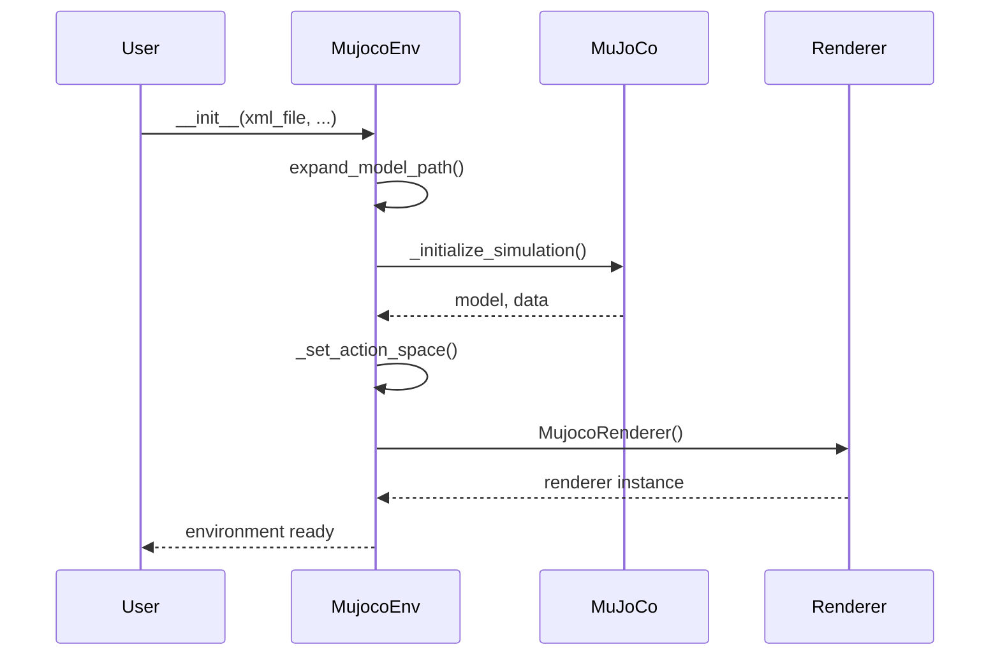
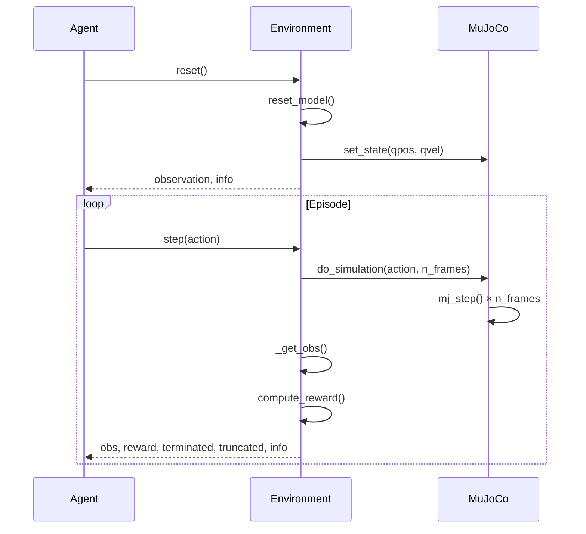
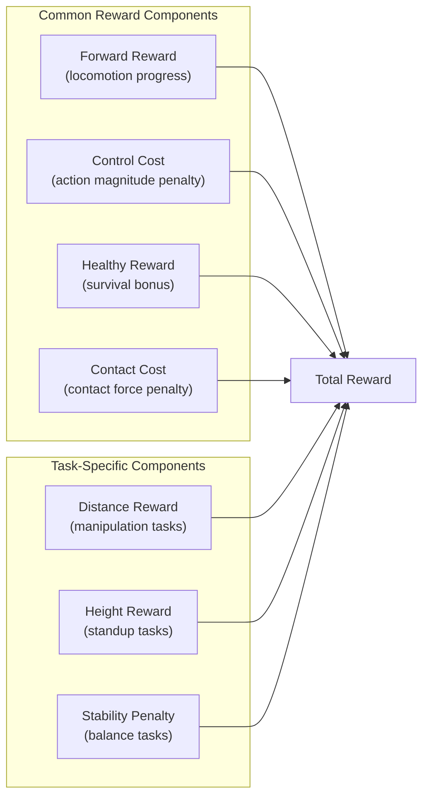

<!-- source: DeepWiki mcp.deepwiki.com · repo Farama-Foundation/Gymnasium · page 5.3 MuJoCo Environments · fetched 2026-10-14 -->

# MuJoCo Environments

<details>
<summary>Relevant source files</summary>

The following files were used as context for generating this wiki page:

- [docs/_scripts/gen_gifs.py](docs/_scripts/gen_gifs.py)
- [docs/_scripts/gen_mds.py](docs/_scripts/gen_mds.py)
- [docs/_scripts/linkcheck.py](docs/_scripts/linkcheck.py)
- [docs/environments/mujoco.md](docs/environments/mujoco.md)
- [docs/environments/third_party_environments.md](docs/environments/third_party_environments.md)
- [gymnasium/envs/mujoco/__init__.py](gymnasium/envs/mujoco/__init__.py)

</details>


This document covers the MuJoCo-based continuous control environments provided by Gymnasium. These environments simulate robotics and control tasks using the MuJoCo physics engine, offering high-fidelity physics simulation for reinforcement learning research. The MuJoCo environments include locomotion tasks (humanoid, ant, hopper), manipulation tasks (pusher, reacher), and classic control problems (inverted pendulum).

For information about other environment categories in Gymnasium, see [Classic Control Environments](#5.1), [Box2D Environments](#5.2), and [Toy Text Environments](#5.4).

## Architecture Overview

The MuJoCo environment system is built around a hierarchical class structure with `MujocoEnv` as the base class and specific environment implementations inheriting from it.



Sources: [gymnasium/envs/mujoco/mujoco_env.py:36-227](), [gymnasium/envs/mujoco/humanoid_v5.py:24](), [gymnasium/envs/mujoco/ant_v5.py:15](), [gymnasium/envs/mujoco/mujoco_rendering.py:681-821]()

## MujocoEnv Base Class

The `MujocoEnv` class serves as the foundation for all MuJoCo environments, providing core functionality for physics simulation, rendering, and environment lifecycle management. It handles the loading of MuJoCo models, stepping the physics simulation, and managing the state of the robot.

For a detailed look into the `MujocoEnv` class, its methods, and the rendering system, see [MujocoEnv Base Class and Rendering](#5.3.1).

### Core Components



Sources: [gymnasium/envs/mujoco/mujoco_env.py:77-109](), [gymnasium/envs/mujoco/mujoco_env.py:141-153](), [gymnasium/envs/mujoco/mujoco_env.py:190-199]()

### Key Methods and Properties

| Method/Property | Purpose | Implementation |
|-----------------|---------|----------------|
| `__init__()` | Initialize MuJoCo model and simulation data | [gymnasium/envs/mujoco/mujoco_env.py:39-109]() |
| `_initialize_simulation()` | Load MuJoCo model from XML file | [gymnasium/envs/mujoco/mujoco_env.py:116-127]() |
| `_step_mujoco_simulation()` | Execute physics simulation steps | [gymnasium/envs/mujoco/mujoco_env.py:141-153]() |
| `do_simulation()` | Apply control actions and step physics | [gymnasium/envs/mujoco/mujoco_env.py:190-199]() |
| `set_state()` | Set joint positions and velocities | [gymnasium/envs/mujoco/mujoco_env.py:129-139]() |
| `state_vector()` | Get concatenated position and velocity state | [gymnasium/envs/mujoco/mujoco_env.py:201-206]() |
| `dt` | Simulation timestep | [gymnasium/envs/mujoco/mujoco_env.py:186-188]() |

Sources: [gymnasium/envs/mujoco/mujoco_env.py:39-227]()

## Environment Categories

Gymnasium provides a variety of MuJoCo environments, categorized by the type of task they represent. These include locomotion, manipulation, and classic control problems. Each environment is designed to challenge reinforcement learning algorithms in different ways.

For detailed documentation on each specific MuJoCo environment, including their v4 and v5 implementations and XML assets, refer to [MuJoCo v5 and v4 Environment Implementations](#5.3.2).

### Locomotion Environments

These environments focus on learning locomotion behaviors for various robotic agents.

#### Humanoid Environments

| Environment | Description | Action Space | Key Features |
|-------------|-------------|--------------|--------------|
| `HumanoidEnv` | 3D bipedal walking | Box(-0.4, 0.4, (17,)) | Full body humanoid with arms and legs |
| `HumanoidStandupEnv` | Standing up from lying position | Box(-0.4, 0.4, (17,)) | Modified reward for standing behavior |

Sources: [gymnasium/envs/mujoco/humanoid_v5.py:24-541](), [gymnasium/envs/mujoco/humanoidstandup_v5.py:18-486]()

#### Quadruped and Other Locomotion

| Environment | Description | Action Space | Key Features |
|-------------|-------------|--------------|--------------|
| `AntEnv` | 3D quadruped locomotion | Box(-1, 1, (8,)) | Four-legged robot with hip and ankle joints |
| `HalfCheetahEnv` | 2D running cheetah | Box(-1, 1, (6,)) | Fast forward locomotion |
| `HopperEnv` | 2D one-legged hopping | Box(-1, 1, (3,)) | Single leg balancing and hopping |
| `Walker2dEnv` | 2D bipedal walking | Box(-1, 1, (6,)) | Two-legged walker |
| `SwimmerEnv` | 2D swimming motion | Box(-1, 1, (2,)) | Snake-like swimmer in fluid |

Sources: [gymnasium/envs/mujoco/ant_v5.py:15-428](), [gymnasium/envs/mujoco/half_cheetah_v5.py:15-281](), [gymnasium/envs/mujoco/hopper_v5.py:18-342](), [gymnasium/envs/mujoco/walker2d_v5.py:18-342](), [gymnasium/envs/mujoco/swimmer_v5.py:10-292]()

### Manipulation Environments

These environments involve robotic arm control and object manipulation tasks.

| Environment | Description | Action Space | Observation Space |
|-------------|-------------|--------------|-------------------|
| `PusherEnv` | 7-DOF arm pushing object to goal | Box(-2, 2, (7,)) | Box(-Inf, Inf, (23,)) |
| `ReacherEnv` | 2-DOF arm reaching target | Box(-1, 1, (2,)) | Box(-Inf, Inf, (11,)) |

Sources: [gymnasium/envs/mujoco/pusher_v5.py:16-275](), [gymnasium/envs/mujoco/reacher_v5.py:13-243]()

### Control Environments

Classic control problems implemented with MuJoCo physics.

| Environment | Description | Action Space | Termination Condition |
|-------------|-------------|--------------|----------------------|
| `InvertedPendulumEnv` | Balance pole on cart | Box(-3, 3, (1,)) | Pole angle > 0.2 rad |
| `InvertedDoublePendulumEnv` | Balance double pendulum | Box(-1, 1, (1,)) | Tip height ≤ 1.0 m |

Sources: [gymnasium/envs/mujoco/inverted_pendulum_v5.py:16-189](), [gymnasium/envs/mujoco/inverted_double_pendulum_v5.py:17-234]()

## Installation and Setup

To use the MuJoCo environments, you need to install the `mujoco` framework. This can be done by installing Gymnasium with the `mujoco` extra:

```bash
pip install gymnasium[mujoco]
```

This command will install the necessary `mujoco` Python package. For instructions on installing the MuJoCo engine itself, refer to the official [MuJoCo website](https://mujoco.org) and their [GitHub repository](https://github.com/google-deepmind/mujoco).

Sources: [docs/environments/mujoco.md:31-35]()

## MuJoCo Environment Versions (v4 and v5)

Gymnasium supports multiple versions of the MuJoCo environments, primarily `v4` and `v5`. These versions differ in the underlying MuJoCo simulator version used and may have variations in environment dynamics, rewards, and observation spaces.

- **`v5`**: Recommended version, utilizing `mujoco=>2.3.3`. It includes the latest features and bug fixes.
- **`v4`**: Maintained for reproducibility, using `mujoco=>2.1.3`.

Older versions (`v2`, `v3`) that relied on the `mujoco-py` framework have been migrated to the `gymnasium-robotics` package. These are deprecated but kept for reproducibility.

For a detailed comparison of `v4` and `v5` and specific changes in each environment, see [MuJoCo v5 and v4 Environment Implementations](#5.3.2).

Sources: [docs/environments/mujoco.md:81-90]()

## Rendering System

The MuJoCo rendering system provides flexible visualization capabilities supporting multiple render modes and output formats. The `MujocoRenderer` class handles the rendering logic, utilizing `OffScreenViewer` for `rgb_array` and `depth_array` modes, and `WindowViewer` for `human` mode.

For a comprehensive explanation of the rendering arguments and the rendering pipeline, see [MujocoEnv Base Class and Rendering](#5.3.1).



Sources: [gymnasium/envs/mujoco/mujoco_rendering.py:681-821](), [gymnasium/envs/mujoco/mujoco_rendering.py:174-330](), [gymnasium/envs/mujoco/mujoco_rendering.py:332-680]()

### Rendering Pipeline

The rendering process follows a structured pipeline from environment calls to OpenGL output:



Sources: [gymnasium/envs/mujoco/mujoco_rendering.py:744-766](), [gymnasium/envs/mujoco/mujoco_rendering.py:236-326](), [gymnasium/envs/mujoco/mujoco_rendering.py:412-495]()

## Environment Lifecycle

### Initialization Workflow



Sources: [gymnasium/envs/mujoco/mujoco_env.py:39-109](), [gymnasium/envs/mujoco/mujoco_env.py:22-33](), [gymnasium/envs/mujoco/mujoco_env.py:116-127]()

### Step and Reset Cycle



Sources: [gymnasium/envs/mujoco/mujoco_env.py:169-184](), [gymnasium/envs/mujoco/mujoco_env.py:190-199](), [gymnasium/envs/mujoco/mujoco_env.py:141-153]()

## Common Patterns and Utilities

### Environment Configuration

Most MuJoCo environments follow consistent patterns for configuration:

| Parameter | Type | Purpose | Example Environments |
|-----------|------|---------|---------------------|
| `xml_file` | str | Custom MuJoCo model path | All v5 environments |
| `frame_skip` | int | Simulation steps per action | All environments |
| `default_camera_config` | dict | Camera settings for rendering | All environments |
| `reset_noise_scale` | float | Initial state randomization | Most locomotion environments |
| `exclude_current_positions_from_observation` | bool | Position-agnostic policies | Locomotion environments |

Sources: [gymnasium/envs/mujoco/humanoid_v5.py:307-325](), [gymnasium/envs/mujoco/ant_v5.py:229-245](), [gymnasium/envs/mujoco/hopper_v5.py:164-178]()

### Reward Structure Patterns

MuJoCo environments typically implement multi-component reward functions:



Sources: [gymnasium/envs/mujoco/humanoid_v5.py:530-541](), [gymnasium/envs/mujoco/ant_v5.py:428](), [gymnasium/envs/mujoco/pusher_v5.py:226-264]()

---

