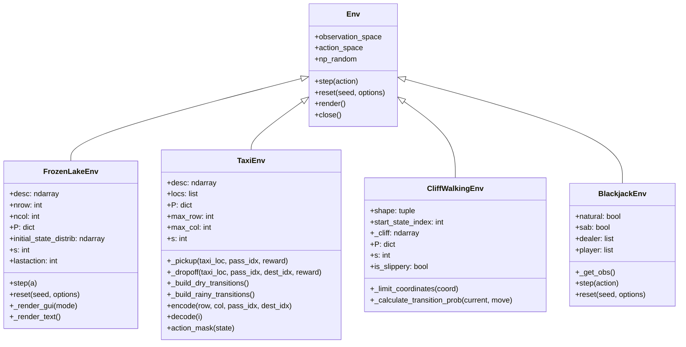
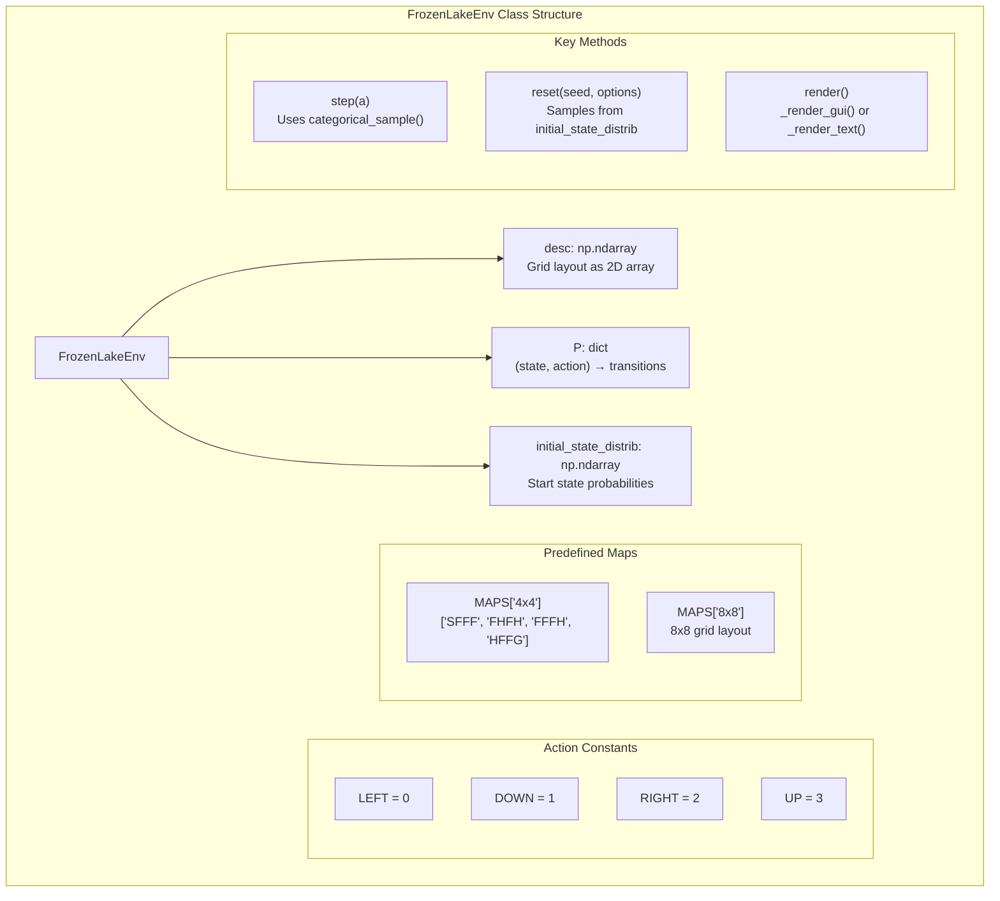
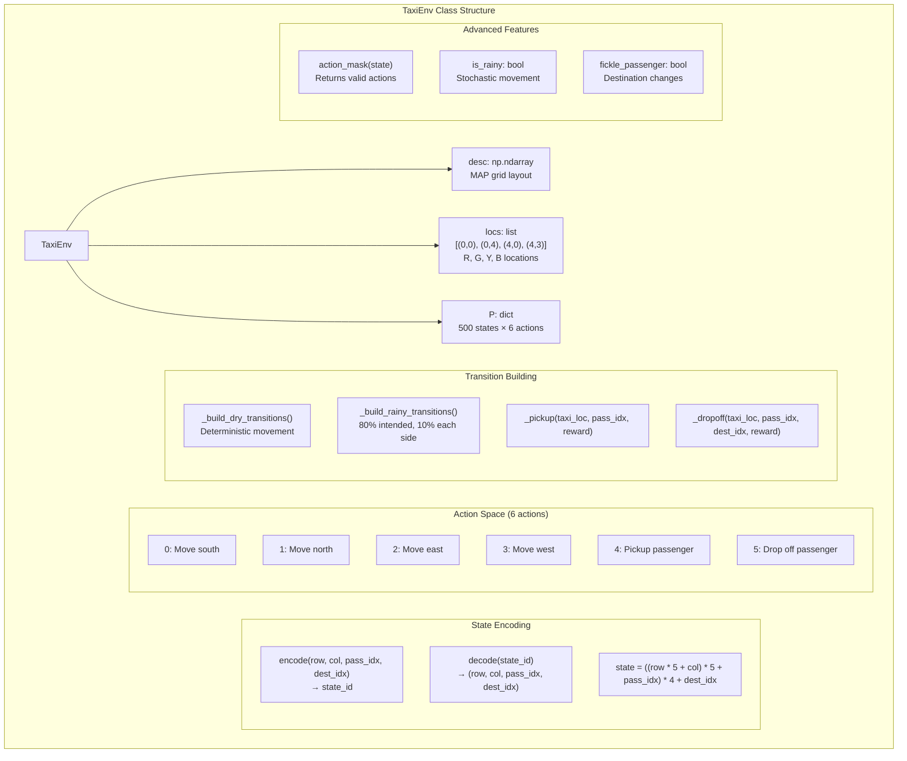
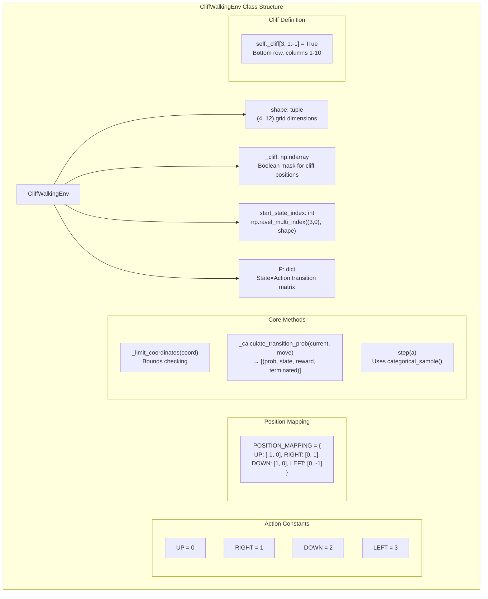
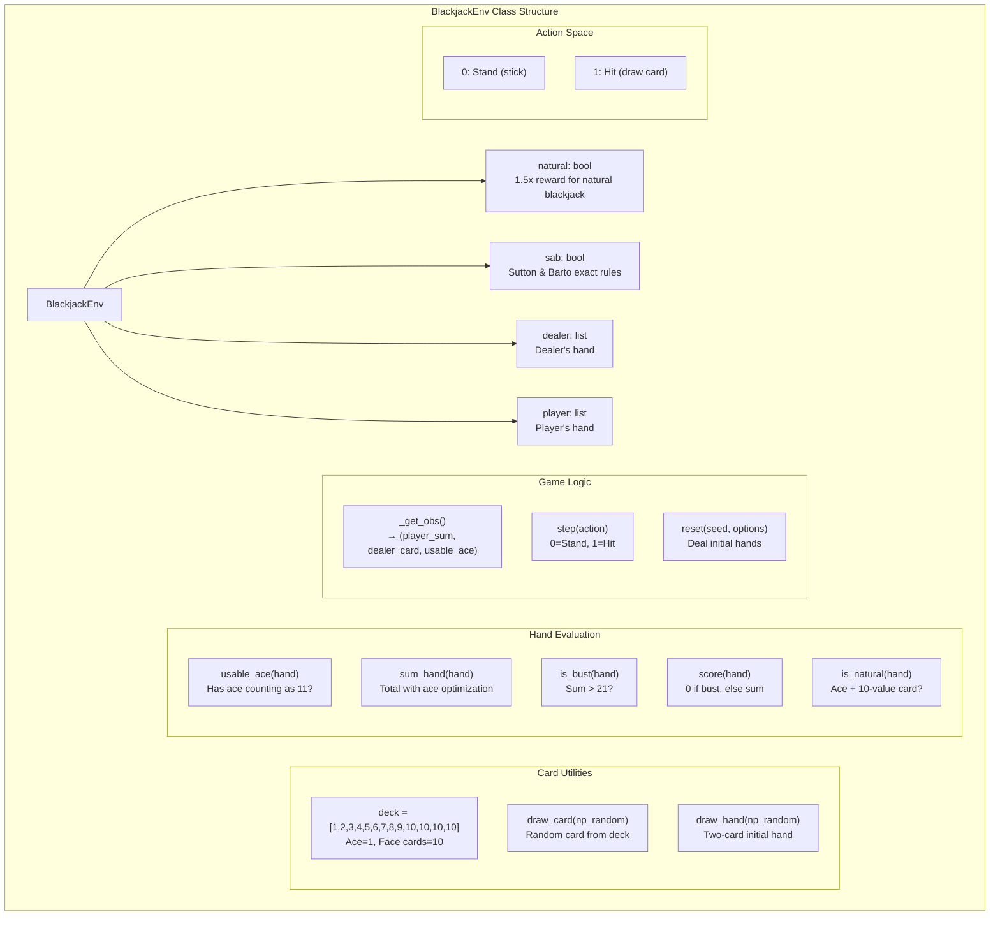
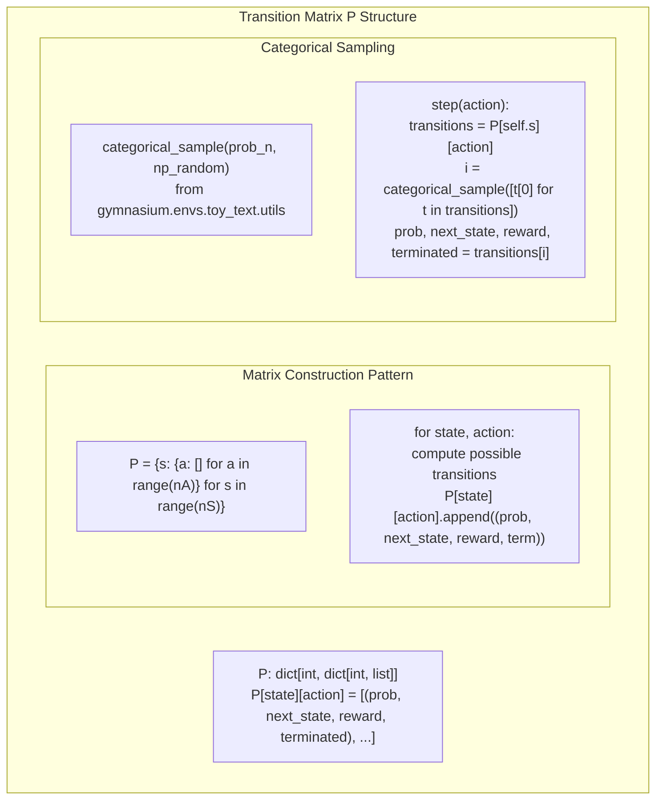
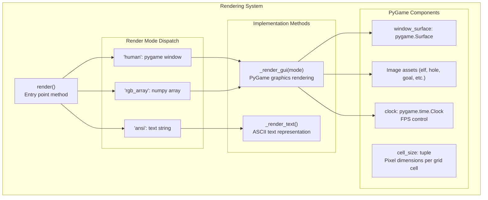
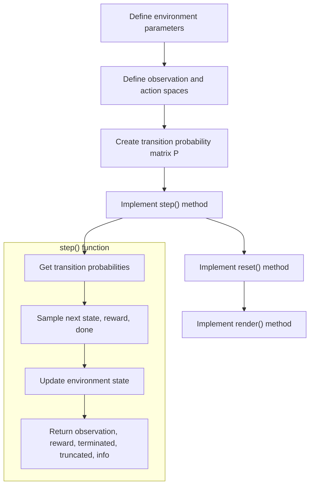
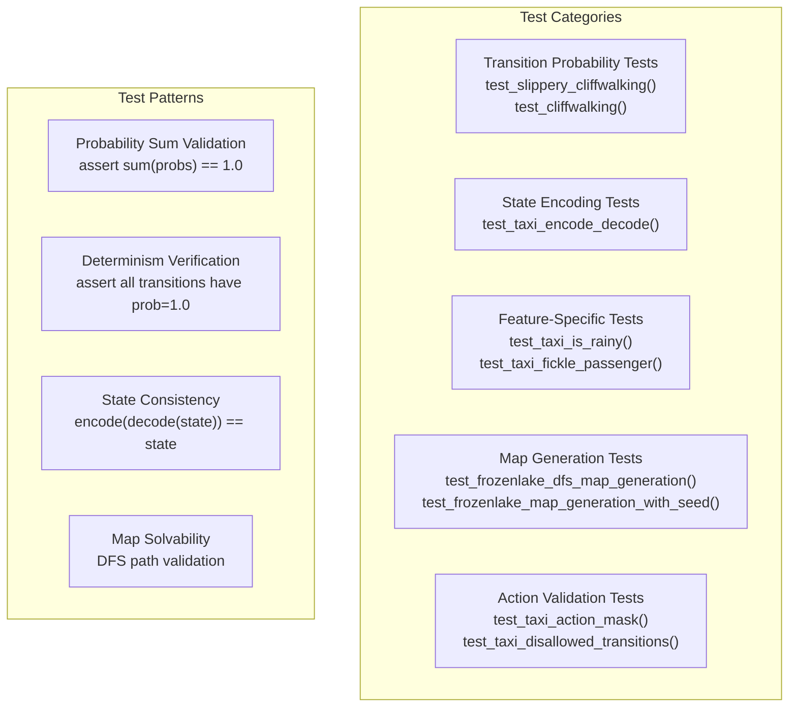

<!-- source: DeepWiki mcp.deepwiki.com · repo Farama-Foundation/Gymnasium · page 5.4 Toy Text Environments · fetched 2026-10-14 -->

# Toy Text Environments

<details>
<summary>Relevant source files</summary>

The following files were used as context for generating this wiki page:

- [docs/_scripts/gen_frozen_lake_gif.py](docs/_scripts/gen_frozen_lake_gif.py)
- [docs/_static/videos/toy_text/cliff_walking.gif](docs/_static/videos/toy_text/cliff_walking.gif)
- [docs/_static/videos/toy_text/frozen_lake.gif](docs/_static/videos/toy_text/frozen_lake.gif)
- [gymnasium/envs/toy_text/blackjack.py](gymnasium/envs/toy_text/blackjack.py)
- [gymnasium/envs/toy_text/cliffwalking.py](gymnasium/envs/toy_text/cliffwalking.py)
- [gymnasium/envs/toy_text/frozen_lake.py](gymnasium/envs/toy_text/frozen_lake.py)
- [gymnasium/envs/toy_text/img/agent.png](gymnasium/envs/toy_text/img/agent.png)
- [gymnasium/envs/toy_text/img/cliff_walking/agent.png](gymnasium/envs/toy_text/img/cliff_walking/agent.png)
- [gymnasium/envs/toy_text/img/cliff_walking/goal_flag.png](gymnasium/envs/toy_text/img/cliff_walking/goal_flag.png)
- [gymnasium/envs/toy_text/img/cliff_walking/letter_g.png](gymnasium/envs/toy_text/img/cliff_walking/letter_g.png)
- [gymnasium/envs/toy_text/img/cliff_walking/letter_s.png](gymnasium/envs/toy_text/img/cliff_walking/letter_s.png)
- [gymnasium/envs/toy_text/img/cliff_walking/tile_cliff_left.png](gymnasium/envs/toy_text/img/cliff_walking/tile_cliff_left.png)
- [gymnasium/envs/toy_text/img/cliff_walking/tile_cliff_mid_a.png](gymnasium/envs/toy_text/img/cliff_walking/tile_cliff_mid_a.png)
- [gymnasium/envs/toy_text/img/cliff_walking/tile_cliff_mid_b.png](gymnasium/envs/toy_text/img/cliff_walking/tile_cliff_mid_b.png)
- [gymnasium/envs/toy_text/img/cliff_walking/tile_cliff_right.png](gymnasium/envs/toy_text/img/cliff_walking/tile_cliff_right.png)
- [gymnasium/envs/toy_text/img/goal_flag.png](gymnasium/envs/toy_text/img/goal_flag.png)
- [gymnasium/envs/toy_text/img/letter_g.png](gymnasium/envs/toy_text/img/letter_g.png)
- [gymnasium/envs/toy_text/img/letter_s.png](gymnasium/envs/toy_text/img/letter_s.png)
- [gymnasium/envs/toy_text/taxi.py](gymnasium/envs/toy_text/taxi.py)

</details>


## Overview

Toy text environments are simple reinforcement learning environments that serve as educational tools and testbeds for RL algorithms. They typically feature discrete state and action spaces, deterministic or simple stochastic dynamics, and text-based or simplified visualizations. Despite their simplicity, they capture fundamental RL challenges such as exploration, delayed rewards, and credit assignment.

This page documents the toy text environments in Gymnasium, their common characteristics, and how to use them effectively in reinforcement learning research and education.

## Common Characteristics

Toy text environments in Gymnasium share several key implementation features:

1. **Discrete State and Action Spaces**: All use `spaces.Discrete` for both observation and action spaces
2. **Transition Probability Matrix**: Most environments implement an explicit `P` dictionary mapping `(state, action)` → `[(probability, next_state, reward, terminated)]`
3. **Categorical Sampling**: Use `categorical_sample()` function from `gymnasium.envs.toy_text.utils` for stochastic transitions
4. **Multiple Render Modes**: Support `"human"`, `"ansi"`, and `"rgb_array"` rendering modes
5. **Environment Variants**: Configurable parameters to modify dynamics and difficulty

### Class Hierarchy and Key Methods



Sources: [gymnasium/envs/toy_text/frozen_lake.py:84-498](), [gymnasium/envs/toy_text/taxi.py:25-633](), [gymnasium/envs/toy_text/cliffwalking.py:22-352](), [gymnasium/envs/toy_text/blackjack.py:48-357]()

## Key Environments

Gymnasium provides several toy text environments, each designed to demonstrate different reinforcement learning concepts.

### FrozenLakeEnv

The `FrozenLakeEnv` class implements a grid-world navigation task where an agent traverses from start (S) to goal (G) while avoiding holes (H).

### FrozenLake Implementation Details



**Core Implementation Features:**
- **State Encoding**: States are integers from `0` to `nrow * ncol - 1`, calculated as `row * ncol + col`
- **Slippery Dynamics**: When `is_slippery=True`, each action has `success_rate` probability (default 1/3) of succeeding, with `fail_rate` probability of moving perpendicular
- **Transition Matrix**: The `P` dictionary maps each `(state, action)` pair to a list of `(probability, next_state, reward, terminated)` tuples
- **Reward Structure**: `reward_schedule` tuple defines rewards for reaching (Goal, Hole, Frozen) tiles, default `(1, 0, 0)`

```python
# Example transition probability construction from frozen_lake.py:284-302
for row in range(nrow):
    for col in range(ncol):
        s = to_s(row, col)  # Convert (row, col) to state index
        for a in range(4):
            li = self.P[s][a]
            letter = desc[row, col]
            if letter in b"GH":  # Goal or Hole - terminal states
                li.append((1.0, s, 0, True))
            else:
                if is_slippery:
                    for b in [(a-1)%4, a, (a+1)%4]:  # Left, intended, right
                        li.append((success_rate if b == a else fail_rate, 
                                  *update_probability_matrix(row, col, b)))
```

Sources: [gymnasium/envs/toy_text/frozen_lake.py:16-33](), [gymnasium/envs/toy_text/frozen_lake.py:84-302](), [gymnasium/envs/toy_text/frozen_lake.py:324-348]()

### TaxiEnv

The `TaxiEnv` class implements Dietterich's hierarchical RL domain where a taxi navigates a 5x5 grid to transport passengers between designated locations.

### Taxi Implementation Architecture



**Key Implementation Details:**
- **State Space**: 500 total states (25 taxi positions × 5 passenger locations × 4 destinations)
- **Wall Constraints**: Movement blocked by walls defined in `MAP` using `|` and `-` characters
- **Reward Structure**: -1 per step, +20 for successful delivery, -10 for illegal pickup/dropoff
- **Action Masking**: `action_mask()` method returns boolean array of valid actions to prevent no-op moves

```python
# State encoding/decoding from taxi.py:196-218
def encode(self, taxi_row, taxi_col, pass_loc, dest_idx):
    i = taxi_row
    i *= 5
    i += taxi_col
    i *= 5
    i += pass_loc
    i *= 4
    i += dest_idx
    return i

def decode(self, i):
    out = []
    out.append(i % 4)          # dest_idx
    i = i // 4
    out.append(i % 5)          # pass_loc
    i = i // 5
    out.append(i % 5)          # taxi_col
    i = i // 5
    out.append(i)              # taxi_row
    return reversed(out)
```

Sources: [gymnasium/envs/toy_text/taxi.py:13-23](), [gymnasium/envs/toy_text/taxi.py:166-277](), [gymnasium/envs/toy_text/taxi.py:194-330](), [gymnasium/envs/toy_text/taxi.py:633]()

### CliffWalkingEnv

The `CliffWalkingEnv` class implements the cliff walking problem from Sutton & Barto Example 6.6, featuring navigation around a dangerous cliff.

### CliffWalking Implementation Structure



**Implementation Details:**
- **State Representation**: States are flattened indices using `np.ravel_multi_index((row, col), shape)`
- **Cliff Penalty**: Stepping into cliff returns agent to start position with -100 reward
- **Goal State**: Position (3, 11) terminates episode successfully
- **Slippery Mode**: When `is_slippery=True`, each action has 1/3 probability each for intended direction and two perpendicular directions

```python
# Cliff initialization and transition calculation from cliffwalking.py:114-192
def __init__(self, render_mode=None, is_slippery=False):
    self.shape = (4, 12)
    self.start_state_index = np.ravel_multi_index((3, 0), self.shape)
    
    # Cliff Location - bottom row except start and goal
    self._cliff = np.zeros(self.shape, dtype=bool)
    self._cliff[3, 1:-1] = True
    
def _calculate_transition_prob(self, current, move):
    if not self.is_slippery:
        deltas = [POSITION_MAPPING[move]]
    else:
        deltas = [POSITION_MAPPING[act] for act in [(move-1)%4, move, (move+1)%4]]
    
    outcomes = []
    for delta in deltas:
        new_position = np.array(current) + np.array(delta)
        new_position = self._limit_coordinates(new_position).astype(int)
        new_state = np.ravel_multi_index(tuple(new_position), self.shape)
        if self._cliff[tuple(new_position)]:
            outcomes.append((1/len(deltas), self.start_state_index, -100, False))
        else:
            terminal_state = (self.shape[0]-1, self.shape[1]-1)
            is_terminated = tuple(new_position) == terminal_state
            outcomes.append((1/len(deltas), new_state, -1, is_terminated))
    return outcomes
```

Sources: [gymnasium/envs/toy_text/cliffwalking.py:14-20](), [gymnasium/envs/toy_text/cliffwalking.py:104-192](), [gymnasium/envs/toy_text/cliffwalking.py:153-192]()

### BlackjackEnv

The `BlackjackEnv` class implements the blackjack card game from Sutton & Barto Example 5.1, featuring simplified casino rules with infinite deck.

### Blackjack Implementation Components



**Core Implementation Logic:**
- **Infinite Deck**: Cards drawn with replacement using `np_random.choice(deck)`
- **Ace Handling**: Aces count as 11 if it keeps hand ≤ 21, otherwise count as 1
- **Dealer Strategy**: Dealer hits on soft 17 (draws until sum ≥ 17)
- **Reward Variants**: Standard (+1/0/-1), Natural (1.5 for blackjack), SAB (player natural auto-wins)

```python
# Core hand evaluation functions from blackjack.py:26-45
def usable_ace(hand):  # Does this hand have a usable ace?
    return int(1 in hand and sum(hand) + 10 <= 21)

def sum_hand(hand):  # Return current hand total
    if usable_ace(hand):
        return sum(hand) + 10
    return sum(hand)

def is_bust(hand):  # Is this hand a bust?
    return sum_hand(hand) > 21

def is_natural(hand):  # Is this hand a natural blackjack?
    return sorted(hand) == [1, 10]

# Game step logic from blackjack.py:166-196
def step(self, action):
    if action:  # hit: add a card to players hand
        self.player.append(draw_card(self.np_random))
        if is_bust(self.player):
            terminated = True
            reward = -1.0
    else:  # stick: play out the dealers hand
        terminated = True
        while sum_hand(self.dealer) < 17:
            self.dealer.append(draw_card(self.np_random))
        reward = cmp(score(self.player), score(self.dealer))
```

Sources: [gymnasium/envs/toy_text/blackjack.py:14-45](), [gymnasium/envs/toy_text/blackjack.py:48-196](), [gymnasium/envs/toy_text/blackjack.py:151-163]()

## Implementation Details

### State Transition Matrix Implementation

Most toy text environments use an explicit transition probability matrix `P` that maps `(state, action)` pairs to lists of possible outcomes. This enables efficient tabular RL algorithms and environment introspection.

### Transition Matrix Structure and Categorical Sampling



**Implementation Pattern:**
1. **Matrix Initialization**: Create nested dictionary structure `P[state][action] = []`
2. **Transition Population**: For each state-action pair, compute all possible outcomes and their probabilities
3. **Step Execution**: Use `categorical_sample()` to sample from transition probabilities during `step()`

```python
# Categorical sampling implementation from utils.py
def categorical_sample(prob_n, np_random):
    """Sample from categorical distribution
    Each row specifies class probabilities
    """
    prob_n = np.asarray(prob_n)
    csprob_n = np.cumsum(prob_n)
    return (csprob_n > np_random.random()).argmax()

# Example usage in CliffWalking step() method from cliffwalking.py:194-204
def step(self, a):
    transitions = self.P[self.s][a]
    i = categorical_sample([t[0] for t in transitions], self.np_random)
    p, s, r, t = transitions[i]
    self.s = s
    self.lastaction = a
    return int(s), r, t, False, {"prob": p}
```

**Matrix Examples by Environment:**
- **FrozenLake**: Slippery transitions with 1/3 probability for intended + perpendicular moves
- **Taxi**: Deterministic transitions except in rainy mode (80% intended, 10% each side)
- **CliffWalking**: Optional slippery mode with 1/3 probability for 3 directions
- **Blackjack**: No explicit P matrix - transitions computed dynamically during `step()`

Sources: [gymnasium/envs/toy_text/utils.py:1-8](), [gymnasium/envs/toy_text/cliffwalking.py:194-204](), [gymnasium/envs/toy_text/frozen_lake.py:256-302](), [gymnasium/envs/toy_text/taxi.py:297-330]()

### Rendering Implementation

Toy text environments implement multiple rendering modes through a common pattern of mode-specific methods and pygame-based graphics.

### Rendering Architecture



**Common Rendering Pattern:**
```python
# Standard render() method pattern from frozen_lake.py:350-363
def render(self):
    if self.render_mode is None:
        gym.logger.warn("You are calling render method without specifying any render mode.")
        return
    
    if self.render_mode == "ansi":
        return self._render_text()
    else:  # self.render_mode in {"human", "rgb_array"}:
        return self._render_gui(self.render_mode)

# Text rendering example from frozen_lake.py:472-486
def _render_text(self):
    desc = self.desc.tolist()
    outfile = StringIO()
    
    row, col = self.s // self.ncol, self.s % self.ncol
    desc = [[c.decode("utf-8") for c in line] for line in desc]
    desc[row][col] = utils.colorize(desc[row][col], "red", highlight=True)
    outfile.write("\n".join("".join(line) for line in desc) + "\n")
    
    return outfile.getvalue()
```

**PyGame Asset Loading:**
Most environments load sprite assets for visual rendering. For example, `CliffWalkingEnv` loads several PNG files for its visual representation:
- `agent.png` [gymnasium/envs/toy_text/img/cliff_walking/agent.png]()
- `goal_flag.png` [gymnasium/envs/toy_text/img/cliff_walking/goal_flag.png]()
- `letter_s.png` [gymnasium/envs/toy_text/img/cliff_walking/letter_s.png]()
- `tile_cliff_left.png` [gymnasium/envs/toy_text/img/cliff_walking/tile_cliff_left.png]()
- `tile_cliff_mid_a.png` [gymnasium/envs/toy_text/img/cliff_walking/tile_cliff_mid_a.png]()
- `tile_cliff_mid_b.png` [gymnasium/envs/toy_text/img/cliff_walking/tile_cliff_mid_b.png]()
- `tile_cliff_right.png` [gymnasium/envs/toy_text/img/cliff_walking/tile_cliff_right.png]()

```python
# Asset loading pattern from frozen_lake.py:389-424
if self.hole_img is None:
    file_name = path.join(path.dirname(__file__), "img/hole.png")
    self.hole_img = pygame.transform.scale(
        pygame.image.load(file_name), self.cell_size
    )
```

Sources: [gymnasium/envs/toy_text/frozen_lake.py:350-462](), [gymnasium/envs/toy_text/cliffwalking.py:215-346](), [gymnasium/envs/toy_text/taxi.py:504-633](), [gymnasium/envs/toy_text/img/cliff_walking/agent.png](), [gymnasium/envs/toy_text/img/cliff_walking/goal_flag.png](), [gymnasium/envs/toy_text/img/cliff_walking/letter_s.png](), [gymnasium/envs/toy_text/img/cliff_walking/tile_cliff_left.png](), [gymnasium/envs/toy_text/img/cliff_walking/tile_cliff_mid_a.png](), [gymnasium/envs/toy_text/img/cliff_walking/tile_cliff_mid_b.png](), [gymnasium/envs/toy_text/img/cliff_walking/tile_cliff_right.png]()

## Usage Examples

### Basic Usage

```python
import gymnasium as gym

# Create the environment
env = gym.make('FrozenLake-v1', is_slippery=True)

# Reset the environment to get initial observation
observation, info = env.reset(seed=42)

for _ in range(1000):
    # Take a random action
    action = env.action_space.sample() 
    observation, reward, terminated, truncated, info = env.step(action)
    
    # Render the environment
    env.render()
    
    # Check if the episode is done
    if terminated or truncated:
        observation, info = env.reset()

env.close()
```

### Customizing Environment Creation

Most toy text environments accept additional parameters to modify their behavior:

```python
# Create a non-slippery FrozenLake environment
env = gym.make('FrozenLake-v1', is_slippery=False, render_mode="human")

# Create a rainy Taxi environment with fickle passengers
env = gym.make('Taxi-v3', is_rainy=True, fickle_passenger=True)
```

## Common Implementation Pattern

The toy text environments follow a common pattern:



Sources: [gymnasium/envs/toy_text/frozen_lake.py](), [gymnasium/envs/toy_text/blackjack.py](), [gymnasium/envs/toy_text/taxi.py](), [gymnasium/envs/toy_text/cliffwalking.py]()

## Key Features of Implementation

### Probabilistic State Transitions

Toy text environments commonly use the `categorical_sample` function to sample from a probability distribution:

```python
def categorical_sample(prob_n, np_random):
    """Sample from categorical distribution"""
    prob_n = np.asarray(prob_n)
    csprob_n = np.cumsum(prob_n)
    return (csprob_n > np_random.random()).argmax()
```

This function is used when taking steps in stochastic environments:

```python
# Example from cliffwalking.py
def step(self, a):
    transitions = self.P[self.s][a]
    i = categorical_sample([t[0] for t in transitions], self.np_random)
    p, s, r, t = transitions[i]
    self.s = s
    self.lastaction = a
    return (int(s), r, t, False, {"prob": p})
```

Sources: [gymnasium/envs/toy_text/cliffwalking.py:193-204](), [gymnasium/envs/toy_text/utils.py:1-8]()

### Visualization

Most toy text environments support multiple rendering modes including human-viewable visualizations using PyGame:

```python
def _render_gui(self, mode):
    try:
        import pygame
    except ImportError as e:
        raise DependencyNotInstalled(
            'pygame is not installed, run `pip install "gymnasium[toy-text]"`'
        ) from e
    # Rendering code follows...
```

Sources: [gymnasium/envs/toy_text/frozen_lake.py:346-442]()

## Environment Variants and Extensions

Most toy text environments have multiple versions and configurable parameters:

| Environment | Variants | Key Parameters |
|------------|----------|---------------|
| FrozenLake | 4x4, 8x8 | `is_slippery`, custom maps via `desc` |
| Taxi | Standard, Rainy | `is_rainy`, `fickle_passenger` |
| Blackjack | Standard, Sutton&Barto | `natural`, `sab` |
| CliffWalking | Standard, Slippery | `is_slippery` |

Environment parameters can be used to adjust the difficulty and dynamics:

```python
# Create custom FrozenLake with specific layout
custom_map = ["SFFF", "FHFH", "FFFH", "HFFG"]
env = gym.make('FrozenLake-v1', desc=custom_map, is_slippery=True)

# You can also generate random FrozenLake maps
from gymnasium.envs.toy_text.frozen_lake import generate_random_map
random_map = generate_random_map(size=8, p=0.8)  # p is probability of frozen tile
env = gym.make('FrozenLake-v1', desc=random_map, render_mode="human")
```

Sources: [gymnasium/envs/toy_text/frozen_lake.py:57-80](), [gymnasium/envs/toy_text/taxi.py:141-148]()

## Testing Framework and Environment Validation

Toy text environments undergo comprehensive testing to ensure correct implementation of transition probabilities, state encoding, and environment dynamics.

### Test Suite Architecture



**Key Test Examples:**

```python
# Transition probability validation from test_env_implementation.py:89-98
def test_slippery_cliffwalking():
    """Test that the slippery cliffwalking environment is correctly implemented."""
    envs = CliffWalkingEnv(is_slippery=True)
    for actions_dict in envs.P.values():
        for transitions in actions_dict.values():
            assert len(transitions) == 3  # 3 possible outcomes per action
            assert all([r[0] == 1 / 3 for r in transitions])  # Equal probability

# State encoding validation from test_env_implementation.py:199-207  
def test_taxi_encode_decode():
    env = TaxiEnv()
    state, info = env.reset()
    for _ in range(100):
        assert env.encode(*env.decode(state)) == state
        state, _, _, _, _ = env.step(env.action_space.sample())

# Map generation validation from test_env_implementation.py:148-176
def test_frozenlake_dfs_map_generation(map_size: int):
    """Verify random maps always have solvable path using DFS."""
    new_frozenlake = generate_random_map(map_size)
    directions = [(1, 0), (0, 1), (-1, 0), (0, -1)]
    frontier, discovered = [], set()
    frontier.append((0, 0))
    # ... DFS implementation to verify path exists
```

**Implementation Guidelines for Custom Environments:**
1. **Transition Matrix**: Ensure all probabilities sum to 1.0 for each `(state, action)` pair
2. **State Encoding**: Implement bijective `encode()`/`decode()` methods for composite state spaces
3. **Action Masking**: Provide `action_mask()` method to indicate valid actions per state
4. **Deterministic Seeding**: Support reproducible behavior via `np_random` seeding
5. **Boundary Validation**: Test edge cases like walls, terminal states, and invalid actions

Sources: [tests/envs/test_env_implementation.py:89-98](), [tests/envs/test_env_implementation.py:199-207](), [tests/envs/test_env_implementation.py:148-176]()

## Summary

Toy text environments in Gymnasium provide simple, controlled environments for reinforcement learning experimentation and education. Their key characteristics include:

1. Discrete state and action spaces
2. Simple dynamics with explicit transition probabilities
3. Various rendering options for visualization
4. Educational focus to demonstrate RL concepts

These environments serve as excellent starting points for learning reinforcement learning concepts and testing algorithms before moving to more complex domains like Atari games or robotic control.

---

