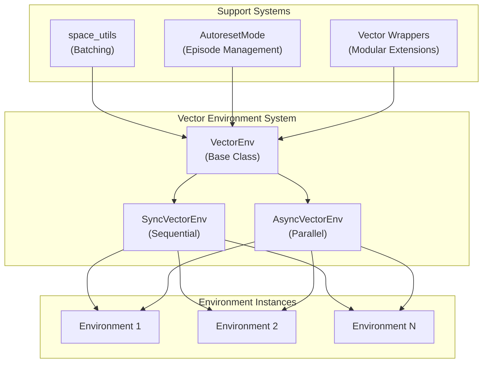
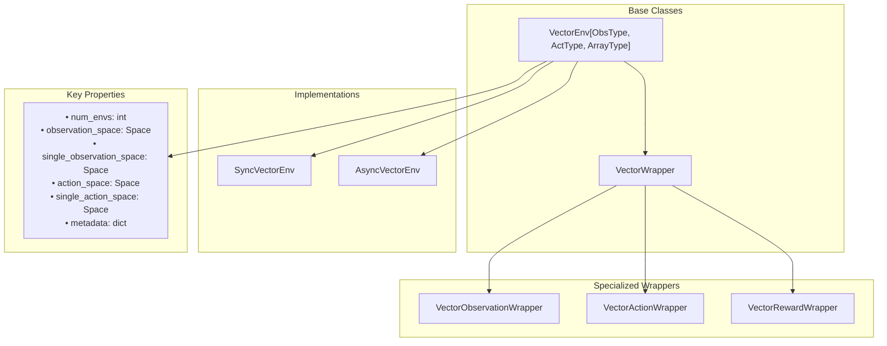
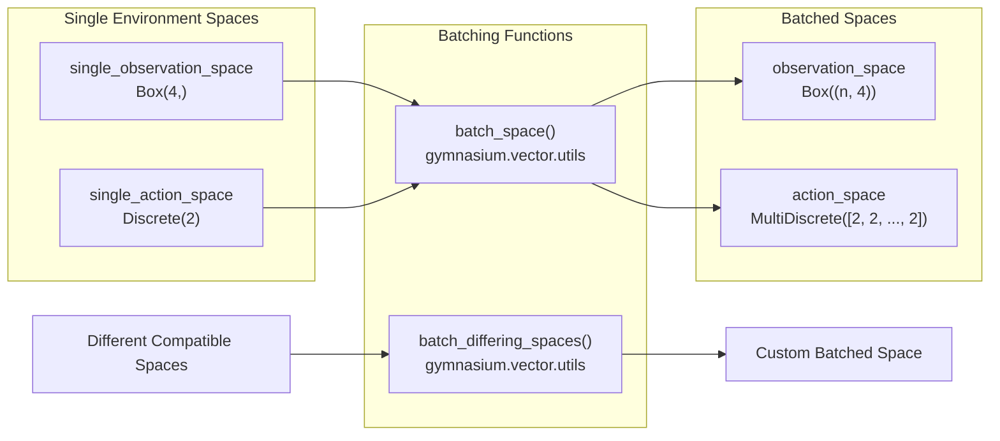
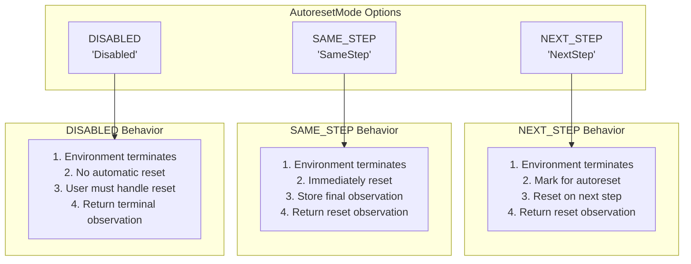

<!-- source: DeepWiki mcp.deepwiki.com · repo Farama-Foundation/Gymnasium · page 6 Vector Environments · fetched 2026-10-14 -->

# Vector Environments

<details>
<summary>Relevant source files</summary>

The following files were used as context for generating this wiki page:

- [docs/api/vector.md](docs/api/vector.md)
- [docs/api/vector/async_vector_env.md](docs/api/vector/async_vector_env.md)
- [docs/api/vector/sync_vector_env.md](docs/api/vector/sync_vector_env.md)
- [docs/api/wrappers.md](docs/api/wrappers.md)
- [gymnasium/vector/__init__.py](gymnasium/vector/__init__.py)
- [gymnasium/vector/async_vector_env.py](gymnasium/vector/async_vector_env.py)
- [gymnasium/vector/sync_vector_env.py](gymnasium/vector/sync_vector_env.py)
- [gymnasium/vector/utils/misc.py](gymnasium/vector/utils/misc.py)
- [gymnasium/vector/vector_env.py](gymnasium/vector/vector_env.py)
- [tests/vector/test_async_vector_env.py](tests/vector/test_async_vector_env.py)
- [tests/vector/test_sync_vector_env.py](tests/vector/test_sync_vector_env.py)
- [tests/vector/test_vector_env.py](tests/vector/test_vector_env.py)

</details>


Vector environments enable running multiple environment instances simultaneously to accelerate reinforcement learning training. This system provides both synchronous (sequential) and asynchronous (parallel) execution modes, with automatic batching of observations, actions, rewards, and episode management.

For information about individual environment implementations, see [Environment Categories](#5). For core environment interfaces, see [Core API](#2).

## Architecture Overview

The vector environment system is built around a common interface with two primary implementations for different execution patterns.



Sources: [gymnasium/vector/vector_env.py:1-624](), [gymnasium/vector/async_vector_env.py:1-173](), [gymnasium/vector/sync_vector_env.py:1-157]()

## Core Class Hierarchy

The vector environment system implements a clear inheritance structure with specialized wrapper classes for different transformation types.



Sources: [gymnasium/vector/vector_env.py:41-120](), [gymnasium/vector/__init__.py:6-13]()

## Synchronous vs Asynchronous Execution

The two main implementations provide different trade-offs between simplicity and performance.

### SyncVectorEnv

`SyncVectorEnv` executes environments sequentially in a single process. This approach is simpler and has lower overhead but cannot leverage multiple CPU cores. For details, see [Synchronous Vector Environments](#6.1).

| Feature | Implementation |
|---------|----------------|
| Execution | Sequential for-loop over environments |
| Process Model | Single process |
| Memory Usage | Shared memory space |
| Debugging | Easier to debug |
| Overhead | Lower initialization overhead |

Key implementation details:
- Environments stored in `self.envs` list [gymnasium/vector/sync_vector_env.py:109]()
- Uses `concatenate()` for observation batching [gymnasium/vector/utils/__init__.py:12]()
- Direct method calls on environment instances [gymnasium/vector/sync_vector_env.py:209-218]()

Sources: [gymnasium/vector/sync_vector_env.py:27-157]()

### AsyncVectorEnv

`AsyncVectorEnv` runs environments in parallel using multiprocessing with pipe-based communication and optional shared memory for observations. For details, see [Asynchronous Vector Environments](#6.2).

| Feature | Implementation |
|---------|----------------|
| Execution | Parallel across multiple processes |
| Process Model | One process per environment |
| Memory Usage | Optional shared memory for observations |
| Communication | Pipes between processes |
| Performance | Higher throughput for CPU-intensive environments |

Key implementation details:
- Uses `multiprocessing.Process` for each environment [gymnasium/vector/async_vector_env.py:217-236]()
- Communication via `multiprocessing.Pipe` [gymnasium/vector/async_vector_env.py:216]()
- State management with `AsyncState` enum [gymnasium/vector/async_vector_env.py:55-62]()
- Worker function `_async_worker` handles environment operations [gymnasium/vector/async_vector_env.py:721-853]()

Sources: [gymnasium/vector/async_vector_env.py:64-173]()

## Space Batching System

Vector environments automatically batch observation and action spaces to handle multiple environment instances efficiently.



### Space Batching Rules

The `batch_space()` function implements specific rules for each space type:

| Original Space | Batched Space | Implementation |
|----------------|---------------|----------------|
| `Box(low, high, shape)` | `Box(tiled_low, tiled_high, (n,) + shape)` | Tile bounds across batch dimension |
| `Discrete(n)` | `MultiDiscrete([n, n, ..., n])` | Convert to multi-discrete |
| `MultiDiscrete(nvec)` | `Box(low, high)` | Convert to continuous box |
| `Dict({key: space})` | `Dict({key: batch_space(space)})` | Recursively batch values |
| `Tuple(spaces)` | `Tuple(batch_space(s) for s in spaces)` | Recursively batch elements |

Sources: [gymnasium/vector/utils/space_utils.py:47-149]()

## Autoreset Modes

Vector environments handle episode termination automatically through three autoreset modes defined in the `AutoresetMode` enum.



### Implementation Details

**NEXT_STEP** (Default): Environments are reset at the beginning of the next `step()` call after termination:
- `SyncVectorEnv`: Uses `_autoreset_envs` array to track which environments need reset [gymnasium/vector/sync_vector_env.py:251-265]()
- `AsyncVectorEnv`: Worker processes handle autoreset in `_async_worker` [gymnasium/vector/async_vector_env.py:754-766]()

**SAME_STEP**: Environments are reset immediately upon termination within the same `step()` call:
- Stores final observation and info in `"final_obs"` and `"final_info"` keys [gymnasium/vector/sync_vector_env.py:285-292]()
- Returns the reset observation instead of the terminal observation

**DISABLED**: No automatic reset occurs; user must manually call `reset()`:
- Used for environments that handle episode management externally
- Requires careful coordination to avoid invalid states

Sources: [gymnasium/vector/vector_env.py:33-39](), [gymnasium/vector/sync_vector_env.py:251-294](), [gymnasium/vector/async_vector_env.py:754-795]()

## Vector Environment API

Vector environments extend the standard Gymnasium environment interface with batched operations and additional utility methods.

### Core Methods

| Method | Purpose | Returns |
|--------|---------|---------|
| `reset(seed, options)` | Reset all environments | `(observations, infos)` |
| `step(actions)` | Step all environments | `(observations, rewards, terminations, truncations, infos)` |
| `call(name, *args, **kwargs)` | Call method on all environments | `tuple` of results |
| `get_attr(name)` | Get attribute from all environments | `tuple` of values |
| `set_attr(name, values)` | Set attribute on all environments | None |

### Async-Specific Methods

`AsyncVectorEnv` provides additional methods for non-blocking operations:

| Method | Purpose |
|--------|---------|
| `reset_async()` | Start async reset |
| `reset_wait(timeout)` | Wait for reset completion |
| `step_async(actions)` | Start async step |
| `step_wait(timeout)` | Wait for step completion |
| `call_async(name, *args, **kwargs)` | Start async method call |
| `call_wait(timeout)` | Wait for call completion |

Sources: [gymnasium/vector/vector_env.py:136-212](), [gymnasium/vector/async_vector_env.py:251-549]()

## Usage Patterns

Vector environments are typically created using environment factory functions and can be configured for different observation modes and autoreset behaviors.

### Basic Creation

```python
# Synchronous vector environment
env_fns = [lambda: gym.make("CartPole-v1") for _ in range(4)]
sync_env = SyncVectorEnv(env_fns)

# Asynchronous vector environment
async_env = AsyncVectorEnv(env_fns, shared_memory=True)
```

### Observation Modes

Vector environments support different observation space configurations:

| Mode | Description | Use Case |
|------|-------------|----------|
| `"same"` | All environments have identical observation spaces | Standard training |
| `"different"` | Environments have compatible but different spaces | Domain randomization |
| `(single_space, batch_space)` | Custom space configuration | Advanced use cases |

### Integration with Training

Vector environments integrate seamlessly with training algorithms by providing batched data:

- Observations are automatically concatenated into arrays suitable for neural networks
- Rewards, terminations, and truncations are returned as 1D arrays
- Info dictionaries are batched with automatic masking for missing values

Sources: [gymnasium/vector/sync_vector_env.py:64-94](), [gymnasium/vector/async_vector_env.py:92-150](), [gymnasium/vector/vector_env.py:276-337]()

---

