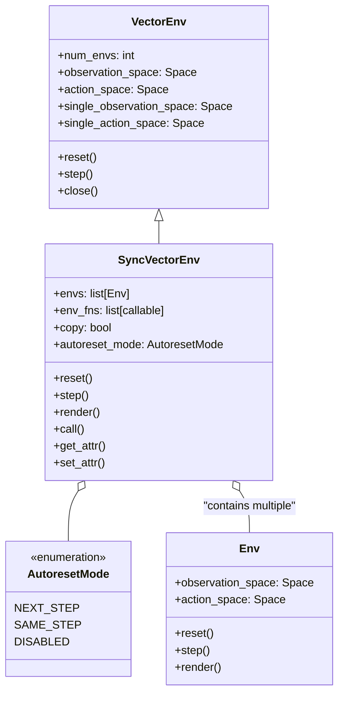
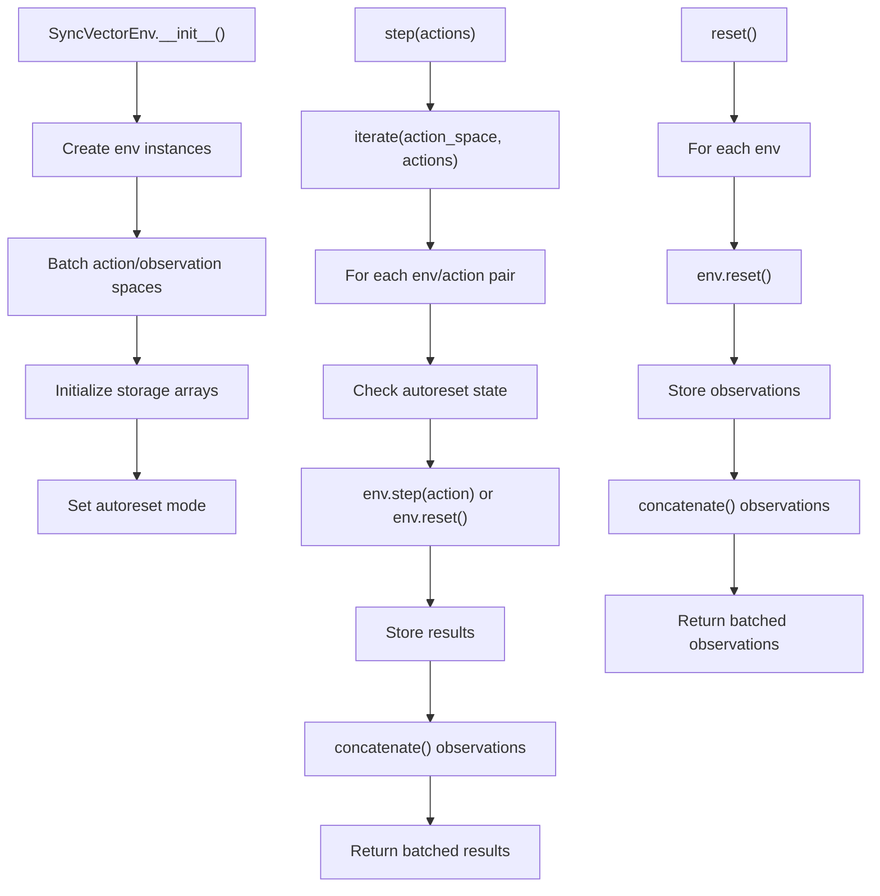
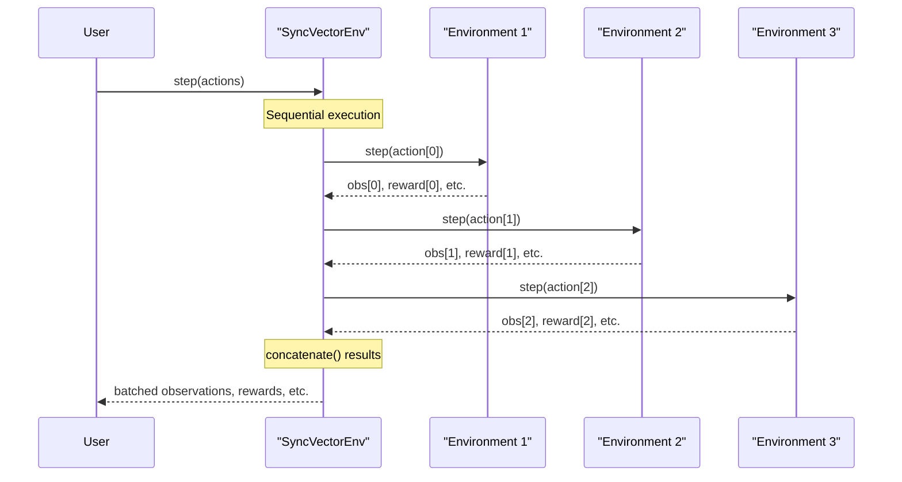
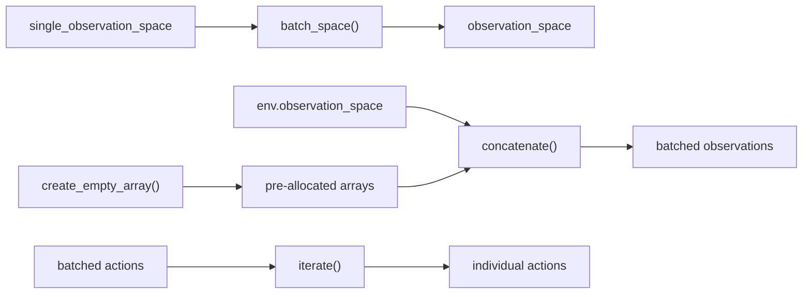
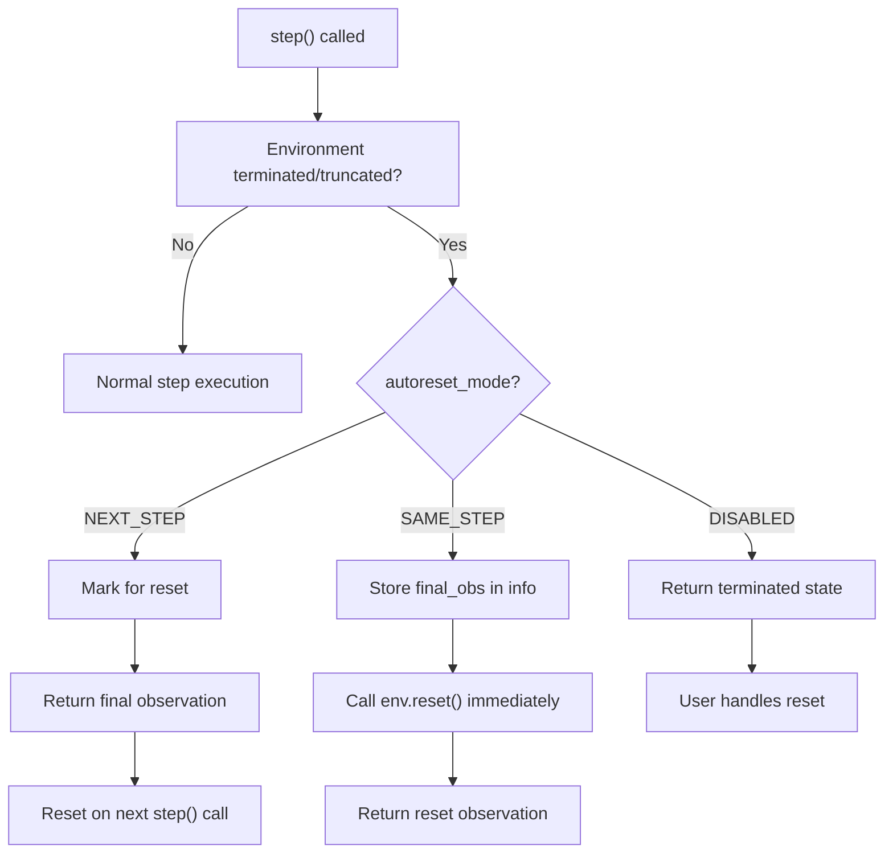

<!-- source: DeepWiki mcp.deepwiki.com · repo Farama-Foundation/Gymnasium · page 6.1 Synchronous Vector Environments · fetched 2026-10-14 -->

# Synchronous Vector Environments

<details>
<summary>Relevant source files</summary>

The following files were used as context for generating this wiki page:

- [gymnasium/vector/async_vector_env.py](gymnasium/vector/async_vector_env.py)
- [gymnasium/vector/sync_vector_env.py](gymnasium/vector/sync_vector_env.py)
- [gymnasium/vector/utils/__init__.py](gymnasium/vector/utils/__init__.py)
- [gymnasium/vector/utils/misc.py](gymnasium/vector/utils/misc.py)
- [gymnasium/vector/vector_env.py](gymnasium/vector/vector_env.py)
- [tests/vector/test_async_vector_env.py](tests/vector/test_async_vector_env.py)
- [tests/vector/test_observation_mode.py](tests/vector/test_observation_mode.py)
- [tests/vector/test_sync_vector_env.py](tests/vector/test_sync_vector_env.py)
- [tests/vector/test_vector_env.py](tests/vector/test_vector_env.py)

</details>


This document covers the synchronous vector environment implementation in Gymnasium, which allows running multiple environments sequentially in a single process. For parallel execution across multiple processes, see [Asynchronous Vector Environments](#6.2).

## Purpose and Scope

Synchronous vector environments (`SyncVectorEnv`) provide a way to batch multiple environment instances together and execute them sequentially using a simple for-loop approach. This is useful for:

- Collecting experience from multiple environments in a single vectorized operation
- Simplifying environment management when parallel execution is not required
- Maintaining deterministic execution order
- Avoiding the complexity and overhead of multiprocessing

The synchronous approach trades potential performance gains from parallelization for simplicity and deterministic behavior.

## Architecture Overview



Sources: [gymnasium/vector/vector_env.py:42-120](), [gymnasium/vector/sync_vector_env.py:26-61](), [gymnasium/vector/vector_env.py:33-39]()

## SyncVectorEnv Implementation

The `SyncVectorEnv` class implements sequential execution of multiple environments through direct iteration:



Sources: [gymnasium/vector/sync_vector_env.py:63-157](), [gymnasium/vector/sync_vector_env.py:239-310](), [gymnasium/vector/sync_vector_env.py:165-237]()

### Key Constructor Parameters

The `SyncVectorEnv` constructor accepts several important parameters:

- **`env_fns`**: List of callable functions that create environment instances
- **`copy`**: Whether to return copies of observations (default: `True`)
- **`observation_mode`**: How to batch observation spaces (`"same"`, `"different"`, or custom tuple)
- **`autoreset_mode`**: When to automatically reset terminated environments

Sources: [gymnasium/vector/sync_vector_env.py:76-91]()

## Execution Flow Comparison



Sources: [gymnasium/vector/sync_vector_env.py:247-310]()

This contrasts with `AsyncVectorEnv`, which executes environments in parallel across multiple processes using pipes and shared memory.

## Space Batching System

The vector environment system uses sophisticated space batching utilities to handle different observation and action space configurations:



The key functions from `gymnasium/vector/utils/space_utils.py` include:

- **`batch_space()`**: Creates batched versions of spaces (e.g., `Box(3,)` → `Box(num_envs, 3)`)
- **`concatenate()`**: Combines individual observations into batched arrays
- **`iterate()`**: Splits batched actions into individual actions for each environment
- **`create_empty_array()`**: Pre-allocates output arrays for efficient concatenation

Sources: [gymnasium/vector/utils/space_utils.py:9-15](), [gymnasium/vector/sync_vector_env.py:106-127](), [gymnasium/vector/sync_vector_env.py:234-236]()

## Autoreset Modes

Vector environments support automatic resetting of terminated or truncated environments through the `AutoresetMode` enum:

| Mode | Behavior | Implementation |
|------|----------|----------------|
| `NEXT_STEP` | Reset on next `step()` call | Default mode, defers reset until next action |
| `SAME_STEP` | Reset immediately | Calls `env.reset()` within same `step()` call |
| `DISABLED` | No automatic reset | User must manually handle resets |



Sources: [gymnasium/vector/vector_env.py:33-39](), [gymnasium/vector/sync_vector_env.py:251-294]()

## Method Details

### Core Methods

**`reset()`**: Resets all or selected environments based on an optional `reset_mask`:

```python
# Reset all environments
observations, infos = vec_env.reset(seed=42)

# Reset only specific environments
options = {"reset_mask": np.array([True, False, True])}
observations, infos = vec_env.reset(options=options)
```

**`step()`**: Executes actions across all environments and handles autoreset logic:

```python
observations, rewards, terminations, truncations, infos = vec_env.step(actions)
```

Sources: [gymnasium/vector/sync_vector_env.py:165-237](), [gymnasium/vector/sync_vector_env.py:239-310]()

### Utility Methods

**`call()`**: Invokes methods on all sub-environments:

```python
render_frames = vec_env.call("render")
spec_ids = vec_env.call("spec.id")
```

**`get_attr()` / `set_attr()`**: Get or set attributes across all environments:

```python
# Get render modes from all environments
render_modes = vec_env.get_attr("metadata.render_modes")

# Set different random seeds
vec_env.set_attr("np_random", [rng1, rng2, rng3])
```

Sources: [gymnasium/vector/sync_vector_env.py:316-347](), [gymnasium/vector/sync_vector_env.py:349-371]()

## Usage Examples

### Basic Usage

```python
import gymnasium as gym

# Create vector environment with identical environments
vec_env = gym.make_vec("CartPole-v1", num_envs=3, vectorization_mode="sync")

# Or create with custom environment functions
env_fns = [
    lambda: gym.make("CartPole-v1", render_mode="rgb_array"),
    lambda: gym.make("CartPole-v1", render_mode="rgb_array"),
    lambda: gym.make("CartPole-v1", render_mode="rgb_array")
]
vec_env = gym.vector.SyncVectorEnv(env_fns)
```

### Advanced Configuration

```python
# Vector environment with different autoreset behavior
vec_env = gym.vector.SyncVectorEnv(
    env_fns=env_fns,
    copy=False,  # Don't copy observations (faster but less safe)
    autoreset_mode=AutoresetMode.SAME_STEP  # Reset immediately
)
```

Sources: [gymnasium/vector/sync_vector_env.py:29-60]()

## Performance Considerations

**Advantages of SyncVectorEnv**:
- Simple, deterministic execution
- Lower memory overhead
- No multiprocessing complexity
- Better for debugging

**Limitations**:
- No parallelization benefits
- Sequential bottleneck for slow environments
- Total execution time = sum of individual environment times

For CPU-intensive environments or when maximum throughput is required, consider using `AsyncVectorEnv` instead.

Sources: [gymnasium/vector/sync_vector_env.py:26-61](), [gymnasium/vector/async_vector_env.py:64-90]()

---

