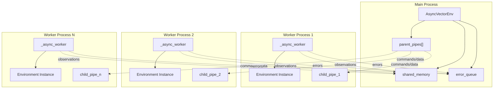
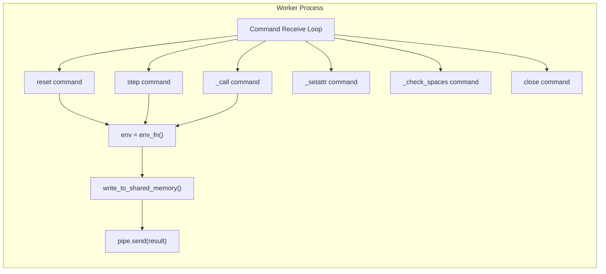
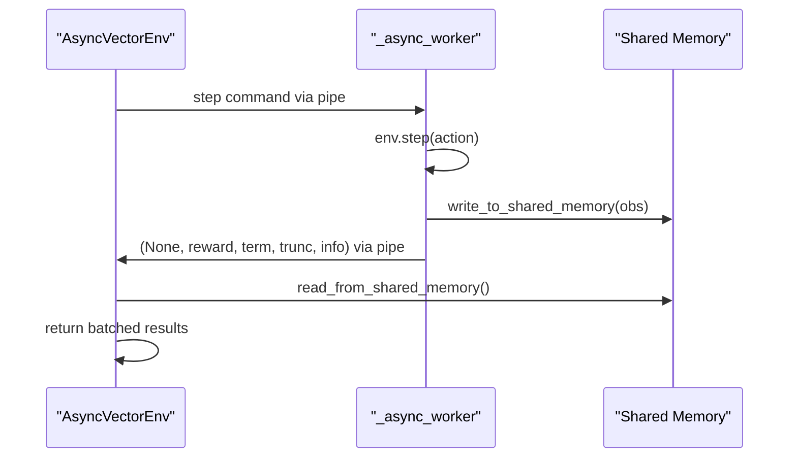
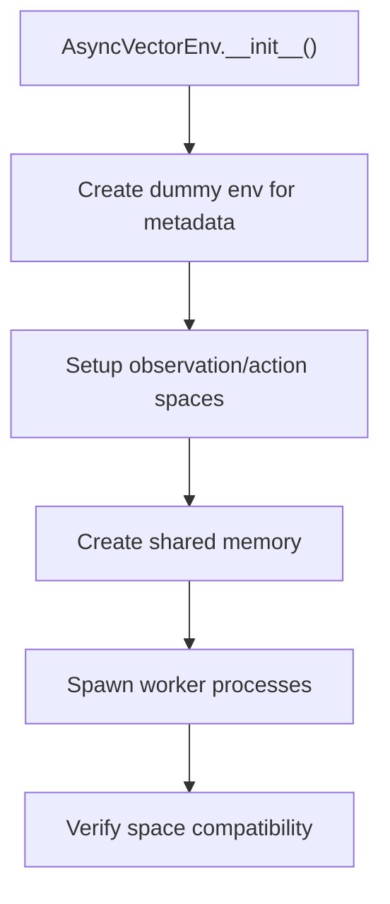
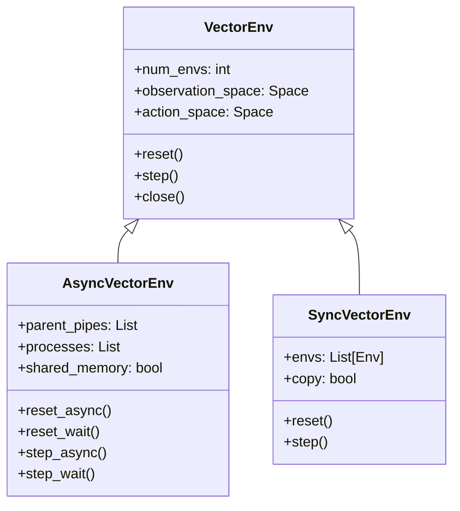

<!-- source: DeepWiki mcp.deepwiki.com · repo Farama-Foundation/Gymnasium · page 6.2 Asynchronous Vector Environments · fetched 2026-10-14 -->

# Asynchronous Vector Environments

<details>
<summary>Relevant source files</summary>

The following files were used as context for generating this wiki page:

- [gymnasium/vector/async_vector_env.py](gymnasium/vector/async_vector_env.py)
- [gymnasium/vector/sync_vector_env.py](gymnasium/vector/sync_vector_env.py)
- [gymnasium/vector/utils/misc.py](gymnasium/vector/utils/misc.py)
- [gymnasium/vector/utils/shared_memory.py](gymnasium/vector/utils/shared_memory.py)
- [gymnasium/vector/vector_env.py](gymnasium/vector/vector_env.py)
- [tests/vector/test_async_vector_env.py](tests/vector/test_async_vector_env.py)
- [tests/vector/test_sync_vector_env.py](tests/vector/test_sync_vector_env.py)
- [tests/vector/test_vector_env.py](tests/vector/test_vector_env.py)
- [tests/vector/utils/test_shared_memory.py](tests/vector/utils/test_shared_memory.py)

</details>


This document covers the asynchronous vector environment system in Gymnasium, which enables parallel execution of multiple environment instances using multiprocessing. This system provides significant performance improvements over sequential execution when running multiple copies of the same environment.

For information about synchronous vector environments, see [Synchronous Vector Environments](#6.1). For the base vector environment interface, see [Vector Environments](#6).

## Overview and Architecture

The `AsyncVectorEnv` class implements parallel environment execution using Python's multiprocessing module. Unlike synchronous vector environments that run environments sequentially in a loop, asynchronous vector environments spawn separate worker processes for each environment instance and coordinate their execution through inter-process communication.

### Core Architecture Diagram



Sources: [gymnasium/vector/async_vector_env.py:55-240]()

## Core Components

### AsyncVectorEnv Class

The `AsyncVectorEnv` class is the main interface that orchestrates parallel environment execution. It inherits from `VectorEnv` and manages worker processes, inter-process communication, and result aggregation.

Key attributes:
- `num_envs`: Number of parallel environments [gymnasium/vector/async_vector_env.py:116]()
- `parent_pipes`: Communication channels to worker processes [gymnasium/vector/async_vector_env.py:126]()
- `processes`: List of worker process objects [gymnasium/vector/async_vector_env.py:127]()
- `shared_memory`: Optional shared memory for observations [gymnasium/vector/async_vector_env.py:133]()
- `error_queue`: Queue for collecting worker errors [gymnasium/vector/async_vector_env.py:128]()

Sources: [gymnasium/vector/async_vector_env.py:64-128]()

### AsyncState Enumeration

The system uses a state machine to track the current operation status:

```mermaid
stateDiagram-v2
    [*] --> DEFAULT
    DEFAULT --> WAITING_RESET : reset_async()
    DEFAULT --> WAITING_STEP : step_async()
    DEFAULT --> WAITING_CALL : call_async()
    
    WAITING_RESET --> DEFAULT : reset_wait()
    WAITING_STEP --> DEFAULT : step_wait()
    WAITING_CALL --> DEFAULT : call_wait()
    
    WAITING_RESET --> DEFAULT : timeout/error
    WAITING_STEP --> DEFAULT : timeout/error
    WAITING_CALL --> DEFAULT : timeout/error
```

Sources: [gymnasium/vector/async_vector_env.py:46-53]()

### Worker Process Architecture

Each worker process runs the `_async_worker` function which manages a single environment instance and handles commands from the main process:



Sources: [gymnasium/vector/async_vector_env.py:721-853]()

## Communication and Synchronization

### Pipe-Based Communication

The system uses bidirectional pipes for command/response communication between the main process and workers:

| Command | Purpose | Data Sent | Response |
|---------|---------|-----------|----------|
| `"reset"` | Reset environment | `{"seed": seed, "options": options}` | `(observation, info)` |
| `"step"` | Execute action | `action` | `(obs, reward, term, trunc, info)` |
| `"_call"` | Call method/property | `(name, args, kwargs)` | Method result |
| `"_setattr"` | Set attribute | `(name, value)` | `None` |
| `"_check_spaces"` | Verify space compatibility | Space info | Compatibility result |
| `"close"` | Shutdown worker | `None` | `None` |

Sources: [gymnasium/vector/async_vector_env.py:744-801]()

### Shared Memory Optimization

When `shared_memory=True`, observations are written directly to shared memory arrays instead of being passed through pipes. This significantly improves performance for environments with large observation spaces (e.g., image observations).



Sources: [gymnasium/vector/async_vector_env.py:194-210](), [gymnasium/vector/async_vector_env.py:744-801]()

The `create_shared_memory`, `read_from_shared_memory`, and `write_to_shared_memory` functions in `gymnasium.vector.utils.shared_memory` handle the allocation and access of shared memory for different Gymnasium `Space` types.
For `Box`, `Discrete`, `MultiDiscrete`, and `MultiBinary` spaces, shared memory is created as a `SynchronizedArray` [gymnasium/vector/utils/shared_memory.py:74-94](). For `Tuple` and `Dict` spaces, shared memory is recursively created for their subspaces [gymnasium/vector/utils/shared_memory.py:97-113](). `Text` spaces use a `SynchronizedArray` of `c_int32` [gymnasium/vector/utils/shared_memory.py:116-120](). `OneOf` spaces store an index and then the shared memory for each possible subspace [gymnasium/vector/utils/shared_memory.py:123-129](). Spaces with dynamic shapes like `Graph` and `Sequence` are not supported with shared memory and will raise a `TypeError` [gymnasium/vector/utils/shared_memory.py:132-138]().

Sources: [gymnasium/vector/utils/shared_memory.py:35-138]()

## Lifecycle and State Management

### Initialization Process

The initialization creates worker processes and establishes communication channels:



Sources: [gymnasium/vector/async_vector_env.py:130-240]()

### Async/Await Pattern

The environment uses an async/await pattern for non-blocking operations:

1. **Async methods** (`reset_async`, `step_async`, `call_async`): Send commands to workers and return immediately
2. **Wait methods** (`reset_wait`, `step_wait`, `call_wait`): Block until all workers complete and return aggregated results

This pattern allows for maximum parallelization while maintaining synchronization points for result collection.

Sources: [gymnasium/vector/async_vector_env.py:269-376](), [gymnasium/vector/async_vector_env.py:392-475]()

## Error Handling and Robustness

### Error Propagation

Worker processes communicate errors through a dedicated error queue. When a worker encounters an exception:

1. Error details are serialized and sent to the error queue [gymnasium/vector/async_vector_env.py:803-810]()
2. The worker sends a failure signal via its pipe [gymnasium/vector/async_vector_env.py:811]()
3. The main process detects the failure and retrieves error details [gymnasium/vector/async_vector_env.py:660-664]()
4. The failing worker's pipe is closed and marked as `None` [gymnasium/vector/async_vector_env.py:665]()
5. The original exception is re-raised in the main process [gymnasium/vector/async_vector_env.py:666]()

Sources: [gymnasium/vector/async_vector_env.py:652-666](), [gymnasium/vector/async_vector_env.py:802-811]()

### Timeout Handling

All wait operations support timeout parameters to prevent indefinite blocking:

```python
# Example timeout usage
observations, infos = env.reset_wait(timeout=30.0)
obs, rewards, terms, truncs, infos = env.step_wait(timeout=30.0)
```

Sources: [gymnasium/vector/async_vector_env.py:693-714](), [gymnasium/vector/async_vector_env.py:636-650]()

## Performance Considerations

### Shared Memory Benefits

Using shared memory provides significant performance improvements for large observations:
- Eliminates serialization/deserialization overhead for observations
- Reduces memory copies between processes
- Particularly beneficial for image-based environments

Sources: [gymnasium/vector/async_vector_env.py:112-137]()

### Process Overhead

Consider the trade-offs:
- **Benefits**: True parallelism, isolation between environments
- **Costs**: Process creation overhead, inter-process communication latency
- **Sweet spot**: Multiple environments with moderate to high computational cost per step

### Environment Compatibility

Not all environments work well with multiprocessing:
- Environments using global state may have issues
- Some rendering modes may not work correctly
- GPU-based environments may need special handling

Sources: [gymnasium/vector/async_vector_env.py:112-137]()

## Integration with Vector Environment System

### Relationship to Base Classes



Sources: [gymnasium/vector/async_vector_env.py:64](), [gymnasium/vector/sync_vector_env.py:26]()

### Autoreset Mode Support

The async vector environment supports different autoreset modes defined in `AutoresetMode`:
- `NEXT_STEP`: Reset happens on the next step after termination/truncation [gymnasium/vector/vector_env.py:37]()
- `SAME_STEP`: Reset happens immediately when termination/truncation occurs [gymnasium/vector/vector_env.py:38]()
- `DISABLED`: No automatic reset [gymnasium/vector/vector_env.py:39]()

Sources: [gymnasium/vector/vector_env.py:33-39](), [gymnasium/vector/async_vector_env.py:754-795]()

---

