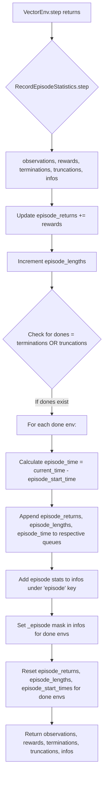

<!-- source: DeepWiki mcp.deepwiki.com · repo Farama-Foundation/Gymnasium · page 6.3 Vector Wrappers · fetched 2026-10-14 -->

# Vector Wrappers

<details>
<summary>Relevant source files</summary>

The following files were used as context for generating this wiki page:

- [gymnasium/envs/box2d/car_dynamics.py](gymnasium/envs/box2d/car_dynamics.py)
- [gymnasium/wrappers/vector/array_conversion.py](gymnasium/wrappers/vector/array_conversion.py)
- [gymnasium/wrappers/vector/common.py](gymnasium/wrappers/vector/common.py)
- [gymnasium/wrappers/vector/dict_info_to_list.py](gymnasium/wrappers/vector/dict_info_to_list.py)
- [gymnasium/wrappers/vector/stateful_observation.py](gymnasium/wrappers/vector/stateful_observation.py)
- [gymnasium/wrappers/vector/vectorize_action.py](gymnasium/wrappers/vector/vectorize_action.py)
- [gymnasium/wrappers/vector/vectorize_observation.py](gymnasium/wrappers/vector/vectorize_observation.py)
- [gymnasium/wrappers/vector/vectorize_reward.py](gymnasium/wrappers/vector/vectorize_reward.py)
- [tests/vector/test_vector_wrapper.py](tests/vector/test_vector_wrapper.py)
- [tests/wrappers/vector/test_dict_info_to_list.py](tests/wrappers/vector/test_dict_info_to_list.py)
- [tests/wrappers/vector/test_record_episode_statistics.py](tests/wrappers/vector/test_record_episode_statistics.py)

</details>


This page details the wrappers specifically designed for use with Gymnasium's vector environments. These wrappers extend the functionality of `VectorEnv` instances, allowing for operations like observation/action/reward transformation, information dictionary conversion, normalization, and episode statistics recording across multiple parallel environments.

## Vector Observation Wrappers

Vector observation wrappers modify the observations returned by a `VectorEnv`.

### `TransformObservation`

The `TransformObservation` wrapper applies a user-defined function to the vector observation. This wrapper is useful when the transformation can be applied efficiently to the batched observation directly.

The wrapper takes a `VectorEnv` and a `func` (a callable) as arguments. Optionally, `observation_space` and `single_observation_space` can be provided if the transformation changes the observation space. If not provided, the wrapper attempts to infer the new spaces.

- **`__init__(self, env: VectorEnv, func: Callable[[_T_contra], _T_co], observation_space: Space | None = None, single_observation_space: Space | None = None) -> None`**: Initializes the wrapper.
    - `env`: The vector environment to wrap.
    - `func`: A function that transforms the vector observation.
    - `observation_space`: The new batched observation space.
    - `single_observation_space`: The new single observation space.
- **`observations(self, observations: _T_contra) -> _T_co`**: Applies the `func` to the input `observations`.

Example usage:
```python
import gymnasium as gym
from gymnasium.spaces import Box
def scale_and_shift(obs):
    return (obs - 1.0) * 2.0

envs = gym.make_vec("CartPole-v1", num_envs=3, vectorization_mode="sync")
new_obs_space = Box(low=envs.observation_space.low, high=envs.observation_space.high)
envs = TransformObservation(envs, func=scale_and_shift, observation_space=new_obs_space)
obs, info = envs.reset(seed=123)
# obs will be scaled and shifted
envs.close()
```
Sources: [gymnasium/wrappers/vector/vectorize_observation.py:32-112]()

### `VectorizeTransformObservation`

The `VectorizeTransformObservation` wrapper is designed to vectorize a single-agent `TransformObservation` wrapper for use with `VectorEnv`. This is useful when you have a transformation function that operates on a single observation, and you want to apply it independently to each observation in a batch.

The wrapper internally creates a "fake" single-agent environment to instantiate the single-agent `TransformObservation` wrapper. It then iterates through the batched observations, applying the single-agent wrapper's transformation to each individual observation.

- **`__init__(self, env: VectorEnv, wrapper: type[transform_observation.TransformObservation], **kwargs: Any) -> None`**: Initializes the wrapper.
    - `env`: The vector environment to wrap.
    - `wrapper`: The single-agent `TransformObservation` wrapper class to vectorize.
    - `**kwargs`: Keyword arguments to pass to the single-agent wrapper's constructor.
- **`observations(self, observations: _ArrayT) -> _ArrayT`**: Iterates through the batched `observations` and applies the single-agent wrapper's `func` to each individual observation.

Example usage:
```python
import numpy as np
import gymnasium as gym
from gymnasium.spaces import Box
from gymnasium.wrappers import TransformObservation
envs = gym.make_vec("CartPole-v1", num_envs=3, vectorization_mode="sync")
old_space = envs.single_observation_space
new_space = Box(low=np.array([old_space.low, old_space.low]), high=np.array([old_space.high, old_space.high]))
envs = VectorizeTransformObservation(envs, wrapper=TransformObservation, func=lambda x: np.array([x, x]), observation_space=new_space)
obs, info = envs.reset(seed=123)
# obs will have each single observation duplicated
envs.close()
```
Sources: [gymnasium/wrappers/vector/vectorize_observation.py:114-143]()

### `NormalizeObservation`

The `NormalizeObservation` wrapper normalizes observations such that each coordinate is centered with unit variance. It maintains a running mean and standard deviation of observations to perform this normalization.

- **`__init__(self, env: VectorEnv, epsilon: float = 1e-8) -> None`**: Initializes the wrapper.
    - `env`: The vector environment to wrap.
    - `epsilon`: A stability parameter added to the variance to prevent division by zero.
- **`update_running_mean` property**: A boolean property to freeze or continue the running mean calculation. If `True` (default), `RunningMeanStd` is updated every step and reset. If `False`, statistics are used but not updated.
- **`reset(self, *, seed: int | None = None, options: dict[str, Any] | None = None) -> tuple[np.ndarray, dict[str, Any]]`**: Resets the environment. This wrapper does not support partial resets; `reset_mask` must contain all `True` values if provided.
- **`observations(self, observations: np.ndarray) -> np.ndarray`**: Normalizes the input `observations` using the running mean and standard deviation.

```mermaid
graph TD
    A[Raw Vector Observations] --> B{NormalizeObservation.observations};
    B --> C{_update_running_mean is True?};
    C -- Yes --> D[Update obs_rms with observations];
    C -- No --> E[Use current obs_rms];
    D --> F[Calculate normalized_obs = (observations - obs_rms.mean) / sqrt(obs_rms.var + epsilon)];
    E --> F;
    F --> G[Normalized Vector Observations];
```
**Diagram: NormalizeObservation Data Flow**
Sources: [gymnasium/wrappers/vector/stateful_observation.py:26-160]()

## Vector Action Wrappers

Vector action wrappers modify the actions sent to a `VectorEnv`.

### `TransformAction`

The `TransformAction` wrapper applies a user-defined function to the vector action before it is sent to the environment. This is useful for applying a global transformation to the batched actions.

- **`__init__(self, env: VectorEnv, func: Callable[[_T_contra], _T_co], action_space: Space | None = None, single_action_space: Space | None = None) -> None`**: Initializes the wrapper.
    - `env`: The vector environment to wrap.
    - `func`: A function that transforms the vector action.
    - `action_space`: The new batched action space.
    - `single_action_space`: The new single action space.
- **`actions(self, actions: _T_contra) -> _T_co`**: Applies the `func` to the input `actions`.

Example usage:
```python
import gymnasium as gym
from gymnasium.spaces import Box
def shrink_action(act):
    return act * 0.3

envs = gym.make_vec("MountainCarContinuous-v0", num_envs=3)
new_action_space = Box(low=shrink_action(envs.action_space.low), high=shrink_action(envs.action_space.high))
envs = TransformAction(env=envs, func=shrink_action, action_space=new_action_space)
_ = envs.action_space.seed(123)
obs, info = envs.reset(seed=123)
# Actions passed to envs.step will be shrunk by 0.3
envs.close()
```
Sources: [gymnasium/wrappers/vector/vectorize_action.py:30-111]()

### `VectorizeTransformAction`

The `VectorizeTransformAction` wrapper vectorizes a single-agent `TransformAction` wrapper. This allows applying a single-agent action transformation independently to each action in a batch.

- **`__init__(self, env: VectorEnv, wrapper: type[transform_action.TransformAction], **kwargs: Any) -> None`**: Initializes the wrapper.
    - `env`: The vector environment to wrap.
    - `wrapper`: The single-agent `TransformAction` wrapper class to vectorize.
    - `**kwargs`: Keyword arguments for the single-agent wrapper.
- **`actions(self, actions: _ArrayT) -> _ArrayT`**: Iterates through the batched `actions` and applies the single-agent wrapper's `func` to each individual action.

Example usage:
```python
import gymnasium as gym
from gymnasium.wrappers import TransformAction
envs = gym.make_vec("MountainCarContinuous-v0", num_envs=3)
envs = VectorizeTransformAction(envs, wrapper=TransformAction, func=lambda x: (x > 0.0) * x, action_space=envs.single_action_space)
_ = envs.action_space.seed(123)
obs, info = envs.reset(seed=123)
# Actions passed to envs.step will have ReLU applied
envs.close()
```
Sources: [gymnasium/wrappers/vector/vectorize_action.py:114-165]()

## Vector Reward Wrappers

Vector reward wrappers modify the rewards returned by a `VectorEnv`.

### `TransformReward`

The `TransformReward` wrapper applies a user-defined function to the vector reward.

- **`__init__(self, env: VectorEnv, func: Callable[[_ArrayT_contra], _ArrayT_co]) -> None`**: Initializes the wrapper.
    - `env`: The vector environment to wrap.
    - `func`: The function to apply to the reward.
- **`rewards(self, rewards: _ArrayT_contra) -> _ArrayT_co`**: Applies the `func` to the input `rewards`.

Example usage:
```python
import gymnasium as gym
def scale_and_shift(rew):
    return (rew - 1.0) * 2.0

envs = gym.make_vec("MountainCarContinuous-v0", num_envs=3)
envs = TransformReward(env=envs, func=scale_and_shift)
_ = envs.action_space.seed(123)
obs, info = envs.reset(seed=123)
obs, rew, term, trunc, info = envs.step(envs.action_space.sample())
# rew will be scaled and shifted
envs.close()
```
Sources: [gymnasium/wrappers/vector/vectorize_reward.py:32-71]()

### `VectorizeTransformReward`

The `VectorizeTransformReward` wrapper vectorizes a single-agent `TransformReward` wrapper. This allows applying a single-agent reward transformation independently to each reward in a batch.

- **`__init__(self, env: VectorEnv, wrapper: type[transform_reward.TransformReward], **kwargs: Any) -> None`**: Initializes the wrapper.
    - `env`: The vector environment to wrap.
    - `wrapper`: The single-agent `TransformReward` wrapper class to vectorize.
    - `**kwargs`: Keyword arguments for the single-agent wrapper.
- **`rewards(self, rewards: _ArrayT) -> _ArrayT`**: Iterates through the batched `rewards` and applies the single-agent wrapper's `func` to each individual reward.

Sources: [gymnasium/wrappers/vector/vectorize_reward.py:73-113]()

### `ClipReward`

The `ClipReward` wrapper is a specialized `VectorizeTransformReward` that clips rewards between a minimum and maximum value.

- **`__init__(self, env: VectorEnv, min_reward: float | np.ndarray | None = None, max_reward: float | np.ndarray | None = None) -> None`**: Initializes the wrapper.
    - `env`: The vector environment to wrap.
    - `min_reward`: The minimum reward value.
    - `max_reward`: The maximum reward value.

Example usage:
```python
import numpy as np
import gymnasium as gym
envs = gym.make_vec("MountainCarContinuous-v0", num_envs=3)
envs = ClipReward(envs, 0.0, 2.0)
_ = envs.action_space.seed(123)
obs, info = envs.reset(seed=123)
for _ in range(10):
    obs, rew, term, trunc, info = envs.step(0.5 * np.ones((3, 1)))
# rew will be clipped between 0.0 and 2.0
envs.close()
```
Sources: [gymnasium/wrappers/vector/vectorize_reward.py:115-150]()

## Vector Information Wrappers

Vector information wrappers modify the `info` dictionary returned by a `VectorEnv`.

### `DictInfoToList`

The `DictInfoToList` wrapper converts the `info` dictionary from a vectorized environment (which is a single dictionary where keys map to batched values) into a list of dictionaries (where each dictionary corresponds to a single environment's info). This is particularly useful when you want to process information for each sub-environment individually.

This wrapper should typically be the outermost wrapper if other wrappers operate on the `info` dictionary (e.g., `RecordEpisodeStatistics`).

- **`__init__(self, env: VectorEnv) -> None`**: Initializes the wrapper.
- **`step(self, actions: np.ndarray) -> tuple[np.ndarray, npt.NDArray[np.float64], npt.NDArray[np.bool_], npt.NDArray[np.bool_], list[dict[str, Any]]]`**: Steps through the environment and converts the returned `infos` dictionary to a list of dictionaries.
- **`reset(self, *, seed: int | None = None, options: dict[str, Any] | None = None) -> tuple[np.ndarray, list[dict[str, Any]]]`**: Resets the environment and converts the returned `infos` dictionary to a list of dictionaries.
- **`_convert_info_to_list(self, vector_infos: dict[str, Any]) -> list[dict[str, Any]]`**: Internal method to perform the conversion from a batched `dict` to a `list[dict]`. It handles keys prefixed with `_` as binary masks indicating the presence of information for specific sub-environments.

```mermaid
graph TD
    A[VectorEnv.step/reset returns] --> B{DictInfoToList.step/reset};
    B --> C[vector_infos: dict[str, Any]];
    C --> D{_convert_info_to_list};
    D -- Iterate over vector_infos --> E{For each key, value pair};
    E -- If key starts with "_" --> F[Skip (binary mask)];
    E -- If value is dict --> G[Recursively call _convert_info_to_list];
    E -- If value is np.ndarray --> H[Extract individual elements for each sub-env];
    H -- If binary mask exists for key --> I[Only add info if mask is True];
    H -- Else --> J[Add info for all sub-envs];
    G --> K[Combine results into list_info];
    I --> K;
    J --> K;
    K --> L[list_info: list[dict[str, Any]]];
    L --> M[Return list_info];
```
**Diagram: DictInfoToList Data Flow**
Sources: [gymnasium/wrappers/vector/dict_info_to_list.py:15-161]()

### `RecordEpisodeStatistics`

The `RecordEpisodeStatistics` wrapper tracks cumulative rewards and episode lengths for each sub-environment. At the end of an episode, these statistics are added to the `info` dictionary under the key `episode`.

- **`__init__(self, env: VectorEnv, buffer_length: int = 100, stats_key: str = "episode") -> None`**: Initializes the wrapper.
    - `env`: The vector environment to wrap.
    - `buffer_length`: The size of the internal deques (`return_queue`, `length_queue`, `time_queue`) that store recent episode statistics.
    - `stats_key`: The key used in the `info` dictionary to store episode statistics.
- **`episode_start_times`**: `np.ndarray` storing the start time of the current episode for each environment.
- **`episode_returns`**: `np.ndarray` storing the cumulative reward for the current episode for each environment.
- **`episode_lengths`**: `np.ndarray` storing the current length of the episode for each environment.
- **`prev_dones`**: `np.ndarray` storing the previous done status for each environment.
- **`time_queue`**: `deque` storing the elapsed time of the last `buffer_length` episodes.
- **`return_queue`**: `deque` storing the cumulative rewards of the last `buffer_length` episodes.
- **`length_queue`**: `deque` storing the lengths of the last `buffer_length` episodes.
- **`reset(self, *, seed: int | None = None, options: dict[str, Any] | None = None) -> tuple[np.ndarray, dict[str, Any]]`**: Resets the environment and initializes episode tracking variables for the environments being reset.
- **`step(self, actions: np.ndarray) -> tuple[np.ndarray, npt.NDArray[np.float64], npt.NDArray[np.bool_], npt.NDArray[np.bool_], dict[str, Any]]`**: Steps through the environment, updates episode statistics, and adds them to the `info` dictionary when an episode terminates or truncates.


**Diagram: RecordEpisodeStatistics Data Flow**
Sources: [gymnasium/wrappers/vector/common.py:22-168]()

## Vector Array Conversion Wrappers

These wrappers facilitate interoperability between different Array API compatible frameworks (e.g., NumPy, PyTorch, JAX).

### `ArrayConversion`

The `ArrayConversion` wrapper converts observations, rewards, terminations, truncations, and info dictionaries from the environment's native Array API framework to a specified target framework. Actions are also converted from the target framework back to the environment's native framework before being passed to `env.step()`.

- **`__init__(self, env: VectorEnv, env_xp: ModuleType, target_xp: ModuleType, env_device: Device | None = None, target_device: Device | None = None) -> None`**: Initializes the wrapper.
    - `env`: The Array API compatible vector environment to wrap.
    - `env_xp`: The Array API framework module (e.g., `numpy`, `torch`) the environment's outputs are currently in.
    - `target_xp`: The Array API framework module to convert outputs to.
    - `env_device`: The device (e.g., "cpu", "cuda:0") the environment's arrays are on.
    - `target_device`: The device to convert outputs to.
- **`step(self, actions: ActType) -> tuple[ObsType, ArrayType, ArrayType, ArrayType, dict]`**: Converts `actions` to `env_xp` and `env_device`, calls `self.env.step()`, and then converts all outputs (observations, rewards, terminations, truncations, info) to `target_xp` and `target_device`.
- **`reset(self, *, seed: int | None = None, options: dict[str, Any] | None = None) -> tuple[ObsType, dict[str, Any]]`**: Converts `options` to `env_xp` and `env_device` if provided, calls `self.env.reset()`, and then converts the returned observations and info to `target_xp` and `target_device`.

```mermaid
graph TD
    subgraph "ArrayConversion Wrapper"
        A[Agent Actions (target_xp, target_device)] --> B{Convert Actions to env_xp, env_device};
        B --> C[env.step(converted_actions)];
        C --> D[Raw Env Outputs (env_xp, env_device)];
        D --> E{Convert Env Outputs to target_xp, target_device};
        E --> F[Agent Inputs (target_xp, target_device)];
    end
```
**Diagram: ArrayConversion Data Flow**
Sources: [gymnasium/wrappers/vector/array_conversion.py:21-110]()

---

