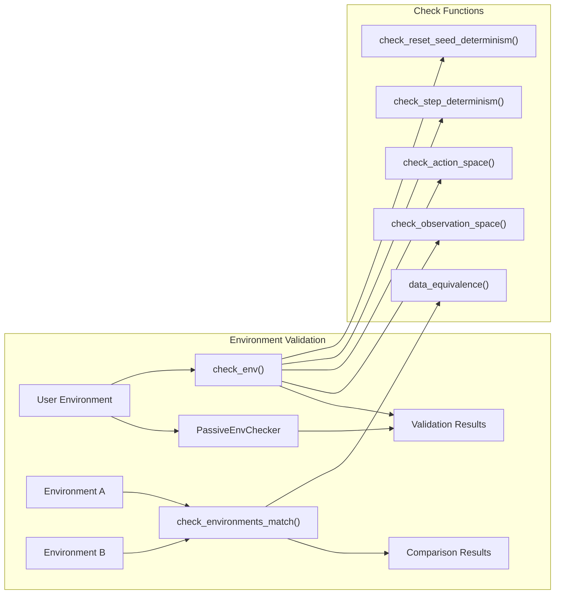
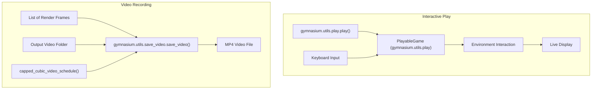
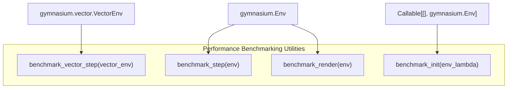
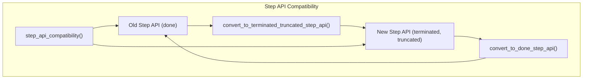
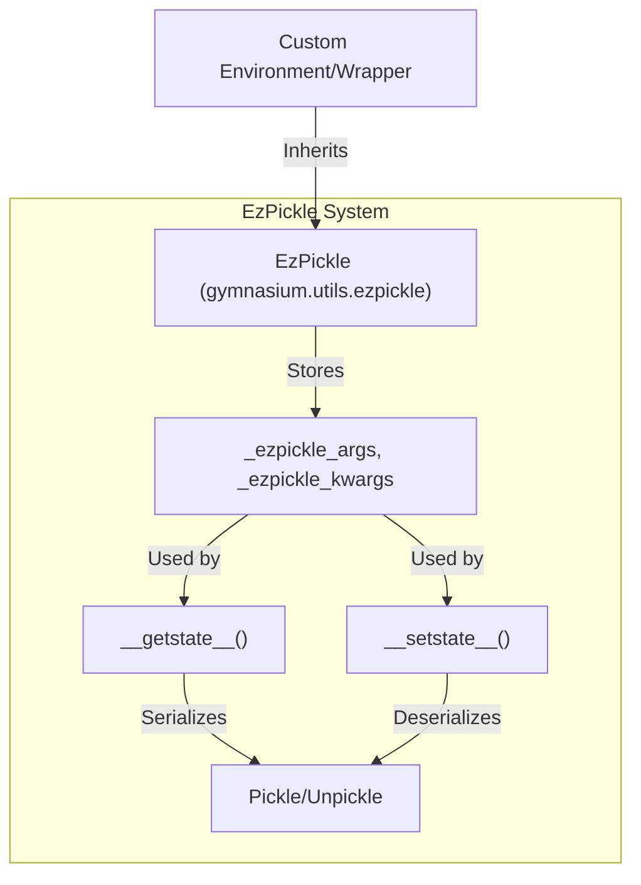
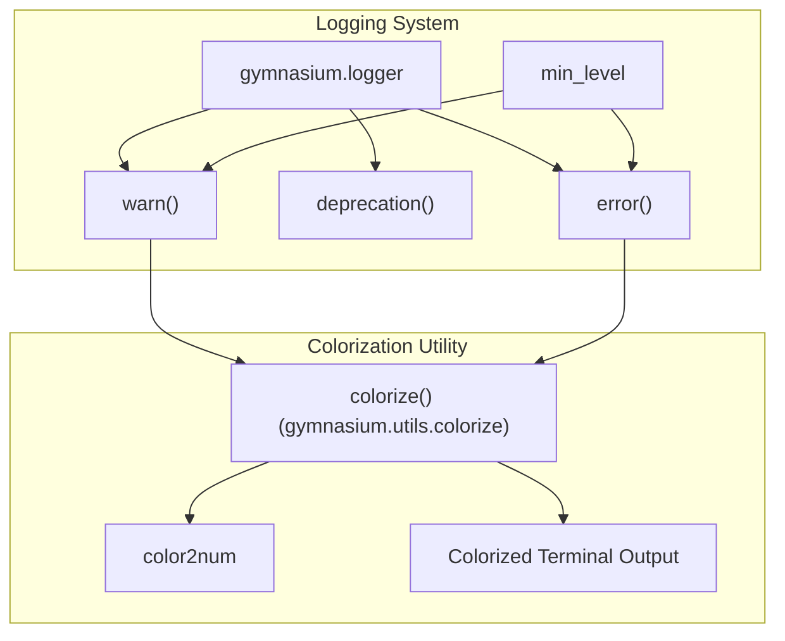

<!-- source: DeepWiki mcp.deepwiki.com · repo Farama-Foundation/Gymnasium · page 7 Utilities and Tools · fetched 2026-10-14 -->

# Utilities and Tools

Relevant source files

The following files were used as context for generating this wiki page:

- [docs/api/utils.md](docs/api/utils.md)
- [gymnasium/logger.py](gymnasium/logger.py)
- [gymnasium/utils/colorize.py](gymnasium/utils/colorize.py)
- [gymnasium/utils/env_match.py](gymnasium/utils/env_match.py)
- [gymnasium/utils/ezpickle.py](gymnasium/utils/ezpickle.py)
- [gymnasium/utils/performance.py](gymnasium/utils/performance.py)
- [gymnasium/utils/save_video.py](gymnasium/utils/save_video.py)
- [tests/utils/test_env_match.py](tests/utils/test_env_match.py)
- [tests/utils/test_performance.py](tests/utils/test_performance.py)

This page provides an overview of the utility functions and tools available in Gymnasium for working with environments, debugging, visualization, and development. These utilities help developers validate environments, interact with them interactively, and debug issues during development.

For detailed information about environment validation, see [Environment Checking](#7.1). For interactive play and visualization tools, see [Play and Visualization](#7.2).

## Overview of Utility Systems

Gymnasium provides several categories of utilities to support environment development and debugging:

```mermaid
graph TB
    subgraph "Environment Validation"
        EnvChecker["env_checker.py"]
        PassiveChecker["passive_env_checker.py"]
        CheckEnv["check_env()"]
        EnvMatch["env_match.py"]
        CheckEnvsMatch["check_environments_match()"]
    end

    subgraph "Interactive Tools"
        PlayUtils["play.py"]
        PlayableGame["PlayableGame"]
        PlayPlot["PlayPlot"]
    end

    subgraph "Performance Benchmarking"
        PerformanceUtils["performance.py"]
        BenchmarkStep["benchmark_step()"]
        BenchmarkVectorStep["benchmark_vector_step()"]
        BenchmarkInit["benchmark_init()"]
        BenchmarkRender["benchmark_render()"]
    end

    subgraph "Rendering & Video"
        SaveVideoUtils["save_video.py"]
        SaveVideo["save_video()"]
        CappedCubicSchedule["capped_cubic_video_schedule()"]
    end

    subgraph "API Compatibility"
        StepAPICompat["step_api_compatibility.py"]
        ConvertToTerminatedTruncated["convert_to_terminated_truncated_step_api()"]
        ConvertToDone["convert_to_done_step_api()"]
    end

    subgraph "Serialization"
        EzPickle["ezpickle.py"]
        EzPickleClass["EzPickle"]
    end

    EnvChecker --> CheckEnv
    PassiveChecker --> CheckEnv
    EnvMatch --> CheckEnvsMatch
    PlayUtils --> PlayableGame
    PlayUtils --> PlayPlot
    PerformanceUtils --> BenchmarkStep
    PerformanceUtils --> BenchmarkVectorStep
    PerformanceUtils --> BenchmarkInit
    PerformanceUtils --> BenchmarkRender
    SaveVideoUtils --> SaveVideo
    SaveVideoUtils --> CappedCubicSchedule
    StepAPICompat --> ConvertToTerminatedTruncated
    StepAPICompat --> ConvertToDone
    EzPickle --> EzPickleClass
```

**Core Utility Functions and Classes**

Sources: [gymnasium/utils/env_checker.py:1-447](), [gymnasium/utils/play.py:1-425](), [gymnasium/utils/performance.py:1-157](), [gymnasium/utils/save_video.py:1-118](), [gymnasium/utils/ezpickle.py:1-37](), [gymnasium/utils/env_match.py:1-151]()

## Environment Validation Utilities

The environment validation system provides comprehensive checking of environment implementations to ensure they conform to the Gymnasium API. This includes utilities for checking a single environment's API compliance and comparing the behavior of two environments.

For details, see [Environment Checking](#7.1).

**Key Validation Functions**

| Function | Purpose | File Location |
|----------|---------|---------------|
| `check_env()` | Comprehensive environment API validation | [docs/api/utils.md:15-17]() |
| `check_environments_match()` | Compares the behavior of two environments | [gymnasium/utils/env_match.py:9-39]() |
| `data_equivalence()` | Compares complex data structures for equality | [gymnasium/utils/env_checker.py:33-69]() |

Sources: [gymnasium/utils/env_checker.py:33-69](), [gymnasium/utils/env_match.py:9-39](), [docs/api/utils.md:15-17]()

## Interactive Play and Visualization

The play utilities enable human interaction with environments for testing and demonstration purposes, while visualization tools assist in recording and saving environment renders.

For details, see [Play and Visualization](#7.2).

**Core Play and Visualization Components**

| Component | Purpose | File Location |
|---|---|---|
| `gymnasium.utils.play.play()` | Main function for interactive environment control | [docs/api/utils.md:21-23]() |
| `gymnasium.utils.play.PlayableGame` | Handles keyboard input and display for interactive play | [docs/api/utils.md:27-31]() |
| `gymnasium.utils.play.PlayPlot` | Provides real-time metric visualization during play | [docs/api/utils.md:24-26]() |
| `gymnasium.utils.save_video.save_video()` | Saves a list of rendered frames as a video file | [docs/api/utils.md:41-43]() |
| `gymnasium.utils.save_video.capped_cubic_video_schedule()` | Default episode trigger for video recording | [docs/api/utils.md:44-46]() |

Sources: [gymnasium/utils/play.py:1-425](), [gymnasium/utils/save_video.py:1-118](), [docs/api/utils.md:21-46]()

## Runtime Performance Benchmarking

Gymnasium provides utilities to measure the runtime performance of environments, which is crucial for identifying bottlenecks and ensuring no performance regressions occur during development. These benchmarks require manual inspection of their outputs.

**Key Performance Benchmarking Functions**

| Function | Purpose | File Location |
|---|---|---|
| `benchmark_step()` | Measures the throughput of `env.step()` | [gymnasium/utils/performance.py:12-54]() |
| `benchmark_vector_step()` | Measures the throughput of `vector_env.step()` | [gymnasium/utils/performance.py:57-103]() |
| `benchmark_init()` | Measures environment initialization and first reset time | [gymnasium/utils/performance.py:106-133]() |
| `benchmark_render()` | Measures the throughput of `env.render()` | [gymnasium/utils/performance.py:136-157]() |

Sources: [gymnasium/utils/performance.py:1-157](), [docs/api/utils.md:53-62]()

## Old to New Step API Compatibility

Utilities are provided to help with the transition between the old `(observation, reward, done, info)` step API and the new `(observation, reward, terminated, truncated, info)` API.

**Key Compatibility Functions**

| Function | Purpose | File Location |
|---|---|---|
| `step_api_compatibility()` | Wraps an environment to ensure step API compatibility | [docs/api/utils.md:48-51]() |
| `convert_to_terminated_truncated_step_api()` | Converts old API output to new API format | [docs/api/utils.md:49-50]() |
| `convert_to_done_step_api()` | Converts new API output to old API format | [docs/api/utils.md:50-51]() |

Sources: [docs/api/utils.md:48-51]()

## Environment Pickling

The `EzPickle` class provides a convenient way to make objects picklable by storing their constructor arguments. This is particularly useful for environments that wrap C/C++ code, such as MuJoCo and Atari environments, where direct serialization of internal states might be complex.

**`EzPickle` Class**

| Method/Attribute | Purpose | File Location |
|---|---|---|
| `EzPickle.__init__()` | Stores constructor arguments for pickling | [gymnasium/utils/ezpickle.py:22-25]() |
| `EzPickle.__getstate__()` | Returns the object's state for pickling | [gymnasium/utils/ezpickle.py:27-32]() |
| `EzPickle.__setstate__()` | Reconstructs the object from its pickled state | [gymnasium/utils/ezpickle.py:34-37]() |

Sources: [gymnasium/utils/ezpickle.py:6-37](), [docs/api/utils.md:34-36]()

## Logging and Colorization

Gymnasium includes a simple logging system that uses Python's `warnings` module and provides utilities for colorizing terminal output. This helps in making warning and error messages more noticeable.

**Key Logging and Colorization Functions**

| Function | Purpose | File Location |
|---|---|---|
| `gymnasium.logger.warn()` | Raises a warning message | [gymnasium/logger.py:23-37]() |
| `gymnasium.logger.deprecation()` | Logs a deprecation warning | [gymnasium/logger.py:39-42]() |
| `gymnasium.logger.error()` | Logs an error message | [gymnasium/logger.py:44-47]() |
| `gymnasium.utils.colorize.colorize()` | Returns a string with terminal color codes | [gymnasium/utils/colorize.py:23-45]() |

Sources: [gymnasium/logger.py:1-47](), [gymnasium/utils/colorize.py:1-45]()

---

