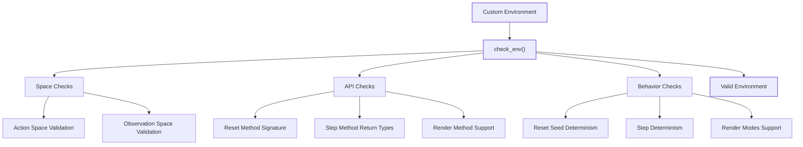
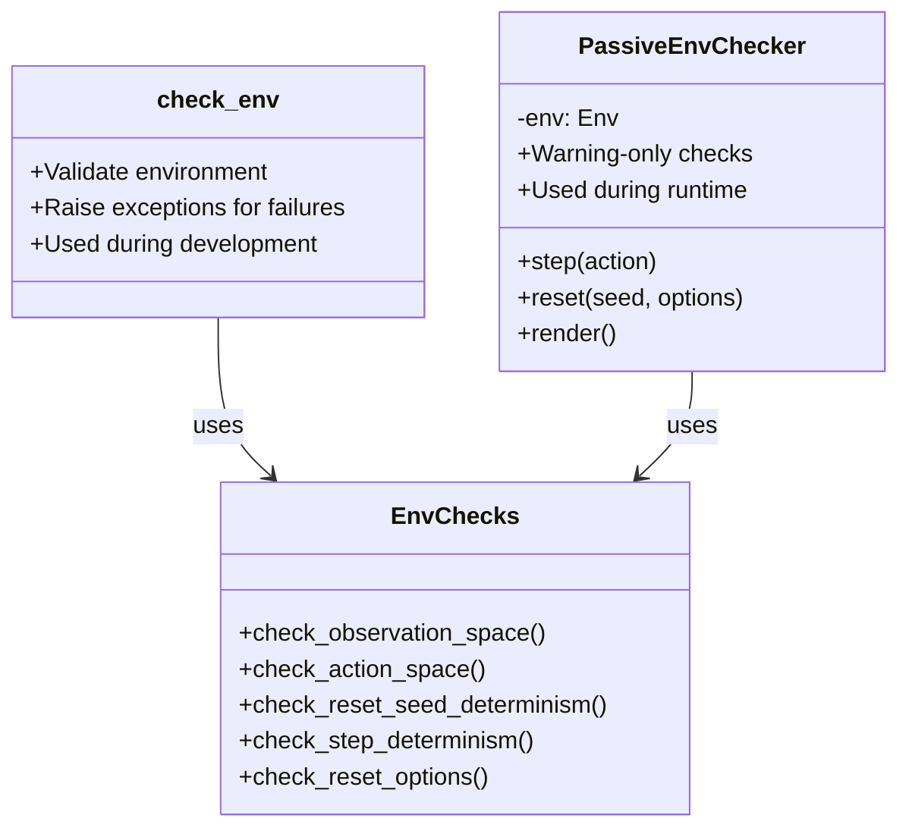
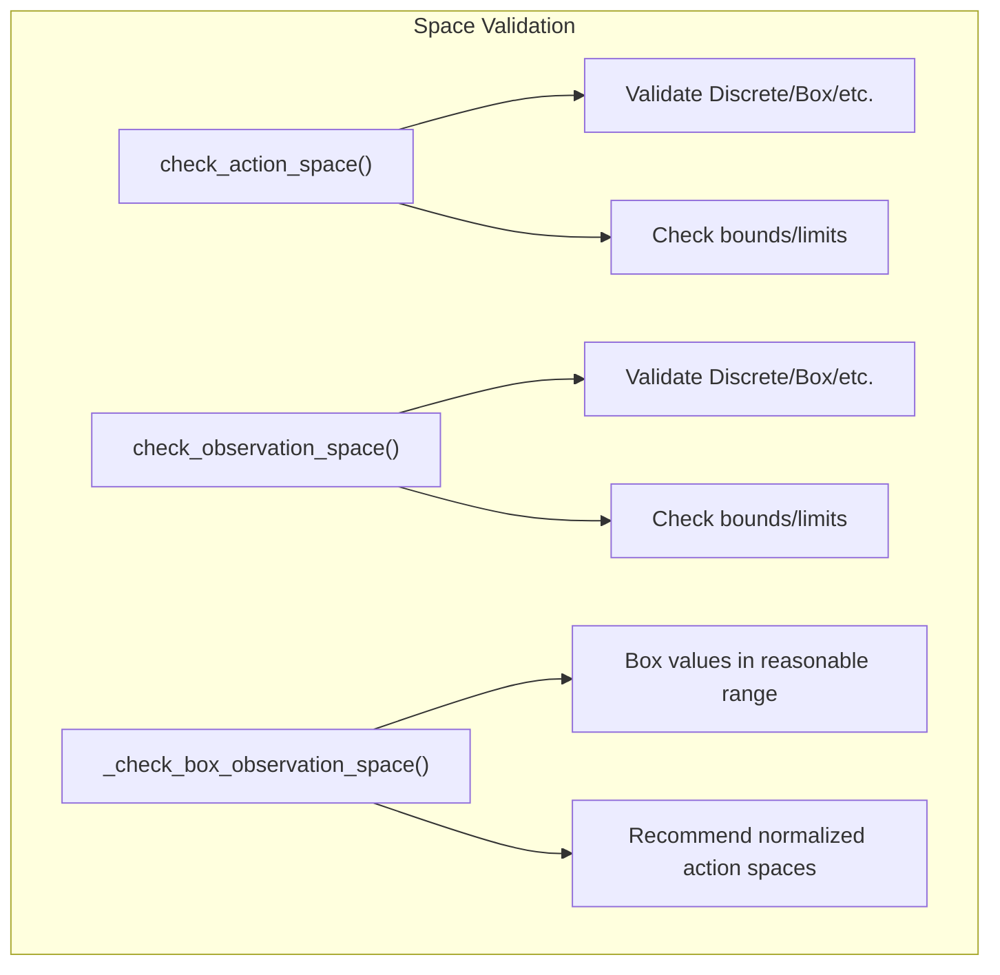
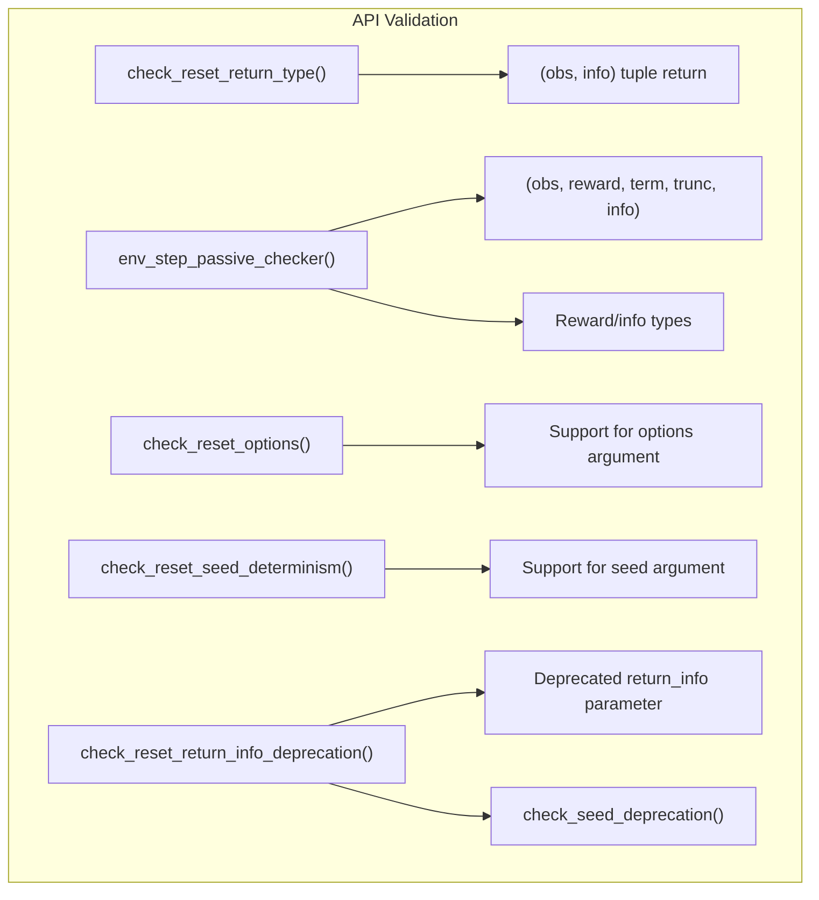
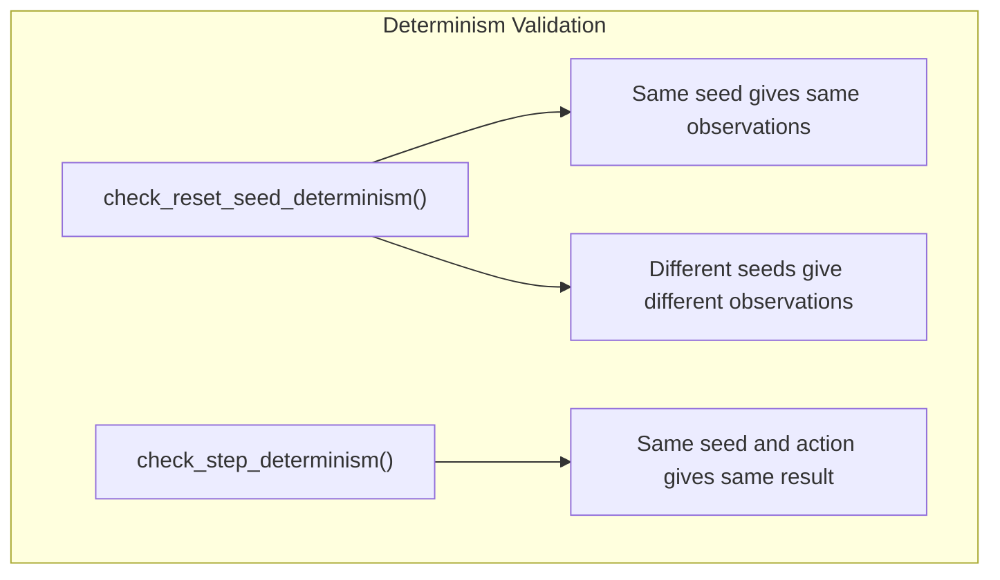
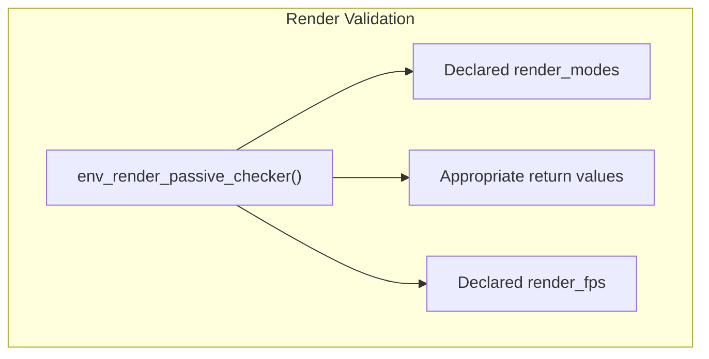
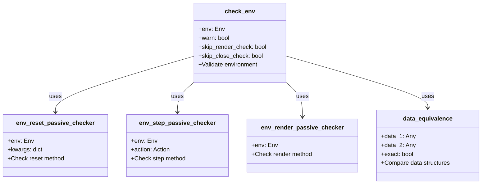

<!-- source: DeepWiki mcp.deepwiki.com · repo Farama-Foundation/Gymnasium · page 7.1 Environment Checking · fetched 2026-10-14 -->

# Environment Checking

<details>
<summary>Relevant source files</summary>

The following files were used as context for generating this wiki page:

- [docs/api/utils.md](docs/api/utils.md)
- [gymnasium/core.py](gymnasium/core.py)
- [gymnasium/utils/colorize.py](gymnasium/utils/colorize.py)
- [gymnasium/utils/env_checker.py](gymnasium/utils/env_checker.py)
- [gymnasium/utils/env_match.py](gymnasium/utils/env_match.py)
- [gymnasium/utils/ezpickle.py](gymnasium/utils/ezpickle.py)
- [gymnasium/utils/passive_env_checker.py](gymnasium/utils/passive_env_checker.py)
- [gymnasium/utils/performance.py](gymnasium/utils/performance.py)
- [gymnasium/utils/save_video.py](gymnasium/utils/save_video.py)
- [gymnasium/wrappers/common.py](gymnasium/wrappers/common.py)
- [tests/test_core.py](tests/test_core.py)
- [tests/testing_env.py](tests/testing_env.py)
- [tests/utils/test_env_checker.py](tests/utils/test_env_checker.py)
- [tests/utils/test_env_match.py](tests/utils/test_env_match.py)
- [tests/utils/test_passive_env_checker.py](tests/utils/test_passive_env_checker.py)
- [tests/utils/test_performance.py](tests/utils/test_performance.py)
- [tests/wrappers/test_passive_env_checker.py](tests/wrappers/test_passive_env_checker.py)

</details>


The Gymnasium environment checking system verifies that custom environments correctly implement the Gymnasium API and follow best practices. This page documents the utilities provided for validating environments, which help prevent common issues and ensure compatibility with the broader ecosystem of Gymnasium tools and algorithms.

The environment checking system consists of two main components:
1. An active checker that raises exceptions when environments don't meet requirements
2. A passive checker that issues warnings but allows execution to continue

## Environment Checker Overview



Sources: [gymnasium/utils/env_checker.py:345-446](), [tests/utils/test_env_checker.py:1-297]()

The environment checker performs comprehensive validation of environments along three dimensions:
1. **Space Validation**: Ensures action and observation spaces are correctly defined
2. **API Validation**: Verifies all required methods have proper signatures and return types
3. **Behavior Validation**: Tests that environment behavior is correct, including determinism when seeded

## Active vs. Passive Checking

Gymnasium provides two approaches to environment checking:



Sources: [gymnasium/utils/env_checker.py:345-446](), [gymnasium/utils/passive_env_checker.py:1-366](), [tests/wrappers/test_passive_env_checker.py:1-113]()

### Active Checking with `check_env`

The `check_env` function performs strict validation and raises exceptions when requirements aren't met. This function is designed to be used during environment development and testing.

```python
import gymnasium as gym
from gymnasium.utils.env_checker import check_env

# Create your custom environment
env = MyCustomEnv()

# Validate the environment (raises exceptions for errors)
check_env(env)
```

Key parameters:
- `env`: The environment to check
- `skip_render_check`: Whether to skip checking the render method
- `skip_close_check`: Whether to skip checking the close method

Sources: [gymnasium/utils/env_checker.py:345-446]()

### Passive Checking with PassiveEnvChecker

The `PassiveEnvChecker` wrapper performs the same validations as `check_env` but only issues warnings instead of raising exceptions. This is useful for runtime validation.

```python
import gymnasium as gym
from gymnasium.wrappers import PassiveEnvChecker

# Create and wrap your environment
env = gym.make("CartPole-v1")
checked_env = PassiveEnvChecker(env)

# Use the environment normally - warnings will be issued for any issues
checked_env.reset()
```

The `PassiveEnvChecker` wrapper is automatically applied by default when using `gym.make()`, unless `disable_env_checker=True` is specified.

Sources: [gymnasium/wrappers/common.py:21-28](), [tests/wrappers/test_passive_env_checker.py:1-113]()

## Key Validations

The environment checker performs the following key validations:

### 1. Space Validation



Sources: [gymnasium/utils/passive_env_checker.py:109-116](), [gymnasium/utils/passive_env_checker.py:25-42](), [gymnasium/utils/passive_env_checker.py:45-60]()

- Validates that action and observation spaces are properly defined Gymnasium spaces [gymnasium/utils/passive_env_checker.py:64-73]()
- Checks that Box spaces have appropriate bounds [gymnasium/utils/passive_env_checker.py:25-60]()
- Recommends normalized action spaces for Box spaces (implicitly, as part of general Box space checks) [gymnasium/utils/passive_env_checker.py:45-60]()

### 2. API Validation



Sources: [gymnasium/utils/env_checker.py:282-305](), [gymnasium/utils/passive_env_checker.py:163-201](), [gymnasium/utils/passive_env_checker.py:204-258](), [gymnasium/utils/env_checker.py:249-279]()

- Verifies that `reset()` returns an observation and info dictionary [gymnasium/utils/env_checker.py:282-305]()
- Checks that `step()` returns the correct 5-tuple format [gymnasium/utils/passive_env_checker.py:204-258]()
- Ensures the environment supports seeding via `reset(seed=...)` [gymnasium/utils/env_checker.py:89-93]()
- Validates that the environment supports options via `reset(options=...)` [gymnasium/utils/env_checker.py:249-279]()
- Checks for deprecated API patterns like `return_info` parameter and `seed()` method [gymnasium/utils/env_checker.py:259-279]()

### 3. Determinism Checks



Sources: [gymnasium/utils/env_checker.py:79-157](), [gymnasium/utils/env_checker.py:188-246](), [tests/utils/test_env_checker.py:114-123]()

- Verifies that environments are deterministic when seeded [gymnasium/utils/env_checker.py:124-126]()
- Ensures that the same seed and action sequence produces the same results [gymnasium/utils/env_checker.py:124-126]()
- Tests that different seeds produce different results [gymnasium/utils/env_checker.py:151-155]()

### 4. Render Method Validation



Sources: [gymnasium/utils/passive_env_checker.py:313-365](), [tests/utils/test_passive_env_checker.py:444-455]()

- Checks that the environment has declared render modes in its metadata [gymnasium/utils/passive_env_checker.py:313-365]()
- Verifies that the render method returns appropriate values for each mode [gymnasium/utils/passive_env_checker.py:313-365]()
- Checks that render_fps is declared in the metadata [gymnasium/utils/passive_env_checker.py:313-365]()

## Common Environment Issues

The environment checker helps identify several common issues:

| Issue | Description | How to Fix |
|-------|-------------|------------|
| Invalid space | Action or observation space isn't a gym Space | Define spaces as Box, Discrete, etc. |
| Incorrect reset return | Reset doesn't return (obs, info) tuple | Update reset to return both values |
| Old step API | Step returns (obs, reward, done, info) | Update to (obs, reward, terminated, truncated, info) |
| Non-deterministic | Environment isn't deterministic with seed | Fix random number generator usage |
| Infinite bounds | Box space with infinite bounds | Consider using finite bounds or ensure algorithm compatibility |
| Unnormalized actions | Box action space not normalized | Consider using range [-1, 1] for better algorithm compatibility |

Sources: [gymnasium/utils/env_checker.py:345-446](), [tests/utils/test_env_checker.py:47-58]()

## Implementation Details

The environment checking system is implemented in two main files:

1. `gymnasium/utils/env_checker.py` - Contains the `check_env` function and related checks
2. `gymnasium/utils/passive_env_checker.py` - Contains the passive checking functions

The `data_equivalence` function is used throughout the checking process to compare observations, rewards, and other data structures, handling different data types appropriately. [gymnasium/utils/env_checker.py:36-77]()



Sources: [gymnasium/utils/env_checker.py:33-68](), [gymnasium/utils/env_checker.py:345-446](), [gymnasium/utils/passive_env_checker.py:163-201](), [gymnasium/utils/passive_env_checker.py:204-258](), [gymnasium/utils/passive_env_checker.py:313-365]()

## Environment Matching (`env_match`)

The `gymnasium.utils.env_match.check_environments_match` function is a utility to compare two environments (`env_a` and `env_b`) to ensure they behave identically over a specified number of steps. This is particularly useful for verifying that changes to an environment or its wrappers do not alter its core behavior.

The function performs checks on:
- Action and observation spaces.
- Observations, rewards, termination, truncation signals, and info dictionaries returned by `reset()` and `step()`.
- Render outputs (if `render_mode` is not `None` or `"human"`).

```python
import gymnasium as gym
from gymnasium.utils.env_match import check_environments_match

env_original = gym.make("CartPole-v1")
env_copy = gym.make("CartPole-v1")

# Check if the two environments behave identically for 100 steps
check_environments_match(env_original, env_copy, num_steps=100, seed=42)
```

Key parameters for `check_environments_match`:
- `env_a`, `env_b`: The two environments to compare.
- `num_steps`: The number of steps to simulate and compare.
- `seed`: The seed used for `reset()` and action sampling to ensure reproducibility.
- `skip_obs`, `skip_rew`, `skip_terminal`, `skip_truncated`, `skip_render`: Boolean flags to skip specific comparisons.
- `info_comparison`: Specifies how to compare the `info` dictionaries. Options include `"equivalence"`, `"superset"`, `"keys-equivalence"`, `"keys-superset"`, and `"skip"`.

Sources: [gymnasium/utils/env_match.py:9-39](), [gymnasium/utils/env_match.py:54-141]()

## Best Practices

1. **During development**:
   - Use `check_env(env)` to catch issues early
   - Fix all raised exceptions before releasing your environment

2. **For released environments**:
   - Don't disable the passive environment checker unless necessary
   - Address warnings from the passive checker

3. **For environment collections**:
   - Add environment checking to your CI pipeline
   - Test with different seeds to verify determinism

4. **Performance considerations**:
   - The passive environment checker adds some overhead
   - For performance-critical applications, disable after validation

Sources: [tests/utils/test_env_checker.py:47-58]()

## Conclusion

Environment checking is a critical part of the Gymnasium framework that helps ensure environments are correctly implemented and behave as expected. The `check_env` function and `PassiveEnvChecker` wrapper provide tools for validating environments during development and runtime, catching common issues before they cause problems. The `env_match` utility further aids in verifying consistent behavior between environments.

For information about other utilities in Gymnasium, see [Utilities and Tools](#7).

---

