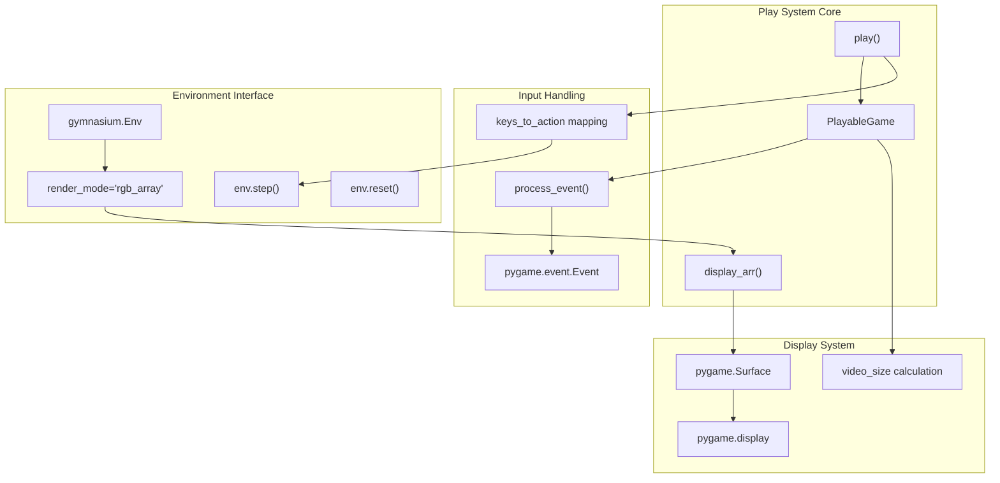
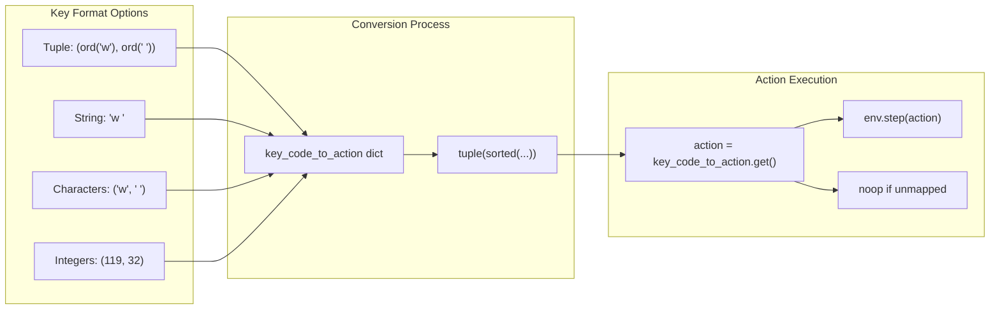
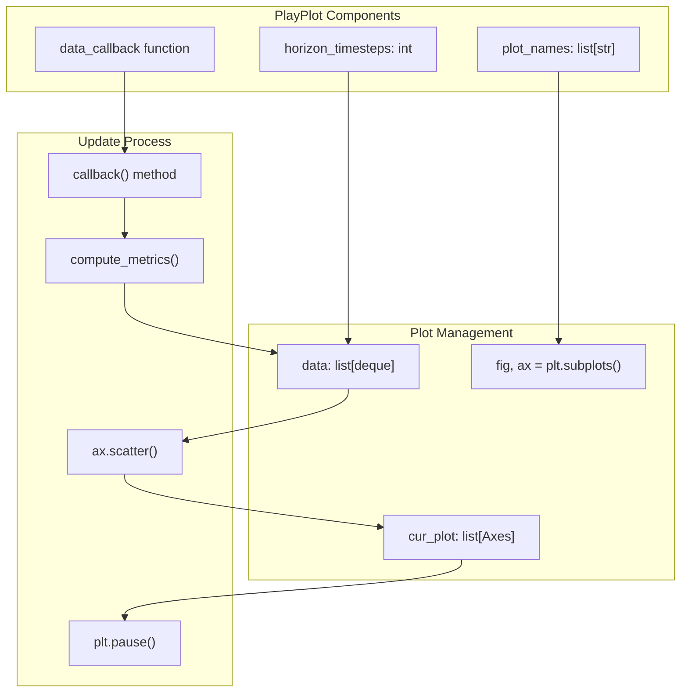
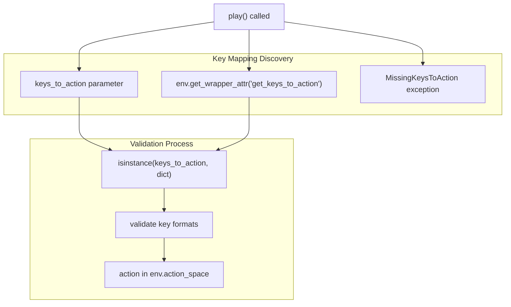
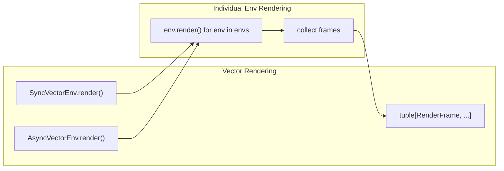
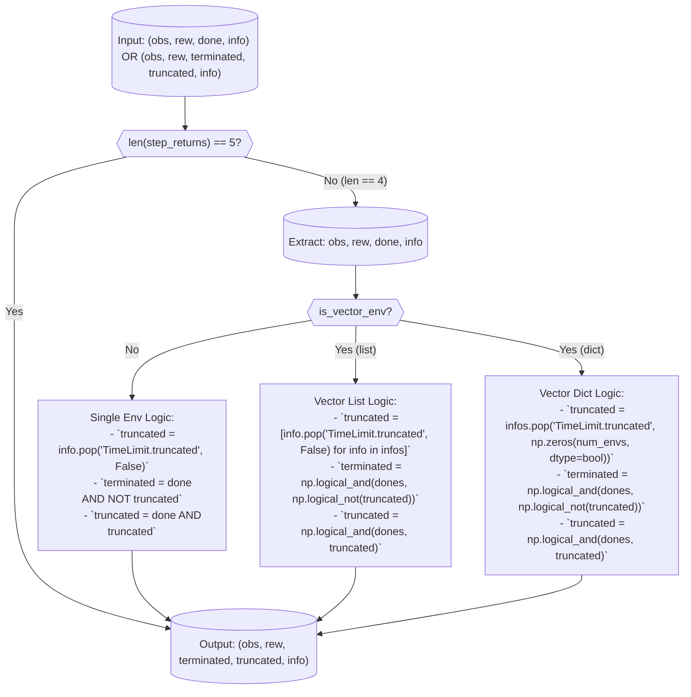
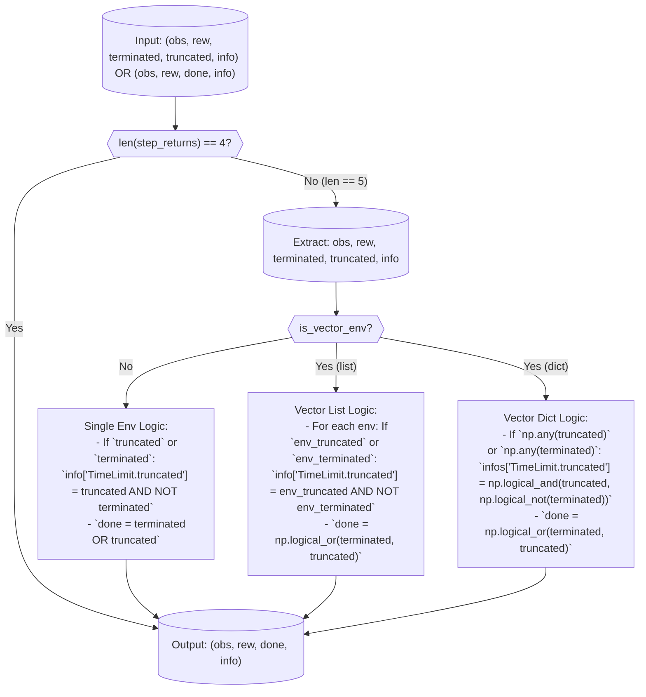
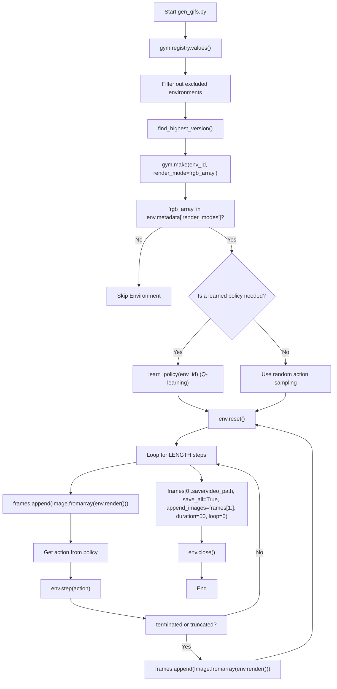

<!-- source: DeepWiki mcp.deepwiki.com · repo Farama-Foundation/Gymnasium · page 7.2 Play and Visualization · fetched 2026-10-14 -->

# Play and Visualization

<details>
<summary>Relevant source files</summary>

The following files were used as context for generating this wiki page:

- [docs/_scripts/gen_gifs.py](docs/_scripts/gen_gifs.py)
- [docs/_scripts/gen_mds.py](docs/_scripts/gen_mds.py)
- [docs/_scripts/linkcheck.py](docs/_scripts/linkcheck.py)
- [docs/environments/mujoco.md](docs/environments/mujoco.md)
- [docs/environments/third_party_environments.md](docs/environments/third_party_environments.md)
- [gymnasium/utils/play.py](gymnasium/utils/play.py)
- [gymnasium/utils/step_api_compatibility.py](gymnasium/utils/step_api_compatibility.py)
- [tests/utils/test_play.py](tests/utils/test_play.py)

</details>


This document covers Gymnasium's interactive play utilities and visualization tools for environments. The play system enables human interaction with environments through keyboard controls, while the visualization components provide real-time plotting and rendering capabilities.

For information about environment rendering modes and wrappers, see [Utilities and Tools](#7). For details about environment specifications and registration, see [Environment Registration](#4).

## Overview

The play and visualization system provides three main capabilities:

1. **Interactive Play** - Human control of environments via keyboard input using the `play()` function
2. **Real-time Visualization** - Live plotting of metrics during environment interaction via `PlayPlot`
3. **Display Utilities** - Rendering and display functions for environment observations

The system is primarily implemented in [gymnasium/utils/play.py:1-499]() and integrates with pygame for input handling and matplotlib for plotting.

## Interactive Play Architecture



Sources: [gymnasium/utils/play.py:182-317](), [gymnasium/utils/play.py:51-155]()

The interactive play system centers around the `play()` function which creates a `PlayableGame` instance to manage the interaction loop. The system requires environments with `rgb_array` or `rgb_array_list` render modes.

### PlayableGame Class

The `PlayableGame` class wraps an environment to enable keyboard interaction:

| Property | Type | Purpose |
|----------|------|---------|
| `env` | `Env` | The wrapped environment |
| `relevant_keys` | `set` | Keys that trigger actions |
| `video_size` | `tuple[int, int]` | Display dimensions |
| `screen` | `pygame.Surface` | Pygame display surface |
| `pressed_keys` | `list` | Currently pressed keys |
| `running` | `bool` | Game loop control flag |

Sources: [gymnasium/utils/play.py:51-61](), [gymnasium/utils/play.py:85-91]()

### Key Mapping System

The system supports flexible key-to-action mappings in multiple formats:



Sources: [gymnasium/utils/play.py:273-281](), [gymnasium/utils/play.py:294-295]()

## Real-time Visualization System

The `PlayPlot` class provides live plotting capabilities during environment interaction:



Sources: [gymnasium/utils/play.py:319-425]()

### PlayPlot Usage Pattern

The `PlayPlot` class follows this interaction pattern:

1. **Initialization** - Define metric computation function and plot configuration
2. **Callback Integration** - Use `PlayPlot.callback` as the play callback
3. **Metric Computation** - Extract metrics from environment transitions
4. **Live Updates** - Automatically update plots with rolling window

Sources: [gymnasium/utils/play.py:347-381](), [gymnasium/utils/play.py:382-425]()

## Environment Integration

### Render Mode Requirements

The play system requires specific render modes:

| Render Mode | Support | Usage |
|-------------|---------|-------|
| `rgb_array` | ✅ Required | Single frame rendering |
| `rgb_array_list` | ✅ Required | Multi-frame rendering |
| `human` | ❌ Incompatible | Direct screen rendering |
| `ansi` | ❌ Incompatible | Text-based rendering |

Sources: [gymnasium/utils/play.py:75-79]()

### Keys-to-Action Discovery

The system discovers key mappings through multiple mechanisms:



Sources: [gymnasium/utils/play.py:250-272](), [gymnasium/utils/play.py:96-104]()

## Display and Rendering Utilities

### Display Array Function

The `display_arr()` function handles rendering numpy arrays to pygame surfaces:

| Parameter | Type | Purpose |
|-----------|------|---------|
| `screen` | `pygame.Surface` | Target display surface |
| `arr` | `np.ndarray` | Image array to display |
| `video_size` | `tuple[int, int]` | Target video dimensions |
| `transpose` | `bool` | Whether to transpose the array |

The function handles:
- Array format conversion and scaling
- Aspect ratio preservation with black bars
- Surface blitting and positioning

Sources: [gymnasium/utils/play.py:157-180]()

### Vector Environment Rendering

Vector environments provide tuple-based rendering for multiple environments:



Sources: [docs/environments/mujoco.md:105-108]() (Note: The provided `mujoco.md` file does not directly contain information about `SyncVectorEnv.render()` or `AsyncVectorEnv.render()`. This diagram is based on general knowledge of vector environments and their rendering patterns, which typically involve iterating through individual environments to collect frames.)

## Step API Compatibility

Gymnasium provides utilities to ensure compatibility between the old `(obs, rew, done, info)` step API and the new `(obs, rew, terminated, truncated, info)` step API. This is crucial for environments, wrappers, and agents that might be written using different API versions.

The `gymnasium.utils.step_api_compatibility` module offers functions to convert between these two formats.

### `convert_to_terminated_truncated_step_api`

This function transforms step returns to the new API format, ensuring that `terminated` and `truncated` booleans are explicitly provided.


Sources: [gymnasium/utils/step_api_compatibility.py:27-79]()

### `convert_to_done_step_api`

This function transforms step returns to the old API format, combining `terminated` and `truncated` into a single `done` boolean.


Sources: [gymnasium/utils/step_api_compatibility.py:82-137]()

### `step_api_compatibility`

This is a wrapper function that uses the above two functions to convert step returns to the desired API based on the `output_truncation_bool` parameter.

| Parameter | Type | Purpose |
|---|---|---|
| `step_returns` | `TerminatedTruncatedStepType` or `DoneStepType` | The step returns to convert. |
| `output_truncation_bool` | `bool` | If `True`, output the new API (`terminated`, `truncated`). If `False`, output the old API (`done`). |
| `is_vector_env` | `bool` | Whether the step returns are from a vector environment. |

Sources: [gymnasium/utils/step_api_compatibility.py:140-143]()

## Documentation GIF Generation

Gymnasium includes scripts to automatically generate GIFs for environment documentation pages. These GIFs demonstrate basic environment behavior and are used throughout the documentation.

The `gen_gifs.py` script iterates through registered environments, renders them, and saves a sequence of frames as a GIF.


Sources: [docs/_scripts/gen_gifs.py:1-118]()

### `learn_policy` Function

For certain environments where a random policy does not adequately demonstrate behavior (e.g., `CliffWalking`), a simple Q-learning agent is trained to generate more meaningful GIFs.

| Parameter | Type | Purpose |
|---|---|---|
| `env_id` | `str` | The ID of the environment to learn a policy for. |
| `episodes` | `int` | Number of training episodes. |
| `alpha` | `float` | Learning rate for Q-learning. |
| `gamma` | `float` | Discount factor for Q-learning. |
| `seed` | `int` | Random seed for reproducibility. |

Sources: [docs/_scripts/gen_gifs.py:20-48]()

### `gen_mds.py` Integration

The generated GIFs are then referenced in the auto-generated environment documentation markdown files by the `gen_mds.py` script. This script creates individual markdown files for each environment, embedding the corresponding GIF.

```python
env_page = f"""---
autogenerated:
title: {title_env_name}
{related_pages_meta}---

# {title_env_name}

```{{figure}} ../../_static/videos/{env_module}/{snake_env_name}.gif
:width: 200px
:name: {snake_env_name}
```
...
"""
```
Sources: [docs/_scripts/gen_mds.py:63-73]()

## Error Handling and Validation

The play system includes comprehensive error checking:

| Error Type | Trigger | Exception |
|------------|---------|-----------|
| Missing keys | No key mapping provided | `MissingKeysToAction` |
| Invalid render mode | Non-rgb_array mode | `ValueError` |
| Invalid key format | Malformed key mapping | `TypeError` |
| Pygame dependency | pygame not installed | `DependencyNotInstalled` |
| Matplotlib dependency | matplotlib not available | `logger.warn` (not an exception) |

Sources: [gymnasium/utils/play.py:28-31](), [gymnasium/utils/play.py:33-39](), [gymnasium/utils/play.py:75-79](), [gymnasium/utils/play.py:105-108]()

## Testing Infrastructure

The play system includes comprehensive tests covering:

- Key mapping validation and conversion
- Event processing and game loop control
- Environment integration with different key formats
- Pygame event simulation and callback testing

Key test utilities include:
- `PlayStatus` class for tracking play session state
- Event injection for automated testing
- Multiple key format validation

Sources: [tests/utils/test_play.py:36-49](), [tests/utils/test_play.py:147-206]()

---

