<!-- source: DeepWiki mcp.deepwiki.com · repo Farama-Foundation/Gymnasium · page 8 Development and Contributing · fetched 2026-10-14 -->

# Development and Contributing

<details>
<summary>Relevant source files</summary>

The following files were used as context for generating this wiki page:

- [CODE_OF_CONDUCT.rst](CODE_OF_CONDUCT.rst)
- [CONTRIBUTING.md](CONTRIBUTING.md)
- [LICENSE](LICENSE)
- [docs/api/spaces.md](docs/api/spaces.md)
- [docs/api/spaces/composite.md](docs/api/spaces/composite.md)
- [gymnasium/spaces/__init__.py](gymnasium/spaces/__init__.py)

</details>


This page outlines the process of developing and contributing to the Gymnasium codebase. It covers the development workflow, testing infrastructure, documentation system, and build processes. For information about the API itself, refer to the [Core API](#2) page.

## Development Architecture Overview

```mermaid
flowchart TB
    subgraph "Development Infrastructure"
        DOCKER["Docker Containers<br/>all-py.Dockerfile<br/>necessary-py.Dockerfile"]
        PRECOMMIT[".pre-commit-config.yaml<br/>Code Quality Hooks"]
        PYPROJECT["pyproject.toml<br/>Build Configuration"]
    end
    
    subgraph "Testing Framework"
        TEST_ENVS["tests/envs/test_envs.py<br/>Environment API Testing"]
        TEST_UTILS["tests/envs/utils.py<br/>Testing Utilities"]
        TEST_MUJOCO["tests/envs/mujoco/test_mujoco_v5.py<br/>MuJoCo Environment Tests"]
        TEST_WRAPPERS["tests/wrappers/<br/>Wrapper Testing"]
        TEST_RENDERING["tests/envs/test_rendering.py<br/>Rendering Tests"]
    end
    
    subgraph "Documentation System"
        DOCS_BUILD["docs/README.md<br/>Build Instructions"]
        DOCS_SCRIPTS["docs/_scripts/gen_mds.py<br/>Documentation Generation"]
        THIRD_PARTY["docs/environments/third_party_environments.md<br/>Community Environments"]
    end
    
    subgraph "Core Development Areas"
        CORE_ENVS["gymnasium/envs/<br/>Environment Implementations"]
        CORE_SPACES["gymnasium/spaces/<br/>Space Definitions"]
        CORE_WRAPPERS["gymnasium/wrappers/<br/>Wrapper Implementations"]
        CORE_UTILS["gymnasium/utils/<br/>Utilities & Validation"]
    end
    
    DOCKER --> TEST_ENVS
    PRECOMMIT --> TEST_ENVS
    PYPROJECT --> TEST_ENVS
    TEST_UTILS --> TEST_ENVS
    TEST_UTILS --> TEST_MUJOCO
    DOCS_BUILD --> DOCS_SCRIPTS
    CORE_ENVS --> TEST_ENVS
    CORE_SPACES --> TEST_ENVS
    CORE_WRAPPERS --> TEST_WRAPPERS
    CORE_UTILS --> TEST_ENVS
```

Sources: [bin/all-py.Dockerfile:1-25](), [bin/necessary-py.Dockerfile:1-27](), [tests/envs/test_envs.py:1-162](), [tests/envs/utils.py:1-54](), [docs/README.md:1-51]()

## Contribution Types

Gymnasium accepts several types of contributions:

- **Bug reports**: Issues with existing functionality
- **Bug fixes**: Pull requests addressing reported bugs
- **Documentation improvements**: Enhancements to documentation clarity and coverage
- **Features**: New functionalities or improvements to existing ones.

Notably, new environments are generally not accepted as direct contributions to the core library. Instead, the project encourages the development of third-party environments.

Sources: [CONTRIBUTING.md:3-13]()

## Development Setup

### Local Development Setup

Development Environment Setup:

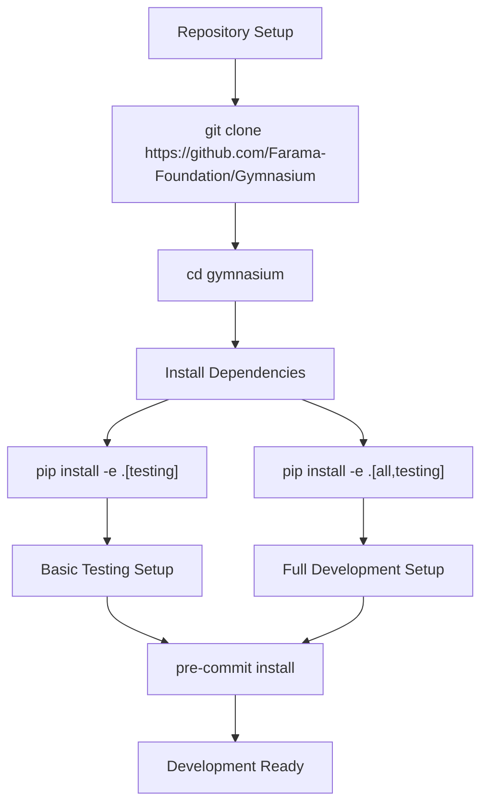

### Docker Development Setup

For containerized development, Gymnasium provides Docker configurations:

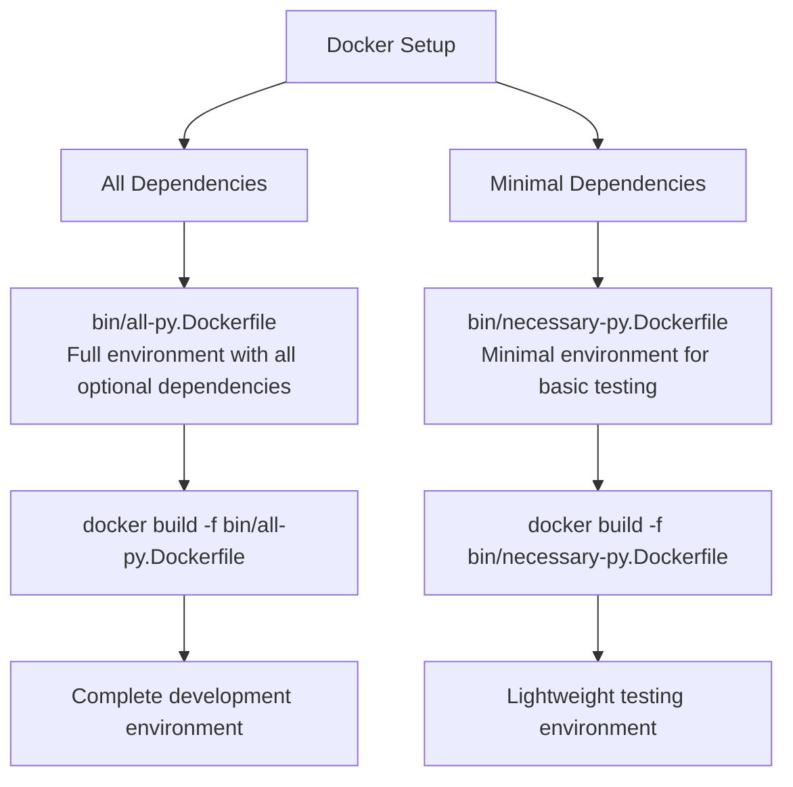

The Docker setup includes:
- System dependencies (`libglu1-mesa-dev`, `libgl1-mesa-dev`, `libosmesa6-dev`)
- Graphics libraries for rendering (`xvfb`, `ffmpeg`)
- Build tools (`cmake`, `swig`, `patchelf`)
- Python package management (`uv`)

Sources: [bin/all-py.Dockerfile:1-25](), [bin/necessary-py.Dockerfile:1-27]()

## Environment Development

### Creating New Environments

When developing new environments, they must integrate with Gymnasium's registration system and testing framework.

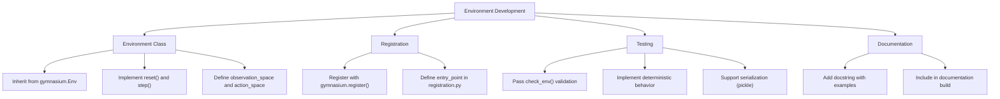

### Environment Validation

All environments must pass validation through `gymnasium.utils.env_checker.check_env()`:

```python
# Environment validation process
env = YourEnvironment()
check_env(env, skip_render_check=True)
```

Key validation checks:
- **API Compliance**: Proper implementation of `reset()` and `step()` methods
- **Space Validation**: Observations and actions fit declared spaces
- **Determinism**: Reproducible behavior with seeds
- **Info Dictionary**: Proper formatting and consistency

### Testing New Environments

The testing framework automatically discovers and tests registered environments:

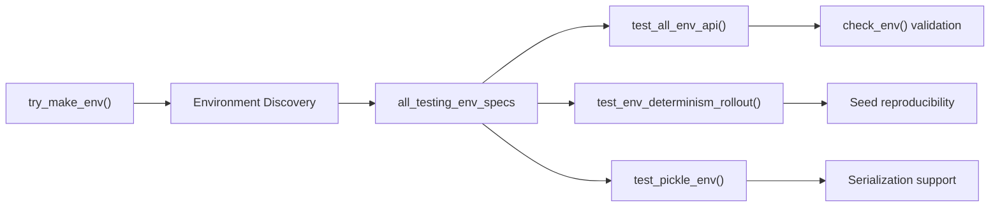

### Environment Registration

Environments are registered in `gymnasium/envs/registration.py` using `EnvSpec`:

```python
register(
    id="YourEnv-v1",
    entry_point="gymnasium.envs.your_module:YourEnvClass",
    max_episode_steps=200,
    nondeterministic=False,
)
```

Sources: [tests/envs/test_envs.py:35-47](), [tests/envs/utils.py:8-27](), [gymnasium/utils/env_match.py:7-18]()

## Code Quality and Standards

### Pre-commit Hooks

Gymnasium enforces code quality through automated pre-commit hooks. These hooks run automatically before each commit if installed, helping maintain consistent code style and catch common issues early.

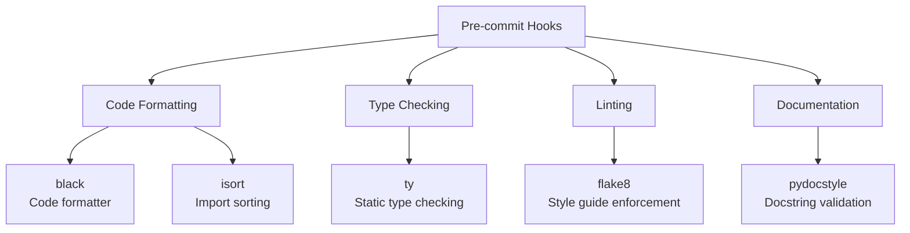
Sources: [CONTRIBUTING.md:31-39](), [CONTRIBUTING.md:18-24]()

### Setup Process

To set up and run pre-commit hooks locally:

```bash
# Install pre-commit
pip install pre-commit

# Install hooks
pre-commit install

# Run manually on all files
pre-commit run --all-files
```
Sources: [CONTRIBUTING.md:31-39]()

### Type Checking

The project uses `ty` for type checking. Its configuration is located in `pyproject.toml` [pyproject.toml -> [tool.ty.src]](). To run type checks locally, you can use `ty check .` or rely on the pre-commit hooks.
Sources: [CONTRIBUTING.md:18-24]()

### Docstring Standards

Gymnasium follows Google-style docstrings, enforced by `pydocstyle` in the pre-commit process. All new functions, files, and classes require appropriate docstrings.
Sources: [CONTRIBUTING.md:45-53]()

```python
def example_function(param1: int, param2: str) -> bool:
    """Brief description of function.
    
    Args:
        param1: Description of first parameter.
        param2: Description of second parameter.
        
    Returns:
        Description of return value.
        
    Raises:
        ValueError: When invalid input is provided.
    """
    pass
```

To check your docstrings, run `pre-commit run --all-files` or `pydocstyle --source --explain --convention=google`.
Sources: [CONTRIBUTING.md:52-53]()

## Testing Framework

Gymnasium has a comprehensive testing framework covering environment API compliance, determinism, and functionality. For details, see [Testing Framework](#8.1).

### Core Testing Architecture

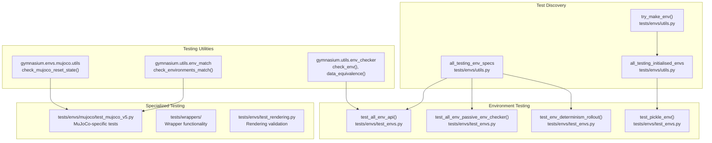

### Key Testing Components

| Test Type | Purpose | Location |
|-----------|---------|----------|
| **API Compliance** | Ensures environments follow Gymnasium API | `tests/envs/test_envs.py:35-47` |
| **Determinism** | Verifies reproducible behavior with same seed | `tests/envs/test_envs.py:78-138` |
| **Serialization** | Tests pickle/unpickle functionality | `tests/envs/test_envs.py:146-163` |
| **Environment Checker** | Validates environment implementations | `gymnasium/utils/env_checker.py` |
| **Rendering** | Tests visual output across render modes | `tests/envs/test_rendering.py:52-76` |

### Running Tests

```bash
# Install testing dependencies
pip install -e .[testing]

# Run all tests
pytest

# Run specific test categories
pytest tests/envs/test_envs.py::test_all_env_api
pytest tests/envs/test_rendering.py
pytest tests/envs/mujoco/

# Run with coverage
pytest --cov=gymnasium
```
Sources: [CONTRIBUTING.md:41-42]()

### Testing New Environments

When adding new environments, ensure they pass:

1. **API Compliance**: `check_env()` from `gymnasium.utils.env_checker`
2. **Determinism**: Consistent behavior with fixed seeds
3. **Serialization**: Proper pickle/unpickle support
4. **Rendering**: All declared render modes work correctly

Sources: [tests/envs/test_envs.py:1-162](), [tests/envs/utils.py:1-54](), [tests/envs/test_rendering.py:1-77](), [tests/envs/mujoco/test_mujoco_v5.py:1-710](), [gymnasium/utils/env_match.py:1-151]()

## Documentation System

Gymnasium uses Sphinx to build documentation with automatic generation from code docstrings. For details, see [Documentation System](#8.2).

### Documentation Build Process

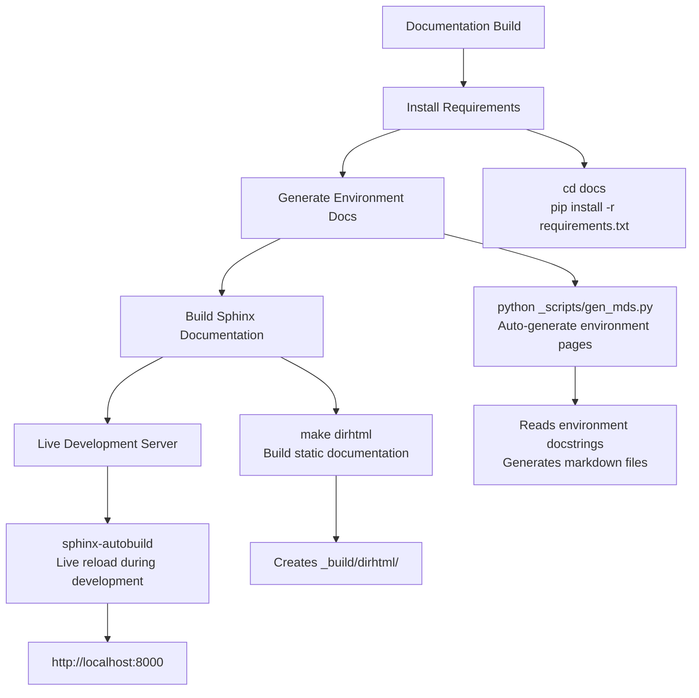
Sources: [CONTRIBUTING.md:58-71]()

### Documentation Components

| Component | Purpose | Location |
|-----------|---------|----------|
| **Environment Pages** | Auto-generated from docstrings | `docs/_scripts/gen_mds.py` |
| **API Documentation** | Sphinx autodoc integration | `docs/api/` |
| **Tutorials** | Sphinx-Gallery tutorials | `docs/tutorials/` |
| **Third-party Environments** | Community environment listings | `docs/environments/third_party_environments.md` |

### Building Documentation

```bash
# Basic build
cd docs
pip install -r requirements.txt
python _scripts/gen_mds.py
make dirhtml

# Live development server
sphinx-autobuild -b dirhtml --watch ../gymnasium --re-ignore "pickle$" . _build
```
Sources: [CONTRIBUTING.md:58-71]()

### Adding Environment Documentation

1. **Environment Docstring**: Add properly formatted docstring to environment Python file
2. **Install Environment**: `pip install -e .`
3. **Generate Documentation**: `python docs/_scripts/gen_mds.py`
4. **Add Media**: Place GIF in `docs/_static/videos/{ENV_TYPE}/`
5. **Update Index**: Add environment to `docs/environments/{ENV_TYPE}/index.md`

### Tutorial Development

Tutorials use Sphinx-Gallery format:
- Place in `docs/tutorials/`
- Use `.py` files with special comment format
- Prefix with `run_` for execution during build
- Keep execution time under a few seconds

Sources: [docs/README.md:1-51](), [docs/environments/third_party_environments.md:1-438]()

## Repository Structure

Understanding the repository structure is essential for effective contribution to Gymnasium.

### Core Library Structure

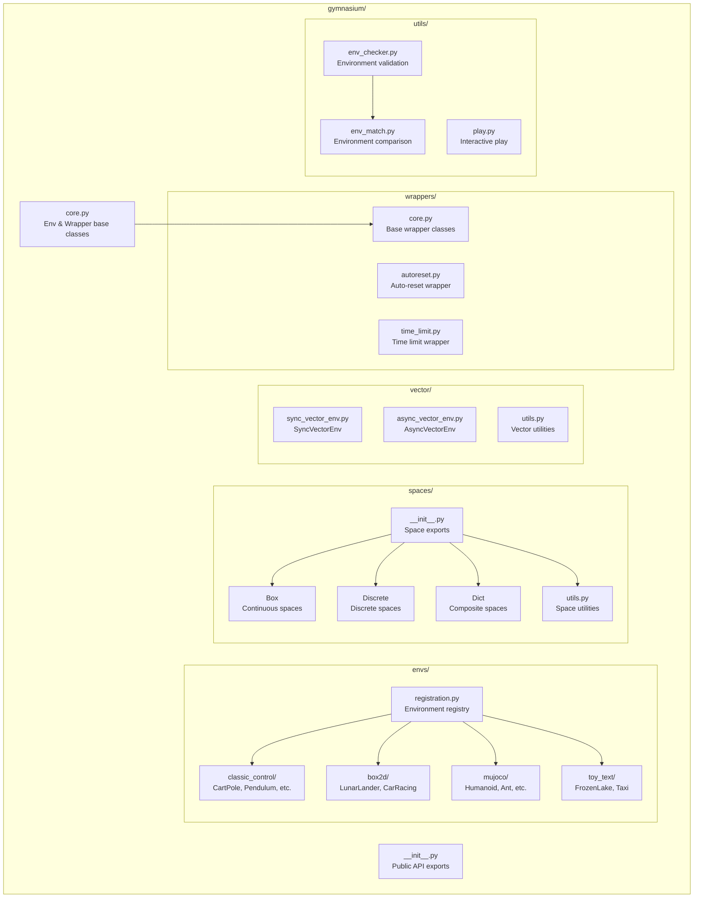
Sources: [gymnasium/spaces/__init__.py:1-48]()

### Testing Structure

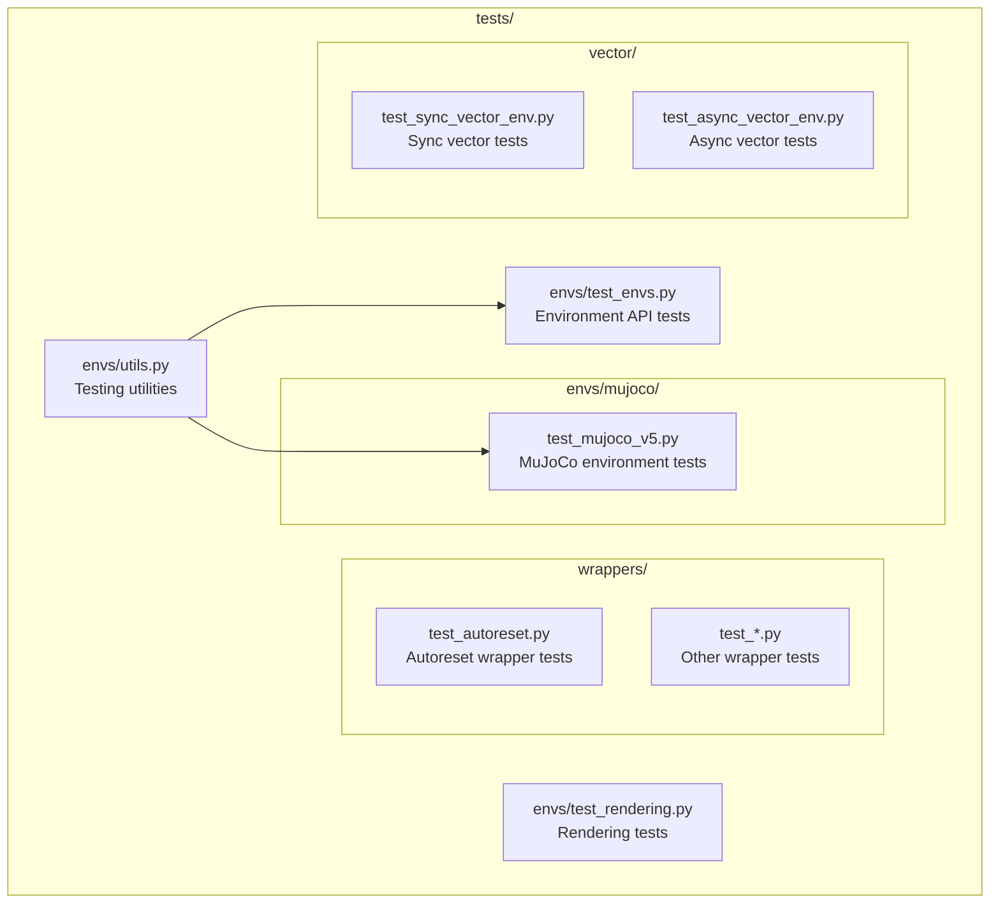

### Development Infrastructure

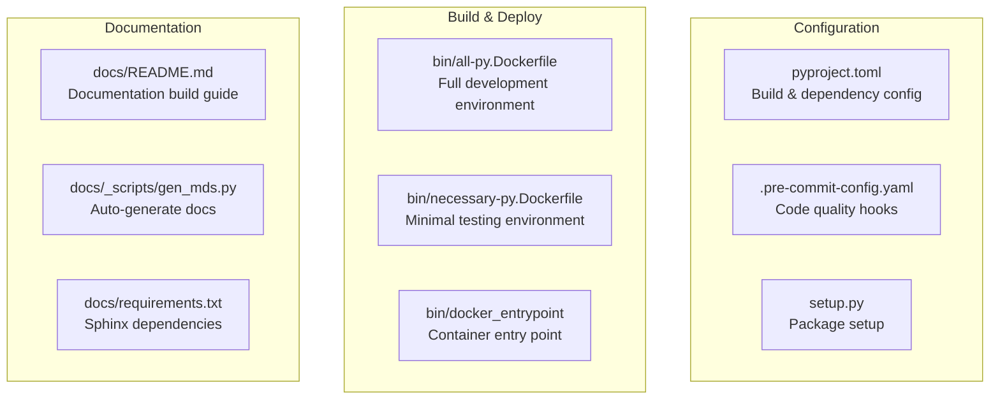

### Key File Locations

| Component | Location | Purpose |
|-----------|----------|---------|
| **Environment Registry** | `gymnasium/envs/registration.py` | Central environment registration |
| **Base Classes** | `gymnasium/core.py` | `Env` and `Wrapper` base classes |
| **Space Definitions** | `gymnasium/spaces/` | Observation and action space types |
| **Environment Validation** | `gymnasium/utils/env_checker.py` | `check_env()` function |
| **Testing Utilities** | `tests/envs/utils.py` | `try_make_env()`, test environment discovery |
| **MuJoCo Utilities** | `gymnasium/envs/mujoco/utils.py` | MuJoCo-specific testing utilities |
| **Vector Environments** | `gymnasium/vector/` | Parallel environment execution |

Sources: [tests/envs/utils.py:1-54](), [tests/envs/test_envs.py:1-162](), [tests/wrappers/test_autoreset.py:1-60](), [gymnasium/utils/env_match.py:1-151](), [gymnasium/envs/mujoco/utils.py:1-76]()

## Contribution Workflow

The typical workflow for contributing to Gymnasium:

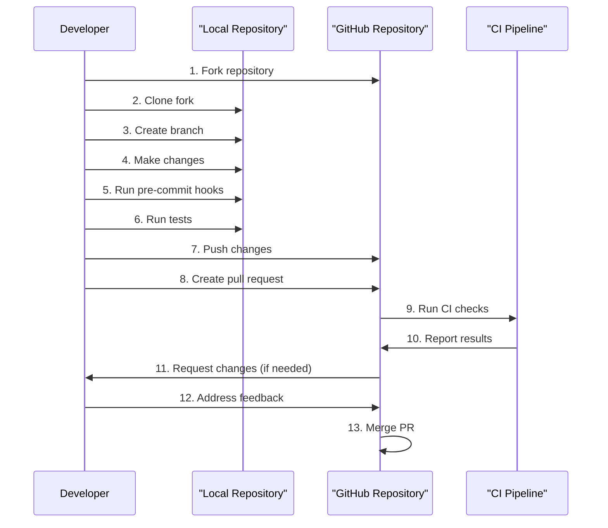

Sources: [CONTRIBUTING.md:1-71]()

---

