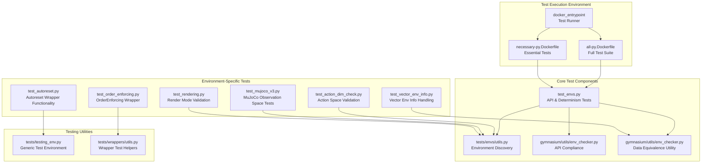
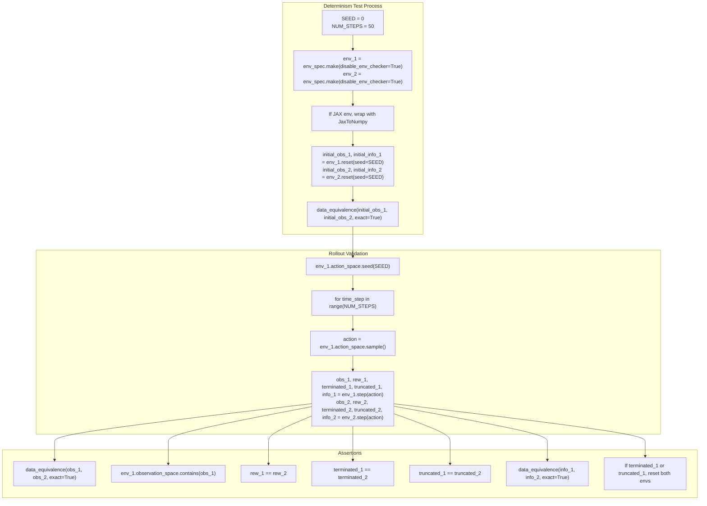

<!-- source: DeepWiki mcp.deepwiki.com · repo Farama-Foundation/Gymnasium · page 8.1 Testing Framework · fetched 2026-10-14 -->

# Testing Framework

<details>
<summary>Relevant source files</summary>

The following files were used as context for generating this wiki page:

- [bin/all-py.Dockerfile](bin/all-py.Dockerfile)
- [bin/necessary-py.Dockerfile](bin/necessary-py.Dockerfile)
- [tests/envs/mujoco/test_mujoco_v3.py](tests/envs/mujoco/test_mujoco_v3.py)
- [tests/envs/test_action_dim_check.py](tests/envs/test_action_dim_check.py)
- [tests/envs/test_envs.py](tests/envs/test_envs.py)
- [tests/envs/test_rendering.py](tests/envs/test_rendering.py)
- [tests/envs/utils.py](tests/envs/utils.py)
- [tests/vector/test_vector_env_info.py](tests/vector/test_vector_env_info.py)
- [tests/wrappers/test_autoreset.py](tests/wrappers/test_autoreset.py)
- [tests/wrappers/test_order_enforcing.py](tests/wrappers/test_order_enforcing.py)
- [tests/wrappers/utils.py](tests/wrappers/utils.py)

</details>


The Testing Framework provides comprehensive validation infrastructure for Gymnasium environments, wrappers, and utilities. This system ensures API compliance, deterministic behavior, cross-version compatibility, and proper functionality across all supported environment types.

For information about environment validation during development, see [Environment Checking:7.1](). For details about the CI/CD pipeline that runs these tests, see [CI/CD and Build System:8.3]().

## Core Testing Infrastructure

The testing framework is built around several key components that validate different aspects of the Gymnasium ecosystem:



Sources: [tests/envs/test_envs.py:1-162](), [tests/envs/utils.py:1-54](), [gymnasium/utils/env_checker.py:9](), [tests/envs/test_rendering.py:1-108](), [bin/all-py.Dockerfile:1-25](), [tests/envs/test_action_dim_check.py:1-147](), [tests/envs/mujoco/test_mujoco_v3.py:1-64](), [tests/wrappers/test_autoreset.py:1-60](), [tests/wrappers/test_order_enforcing.py:1-35](), [tests/vector/test_vector_env_info.py:1-165]()

## Environment Discovery and Filtering

The testing framework automatically discovers and filters environments for testing using the `try_make_env` function and environment categorization:

```mermaid
graph LR
    subgraph "Environment Discovery Process"
        REGISTRY["gym.envs.registry.values()<br/>All Registered EnvSpecs"]
        TRY_MAKE["try_make_env(env_spec)<br/>Attempt to make environment"]
        FILTER_ENTRY["Entry Point Check<br/>'gymnasium.envs.' in entry_point"]
        ERROR_HANDLING["Catch ImportError, AttributeError, DependencyNotInstalled, MissingArgument"]
    end
    
    subgraph "Environment Collections"
        ALL_TESTING_INITIALISED_ENVS["all_testing_initialised_envs<br/>List[gym.Env]"]
        ALL_TESTING_ENV_SPECS["all_testing_env_specs<br/>List[EnvSpec]"]
        MUJOCO_TESTING_ENV_SPECS["mujoco_testing_env_specs<br/>List[EnvSpec] (MuJoCo only)"]
        GYM_TESTING_ENV_SPECS["gym_testing_env_specs<br/>List[EnvSpec] (Box2D, Classic Control, Toy Text)"]
    end
    
    subgraph "Test Execution"
        PARAMETRIZE["@pytest.mark.parametrize<br/>Dynamic Test Generation"]
        TEST_FUNCTIONS["test_all_env_api()<br/>test_env_determinism_rollout()<br/>test_pickle_env()<br/>test_mujoco_action_dimensions()<br/>test_obs_space_mujoco_environments()"]
    end
    
    REGISTRY --> TRY_MAKE
    TRY_MAKE --> FILTER_ENTRY
    FILTER_ENTRY --> ERROR_HANDLING
    ERROR_HANDLING --> ALL_TESTING_INITIALISED_ENVS
    ALL_TESTING_INITIALISED_ENVS --> ALL_TESTING_ENV_SPECS
    ALL_TESTING_ENV_SPECS --> MUJOCO_TESTING_ENV_SPECS
    ALL_TESTING_ENV_SPECS --> GYM_TESTING_ENV_SPECS
    ALL_TESTING_ENV_SPECS --> PARAMETRIZE
    ALL_TESTING_INITIALISED_ENVS --> PARAMETRIZE
    MUJOCO_TESTING_ENV_SPECS --> PARAMETRIZE
    PARAMETRIZE --> TEST_FUNCTIONS
```



The `try_make_env` function [tests/envs/utils.py:8-27]() attempts to instantiate an environment from its `EnvSpec`. It filters environments whose entry points are not within `gymnasium.envs.` and handles various exceptions that might occur during environment creation, logging warnings for skipped environments.

The discovered environments are then categorized into:
- `all_testing_initialised_envs`: A list of all successfully initialized `gym.Env` instances [tests/envs/utils.py:31-36]().
- `all_testing_env_specs`: A list of `EnvSpec` objects for all testable environments [tests/envs/utils.py:39-41]().
- `mujoco_testing_env_specs`: `EnvSpec` objects specifically for MuJoCo environments [tests/envs/utils.py:42-46]().
- `gym_testing_env_specs`: `EnvSpec` objects for core Gymnasium environments (Box2D, Classic Control, Toy Text) [tests/envs/utils.py:47-54]().

These lists are used with `@pytest.mark.parametrize` to dynamically generate tests for each environment.

Sources: [tests/envs/utils.py:8-54](), [tests/envs/test_envs.py:30-47](), [tests/envs/test_action_dim_check.py:10-14](), [tests/envs/mujoco/test_mujoco_v3.py:18-22]()

## API Compliance Testing

The `test_all_env_api` function [tests/envs/test_envs.py:34-47]() validates that all environments conform to the Gymnasium API specification using `gymnasium.utils.env_checker.check_env` [gymnasium/utils/env_checker.py:9]().

| Test Component | Function | Purpose |
|---|---|---|
| Environment Creation | `spec.make().unwrapped` | Instantiates the environment and unwraps it to test the base environment. |
| API Compliance | `check_env(env, skip_render_check=True)` | Performs a comprehensive check of the environment's API, including observation/action space validity, `reset`/`step` return types, and more. Rendering checks are skipped to avoid GUI dependencies. |
| Warning Filtering | `CHECK_ENV_IGNORE_WARNINGS` | A list of regex patterns for warnings that are expected and should not cause a test failure [tests/envs/test_envs.py:20-27](). |
| Error Handling | `gym.error.Error` | Catches any unexpected warnings that are not in `CHECK_ENV_IGNORE_WARNINGS`, raising an error to indicate a potential issue. |

The test uses a parametrized approach where each environment specification is tested individually:

```python
@pytest.mark.parametrize(
    "spec",
    all_testing_env_specs,
    ids=[spec.id for spec in all_testing_env_specs],
)
def test_all_env_api(spec):
```

Additionally, `test_all_env_passive_env_checker` [tests/envs/test_envs.py:49-64]() performs a passive check by simply calling `reset()` and `step()` once, filtering out specific known warnings related to environment versions.

Sources: [tests/envs/test_envs.py:34-47](), [tests/envs/test_envs.py:20-27](), [tests/envs/test_envs.py:49-64]()

## Determinism Testing

The `test_env_determinism_rollout` function [tests/envs/test_envs.py:77-138]() ensures environments produce identical behavior when given the same seed.



This test skips environments marked as `nondeterministic` [tests/envs/test_envs.py:89](). It uses `gymnasium.utils.env_checker.data_equivalence` [gymnasium/utils/env_checker.py:9]() to compare observations and info dictionaries, ensuring exact matches. For JAX-based environments, `JaxToNumpy` wrapper [gymnasium/wrappers/jax_to_numpy.py:1] is applied to convert JAX arrays to NumPy for consistent comparison [tests/envs/test_envs.py:96-97]().

Another determinism test, `test_pickle_env` [tests/envs/test_envs.py:140-162](), verifies that environments can be pickled and unpickled, and that the unpickled environment behaves identically to the original.

Sources: [tests/envs/test_envs.py:77-138](), [tests/envs/test_envs.py:69-70](), [tests/envs/test_envs.py:140-162](), [gymnasium/utils/env_checker.py:9]()

## Action Space Validation

The `test_action_dim_check.py` [tests/envs/test_action_dim_check.py:1-147]() module contains tests specifically for validating action space dimensions and out-of-bound actions.

### MuJoCo Action Dimensions

`test_mujoco_action_dimensions` [tests/envs/test_action_dim_check.py:10-48]() verifies that MuJoCo environments raise a `ValueError` when `step()` is called with mis-dimensioned actions (e.g., too few/many actions, incorrect number of dimensions, incorrect shape).

### Discrete Action Space Out-of-Bound Actions

`test_discrete_actions_out_of_bound` [tests/envs/test_action_dim_check.py:60-84]() checks that discrete action space environments raise an exception when an action outside the valid range is provided to `step()`. JAX-based environments are skipped for this test [tests/envs/test_action_dim_check.py:73-75]().

### Box Action Space Out-of-Bound Actions

`test_box_actions_out_of_bound` [tests/envs/test_action_dim_check.py:96-147]() verifies that environments with `Box` action spaces correctly clip out-of-bound actions. It asserts that stepping with an action slightly outside the bounds produces the same result as stepping with an action exactly at the boundary. JAX-based environments are also skipped here [tests/envs/test_action_dim_check.py:109-111]().

Sources: [tests/envs/test_action_dim_check.py:1-147]()

## MuJoCo-Specific Testing

The `test_mujoco_v3.py` [tests/envs/mujoco/test_mujoco_v3.py:1-64]() module focuses on validating observation spaces for MuJoCo environments.

`test_obs_space_mujoco_environments` [tests/envs/mujoco/test_mujoco_v3.py:18-64]() checks that observations returned by `reset()` and `step()` are contained within the environment's declared `observation_space`. It also tests specific MuJoCo environment configurations, such as:
- Excluding current positions from observation for certain environments (e.g., Ant, HalfCheetah) [tests/envs/mujoco/test_mujoco_v3.py:37-52]().
- Including contact forces for Ant-v4 [tests/envs/mujoco/test_mujoco_v3.py:54-63]().

Sources: [tests/envs/mujoco/test_mujoco_v3.py:1-64]()

## Rendering and Visualization Testing

The `test_rendering.py` [tests/envs/test_rendering.py:1-108]() module contains tests for validating environment rendering capabilities.

`test_pygame_selective_init` [tests/envs/test_rendering.py:8-38]() ensures that `pygame.display.init()` is used instead of `pygame.init()` to avoid initializing unnecessary subsystems like audio, which can cause issues in headless environments.

`check_rendered` [tests/envs/test_rendering.py:41-75]() is a helper function that validates the format and content of rendered frames based on the `render_mode`.

| Render Mode | Expected Output | Validation |
|---|---|---|
| `rgb_array` | `numpy.ndarray` | 3D array (H, W, 3), values 0-255 |
| `ansi` | `str` | Non-empty string |
| `rgb_array_list` | `list` | List of `rgb_array` frames |
| `state_pixels_list` | `list` | List of `rgb_array` frames |
| `state_pixels` | `numpy.ndarray` | Same as `rgb_array` |
| `depth_array_list` | `list` | List of `depth_array` frames |
| `depth_array` | `numpy.ndarray` | 2D array |
| `rgbd_tuple` | `tuple` | Tuple of `rgb_array` and `depth_array` |

The `test_render_modes` function [tests/envs/test_rendering.py:84-108]() iterates through all supported `render_modes` for each environment (excluding "human" mode) and calls `check_rendered` to validate the output. It also handles potential `gladLoadGL error` by skipping the test if OpenGL is not available.

Sources: [tests/envs/test_rendering.py:1-108]()

## Wrapper Testing Infrastructure

The wrapper testing framework uses the `GenericTestEnv` class [tests/testing_env.py:1-50]() to create controlled test environments with custom `reset` and `step` functions. This allows testing wrapper behavior in isolation with predictable environment responses.

### Autoreset Wrapper

`test_autoreset_wrapper_autoreset` [tests/wrappers/test_autoreset.py:26-60]() verifies that the `Autoreset` wrapper correctly resets the environment automatically when a termination or truncation signal is received. It uses custom `autoreset_reset_func` [tests/wrappers/test_autoreset.py:10-13]() and `autoreset_step_func` [tests/wrappers/test_autoreset.py:16-24]() to simulate environment behavior.

### OrderEnforcing Wrapper

`test_order_enforcing` [tests/wrappers/test_order_enforcing.py:11-35]() checks that the `OrderEnforcing` wrapper raises a `ResetNeeded` error if `step()` or `render()` is called before `reset()`. It also confirms that these errors are not raised after `reset()` has been called, and that the `disable_render_order_enforcing` option works as expected. The `has_wrapper` utility function [tests/wrappers/utils.py:87-93]() is used to check if a specific wrapper is in the environment stack.

### Vector Environment Info Handling

`test_vector_add_info` [tests/vector/test_vector_env_info.py:17-118]() and `test_vector_return_info` [tests/vector/test_vector_env_info.py:143-165]() validate how `VectorEnv` (including `AsyncVectorEnv` and `SyncVectorEnv`) aggregates and processes information dictionaries (`info`) from multiple sub-environments. It ensures that `info` dictionaries are correctly structured, including handling missing keys and nested dictionaries, and that `data_equivalence` holds for the aggregated info.

Sources: [tests/wrappers/test_autoreset.py:1-60](), [tests/testing_env.py:1-50](), [tests/wrappers/test_order_enforcing.py:1-35](), [tests/wrappers/utils.py:87-93](), [tests/vector/test_vector_env_info.py:1-165]()

## Containerized Testing Environment

The testing framework supports containerized execution through Docker configurations, defined in `bin/all-py.Dockerfile` [bin/all-py.Dockerfile:1-25]() and `bin/necessary-py.Dockerfile` [bin/necessary-py.Dockerfile:1-27](). These Dockerfiles set up the necessary dependencies and environment for running tests.

```mermaid
graph TB
    subgraph "Docker Testing Setup"
        ALL_PY["all-py.Dockerfile<br/>Full Environment<br/>All Dependencies"]
        NECESSARY_PY["necessary-py.Dockerfile<br/>Minimal Environment<br/>Essential Dependencies"]
        DOCKER_ENTRY["docker_entrypoint<br/>Test Execution Script"]
    end
    
    subgraph "Installation Process"
        APT_DEPS["apt-get install<br/>System Dependencies<br/>libglu1-mesa-dev, libgl1-mesa-dev, libosmesa6-dev, xvfb, unzip, patchelf, ffmpeg, cmake, swig"]
        UV_INSTALL["uv pip install<br/>Python Dependencies"]
        ALL_DEPS["uv pip install --system .[all,testing] \"numpy$NUMPY_VERSION\" --no-cache-dir --extra-index-url https://download.pytorch.org/whl/cpu"]
        NECESSARY_DEPS["uv pip install --system .[testing] --no-cache-dir"]
        NUMPY_VERSION_CONTROL["\"numpy$NUMPY_VERSION\" or \"numpy>=1.21,<2.0\""]
    end
    
    subgraph "Test Execution"
        XVFB["xvfb display server<br/>Headless rendering"]
        PYTEST["pytest test runner<br/>Parametrized test execution"]
        COVERAGE["Test coverage reporting"]
    end
    
    ALL_PY --> APT_DEPS
    NECESSARY_PY --> APT_DEPS
    APT_DEPS --> UV_INSTALL
    UV_INSTALL --> NUMPY_VERSION_CONTROL
    NUMPY_VERSION_CONTROL --> ALL_DEPS
    NUMPY_VERSION_CONTROL --> NECESSARY_DEPS
    DOCKER_ENTRY --> XVFB
    XVFB --> PYTEST
    PYTEST --> COVERAGE
```

- **`all-py.Dockerfile`**: Installs all Gymnasium dependencies, including optional ones, and test dependencies. It specifies a NumPy version range (`>=1.21,<2.0`) and installs PyTorch CPU build [bin/all-py.Dockerfile:21-23]().
- **`necessary-py.Dockerfile`**: Installs only essential dependencies and test dependencies, also with a NumPy version range [bin/necessary-py.Dockerfile:23-24]().
- **`docker_entrypoint`**: This script is the entry point for the Docker containers, typically used to run tests or other development tasks.

Both Dockerfiles install system dependencies like OpenGL libraries, `xvfb` (for headless rendering), `ffmpeg`, `cmake`, and `swig` [bin/all-py.Dockerfile:8-12](), [bin/necessary-py.Dockerfile:7-15](). They use `uv` for efficient Python package installation.

Sources: [bin/all-py.Dockerfile:1-25](), [bin/necessary-py.Dockerfile:1-27]()

## Test Execution and Parametrization

The testing framework uses pytest's parametrization extensively to generate tests dynamically:

```python
@pytest.mark.parametrize(
    "env_spec",
    all_testing_env_specs,
    ids=[env.id for env in all_testing_env_specs],
)
def test_env_determinism_rollout(env_spec: EnvSpec):
    # Test implementation
```

This approach ensures that:
- New environments are automatically included in tests.
- Test failures are isolated to specific environments.
- Environment IDs are used for clear test identification.
- Nondeterministic environments are appropriately skipped [tests/envs/test_envs.py:89-90]().

Sources: [tests/envs/test_envs.py:73-91](), [tests/envs/test_envs.py:141-162]()

## Error Handling and Warning Management

The testing framework includes sophisticated error handling and warning filtering to manage expected warnings while catching unexpected issues.

`CHECK_ENV_IGNORE_WARNINGS` [tests/envs/test_envs.py:20-27]() is a list of specific warning messages that are expected during `check_env` execution and are therefore ignored. This prevents tests from failing due to known, acceptable conditions (e.g., infinite observation space bounds).

Similarly, `PASSIVE_CHECK_IGNORE_WARNING` [tests/envs/test_envs.py:14-16]() is a regex pattern used to ignore warnings during passive environment checks, such as those related to environment versioning.

```python
# Example of warning filtering in test_all_env_api
with warnings.catch_warnings(record=True) as caught_warnings:
    env = spec.make().unwrapped
    check_env(env, skip_render_check=True)
    env.close()

for warning in caught_warnings:
    if warning.message.args[0] not in CHECK_ENV_IGNORE_WARNINGS:
        raise gym.error.Error(f"Unexpected warning: {warning.message}")
```
This mechanism allows tests to pass while filtering known, acceptable warnings, ensuring that only genuinely problematic warnings lead to test failures.

Sources: [tests/envs/test_envs.py:20-27](), [tests/envs/test_envs.py:14-16](), [tests/envs/test_envs.py:36-45]()

---

