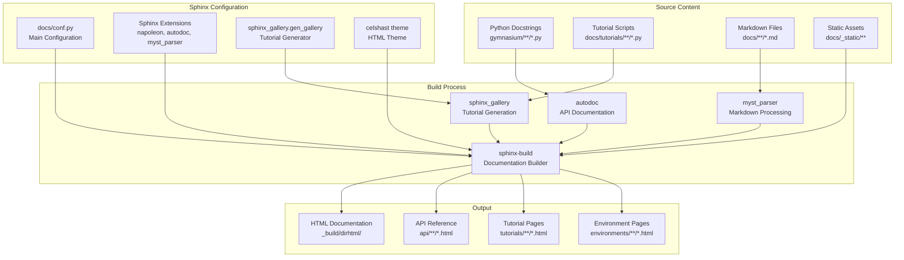
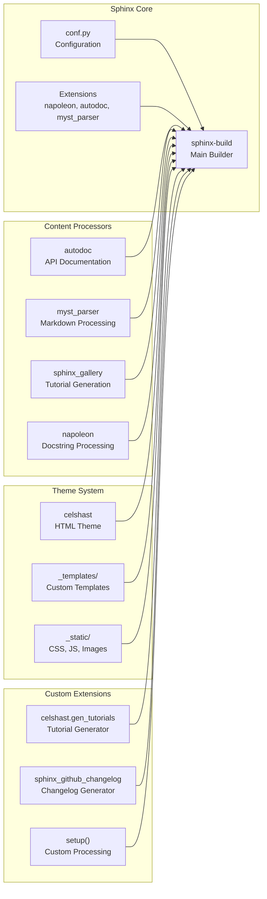
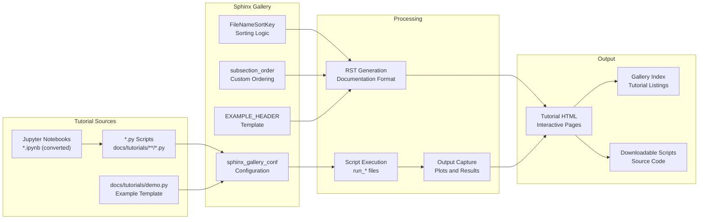
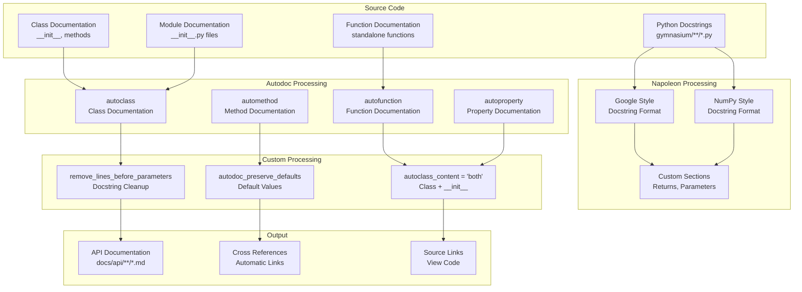
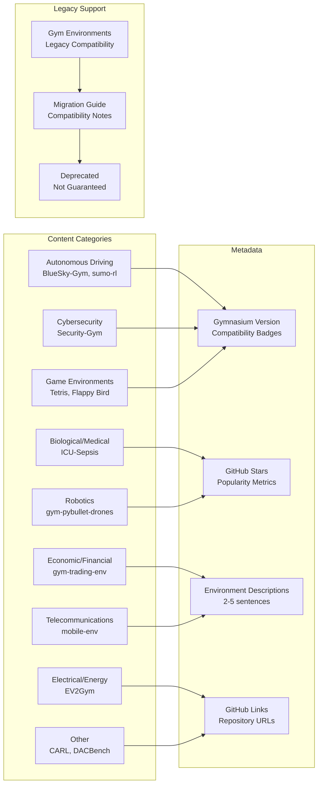
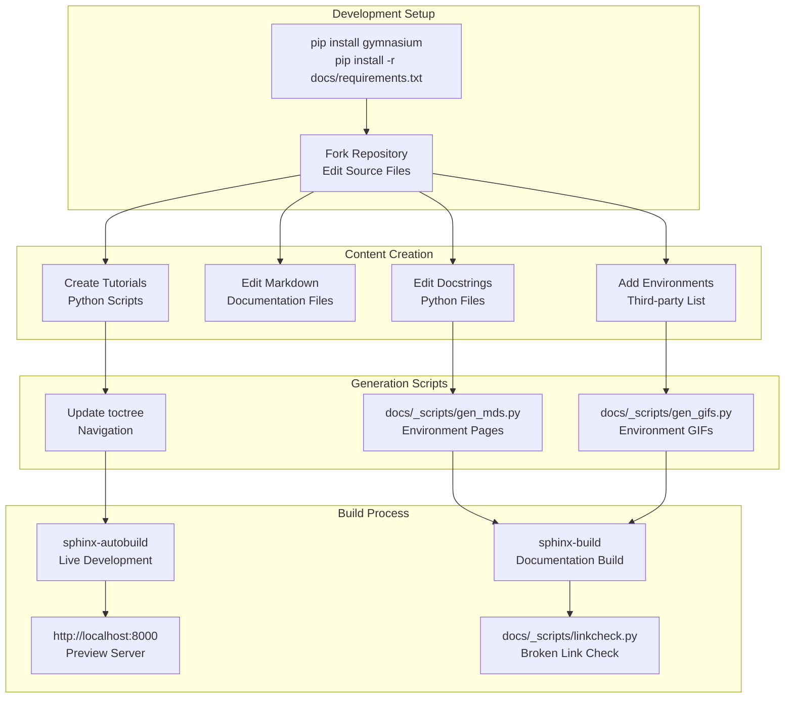

<!-- source: DeepWiki mcp.deepwiki.com · repo Farama-Foundation/Gymnasium · page 8.2 Documentation System · fetched 2026-10-14 -->

# Documentation System

<details>
<summary>Relevant source files</summary>

The following files were used as context for generating this wiki page:

- [docs/.gitignore](docs/.gitignore)
- [docs/README.md](docs/README.md)
- [docs/_scripts/gen_gifs.py](docs/_scripts/gen_gifs.py)
- [docs/_scripts/gen_mds.py](docs/_scripts/gen_mds.py)
- [docs/_scripts/linkcheck.py](docs/_scripts/linkcheck.py)
- [docs/_static/img/favicon.png](docs/_static/img/favicon.png)
- [docs/_static/img/gymnasium-github.png](docs/_static/img/gymnasium-github.png)
- [docs/conf.py](docs/conf.py)
- [docs/environments/mujoco.md](docs/environments/mujoco.md)
- [docs/environments/third_party_environments.md](docs/environments/third_party_environments.md)
- [docs/index.md](docs/index.md)
- [docs/requirements.txt](docs/requirements.txt)

</details>


This page documents the Gymnasium documentation system, which automatically generates comprehensive documentation from source code, tutorials, and markdown files. The system uses Sphinx as the primary documentation generator with custom extensions for tutorial generation, API documentation, and third-party environment listings.

For information about testing environments and code quality, see [Testing Framework](#8.1). For details about the build and deployment pipeline, see [CI/CD and Build System](#8.3).

## Architecture Overview

The documentation system is built on a Sphinx-based architecture with multiple content sources and automated generation pipelines:

### Documentation Generation Pipeline



Sources: [docs/conf.py:1-173](), [docs/README.md:1-51]()

### Core Components



Sources: [docs/conf.py:43-53](), [docs/conf.py:86-88](), [docs/conf.py:95-110]()

## Build Configuration

The documentation system is configured through `docs/conf.py`, which defines extensions, theme settings, and custom processing:

### Core Configuration

| Setting | Value | Purpose |
|---------|-------|---------|
| `project` | "Gymnasium" | Project name displayed in documentation |
| `copyright` | Dynamic year + "Farama Foundation" | Copyright information |
| `release` | `gymnasium.__version__` | Version from package metadata |
| `html_theme` | "celshast" | Modern, responsive HTML theme |
| `html_baseurl` | "https://gymnasium.farama.org" | Base URL for canonical links |

### Extensions Configuration

The system uses multiple Sphinx extensions for different content types:

```python
extensions = [
    "sphinx.ext.napoleon",      # Google/NumPy docstring support
    "sphinx.ext.autodoc",       # API documentation from docstrings
    "sphinx.ext.githubpages",   # GitHub Pages deployment
    "sphinx.ext.viewcode",      # Source code links
    "sphinx.ext.coverage",      # Documentation coverage
    "myst_parser",              # Markdown parsing
    "celshast.gen_tutorials",   # Tutorial generation
    "sphinx_gallery.gen_gallery", # Gallery generation
    "sphinx_github_changelog",  # Changelog from GitHub
]
```

Sources: [docs/conf.py:43-53](), [docs/conf.py:30-36](), [docs/conf.py:95-110]()

## Content Organization

The documentation is organized into distinct content types with specific processing workflows:

### Content Structure

```mermaid
graph TD
    subgraph "Documentation Root"
        INDEX["docs/index.md<br/>Main Landing Page"]
        CONF["docs/conf.py<br/>Sphinx Configuration"]
        REQUIREMENTS["docs/requirements.txt<br/>Build Dependencies"]
    end
    
    subgraph "API Documentation"
        API_ENV["docs/api/env.md<br/>Environment API"]
        API_SPACES["docs/api/spaces.md<br/>Spaces API"]
        API_VECTOR["docs/api/vector/<br/>Vector Environments"]
        API_WRAPPERS["docs/api/wrappers.md<br/>Wrappers API"]
    end
    
    subgraph "Environment Documentation"
        ENV_CLASSIC["docs/environments/classic_control/<br/>Classic Control"]
        ENV_BOX2D["docs/environments/box2d/<br/>Box2D Physics"]
        ENV_MUJOCO["docs/environments/mujoco/<br/>MuJoCo Robotics"]
        ENV_THIRD_PARTY["docs/environments/third_party_environments.md<br/>External Environments"]
    end
    
    subgraph "Tutorial System"
        TUTORIALS_BASICS["docs/tutorials/gymnasium_basics/<br/>Basic Tutorials"]
        TUTORIALS_TRAINING["docs/tutorials/training_agents/<br/>Training Tutorials"]
        TUTORIAL_SCRIPTS["*.py files<br/>Executable Scripts"]
    end
    
    subgraph "Introduction"
        INTRO_BASIC["docs/introduction/basic_usage.py<br/>Basic Usage"]
        INTRO_CUSTOM["docs/introduction/create_custom_env.py<br/>Custom Environments"]
        INTRO_MIGRATION["docs/introduction/migration_guide.md<br/>Migration Guide"]
    end
    
    INDEX --> API_ENV
    INDEX --> ENV_CLASSIC
    INDEX --> TUTORIALS_BASICS
    INDEX --> INTRO_BASIC
    
    API_VECTOR --> API_ENV
    ENV_THIRD_PARTY --> ENV_CLASSIC
    TUTORIAL_SCRIPTS --> TUTORIALS_BASICS
```



Sources: [docs/index.md:45-100](), [docs/environments/third_party_environments.md:1-121](), [docs/README.md:5-19]()

## Tutorial System

The documentation uses `sphinx-gallery` to generate interactive tutorials from Python scripts:

### Tutorial Generation Process



### Tutorial Configuration

The tutorial system uses custom sorting and organization logic:

```python
tutorial_sorting = {
    "tutorials/gymnasium_basics": [
        "environment_creation",
        "implementing_custom_wrappers", 
        "handling_time_limits",
        "load_quadruped_model",
        "*",
    ],
    "tutorials/training_agents": [
        "blackjack_q_learning",
        "frozenlake_q_learning", 
        "mujoco_reinforce",
        "vector_a2c",
        "*",
    ],
}
```

Sources: [docs/conf.py:133-148](), [docs/conf.py:150-165](), [docs/README.md:45-51]()

## API Documentation Generation

The system automatically generates API documentation from Python docstrings using `autodoc` and `napoleon`:

### API Documentation Pipeline



### Docstring Processing

The system includes custom processing for docstring formatting:

```python
def remove_lines_before_parameters(app, what, name, obj, options, lines):
    if what == "class":
        # ":param" represents args values
        first_idx_to_keep = next(
            (i for i, line in enumerate(lines) if line.startswith(":param")), 0
        )
        lines[:] = lines[first_idx_to_keep:]
```

Sources: [docs/conf.py:64-72](), [docs/conf.py:77-88]()

## Third-Party Environment Documentation

The system maintains a curated list of third-party environments that use the Gymnasium API:

### Third-Party Content Structure



### Environment Listing Format

Each third-party environment follows a standardized format:

```markdown
- [NAME: SUB_NAME_IF_PRESENT](LINK)

  
  

  A short 2-5 sentence description.
```

Sources: [docs/environments/third_party_environments.md:25-44](), [docs/environments/third_party_environments.md:46-121]()

## Build Process

The documentation system supports both one-time builds and continuous development:

### Build Commands

| Command | Purpose | Usage |
|---------|---------|-------|
| `make dirhtml` | Single build | Production documentation |
| `sphinx-autobuild` | Continuous build | Development with live reload |
| `docs/_scripts/gen_mds.py` | Environment docs | Generate environment pages |
| `docs/_scripts/gen_gifs.py` | GIF generation | Create environment animations |
| `docs/_scripts/linkcheck.py` | Link checking | Verify external links |

### Development Workflow



### Dependencies and Requirements

The documentation system requires specific packages for building:

```
sphinx
sphinx-autobuild
myst-parser
sphinx-gallery==0.14.0
celshast
moviepy
pygame
sphinx_github_changelog
ale_py
tabulate
```

Sources: [docs/README.md:20-44](), [docs/requirements.txt:1-10](), [docs/_scripts/linkcheck.py:1-28]()

## Theme and Styling

The documentation uses the `celshast` theme with custom configuration for branding and functionality:

### Theme Configuration

```python
html_theme_options = {
    "light_logo": "img/gymnasium_black.svg",
    "dark_logo": "img/gymnasium_white.svg", 
    "gtag": "G-6H9C8TWXZ8",
    "description": "A standard API for reinforcement learning and a diverse set of reference environments (formerly Gym)",
    "image": "img/gymnasium-github.png",
    "versioning": True,
    "source_repository": "https://github.com/Farama-Foundation/Gymnasium/",
    "source_branch": "main",
    "source_directory": "docs/",
}
```

The theme provides responsive design, dark/light mode support, and integrated GitHub repository links.

Sources: [docs/conf.py:100-110](), [docs/conf.py:95-99](), [docs/conf.py:112-113]()

---

