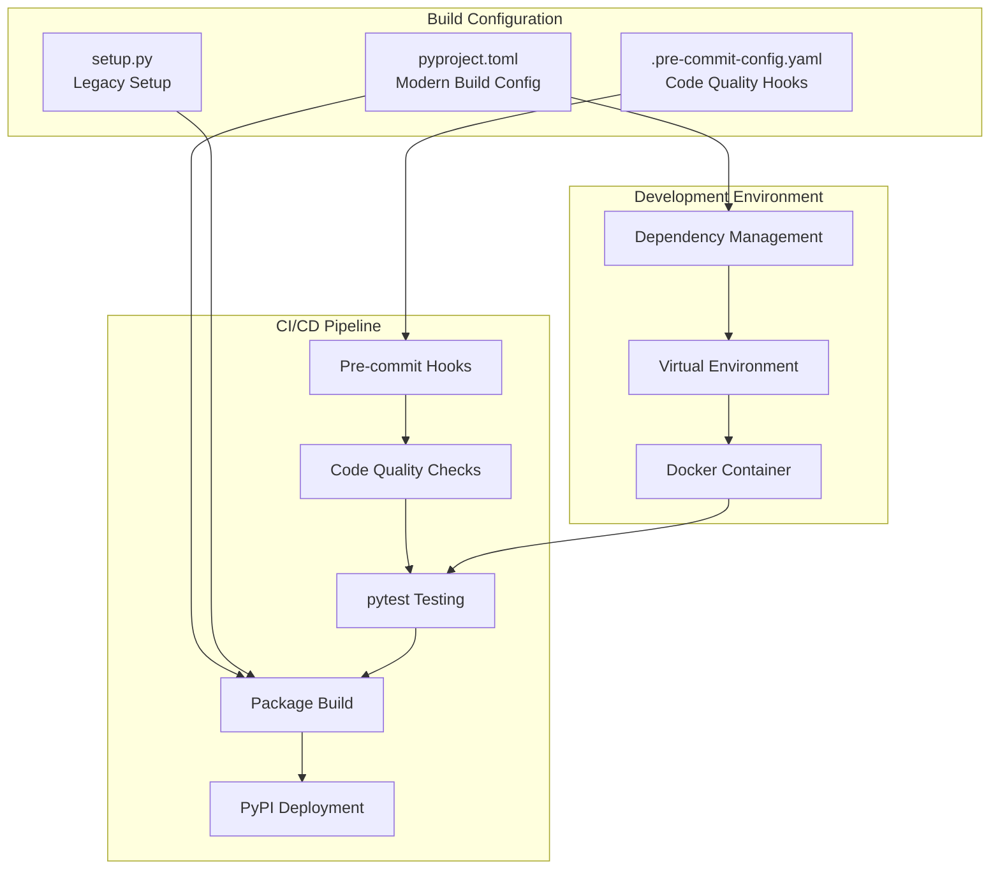
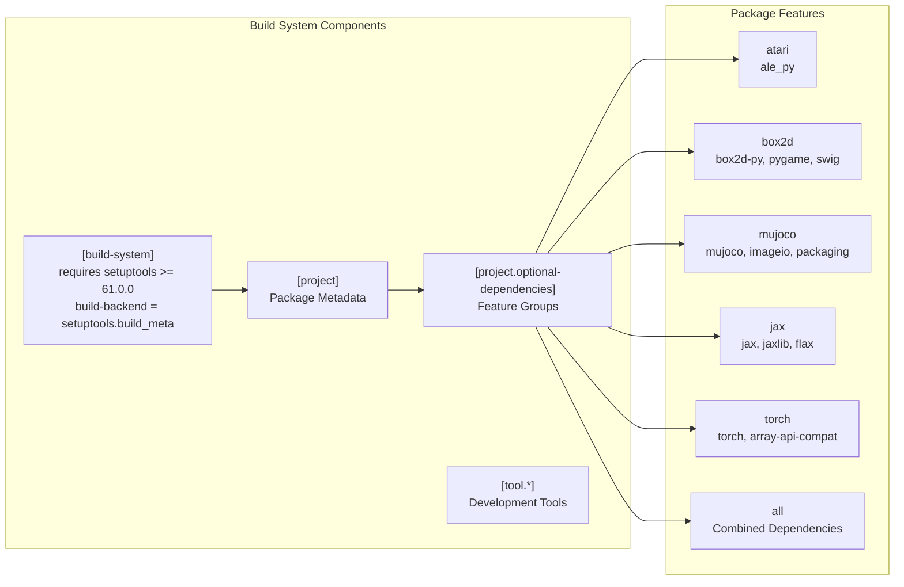
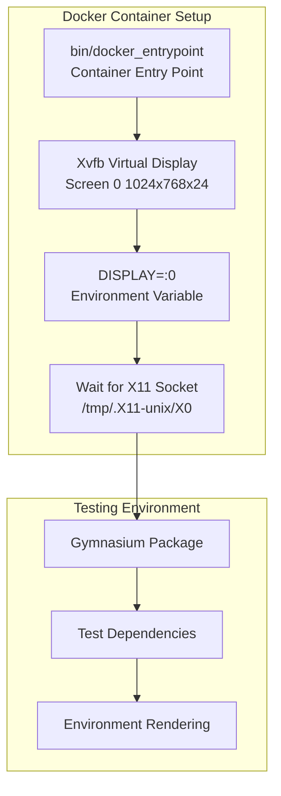

<!-- source: DeepWiki mcp.deepwiki.com · repo Farama-Foundation/Gymnasium · page 8.3 CI/CD and Build System · fetched 2026-10-14 -->

# CI/CD and Build System

<details>
<summary>Relevant source files</summary>

The following files were used as context for generating this wiki page:

- [.github/ISSUE_TEMPLATE/bug.yml](.github/ISSUE_TEMPLATE/bug.yml)
- [.github/ISSUE_TEMPLATE/proposal.yml](.github/ISSUE_TEMPLATE/proposal.yml)
- [.github/ISSUE_TEMPLATE/question.yml](.github/ISSUE_TEMPLATE/question.yml)
- [.github/dependabot.yml](.github/dependabot.yml)
- [.github/workflows/docs-build-dev.yml](.github/workflows/docs-build-dev.yml)
- [.github/workflows/docs-build-release.yml](.github/workflows/docs-build-release.yml)
- [.github/workflows/docs-manual-build.yml](.github/workflows/docs-manual-build.yml)
- [.github/workflows/linkcheck.yml](.github/workflows/linkcheck.yml)
- [.github/workflows/pypi-publish.yml](.github/workflows/pypi-publish.yml)
- [.github/workflows/run-pre-commit.yml](.github/workflows/run-pre-commit.yml)
- [.github/workflows/run-pytest.yml](.github/workflows/run-pytest.yml)
- [.github/workflows/run-tutorial.yml](.github/workflows/run-tutorial.yml)
- [bin/docker_entrypoint](bin/docker_entrypoint)

</details>


This document covers the continuous integration, continuous deployment, and build system infrastructure for the Gymnasium library. This includes the modern Python packaging configuration, automated testing workflows, code quality enforcement, and containerization setup.

For information about the testing framework itself, see [Testing Framework](#8.1). For documentation build processes, see [Documentation System](#8.2).

## Overview

The Gymnasium project uses a modern Python packaging approach with `pyproject.toml` as the primary configuration file while maintaining `setup.py` for backward compatibility. The build system is configured to support multiple optional dependencies, automated code quality checks, and containerized testing environments.



Sources: [pyproject.toml:1-161](), [setup.py:1-36](), [.pre-commit-config.yaml:1-51]()

## Package Configuration

### Modern Build System

The primary build configuration is defined in `pyproject.toml` using the setuptools build backend. The build system section specifies the minimum required version of setuptools and the build backend to use.



The core dependencies are minimal, including only `numpy`, `cloudpickle`, `typing-extensions`, and `farama-notifications`. Optional dependencies are organized into feature groups for different environment types and frameworks.

Sources: [pyproject.toml:3-5](), [pyproject.toml:26-31](), [pyproject.toml:34-92]()

### Legacy Setup Configuration

A minimal `setup.py` file is maintained for backward compatibility. It delegates most configuration to `pyproject.toml` but includes helper functions for extracting version information and README content.

The `get_version()` function extracts the version from `gymnasium/__init__.py` by parsing the `__version__` variable, while `get_description()` extracts the first two sections of the README file for the package description.

Sources: [setup.py:11-19](), [setup.py:22-34](), [setup.py:36]()

## Code Quality and Pre-commit Hooks

The project uses an extensive set of pre-commit hooks to ensure code quality and consistency. These hooks are configured in `.pre-commit-config.yaml` and run automatically before each commit.

```mermaid
graph TD
    subgraph "Pre-commit Hook Categories"
        basic["Basic Checks<br/>check-yaml, check-toml<br/>trailing-whitespace, end-of-file-fixer"]
        security["Security Checks<br/>detect-private-key<br/>check-executables-have-shebangs"]
        style["Code Style<br/>black, isort<br/>flake8, pyupgrade"]
        docs["Documentation<br/>pydocstyle"]
        types["Type Checking<br/>pyright"]
        spelling["Spell Check<br/>codespell"]
    end

    subgraph "Hook Execution Flow"
        commit["git commit"]
        precommit["pre-commit run"]
        pass["All Checks Pass"]
        fail["Check Failures"]
        fix["Auto-fix Issues"]
    end

    commit --> precommit
    precommit --> basic
    precommit --> security
    precommit --> style
    precommit --> docs
    precommit --> types
    precommit --> spelling

    basic --> pass
    security --> pass
    style --> fix
    docs --> fail
    types --> fail
    spelling --> fail

    fix --> pass
    pass --> commit
    fail --> commit
```

### Code Formatting and Linting

The project uses several tools for code formatting and linting:

- **Black**: Code formatting with default configuration
- **isort**: Import sorting with black profile compatibility
- **flake8**: Linting with specific per-file ignores and complexity limits
- **pyupgrade**: Automatic Python syntax upgrades for Python 3.10+
- **pydocstyle**: Docstring style checking using Google convention

Sources: [.pre-commit-config.yaml:46-49](), [.pre-commit-config.yaml:42-45](), [.pre-commit-config.yaml:26-36](), [.pre-commit-config.yaml:37-41](), [.pre-commit-config.yaml:50-51]()

### Type Checking Configuration

Static type checking is performed using Pyright with configuration in `pyproject.toml`. The configuration includes specific settings for handling missing imports and type stubs, which are common in scientific computing environments.

Key Pyright settings include:
- Basic type checking mode
- Python 3.10 compatibility
- Disabled missing import reporting for CI compatibility
- Specific error reporting configurations for gradual typing adoption

Sources: [pyproject.toml:136-161](), [.pre-commit-config.yaml:51]()

## Testing and Containerization

### Docker Environment Setup

The project includes Docker support for containerized testing environments. The Docker entrypoint script sets up a virtual display for headless testing of graphical environments.



The entrypoint script starts a virtual X server (Xvfb) and waits for the X11 socket to be available before executing the main command. This enables testing of environments that require graphical rendering in headless CI environments.

Sources: [bin/docker_entrypoint:1-26]()

### Testing Dependencies

Testing dependencies are defined in the `pyproject.toml` file under the `testing` optional dependency group. These include:

- `pytest` for test execution
- `scipy` for mathematical computations in tests
- `dill` for object serialization testing
- `array_api_extra` for array API compatibility testing

Sources: [pyproject.toml:94-99]()

## Tool Configuration

### Development Tool Settings

The `pyproject.toml` file includes configuration for various development tools:

**setuptools Configuration**:
- Package discovery settings
- Package data inclusion for assets
- Asset file patterns for different environment types

**pytest Configuration**:
- Warning filters for deprecation warnings
- Test discovery and execution settings

**Code Quality Tools**:
- Black formatting with default settings
- isort with black profile and custom source paths
- Pyright type checking with project-specific settings

Sources: [pyproject.toml:107-121](), [pyproject.toml:161](), [pyproject.toml:125-135]()

### Package Data Management

The build system is configured to include various asset files required by different environment types:

| Environment Type | Asset Files |
|------------------|-------------|
| MuJoCo | `envs/mujoco/assets/*.xml` |
| Classic Control | `envs/classic_control/assets/*.png` |
| Box2D | `envs/phys2d/assets/*.png` |
| Toy Text | `envs/toy_text/font/*.ttf`, `envs/toy_text/img/*.png` |
| Type Information | `py.typed` |

Sources: [pyproject.toml:113-121]()

## Distribution and Deployment

### Package Metadata

The package is configured with comprehensive metadata for PyPI distribution:

- **Name**: `gymnasium`
- **Description**: Standard API for reinforcement learning
- **License**: MIT License
- **Python Support**: >= 3.10
- **Classifications**: Production/Stable, AI/ML focused
- **URLs**: Homepage, Repository, Documentation, Bug Reports

### Version Management

Version information is dynamically extracted from `gymnasium/__init__.py` using the `get_version()` function in `setup.py`. This ensures the version is maintained in a single location and automatically synchronized across build configurations.

Sources: [pyproject.toml:7-32](), [pyproject.toml:101-105](), [setup.py:11-19]()

## GitHub Actions Workflows

Gymnasium leverages GitHub Actions for continuous integration and deployment. These workflows automate various tasks, including testing, code quality checks, documentation builds, and package publishing.

```mermaid
graph TD
    A[GitHub Push/PR/Release] --> B{Workflow Triggered}

    subgraph "Core CI Workflows"
        B -- "On push/PR" --> C1[run-pre-commit.yml<br/>"Run pre-commit"]
        B -- "On push/PR" --> C2[run-pytest.yml<br/>"Run PyTest"]
        C1 --> D1{Pre-commit Checks Pass?}
        C2 --> D2{PyTest Checks Pass?}
    end

    subgraph "Documentation Workflows"
        B -- "On push to main" --> E1[docs-build-dev.yml<br/>"Build main branch docs"]
        B -- "On tag release" --> E2[docs-build-release.yml<br/>"Build release docs"]
        B -- "Manual trigger" --> E3[docs-manual-build.yml<br/>"Manually Build Website"]
        B -- "Scheduled/Manual" --> E4[linkcheck.yml<br/>"Check documentation links"]
        B -- "On push/PR" --> E5[run-tutorial.yml<br/>"Test Gymnasium Tutorials"]
    end

    subgraph "Deployment Workflows"
        B -- "On release published" --> F1[pypi-publish.yml<br/>"Build artifact for PyPI"]
    end

    D1 -- "Yes" --> G[Continue CI]
    D2 -- "Yes" --> G
    D1 -- "No" --> H[Fail CI]
    D2 -- "No" --> H

    E1 --> I[Deploy to GitHub Pages /main]
    E2 --> J[Deploy to GitHub Pages /vX.Y.Z]
    E3 --> K[Deploy to GitHub Pages /custom_version]
    E4 --> L[Generate Linkcheck Report]
    E5 --> M[Tutorials Pass?]

    F1 --> N[Publish to PyPI]
```

### `run-pre-commit.yml`

This workflow runs the pre-commit hooks on `pull_request` and `push` events to the `main` branch. It ensures that code adheres to formatting, linting, and type-checking standards before merging.
The workflow sets up Python 3.12, installs `numpy==1.26` and `pre-commit`, then executes `pre-commit run --all-files` [run-pre-commit.yml:19-23]().

Sources: [.github/workflows/run-pre-commit.yml:1-23]()

### `run-pytest.yml`

This workflow executes `pytest` for comprehensive testing of the Gymnasium library. It uses a Docker-based approach to test against a matrix of Python and NumPy versions.

The workflow defines two main jobs:
1.  **`build-all`**: This job runs tests against a matrix of Python versions (`3.10`, `3.11`, `3.12`, `3.13`, `3.14`) and NumPy versions (`>=1.21,<2.0`, `>=2.1`) [run-pytest.yml:13-14](). It builds a Docker image using `bin/all-py.Dockerfile` with specified Python and NumPy versions [run-pytest.yml:22-26]() and then runs `pytest tests/*` inside the container [run-pytest.yml:28](). For NumPy `>=2.1`, it also runs doctests [run-pytest.yml:31-32]().
2.  **`build-necessary`**: This job builds a Docker image using `bin/necessary-py.Dockerfile` with Python 3.10 [run-pytest.yml:40-42]() and runs a subset of tests (`tests/test_core.py`, `tests/envs/test_envs.py`, `tests/spaces`) [run-pytest.yml:44-45]().

The Dockerfiles (`bin/all-py.Dockerfile` and `bin/necessary-py.Dockerfile`) are responsible for setting up the Python environment and installing dependencies, including Gymnasium itself. The `bin/docker_entrypoint` script is used within these Docker images to handle display setup for environments requiring rendering.

Sources: [.github/workflows/run-pytest.yml:1-45](), [bin/docker_entrypoint:1-26]()

### `run-tutorial.yml`

This workflow tests the Gymnasium tutorials to ensure they remain functional and up-to-date. It runs on `push` to `main`, `pull_request` for modified tutorial files, or `workflow_dispatch` for manual triggering [run-tutorial.yml:3-15]().

The workflow uses a strategy matrix for `tutorial-group` (e.g., `gymnasium_basics`, `training_agents`) [run-tutorial.yml:28-30]().
Key steps include:
-   Installing system dependencies like `libglu1-mesa-dev`, `libgl1-mesa-dev`, `libosmesa6-dev`, `xvfb`, `ffmpeg`, `cmake`, `swig` [run-tutorial.yml:43-45]().
-   Installing tutorial-specific Python requirements based on the `tutorial-group` [run-tutorial.yml:47-55]().
-   Patching tutorials to adjust parameters for CI (e.g., reducing `total_num_episodes` or `n_runs`) and ensuring `render_mode="rgb_array"` is used instead of `"human"` to avoid display issues [run-tutorial.yml:64-89]().
-   Identifying changed tutorial files for `pull_request` events to only run relevant tests [run-tutorial.yml:97-110]().
-   Executing each tutorial Python script with a timeout, capturing output, and reporting pass/fail/timeout status [run-tutorial.yml:121-171]().

Sources: [.github/workflows/run-tutorial.yml:1-209]()

### Documentation Build Workflows (`docs-build-dev.yml`, `docs-build-release.yml`, `docs-manual-build.yml`)

These workflows are responsible for building and deploying the Gymnasium documentation to GitHub Pages. They share a common structure:
-   **`docs-build-dev.yml`**: Builds documentation for the `main` branch on every `push` to `main` and deploys it to the `main` target folder on GitHub Pages [docs-build-dev.yml:3-6]().
-   **`docs-build-release.yml`**: Builds documentation when a new tag (e.g., `v0.29.1`) is pushed and deploys it to a version-specific folder on GitHub Pages [docs-build-release.yml:3-7]().
-   **`docs-manual-build.yml`**: Allows manual triggering to build documentation for a specific version or commit, with an option to mark it as the `latest` version [docs-manual-build.yml:3-15]().

All documentation workflows perform the following steps:
1.  Checkout the repository [docs-build-dev.yml:19]().
2.  Set up Python 3.12 [docs-build-dev.yml:21-23]().
3.  Install documentation dependencies from `docs/requirements.txt` [docs-build-dev.yml:25-26]().
4.  Install Gymnasium with necessary extras (`box2d`, `mujoco`, `jax`) and `torch`, `matplotlib` [docs-build-dev.yml:28-29]().
5.  Run `docs/_scripts/gen_mds.py` and `docs/_scripts/gen_envs_display.py` to generate environment documentation [docs-build-dev.yml:31]().
6.  Build the Sphinx documentation using `sphinx-build -b dirhtml -v docs _build` [docs-build-dev.yml:33]().
7.  Move and update the 404 error page [docs-build-dev.yml:36-40]().
8.  Remove `.doctrees` [docs-build-dev.yml:42]().
9.  Upload the built documentation to GitHub Pages using `JamesIves/github-pages-deploy-action@v4` [docs-build-dev.yml:45-51]().

Sources: [.github/workflows/docs-build-dev.yml:1-50](), [.github/workflows/docs-build-release.yml:1-59](), [.github/workflows/docs-manual-build.yml:1-73]()

### `linkcheck.yml`

This workflow checks for broken links in the documentation. It runs on a schedule (1st and 15th of every month) or can be triggered manually [linkcheck.yml:3-8]().
The workflow sets up the environment similarly to the documentation build workflows, then executes `python docs/_scripts/linkcheck.py -v` to perform the link check [linkcheck.yml:36](). Finally, it uploads the linkcheck report as an artifact [linkcheck.yml:38-42]().

Sources: [.github/workflows/linkcheck.yml:1-42]()

### `pypi-publish.yml`

This workflow handles building and publishing Gymnasium packages to PyPI. It is triggered on `push` to `main`, `pull_request` to `main`, or when a `release` is `published` [pypi-publish.yml:10-15]().

The workflow consists of two jobs:
1.  **`build-wheels`**: This job checks out the code, sets up Python, installs `build` using `pipx`, and then builds source distributions (`sdist`) and wheels using `pyproject-build` [pypi-publish.yml:27-35](). The built artifacts are then stored using `actions/upload-artifact@v7` [pypi-publish.yml:37-40]().
2.  **`publish`**: This job depends on `build-wheels` and only runs if a GitHub `release` event is `published` [pypi-publish.yml:46-48](). It downloads the built artifacts and uses `pypa/gh-action-pypi-publish@release/v1` to publish them to PyPI using a `PYPI_API_TOKEN` secret [pypi-publish.yml:50-59]().

Sources: [.github/workflows/pypi-publish.yml:1-59]()

## Issue Templates

Gymnasium uses GitHub Issue Templates to streamline bug reports, feature proposals, and questions. These templates guide users to provide necessary information, improving the efficiency of issue management.

-   **Bug Report (`bug.yml`)**: For reporting bugs, asking for steps to reproduce, expected vs. actual behavior, and environment details.
-   **Proposal (`proposal.yml`)**: For suggesting changes that are not bug fixes, including motivation, pitch, alternatives, and a checklist [github/ISSUE_TEMPLATE/proposal.yml:1-50]().
-   **Question (`question.yml`)**: For asking questions, with a disclaimer encouraging basic questions to be directed to community forums like Reddit or Discord [github/ISSUE_TEMPLATE/question.yml:1-22]().

Sources: [.github/ISSUE_TEMPLATE/proposal.yml:1-49](), [.github/ISSUE_TEMPLATE/question.yml:1-21]()

## Dependabot Configuration

The project uses Dependabot to automatically keep GitHub Actions workflows up-to-date. The configuration in `.github/dependabot.yml` specifies that Dependabot should check for updates to `github-actions` packages in the root directory weekly [github/dependabot.yml:9-14]().

Sources: [.github/dependabot.yml:1-14]()

---

