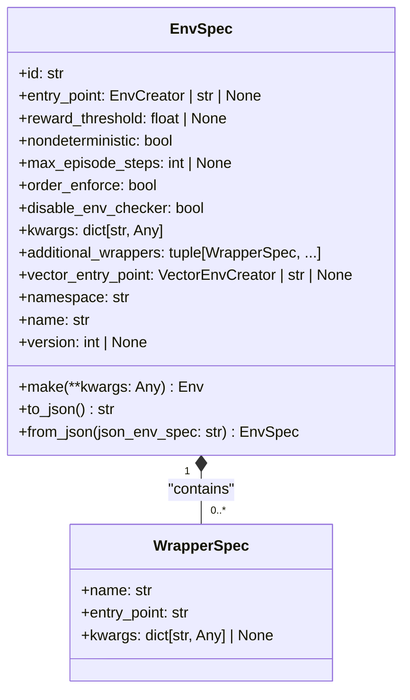

<!-- source: DeepWiki mcp.deepwiki.com · repo Farama-Foundation/Gymnasium · page 9 Glossary · fetched 2026-10-14 -->

# Glossary

<details>
<summary>Relevant source files</summary>

The following files were used as context for generating this wiki page:

- [gymnasium/__init__.py](gymnasium/__init__.py)
- [gymnasium/core.py](gymnasium/core.py)
- [gymnasium/envs/registration.py](gymnasium/envs/registration.py)
- [gymnasium/experimental/__init__.py](gymnasium/experimental/__init__.py)
- [gymnasium/spaces/utils.py](gymnasium/spaces/utils.py)
- [gymnasium/utils/env_checker.py](gymnasium/utils/env_checker.py)
- [gymnasium/utils/passive_env_checker.py](gymnasium/utils/passive_env_checker.py)
- [gymnasium/vector/async_vector_env.py](gymnasium/vector/async_vector_env.py)
- [gymnasium/vector/sync_vector_env.py](gymnasium/vector/sync_vector_env.py)
- [gymnasium/vector/utils/misc.py](gymnasium/vector/utils/misc.py)
- [gymnasium/vector/utils/space_utils.py](gymnasium/vector/utils/space_utils.py)
- [gymnasium/vector/vector_env.py](gymnasium/vector/vector_env.py)
- [gymnasium/wrappers/common.py](gymnasium/wrappers/common.py)
- [gymnasium/wrappers/utils.py](gymnasium/wrappers/utils.py)
- [tests/envs/registration/test_make_vec.py](tests/envs/registration/test_make_vec.py)
- [tests/spaces/test_spaces.py](tests/spaces/test_spaces.py)
- [tests/spaces/test_utils.py](tests/spaces/test_utils.py)
- [tests/spaces/utils.py](tests/spaces/utils.py)
- [tests/test_core.py](tests/test_core.py)
- [tests/testing_env.py](tests/testing_env.py)
- [tests/utils/test_env_checker.py](tests/utils/test_env_checker.py)
- [tests/utils/test_passive_env_checker.py](tests/utils/test_passive_env_checker.py)
- [tests/vector/test_async_vector_env.py](tests/vector/test_async_vector_env.py)
- [tests/vector/test_sync_vector_env.py](tests/vector/test_sync_vector_env.py)
- [tests/vector/test_vector_env.py](tests/vector/test_vector_env.py)
- [tests/vector/utils/utils.py](tests/vector/utils/utils.py)
- [tests/wrappers/test_flatten_observation.py](tests/wrappers/test_flatten_observation.py)
- [tests/wrappers/test_passive_env_checker.py](tests/wrappers/test_passive_env_checker.py)

</details>


This page provides definitions for codebase-specific terms, jargon, abbreviations, and domain concepts used within the Gymnasium library. It aims to clarify the meaning and usage of these terms, often with references to the relevant code.

## Env
The `Env` class is the core abstraction for a Reinforcement Learning environment in Gymnasium. It defines the standard interface for agents to interact with an environment, including methods for stepping through time, resetting the environment, and rendering.

**Key Attributes:**
*   `action_space`: Defines the valid actions an agent can take. [gymnasium/core.py:68]()
*   `observation_space`: Defines the structure and bounds of observations an agent receives. [gymnasium/core.py:69]()
*   `metadata`: A dictionary containing environment-specific metadata, such as supported render modes and render frames per second. [gymnasium/core.py:62]()
*   `spec`: An `EnvSpec` object that holds the parameters used to create the environment. [gymnasium/core.py:65]()
*   `np_random`: The random number generator for the environment, ensuring reproducibility. [gymnasium/core.py:72-75]()

**Key Methods:**
*   `step(action)`: Executes one timestep of the environment's dynamics. It returns the next observation, reward, `terminated` flag, `truncated` flag, and an `info` dictionary. [gymnasium/core.py:77-116]()
*   `reset(seed=None, options=None)`: Resets the environment to an initial state, returning the initial observation and an `info` dictionary. It can be seeded for reproducibility. [gymnasium/vector/vector_env.py:140-152]()
*   `render()`: Renders the environment for visualization. [gymnasium/core.py:37]()
*   `close()`: Closes the environment, releasing any resources. [gymnasium/core.py:38]()

**Implementation Details:**
The `Env` class is generic, parameterized by `ObsType` and `ActType` to specify the types of observations and actions. [gymnasium/core.py:25]() Subclasses must implement the `step` and `reset` methods.

Sources: [gymnasium/core.py:25-116]()

## EnvSpec
The `EnvSpec` class is a dataclass that serves as a blueprint for creating Gymnasium environments using `gymnasium.make()`. It encapsulates all the necessary information to instantiate a specific environment, including its ID, entry point, and various configuration parameters.

**Key Attributes:**
*   `id`: The unique string identifier for the environment (e.g., "CartPole-v1"). [gymnasium/envs/registration.py:90]()
*   `entry_point`: The callable or string path to the function that creates the environment instance. [gymnasium/envs/registration.py:91]()
*   `reward_threshold`: An optional float indicating the reward an agent needs to achieve to "solve" the environment. [gymnasium/envs/registration.py:94]()
*   `nondeterministic`: A boolean indicating if the environment's observations are non-deterministic even with the same initial state and actions. [gymnasium/envs/registration.py:95]()
*   `max_episode_steps`: The maximum number of steps an episode can take before being truncated. [gymnasium/envs/registration.py:98]()
*   `order_enforce`: A boolean to enforce the order of `reset()` before `step()` or `render()`. [gymnasium/envs/registration.py:99]()
*   `disable_env_checker`: If `True`, disables the environment checker wrapper during `make()`. [gymnasium/envs/registration.py:100]()
*   `kwargs`: A dictionary of additional keyword arguments passed to the environment's constructor. [gymnasium/envs/registration.py:103]()
*   `additional_wrappers`: A tuple of `WrapperSpec` objects representing wrappers to be applied to the environment. [gymnasium/envs/registration.py:111]()
*   `vector_entry_point`: The callable or string path to the function that creates a vectorized environment instance. [gymnasium/envs/registration.py:114]()
*   `namespace`, `name`, `version`: Derived from the `id` attribute during post-initialization. [gymnasium/envs/registration.py:117-118]()

**Functionality:**
The `EnvSpec` class provides methods to `make()` an environment instance and to serialize/deserialize itself to/from JSON. [gymnasium/envs/registration.py:120-189]()

**Diagram: EnvSpec Structure**

Sources: [gymnasium/envs/registration.py:72-189]()

## WrapperSpec
The `WrapperSpec` class is a dataclass used within `EnvSpec` to record the configuration of a wrapper that should be applied to an environment.

**Key Attributes:**
*   `name`: The name of the wrapper. [gymnasium/envs/registration.py:66]()
*   `entry_point`: The string location of the wrapper class or function. [gymnasium/envs/registration.py:67]()
*   `kwargs`: A dictionary of keyword arguments to be passed to the wrapper's constructor. [gymnasium/envs/registration.py:68]()

Sources: [gymnasium/envs/registration.py:58-69]()

## autoreset
`autoreset` refers to the mechanism in vectorized environments where individual sub-environments are automatically reset when they reach a terminal state (either `terminated` or `truncated`). This prevents the need to wait for all environments in a batch to finish before any can be restarted, which is crucial for efficient training.

The behavior of autoreset is controlled by the `AutoresetMode` enum.

Sources: [gymnasium/vector/vector_env.py:58-63]()

## AutoresetMode
`AutoresetMode` is an `Enum` that defines how sub-environments in a `VectorEnv` handle resets after an episode ends.

**Modes:**
*   `NEXT_STEP`: The sub-environment is reset at the beginning of the *next* `step()` call after it terminates or truncates. This is the default behavior. [gymnasium/vector/vector_env.py:37]()
*   `SAME_STEP`: The sub-environment is reset immediately within the *same* `step()` call that caused it to terminate or truncate. [gymnasium/vector/vector_env.py:38]()
*   `DISABLED`: Autoreset is disabled. The user is responsible for explicitly calling `reset()` on terminated/truncated sub-environments. [gymnasium/vector/vector_env.py:39]()

**Usage:**
The `autoreset_mode` can be specified when creating a `VectorEnv`, for example, in `AsyncVectorEnv` [gymnasium/vector/async_vector_env.py:144]() or `SyncVectorEnv` [gymnasium/vector/sync_vector_env.py:105](). The chosen mode is stored in the `metadata` of the `VectorEnv`. [gymnasium/vector/sync_vector_env.py:116]()

**Diagram: AutoresetMode in Vector Environments**
```mermaid
graph TD
    A[VectorEnv.step()] --> B{Sub-env terminated/truncated?};
    B -- Yes --> C{AutoresetMode?};
    C -- NEXT_STEP --> D[Mark sub-env for reset on next step];
    C -- SAME_STEP --> E[Reset sub-env immediately];
    C -- DISABLED --> F[User must manually reset sub-env];
    B -- No --> G[Continue sub-env];
```
Sources: [gymnasium/vector/vector_env.py:34-40](), [gymnasium/vector/async_vector_env.py:144](), [gymnasium/vector/sync_vector_env.py:105](), [gymnasium/vector/sync_vector_env.py:116]()

## truncation
`truncation` is a boolean flag returned by the `Env.step()` method, indicating that the episode ended due to a condition *outside the scope of the Markov Decision Process (MDP)*. This typically includes reaching a time limit (`max_episode_steps`) or an agent going out of bounds.

It is distinct from `terminated`, which indicates reaching a natural terminal state defined by the MDP (e.g., reaching a goal or falling into a pit). Both `terminated` and `truncated` signal that the user needs to call `reset()` before further `step()` calls.

Sources: [gymnasium/core.py:100-103]()

## flatdim
`flatdim` is a utility function in `gymnasium.spaces.utils` that calculates the total number of dimensions a flattened representation of a given `Space` would have. This is particularly useful when converting complex observation or action spaces into a single, flat NumPy array, which is often required by neural networks.

**Function Signature:**
`gymnasium.spaces.utils.flatdim(space: Space[Any]) -> int` [gymnasium/spaces/utils.py:101]()

**Behavior:**
*   For `Box` and `MultiBinary` spaces, it returns the product of their shape dimensions. [gymnasium/spaces/utils.py:130-131]()
*   For `Discrete` spaces, it returns `space.n`. [gymnasium/spaces/utils.py:135]()
*   For `MultiDiscrete` spaces, it returns the sum of elements in `space.nvec`. [gymnasium/spaces/utils.py:139]()
*   For `Tuple` and `Dict` spaces, it sums the `flatdim` of their constituent subspaces. [gymnasium/spaces/utils.py:145](), [gymnasium/spaces/utils.py:154]()
*   For `Text` spaces, it returns `space.max_length`. [gymnasium/spaces/utils.py:168]()
*   For `OneOf` spaces, it returns `1 + max(flatdim(s) for s in space.spaces)` to account for the index and the flattened chosen subspace. [gymnasium/spaces/utils.py:173]()
*   It raises a `ValueError` if the space cannot be flattened to a NumPy array (e.g., `Graph` or `Sequence` spaces). [gymnasium/spaces/utils.py:121](), [gymnasium/spaces/utils.py:164]()

**Example:**
```python
>>> from gymnasium.spaces import Dict, Discrete
>>> import gymnasium.spaces.utils as utils
>>> space = Dict({"position": Discrete(2), "velocity": Discrete(3)})
>>> utils.flatdim(space)
5
```
Sources: [gymnasium/spaces/utils.py:101-175](), [tests/spaces/test_utils.py:26-105]()

## qpos/qvel (MuJoCo Environments)
In the context of MuJoCo environments, `qpos` and `qvel` refer to the generalized coordinates and generalized velocities of the simulated physical system, respectively. These are fundamental state variables in MuJoCo.

*   **`qpos` (Generalized Positions):** Represents the configuration of the system. This includes positions and orientations of bodies, joint angles, and other degrees of freedom. The size and meaning of `qpos` are specific to each MuJoCo model.
*   **`qvel` (Generalized Velocities):** Represents the rates of change of the generalized positions. This includes linear and angular velocities of bodies, and joint angular velocities.

These variables are typically part of the observation space in MuJoCo environments and are crucial for defining the state of the agent and environment. They are directly manipulated by the MuJoCo physics engine during simulation steps.

Sources: (Implicit in MuJoCo environment implementations, not explicitly defined in the provided core files, but a standard MuJoCo term.)

## AsyncState
`AsyncState` is an `Enum` used internally by `AsyncVectorEnv` to track the current state of the asynchronous vector environment. This helps manage the flow of operations (reset, step, call) across multiple worker processes.

**States:**
*   `DEFAULT`: The default state, indicating no pending asynchronous operation. [gymnasium/vector/async_vector_env.py:58]()
*   `WAITING_RESET`: The environment is waiting for `reset()` calls to complete from its worker processes. [gymnasium/vector/async_vector_env.py:59]()
*   `WAITING_STEP`: The environment is waiting for `step()` calls to complete from its worker processes. [gymnasium/vector/async_vector_env.py:60]()
*   `WAITING_CALL`: The environment is waiting for a generic `call()` operation to complete from its worker processes. [gymnasium/vector/async_vector_env.py:61]()

This enum is essential for preventing race conditions and ensuring proper synchronization in the `AsyncVectorEnv` implementation.

Sources: [gymnasium/vector/async_vector_env.py:55-61]()

## data_equivalence
`data_equivalence` is a utility function used for comparing two data structures (e.g., observations, info dictionaries) for equality. It handles various data types, including dictionaries, tuples, lists, and NumPy arrays, and can perform either exact or approximate comparisons for numerical data.

**Function Signature:**
`gymnasium.utils.env_checker.data_equivalence(data_1: Any, data_2: Any, exact: bool = False) -> bool` [gymnasium/utils/env_checker.py:36]()

**Behavior:**
*   Compares types, keys (for dicts), and lengths (for tuples/lists). [gymnasium/utils/env_checker.py:47-54]()
*   For NumPy arrays:
    *   Checks shape and dtype. [gymnasium/utils/env_checker.py:59]()
    *   If `exact=True`, uses `np.all(data_1 == data_2)`. [gymnasium/utils/env_checker.py:67]()
    *   If `exact=False`, uses `np.allclose(data_1, data_2, rtol=1e-5, atol=1e-5)` for approximate comparison. [gymnasium/utils/env_checker.py:69-70]()
*   For other types, it uses the `==` operator. [gymnasium/utils/env_checker.py:73-76]()

**Usage:**
This function is primarily used in environment checking utilities, such as `check_reset_seed_determinism`, to verify the determinism of environment outputs. [gymnasium/utils/env_checker.py:125](), [gymnasium/utils/env_checker.py:128]()

Sources: [gymnasium/utils/env_checker.py:36-76](), [tests/spaces/test_spaces.py:89-94]()

## is_space_dtype_shape_equiv
`is_space_dtype_shape_equiv` is a utility function that checks if two `Space` objects are equivalent in terms of their data type (`dtype`) and shape. This is particularly useful in vectorized environments to ensure that the observation spaces of different sub-environments are compatible for batching, even if their specific bounds or other parameters differ.

**Function Signature:**
`gymnasium.spaces.utils.is_space_dtype_shape_equiv(space_1: Space, space_2: Space) -> bool` [gymnasium/spaces/utils.py:227]()

**Behavior:**
*   It recursively compares the `dtype` and `shape` attributes of the spaces.
*   For composite spaces like `Tuple` or `Dict`, it checks the equivalence of their constituent subspaces.
*   It returns `True` if both spaces have the same `dtype` and `shape` (or recursively, their components do), and `False` otherwise.

**Usage:**
This function is used in `SyncVectorEnv` to validate that sub-environments have compatible observation spaces when `observation_mode='different'`. [gymnasium/vector/sync_vector_env.py:154]()

Sources: [gymnasium/spaces/utils.py:227](), [gymnasium/vector/sync_vector_env.py:154](), [tests/spaces/test_utils.py:227-241]()

## VectorizeMode
`VectorizeMode` is an `Enum` used in `gymnasium.make_vec()` to specify the type of vectorized environment to create.

**Modes:**
*   `SYNC`: Creates a `SyncVectorEnv`, which runs environments sequentially in a single process. [gymnasium/envs/registration.py:20]()
*   `ASYNC`: Creates an `AsyncVectorEnv`, which runs environments in parallel using multiple processes. [gymnasium/envs/registration.py:20]()

This enum allows users to easily choose between synchronous and asynchronous vectorization when instantiating environments.

Sources: [gymnasium/__init__.py:20](), [gymnasium/envs/registration.py:34]()

## EnvCreator
`EnvCreator` is a `Protocol` (a type hint for structural subtyping) that defines the expected signature for a function that creates a Gymnasium `Env` instance.

**Signature:**
`def __call__(self, **kwargs: Any) -> Env: ...` [gymnasium/envs/registration.py:48]()

This protocol is used in `EnvSpec` to type-hint the `entry_point` attribute, indicating that it should be a callable that returns an `Env` object.

Sources: [gymnasium/envs/registration.py:45-48]()

## VectorEnvCreator
`VectorEnvCreator` is a `Protocol` that defines the expected signature for a function that creates a Gymnasium `VectorEnv` instance.

**Signature:**
`def __call__(self, **kwargs: Any) -> gym.vector.VectorEnv: ...` [gymnasium/envs/registration.py:53]()

This protocol is used in `EnvSpec` to type-hint the `vector_entry_point` attribute, indicating that it should be a callable that returns a `VectorEnv` object.

Sources: [gymnasium/envs/registration.py:51-54]()