# Page: Overview

# Overview

<details>
<summary>Relevant source files</summary>

The following files were used as context for generating this wiki page:

- [CITATION.cff](CITATION.cff)
- [README.md](README.md)
- [assets/wispr-flow.svg](assets/wispr-flow.svg)
- [docs/.gitignore](docs/.gitignore)
- [docs/README.md](docs/README.md)
- [docs/conf.py](docs/conf.py)
- [docs/index.md](docs/index.md)
- [docs/requirements.txt](docs/requirements.txt)
- [gymnasium/__init__.py](gymnasium/__init__.py)
- [gymnasium/envs/registration.py](gymnasium/envs/registration.py)
- [gymnasium/experimental/__init__.py](gymnasium/experimental/__init__.py)
- [setup.py](setup.py)
- [tests/envs/registration/test_make_vec.py](tests/envs/registration/test_make_vec.py)
- [tests/vector/utils/utils.py](tests/vector/utils/utils.py)

</details>


This document introduces the Gymnasium library, explaining its purpose as a reinforcement learning environment standard, its core architecture, and its relationship to the broader ecosystem. This covers the high-level system design and key components that make up the library.

For detailed API documentation, see [Core API](#2). For specific environment implementations, see [Environment Categories](#5). For installation instructions, see [Installation and Setup](#1.1).

## What is Gymnasium

Gymnasium is an open-source Python library that provides a standard API for reinforcement learning environments. It serves as a maintained fork of OpenAI's Gym library and establishes the de facto standard for agent-environment interaction in reinforcement learning research and development.

The library's primary purposes are:
- **Standardization**: Provides a consistent interface through the `gymnasium.Env` class for all reinforcement learning environments [gymnasium/__init__.py:5-11]()
- **Environment Collection**: Includes implementations of classic RL environments across multiple domains (control, physics, games) [README.md:20-27]()
- **Extensibility**: Supports custom environments and third-party integrations through a registration system [gymnasium/envs/registration.py:36-41]()
- **Research Enablement**: Facilitates reproducible research through environment versioning and standardized APIs [README.md:61-63]()

Sources: [README.md:15-17](), [docs/index.md:20-21](), [CITATION.cff:94-102](), [gymnasium/__init__.py:5-11](), [README.md:20-27](), [gymnasium/envs/registration.py:36-41](), [README.md:61-63]()

## Core Architecture

The Gymnasium library is built around a central registry system that manages environment creation and configuration, with modular components for different types of environments and utilities.

### System Architecture Overview

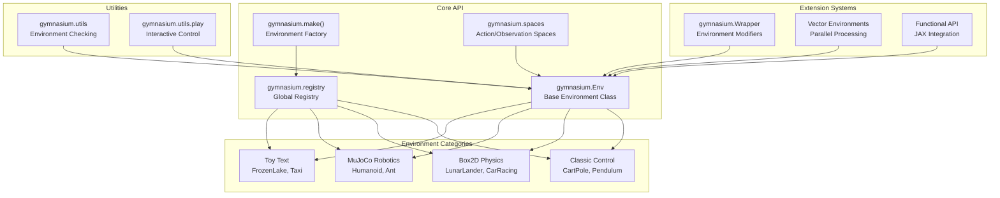

Sources: [README.md:39-53](), [docs/index.md:59-67](), [docs/index.md:72-80]()

### Environment Registration and Creation Flow

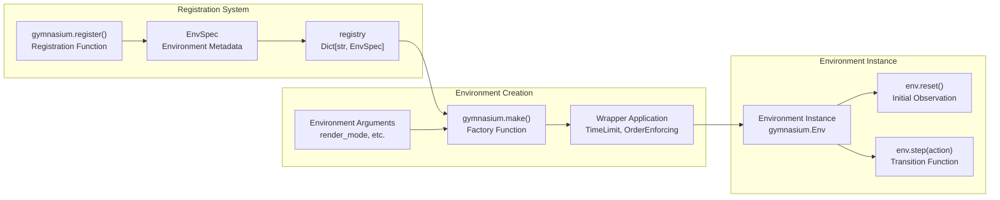

Sources: [README.md:42-43](), [docs/index.md:26-27](), [gymnasium/envs/registration.py:71-119]()

## Key Components

### Core API Classes

| Component | Location | Purpose |
|-----------|----------|---------|
| `gymnasium.Env` | `gymnasium.core.Env` | Defines standard interface with `reset()`, `step()`, `render()` methods |
| `gymnasium.Wrapper` | `gymnasium.core.Wrapper` | Enables composable environment transformations |
| `gymnasium.Space` | `gymnasium.spaces.space.Space` | Defines valid actions and observations |
| `gymnasium.make()` | `gymnasium.envs.registration.make` | Creates and configures environment instances |

Sources: [gymnasium/__init__.py:5-12](), [gymnasium/__init__.py:14](), [gymnasium/envs/registration.py:38]()

### Environment Categories

The library includes several built-in environment families:

- **Classic Control**: Traditional control problems like `CartPole-v1`, `MountainCar-v0` [README.md:21]()
- **Box2D**: Physics-based environments using Box2D engine like `LunarLander-v3`, `CarRacing-v3` [README.md:23]()
- **MuJoCo**: Robotics simulations using MuJoCo physics like `Humanoid-v5`, `Ant-v5` [README.md:25]()
- **Toy Text**: Simple discrete environments like `FrozenLake-v1`, `Taxi-v3` [README.md:24]()

Sources: [README.md:22-27](), [docs/index.md:74-79]()

### Extension Systems

- **Vector Environments**: `SyncVectorEnv` and `AsyncVectorEnv` for parallel environment execution [tests/envs/registration/test_make_vec.py:12]()
- **Wrappers**: Modular environment modifications through `gymnasium.Wrapper` subclasses [gymnasium/__init__.py:6]()
- **Functional API**: JAX-compatible functional interface for high-performance computing [docs/index.md:67]()

Sources: [README.md:59-61](), [docs/index.md:79](), [tests/envs/registration/test_make_vec.py:12](), [gymnasium/__init__.py:6](), [docs/index.md:67]()

## Environment Ecosystem

Gymnasium serves as the foundation for a broader ecosystem of reinforcement learning environments and tools.

### Farama Foundation Ecosystem

```mermaid
graph TB
    subgraph "Core Gymnasium"
        GYMNASIUM["gymnasium<br/>Standard RL Interface"]
        CORE_ENVS["Built-in Environments<br/>Classic Control, Box2D, MuJoCo"]
    end
    
    subgraph "Extended Ecosystem"
        PETTINGZOO["PettingZoo<br/>Multi-Agent RL"]
        MINIGRID["Minigrid<br/>Grid World Environments"]
        MINARI["Minari<br/>Offline RL Datasets"]
        ROBOTICS["Gymnasium-Robotics<br/>Robot Learning Tasks"]
    end
    
    subgraph "Third-Party Integration"
        ALE["ALE (Atari)<br/>Atari 2600 Games"]
        COMMUNITY["Community Environments<br/>Domain-Specific"]
        RESEARCH["Research Environments<br/>Academic Projects"]
    end
    
    subgraph "Training Libraries"
        CLEANRL["CleanRL<br/>Reference Implementations"]
        STABLE_BASELINES["Stable Baselines3<br/>Algorithm Library"]
        OTHER_LIBS["Other Libraries<br/>RLLib, Tianshou"]
    end
    
    GYMNASIUM --> CORE_ENVS
    GYMNASIUM --> PETTINGZOO
    GYMNASIUM --> MINIGRID
    GYMNASIUM --> MINARI
    GYMNASIUM --> ROBOTICS
    GYMNASIUM --> ALE
    GYMNASIUM --> COMMUNITY
    GYMNASIUM --> RESEARCH
    
    GYMNASIUM --> CLEANRL
    GYMNASIUM --> STABLE_BASELINES
    GYMNASIUM --> OTHER_LIBS
```

Sources: [README.md:59-61](), [docs/index.md:79]()

## Development and Distribution

### Build and Distribution Pipeline

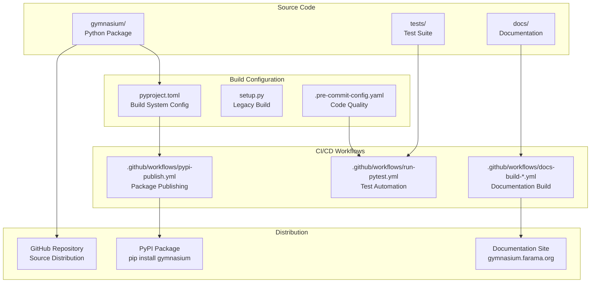

Sources: [setup.py:36](), [docs/conf.py:33](), [docs/requirements.txt:1-9](), [docs/README.md:25-41]()

### Python Version Support

Gymnasium supports Python 3.10, 3.11, 3.12, and 3.13 on Linux and macOS platforms. The library uses modern Python packaging with `pyproject.toml` configuration and maintains backward compatibility through careful API design.

Sources: [README.md:35](), [docs/conf.py:33]()

## Installation and Basic Usage

Installation is straightforward using pip:

```bash
pip install gymnasium
```

For additional environment dependencies:
```bash
pip install "gymnasium[all]"  # All environments
pip install "gymnasium[atari]"  # Specific environment family
```

Basic usage follows a standard pattern:

```python
import gymnasium as gym

env = gym.make("CartPole-v1")
observation, info = env.reset(seed=42)

for _ in range(1000):
    action = env.action_space.sample()
    observation, reward, terminated, truncated, info = env.step(action)
    
    if terminated or truncated:
        observation, info = env.reset()

env.close()
```

Sources: [README.md:31-33](), [README.md:41-53](), [docs/index.md:26-42]()

---

# Page: Installation and Setup

# Installation and Setup

<details>
<summary>Relevant source files</summary>

The following files were used as context for generating this wiki page:

- [.pre-commit-config.yaml](.pre-commit-config.yaml)
- [CITATION.cff](CITATION.cff)
- [README.md](README.md)
- [assets/wispr-flow.svg](assets/wispr-flow.svg)
- [gymnasium/envs/mujoco/assets/pusher_v5.xml](gymnasium/envs/mujoco/assets/pusher_v5.xml)
- [gymnasium/wrappers/transform_reward.py](gymnasium/wrappers/transform_reward.py)
- [pyproject.toml](pyproject.toml)
- [setup.py](setup.py)
- [tests/envs/mujoco/test_mujoco_v5.py](tests/envs/mujoco/test_mujoco_v5.py)

</details>


This page describes how to install Gymnasium and set up your environment to work with various reinforcement learning environments. For information about using Gymnasium's core API after installation, see [Core API](#2).

## Overview

Gymnasium is a Python library for developing and comparing reinforcement learning algorithms. It provides a standard API for environments, along with a diverse set of reference environments to test and develop algorithms.

## Requirements

Before installing Gymnasium, ensure your system meets these requirements:

- Python 3.10 or newer [pyproject.toml:11]()
- pip package manager (usually comes with Python)

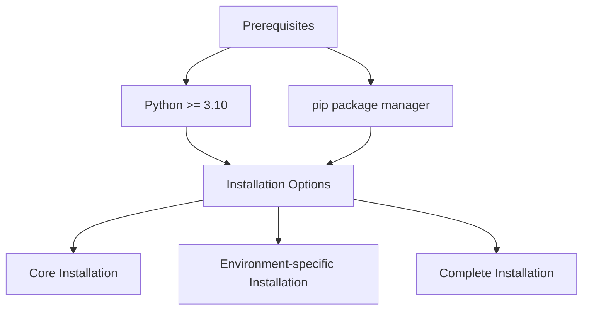

Sources: [pyproject.toml:11]()

## Basic Installation

### Core Installation

To install the core Gymnasium package:

```bash
pip install gymnasium
```

This installs Gymnasium with only the core dependencies:

| Dependency | Version Requirement |
|------------|---------------------|
| numpy | >=1.22.0 |
| cloudpickle | >=1.2.0 |
| typing-extensions | >=4.3.0 |
| farama-notifications | >=0.0.1 |

Sources: [pyproject.toml:27-32]()

## Environment-Specific Installation

Gymnasium supports several categories of environments, each with its own dependencies. Install only what you need to minimize dependencies.

### Environment Categories and Installation

```mermaid
graph TD
    A["Gymnasium Environment Categories"] --> B["Classic Control"]
    A --> C["Box2D"]
    A --> D["MuJoCo"]
    A --> E["Toy Text"]
    A --> F["Atari"]
    A --> G["JAX"]
    A --> H["Torch"]
    A --> I["Array API"]
    A --> J["Other (Visualization)"]
    
    B --> B1["pip install gymnasium[classic-control]"]
    C --> C1["pip install gymnasium[box2d]"]
    D --> D1["pip install gymnasium[mujoco]"]
    E --> E1["pip install gymnasium[toy-text]"]
    F --> F1["pip install gymnasium[atari]"]
    G --> G1["pip install gymnasium[jax]"]
    H --> H1["pip install gymnasium[torch]"]
    I --> I1["pip install gymnasium[array-api]"]
    J --> J1["pip install gymnasium[other]"]
    
    B1 --> P1["pygame-ce >=2.1.3"]
    
    C1 --> P2["pygame-ce >=2.1.3"]
    C1 --> P3["box2d ==2.3.10; python_version < '3.14'"]
    C1 --> P4["box2d-py ==2.3.8; python_version >= '3.14'"]
    C1 --> P5["swig ==4.*; python_version >= '3.14'"]
    
    D1 --> P6["mujoco >=2.1.5"]
    D1 --> P7["imageio >=2.14.1"]
    D1 --> P8["packaging >=23.0"]
    
    E1 --> P9["pygame-ce >=2.1.3"]
    
    F1 --> P10["ale_py >=0.9"]
    
    G1 --> P11["jax >=0.4.16"]
    G1 --> P12["jaxlib >=0.4.16"]
    G1 --> P13["flax >=0.5.0"]
    G1 --> P14["array-api-compat >=1.11.0"]
    
    H1 --> P15["torch >=1.13.0"]
    H1 --> P16["array-api-compat >=1.11.0"]
    
    I1 --> P17["array-api-compat >=1.11.0"]
    I1 --> P18["packaging >=23.0"]
    
    J1 --> P19["moviepy >=1.0.0"]
    J1 --> P20["matplotlib >=3.0"]
    J1 --> P21["opencv-python >=3.0"]
    J1 --> P22["seaborn >= 0.13"]
```

For specific environment categories, use the following installation commands:

| Environment Category | Installation Command | Description |
|----------------------|----------------------|-------------|
| Classic Control | `pip install "gymnasium[classic-control]"` | Simple physics-based control tasks (CartPole, MountainCar, etc.) |
| Box2D | `pip install "gymnasium[box2d]"` | 2D physics environments (LunarLander, CarRacing, etc.) |
| MuJoCo | `pip install "gymnasium[mujoco]"` | 3D physics simulation environments (Humanoid, Ant, HalfCheetah, etc.) |
| Toy Text | `pip install "gymnasium[toy-text]"` | Simple text-based environments (FrozenLake, Blackjack, etc.) |
| Atari | `pip install "gymnasium[atari]"` | Atari 2600 game environments |

Sources: [pyproject.toml:36-46]()

## Machine Learning Framework Support

Gymnasium provides optional dependencies for specific machine learning frameworks:

| Framework | Installation Command | Dependencies |
|-----------|----------------------|-------------|
| JAX | `pip install "gymnasium[jax]"` | jax >=0.4.16, jaxlib >=0.4.16, flax >=0.5.0, array-api-compat >=1.11.0 |
| PyTorch | `pip install "gymnasium[torch]"` | torch >=1.13.0, array-api-compat >=1.11.0 |
| Array API | `pip install "gymnasium[array-api]"` | array-api-compat >=1.11.0, packaging >=23.0 |

Sources: [pyproject.toml:47-54]()

## Visualization Support

For visualization tools and utilities:

```bash
pip install "gymnasium[other]"
```

This installs:
- moviepy >=1.0.0
- matplotlib >=3.0
- opencv-python >=3.0
- seaborn >=0.13

Sources: [pyproject.toml:55-60]()

## Complete Installation

To install Gymnasium with all dependencies (except those requiring ROM licenses):

```bash
pip install "gymnasium[all]"
```

This includes all environment categories and frameworks mentioned above.

Sources: [pyproject.toml:61-63]()

## Development Installation

If you plan to contribute to Gymnasium or need the latest development version:

1. Clone the repository:
   ```bash
   git clone https://github.com/Farama-Foundation/Gymnasium.git
   cd Gymnasium
   ```

2. Install in development mode:
   ```bash
   pip install -e .
   ```

3. Install development dependencies:
   ```bash
   pip install -e ".[testing]"
   ```
   The `testing` extra includes:
   - pytest >=7.1.3
   - scipy >=1.7.3
   - dill >=0.3.7
   - array_api_extra >=0.7.0
   Sources: [pyproject.toml:65-70]()

4. Set up pre-commit hooks (optional but recommended for contributors):
   ```bash
   pip install pre-commit
   pre-commit install
   ```
   The pre-commit configuration (`.pre-commit-config.yaml`) includes hooks for:
   - `check-symlinks`, `destroyed-symlinks`, `trailing-whitespace`, `end-of-file-fixer`, `check-yaml`, `check-toml`, `check-ast`, `check-added-large-files`, `check-merge-conflict`, `check-executables-have-shebangs`, `check-shebang-scripts-are-executable`, `detect-private-key`, `debug-statements` from `pre-commit/pre-commit-hooks` [.pre-commit-config.yaml:3-20]()
   - `codespell` for spell checking [.pre-commit-config.yaml:21-25]()
   - `ruff-check` and `ruff-format` for linting and formatting [.pre-commit-config.yaml:26-35]()
   - `ty` for type checking [.pre-commit-config.yaml:48-51]()

Sources: [README.md:65-68](), [.pre-commit-config.yaml:1-51]()

## Verifying Installation

After installation, verify that Gymnasium is working correctly:

```python
import gymnasium as gym

# Create a simple environment
env = gym.make("CartPole-v1")

# Reset the environment
observation, info = env.reset()

# Take a random action
action = env.action_space.sample()
observation, reward, terminated, truncated, info = env.step(action)

# Close the environment
env.close()

print("Gymnasium is installed correctly!")
```

Sources: [README.md:40-51]()

## Architecture Integration

The following diagram shows how Gymnasium's installation components map to the system architecture:

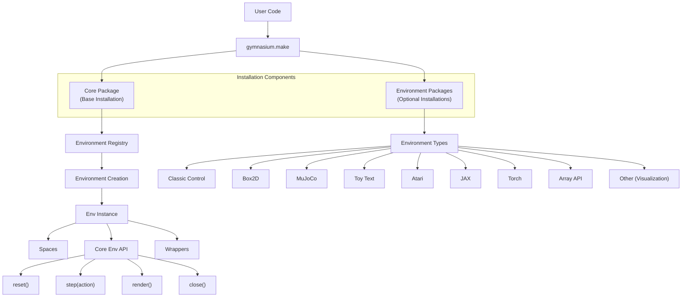

Sources: [pyproject.toml:36-60]()

## Troubleshooting

### Common Issues

1.  **Missing Dependencies**: If you get import errors when using certain environments, ensure you've installed the corresponding optional dependencies.

    ```
    ImportError: No module named 'box2d'
    ```
    Solution: `pip install "gymnasium[box2d]"`

2.  **Pygame Display Issues**: If using environments that require rendering with Pygame and you're working in a headless environment:

    ```
    pygame.error: No available video device
    ```
    Solution: You may need to configure a virtual framebuffer like Xvfb.

3.  **Version Conflicts**: Dependency conflicts can occur with other packages.

    Solution: Consider using virtual environments to isolate Gymnasium installations.

### Environment-Specific Issues

-   **MuJoCo**: The MuJoCo physics engine might require additional setup on some systems. Refer to the MuJoCo documentation for platform-specific instructions.

-   **Atari**: Atari environments require ROM files that cannot be distributed with Gymnasium due to licensing restrictions. See the `ale_py` documentation for information about obtaining ROMs legally.

## What's Next

Once you have Gymnasium installed, you can:

1.  Explore the [Core API](#2) to understand how to use Gymnasium's interfaces
2.  Learn about [Spaces](#3) that define the format of observations and actions
3.  Discover the various [Environment Categories](#5) available in Gymnasium

---

# Page: Getting Started with Gymnasium

# Getting Started with Gymnasium

<details>
<summary>Relevant source files</summary>

The following files were used as context for generating this wiki page:

- [.gitignore](.gitignore)
- [docs/_static/img/tutorials/mujoco_reinforce_fig4.png](docs/_static/img/tutorials/mujoco_reinforce_fig4.png)
- [docs/_static/videos/tutorials/environment-creation-example-episode.gif](docs/_static/videos/tutorials/environment-creation-example-episode.gif)
- [docs/api/functional.md](docs/api/functional.md)
- [docs/introduction/basic_usage.md](docs/introduction/basic_usage.md)
- [docs/introduction/create_custom_env.md](docs/introduction/create_custom_env.md)
- [docs/introduction/migration_guide.md](docs/introduction/migration_guide.md)
- [docs/introduction/record_agent.md](docs/introduction/record_agent.md)
- [docs/introduction/speed_up_env.md](docs/introduction/speed_up_env.md)
- [docs/introduction/train_agent.md](docs/introduction/train_agent.md)
- [docs/tutorials/README.rst](docs/tutorials/README.rst)
- [docs/tutorials/gymnasium_basics/README.rst](docs/tutorials/gymnasium_basics/README.rst)
- [docs/tutorials/gymnasium_basics/environment_creation.py](docs/tutorials/gymnasium_basics/environment_creation.py)
- [docs/tutorials/gymnasium_basics/implementing_custom_wrappers.py](docs/tutorials/gymnasium_basics/implementing_custom_wrappers.py)
- [docs/tutorials/gymnasium_basics/load_quadruped_model.py](docs/tutorials/gymnasium_basics/load_quadruped_model.py)
- [docs/tutorials/training_agents/README.rst](docs/tutorials/training_agents/README.rst)
- [docs/tutorials/training_agents/blackjack_q_learning.py](docs/tutorials/training_agents/blackjack_q_learning.py)
- [docs/tutorials/training_agents/frozenlake_q_learning.py](docs/tutorials/training_agents/frozenlake_q_learning.py)
- [docs/tutorials/training_agents/mujoco_reinforce.py](docs/tutorials/training_agents/mujoco_reinforce.py)
- [docs/tutorials/training_agents/vector_a2c.py](docs/tutorials/training_agents/vector_a2c.py)

</details>


This page provides a tutorial-style introduction to Gymnasium, covering basic usage patterns, agent-environment interaction, and common workflows that form the foundation of reinforcement learning development.

For detailed installation instructions, see [Installation and Setup](#1.1). For comprehensive API documentation, see [Core API](#2). For training your first agent, see [Train an Agent](docs/introduction/train_agent.md).

## What is Gymnasium?

Gymnasium is an open source Python library that provides a standard API for reinforcement learning environments. It serves as the interface between learning algorithms and environments, offering a consistent way to interact with diverse RL problems ranging from simple control tasks to complex simulations.

The library includes built-in environment families (Classic Control, Box2D, MuJoCo, Toy Text) and supports third-party environments through a unified registration system.

**Sources:** [README.md:15-17](), [docs/introduction/basic_usage.md:16-24]()

## Core Concepts

### The Agent-Environment Loop

The fundamental interaction pattern in Gymnasium follows the standard reinforcement learning agent-environment loop:

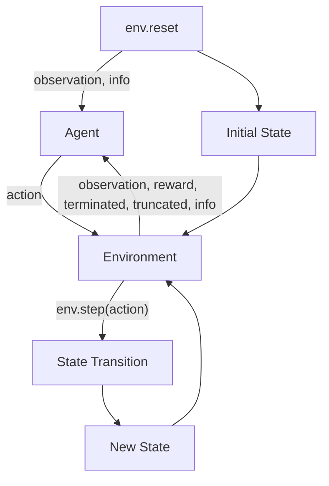

This loop represents the core interaction where:
1. Agent observes the current state
2. Agent selects an action based on what it sees
3. Environment processes the action and transitions to a new state
4. Environment returns feedback (reward, new observation, episode status)
5. Process repeats until episode terminates

**Sources:** [docs/introduction/basic_usage.md:52-62]()

### Key API Components

The Gymnasium API centers around several core components:

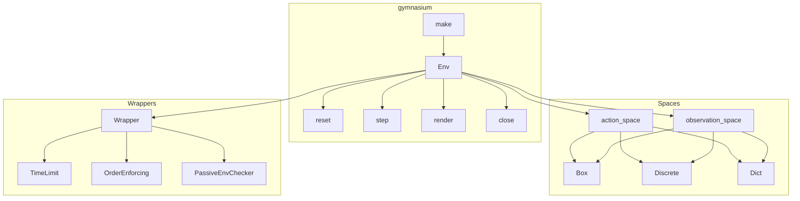

| Component | Purpose | Key Methods |
|-----------|---------|-------------|
| `gym.make()` | Environment factory | Creates environment instances |
| `Env` | Base environment class | `reset()`, `step()`, `render()`, `close()` |
| `action_space` | Defines valid actions | `sample()`, `contains()` |
| `observation_space` | Defines observation format | `sample()`, `contains()` |
| `Wrapper` | Environment modifier | Modifies behavior without changing core env |

**Sources:** [docs/introduction/basic_usage.md:26-50](), [gymnasium/core.py]()

## Basic Usage Patterns

### Creating and Interacting with Environments

```python
import gymnasium as gym

# Create environment
env = gym.make("CartPole-v1")

# Start episode
observation, info = env.reset()

# Take actions
for _ in range(1000):
    action = env.action_space.sample()  # Random action
    observation, reward, terminated, truncated, info = env.step(action)
    
    if terminated or truncated:
        observation, info = env.reset()

env.close()
```

This pattern demonstrates the essential workflow:
1. **Environment Creation**: `gym.make()` [docs/introduction/basic_usage.md:31-38]() instantiates environments from the registry.
2. **Episode Initialization**: `env.reset()` [docs/introduction/basic_usage.md:86-87]() starts new episodes and returns initial observations.
3. **Action Execution**: `env.step(action)` [docs/introduction/basic_usage.md:103]() processes actions and returns the standard 5-tuple (`observation`, `reward`, `terminated`, `truncated`, `info`).
4. **Episode Management**: Check termination conditions (`terminated` or `truncated`) and reset when needed [docs/introduction/basic_usage.md:110-111]().
5. **Cleanup**: `env.close()` [docs/introduction/basic_usage.md:113]() releases resources.

**Sources:** [README.md:41-53](), [docs/introduction/basic_usage.md:79-114]()

### Understanding Spaces

Action and observation spaces define the interface between agents and environments:

```python
# Examine spaces
print(f"Action space: {env.action_space}")        # Discrete(2)
print(f"Observation space: {env.observation_space}")  # Box(4,)

# Sample from spaces
action = env.action_space.sample()      # Random valid action
obs = env.observation_space.sample()    # Random valid observation

# Check validity
valid_action = env.action_space.contains(action)
valid_obs = env.observation_space.contains(obs)
```

Common space types:
- `Discrete(n)`: Integer actions from 0 to n-1 [gymnasium/spaces/discrete.py]()
- `Box(low, high, shape)`: Continuous values within bounds [gymnasium/spaces/box.py]()
- `Dict`: Structured observations with named components [gymnasium/spaces/dict.py]()
- `MultiDiscrete`: Multiple discrete choices [gymnasium/spaces/multi_discrete.py]()
- `MultiBinary`: Binary vectors [gymnasium/spaces/multi_binary.py]()

**Sources:** [docs/introduction/basic_usage.md:134-176]()

### Environment Registry and Creation

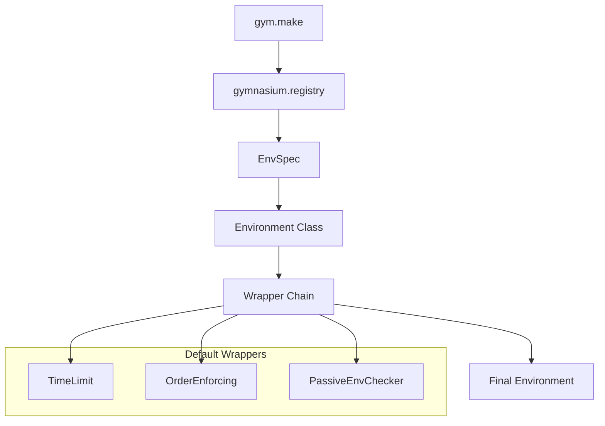

The registry system manages environment creation and configuration:

```python
# Register custom environment
gym.register(
    id="MyEnv-v0",
    entry_point="my_package:MyEnv",
    max_episode_steps=1000
)

# Create with parameters
env = gym.make("CartPole-v1", render_mode="human")

# View available environments
gym.pprint_registry()
```

The `gym.make()` function [docs/introduction/basic_usage.md:31-38]() is the primary way to create environments. It uses the `gymnasium.registry` [gymnasium/envs/registration.py:100-100]() to look up environment specifications (`EnvSpec`) [gymnasium/envs/registration.py:10-10](). When an environment is created, a chain of default wrappers is often applied, including `TimeLimit` [gymnasium/wrappers/time_limit.py:10-10](), `OrderEnforcing` [gymnasium/wrappers/order_enforcing.py:10-10](), and `PassiveEnvChecker` [gymnasium/wrappers/env_checker.py:10-10](), to ensure consistent behavior and API compliance.

You can register your own environments using `gym.register()` [gymnasium/envs/registration.py:100-100](), specifying an `id`, `entry_point`, and optional metadata like `max_episode_steps`. To see all registered environments, use `gym.pprint_registry()` [gymnasium/envs/registration.py:120-120]().

**Sources:** [gymnasium/envs/registration.py](), [docs/introduction/create_custom_env.md:328-347]()

## Common Workflows

### Training Loop Structure

```python
import gymnasium as gym
from collections import defaultdict
import numpy as np

# Define a simple Q-learning agent for demonstration
class SimpleQLearningAgent:
    def __init__(self, action_space, observation_space, learning_rate=0.1, discount_factor=0.99, epsilon=0.1):
        self.action_space = action_space
        self.observation_space = observation_space
        self.lr = learning_rate
        self.gamma = discount_factor
        self.epsilon = epsilon
        # Q-table for discrete states (assuming observation space is discrete or can be discretized)
        # For CartPole, we'd need to discretize the continuous observation space.
        # For simplicity, this example assumes a discrete observation space for the Q-table.
        # For CartPole, a more complex agent (e.g., neural network) would be used.
        self.q_table = defaultdict(lambda: np.zeros(self.action_space.n))

    def get_action(self, observation):
        # Epsilon-greedy policy
        if np.random.rand() < self.epsilon:
            return self.action_space.sample()  # Explore
        else:
            # Exploit: choose action with max Q-value for current state
            # For continuous observation, this would require state discretization or a function approximator
            state_tuple = tuple(observation) # Simple conversion for demonstration
            return np.argmax(self.q_table[state_tuple])

    def update(self, observation, action, reward, next_observation, terminated):
        state_tuple = tuple(observation)
        next_state_tuple = tuple(next_observation)

        current_q = self.q_table[state_tuple][action]
        
        if terminated:
            target_q = reward
        else:
            target_q = reward + self.gamma * np.max(self.q_table[next_state_tuple])
        
        self.q_table[state_tuple][action] += self.lr * (target_q - current_q)


# Setup
env = gym.make("FrozenLake-v1", is_slippery=False) # Using FrozenLake for discrete states
agent = SimpleQLearningAgent(env.action_space, env.observation_space)

num_episodes = 1000
# Training loop
for episode in range(num_episodes):
    observation, info = env.reset()
    episode_reward = 0
    
    while True:
        # Agent decision
        action = agent.get_action(observation)
        
        # Environment step
        next_observation, reward, terminated, truncated, info = env.step(action)
        
        # Agent learning
        agent.update(observation, action, reward, next_observation, terminated)
        
        episode_reward += reward
        observation = next_observation # Update observation for next step
        
        if terminated or truncated:
            break
    
    # Episode complete
    print(f"Episode {episode}: reward = {episode_reward}")

env.close()
```

This workflow represents the standard training pattern used across RL algorithms. The `SimpleQLearningAgent` demonstrates how an agent interacts with the environment by choosing actions (`get_action`) and updating its policy based on feedback (`update`). The `env.reset()` [docs/introduction/basic_usage.md:86-87]() and `env.step()` [docs/introduction/basic_usage.md:103]() methods facilitate this interaction.

**Sources:** [docs/introduction/train_agent.md:238-263](), [docs/tutorials/training_agents/frozenlake_q_learning.py:105-126](), [docs/tutorials/training_agents/frozenlake_q_learning.py:130-149]()

### Environment Modification with Wrappers

```python
from gymnasium.wrappers import TimeLimit, RecordVideo, ClipReward

# Base environment
base_env = gym.make("CartPole-v1", render_mode="rgb_array")

# Add wrappers
env = TimeLimit(base_env, max_episode_steps=500)
env = ClipReward(env, min_reward=-1, max_reward=1) # Example custom wrapper
env = RecordVideo(env, video_folder="videos/", episode_trigger=lambda x: x % 100 == 0)

# Wrapper chain inspection
print(env)  # Shows wrapper hierarchy
print(env.unwrapped)  # Access original environment

env.close()
```

Wrappers modify environment behavior without changing the core implementation. They are applied in a stack, with the outermost wrapper being the first to process calls to `step()`, `reset()`, etc.

- `TimeLimit` [gymnasium/wrappers/time_limit.py:10-10](): Adds episode step limits, causing `truncated=True` if the limit is reached.
- `RecordVideo` [gymnasium/wrappers/record_video.py:10-10](): Saves episode recordings to a specified folder, useful for visualization and debugging.
- `ClipReward` [docs/tutorials/gymnasium_basics/implementing_custom_wrappers.py:95-103](): A custom wrapper example that clips the reward to a specified range.
- `FlattenObservation` [gymnasium/wrappers/flatten_observation.py:10-10](): Converts dictionary observations into a single flat array.
- `RescaleAction` [gymnasium/wrappers/rescale_action.py:10-10](): Rescales actions from one range to another.

You can inspect the wrapper hierarchy by printing the wrapped environment object. The `env.unwrapped` attribute allows direct access to the base environment, bypassing all wrappers.

**Sources:** [docs/introduction/basic_usage.md:178-232](), [docs/tutorials/gymnasium_basics/implementing_custom_wrappers.py:95-103]()

### Multi-Environment Workflows

```python
import gymnasium as gym
import numpy as np

# Create a vectorized environment with 4 parallel instances
vec_env = gym.make_vec("CartPole-v1", num_envs=4)

# Reset all environments
observations, infos = vec_env.reset()
print(f"Initial observations shape: {observations.shape}") # (num_envs, observation_space_shape)

# Take a step in all environments
# Actions must be a batch, one for each environment
actions = np.array([vec_env.action_space.sample() for _ in range(vec_env.num_envs)])
observations, rewards, terminated, truncated, infos = vec_env.step(actions)

print(f"Observations shape after step: {observations.shape}")
print(f"Rewards: {rewards}")
print(f"Terminated flags: {terminated}")
print(f"Truncated flags: {truncated}")

vec_env.close()
```

Vector environments (`VectorEnv` [gymnasium/vector/vector_env.py:10-10]()) allow running multiple environment instances in parallel, significantly speeding up data collection for training. `gym.make_vec()` [gymnasium/vector/__init__.py:10-10]() creates a vectorized environment.

When interacting with a `VectorEnv`, `reset()` and `step()` operate on batches:
- `reset()` returns a batch of observations and a list of info dictionaries, one for each environment.
- `step()` takes a batch of actions (one for each environment) and returns batches of observations, rewards, `terminated` flags, `truncated` flags, and a list of info dictionaries.

This batch-oriented interaction is crucial for efficient training with algorithms that benefit from parallel experience collection, such as A2C [docs/tutorials/training_agents/vector_a2c.py:92-164]() or PPO.

**Sources:** [docs/introduction/speed_up_env.md:12-21](), [docs/tutorials/training_agents/vector_a2c.py:92-164]()

## Environment Categories

Gymnasium includes several built-in environment families:

| Category | Description | Example Environments |
|----------|-------------|---------------------|
| Classic Control | Simple control problems with continuous state and discrete/continuous actions. | CartPole, MountainCar, Pendulum |
| Box2D | 2D physics simulations requiring Box2D library. | LunarLander, CarRacing, BipedalWalker |
| MuJoCo | 3D robotics simulations requiring MuJoCo physics engine. | Humanoid, Ant, Walker2d |
| Toy Text | Discrete, simple problems often used for tabular RL methods. | FrozenLake, Taxi, Blackjack |

Each category targets different aspects of RL research and provides varying levels of complexity.

**Sources:** [README.md:19-28]()

## Next Steps

After mastering these basics, explore these advanced topics:

1.  **Algorithm Implementation**: Learn to implement RL algorithms like Q-learning [docs/tutorials/training_agents/frozenlake_q_learning.py:105-126](), policy gradients, or actor-critic methods [docs/tutorials/training_agents/vector_a2c.py:92-164]().
2.  **Custom Environments**: Create domain-specific environments for your research problems - see [Create a Custom Environment](docs/introduction/create_custom_env.md).
3.  **Performance Optimization**: Use vectorized environments and other techniques - see [Speed Up Training](docs/introduction/speed_up_env.md).
4.  **Evaluation and Recording**: Systematically evaluate and record agent performance - see [Recording Agents](docs/introduction/record_agent.md).
5.  **Advanced Features**: Explore functional environments [docs/api/functional.md](), third-party integrations, and specialized wrappers [docs/tutorials/gymnasium_basics/implementing_custom_wrappers.py:20-138]().

The key to effective RL development is understanding the agent-environment interface and building upon these fundamental interaction patterns.

**Sources:** [docs/introduction/basic_usage.md:252-258]()

---

# Page: Core API

# Core API

<details>
<summary>Relevant source files</summary>

The following files were used as context for generating this wiki page:

- [gymnasium/core.py](gymnasium/core.py)
- [gymnasium/utils/env_checker.py](gymnasium/utils/env_checker.py)
- [gymnasium/utils/passive_env_checker.py](gymnasium/utils/passive_env_checker.py)
- [gymnasium/wrappers/common.py](gymnasium/wrappers/common.py)
- [tests/test_core.py](tests/test_core.py)
- [tests/testing_env.py](tests/testing_env.py)
- [tests/utils/test_env_checker.py](tests/utils/test_env_checker.py)
- [tests/utils/test_passive_env_checker.py](tests/utils/test_passive_env_checker.py)
- [tests/wrappers/test_passive_env_checker.py](tests/wrappers/test_passive_env_checker.py)

</details>


The Core API provides the fundamental interfaces and classes that define how agents interact with environments in Gymnasium. This includes the base `Env` class that all environments must implement, the `Wrapper` system for modifying environment behavior, and the registration system for creating environments.

For information about specific environment implementations, see [Environment Categories](#5). For details about the spaces system used to define action and observation spaces, see [Spaces](#3). For vector environments that run multiple instances in parallel, see [Vector Environments](#6).

## API Architecture Overview

The Gymnasium Core API is built around several key components that work together to provide a consistent interface for reinforcement learning environments:

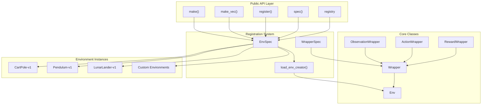

Sources: [gymnasium/__init__.py:10-12](), [gymnasium/core.py:25-65](), [gymnasium/envs/registration.py:74-246]()

## Class Hierarchy and Relationships

The core classes follow a clear inheritance hierarchy that enables modular composition of environment behavior:

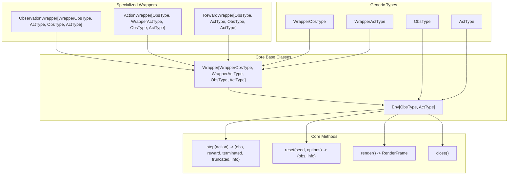

Sources: [gymnasium/core.py:19-20](), [gymnasium/core.py:25-59](), [gymnasium/core.py:284-291](), [gymnasium/core.py:531-648]()

## Environment Creation and Lifecycle

The environment creation process involves several steps that transform environment specifications into runnable instances:

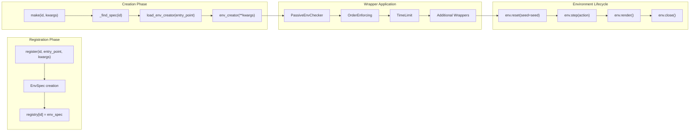

Sources: [gymnasium/envs/registration.py:564-638](), [gymnasium/envs/registration.py:640-824](), [gymnasium/envs/registration.py:534-546]()

## Key API Functions

### Environment Creation Functions

| Function | Purpose | Returns |
|----------|---------|---------|
| `make(id, **kwargs)` | Creates a single environment instance | `Env` |
| `make_vec(id, num_envs, **kwargs)` | Creates a vectorized environment | `VectorEnv` |
| `spec(id)` | Retrieves environment specification | `EnvSpec` |
| `register(id, entry_point, **kwargs)` | Registers new environment | `None` |

### Registry Management

| Function | Purpose | Returns |
|----------|---------|---------|
| `registry` | Global environment registry | `dict[str, EnvSpec]` |
| `pprint_registry()` | Pretty-prints available environments | `None` |
| `register_envs(module)` | Registers environments from module | `None` |

Sources: [gymnasium/__init__.py:34-50](), [gymnasium/envs/registration.py:32-45]()

## Core Environment Interface

The `Env` class defines the standard interface that all environments must implement. For details, see [Env Class](#2.1).

### Essential Methods

- **`step(action)`**: Executes one environment timestep
  - Returns: `(observation, reward, terminated, truncated, info)`
  - Defined in [gymnasium/core.py:77-112]()

- **`reset(seed=None, options=None)`**: Resets environment to initial state
  - Returns: `(observation, info)`
  - Defined in [gymnasium/core.py:114-158]()

- **`render()`**: Renders the environment for visualization
  - Returns: `RenderFrame | list[RenderFrame] | None`
  - Defined in [gymnasium/core.py:159-191]()

- **`close()`**: Cleanup when environment is no longer needed
  - Defined in [gymnasium/core.py:193-199]()

### Essential Properties

- **`action_space`**: Defines valid actions (`spaces.Space[ActType]`)
- **`observation_space`**: Defines valid observations (`spaces.Space[ObsType]`)
- **`spec`**: Environment specification (`EnvSpec | None`)
- **`metadata`**: Environment metadata (`dict[str, Any]`)
- **`render_mode`**: Current rendering mode (`str | None`)

Sources: [gymnasium/core.py:25-75]()

## Wrapper System Overview

The wrapper system allows modular modification of environment behavior without changing the underlying environment implementation. For details, see [Wrapper System](#2.2).

### Base Wrapper Class

The `Wrapper` class provides the foundation for all environment modifications:

```python
class Wrapper(Env[WrapperObsType, WrapperActType]):
    def __init__(self, env: Env[ObsType, ActType])
    def step(self, action: WrapperActType) -> tuple[WrapperObsType, SupportsFloat, bool, bool, dict]
    def reset(self, *, seed: int | None = None, options: dict | None = None) -> tuple[WrapperObsType, dict]
```

### Specialized Wrapper Types

| Wrapper Type | Purpose | Key Method |
|--------------|---------|------------|
| `ObservationWrapper` | Modifies observations | `observation(obs) -> modified_obs` |
| `ActionWrapper` | Modifies actions | `action(action) -> modified_action` |
| `RewardWrapper` | Modifies rewards | `reward(reward) -> modified_reward` |

### Wrapper Attribute Access

The wrapper system provides methods for accessing attributes through the wrapper stack:

- **`has_wrapper_attr(name)`**: Check if attribute exists in wrapper stack
- **`get_wrapper_attr(name)`**: Get attribute from wrapper stack
- **`set_wrapper_attr(name, value)`**: Set attribute in wrapper stack

Sources: [gymnasium/core.py:288-529](), [gymnasium/core.py:531-648]()

## Environment Specification System

The `EnvSpec` class contains metadata and configuration for environment creation:

### Core EnvSpec Attributes

| Attribute | Type | Purpose |
|-----------|------|---------|
| `id` | `str` | Environment identifier |
| `entry_point` | `EnvCreator \| str \| None` | Environment constructor |
| `reward_threshold` | `float \| None` | Reward threshold for solving |
| `nondeterministic` | `bool` | Whether environment is nondeterministic |
| `max_episode_steps` | `int \| None` | Maximum episode length |
| `order_enforce` | `bool` | Whether to enforce call order |
| `disable_env_checker` | `bool` | Whether to disable environment checker |
| `additional_wrappers` | `tuple[WrapperSpec, ...]` | Additional wrappers to apply |

### Environment ID Format

Environment IDs follow the pattern: `[namespace/](env-name)[-v(version)]`

- **Namespace**: Optional namespace for organization
- **Environment name**: The core environment identifier
- **Version**: Optional version number

Examples: `CartPole-v1`, `ALE/Breakout-v5`, `MyNamespace/CustomEnv-v0`

Sources: [gymnasium/envs/registration.py:74-246](), [gymnasium/envs/registration.py:27-29](), [gymnasium/envs/registration.py:261-282]()

---

# Page: Env Class

# Env Class

<details>
<summary>Relevant source files</summary>

The following files were used as context for generating this wiki page:

- [gymnasium/core.py](gymnasium/core.py)
- [gymnasium/utils/env_checker.py](gymnasium/utils/env_checker.py)
- [gymnasium/utils/passive_env_checker.py](gymnasium/utils/passive_env_checker.py)
- [gymnasium/wrappers/common.py](gymnasium/wrappers/common.py)
- [tests/test_core.py](tests/test_core.py)
- [tests/testing_env.py](tests/testing_env.py)
- [tests/utils/test_env_checker.py](tests/utils/test_env_checker.py)
- [tests/utils/test_passive_env_checker.py](tests/utils/test_passive_env_checker.py)
- [tests/utils/test_seeding.py](tests/utils/test_seeding.py)
- [tests/wrappers/test_passive_env_checker.py](tests/wrappers/test_passive_env_checker.py)

</details>


The `Env` class is the fundamental base class for all reinforcement learning environments in Gymnasium. It defines the standard interface that all environments must implement, providing the core methods for agent-environment interaction, observation and action space definitions, and environment lifecycle management.

For information about extending environments through wrappers, see [Wrapper System](). For details on creating and registering custom environments, see [Environment Registration]().

## Class Overview

The `Env` class is a generic base class parameterized by observation type (`ObsType`) and action type (`ActType`). It establishes the contract that all Gymnasium environments must follow, ensuring consistent behavior across different environment implementations.

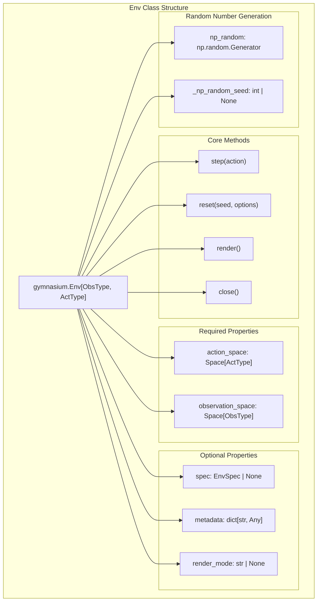

Sources: [gymnasium/core.py:25-75]()

## Core Methods

### step Method

The `step` method is the primary interface for advancing the environment by one timestep. It takes an action and returns the next observation, reward, termination signals, and additional information.

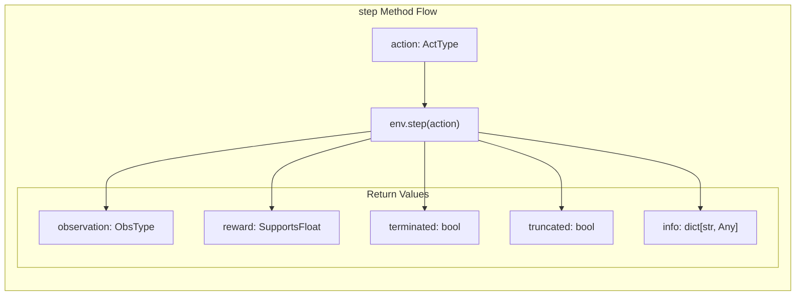

The method signature is:
```python
def step(
    self, action: ActType
) -> tuple[ObsType, SupportsFloat, bool, bool, dict[str, Any]]:
```

Key aspects:
- **Action**: Must be a valid element of the environment's `action_space`
- **Observation**: Must be a valid element of the environment's `observation_space`
- **Reward**: A scalar value representing the reward for the action
- **Terminated**: Indicates if the episode has ended due to task completion
- **Truncated**: Indicates if the episode has ended due to time limits or other constraints
- **Info**: Dictionary containing auxiliary diagnostic information

Sources: [gymnasium/core.py:77-116]()

### reset Method

The `reset` method initializes the environment to a starting state, typically called at the beginning of each episode or when the environment needs to be restarted.

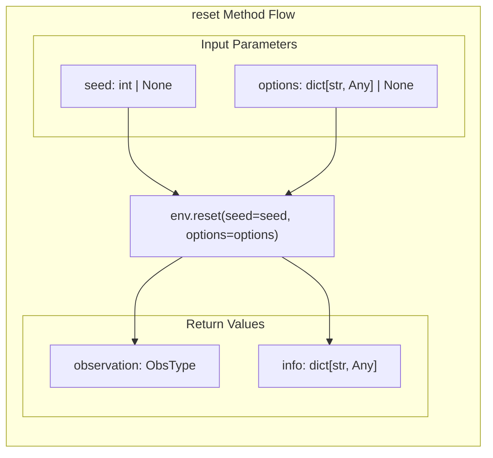

The method signature is:
```python
def reset(
    self, *, seed: int | None = None, options: dict[str, Any] | None = None
) -> tuple[ObsType, dict[str, Any]]:
```

Key aspects:
- **Seed**: Optional integer for reproducible random number generation. The `super().reset(seed=seed)` call within an environment's `reset` method is crucial for initializing the environment's internal random number generator (`_np_random`) and ensuring deterministic behavior when a seed is provided. [gymnasium/utils/env_checker.py:102-105]()
- **Options**: Optional dictionary for environment-specific configuration
- **Observation**: Initial observation from the environment
- **Info**: Dictionary containing auxiliary information about the reset

Sources: [gymnasium/core.py:118-158]()

### render Method

The `render` method provides visualization of the environment state, supporting various rendering modes for different use cases.

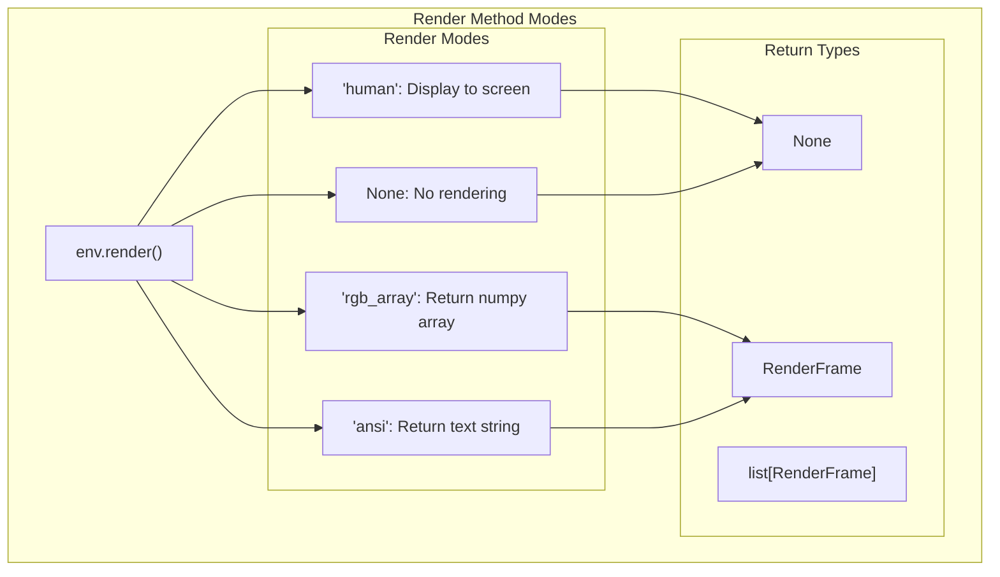

The method signature is:
```python
def render(self) -> RenderFrame | list[RenderFrame] | None:
```

Render modes are specified during environment initialization and stored in `env.render_mode`. The `metadata` attribute should list supported render modes.

Sources: [gymnasium/core.py:160-192]()

### close Method

The `close` method handles cleanup operations when the environment is no longer needed, such as closing rendering windows or releasing resources.

```python
def close(self):
    """Override close in your environment or wrapper to perform any necessary cleanup.

    Environments will automatically close() themselves when garbage collected or when the program exits.
    """
    pass
```

Sources: [gymnasium/core.py:194-200]()

## Properties and Attributes

### Space Properties

Every environment must define `action_space` and `observation_space` properties that specify the valid ranges for actions and observations.

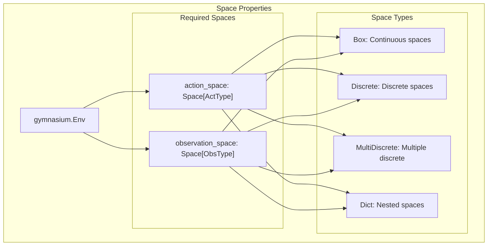

Sources: [gymnasium/core.py:68-69]()
The `check_observation_space` and `check_action_space` utilities in `gymnasium.utils.passive_env_checker` are used to validate these spaces. They ensure that the spaces inherit from `gymnasium.spaces.Space` and have sensible configurations (e.g., positive number of elements for `Discrete` spaces, correct shapes for `Box` spaces). [gymnasium/utils/passive_env_checker.py:61-116]()

### Metadata and Specification

The `metadata` attribute provides information about the environment's capabilities, while `spec` contains registration information.

| Attribute | Type | Description |
|-----------|------|-------------|
| `metadata` | `dict[str, Any]` | Environment metadata (e.g., render modes, FPS) |
| `spec` | `EnvSpec \| None` | Environment specification from registration |
| `render_mode` | `str \| None` | Current rendering mode |

Sources: [gymnasium/core.py:61-65]()

## Random Number Generation

Gymnasium environments use a standardized random number generation system to ensure reproducibility and proper seeding.

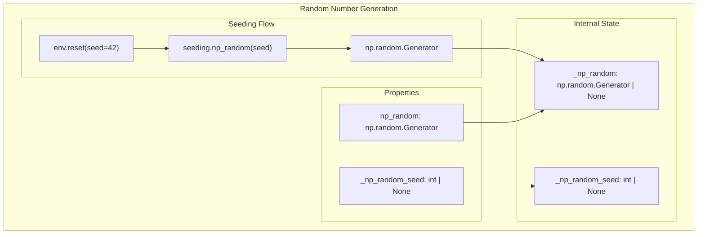

Key aspects:
- **np_random**: Provides access to the environment's random number generator. This property ensures that if `_np_random` is `None`, a new `np.random.Generator` is created using a random seed, and this seed is stored in `_np_random_seed`. [gymnasium/core.py:210-226]()
- **_np_random_seed**: Stores the seed used to initialize the current `np.random.Generator`. It is set to -1 if the seed is unknown. [gymnasium/core.py:73-74]()
- **Automatic initialization**: If `env.reset(seed=None)` is called, a random seed is generated internally.
- **Seed persistence**: The seed is maintained across reset calls unless explicitly changed. The `check_reset_seed_determinism` utility verifies that calling `reset` with the same seed produces deterministic results for observations and the internal random number generator state. [gymnasium/utils/env_checker.py:79-157]()

Sources: [gymnasium/core.py:71-74](), [gymnasium/core.py:202-246]()

## Wrapper Integration

The `Env` class provides methods for interacting with the wrapper system, allowing wrappers to modify environment behavior while maintaining access to underlying functionality.

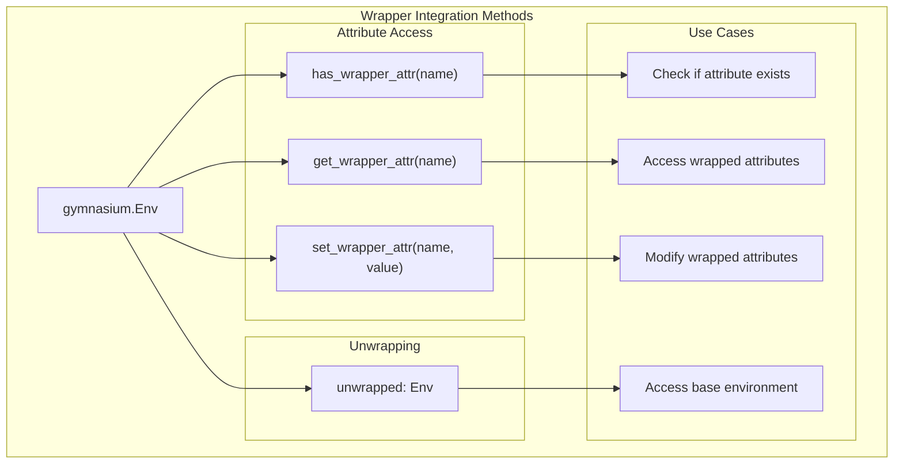

These methods enable:
- **Attribute traversal**: Access attributes through wrapper chains. For example, `env.get_wrapper_attr("gravity")` will search through the wrapper stack to find the `gravity` attribute. [tests/test_core.py:177-179]()
- **Dynamic modification**: Modify attributes at any wrapper level. `env.set_wrapper_attr("gravity", 10.0)` will set the `gravity` attribute on the first environment in the stack that has it. [tests/test_core.py:188-192]()
- **Base environment access**: Direct access to the underlying environment using `env.unwrapped`. [gymnasium/core.py:278-282]()

Sources: [gymnasium/core.py:268-282]()

## Context Manager Support

The `Env` class supports Python's context manager protocol, enabling automatic resource cleanup.

```python
# Context manager usage
with gym.make("CartPole-v1") as env:
    obs, info = env.reset()
    # Environment is automatically closed when exiting the with block
```

The implementation uses `__enter__` and `__exit__` methods to ensure proper cleanup. The `__enter__` method returns `self`, allowing the environment object to be used within the `with` statement. The `__exit__` method calls `self.close()` to release resources. [gymnasium/core.py:258-266]()

Sources: [gymnasium/core.py:258-266]()

## Implementation Guidelines

### Custom Environment Implementation

When creating custom environments, inherit from `Env` and implement the required methods:

```python
class CustomEnv(gym.Env[ObsType, ActType]):
    def __init__(self):
        # Define action and observation spaces
        self.action_space = ...
        self.observation_space = ...
        
        # Optional: Set metadata
        self.metadata = {"render_modes": ["human", "rgb_array"]}
    
    def step(self, action):
        # Implement environment dynamics
        return observation, reward, terminated, truncated, info
    
    def reset(self, *, seed=None, options=None):
        # Call parent reset for proper seeding
        super().reset(seed=seed, options=options)
        # Initialize environment state
        return observation, info
```
It is critical that the `reset` method calls `super().reset(seed=seed, options=options)` to ensure proper seeding of the environment's internal random number generator. Failure to do so can lead to non-deterministic behavior even when a seed is provided. [gymnasium/utils/env_checker.py:102-105]()

Environments should also ensure that the observations and info dictionaries returned by `reset` and `step` are new objects and not reused buffers. The `PassiveEnvChecker` wrapper and `data_shares_objects` utility function can detect such issues. [gymnasium/utils/passive_env_checker.py:30](), [tests/wrappers/test_passive_env_checker.py:134-166]()

### Type Safety

The `Env` class supports static type checking through generic type parameters:

```python
# Type-safe environment definition
class TypedEnv(gym.Env[np.ndarray, int]):
    def __init__(self):
        self.observation_space: gym.spaces.Space[np.ndarray] = gym.spaces.Box(...)
        self.action_space: gym.spaces.Space[int] = gym.spaces.Discrete(...)
```

Sources: [gymnasium/core.py:53-56]()

---

# Page: Wrapper System

# Wrapper System

<details>
<summary>Relevant source files</summary>

The following files were used as context for generating this wiki page:

- [docs/api/wrappers/action_wrappers.md](docs/api/wrappers/action_wrappers.md)
- [docs/api/wrappers/table.md](docs/api/wrappers/table.md)
- [gymnasium/core.py](gymnasium/core.py)
- [gymnasium/error.py](gymnasium/error.py)
- [gymnasium/utils/env_checker.py](gymnasium/utils/env_checker.py)
- [gymnasium/utils/passive_env_checker.py](gymnasium/utils/passive_env_checker.py)
- [gymnasium/wrappers/__init__.py](gymnasium/wrappers/__init__.py)
- [gymnasium/wrappers/common.py](gymnasium/wrappers/common.py)
- [gymnasium/wrappers/stateful_action.py](gymnasium/wrappers/stateful_action.py)
- [tests/test_core.py](tests/test_core.py)
- [tests/testing_env.py](tests/testing_env.py)
- [tests/utils/test_env_checker.py](tests/utils/test_env_checker.py)
- [tests/utils/test_passive_env_checker.py](tests/utils/test_passive_env_checker.py)
- [tests/wrappers/test_action_repeat.py](tests/wrappers/test_action_repeat.py)
- [tests/wrappers/test_passive_env_checker.py](tests/wrappers/test_passive_env_checker.py)
- [tests/wrappers/test_sticky_action.py](tests/wrappers/test_sticky_action.py)
- [tests/wrappers/test_white_noise_rendering.py](tests/wrappers/test_white_noise_rendering.py)

</details>


The Wrapper System is a key component of Gymnasium that enables modifying environment behavior without altering the underlying environment code. Wrappers provide a standardized mechanism to customize environment aspects such as observations, actions, rewards, and more. They serve as a powerful abstraction layer that makes it easy to implement common functionality like episode termination conditions, preprocessing steps, and monitoring tools.

## Architecture Overview

The Wrapper System is built on a simple but powerful inheritance and composition pattern. All wrappers inherit from the base `Wrapper` class, which itself inherits from the `Env` class. This design ensures that wrappers maintain the same interface as environments, allowing them to be used interchangeably.

```mermaid
classDiagram
    direction TB
    class Env {
        +step(action: ActType) tuple[ObsType, SupportsFloat, bool, bool, dict]
        +reset(seed: int|None, options: dict|None) tuple[ObsType, dict]
        +render() RenderFrame|list[RenderFrame]|None
        +close()
        +action_space: spaces.Space[ActType]
        +observation_space: spaces.Space[ObsType]
        +unwrapped: Env
        +has_wrapper_attr(name: str) bool
        +get_wrapper_attr(name: str) Any
        +set_wrapper_attr(name: str, value: Any, force: bool) bool
    }
    
    class Wrapper {
        -env: Env[ObsType, ActType]
        +step(action: WrapperActType) tuple[WrapperObsType, SupportsFloat, bool, bool, dict]
        +reset(seed: int|None, options: dict|None) tuple[WrapperObsType, dict]
        +render() RenderFrame|list[RenderFrame]|None
        +close()
        +action_space: spaces.Space
        +observation_space: spaces.Space
        +unwrapped: Env[ObsType, ActType]
        +spec: EnvSpec|None
        +wrapper_spec(**kwargs) WrapperSpec
    }
    
    class ActionWrapper {
        +action(action: WrapperActType) ActType
        +step(action: WrapperActType) tuple[ObsType, SupportsFloat, bool, bool, dict]
    }
    
    class ObservationWrapper {
        +observation(observation: ObsType) WrapperObsType
        +step(action: ActType) tuple[WrapperObsType, SupportsFloat, bool, bool, dict]
        +reset(seed: int|None, options: dict|None) tuple[WrapperObsType, dict]
    }
    
    class RewardWrapper {
        +reward(reward: SupportsFloat) SupportsFloat
        +step(action: ActType) tuple[ObsType, SupportsFloat, bool, bool, dict]
    }
    
    class TimeLimit {
        -_max_episode_steps: int
        -_elapsed_steps: int|None
        +step(action: ActType) tuple[ObsType, SupportsFloat, bool, bool, dict]
        +reset(seed: int|None, options: dict|None) tuple[ObsType, dict]
        +spec: EnvSpec|None
    }
    
    class OrderEnforcing {
        -_has_reset: bool
        -_disable_render_order_enforcing: bool
        +step(action: ActType) tuple[ObsType, SupportsFloat, bool, bool, dict]
        +reset(seed: int|None, options: dict|None) tuple[ObsType, dict]
        +render() RenderFrame|list[RenderFrame]|None
        +has_reset: bool
    }
    
    class PassiveEnvChecker {
        +checked_reset: bool
        +checked_step: bool
        +checked_render: bool
        +close_called: bool
        +step(action: ActType) tuple[ObsType, SupportsFloat, bool, bool, dict]
        +reset(seed: int|None, options: dict|None) tuple[ObsType, dict]
        +render() RenderFrame|list[RenderFrame]|None
    }
    
    class Autoreset {
        +autoreset: bool
        +step(action: ActType) tuple[ObsType, SupportsFloat, bool, bool, dict]
        +reset(seed: int|None, options: dict|None) tuple[WrapperObsType, dict]
    }
    
    class RecordEpisodeStatistics {
        +episode_count: int
        +episode_start_time: float
        +episode_returns: float
        +episode_lengths: int
        +time_queue: deque[float]
        +return_queue: deque[float]
        +length_queue: deque[int]
        +step(action: ActType) tuple[ObsType, SupportsFloat, bool, bool, dict]
        +reset(seed: int|None, options: dict|None) tuple[ObsType, dict]
    }
    
    Env <|-- Wrapper
    Wrapper <|-- ActionWrapper
    Wrapper <|-- ObservationWrapper
    Wrapper <|-- RewardWrapper
    Wrapper <|-- TimeLimit
    Wrapper <|-- OrderEnforcing
    Wrapper <|-- PassiveEnvChecker
    Wrapper <|-- Autoreset
    Wrapper <|-- RecordEpisodeStatistics
    Wrapper o-- Env : wraps
```

Sources: [gymnasium/core.py:23-647](), [gymnasium/wrappers/common.py:34-550]()

## Wrapper Base Class

The `Wrapper` class forms the foundation of the wrapper system. It encapsulates an environment instance and delegates most method calls to the wrapped environment, potentially modifying the inputs or outputs.

### Key Properties

- `env`: The wrapped environment
- `unwrapped`: Property that returns the base non-wrapped environment
- `action_space`: The wrapper's action space (defaults to the wrapped env's space)
- `observation_space`: The wrapper's observation space (defaults to the wrapped env's space)

### Key Methods

- `step(action)`: Executes the environment step and returns the result
- `reset(seed=None, options=None)`: Resets the environment
- `render()`: Renders the environment
- `close()`: Closes the environment
- `has_wrapper_attr(name)`: Checks if an attribute exists in the wrapper chain
- `get_wrapper_attr(name)`: Gets an attribute from the wrapper chain
- `set_wrapper_attr(name, value, force=True)`: Sets an attribute in the wrapper chain

Sources: [gymnasium/core.py:288-529]()

## Specialized Wrapper Types

Gymnasium provides three specialized wrapper types, each designed to modify a specific aspect of environment interaction.

### ActionWrapper

The `ActionWrapper` modifies actions before they are passed to the environment. Subclasses override the `action(action)` method to implement the desired transformation.

```python
def step(self, action):
    return self.env.step(self.action(action))
```

Sources: [gymnasium/core.py:610-647]()

### ObservationWrapper

The `ObservationWrapper` modifies observations returned by the environment. Subclasses override the `observation(observation)` method to implement the transformation.

```python
def reset(self, *, seed=None, options=None):
    obs, info = self.env.reset(seed=seed, options=options)
    return self.observation(obs), info

def step(self, action):
    observation, reward, terminated, truncated, info = self.env.step(action)
    return self.observation(observation), reward, terminated, truncated, info
```

Sources: [gymnasium/core.py:531-572]()

### RewardWrapper

The `RewardWrapper` modifies rewards returned by the environment. Subclasses override the `reward(reward)` method to implement the desired transformation.

```python
def step(self, action):
    observation, reward, terminated, truncated, info = self.env.step(action)
    return observation, self.reward(reward), terminated, truncated, info
```

Sources: [gymnasium/core.py:575-607]()

## Common Wrappers

Gymnasium provides several common wrappers that implement frequently needed functionality:

### TimeLimit

Limits the number of steps in an episode. If the maximum number of steps is reached, the episode is truncated.

```mermaid
flowchart LR
    A["env.step(action)"] --> B["self.env.step(action)"]
    B --> C["observation, reward, terminated, truncated, info"]
    C --> D{"self._elapsed_steps >= 
             self._max_episode_steps"}
    D -->|"Yes"| E["Set truncated = True"]
    D -->|"No"| F["Return result unchanged"]
    E --> G["Return modified result"]
    F --> G
```

Sources: [gymnasium/wrappers/common.py:43-166]()

### OrderEnforcing

Ensures that methods are called in the correct order (reset must be called before step or render). Raises a `ResetNeeded` exception if methods are called out of order.

Sources: [gymnasium/wrappers/common.py:340-434]()

### Autoreset

Automatically resets the environment when a terminated or truncated state is reached. This follows the vector autoreset API where on the step after an episode terminates or truncates, the environment is reset.

```python
def step(self, action: ActType) -> tuple[ObsType, SupportsFloat, bool, bool, dict[str, Any]]:
    if self.autoreset:
        obs, info = self.env.reset()
        reward, terminated, truncated = 0.0, False, False
    else:
        obs, reward, terminated, truncated, info = self.env.step(action)
    
    self.autoreset = terminated or truncated
    return obs, reward, terminated, truncated, info
```

Sources: [gymnasium/wrappers/common.py:169-218]()

### PassiveEnvChecker

Passively checks that the environment follows the Gymnasium API. Unlike active checking (with `check_env`), this wrapper does not interfere with environment operation and only performs checks on the first call to each method.

| Check Type | Method | Description |
|------------|--------|-------------|
| `checked_reset` | `reset()` | Validates reset return format on first call |
| `checked_step` | `step()` | Validates step return format on first call |
| `checked_render` | `render()` | Validates render return format on first call |

Sources: [gymnasium/wrappers/common.py:220-338]()

### RecordEpisodeStatistics

Records statistics about episodes, including episode rewards, lengths, and duration. The statistics are made available in the info dictionary returned by `step()`.

| Attribute | Type | Description |
|-----------|------|-------------|
| `episode_count` | `int` | Total number of completed episodes |
| `episode_start_time` | `float` | Start time of current episode |
| `episode_returns` | `float` | Cumulative reward for current episode |
| `episode_lengths` | `int` | Number of steps in current episode |
| `time_queue` | `deque[float]` | Duration of recent episodes |
| `return_queue` | `deque[float]` | Returns of recent episodes |
| `length_queue` | `deque[int]` | Lengths of recent episodes |

Sources: [gymnasium/wrappers/common.py:437-550]()

## Wrapper Registry

The `gymnasium.wrappers` module acts as a registry for all available wrappers. It categorizes wrappers into several groups based on their primary function:

```mermaid
graph TD
    A["gymnasium.wrappers"] --> B["Observation Wrappers"]
    A --> C["Action Wrappers"]
    A --> D["Reward Wrappers"]
    A --> E["Common Wrappers"]
    A --> F["Rendering Wrappers"]
    A --> G["Array Conversion Wrappers"]

    B --> B1["AtariPreprocessing"]
    B --> B2["FrameStackObservation"]
    B --> B3["NormalizeObservation"]
    B --> B4["ResizeObservation"]
    B --> B5["GrayscaleObservation"]
    B --> B6["TimeAwareObservation"]
    B --> B7["MaxAndSkipObservation"]
    B --> B8["DelayObservation"]
    B --> B9["DtypeObservation"]
    B --> B10["DiscretizeObservation"]
    B --> B11["FilterObservation"]
    B --> B12["FlattenObservation"]
    B --> B13["AddRenderObservation"]
    B --> B14["ReshapeObservation"]
    B --> B15["RescaleObservation"]
    B --> B16["TransformObservation"]

    C --> C1["ClipAction"]
    C --> C2["DiscretizeAction"]
    C --> C3["RescaleAction"]
    C --> C4["StickyAction"]
    C --> C5["RepeatAction"]
    C --> C6["TransformAction"]

    D --> D1["ClipReward"]
    D --> D2["NormalizeReward"]
    D --> D3["TransformReward"]

    E --> E1["TimeLimit"]
    E --> E2["Autoreset"]
    E --> E3["PassiveEnvChecker"]
    E --> E4["OrderEnforcing"]
    E --> E5["RecordEpisodeStatistics"]

    F --> F1["HumanRendering"]
    F --> F2["RecordVideo"]
    F --> F3["AddWhiteNoise"]
    F --> F4["ObstructView"]
    F --> F5["RenderCollection"]

    G --> G1["ArrayConversion"]
    G --> G2["JaxToNumpy"]
    G --> G3["JaxToTorch"]
    G --> G4["NumpyToTorch"]
```

Sources: [gymnasium/wrappers/__init__.py:97-144]()

Some wrappers, particularly those for array conversion, are loaded dynamically at runtime to avoid unnecessary dependencies like JAX or PyTorch if they are not used. This is handled by the `__getattr__` method in the `gymnasium.wrappers` module. [gymnasium/wrappers/__init__.py:165-186]()

## Wrapper Application Process

When using `gym.make()`, Gymnasium automatically applies several wrappers based on the environment specification and parameters. The wrappers are applied in a specific order to ensure proper functionality:

```mermaid
flowchart TD
    A["gym.make(id, **kwargs)"] --> B["Create environment instance"]
    B --> C{"Has max_episode_steps?"}
    C -->|"Yes"| D["Apply TimeLimit wrapper"]
    C -->|"No"| E{"order_enforce is True?"}
    D --> E
    E -->|"Yes"| F["Apply OrderEnforcing wrapper"]
    E -->|"No"| G{"disable_env_checker is False?"}
    F --> G
    G -->|"Yes"| H["Apply PassiveEnvChecker wrapper"]
    G -->|"No"| I["Apply additional_wrappers from EnvSpec"]
    H --> I
    I --> J["Return wrapped environment"]
    
    subgraph "Typical Wrapper Stack"
        K["TimeLimit"] --> L["OrderEnforcing"] 
        L --> M["PassiveEnvChecker"]
        M --> N["Base Environment"]
    end
```

Sources: [gymnasium/envs/registration.py:1-600](), [tests/envs/registration/test_env_spec.py:18-75]()

## Applying Wrappers Manually

Wrappers can also be applied manually by instantiating them directly:

```python
env = gym.make("CartPole-v1")
env = gym.wrappers.RecordEpisodeStatistics(env)
env = gym.wrappers.ClipAction(env)
```

Multiple wrappers can be chained, with each wrapper modifying the behavior of all inner wrappers. The order of application matters:

1. The innermost wrapper (applied first) interacts directly with the base environment
2. Each subsequent wrapper interacts with the previously wrapped environment
3. The outermost wrapper (applied last) is what the user code interacts with

Sources: [gymnasium/wrappers/__init__.py:19-27]()

## Accessing the Unwrapped Environment

Wrappers provide access to the underlying base environment through the `unwrapped` property, which recursively unwraps all layers:

```python
env = gym.make("CartPole-v1")
# env might be wrapped with TimeLimit, OrderEnforcing, etc.
base_env = env.unwrapped  # Gets the raw CartPoleEnv instance
```

### Wrapper Attribute Access

The wrapper system provides methods to access and modify attributes across the wrapper stack:

| Method | Description |
|--------|-------------|
| `has_wrapper_attr(name)` | Check if attribute exists in wrapper stack |
| `get_wrapper_attr(name)` | Get attribute value from wrapper stack |
| `set_wrapper_attr(name, value, force=True)` | Set attribute value in wrapper stack |

These methods search through the wrapper hierarchy, allowing access to environment-specific properties without needing to unwrap the environment.

Sources: [gymnasium/core.py:348-354](), [gymnasium/core.py:405-454](), [tests/test_core.py:170-227]()

## Common Wrapper Usage Patterns

| Wrapper Type | Common Use Cases | Key Method |
|--------------|-----------------|------------|
| ActionWrapper | Clipping actions to valid ranges, rescaling action spaces | `action()` |
| ObservationWrapper | Normalization, flattening hierarchical observations, image preprocessing | `observation()` |
| RewardWrapper | Reward scaling, reward clipping, custom reward functions | `reward()` |
| TimeLimit | Setting maximum episode length | `step()` with truncation logic |
| OrderEnforcing | Ensuring proper method call sequence | `step()`, `reset()`, `render()` |
| PassiveEnvChecker | API compliance validation | All methods with passive checking |
| Autoreset | Automatic environment reset after episodes | `step()` with autoreset logic |
| RecordEpisodeStatistics | Tracking performance metrics across episodes | `step()`, `reset()` with statistics |

## Creating Custom Wrappers

To create a custom wrapper, inherit from the appropriate wrapper class and override the relevant methods:

1. For action modification: inherit from `ActionWrapper` and override `action(self, action)`
2. For observation modification: inherit from `ObservationWrapper` and override `observation(self, observation)`
3. For reward modification: inherit from `RewardWrapper` and override `reward(self, reward)`
4. For more complex behavior: inherit directly from `Wrapper` and override `step`, `reset`, etc.

Custom wrappers should maintain the same interface as the base environment, particularly regarding the shapes and types of returned values.

Sources: [gymnasium/core.py:531-647]()

## Summary

The Wrapper System is a powerful extension mechanism in Gymnasium that enables flexible modification of environment behavior. By using wrappers, you can customize environments without changing their underlying code, implement common preprocessing steps, and monitor environment performance. Understanding the wrapper system is essential for effectively working with Gymnasium environments, particularly when adapting them for specific reinforcement learning tasks.

For detailed documentation on specific wrapper categories, refer to the following child pages:
- [Transform and Stateful Wrappers](#2.2.1)
- [Rendering and Recording Wrappers](#2.2.2)
- [Array Conversion Wrappers (Jax/Torch/NumPy)](#2.2.3)

---

# Page: Transform and Stateful Wrappers

# Transform and Stateful Wrappers

<details>
<summary>Relevant source files</summary>

The following files were used as context for generating this wiki page:

- [docs/api/env.md](docs/api/env.md)
- [gymnasium/wrappers/atari_preprocessing.py](gymnasium/wrappers/atari_preprocessing.py)
- [gymnasium/wrappers/stateful_observation.py](gymnasium/wrappers/stateful_observation.py)
- [gymnasium/wrappers/stateful_reward.py](gymnasium/wrappers/stateful_reward.py)
- [gymnasium/wrappers/transform_action.py](gymnasium/wrappers/transform_action.py)
- [gymnasium/wrappers/transform_observation.py](gymnasium/wrappers/transform_observation.py)
- [gymnasium/wrappers/vector/stateful_reward.py](gymnasium/wrappers/vector/stateful_reward.py)
- [tests/wrappers/test_atari_preprocessing.py](tests/wrappers/test_atari_preprocessing.py)
- [tests/wrappers/test_discretize_action.py](tests/wrappers/test_discretize_action.py)
- [tests/wrappers/test_discretize_observation.py](tests/wrappers/test_discretize_observation.py)
- [tests/wrappers/test_dtype_observation.py](tests/wrappers/test_dtype_observation.py)
- [tests/wrappers/test_frame_stack_observation.py](tests/wrappers/test_frame_stack_observation.py)
- [tests/wrappers/test_gray_scale_observation.py](tests/wrappers/test_gray_scale_observation.py)
- [tests/wrappers/test_normalize_observation.py](tests/wrappers/test_normalize_observation.py)
- [tests/wrappers/test_normalize_reward.py](tests/wrappers/test_normalize_reward.py)
- [tests/wrappers/test_rescale_action.py](tests/wrappers/test_rescale_action.py)
- [tests/wrappers/test_rescale_observation.py](tests/wrappers/test_rescale_observation.py)
- [tests/wrappers/test_resize_observation.py](tests/wrappers/test_resize_observation.py)
- [tests/wrappers/vector/test_normalize_observation.py](tests/wrappers/vector/test_normalize_observation.py)
- [tests/wrappers/vector/test_normalize_reward.py](tests/wrappers/vector/test_normalize_reward.py)

</details>


This page provides detailed documentation for Gymnasium's transform and stateful wrappers. These wrappers modify observations, actions, or rewards, often maintaining internal state to do so. This includes wrappers for normalization, frame stacking, and Atari preprocessing.

## Observation Transform Wrappers

Observation transform wrappers modify the observations returned by the environment. These wrappers are typically stateless, applying a function directly to the observation.

### `TransformObservation`

The `TransformObservation` wrapper [gymnasium/wrappers/transform_observation.py:43-97]() applies a user-defined function to the observation received from the environment's `reset()` and `step()` methods.

**Implementation Details:**
- The wrapper takes a `func` (a callable) and an optional `observation_space` as arguments during initialization [gymnasium/wrappers/transform_observation.py:71-84]().
- If `observation_space` is provided, it overrides the environment's observation space [gymnasium/wrappers/transform_observation.py:90-91]().
- The `observation()` method simply calls the provided `func` with the raw observation [gymnasium/wrappers/transform_observation.py:95-97]().

**Example:**
```python
import gymnasium as gym
from gymnasium.wrappers import TransformObservation
import numpy as np

env = gym.make("CartPole-v1")
env = TransformObservation(env, lambda obs: obs + 0.1 * np.random.random(obs.shape), env.observation_space)
obs, info = env.reset(seed=42)
# obs will be the original observation with added random noise
```

### `FilterObservation`

The `FilterObservation` wrapper [gymnasium/wrappers/transform_observation.py:100-164]() filters `Dict` or `Tuple` observation spaces to include only specified keys or indices.

**Implementation Details:**
- It inherits from `TransformObservation` [gymnasium/wrappers/transform_observation.py:100-103]().
- The constructor validates `filter_keys` based on the observation space type (strings for `Dict`, integers for `Tuple`) [gymnasium/wrappers/transform_observation.py:144-163]().
- It dynamically creates a new observation space containing only the filtered keys/indices.
- The `observation()` method filters the input observation dictionary or tuple.

**Example:**
```python
import gymnasium as gym
from gymnasium.wrappers import FilterObservation, TimeAwareObservation

env = gym.make("CartPole-v1")
env = TimeAwareObservation(env, flatten=False) # Creates a Dict observation space
# env.observation_space is now Dict('obs': Box(...), 'time': Box(...))
env = FilterObservation(env, filter_keys=['time'])
obs, info = env.reset(seed=42)
# obs will only contain the 'time' key
```

### `FlattenObservation`

The `FlattenObservation` wrapper flattens the observation space of the environment. This is useful for environments with complex observation spaces (e.g., `Dict` or `Tuple`) that need to be converted into a single `Box` space.

**Implementation Details:**
- It uses `gymnasium.spaces.utils.flatten_space` to create the new observation space.
- The `observation()` method uses `gymnasium.spaces.utils.flatten` to flatten the actual observation.

### `GrayscaleObservation`

The `GrayscaleObservation` wrapper converts RGB observations to grayscale.

**Implementation Details:**
- It checks if the original observation space is a `Box` with 3 channels (RGB) [gymnasium/wrappers/transform_observation.py:400-402]().
- The `observation()` method performs the grayscale conversion using a weighted sum of RGB channels [gymnasium/wrappers/transform_observation.py:420-421]().
- It supports an optional `keep_dim` argument to maintain the channel dimension (e.g., `(H, W, 1)` instead of `(H, W)`) [gymnasium/wrappers/transform_observation.py:390]().

**Example:**
```python
import gymnasium as gym
from gymnasium.wrappers import GrayscaleObservation

env = gym.make("CarRacing-v2") # Original observation is RGB (96, 96, 3)
env = GrayscaleObservation(env) # Observation becomes grayscale (96, 96)
obs, info = env.reset()
```
Sources: [gymnasium/wrappers/transform_observation.py:370-423]()

### `ResizeObservation`

The `ResizeObservation` wrapper resizes array-based observations, typically RGB images.

**Implementation Details:**
- It requires `opencv-python` [gymnasium/wrappers/transform_observation.py:446-450]().
- The constructor validates the `shape` argument [gymnasium/wrappers/transform_observation.py:452-460]().
- The `observation()` method uses `cv2.resize` to perform the resizing [gymnasium/wrappers/transform_observation.py:470-471]().
- It handles both grayscale and RGB observations, preserving the channel dimension if present [tests/wrappers/test_resize_observation.py:53-64]().

**Example:**
```python
import gymnasium as gym
from gymnasium.wrappers import ResizeObservation

env = gym.make("CarRacing-v2") # Original observation is RGB (96, 96, 3)
env = ResizeObservation(env, (64, 64)) # Observation becomes (64, 64, 3)
obs, info = env.reset()
```
Sources: [gymnasium/wrappers/transform_observation.py:426-473](), [tests/wrappers/test_resize_observation.py:53-64]()

### `ReshapeObservation`

The `ReshapeObservation` wrapper reshapes array-based observations to a new specified shape.

**Implementation Details:**
- The constructor validates that the product of the new shape dimensions matches the product of the original observation space dimensions [gymnasium/wrappers/transform_observation.py:494-496]().
- The `observation()` method uses `np.reshape` to change the observation's shape [gymnasium/wrappers/transform_observation.py:505-506]().

### `RescaleObservation`

The `RescaleObservation` wrapper rescales observations to a specified range `[min_obs, max_obs]`.

**Implementation Details:**
- It requires the environment's observation space to be a `Box` [gymnasium/wrappers/transform_observation.py:534-536]().
- The `observation()` method applies a linear transformation to map the original observation range to the new `[min_obs, max_obs]` range [gymnasium/wrappers/transform_observation.py:550-551]().
- It uses the `rescale_box` utility function to determine the new observation space [gymnasium/wrappers/transform_observation.py:545]().

### `DtypeObservation`

The `DtypeObservation` wrapper converts the observation's data type to a specified `dtype`.

**Implementation Details:**
- It supports various observation space types including `Box`, `Discrete`, `MultiDiscrete`, and `MultiBinary` [tests/wrappers/test_dtype_observation.py:31-37]().
- The `observation()` method casts the observation to the target `dtype` [gymnasium/wrappers/transform_observation.py:579-580]().
- For `Discrete` spaces, it correctly adjusts the observation space bounds to match the original support while changing the dtype [tests/wrappers/test_dtype_observation.py:90-95]().

**Example:**
```python
import gymnasium as gym
from gymnasium.wrappers import DtypeObservation
import numpy as np

env = gym.make("CartPole-v1") # Original observation dtype is float32
env = DtypeObservation(env, dtype=np.float64) # Observation dtype becomes float64
obs, info = env.reset()
assert obs.dtype == np.float64
```
Sources: [gymnasium/wrappers/transform_observation.py:554-582](), [tests/wrappers/test_dtype_observation.py:31-37](), [tests/wrappers/test_dtype_observation.py:90-95]()

### `DiscretizeObservation`

The `DiscretizeObservation` wrapper discretizes a continuous `Box` observation space into a single `Discrete` space.

**Implementation Details:**
- It requires the environment's observation space to be a `Box` [gymnasium/wrappers/transform_observation.py:609-611]().
- The constructor calculates the number of bins for each dimension and the total number of discrete states [gymnasium/wrappers/transform_observation.py:619-627]().
- The `observation()` method maps continuous observations to discrete integer values based on the defined bins [gymnasium/wrappers/transform_observation.py:639-645]().

## Action Transform Wrappers

Action transform wrappers modify the actions sent to the environment.

### `TransformAction`

The `TransformAction` wrapper [gymnasium/wrappers/transform_action.py:25-77]() applies a user-defined function to the action before it is passed to the environment's `step()` method.

**Implementation Details:**
- Similar to `TransformObservation`, it takes a `func` and an optional `action_space` [gymnasium/wrappers/transform_action.py:51-56]().
- The `action()` method applies the provided `func` to the action [gymnasium/wrappers/transform_action.py:75-77]().

**Example:**
```python
import gymnasium as gym
from gymnasium.wrappers import TransformAction
import numpy as np

env = gym.make("MountainCarContinuous-v0")
env = TransformAction(env, lambda a: 0.5 * a + 0.1, env.action_space)
# Actions passed to env.step() will be transformed by the lambda function
```
Sources: [gymnasium/wrappers/transform_action.py:25-77]()

### `ClipAction`

The `ClipAction` wrapper [gymnasium/wrappers/transform_action.py:79-127]() clips actions to be within the bounds of the environment's `action_space`.

**Implementation Details:**
- It requires the environment's action space to be a `Box` [gymnasium/wrappers/transform_action.py:109-111]().
- It internally uses `TransformAction` with a `np.clip` function to perform the clipping [gymnasium/wrappers/transform_action.py:116-121]().
- The wrapper's action space is set to `Box(-inf, inf, ...)` because the clipping happens internally, and the agent can theoretically output any value [gymnasium/wrappers/transform_action.py:121-126]().

**Example:**
```python
import gymnasium as gym
from gymnasium.wrappers import ClipAction
import numpy as np

env = gym.make("Hopper-v4", disable_env_checker=True)
env = ClipAction(env)
# If an action like np.array([5.0, -2.0, 0.0]) is passed, it will be clipped to [1.0, -1.0, 0.0]
```
Sources: [gymnasium/wrappers/transform_action.py:79-127]()

### `RescaleAction`

The `RescaleAction` wrapper [gymnasium/wrappers/transform_action.py:130-183]() affinely (linearly) rescales a `Box` action space to a new range `[min_action, max_action]`.

**Implementation Details:**
- It requires the environment's action space to be a `Box` [gymnasium/wrappers/transform_action.py:175-177]().
- It uses the `rescale_box` utility function to calculate the transformation [gymnasium/wrappers/transform_action.py:183]().
- The `action()` method applies this linear transformation to the input action.

**Example:**
```python
import gymnasium as gym
from gymnasium.wrappers import RescaleAction
import numpy as np

env = gym.make("Hopper-v4", disable_env_checker=True)
min_action = -0.5
max_action = np.array([0.0, 0.5, 0.75], dtype=np.float32)
wrapped_env = RescaleAction(env, min_action=min_action, max_action=max_action)
# Actions will be rescaled from the original action space to the new [min_action, max_action] range
```
Sources: [gymnasium/wrappers/transform_action.py:130-183]()

### `DiscretizeAction`

The `DiscretizeAction` wrapper discretizes a continuous `Box` action space into a `Discrete` space.

**Implementation Details:**
- Similar to `DiscretizeObservation`, it maps continuous actions to discrete integer values based on defined bins.
- It requires the environment's action space to be a `Box`.

## Stateful Observation Wrappers

Stateful observation wrappers maintain internal state that influences how observations are processed.

### `DelayObservation`

The `DelayObservation` wrapper [gymnasium/wrappers/stateful_observation.py:35-104]() introduces a delay in the observations returned by the environment. Before the specified `delay` number of timesteps, it returns an array of zeros.

**Implementation Details:**
- It maintains an `observation_queue` (a `deque`) to store past observations [gymnasium/wrappers/stateful_observation.py:86-87]().
- On `reset()`, the queue is cleared [gymnasium/wrappers/stateful_observation.py:92]().
- In `observation()`, the current observation is added to the queue. If the queue size exceeds `delay`, the oldest observation is returned; otherwise, a zero array is returned [gymnasium/wrappers/stateful_observation.py:98-103]().

**Example:**
```python
import gymnasium as gym
from gymnasium.wrappers import DelayObservation
import numpy as np

env = gym.make("CartPole-v1")
env = DelayObservation(env, delay=2)
obs, info = env.reset(seed=123) # Returns zeros
obs, reward, terminated, truncated, info = env.step(env.action_space.sample()) # Returns zeros
obs, reward, terminated, truncated, info = env.step(env.action_space.sample()) # Returns the first actual observation
```
Sources: [gymnasium/wrappers/stateful_observation.py:35-104]()

### `TimeAwareObservation`

The `TimeAwareObservation` wrapper [gymnasium/wrappers/stateful_observation.py:106-160]() augments the observation with the current timestep within an episode.

**Implementation Details:**
- It tracks the current timestep `self.current_timestep` [gymnasium/wrappers/stateful_observation.py:200]().
- The `observation()` method appends the timestep (normalized or raw) to the observation.
- For `Dict` spaces, it adds a `"time"` key; for `Tuple` spaces, it appends to the tuple. Otherwise, it converts the observation space to a `Dict` with `"obs"` and `"time"` keys [gymnasium/wrappers/stateful_observation.py:210-240]().
- The `flatten` argument can be used to flatten the resulting observation space [gymnasium/wrappers/stateful_observation.py:122]().

**Example:**
```python
import gymnasium as gym
from gymnasium.wrappers import TimeAwareObservation

env = gym.make("CartPole-v1")
env = TimeAwareObservation(env) # Observation space becomes (original_shape + 1,)
obs, info = env.reset(seed=42) # Last element of obs is 0.0
obs, reward, terminated, truncated, info = env.step(env.action_space.sample()) # Last element of obs is 1.0
```
Sources: [gymnasium/wrappers/stateful_observation.py:106-160]()

### `FrameStackObservation`

The `FrameStackObservation` wrapper stacks the `k` most recent observations along a new axis. This is commonly used in environments like Atari to provide temporal context to the agent.

**Implementation Details:**
- It maintains a `deque` of observations [gymnasium/wrappers/stateful_observation.py:300]().
- On `reset()`, the queue is filled with the initial observation `k` times [gymnasium/wrappers/stateful_observation.py:310-313]().
- In `observation()`, the new observation is added to the queue, and the oldest is removed. The stacked observations are then concatenated [gymnasium/wrappers/stateful_observation.py:317-322]().
- The observation space is updated to reflect the new stacked dimension [gymnasium/wrappers/stateful_observation.py:290-297]().

**Example:**
```python
import gymnasium as gym
from gymnasium.wrappers import FrameStackObservation

env = gym.make("CartPole-v1")
env = FrameStackObservation(env, num_stack=4) # Observation space becomes (original_shape * 4,)
obs, info = env.reset() # obs will be 4 stacked observations
```
Sources: [gymnasium/wrappers/stateful_observation.py:259-322]()

### `NormalizeObservation`

The `NormalizeObservation` wrapper [gymnasium/wrappers/stateful_observation.py:325-409]() normalizes observations to have zero mean and unit variance. It uses a running mean and standard deviation for this purpose.

**Implementation Details:**
- It uses a `RunningMeanStd` utility class to track the mean and variance of observations [gymnasium/wrappers/stateful_observation.py:370]().
- The `observation()` method normalizes the observation using the current running mean and standard deviation [gymnasium/wrappers/stateful_observation.py:399-400]().
- The `update_running_mean` property allows freezing the statistics updates, which is useful during evaluation [gymnasium/wrappers/stateful_observation.py:373-374]().
- It ensures `epsilon` (a stability parameter) is strictly positive to prevent division by zero [tests/wrappers/test_normalize_observation.py:83-90]().

**Example:**
```python
import gymnasium as gym
from gymnasium.wrappers import NormalizeObservation

env = gym.make("CartPole-v1")
env = NormalizeObservation(env)
obs, info = env.reset() # obs will be normalized
```
Sources: [gymnasium/wrappers/stateful_observation.py:325-409](), [tests/wrappers/test_normalize_observation.py:83-90]()

### `MaxAndSkipObservation`

The `MaxAndSkipObservation` wrapper [gymnasium/wrappers/stateful_observation.py:412-499]() is specific to Atari environments. It performs frame skipping and max-pooling over the last two frames.

**Implementation Details:**
- It takes `skip` as an argument, which is the number of frames to skip [gymnasium/wrappers/stateful_observation.py:440]().
- It maintains an `obs_buffer` to store the last two observations [gymnasium/wrappers/stateful_observation.py:441]().
- The `step()` method performs `skip` internal steps, collecting observations. It then returns the element-wise maximum of the last two collected observations [gymnasium/wrappers/stateful_observation.py:470-499]().

## Stateful Reward Wrappers

Stateful reward wrappers modify rewards based on internal state.

### `NormalizeReward`

The `NormalizeReward` wrapper [gymnasium/wrappers/stateful_reward.py:20-142]() normalizes immediate rewards such that their exponential moving average has an approximately fixed variance.

**Implementation Details:**
- It uses a `RunningMeanStd` object to track the mean and standard deviation of the discounted returns [gymnasium/wrappers/stateful_reward.py:111]().
- It maintains `discounted_reward` which is updated at each step [gymnasium/wrappers/stateful_reward.py:134-136]().
- The `step()` method normalizes the reward by dividing it by the standard deviation of the discounted returns (plus `epsilon` for stability) [gymnasium/wrappers/stateful_reward.py:141]().
- The `update_running_mean` property allows freezing the statistics updates [gymnasium/wrappers/stateful_reward.py:117-126]().
- It validates `gamma` to be within `[0, 1]` and `epsilon` to be strictly positive [gymnasium/wrappers/stateful_reward.py:93-106]().

**Example:**
```python
import gymnasium as gym
from gymnasium.wrappers import NormalizeReward
import numpy as np

env = gym.make("MountainCarContinuous-v0")
env = NormalizeReward(env, gamma=0.99, epsilon=1e-8)
obs, reward, terminated, truncated, info = env.step(env.action_space.sample())
# reward will be normalized
```
Sources: [gymnasium/wrappers/stateful_reward.py:20-142](), [gymnasium/wrappers/vector/stateful_reward.py:20-165]()

## Atari Preprocessing

The `AtariPreprocessing` wrapper [gymnasium/wrappers/atari_preprocessing.py:16-254]() implements common preprocessing techniques for Atari 2600 environments, following the guidelines from Machado et al. (2018).

**Implementation Details:**
- **Noop Reset:** Performs a random number of no-op actions at the beginning of an episode [gymnasium/wrappers/atari_preprocessing.py:27]().
- **Frame Skipping:** Steps the environment multiple times for each agent action, returning the observation from the last step [gymnasium/wrappers/atari_preprocessing.py:28]().
- **Max-pooling:** Takes the element-wise maximum of the last two observations after frame skipping [gymnasium/wrappers/atari_preprocessing.py:29]().
- **Terminal on Life Loss:** Optionally terminates an episode when a life is lost [gymnasium/wrappers/atari_preprocessing.py:30]().
- **Resize to Square Image:** Resizes the observation to a specified `screen_size` (e.g., 84x84) [gymnasium/wrappers/atari_preprocessing.py:31]().
- **Grayscale Observation:** Converts RGB observations to grayscale [gymnasium/wrappers/atari_preprocessing.py:32]().
- **Grayscale New Axis:** Optionally adds a channel dimension to grayscale observations [gymnasium/wrappers/atari_preprocessing.py:33]().
- **Scale Observation:** Optionally scales observations to `[0, 1)` [gymnasium/wrappers/atari_preprocessing.py:34]().

**Data Flow Diagram for AtariPreprocessing:**

```mermaid
graph TD
    A[Original Atari Env.step()] --> B{Frame Skipping};
    B -- "Multiple steps" --> C[Collect Observations];
    C -- "Last 2 observations" --> D{Max-Pooling};
    D -- "Max-pooled observation" --> E{Grayscale Conversion};
    E -- "Grayscale observation" --> F{Resize to Screen Size};
    F -- "Resized observation" --> G{Optional: Grayscale New Axis};
    G -- "Observation with/without new axis" --> H{Optional: Scale Observation};
    H --> I[Processed Observation];
    I --> J[AtariPreprocessing.step() returns];

    subgraph "Internal State and Logic"
        B -- "noop_max" --> K[Noop Reset on Env.reset()];
        K --> A;
        B -- "frame_skip" --> B;
        D -- "obs_buffer" --> D;
        A -- "lives" --> L{Terminal on Life Loss?};
        L -- "terminated=True" --> J;
    end
```
Sources: [gymnasium/wrappers/atari_preprocessing.py:16-254]()

**Example:**
```python
import gymnasium as gym
import ale_py # Required for Atari environments
gym.register_envs(ale_py)
from gymnasium.wrappers import AtariPreprocessing

env = gym.make("ALE/Pong-v5", frameskip=1) # Disable original frameskip
env = AtariPreprocessing(
    env,
    noop_max=10,
    frame_skip=4,
    terminal_on_life_loss=True,
    screen_size=84,
    grayscale_obs=True,
    grayscale_newaxis=False,
    scale_obs=False,
)
obs, info = env.reset()
# obs will be a (84, 84) grayscale image, processed with frame skipping and max-pooling
```
Sources: [gymnasium/wrappers/atari_preprocessing.py:16-254]()

---

# Page: Rendering and Recording Wrappers

# Rendering and Recording Wrappers

<details>
<summary>Relevant source files</summary>

The following files were used as context for generating this wiki page:

- [gymnasium/wrappers/rendering.py](gymnasium/wrappers/rendering.py)
- [gymnasium/wrappers/vector/__init__.py](gymnasium/wrappers/vector/__init__.py)
- [gymnasium/wrappers/vector/rendering.py](gymnasium/wrappers/vector/rendering.py)
- [tests/utils/test_save_video.py](tests/utils/test_save_video.py)
- [tests/wrappers/test_human_rendering.py](tests/wrappers/test_human_rendering.py)
- [tests/wrappers/test_record_episode_statistics.py](tests/wrappers/test_record_episode_statistics.py)
- [tests/wrappers/test_record_video.py](tests/wrappers/test_record_video.py)
- [tests/wrappers/vector/test_record_video.py](tests/wrappers/vector/test_record_video.py)

</details>


This page provides detailed documentation for Gymnasium's rendering and recording wrappers, including `HumanRendering`, `RecordVideo`, `RecordEpisodeStatistics`, and related utilities like `save_video`. These wrappers are essential for visualizing environment interactions, debugging agents, and generating demonstrations.

## RenderCollection Wrapper

The `RenderCollection` wrapper [gymnasium/wrappers/rendering.py:34-164]() collects rendered frames of an environment into a list. This allows users to retrieve all frames generated since the last `render()` call or `reset()` call, depending on configuration. It is designed for single environments and does not have a vector version.

### How it Works

The `RenderCollection` wrapper stores frames in an internal `frame_list` [gymnasium/wrappers/rendering.py:124]().
- When `step()` is called, it performs the step in the base environment and then appends the rendered frame from the base environment to `frame_list` [gymnasium/wrappers/rendering.py:137-143]().
- When `reset()` is called, it resets the base environment. If `reset_clean` is `True` (default), it clears the `frame_list` before appending the initial rendered frame [gymnasium/wrappers/rendering.py:146-155]().
- When `render()` is called on the wrapper, it returns the collected `frame_list`. If `pop_frames` is `True` (default), the `frame_list` is cleared after being returned [gymnasium/wrappers/rendering.py:157-164]().

The wrapper requires the base environment's `render_mode` to be an array-based mode (e.g., `"rgb_array"`) and not end with `"_list"` [gymnasium/wrappers/rendering.py:117-122](). It modifies the wrapper's `render_mode` property to append `"_list"` to the base environment's `render_mode` (e.g., `"rgb_array_list"`) [gymnasium/wrappers/rendering.py:133-136]().

### Configuration Parameters

- `env`: The environment to wrap.
- `pop_frames` (bool): If `True`, the `frame_list` is cleared after `render()` is called. Defaults to `True` [gymnasium/wrappers/rendering.py:109]().
- `reset_clean` (bool): If `True`, the `frame_list` is cleared when `reset()` is called. Defaults to `True` [gymnasium/wrappers/rendering.py:110]().

### RenderCollection Data Flow
```mermaid
graph TD
    A[User calls env.reset()] --> B{reset_clean is True?}
    B -- Yes --> C[Clear frame_list]
    B -- No --> D[Keep frame_list]
    C --> E[Base env.reset()]
    D --> E
    E --> F[Base env.render()]
    F --> G[Append frame to frame_list]
    G --> H[Return observation, info]

    I[User calls env.step(action)] --> J[Base env.step(action)]
    J --> K[Base env.render()]
    K --> L[Append frame to frame_list]
    L --> M[Return observation, reward, terminated, truncated, info]

    N[User calls env.render()] --> O[Get frame_list]
    O --> P{pop_frames is True?}
    P -- Yes --> Q[Clear frame_list]
    P -- No --> R[Keep frame_list]
    Q --> S[Return frame_list]
    R --> S
```
Sources:
- [gymnasium/wrappers/rendering.py:100-164]()

## RecordVideo Wrapper

The `RecordVideo` wrapper [gymnasium/wrappers/rendering.py:166-184]() records videos of environment episodes. It uses the environment's `render()` function to capture frames and saves them as video files. This wrapper supports both single and vector environments.

### How it Works

The `RecordVideo` wrapper manages video recording based on user-defined triggers.
- It requires the base environment's `render_mode` to be an array-based mode (e.g., `"rgb_array"`) [gymnasium/wrappers/rendering.py:190-192]().
- Recording is initiated when either an `episode_trigger` or `step_trigger` function returns `True` [gymnasium/wrappers/rendering.py:176-178](). If neither is provided, a default `episode_trigger` (`capped_cubic_video_schedule`) is used [gymnasium/wrappers/rendering.py:182-183]().
- During `step()` and `reset()` calls, if recording is active, frames are collected [gymnasium/wrappers/rendering.py:290-300]().
- When an episode ends or the `video_length` is reached, the collected frames are saved to a video file using `save_video` [gymnasium/wrappers/rendering.py:302-309]().

### Configuration Parameters

- `env`: The environment to wrap.
- `video_folder` (str): The folder where videos will be saved [gymnasium/wrappers/rendering.py:200]().
- `episode_trigger` (Callable): A function that takes the episode number and returns `True` to start recording. Defaults to `capped_cubic_video_schedule` [gymnasium/wrappers/rendering.py:201]().
- `step_trigger` (Callable): A function that takes the global step number and returns `True` to start recording [gymnasium/wrappers/rendering.py:202]().
- `name_prefix` (str): A prefix for video filenames [gymnasium/wrappers/rendering.py:203]().
- `disable_logger` (bool): If `True`, disables the logger [gymnasium/wrappers/rendering.py:204]().
- `video_length` (int): The maximum number of steps to record for a single video. If `None`, records until the episode ends [gymnasium/wrappers/rendering.py:205]().
- `video_aspect_ratio` (tuple[int, int]): The aspect ratio of the video (width, height). Defaults to `(1, 1)` [gymnasium/wrappers/rendering.py:206]().

### RecordVideo Workflow
```mermaid
graph TD
    A[Initialize RecordVideo Wrapper] --> B{episode_trigger or step_trigger met?}
    B -- Yes --> C[Start Recording]
    C --> D[Call base env.reset()]
    D --> E[Collect initial frame]
    E --> F[Loop: env.step(action)]
    F --> G[Call base env.step(action)]
    G --> H[Collect frame]
    H --> I{Episode terminated/truncated OR video_length reached?}
    I -- No --> F
    I -- Yes --> J[Save collected frames to video]
    J --> K[Stop Recording]
    K --> L{Next episode/step trigger met?}
    L -- Yes --> C
    L -- No --> M[Continue without recording]
    M --> F
```
Sources:
- [gymnasium/wrappers/rendering.py:166-309]()
- [tests/wrappers/test_record_video.py:13-42]()
- [tests/wrappers/vector/test_record_video.py:15-57]()

## HumanRendering Wrapper

The `HumanRendering` wrapper [gymnasium/wrappers/rendering.py:400-402]() (for single environments) and `gymnasium.wrappers.vector.rendering.HumanRendering` [gymnasium/wrappers/vector/rendering.py:25-26]() (for vector environments) provides human-friendly rendering by converting `rgb_array` or `depth_array` frames into a displayable window using `pygame`.

### How it Works

The `HumanRendering` wrapper intercepts `render()` calls and displays the frames in a `pygame` window.
- It requires the base environment's `render_mode` to be `rgb_array`, `rgb_array_list`, `depth_array`, or `depth_array_list` [gymnasium/wrappers/rendering.py:409-411](), [gymnasium/wrappers/vector/rendering.py:28-33]().
- During `step()` and `reset()` calls, it calls the base environment's `render()` method to get the frame(s) and then displays them in a `pygame` window [gymnasium/wrappers/rendering.py:430-434](), [gymnasium/wrappers/vector/rendering.py:76-94]().
- For vector environments, it arranges the individual environment renders into a grid within the `pygame` window [gymnasium/wrappers/vector/rendering.py:118-176]().
- The `close()` method ensures the `pygame` window is properly shut down [gymnasium/wrappers/rendering.py:449-452](), [gymnasium/wrappers/vector/rendering.py:200-203]().

### Configuration Parameters

- `env`: The environment to wrap.
- `screen_size` (tuple[int, int], optional): The size of the rendering window. If `None`, it defaults to the environment's render size [gymnasium/wrappers/rendering.py:403](), [gymnasium/wrappers/vector/rendering.py:43]().

### HumanRendering (Vector) Diagram
```mermaid
graph TD
    A[User calls VectorEnv.reset()] --> B[HumanRendering.reset()]
    B --> C[Base VectorEnv.reset()]
    C --> D[HumanRendering._render_frame()]
    D --> E[Base VectorEnv.render()]
    E --> F{Render mode is _list?}
    F -- Yes --> G[Get last frame from list]
    F -- No --> H[Get frame]
    G --> I[Process frames (transpose, scale, merge)]
    H --> I
    I --> J[Display frames in Pygame window]
    J --> K[Return observation, info]

    L[User calls VectorEnv.step(actions)] --> M[HumanRendering.step()]
    M --> N[Base VectorEnv.step(actions)]
    N --> D
    D --> O[Return observation, reward, terminated, truncated, info]
```
Sources:
- [gymnasium/wrappers/vector/rendering.py:25-203]()
- [tests/wrappers/test_human_rendering.py:11-24]()

## RecordEpisodeStatistics Wrapper

The `RecordEpisodeStatistics` wrapper [gymnasium/wrappers/vector/common.py:1-10]() (for single environments) and `gymnasium.wrappers.vector.common.RecordEpisodeStatistics` [gymnasium/wrappers/vector/common.py:1-10]() (for vector environments) records episode-wise statistics such as returns and lengths. These statistics are added to the `info` dictionary returned by `step()` when an episode terminates or truncates.

### How it Works

- It maintains internal counters for the current episode's return (`episode_returns`) and length (`episode_lengths`) [gymnasium/wrappers/vector/common.py:39-40]().
- In `step()`, it updates these counters. If an episode ends (terminated or truncated), it adds the `episode_returns`, `episode_lengths`, and `episode_times` to the `info` dictionary under the key `"episode"` [gymnasium/wrappers/vector/common.py:50-64]().
- It also stores these statistics in `deque` objects (`return_queue`, `length_queue`, `time_queue`) for a specified `deque_size` [gymnasium/wrappers/vector/common.py:41-43]().

### Configuration Parameters

- `env`: The environment to wrap.
- `deque_size` (int): The maximum number of episode statistics to store in the internal deques. Defaults to 100 [gymnasium/wrappers/vector/common.py:35]().

### RecordEpisodeStatistics Data Flow
```mermaid
graph TD
    A[Initialize RecordEpisodeStatistics] --> B[episode_returns = 0, episode_lengths = 0]
    B --> C[User calls env.reset()]
    C --> D[Base env.reset()]
    D --> E[Reset episode_returns, episode_lengths, episode_times]
    E --> F[Return observation, info]

    G[User calls env.step(action)] --> H[Base env.step(action)]
    H --> I[Update episode_returns, episode_lengths]
    I --> J{Terminated or Truncated?}
    J -- Yes --> K[Add "episode" key to info dict with r, l, t]
    K --> L[Append r, l, t to deques]
    L --> M[Reset episode_returns, episode_lengths, episode_times]
    J -- No --> N[Keep current episode_returns, episode_lengths]
    N --> O[Return observation, reward, terminated, truncated, info]
```
Sources:
- [gymnasium/wrappers/vector/common.py:1-10]()
- [tests/wrappers/test_record_episode_statistics.py:11-28]()

## save_video Utility

The `save_video` utility function [gymnasium/utils/save_video.py:1-10]() is a standalone function used by `RecordVideo` to write a list of image frames to a video file.

### How it Works

- It takes a list of `RenderFrame` (NumPy arrays), a `video_folder`, `fps`, and optional trigger functions and indices.
- It uses `imageio` to write the frames to an MP4 file.
- It determines the filename based on `name_prefix`, `episode_index`, and `step_starting_index` [gymnasium/utils/save_video.py:100-107]().
- It includes a `capped_cubic_video_schedule` [gymnasium/utils/save_video.py:12-25]() function which is used as the default `episode_trigger` for `RecordVideo`. This schedule records videos at episodes that are powers of 3 until 1000, then every 1000 episodes.

### `save_video` Parameters

- `frames` (list[RenderFrame]): A list of image frames to save.
- `video_folder` (str): The directory to save the video.
- `fps` (int): Frames per second for the video.
- `name_prefix` (str): Prefix for the video filename.
- `episode_trigger` (Callable): Function to determine if an episode should be recorded.
- `step_trigger` (Callable): Function to determine if a step should be recorded.
- `episode_index` (int): The current episode number.
- `step_starting_index` (int): The global step number when the recording started.

Sources:
- [gymnasium/utils/save_video.py:1-10]()
- [tests/utils/test_save_video.py:10-39]()

## Additional Rendering Wrappers

Gymnasium also includes other rendering-related wrappers:

-   `AddWhiteNoise` [gymnasium/wrappers/rendering.py:5-6](): Randomly replaces pixels with white noise.
-   `ObstructView` [gymnasium/wrappers/rendering.py:7](): Randomly places patches of white noise to obstruct the pixel rendering.

These wrappers are typically used for testing robustness or simulating visual impairments.

Sources:
- [gymnasium/wrappers/rendering.py:5-7]()

---

# Page: Array Conversion Wrappers (Jax/Torch/NumPy)

# Array Conversion Wrappers (Jax/Torch/NumPy)

<details>
<summary>Relevant source files</summary>

The following files were used as context for generating this wiki page:

- [docs/api/vector/wrappers.md](docs/api/vector/wrappers.md)
- [gymnasium/wrappers/array_conversion.py](gymnasium/wrappers/array_conversion.py)
- [gymnasium/wrappers/jax_to_numpy.py](gymnasium/wrappers/jax_to_numpy.py)
- [gymnasium/wrappers/jax_to_torch.py](gymnasium/wrappers/jax_to_torch.py)
- [gymnasium/wrappers/numpy_to_torch.py](gymnasium/wrappers/numpy_to_torch.py)
- [gymnasium/wrappers/vector/jax_to_numpy.py](gymnasium/wrappers/vector/jax_to_numpy.py)
- [gymnasium/wrappers/vector/numpy_to_torch.py](gymnasium/wrappers/vector/numpy_to_torch.py)
- [tests/wrappers/test_array_conversion.py](tests/wrappers/test_array_conversion.py)
- [tests/wrappers/test_jax_to_numpy.py](tests/wrappers/test_jax_to_numpy.py)
- [tests/wrappers/test_jax_to_torch.py](tests/wrappers/test_jax_to_torch.py)
- [tests/wrappers/test_numpy_to_torch.py](tests/wrappers/test_numpy_to_torch.py)
- [tests/wrappers/test_record_constructor_args.py](tests/wrappers/test_record_constructor_args.py)
- [tests/wrappers/vector/test_array_conversion.py](tests/wrappers/vector/test_array_conversion.py)

</details>


This page documents Gymnasium's array conversion wrappers, which facilitate interoperability between environments implemented using different array manipulation libraries like NumPy, JAX, and PyTorch. These wrappers allow users to interact with an environment using their preferred array type, regardless of the environment's native implementation. The core of this functionality is provided by the generic `ArrayConversion` wrapper, with specialized wrappers like `JaxToNumpy`, `JaxToTorch`, and `NumpyToTorch` offering convenient interfaces for common conversions.

## The `ArrayConversion` Wrapper

The `ArrayConversion` wrapper [gymnasium/wrappers/array_conversion.py:48-292]() is a generic wrapper designed to convert array inputs and outputs between any two Array API compatible frameworks. This is achieved using the `array-api-compat` package, which provides a compatibility layer for various array libraries.

### Implementation Details

The `ArrayConversion` class [gymnasium/wrappers/array_conversion.py:48-292]() inherits from `gymnasium.Wrapper`. Its constructor takes three key arguments:
- `env`: The environment to wrap.
- `env_xp`: The array module (e.g., `numpy`, `jax.numpy`, `torch`) that the wrapped environment natively uses for its arrays.
- `target_xp`: The desired array module for interaction with the wrapped environment.
- `target_device`: An optional device specification (e.g., `"cpu"`, `"cuda:0"`) for the target array module.

The wrapper overrides the `reset()` and `step()` methods of the `gym.Env` class to perform the necessary conversions.

#### Data Flow

When `reset()` [gymnasium/wrappers/array_conversion.py:200-204]() or `step()` [gymnasium/wrappers/array_conversion.py:210-220]() is called on an `ArrayConversion` wrapped environment:
1. **Action Conversion (for `step`)**: The incoming `action` (which is in `target_xp` format) is converted to `env_xp` format using `array_conversion(action, xp=self._env_xp)` [gymnasium/wrappers/array_conversion.py:212]().
2. **Environment Interaction**: The converted action is passed to the underlying environment's `step()` method.
3. **Observation/Reward/Termination/Truncation/Info Conversion**: The outputs from the underlying environment (`observation`, `reward`, `terminated`, `truncated`, `info`) (which are in `env_xp` format) are then converted to `target_xp` format using `array_conversion(value, xp=self._target_xp, device=self._target_device)` [gymnasium/wrappers/array_conversion.py:215-219]().

The `render()` method [gymnasium/wrappers/array_conversion.py:222-225]() also uses `array_conversion` to ensure that rendered frames are returned in the `target_xp` format, unless the output is `None`.

#### The `array_conversion` Function

The core conversion logic resides in the `array_conversion` singledispatch function [gymnasium/wrappers/array_conversion.py:73-76](). This function is responsible for converting various data types (numbers, mappings, iterables, and Array API compatible objects) to the specified target array module (`xp`) and device.

- **Numbers**: Python numbers are converted to arrays of the target `xp` module [gymnasium/wrappers/array_conversion.py:80-85]().
- **Mappings (Dictionaries)**: Dictionaries are recursively processed, converting their values [gymnasium/wrappers/array_conversion.py:88-93]().
- **Iterables (Tuples, Lists)**: Iterables are recursively processed, converting their elements. Special handling is included for `namedtuple` [gymnasium/wrappers/array_conversion.py:96-111]().
- **Array API Objects**: Array API compatible objects are converted using `xp.from_dlpack()` [gymnasium/wrappers/array_conversion.py:114-146](). This function handles potential issues with device placement and read-only buffers.
- **None**: `None` values are passed through without conversion [gymnasium/wrappers/array_conversion.py:148-153]().

#### `module_namespace` Utility

The `module_namespace` function [gymnasium/wrappers/array_conversion.py:60-66]() determines the Array API compatible namespace of a given module. This is crucial for ensuring that the correct array functions (e.g., `asarray`, `from_dlpack`) are used for conversion.

```mermaid
graph TD
    subgraph "Gymnasium Environment Interaction"
        A[User calls env.step(action_target_xp)] --> B{ArrayConversion Wrapper};
        B -- "action (target_xp)" --> C[array_conversion(action, env_xp)];
        C -- "action (env_xp)" --> D[Underlying env.step(action_env_xp)];
        D -- "obs, rew, term, trunc, info (env_xp)" --> E[array_conversion(outputs, target_xp, target_device)];
        E -- "obs, rew, term, trunc, info (target_xp)" --> F[Return to User];
    end

    subgraph "array_conversion Function (Singledispatch)"
        G[Input Value] --> H{Type of Value?};
        H -- "Number" --> I[xp.asarray(value)];
        H -- "Mapping" --> J[Recursively convert values];
        H -- "Iterable" --> K[Recursively convert elements];
        H -- "Array API Object" --> L[xp.from_dlpack(value) + to_device];
        H -- "None" --> M[Return None];
        I --> N[Converted Value];
        J --> N;
        K --> N;
        L --> N;
        M --> N;
    end

    B -- "Uses" --> G;
    E -- "Uses" --> G;
```
**Diagram: Array Conversion Wrapper Data Flow**
Sources: [gymnasium/wrappers/array_conversion.py:73-76](), [gymnasium/wrappers/array_conversion.py:80-85](), [gymnasium/wrappers/array_conversion.py:88-93](), [gymnasium/wrappers/array_conversion.py:96-111](), [gymnasium/wrappers/array_conversion.py:114-146](), [gymnasium/wrappers/array_conversion.py:148-153](), [gymnasium/wrappers/array_conversion.py:200-204](), [gymnasium/wrappers/array_conversion.py:210-220]()

## Specialized Array Conversion Wrappers

Gymnasium provides specialized wrappers built on top of `ArrayConversion` for common conversions between JAX, NumPy, and PyTorch. These wrappers simplify usage by pre-configuring the `env_xp` and `target_xp` arguments.

### `JaxToNumpy`

The `JaxToNumpy` wrapper [gymnasium/wrappers/jax_to_numpy.py:33-79]() converts a JAX-based environment to interact with NumPy arrays.

- **Input**: Actions are expected as NumPy arrays.
- **Output**: Observations, rewards, terminations, and truncations are returned as NumPy arrays.
- **Constructor**: `JaxToNumpy(env: gym.Env)` [gymnasium/wrappers/jax_to_numpy.py:65-79](). It automatically sets `env_xp=jnp` and `target_xp=np`.
- **Note**: JAX does not support non-array values, so a roundtrip (JAX -> NumPy -> JAX) might not preserve exact types for scalar values (e.g., `int_32(5)` becomes `DeviceArray([5], dtype=jnp.int32)`). [gymnasium/wrappers/jax_to_numpy.py:39-42]()

**Example Usage**:
```python
import gymnasium as gym
from gymnasium.wrappers import JaxToNumpy
# env = gym.make("JaxEnv-vx") # Assuming a JAX-based environment
# env = JaxToNumpy(env)
# obs, _ = env.reset(seed=123)
# type(obs) # <class 'numpy.ndarray'>
```
Sources: [gymnasium/wrappers/jax_to_numpy.py:33-79](), [gymnasium/wrappers/jax_to_numpy.py:39-42](), [gymnasium/wrappers/jax_to_numpy.py:44-59](), [gymnasium/wrappers/jax_to_numpy.py:65-79]()

### `JaxToTorch`

The `JaxToTorch` wrapper [gymnasium/wrappers/jax_to_torch.py:49-93]() converts a JAX-based environment to interact with PyTorch Tensors.

- **Input**: Actions are expected as PyTorch Tensors.
- **Output**: Observations, rewards, terminations, and truncations are returned as PyTorch Tensors.
- **Constructor**: `JaxToTorch(env: gym.Env, device: Device | None = None)` [gymnasium/wrappers/jax_to_torch.py:81-93](). It sets `env_xp=jnp` and `target_xp=torch`. An optional `device` argument allows specifying the PyTorch device.
- **Note**: Rendered frames are returned as NumPy arrays, not PyTorch Tensors. [gymnasium/wrappers/jax_to_torch.py:56-57]()

**Example Usage**:
```python
import torch
import gymnasium as gym
from gymnasium.wrappers import JaxToTorch
# env = gym.make("JaxEnv-vx") # Assuming a JAX-based environment
# env = JaxToTorch(env)
# obs, _ = env.reset(seed=123)
# type(obs) # <class 'torch.Tensor'>
```
Sources: [gymnasium/wrappers/jax_to_torch.py:49-93](), [gymnasium/wrappers/jax_to_torch.py:56-57](), [gymnasium/wrappers/jax_to_torch.py:59-75](), [gymnasium/wrappers/jax_to_torch.py:81-93]()

### `NumpyToTorch`

The `NumpyToTorch` wrapper [gymnasium/wrappers/numpy_to_torch.py:35-77]() converts a NumPy-based environment to interact with PyTorch Tensors.

- **Input**: Actions are expected as PyTorch Tensors.
- **Output**: Observations, rewards, terminations, and truncations are returned as PyTorch Tensors.
- **Constructor**: `NumpyToTorch(env: gym.Env, device: Device | None = None)` [gymnasium/wrappers/numpy_to_torch.py:67-76](). It sets `env_xp=np` and `target_xp=torch`. An optional `device` argument allows specifying the PyTorch device.
- **Note**: Rendered frames are returned as NumPy arrays, not PyTorch Tensors. [gymnasium/wrappers/numpy_to_torch.py:41-42]()

**Example Usage**:
```python
import torch
import gymnasium as gym
from gymnasium.wrappers import NumpyToTorch
env = gym.make("CartPole-v1")
env = NumpyToTorch(env)
obs, _ = env.reset(seed=123)
# type(obs) # <class 'torch.Tensor'>
```
Sources: [gymnasium/wrappers/numpy_to_torch.py:35-77](), [gymnasium/wrappers/numpy_to_torch.py:41-42](), [gymnasium/wrappers/numpy_to_torch.py:44-60](), [gymnasium/wrappers/numpy_to_torch.py:67-76]()

## Vectorized Array Conversion Wrappers

Similar array conversion wrappers are available for `VectorEnv` instances, located in `gymnasium.wrappers.vector`. These include `gymnasium.wrappers.vector.JaxToNumpy` [gymnasium/wrappers/vector/jax_to_numpy.py:15-39]() and `gymnasium.wrappers.vector.NumpyToTorch` [gymnasium/wrappers/vector/numpy_to_torch.py:15-49](). They function identically to their single-environment counterparts but operate on batched observations and actions.

## Roundtripping and Type Preservation

The conversion functions aim to preserve data equivalence during roundtrips (e.g., NumPy -> JAX -> NumPy). However, due to differences in how frameworks handle data types (e.g., JAX's strict array-only policy, or precision differences), perfect type preservation is not always guaranteed, especially for scalar values or specific precision levels. The `test_roundtripping` functions in the test suite [tests/wrappers/test_jax_to_torch.py:103-106](), [tests/wrappers/test_jax_to_numpy.py:80-87](), [tests/wrappers/test_numpy_to_torch.py:81-84]() verify the equivalence of data after a roundtrip.

```mermaid
graph TD
    subgraph "Array Conversion Wrappers"
        AC[ArrayConversion]
        J2N[JaxToNumpy]
        J2T[JaxToTorch]
        N2T[NumpyToTorch]
    end

    subgraph "Core Conversion Logic"
        ACF[array_conversion function]
        MN[module_namespace function]
    end

    subgraph "Array Libraries"
        NP[NumPy]
        JAX[JAX.numpy]
        TORCH[PyTorch]
    end

    AC --> ACF
    AC --> MN

    J2N -- "env_xp=JAX, target_xp=NP" --> AC
    J2T -- "env_xp=JAX, target_xp=TORCH" --> AC
    N2T -- "env_xp=NP, target_xp=TORCH" --> AC

    ACF -- "Converts to/from" --> NP
    ACF -- "Converts to/from" --> JAX
    ACF -- "Converts to/from" --> TORCH

    MN -- "Determines namespace for" --> NP
    MN -- "Determines namespace for" --> JAX
    MN -- "Determines namespace for" --> TORCH
```
**Diagram: Array Conversion Wrapper System Overview**
Sources: [gymnasium/wrappers/array_conversion.py:48-292](), [gymnasium/wrappers/array_conversion.py:60-66](), [gymnasium/wrappers/array_conversion.py:73-76](), [gymnasium/wrappers/jax_to_numpy.py:33-79](), [gymnasium/wrappers/jax_to_torch.py:49-93](), [gymnasium/wrappers/numpy_to_torch.py:35-77]()

---

# Page: Spaces

# Spaces

<details>
<summary>Relevant source files</summary>

The following files were used as context for generating this wiki page:

- [CONTRIBUTING.md](CONTRIBUTING.md)
- [docs/api/spaces.md](docs/api/spaces.md)
- [docs/api/spaces/composite.md](docs/api/spaces/composite.md)
- [gymnasium/spaces/__init__.py](gymnasium/spaces/__init__.py)
- [gymnasium/spaces/graph.py](gymnasium/spaces/graph.py)
- [gymnasium/spaces/multi_binary.py](gymnasium/spaces/multi_binary.py)
- [gymnasium/spaces/oneof.py](gymnasium/spaces/oneof.py)
- [gymnasium/spaces/sequence.py](gymnasium/spaces/sequence.py)
- [gymnasium/spaces/space.py](gymnasium/spaces/space.py)
- [gymnasium/spaces/tuple.py](gymnasium/spaces/tuple.py)

</details>


## Purpose and Scope

This document covers the Gymnasium spaces system, which provides a standardized way to define and work with observation and action spaces in reinforcement learning environments. Spaces define the valid format and structure of data that environments can produce as observations or accept as actions.

For information about how spaces are used in environment registration, see [Environment Registration](#4). For details on how to implement custom environments that use spaces, see [Env Class](#2.1).

## Space Fundamentals

The spaces system is built around the abstract `Space` base class, which provides the common interface for all space types. All spaces inherit from `Space[T]` where `T` is the type of values that belong to the space.

```mermaid
graph TD
    Space["Space[T]<br/>Base Abstract Class"]
    
    subgraph "Core Methods"
        sample["sample()"]
        contains["contains()"]
        seed["seed()"]
        is_np_flattenable["is_np_flattenable"]
    end
    
    subgraph "Primitive Spaces"
        Box["Box<br/>Continuous values"]
        Discrete["Discrete<br/>Finite integers"]
        MultiDiscrete["MultiDiscrete<br/>Multiple discrete"]
        MultiBinary["MultiBinary<br/>Binary vectors"]
        Text["Text<br/>String values"]
    end
    
    subgraph "Composite Spaces"
        Dict["Dict<br/>Named subspaces"]
        Tuple["Tuple<br/>Ordered subspaces"]
        Graph["Graph<br/>Node-edge structures"]
        Sequence["Sequence<br/>Variable length"]
        OneOf["OneOf<br/>Union of spaces"]
    end
    
    Space --> sample
    Space --> contains
    Space --> seed
    Space --> is_np_flattenable
    
    Space --> Box
    Space --> Discrete
    Space --> MultiDiscrete
    Space --> MultiBinary
    Space --> Text
    
    Space --> Dict
    Space --> Tuple
    Space --> Graph
    Space --> Sequence
    Space --> OneOf
```

Sources: [gymnasium/spaces/space.py:20-165]()

The `Space` class defines the fundamental interface that all spaces must implement:

| Method | Purpose | Returns |
|--------|---------|---------|
| `sample()` | Generate random sample from space | `T` |
| `contains(x)` | Check if `x` is valid member | `bool` |
| `seed(seed)` | Seed the space's RNG | `int \| list[int] \| dict[str, int]` |
| `is_np_flattenable` | Check if space can be flattened to numpy array | `bool` |

## Space Type Hierarchy

Gymnasium spaces are organized into two main categories: primitive spaces that represent basic data types, and composite spaces that combine multiple subspaces.

```mermaid
graph TB
    subgraph "Primitive Spaces"
        Box_impl["Box<br/>numpy arrays with bounds<br/>gymnasium/spaces/box.py"]
        Discrete_impl["Discrete<br/>single integer from finite set<br/>gymnasium/spaces/discrete.py"]
        MultiDiscrete_impl["MultiDiscrete<br/>multiple discrete values<br/>gymnasium/spaces/multi_discrete.py"]
        MultiBinary_impl["MultiBinary<br/>binary vectors<br/>gymnasium/spaces/multi_binary.py"]
        Text_impl["Text<br/>strings with charset<br/>gymnasium/spaces/text.py"]
    end
    
    subgraph "Composite Spaces"
        Dict_impl["Dict<br/>named subspaces<br/>gymnasium/spaces/dict.py"]
        Tuple_impl["Tuple<br/>ordered subspaces<br/>gymnasium/spaces/tuple.py"]
        Graph_impl["Graph<br/>nodes and edges<br/>gymnasium/spaces/graph.py"]
        Sequence_impl["Sequence<br/>variable length sequences<br/>gymnasium/spaces/sequence.py"]
        OneOf_impl["OneOf<br/>union of spaces<br/>gymnasium/spaces/oneof.py"]
    end
    
    subgraph "Space Utilities"
        utils["flatten()<br/>unflatten()<br/>flatten_space()<br/>gymnasium/spaces/utils.py"]
    end
    
    Box_impl --> utils
    Discrete_impl --> utils
    MultiDiscrete_impl --> utils
    Dict_impl --> utils
    Tuple_impl --> utils
```

Sources: [gymnasium/spaces/__init__.py:31-35](), [gymnasium/spaces/__init__.py:37-42]()

### Primitive Spaces

Primitive spaces represent basic data types. For details, see [Primitive Spaces](#3.1).

- **`Box`**: Represents continuous or discrete n-dimensional arrays with bounds. Supports both bounded and unbounded intervals.
- **`Discrete`**: Represents a finite set of integers `{start, start+1, ..., start+n-1}`.
- **`MultiDiscrete`**: Represents multiple discrete values, useful for multi-dimensional discrete action spaces.
- **`MultiBinary`**: Represents binary vectors where each element is 0 or 1.
- **`Text`**: Represents strings with a specified character set and length constraints.

Sources: [docs/api/spaces.md:51-57]()

### Composite Spaces

Composite spaces combine multiple subspaces. For details, see [Composite Spaces](#3.2).

- **`Dict`**: Maps string keys to subspaces, creating structured observations or actions.
- **`Tuple`**: Ordered sequence of subspaces, representing cartesian products.
- **`Graph`**: Represents graph structures with node and edge features.
- **`Sequence`**: Variable-length sequences of elements from a feature space.
- **`OneOf`**: Union type that can contain values from exactly one of several subspaces.

Sources: [docs/api/spaces.md:66-71]()

## Key Space Operations

### Sampling

All spaces support sampling via the `sample()` method, which can optionally accept `mask` or `probability` parameters for constrained sampling:

```python
# Basic sampling
action = action_space.sample()

# Masked sampling (binary mask)
action = action_space.sample(mask=np.array([1, 0, 1], dtype=np.int8))

# Probability sampling
action = action_space.sample(probability=np.array([0.5, 0.3, 0.2], dtype=np.float64))
```

Sources: [gymnasium/spaces/space.py:94-108](), [gymnasium/spaces/multi_binary.py:72-134]()

### Containment Testing

The `contains()` method (accessible via `in` operator) checks if a value is a valid member of the space:

```python
observation = env.observation_space.sample()
assert observation in env.observation_space
```

Sources: [gymnasium/spaces/space.py:122-128]()

### Seeding

Spaces maintain their own pseudo-random number generators that can be seeded for reproducible sampling:

```python
# Seed with integer
space.seed(42)

# Seed composite spaces with dict/tuple
dict_space.seed({"key1": 123, "key2": 456})
tuple_space.seed([123, 456])
```

Sources: [gymnasium/spaces/space.py:110-120](), [gymnasium/spaces/tuple.py:56-95](), [gymnasium/spaces/graph.py:85-154](), [gymnasium/spaces/sequence.py:83-100](), [gymnasium/spaces/oneof.py:67-109]()

## Space Utilities

The `gymnasium.spaces.utils` module provides utilities for working with spaces, particularly for flattening and transforming space structures. For details, see [Space Utilities](#3.3).

```mermaid
graph LR
    subgraph "Space Utilities"
        flatten_fn["flatten(space, x)<br/>Flatten space sample"]
        unflatten_fn["unflatten(space, x)<br/>Restore flattened sample"]
        flatten_space_fn["flatten_space(space)<br/>Create flattened space"]
        flatdim_fn["flatdim(space)<br/>Get flattened dimensions"]
        equiv_fn["is_space_dtype_shape_equiv()<br/>Check space compatibility"]
    end
    
    subgraph "Dispatch System"
        singledispatch["@singledispatch<br/>Type-based dispatch"]
        Box_handler["Box/MultiBinary handler"]
        Discrete_handler["Discrete handler"]
        Dict_handler["Dict handler"]
        Tuple_handler["Tuple handler"]
        Graph_handler["Graph handler"]
    end
    
    flatten_fn --> singledispatch
    unflatten_fn --> singledispatch
    flatten_space_fn --> singledispatch
    flatdim_fn --> singledispatch
    equiv_fn --> singledispatch
    
    singledispatch --> Box_handler
    singledispatch --> Discrete_handler
    singledispatch --> Dict_handler
    singledispatch --> Tuple_handler
    singledispatch --> Graph_handler
```

Sources: [gymnasium/spaces/__init__.py:44-47]()

### Key Utility Functions

| Function | Purpose | Input | Output |
|----------|---------|--------|--------|
| `flatten(space, x)` | Convert space sample to flat array | Space and sample | Flattened representation |
| `unflatten(space, x)` | Restore sample from flat array | Space and flat array | Original sample structure |
| `flatten_space(space)` | Create flattened version of space | Space | Flattened space |
| `flatdim(space)` | Get dimensions of flattened space | Space | Integer dimension count |

### Flattening Examples

```python
# Flatten a Dict space sample
dict_space = Dict({"pos": Box(0, 1, (2,)), "vel": Discrete(3)})
sample = dict_space.sample()
flat_sample = flatten(dict_space, sample)  # numpy array

# Flatten the space itself
flat_space = flatten_space(dict_space)  # Box space
```

## Integration with Environments

Spaces are integral to the Gymnasium environment interface, defining the structure of observations and actions:

```mermaid
graph TB
    subgraph "Environment Interface"
        Env["gym.Env"]
        obs_space["observation_space: Space"]
        action_space_prop["action_space: Space"]
        reset_method["reset() -> obs, info"]
        step_method["step(action) -> obs, reward, term, trunc, info"]
    end
    
    subgraph "Space Validation"
        contains_check["action in action_space"]
        sample_check["obs in observation_space"]
        env_checker["PassiveEnvChecker"]
    end
    
    subgraph "Space Types"
        Box_space["Box spaces"]
        Discrete_space["Discrete spaces"]
        Dict_space["Dict spaces"]
        custom_space["Custom spaces"]
    end
    
    Env --> obs_space
    Env --> action_space_prop
    Env --> reset_method
    Env --> step_method
    
    step_method --> contains_check
    reset_method --> sample_check
    contains_check --> env_checker
    sample_check --> env_checker
    
    obs_space --> Box_space
    obs_space --> Discrete_space
    obs_space --> Dict_space
    obs_space --> custom_space
    
    action_space_prop --> Box_space
    action_space_prop --> Discrete_space
    action_space_prop --> Dict_space
    action_space_prop --> custom_space
```

Sources: [gymnasium/spaces/space.py:20-44](), [gymnasium/core.py:100-200]()

Environments use spaces to:
- Define valid observation and action formats
- Validate inputs and outputs
- Enable automatic sampling for exploration
- Support space transformations via wrappers

The spaces system provides the foundation for type safety and data validation throughout the Gymnasium ecosystem, ensuring consistency between environments and algorithms.

---

# Page: Primitive Spaces

# Primitive Spaces

<details>
<summary>Relevant source files</summary>

The following files were used as context for generating this wiki page:

- [gymnasium/spaces/box.py](gymnasium/spaces/box.py)
- [gymnasium/spaces/discrete.py](gymnasium/spaces/discrete.py)
- [gymnasium/spaces/multi_discrete.py](gymnasium/spaces/multi_discrete.py)
- [gymnasium/spaces/text.py](gymnasium/spaces/text.py)
- [tests/spaces/test_box.py](tests/spaces/test_box.py)
- [tests/spaces/test_discrete.py](tests/spaces/test_discrete.py)
- [tests/spaces/test_multidiscrete.py](tests/spaces/test_multidiscrete.py)
- [tests/spaces/test_text.py](tests/spaces/test_text.py)
- [tests/wrappers/vector/test_vector_wrappers.py](tests/wrappers/vector/test_vector_wrappers.py)

</details>


This page documents the primitive space types in Gymnasium, which represent fundamental data formats for observations and actions in reinforcement learning environments. Primitive spaces are the building blocks from which more complex spaces can be constructed. For information about composite spaces like Dict, Tuple, and Graph, see [Composite Spaces](#3.2).

## Space Base Class

All spaces in Gymnasium inherit from the abstract `Space` class, which defines the common interface and functionality that all spaces must implement.

**Primitive Space Class Hierarchy**

```mermaid
classDiagram
    Space~T_cov~ <|-- Box
    Space~T_cov~ <|-- Discrete
    Space~T_cov~ <|-- MultiDiscrete
    Space~T_cov~ <|-- MultiBinary
    Space~T_cov~ <|-- Text
    
    class Space~T_cov~ {
        +_shape: tuple[int, ...] | None
        +dtype: np.dtype | None
        +_np_random: np.random.Generator
        +sample(mask=None, probability=None) T_cov
        +seed(seed=None) int | list[int] | dict[str, int]
        +contains(x) bool
        +is_np_flattenable: bool
        +np_random: np.random.Generator
    }
    
    class Box {
        +low: NDArray[Any]
        +high: NDArray[Any]
        +bounded_below: NDArray[Any]
        +bounded_above: NDArray[Any]
        +low_repr: str
        +high_repr: str
        +sample(mask=None, probability=None) NDArray[Any]
        +is_bounded(manner="both") bool
        +contains(x) bool
    }
    
    class Discrete {
        +n: np.int64
        +start: np.int64
        +sample(mask=None, probability=None) np.int64
        +contains(x) bool
    }
    
    class MultiDiscrete {
        +nvec: NDArray[np.integer]
        +start: NDArray[np.integer]
        +sample(mask=None, probability=None) NDArray[np.integer]
        +contains(x) bool
        +_apply_mask(sub_mask, sub_nvec, sub_start, mask_type)
    }
    
    class MultiBinary {
        +n: int | tuple[int, ...]
        +sample(mask=None, probability=None) NDArray[np.int8]
        +contains(x) bool
    }

    class Text {
        +min_length: int
        +max_length: int
        +_char_set: frozenset[str]
        +_char_list: tuple[str, ...]
        +_char_index: dict[str, np.int32]
        +_char_str: str
        +sample(mask=None, probability=None) str
        +contains(x) bool
        +character_set: frozenset[str]
        +character_list: tuple[str, ...]
        +character_index(char) np.int32
    }
```

Sources:
- [gymnasium/spaces/space.py:20-164]()
- [gymnasium/spaces/box.py:37-476]()
- [gymnasium/spaces/discrete.py:13-187]()
- [gymnasium/spaces/multi_discrete.py:16-281]()
- [gymnasium/spaces/text.py:17-250]()

### Key Properties and Methods

The `Space` base class has several key properties and methods:

- **shape**: The shape of samples from the space (if applicable)
- **dtype**: The data type of samples from the space
- **sample(mask=None, probability=None)**: Generate a random sample from the space
- **contains(x)** or **x in space**: Check if a value is a valid member of the space
- **seed(seed=None)**: Seed the random number generator for reproducible sampling
- **is_np_flattenable**: Whether the space can be flattened to a Box space

## Box Space

The `Box` class represents a continuous n-dimensional box in ℝⁿ, defined by lower and upper bounds for each dimension. It's the most common space for continuous observations and actions.

### Constructor and Properties

The `Box.__init__` method accepts the following parameters:
- `low`: Lower bounds (scalar or array) [gymnasium/spaces/box.py:99-130]()
- `high`: Upper bounds (scalar or array) [gymnasium/spaces/box.py:99-130]()
- `shape`: Optional shape specification [gymnasium/spaces/box.py:99-130]()
- `dtype`: Element data type (defaults to `np.float32`) [gymnasium/spaces/box.py:99-130]()
- `seed`: Optional random seed [gymnasium/spaces/box.py:99-130]()

### Key Attributes

- **`low`**: `NDArray[Any]` - Lower bounds after processing [gymnasium/spaces/box.py:87]()
- **`high`**: `NDArray[Any]` - Upper bounds after processing [gymnasium/spaces/box.py:88]()
- **`bounded_below`**: `NDArray[np.bool_]` - Boolean array indicating finite lower bounds [gymnasium/spaces/box.py:90]()
- **`bounded_above`**: `NDArray[np.bool_]` - Boolean array indicating finite upper bounds [gymnasium/spaces/box.py:91]()
- **`low_repr`**: `str | None` - String representation of bounds for `__repr__` [gymnasium/spaces/box.py:93]()
- **`high_repr`**: `str | None` - String representation of bounds for `__repr__` [gymnasium/spaces/box.py:94]()

### Usage Examples

```python
# Scalar bounds with explicit shape
Box(low=-1.0, high=2.0, shape=(3, 4), dtype=np.float32)

# Array bounds (shape inferred)
Box(low=np.array([-1.0, -2.0]), high=np.array([2.0, 4.0]), dtype=np.float32)

# Unbounded dimensions using infinity
Box(low=-np.inf, high=np.inf, shape=(2,))

# Mixed bounded/unbounded
Box(low=np.array([-np.inf, 0.0]), high=np.array([1.0, np.inf]))
```

### Sampling Algorithm

The `Box.sample()` method uses vectorized sampling based on boundedness patterns:

**Box Sampling Strategy by Interval Type**

```mermaid
flowchart TD
    A["Box.sample()"] --> B["Create sample array: np.empty(self.shape)"]
    B --> C["Compute boundedness masks"]
    C --> D["unbounded = ~bounded_below & ~bounded_above"]
    C --> E["upp_bounded = ~bounded_below & bounded_above"]
    C --> F["low_bounded = bounded_below & ~bounded_above"]
    C --> G["bounded = bounded_below & bounded_above"]
    
    D --> H["sample[unbounded] = np_random.normal()"]
    E --> I["sample[upp_bounded] = -np_random.exponential() + high"]
    F --> J["sample[low_bounded] = np_random.exponential() + low"]
    G --> K["sample[bounded] = np_random.uniform(low, high)"]
    
    H --> L["Apply dtype conversion and clipping"]
    I --> L
    J --> L
    K --> L
```

The implementation creates boolean masks for each interval type and applies vectorized sampling:
- **`[a, b]`**: `np_random.uniform(low, high)`
- **`[a, ∞)`**: `np_random.exponential() + low`
- **`(-∞, b]`**: `-np_random.exponential() + high`
- **`(-∞, ∞)`**: `np_random.normal()`

Sources:
- [gymnasium/spaces/box.py:346-419]()

## Discrete Space

The `Discrete` class represents a finite set of integers {start, start+1, ..., start+n-1}. By default, this is {0, 1, ..., n-1}.

### Constructor Parameters

- **`n`**: `int | np.integer[Any]` - Number of discrete values (must be positive) [gymnasium/spaces/discrete.py:58-87]()
- **`start`**: `int | np.integer[Any]` - Starting value (default is 0) [gymnasium/spaces/discrete.py:58-87]()
- **`seed`**: Optional random seed [gymnasium/spaces/discrete.py:58-87]()
- **`dtype`**: The space type, for example, `int`, `np.int64`, `np.int32`, or `np.uint8`. [gymnasium/spaces/discrete.py:58-87]()

### Key Attributes

- **`n`**: `_IntegerT_co` - Number of values in the space [gymnasium/spaces/discrete.py:52]()
- **`start`**: `_IntegerT_co` - Starting value of the range [gymnasium/spaces/discrete.py:53]()
- **`shape`**: `()` - Always empty tuple (scalar space) [gymnasium/spaces/discrete.py:120]()
- **`dtype`**: `np.dtype[_IntegerT_co]` - Fixed data type [gymnasium/spaces/discrete.py:51]()

### Usage Examples

```python
# Standard discrete space {0, 1, 2, 3, 4}
Discrete(5)

# Offset discrete space {-1, 0, 1}
Discrete(3, start=-1)

# With seeding for reproducible sampling
Discrete(10, seed=42)
```

### Sampling with Masks and Probabilities

The `Discrete.sample()` method supports three modes of operation:

**Discrete Sampling Flow**

```mermaid
flowchart TD
    A["Discrete.sample(mask, probability)"] --> B{"Check Parameters"}
    B -->|"mask is not None"| C["Binary Mask Sampling"]
    B -->|"probability is not None"| D["Probability Mask Sampling"]
    B -->|"both None"| E["Uniform Sampling"]
    
    C --> F["Validate mask: dtype=np.int8, shape=(n,)"]
    F --> G["valid_action_mask = mask == 1"]
    G --> H{"Any valid actions?"}
    H -->|"Yes"| I["np_random.choice(valid_indices) + start"]
    H -->|"No"| J["Return start (fallback)"]
    
    D --> K["Validate probability: dtype=np.float64, sum=1.0"]
    K --> L["np_random.choice(range(n), p=probability) + start"]
    
    E --> M["start + np_random.integers(n)"]
    
    I --> N["Return sampled value"]
    J --> N
    L --> N
    M --> N
```

### Implementation Details

1. **Binary Mask Sampling**: Uses `np.int8` arrays where `1` = valid, `0` = invalid [gymnasium/spaces/discrete.py:154-171]()
2. **Probability Mask Sampling**: Uses `np.float64` arrays that sum to 1.0 [gymnasium/spaces/discrete.py:172-200]()
3. **Uniform Sampling**: Default behavior with `np_random.integers(n)` [gymnasium/spaces/discrete.py:202-203]()

Both mask types are validated for correct dtype, shape, and value ranges.

Sources:
- [gymnasium/spaces/discrete.py:66-133]()
- [gymnasium/spaces/discrete.py:145-203]()
- [tests/spaces/test_discrete.py:31-55]()

## MultiDiscrete Space

The `MultiDiscrete` class represents the Cartesian product of multiple `Discrete` spaces. It's commonly used for multi-dimensional discrete action spaces like game controllers.

### Constructor Parameters

- **`nvec`**: `NDArray[np.integer[Any]] | list[int]` - Counts for each categorical variable [gymnasium/spaces/multi_discrete.py:64-91]()
- **`dtype`**: `str | type[np.integer[Any]]` - Integer dtype (default: `np.int64`) [gymnasium/spaces/multi_discrete.py:64-91]()
- **`seed`**: Optional random seed [gymnasium/spaces/multi_discrete.py:64-91]()
- **`start`**: `NDArray[np.integer[Any]] | list[int] | None` - Starting values (default: all zeros) [gymnasium/spaces/multi_discrete.py:64-91]()

### Key Attributes

- **`nvec`**: `NDArray[_IntegerT_co]` - Count array with shape information [gymnasium/spaces/multi_discrete.py:59]()
- **`start`**: `NDArray[_IntegerT_co]` - Starting value array (same shape as `nvec`) [gymnasium/spaces/multi_discrete.py:60]()
- **`shape`**: `tuple[int, ...]` - Shape of the multi-discrete space [gymnasium/spaces/multi_discrete.py:136]()
- **`dtype`**: `np.dtype[_IntegerT_co]` - Integer dtype for all elements [gymnasium/spaces/multi_discrete.py:58]()

### Usage Examples

```python
# Game controller: arrow keys (5 values), button A (2 values), button B (2 values)
MultiDiscrete([5, 2, 2])

# Custom starting values
MultiDiscrete([2, 3, 4], start=[10, 20, 30])

# 2D grid of discrete variables
MultiDiscrete([[2, 3], [4, 5]])
```

### Multi-Dimensional Support and Sampling

The `MultiDiscrete` class supports multi-dimensional `nvec` arrays and implements recursive mask application through `_apply_mask()`:

**MultiDiscrete Sampling with Masks**

```mermaid
flowchart TD
    A["MultiDiscrete.sample(mask=mask)"] --> B["_apply_mask(mask, nvec, start, 'mask')"]
    B --> C{"isinstance(nvec, np.ndarray)?"}
    C -->|"Yes"| D["Recursive case: iterate over dimensions"]
    C -->|"No"| E["Base case: single discrete variable"]
    
    D --> F["for new_mask, new_nvec, new_start in zip(mask, nvec, start)"]
    F --> G["_apply_mask(new_mask, new_nvec, new_start, mask_type)"]
    G --> H["Return list of results"]
    
    E --> I["Validate mask: dtype=np.int8, length=nvec"]
    I --> J["valid_action_mask = mask == 1"]
    J --> K{"np.any(valid_action_mask)?"}
    K -->|"Yes"| L["np_random.choice(valid_indices) + start"]
    K -->|"No"| M["Return start (fallback)"]
    
    L --> N["Return sampled value"]
    M --> N
    H --> O["Convert to numpy array with dtype"]
    O --> P["Return final sample"]
```

### Multi-Dimensional Example

For `MultiDiscrete([[2,3],[4,5]])`:
- Position `[0,0]`: Range `{0,1}` (2 values)
- Position `[0,1]`: Range `{0,1,2}` (3 values)  
- Position `[1,0]`: Range `{0,1,2,3}` (4 values)
- Position `[1,1]`: Range `{0,1,2,3,4}` (5 values)

Sources:
- [gymnasium/spaces/multi_discrete.py:136-200]()
- [tests/spaces/test_multidiscrete.py:10-60]()

## MultiBinary Space

The `MultiBinary` class represents a binary array where each element is either 0 or 1. It's commonly used for multi-binary action spaces or binary observation vectors.

### Constructor Parameters

- **`n`**: `int | tuple[int, ...]` - Shape specification for the binary array [gymnasium/spaces/multi_binary.py:40-41]()
- **`seed`**: Optional random seed [gymnasium/spaces/multi_binary.py:40-41]()

### Key Attributes

- **`n`**: `int | tuple[int, ...]` - Shape specification [gymnasium/spaces/multi_binary.py:49]()
- **`shape`**: `tuple[int, ...]` - Computed shape tuple [gymnasium/spaces/multi_binary.py:50]()
- **`dtype`**: `np.int8` - Fixed binary data type [gymnasium/spaces/multi_binary.py:48]()

### Usage Examples

```python
# 1D binary array of length 5
MultiBinary(5)

# 2D binary array with shape (2, 3)  
MultiBinary([2, 3])

# Multi-dimensional binary space
MultiBinary((4, 3, 2))
```

### Sampling with Masks

The `MultiBinary.sample()` method supports mask-based sampling with a 3-value mask system:

**MultiBinary Mask Values**

| Mask Value | Behavior |
|------------|----------|
| `0` | Force element to be `0` |
| `1` | Force element to be `1` |
| `2` | Random (50% chance of 0 or 1) |

```python
# Control specific elements
mask = np.array([0, 1, 2, 0, 1], dtype=np.int8)
sample = space.sample(mask=mask)  # Result: [0, 1, random, 0, 1]
```

Default sampling (no mask) uses `np_random.integers(2)` for each element.

Sources:
- [gymnasium/spaces/multi_binary.py:62-135]()

## Text Space

The `Text` class represents a string comprised of characters from a given character set. It allows for variable-length strings within specified minimum and maximum lengths.

### Constructor Parameters

- **`max_length`**: `int` - Maximum text length (in characters). [gymnasium/spaces/text.py:35-40]()
- **`min_length`**: `int` - Minimum text length (in characters). Defaults to 1. [gymnasium/spaces/text.py:35-40]()
- **`charset`**: `frozenset[str] | str` - Character set to draw from. Defaults to alphanumeric characters. [gymnasium/spaces/text.py:35-40]()
- **`seed`**: Optional random seed. [gymnasium/spaces/text.py:35-40]()

### Key Attributes

- **`min_length`**: `int` - Minimum text length. [gymnasium/spaces/text.py:72]()
- **`max_length`**: `int` - Maximum text length. [gymnasium/spaces/text.py:73]()
- **`_char_set`**: `frozenset[str]` - The character set as a frozenset. [gymnasium/spaces/text.py:93]()
- **`_char_list`**: `tuple[str, ...]` - The character set as a sorted tuple. [gymnasium/spaces/text.py:94]()
- **`_char_index`**: `dict[str, np.int32]` - Mapping from character to its index in `_char_list`. [gymnasium/spaces/text.py:95-97]()
- **`_char_str`**: `str` - The character set as a sorted string. [gymnasium/spaces/text.py:98]()
- **`character_set`**: `frozenset[str]` - Public accessor for `_char_set`. [gymnasium/spaces/text.py:190]()
- **`character_list`**: `tuple[str, ...]` - Public accessor for `_char_list`. [gymnasium/spaces/text.py:194]()
- **`character_index(char)`**: Returns the index of a character. [gymnasium/spaces/text.py:198]()

### Usage Examples

```python
# Text space with max length 5, default alphanumeric charset
Text(5)

# Text space with min length 1, max length 10, and only digits
import string
Text(min_length=1, max_length=10, charset=string.digits)
```

### Sampling with Masks and Probabilities

The `Text.sample()` method allows for specifying the length and character distribution using masks or probabilities.

**Text Sampling Flow**

```mermaid
flowchart TD
    A["Text.sample(mask, probability)"] --> B{"Check Parameters"}
    B -->|"mask is not None"| C["Binary Mask Sampling"]
    B -->|"probability is not None"| D["Probability Mask Sampling"]
    B -->|"both None"| E["Uniform Sampling"]
    
    C --> F["_validate_mask(mask, np.int8, 'mask')"]
    F --> G{"charlist_mask is not None?"}
    G -->|"Yes"| H["Normalize charlist_mask to probabilities"]
    G -->|"No"| I["Default uniform char probabilities"]
    
    D --> J["_validate_mask(probability, np.float64, 'probability')"]
    J --> K{"charlist_mask is not None?"}
    K -->|"Yes"| L["Use provided charlist_mask as probabilities"]
    K -->|"No"| I
    
    E --> M["Random length between min_length and max_length"]
    E --> I
    
    H --> N["Sample characters based on probabilities"]
    L --> N
    I --> N
    M --> N
    N --> O["Concatenate sampled characters"]
    O --> P["Return sampled string"]
```

### Implementation Details

1. **Character Set Handling**: `charset` can be a `frozenset` (sorted internally for consistency) or a `str` (order preserved). [gymnasium/spaces/text.py:75-98]()
2. **Mask/Probability Structure**: Both `mask` and `probability` are tuples `(length, charlist_mask)`. `length` can be `None` to sample randomly within `min_length` and `max_length`. `charlist_mask` is an `np.ndarray` of the same length as the character set. [gymnasium/spaces/text.py:104-121]()
3. **Empty String Handling**: If `min_length` is 0 and the character mask is all zeros, an empty string can be sampled. [tests/spaces/test_text.py:33-38]()

Sources:
- [gymnasium/spaces/text.py:33-101]()
- [gymnasium/spaces/text.py:103-188]()
- [tests/spaces/test_text.py:12-83]()
- [tests/spaces/test_text.py:86-95]()
- [tests/spaces/test_text.py:97-128]()

## Common Operations

### Checking if Values are Valid

All spaces implement the `contains` method and support the `in` operator:

```python
box_space = Box(0, 1, shape=(2,))
value = np.array([0.5, 0.7])
if value in box_space:
    print("Value is valid")
```

Sources:
- [tests/spaces/test_discrete.py:143-165]()
- [tests/spaces/test_discrete.py:170-183]()
- [tests/spaces/test_discrete.py:188-203]()
- [tests/spaces/test_multidiscrete.py:174-200]()

### Seeding for Reproducibility

All spaces can be seeded for reproducible sampling:

```python
space.seed(42)  # Seed with a fixed value
samples = [space.sample() for _ in range(5)]  # Will be the same every time
```

Sources:
- [tests/spaces/test_multidiscrete.py:86-110]()
- [tests/spaces/test_multidiscrete.py:113-139]()
- [tests/spaces/test_text.py:129-152]()

### Space Compatibility Checking in Vector Environments

The `is_space_dtype_shape_equiv` function uses single dispatch to check space compatibility for vector environments:

**Space Compatibility Checking Flow**

```mermaid
flowchart TD
    A["is_space_dtype_shape_equiv(space_1, space_2)"] --> B["@singledispatch decorator"]
    B --> C{"type(space_1)"}
    C -->|"Box, Discrete, MultiDiscrete, MultiBinary"| D["_is_space_fundamental_dtype_shape_equiv"]
    C -->|"Text"| E["_is_space_text_dtype_shape_equiv"]
    C -->|"Dict"| F["_is_space_dict_dtype_shape_equiv"]
    C -->|"Tuple"| G["_is_space_tuple_dtype_shape_equiv"]
    C -->|"Graph"| H["_is_space_graph_dtype_shape_equiv"]
    C -->|"OneOf"| I["_is_space_oneof_dtype_shape_equiv"]
    C -->|"Sequence"| J["_is_space_sequence_dtype_shape_equiv"]
    
    D --> K["type(space_1) is type(space_2) and<br/>space_1.shape == space_2.shape and<br/>space_1.dtype == space_2.dtype"]
    E --> L["space_1.max_length == space_2.max_length and<br/>space_1.character_set == space_2.character_set"]
    F --> M["Recursive check on all Dict keys"]
    G --> N["Recursive check on all Tuple elements"]
    H --> O["Check node_space and edge_space compatibility"]
    I --> P["Check all OneOf subspaces"]
    J --> Q["Check feature_space and stack flag"]
    
    K --> R["Return bool"]
    L --> R
    M --> R
    N --> R
    O --> R
    P --> R
    Q --> R
```

### Implementation Details

For primitive spaces, the function registered at `_is_space_fundamental_dtype_shape_equiv` checks:
1. **Type equality**: `type(space_1) is type(space_2)`
2. **Shape equality**: `space_1.shape == space_2.shape`  
3. **Dtype equality**: `space_1.dtype == space_2.dtype`

Sources:
- [gymnasium/spaces/utils.py:574-671]()
- [tests/wrappers/vector/test_vector_wrappers.py:99-107]()

## Space Conversions and Utilities

All primitive spaces implement the flattening protocol through single dispatch functions in `gymnasium.spaces.utils`:

**Space Flattening System**

```mermaid
flowchart TD
    A["@singledispatch<br/>flatten(space, x)"] --> B{"type(space)"}
    B -->|"Box, MultiBinary"| C["_flatten_box_multibinary"]
    B -->|"Discrete"| D["_flatten_discrete"]
    B -->|"MultiDiscrete"| E["_flatten_multidiscrete"]
    B -->|"Text"| F["_flatten_text"]
    
    C --> G["np.asarray(x, dtype=space.dtype).flatten()"]
    D --> H["Create one-hot vector:<br/>onehot = np.zeros(space.n)<br/>onehot[x - space.start] = 1"]
    E --> I["Create concatenated one-hot vectors:<br/>for each dimension"]
    F --> J["Convert string to array of char indices"]
    
    G --> K["Flattened NDArray"]
    H --> K
    I --> K
    J --> K
    
    L["@singledispatch<br/>unflatten(space, x)"] --> M{"type(space)"}
    M -->|"Box, MultiBinary"| N["_unflatten_box_multibinary"]
    M -->|"Discrete"| O["_unflatten_discrete"]
    M -->|"MultiDiscrete"| P["_unflatten_multidiscrete"]
    M -->|"Text"| Q["_unflatten_text"]
    
    N --> R["x.astype(space.dtype).reshape(space.shape)"]
    O --> S["space.start + np.nonzero(x)[0][0]"]
    P --> T["Reconstruct from concatenated one-hot"]
    Q --> U["Convert array of char indices to string"]
    
    R --> V["Original Format"]
    S --> V
    T --> V
    U --> V
```

### Flattening Behavior by Space Type

| Space Type | Flattening Method | `flatdim()` Result |
|------------|-------------------|-------------------|
| **Box** | `x.flatten()` | `np.prod(space.shape)` |
| **Discrete** | One-hot encoding | `space.n` |
| **MultiDiscrete** | Concatenated one-hot | `np.sum(space.nvec)` |
| **MultiBinary** | `x.flatten()` | `np.prod(space.shape)` |
| **Text** | Array of character indices | `space.max_length` |

### Implementation Functions

- **`flatdim(space)`**: Returns dimensionality of flattened space
- **`flatten(space, x)`**: Converts sample to flat array
- **`unflatten(space, x)`**: Reconstructs original sample format
- **`flatten_space(space)`**: Creates equivalent flattened space

Sources:
- [gymnasium/spaces/utils.py:33-111]()
- [gymnasium/spaces/utils.py:116-276]()
- [gymnasium/spaces/utils.py:278-427]()
- [gymnasium/spaces/utils.py:430-571]()

## Sampling Distribution Properties

All primitive spaces implement sampling distributions that have been verified to produce samples with the expected statistical properties:

- **Box**: Uniform distribution for bounded dimensions, exponential/normal for unbounded
- **Discrete**: Uniform distribution over all values
- **MultiDiscrete**: Independent uniform distributions for each variable
- **MultiBinary**: Independent Bernoulli (coin flip) for each element
- **Text**: Uniform distribution over characters in the charset and lengths between `min_length` and `max_length`.

The sampling distributions are tested for statistical properties in the test suite.

Sources:
- [tests/spaces/test_spaces.py:73-206]()
- [tests/spaces/test_spaces.py:351-503]()

---

# Page: Composite Spaces

# Composite Spaces

<details>
<summary>Relevant source files</summary>

The following files were used as context for generating this wiki page:

- [gymnasium/spaces/dict.py](gymnasium/spaces/dict.py)
- [gymnasium/spaces/graph.py](gymnasium/spaces/graph.py)
- [gymnasium/spaces/multi_binary.py](gymnasium/spaces/multi_binary.py)
- [gymnasium/spaces/oneof.py](gymnasium/spaces/oneof.py)
- [gymnasium/spaces/sequence.py](gymnasium/spaces/sequence.py)
- [gymnasium/spaces/space.py](gymnasium/spaces/space.py)
- [gymnasium/spaces/tuple.py](gymnasium/spaces/tuple.py)
- [tests/spaces/test_dict.py](tests/spaces/test_dict.py)
- [tests/spaces/test_oneof.py](tests/spaces/test_oneof.py)
- [tests/spaces/test_tuple.py](tests/spaces/test_tuple.py)
- [tests/vector/utils/test_space_utils.py](tests/vector/utils/test_space_utils.py)

</details>


This page documents the composite spaces available in Gymnasium, which are containers that can hold and organize other spaces. Composite spaces allow for the creation of structured observation and action spaces by composing together primitive spaces (see [Primitive Spaces](#3.1)) and other composite spaces. They are essential for representing complex environments where observations or actions have multiple components with different shapes and types.

## Overview of Composite Spaces

Gymnasium provides several composite space types, each with different characteristics for organizing and representing structured data:

```mermaid
classDiagram
    Space <|-- Dict
    Space <|-- Tuple
    Space <|-- Graph
    Space <|-- Sequence
    Space <|-- OneOf
    
    class Space {
        +sample(mask, probability)
        +contains(x)
        +seed(seed)
        +is_np_flattenable: bool
        +shape: tuple
        +dtype: np.dtype
    }
    
    class Dict {
        +spaces: dict[str, Space]
        +keys(): KeysView
        +__getitem__(key): Space
        +__setitem__(key, value)
        +is_np_flattenable: bool
    }
    
    class Tuple {
        +spaces: tuple[Space]
        +__getitem__(index): Space
        +__len__(): int
        +is_np_flattenable: bool
    }
    
    class Graph {
        +node_space: Box|Discrete
        +edge_space: Box|Discrete|None
        +sample(num_nodes, num_edges): GraphInstance
        +is_np_flattenable: False
    }
    
    class Sequence {
        +feature_space: Space
        +stack: bool
        +generate_sample_length()
        +is_np_flattenable: False
    }
    
    class OneOf {
        +spaces: tuple[Space]
        +sample(): tuple[int, Any]
        +is_np_flattenable: bool
    }
```

Sources: [gymnasium/spaces/space.py:18-165](), [gymnasium/spaces/dict.py:25-290](), [gymnasium/spaces/tuple.py:16-204](), [gymnasium/spaces/graph.py:29-339](), [gymnasium/spaces/sequence.py:15-231](), [gymnasium/spaces/oneof.py:15-202]()

## Dict Space

The `Dict` space represents a dictionary mapping from keys to spaces. It is useful for environments where observations or actions have named components with different structures.

### Key Features

- Elements are dictionaries with keys corresponding to the defined spaces [gymnasium/spaces/dict.py:30-31]()
- Supports dictionary-like operations (keys, items, etc.) [gymnasium/spaces/dict.py:29]()
- Can be initialized with a dictionary, OrderedDict, sequence of (key, space) tuples, or keyword arguments [gymnasium/spaces/dict.py:71-79]()
- Returns a dictionary when sampled, with each value sampled from its corresponding space [gymnasium/spaces/dict.py:203-230]()

### Example

```python
from gymnasium.spaces import Dict, Box, Discrete

# Create a Dict space representing a robot state
observation_space = Dict({
    'position': Box(-1, 1, shape=(2,)),    # x,y coordinates
    'velocity': Box(-2, 2, shape=(2,)),    # velocity vector 
    'sensor_data': Box(0, 100, shape=(10,)), 
    'camera': Box(0, 255, shape=(64, 64, 3), dtype=np.uint8),
    'status': Discrete(4)  # Operational state
})

# Sample from the space
sample = observation_space.sample()
# Returns a dictionary with keys 'position', 'velocity', etc.
```

### Dict.sample() Method Flow

```mermaid
flowchart TB
    Dict["Dict.sample()"] --> CheckArgs["Check mask/probability args"]
    CheckArgs --> SampleLoop["For each key in self.spaces"]
    SampleLoop --> SampleSpace["subspace.sample()"]
    SampleSpace --> BuildResult["Build result dict"]
    BuildResult --> Return["Return: dict[str, Any]"]
    
    subgraph "Dict Structure"
        DictSpaces["self.spaces: dict[str, Space]"]
        DictKeys["self.keys(): KeysView"]
        DictGetItem["self.__getitem__(key)"]
    end
    
    subgraph "Sample Result"
        ResultDict["{'color': np.int64(0), 'position': array([-0.3991573 ,  0.21649833], dtype=float32)}"]
    end
```

Sources: [gymnasium/spaces/dict.py:203-230](), [gymnasium/spaces/dict.py:67-68]()

## Tuple Space

The `Tuple` space represents an ordered collection of spaces. It is similar to `Dict` but uses indices instead of keys.

### Key Features

- Elements are tuples of elements from constituent spaces [gymnasium/spaces/tuple.py:20-21]()
- Implements sequence-like operations (length, indexing, etc.) [gymnasium/spaces/tuple.py:16]()
- The length of samples is always equal to the number of spaces in the tuple [gymnasium/spaces/tuple.py:154-155]()
- Each element in the sample is from the corresponding space in the tuple [gymnasium/spaces/tuple.py:128-130]()

### Example

```python
from gymnasium.spaces import Tuple, Box, Discrete

# Create a Tuple space for a robot arm
action_space = Tuple((
    Box(-1, 1, shape=(3,)),  # Movement vector
    Discrete(4),             # Gripper action
    Box(0, 1, shape=(2,))    # Additional parameters
))

# Sample from the space
sample = action_space.sample()
# Returns a tuple with 3 elements, e.g., (array([0.1, -0.7, 0.5]), 2, array([0.8, 0.2]))
```

### Tuple.sample() Method Flow

```mermaid
flowchart TB
    Tuple["Tuple.sample()"] --> CheckArgs["Check mask/probability args"]
    CheckArgs --> SampleLoop["For each space in self.spaces"]
    SampleLoop --> SampleSpace["space.sample()"]
    SampleSpace --> BuildTuple["Build tuple result"]
    BuildTuple --> Return["Return: tuple[Any, ...]"]
    
    subgraph "Tuple Structure"
        TupleSpaces["self.spaces: tuple[Space, ...]"]
        TupleLen["self.__len__()"]
        TupleGetItem["self.__getitem__(index)"]
    end
    
    subgraph "Sample Result"
        ResultTuple["(np.int64(0), array([-0.3991573 ,  0.21649833], dtype=float32))"]
    end
```

Sources: [gymnasium/spaces/tuple.py:97-147](), [gymnasium/spaces/tuple.py:28]()

## Graph Space

The `Graph` space represents graph structures with nodes and optionally edges. It's suitable for environments where observations or actions involve graph-structured data, such as molecular structures, social networks, or maps.

### Key Features

- Represents a collection of nodes with optional edges connecting them [gymnasium/spaces/graph.py:30-31]()
- Nodes are represented with features from a `Box` or `Discrete` space [gymnasium/spaces/graph.py:49]()
- Edges can optionally be represented with features from a `Box` or `Discrete` space [gymnasium/spaces/graph.py:50]()
- Returns a `GraphInstance` namedtuple with node features, edge features, and edge connections [gymnasium/spaces/graph.py:29]()
- Allows specifying the number of nodes and edges when sampling [gymnasium/spaces/graph.py:155-161]()

### Example

```python
from gymnasium.spaces import Graph, Box, Discrete

# Create a Graph space for a molecular structure
observation_space = Graph(
    node_space=Box(-1, 1, shape=(3,)),  # 3D atom features
    edge_space=Discrete(4)               # Bond types
)

# Sample with 5 nodes (atoms) and 8 edges (bonds)
sample = observation_space.sample(num_nodes=5, num_edges=8)
# Returns a GraphInstance with nodes, edges, and edge_links
```

### Graph.sample() Method Flow

```mermaid
flowchart TB
    GraphSample["Graph.sample(num_nodes, num_edges)"] --> GenSampleSpace["_generate_sample_space()"]
    GenSampleSpace --> SampleNodes["sampled_node_space.sample()"]
    GenSampleSpace --> SampleEdges["sampled_edge_space.sample()"]
    SampleNodes --> GenEdgeLinks["Generate edge_links array"]
    SampleEdges --> GenEdgeLinks
    GenEdgeLinks --> CreateInstance["GraphInstance(nodes, edges, edge_links)"]
    
    subgraph "Graph Components"
        NodeSpace["self.node_space: Box|Discrete"]
        EdgeSpace["self.edge_space: Box|Discrete|None"]
        GraphInstance["GraphInstance: NamedTuple"]
    end
    
    subgraph "Sample Result"
        ResultGraph["GraphInstance(nodes=array([[...], [...]]), edges=array([...]), edge_links=array([[0,1], [1,2]])"]
    end
```

Sources: [gymnasium/spaces/graph.py:155-269](), [gymnasium/spaces/graph.py:18-27](), [gymnasium/spaces/graph.py:69-70]()

## Sequence Space

The `Sequence` space represents variable-length sequences of elements from a single space. It's useful for environments where observations or actions can have varying lengths, such as text generation or trajectory planning.

### Key Features

- Represents sequences of variable length [gymnasium/spaces/sequence.py:15-16]()
- All elements in the sequence must be from the same space [gymnasium/spaces/sequence.py:50]()
- By default, sampling returns a tuple of elements from the feature space [gymnasium/spaces/sequence.py:147]()
- When `stack=True`, sampling returns a stacked array of elements [gymnasium/spaces/sequence.py:150-155]()
- Can specify a length mask or probability when sampling to control sequence length [gymnasium/spaces/sequence.py:115-125]()

### Example

```python
from gymnasium.spaces import Sequence, Box

# Create a Sequence space for variable-length trajectories
observation_space = Sequence(
    Box(-1, 1, shape=(2,)),  # Each point is a 2D coordinate
    stack=True               # Return as stacked array
)

# Sample from the space (length is random)
sample = observation_space.sample()
# With stack=True: Returns array of shape (n, 2)
# With stack=False: Returns tuple of n arrays of shape (2,)
```

### Sequence.sample() Method Flow

```mermaid
flowchart TB
    SeqSample["Sequence.sample()"] --> GenLength["generate_sample_length()"]
    GenLength --> GeometricDist["np_random.geometric(0.25)"]
    GeometricDist --> SampleLoop["Sample feature_space N times"]
    SampleLoop --> CheckStack["Check self.stack"]
    
    CheckStack --"stack=False"--> TupleResult["Return: tuple[Any, ...]"]
    CheckStack --"stack=True"--> CreateArray["gym.vector.utils.create_empty_array()"]
    CreateArray --> ConcatArray["gym.vector.utils.concatenate()"]
    ConcatArray --> ArrayResult["Return: NDArray"]
    
    subgraph "Sequence Components"
        FeatureSpace["self.feature_space: Space"]
        StackFlag["self.stack: bool"]
        StackedSpace["self.stacked_feature_space: Space"]
    end
```

Sources: [gymnasium/spaces/sequence.py:107-157](), [gymnasium/spaces/sequence.py:37-38](), [gymnasium/spaces/sequence.py:60-63]()

## OneOf Space

The `OneOf` space represents a union of spaces, where an element belongs to exactly one of the constituent spaces. It's useful for environments where different types of actions or observations are possible but only one is used at a time.

### Key Features

- Elements are tuples of the form `(space_index, value)` [gymnasium/spaces/oneof.py:15]()
- `space_index` indicates which space was used [gymnasium/spaces/oneof.py:129]()
- `value` is a sample from the space at `space_index` [gymnasium/spaces/oneof.py:144-156]()
- Allows representing heterogeneous types where only one is used at a time [gymnasium/spaces/oneof.py:17-18]()
- Can be used for environments with multiple action modes [gymnasium/spaces/oneof.py:17-18]()

### Example

```python
from gymnasium.spaces import OneOf, Discrete, Box

# Create a OneOf space for a multi-modal agent
action_space = OneOf([
    Discrete(4),                # Discrete actions (e.g., move direction)
    Box(-1, 1, shape=(2,)),     # Continuous control (e.g., velocity vector)
    Box(0, 1, shape=(5,))       # Parameter space (e.g., options configuration)
])

# Sample from the space
sample = action_space.sample()
# Returns a tuple like (0, 2) or (1, array([0.5, -0.3])) or (2, array([0.1, 0.2, 0.7, 0.4, 0.3]))
```

### OneOf.sample() Method Flow

```mermaid
flowchart TB
    OneOfSample["OneOf.sample()"] --> RandomIdx["np_random.integers(0, len(self.spaces))"]
    RandomIdx --> SelectSpace["subspace = self.spaces[subspace_idx]"]
    SelectSpace --> SampleSpace["subspace.sample()"]
    SampleSpace --> BuildResult["Return: tuple[int, Any]"]
    
    subgraph "OneOf Structure"
        Spaces["self.spaces: tuple[Space, ...]"]
        GetItem["self.__getitem__(index)"]
        Length["self.__len__()"]
    end
    
    subgraph "Sample Result"
        ResultTuple["(np.int64(0), np.int64(0))"]
    end
```

Sources: [gymnasium/spaces/oneof.py:111-158](), [gymnasium/spaces/oneof.py:35-36]()

## Working with Composite Spaces

### Space Utility Functions

The `gymnasium.spaces.utils` module provides functions for working with composite spaces, particularly for flattening and unflattening operations.

```mermaid
flowchart TB
    subgraph "Core Utility Functions"
        flatdim["flatdim(space): int"]
        flatten["flatten(space, x): FlatType"]
        unflatten["unflatten(space, x): T"]
        flatten_space["flatten_space(space): Space"]
        is_equiv["is_space_dtype_shape_equiv(space_1, space_2): bool"]
    end
    
    subgraph "Flattening Process"
        InputSpace["Composite Space"] --> flatdim
        InputSpace --> flatten_space
        InputSample["Space Sample"] --> flatten
        FlatSample["Flattened Sample"] --> unflatten
        unflatten --> OutputSample["Original Sample"]
    end
    
    subgraph "Singledispatch Implementation"
        singledispatch["@singledispatch"]
        register_dict["@flatdim.register(Dict)"]
        register_tuple["@flatdim.register(Tuple)"]
        register_graph["@flatdim.register(Graph)"]
        register_oneof["@flatdim.register(OneOf)"]
    end
```

**Flattening behavior by space type:**

| Space Type | `flatdim()` | `flatten()` | `is_np_flattenable` |
|------------|-------------|-------------|---------------------|
| Dict       | `sum(flatdim(s) for s in spaces.values())` | `np.concatenate()` if flattenable | `all(space.is_np_flattenable for space in spaces.values())` [gymnasium/spaces/dict.py:137-139]() |
| Tuple      | `sum(flatdim(s) for s in spaces)` | `np.concatenate()` if flattenable | `all(space.is_np_flattenable for space in spaces)` [gymnasium/spaces/tuple.py:52-54]() |
| Graph      | Raises `ValueError` | Returns `GraphInstance` | `False` [gymnasium/spaces/graph.py:80-82]() |
| Sequence   | Not supported | Returns tuple or stacked array | `False` [gymnasium/spaces/sequence.py:103-105]() |
| OneOf      | `1 + max(flatdim(s) for s in spaces)` | Array with index and padded sample | `all(space.is_np_flattenable for space in spaces)` [gymnasium/spaces/oneof.py:63-65]() |

Sources: [gymnasium/spaces/dict.py:137-139](), [gymnasium/spaces/tuple.py:52-54](), [gymnasium/spaces/graph.py:80-82](), [gymnasium/spaces/sequence.py:103-105](), [gymnasium/spaces/oneof.py:63-65]()

### Working with Utility Functions

The utility functions use Python's `singledispatch` decorator to provide type-specific implementations:

```python
from gymnasium.spaces.utils import flatdim, flatten, unflatten, flatten_space

# Get the flattened dimension count for a space
dim_count = flatdim(space)  # Returns int

# Flatten a sample from a composite space for neural networks
flat_sample = flatten(space, sample)  # Returns NDArray or nested structure

# Convert a flattened sample back to the original structure
original_sample = unflatten(space, flat_sample)  # Returns original type

# Get a flattened version of the space itself
flat_space = flatten_space(space)  # Returns Box or simplified space
```

**Key implementation details:**

- `flatdim()` raises `ValueError` for non-flattenable spaces like `Graph` and `Sequence`
- `flatten()` for `Dict` and `Tuple` concatenates subspace samples when `is_np_flattenable=True`
- `unflatten()` uses `np.split()` with cumulative dimensions to reconstruct samples
- `OneOf` flattening includes space index and pads shorter samples to maximum dimension

Sources: [gymnasium/spaces/space.py:93-95]()

### Nested Composite Spaces

Composite spaces can be nested to create complex hierarchical structures:

```python
from gymnasium.spaces import Dict, Tuple, Box, Discrete

# Create a complex nested space
nested_space = Dict({
    'agent': Dict({
        'position': Box(-10, 10, shape=(3,)),
        'inventory': Tuple((
            Discrete(10),  # Number of item 1
            Discrete(5)    # Number of item 2
        ))
    }),
    'world': Dict({
        'weather': Discrete(4),
        'time': Box(0, 24, shape=()),
        'objects': Sequence(Box(-1, 1, shape=(4,)))
    })
})
```

This flexibility allows for representing very complex observation and action spaces that can model real-world environments with hierarchical structure.

Sources: [gymnasium/spaces/dict.py:40-59](), [gymnasium/spaces/tuple.py:22-25]()

## Common Use Cases

### Structured Observations

Composite spaces are commonly used to create structured observations for environments:

```python
observation_space = Dict({
    'agent': Box(-1, 1, shape=(2,)),        # Agent position
    'target': Box(-1, 1, shape=(2,)),       # Target position
    'obstacles': Sequence(Box(-1, 1, shape=(2,))),  # Variable number of obstacles
    'remaining_time': Box(0, 100, shape=())  # Time remaining
})
```

### Multi-Modal Actions

They're also useful for environments with different action modes:

```python
action_space = OneOf([
    Discrete(4),                # Move in cardinal directions
    Box(-1, 1, shape=(2,)),     # Continuous movement
    Dict({                      # Complex action
        'target': Box(-1, 1, shape=(2,)),
        'force': Box(0, 100, shape=())
    })
])
```

### Graph-Based Environments

Graph spaces are ideal for environments involving network structures:

```python
observation_space = Graph(
    node_space=Dict({
        'position': Box(-1, 1, shape=(2,)),
        'type': Discrete(3)
    }),
    edge_space=Box(0, 1, shape=())  # Edge weights
)
```

By combining these composite spaces, Gymnasium enables the creation of environments with rich, structured observations and complex action spaces that can model a wide range of real-world scenarios.

---

# Page: Space Utilities

# Space Utilities

<details>
<summary>Relevant source files</summary>

The following files were used as context for generating this wiki page:

- [docs/api/spaces/fundamental.md](docs/api/spaces/fundamental.md)
- [docs/api/spaces/utils.md](docs/api/spaces/utils.md)
- [gymnasium/spaces/utils.py](gymnasium/spaces/utils.py)
- [gymnasium/vector/utils/space_utils.py](gymnasium/vector/utils/space_utils.py)
- [gymnasium/wrappers/utils.py](gymnasium/wrappers/utils.py)
- [tests/spaces/test_spaces.py](tests/spaces/test_spaces.py)
- [tests/spaces/test_utils.py](tests/spaces/test_utils.py)
- [tests/spaces/utils.py](tests/spaces/utils.py)
- [tests/wrappers/test_flatten_observation.py](tests/wrappers/test_flatten_observation.py)

</details>


This page documents the utility functions in `gymnasium.spaces.utils` that operate on spaces. These utilities provide essential mechanisms for flattening and unflattening spaces and their samples, making them compatible with neural networks and other algorithms that require flat arrays of data. They are particularly useful for converting between structured observation/action spaces and the flat arrays that learning algorithms typically expect.

For information about the spaces themselves, see [Primitive Spaces](#3.1) and [Composite Spaces](#3.2).

## Space Utility Functions Overview

The `gymnasium.spaces.utils` module provides five main utility functions for working with spaces, all implemented using Python's `@singledispatch` mechanism to support different space types. These functions handle operations like flattening complex nested spaces, converting samples between formats, and checking space compatibility.

#### Main utility functions in gymnasium.spaces.utils
```mermaid
graph TD
    utils_py["gymnasium.spaces.utils"] --> flatdim_func["flatdim(space)"]
    utils_py --> flatten_func["flatten(space, x)"]
    utils_py --> unflatten_func["unflatten(space, x)"]
    utils_py --> flatten_space_func["flatten_space(space)"]
    utils_py --> is_space_dtype_shape_equiv_func["is_space_dtype_shape_equiv(space_1, space_2)"]
    
    flatdim_func --> flatdim_result["int: flattened dimension count"]
    flatten_func --> flatten_result["FlatType: flattened representation"]
    unflatten_func --> unflatten_result["T: original sample format"]
    flatten_space_func --> flatten_space_result["Box|Dict|Tuple|Graph|Sequence: simplified space"]
    is_space_dtype_shape_equiv_func --> equiv_result["bool: shape/dtype compatibility"]
    
    neural_nets["Neural Networks"] --> flatten_func
    unflatten_func --> neural_nets
    
    vector_envs["Vector Environments"] --> is_space_dtype_shape_equiv_func
    is_space_dtype_shape_equiv_func --> vector_envs
```

Sources:
- [gymnasium/spaces/utils.py:34-59]()
- [gymnasium/spaces/utils.py:101-109]()
- [gymnasium/spaces/utils.py:177-179]()
- [gymnasium/spaces/utils.py:278-295]()
- [gymnasium/spaces/utils.py:430-493]()
- [gymnasium/spaces/utils.py:574-593]()

## Core Functions

### flatdim

The `flatdim` function calculates the number of dimensions a flattened equivalent of a space would have. This is useful for determining the size of neural network input/output layers or allocating memory.

```python
# Example usage:
from gymnasium.spaces import Dict, Discrete
space = Dict({"position": Discrete(2), "velocity": Discrete(3)})
flatdim(space)  # Returns 5
```

The function uses `@singledispatch` to handle different space types. For spaces that cannot be flattened to a numpy array (such as `Graph` or `Sequence` spaces), `flatdim` raises a `ValueError` if `space.is_np_flattenable` is `False`.

#### flatdim implementations by space type
| Space Type | Implementation | Line Reference |
|------------|---------------|----------------|
| `Box`, `MultiBinary` | `reduce(op.mul, space.shape, 1)` | [gymnasium/spaces/utils.py:128-131]() |
| `Discrete` | `int(space.n)` | [gymnasium/spaces/utils.py:134-136]() |
| `MultiDiscrete` | `int(np.sum(space.nvec))` | [gymnasium/spaces/utils.py:139-141]() |
| `Tuple` | `sum(flatdim(s) for s in space.spaces)` | [gymnasium/spaces/utils.py:144-151]() |
| `Dict` | `sum(flatdim(s) for s in space.spaces.values())` | [gymnasium/spaces/utils.py:154-159]() |
| `Graph` | Raises `ValueError` | [gymnasium/spaces/utils.py:162-165]() |
| `Text` | `space.max_length` | [gymnasium/spaces/utils.py:168-170]() |
| `OneOf` | `1 + max(flatdim(s) for s in space.spaces)` | [gymnasium/spaces/utils.py:173-175]() |

Sources:
- [gymnasium/spaces/utils.py:101-109]()
- [gymnasium/spaces/utils.py:116-175]()

### flatten and unflatten

The `flatten` function converts a data point from a space into a flat representation, while `unflatten` performs the reverse operation. Both functions use `@singledispatch` to handle different space types.

#### flatten/unflatten data flow
```mermaid
flowchart LR
    original_sample["Original Sample"] --> flatten_func["flatten(space, sample)"]
    flatten_func --> flattened_result["FlatType result"]
    flattened_result --> unflatten_func["unflatten(space, flattened)"]
    unflatten_func --> reconstructed["Reconstructed Sample"]
    
    subgraph "Space Type Examples"
        box_space["Box(shape=(3,5))"] --> box_flat["NDArray shape (15,)"]
        discrete_space["Discrete(5)"] --> discrete_flat["One-hot NDArray (5,)"]
        dict_space["Dict with Box + Discrete"] --> dict_flat["Concatenated NDArray"]
        tuple_space["Tuple with Box + Discrete"] --> tuple_flat["Concatenated NDArray"]
        graph_space["Graph space"] --> graph_flat["GraphInstance"]
        text_space["Text space"] --> text_flat["NDArray[np.int32]"]
        oneof_space["OneOf space"] --> oneof_flat["NDArray with index + padded sample"]
    end
```

#### flatten/unflatten implementations by space type
| Space Type | flatten returns | unflatten expects | Implementation |
|------------|-----------------|-------------------|----------------|
| `Box`, `MultiBinary` | `NDArray` (flattened) | `NDArray` | [gymnasium/spaces/utils.py:202-205]() |
| `Discrete` | `NDArray` (one-hot) | `NDArray` | [gymnasium/spaces/utils.py:208-212]() |
| `MultiDiscrete` | `NDArray` (concatenated one-hot) | `NDArray` | [gymnasium/spaces/utils.py:215-224]() |
| `Tuple` | `NDArray` or `tuple` | `NDArray` or `tuple` | [gymnasium/spaces/utils.py:227-233]() |
| `Dict` | `NDArray` or `dict` | `NDArray` or `dict` | [gymnasium/spaces/utils.py:236-242]() |
| `Graph` | `GraphInstance` | `GraphInstance` | [gymnasium/spaces/utils.py:245-272]() |
| `Text` | `NDArray[np.int32]` | `NDArray[np.int32]` | [gymnasium/spaces/utils.py:275-282]() |
| `Sequence` | `tuple` or stacked array | `tuple` or stacked array | [gymnasium/spaces/utils.py:285-300]() |
| `OneOf` | `NDArray` | `NDArray` | [gymnasium/spaces/utils.py:303-316]() |

The return type depends on whether the space `is_np_flattenable`. For np-flattenable spaces, both functions work with numpy arrays. For non-np-flattenable spaces, they maintain the original structure.

Sources:
- [gymnasium/spaces/utils.py:177-179]()
- [gymnasium/spaces/utils.py:202-316]()
- [gymnasium/spaces/utils.py:319-427]()

### flatten_space

The `flatten_space` function converts a space to a simpler equivalent space, usually a `Box`, that can capture all possible samples from the original space when flattened. This is useful for converting complex spaces into formats that learning algorithms can handle.

```python
# Example:
from gymnasium.spaces import Box, Dict, Discrete
space = Dict({"position": Discrete(2), "velocity": Box(0, 1, shape=(2, 2))})
flat_space = flatten_space(space)  # Returns Box(0.0, 1.0, (6,), float64)
```

#### flatten_space implementations by space type
| Space Type | Returns | Implementation |
|------------|---------|----------------|
| `Box` | `Box` with flattened shape | [gymnasium/spaces/utils.py:496-498]() |
| `Discrete`, `MultiBinary`, `MultiDiscrete` | `Box` with one-hot bounds | [gymnasium/spaces/utils.py:501-505]() |
| `Tuple` | `Box` (if np-flattenable) or `Tuple` | [gymnasium/spaces/utils.py:508-517]() |
| `Dict` | `Box` (if np-flattenable) or `Dict` | [gymnasium/spaces/utils.py:520-531]() |
| `Graph` | `Graph` with flattened node/edge spaces | [gymnasium/spaces/utils.py:534-541]() |
| `Text` | `Box` with character indices | [gymnasium/spaces/utils.py:544-548]() |
| `Sequence` | `Sequence` with flattened feature space | [gymnasium/spaces/utils.py:551-553]() |
| `OneOf` | `Box` with padded bounds | [gymnasium/spaces/utils.py:556-571]() |

For spaces like `Graph` and `Sequence` that can't be fully flattened to a `Box`, `flatten_space` tries to flatten their subspaces while preserving the overall structure.

Sources:
- [gymnasium/spaces/utils.py:430-493]()
- [gymnasium/spaces/utils.py:496-571]()

### is_space_dtype_shape_equiv

The `is_space_dtype_shape_equiv` function checks whether two spaces share the same shape and dtype. This is critical for vector environments and space compatibility checks. It recursively compares composite spaces.

```python
# Example:
space1 = Box(0, 1, shape=(3, 4))
space2 = Box(-1, 2, shape=(3, 4))
is_space_dtype_shape_equiv(space1, space2)  # Returns True (same shape and dtype)
```

#### is_space_dtype_shape_equiv implementations by space type
| Space Type | Checks | Implementation |
|------------|--------|----------------|
| `Box`, `Discrete`, `MultiDiscrete`, `MultiBinary` | `type`, `shape`, `dtype` | [gymnasium/spaces/utils.py:595-605]() |
| `Text` | `type`, `max_length`, `character_set` | [gymnasium/spaces/utils.py:608-614]() |
| `Dict` | `type`, `keys`, recursive check on values | [gymnasium/spaces/utils.py:617-626]() |
| `Tuple` | `type`, `length`, recursive check on elements | [gymnasium/spaces/utils.py:629-633]() |
| `Graph` | `type`, `node_space`, `edge_space` equivalence | [gymnasium/spaces/utils.py:636-649]() |
| `OneOf` | `type`, `length`, recursive check on spaces | [gymnasium/spaces/utils.py:652-661]() |
| `Sequence` | `type`, `stack`, `feature_space` equivalence | [gymnasium/spaces/utils.py:664-670]() |

This function is primarily used by vector environments to ensure compatibility when batching observations and actions from multiple environment instances.

Sources:
- [gymnasium/spaces/utils.py:574-593]()
- [gymnasium/spaces/utils.py:595-670]()

## Flattening Process Details

The process of flattening and unflattening depends on the space type and uses `@singledispatch` to route to the appropriate implementation:

#### @singledispatch routing for flatten function
```mermaid
graph LR
    sample["Space Sample"] --> dispatch{"@singledispatch\nflatten(space, x)"}
    
    dispatch -->|"Box, MultiBinary"| flatten_box["_flatten_box_multibinary()"]
    dispatch -->|"Discrete"| flatten_discrete["_flatten_discrete()"]
    dispatch -->|"MultiDiscrete"| flatten_multi["_flatten_multidiscrete()"]
    dispatch -->|"Dict"| flatten_dict["_flatten_dict()"]
    dispatch -->|"Tuple"| flatten_tuple["_flatten_tuple()"]
    dispatch -->|"Graph"| flatten_graph["_flatten_graph()"]
    dispatch -->|"Text"| flatten_text["_flatten_text()"]
    dispatch -->|"Sequence"| flatten_sequence["_flatten_sequence()"]
    dispatch -->|"OneOf"| flatten_oneof["_flatten_oneof()"]
    
    flatten_box --> ndarray_result["NDArray result"]
    flatten_discrete --> ndarray_result
    flatten_multi --> ndarray_result
    flatten_dict --> dict_or_array["dict or NDArray"]
    flatten_tuple --> tuple_or_array["tuple or NDArray"]
    flatten_graph --> graph_instance["GraphInstance"]
    flatten_text --> ndarray_result
    flatten_sequence --> sequence_result["tuple or stacked array"]
    flatten_oneof --> ndarray_result
    
    ndarray_result --> neural_network["Neural Network Input"]
```

For spaces where `is_np_flattenable` is `True`, the result is a numpy array that can be fed directly to neural networks. Other spaces maintain some structure but flatten their components as much as possible.

#### Key flattening behaviors:
- **Box/MultiBinary**: `np.asarray(x, dtype=space.dtype).flatten()`
- **Discrete**: One-hot encoding: `onehot[x - space.start] = 1`
- **MultiDiscrete**: Concatenated one-hot arrays with computed offsets
- **Dict/Tuple**: Recursive flattening with concatenation if np-flattenable
- **Graph**: Special `GraphInstance` format preserving node/edge structure
- **Text**: Character indices: `space.character_index(val)` for each character
- **Sequence**: Handles both stacked and unstacked sequences
- **OneOf**: Index + padded sample format

Sources:
- [gymnasium/spaces/utils.py:177-179]()
- [gymnasium/spaces/utils.py:202-316]()
- [gymnasium/spaces/utils.py:319-427]()

## Space Compatibility and Vector Environments

Space utilities are crucial for vector environments, which run multiple environments in parallel. The `is_space_dtype_shape_equiv` function ensures that spaces are compatible for:

1. Shared memory arrays in parallel environments
2. Batching observations from multiple environments
3. Ensuring space consistency when using wrappers

#### Vector environment space compatibility flow
```mermaid
flowchart TD
    vector_env["VectorEnv"] --> check_compat["Check space compatibility"]
    check_compat --> is_equiv_func["is_space_dtype_shape_equiv(space1, space2)"]
    is_equiv_func -->|"True"| create_shared["Create shared memory"]
    is_equiv_func -->|"False"| error["Raise ValueError"]
    
    create_shared --> run_parallel["Run environments in parallel"]
    run_parallel --> batch_obs["Batch observations"]
    batch_obs --> maybe_flatten["Flatten if needed"]
    maybe_flatten --> learning_algo["Feed to learning algorithm"]
    
    subgraph "Compatibility Checks"
        shape_check["space.shape == other.shape"]
        dtype_check["space.dtype == other.dtype"]
        type_check["type(space) == type(other)"]
        recursive_check["Recursive checks for composite spaces"]
    end
    
    is_equiv_func --> shape_check
    is_equiv_func --> dtype_check
    is_equiv_func --> type_check
    is_equiv_func --> recursive_check
```

When working with vector environments, the space utilities ensure that observations from different environments can be properly batched and processed. The compatibility check is essential for creating shared memory arrays that can hold samples from all environments.

Sources:
- [gymnasium/spaces/utils.py:574-593]()
- [gymnasium/spaces/utils.py:595-670]()

## Example Use Cases

### Neural Network Preprocessing

One of the most common uses of space utilities is to preprocess observations for neural networks:

```python
# Convert complex observation spaces to flat arrays for neural networks
observation = env.observation_space.sample()
flat_obs = flatten(env.observation_space, observation)

# Feed to neural network
action_logits = model(flat_obs)

# Convert network output back to action space format
action = unflatten(env.action_space, action_logits)
```

### Space Conversion in Wrappers

Space utilities are frequently used in wrappers to convert between different space representations:

```python
# FlattenObservation wrapper logic
class FlattenObservation(ObservationWrapper):
    def __init__(self, env):
        super().__init__(env)
        self.observation_space = flatten_space(env.observation_space)
    
    def observation(self, observation):
        return flatten(self.env.observation_space, observation)
```

### Vector Environment Shared Memory

In vector environments, space utilities help create and manage shared memory:

```python
# Create shared memory for vector environments
shared_mem = create_shared_memory(space, n=num_envs)

# Write to shared memory
write_to_shared_memory(space, env_idx, sample, shared_mem)

# Read back from shared memory
batch_sample = read_from_shared_memory(space, shared_mem, n=num_envs)
```

Sources:
- [gymnasium/spaces/utils.py:149-160]()
- [gymnasium/vector/utils/space_utils.py:18-23]()
- [gymnasium/wrappers/utils.py:72-193]()
- [tests/wrappers/test_flatten_observation.py:14-31]()

## Space Utility Implementation Details

The space utilities use Python's `@singledispatch` mechanism to provide type-specific implementations for each space type. This allows the utilities to handle different space types appropriately while maintaining a consistent interface.

#### @singledispatch implementation structure
```mermaid
graph LR
    singledispatch_dec["@singledispatch"] --> base_impl["Base implementation"]
    base_impl --> box_reg["@flatdim.register(Box)"]
    base_impl --> discrete_reg["@flatdim.register(Discrete)"]
    base_impl --> dict_reg["@flatdim.register(Dict)"]
    base_impl --> tuple_reg["@flatdim.register(Tuple)"]
    base_impl --> multidiscrete_reg["@flatdim.register(MultiDiscrete)"]
    base_impl --> multibinary_reg["@flatdim.register(MultiBinary)"]
    base_impl --> graph_reg["@flatdim.register(Graph)"]
    base_impl --> text_reg["@flatdim.register(Text)"]
    base_impl --> oneof_reg["@flatdim.register(OneOf)"]
    
    box_reg --> box_impl["_flatdim_box_multibinary()"]
    discrete_reg --> discrete_impl["_flatdim_discrete()"]
    dict_reg --> dict_impl["_flatdim_dict()"]
    tuple_reg --> tuple_impl["_flatdim_tuple()"]
    multidiscrete_reg --> multidiscrete_impl["_flatdim_multidiscrete()"]
    multibinary_reg --> box_impl
    graph_reg --> graph_impl["_flatdim_graph()"]
    text_reg --> text_impl["_flatdim_text()"]
    oneof_reg --> oneof_impl["_flatdim_oneof()"]
```

Each space type implements its own version of the utility functions, allowing for specialized handling that maintains the semantic meaning of the space. The pattern is consistent across all utility functions:

#### Function dispatch pattern
| Function | Base decorator | Implementation pattern |
|----------|---------------|----------------------|
| `flatdim` | `@singledispatch` | `@flatdim.register(SpaceType)` |
| `flatten` | `@singledispatch` | `@flatten.register(SpaceType)` |
| `unflatten` | `@singledispatch` | `@unflatten.register(SpaceType)` |
| `flatten_space` | `@singledispatch` | `@flatten_space.register(SpaceType)` |
| `is_space_dtype_shape_equiv` | `@singledispatch` | `@is_space_dtype_shape_equiv.register(SpaceType)` |

This design allows adding new space types without modifying existing utility functions, following the open-closed principle.

Sources:
- [gymnasium/spaces/utils.py:33-35]()
- [gymnasium/spaces/utils.py:116-120]()
- [gymnasium/spaces/utils.py:177-179]()
- [gymnasium/spaces/utils.py:278-282]()
- [gymnasium/spaces/utils.py:430-435]()
- [gymnasium/spaces/utils.py:574-579]()

## Limitations and Edge Cases

There are some limitations and edge cases to be aware of when using space utilities:

1.  **Dynamic Shape Spaces**: `Graph` and `Sequence` spaces have dynamic shapes, making them difficult to fully flatten to a `Box` space.
    Sources: [gymnasium/spaces/utils.py:162-165]()

2.  **OneOf Space**: Requires special handling to track both the selected space index and the flattened sample.
    Sources: [gymnasium/spaces/utils.py:303-316]()

3.  **Information Loss**: The flattening process may lose some structural information, making it important to always unflatten with the same space.

4.  **Non-reversible Operations**: Not all flattening operations are perfectly reversible. For example, flattening a `Discrete` space to one-hot and then unflattening may not work if the one-hot vector is modified.

5.  **Dtype Transitions**: When flattening spaces with mixed dtypes, the resulting flattened space may use a common dtype that could lead to precision loss.
    Sources: [gymnasium/spaces/utils.py:89-97]()

The space utilities are a critical part of Gymnasium's infrastructure, enabling complex space manipulation and compatibility with learning algorithms that require simpler data structures. They bridge the gap between the rich, structured environments and the flat array inputs that most learning algorithms expect.

---

# Page: Environment Registration

# Environment Registration

<details>
<summary>Relevant source files</summary>

The following files were used as context for generating this wiki page:

- [gymnasium/__init__.py](gymnasium/__init__.py)
- [gymnasium/envs/__init__.py](gymnasium/envs/__init__.py)
- [gymnasium/envs/registration.py](gymnasium/envs/registration.py)
- [gymnasium/envs/tabular/__init__.py](gymnasium/envs/tabular/__init__.py)
- [gymnasium/experimental/__init__.py](gymnasium/experimental/__init__.py)
- [tests/envs/registration/test_make_vec.py](tests/envs/registration/test_make_vec.py)
- [tests/envs/test_env_implementation.py](tests/envs/test_env_implementation.py)
- [tests/vector/utils/utils.py](tests/vector/utils/utils.py)

</details>


Environment registration is a core system in Gymnasium that enables environments to be registered, discovered, and instantiated. This page documents how environments are registered in Gymnasium and how they can be created using the registration system. For information about creating environments after they've been registered, see [Making Environments](#4.1).

## Overview

The environment registration system serves as a central repository for all available environments in Gymnasium. The system consists of a global `registry` dictionary that maps environment IDs to `EnvSpec` objects, along with functions for registration, creation, and discovery.

Core components:
- `registry`: Global dictionary mapping environment IDs to `EnvSpec` objects [gymnasium/envs/registration.py:264]()
- `register()`: Function to register new environments [gymnasium/envs/registration.py:564-638]()
- `make()`: Function to create environment instances [gymnasium/envs/registration.py:640-825]()
- `make_vec()`: Function to create vectorized environments [gymnasium/envs/registration.py:827-983]()
- `spec()`: Function to retrieve environment specifications [gymnasium/envs/registration.py:985-1009]()

```mermaid
flowchart TD
    A["register()"] --> B["registry dict[str, EnvSpec]"]
    
    C["make()"] --> D["_find_spec()"]
    D --> B
    B --> E["load_env_creator()"]
    E --> F["env_creator(**kwargs)"]
    F --> G["Apply wrappers"]
    G --> H["Return Env instance"]
    
    I["make_vec()"] --> J["VectorizeMode selection"]
    J --> K["SyncVectorEnv / AsyncVectorEnv"]
    J --> L["vector_entry_point"]
    K --> M["Return VectorEnv instance"]
    L --> M
    
    N["pprint_registry()"] --> B
    O["spec()"] --> B
```

Sources: [gymnasium/__init__.py:13-22](), [gymnasium/envs/registration.py:256-258](), [gymnasium/envs/registration.py:564-638](), [gymnasium/envs/registration.py:640-825](), [gymnasium/envs/registration.py:827-983]()

## Environment IDs

Environments in Gymnasium are identified by unique string IDs that follow a specific format:

```
[namespace/](env-name)[-v(version)]
```

Where:
- `namespace` (optional): Identifies the provider of the environment (e.g., `gymnasium/` or `third_party/`)
- `env-name`: The name of the environment (e.g., `CartPole`)
- `version` (optional): A version number (e.g., `v1`)

Examples:
- `CartPole-v1`: The CartPole environment, version 1
- `gymnasium/MountainCar-v0`: The MountainCar environment from the gymnasium namespace, version 0
- `ThirdParty/CustomEnv`: A custom environment from a third-party namespace with no version specified

The ID format is enforced by a regular expression defined in the registration module: [gymnasium/envs/registration.py:25-26]()

```mermaid
graph LR
    A["Environment ID"] --> B["ENV_ID_RE Regex Validation"]
    B --> C["Parsed Components"]
    C --> D["namespace (optional)"]
    C --> E["name (required)"]
    C --> F["version (optional)"]
```

Sources: [gymnasium/envs/registration.py:25-26](), [gymnasium/envs/registration.py:116-118]()

## The Registry

The registry is a global dictionary that maps environment IDs to their specifications: [gymnasium/envs/registration.py:264]()

```mermaid
classDiagram
    class registry {
        dict[str, EnvSpec]
    }
    
    class EnvSpec {
        +id: str
        +entry_point: EnvCreator|str|None
        +reward_threshold: float|None
        +nondeterministic: bool
        +max_episode_steps: int|None
        +order_enforce: bool
        +disable_env_checker: bool
        +kwargs: dict
        +additional_wrappers: tuple[WrapperSpec]
        +vector_entry_point: VectorEnvCreator|str|None
        +namespace: str|None
        +name: str
        +version: int|None
        +make(): Env
    }
    
    class WrapperSpec {
        +name: str
        +entry_point: str
        +kwargs: dict|None
    }
    
    registry "1" --> "*" EnvSpec : contains
    EnvSpec "1" --> "*" WrapperSpec : has
```

Sources: [gymnasium/envs/registration.py:68-79](), [gymnasium/envs/registration.py:82-113](), [gymnasium/envs/registration.py:264]()

## Registering Environments

Environments are registered using the `register()` function, which creates an `EnvSpec` object and adds it to the registry: [gymnasium/envs/registration.py:564-638]()

```mermaid
sequenceDiagram
    participant User
    participant register
    participant registry
    participant EnvSpec
    
    User->>register: register(id, entry_point, ...)
    register->>register: parse_env_id(id)
    register->>EnvSpec: create EnvSpec
    EnvSpec->>EnvSpec: __post_init__()
    register->>register: _check_spec_register(new_spec)
    register->>registry: registry[new_spec.id] = new_spec
```

The `register()` function accepts the following parameters: [gymnasium/envs/registration.py:570-607]()

| Parameter | Type | Description |
|-----------|------|-------------|
| `id` | `str` | The environment ID |
| `entry_point` | `str` or callable | The entry point for creating the environment |
| `reward_threshold` | `float` or `None` | The reward threshold for solving the environment |
| `nondeterministic` | `bool` | Whether the environment is nondeterministic |
| `max_episode_steps` | `int` or `None` | Maximum number of steps per episode |
| `order_enforce` | `bool` | Whether to enforce the correct method call order |
| `disable_env_checker` | `bool` | Whether to disable the environment checker |
| `additional_wrappers` | `tuple[WrapperSpec]` | Additional wrappers to apply |
| `vector_entry_point` | `str` or callable | The entry point for creating a vectorized environment |
| `kwargs` | `dict` | Additional arguments to pass to the environment constructor |

Sources: [gymnasium/envs/registration.py:570-607]()

### Example Registrations

The following examples demonstrate how environments are registered in Gymnasium:

```python
# Classic control environment
register(
    id="CartPole-v1",
    entry_point="gymnasium.envs.classic_control.cartpole:CartPoleEnv",
    vector_entry_point="gymnasium.envs.classic_control.cartpole:CartPoleVectorEnv",
    max_episode_steps=500,
    reward_threshold=475.0,
)

# Box2D environment
register(
    id="LunarLander-v3",
    entry_point="gymnasium.envs.box2d.lunar_lander:LunarLander",
    max_episode_steps=1000,
    reward_threshold=200,
)

# Environment with kwargs
register(
    id="BipedalWalkerHardcore-v3",
    entry_point="gymnasium.envs.box2d.bipedal_walker:BipedalWalker",
    kwargs={"hardcore": True},
    max_episode_steps=2000,
    reward_threshold=300,
)
```

Sources: [gymnasium/envs/__init__.py:26-32](), [gymnasium/envs/__init__.py:94-99](), [gymnasium/envs/__init__.py:110-115]()

## Creating Environments

Registered environments can be created using the `make()` function, which looks up the environment specification in the registry and creates an instance of the environment. For details, see [Making Environments](#4.1).

```mermaid
flowchart TD
    A["gymnasium.make(id)"] --> B["_find_spec(id)"]
    B --> C["registry.get(id)"]
    C --> D{Found in registry?}
    D -->|Yes| E["Get EnvSpec"]
    D -->|No| F["Check for versioning"]
    F -->|Latest version found| G["Get latest version EnvSpec"]
    F -->|Not found| H["Raise error"]
    
    E --> I["Create environment from entry_point"]
    G --> I
    
    I --> J["Apply wrappers"]
    J --> K["Return environment"]
```

The `make()` function accepts the following parameters: [gymnasium/envs/registration.py:648-825]()

| Parameter | Type | Description |
|-----------|------|-------------|
| `id` | `str` or `EnvSpec` | The environment ID or specification |
| `max_episode_steps` | `int` or `None` | Override for maximum steps per episode |
| `disable_env_checker` | `bool` or `None` | Whether to disable the environment checker |
| `**kwargs` | Any | Additional arguments to pass to the environment constructor |

For vectorized environments, the `make_vec()` function can be used, which creates multiple instances of an environment and combines them into a vectorized environment. For details, see [Making Environments](#4.1).

```mermaid
flowchart TD
    A["gymnasium.make_vec(id, num_envs)"] --> B["_find_spec(id)"]
    B --> C["Get EnvSpec"]
    
    C --> D["Check vectorization_mode"]
    D -->|vector_entry_point| E["Use vector_entry_point"]
    D -->|sync| F["Create SyncVectorEnv"]
    D -->|async| G["Create AsyncVectorEnv"]
    
    E --> H["Return vectorized environment"]
    F --> H
    G --> H
```

Sources: [gymnasium/envs/registration.py:648-825](), [gymnasium/envs/registration.py:827-983]()

## Environment Specification (EnvSpec)

The `EnvSpec` class is a dataclass that contains all the information needed to create an environment. For details, see [Environment Specifications](#4.2).

```mermaid
classDiagram
    class EnvSpec {
        +id: str
        +entry_point: EnvCreator|str|None
        +reward_threshold: float|None
        +nondeterministic: bool
        +max_episode_steps: int|None
        +order_enforce: bool
        +disable_env_checker: bool
        +kwargs: dict
        +namespace: str|None
        +name: str
        +version: int|None
        +additional_wrappers: tuple[WrapperSpec]
        +vector_entry_point: VectorEnvCreator|str|None
        +__post_init__()
        +make(**kwargs): Env
        +to_json(): str
        +from_json(json_env_spec): EnvSpec
        +pprint(disable_print, include_entry_points, print_all): str|None
    }
```

The `__post_init__` method is called after the dataclass is initialized and extracts the namespace, name, and version from the environment ID. [gymnasium/envs/registration.py:116-118]()

The `make()` method creates an instance of the environment using the specification. [gymnasium/envs/registration.py:120-122]()

The `to_json()` and `from_json()` methods allow serializing and deserializing the specification. [gymnasium/envs/registration.py:124-189]()

The `pprint()` method pretty-prints the specification for debugging and inspection. [gymnasium/envs/registration.py:1011-1091]()

Sources: [gymnasium/envs/registration.py:82-189](), [gymnasium/envs/registration.py:1011-1091]()

## Wrapper Specification (WrapperSpec)

The `WrapperSpec` class is a dataclass that contains information about a wrapper to be applied to an environment. For details, see [Environment Specifications](#4.2).

```mermaid
classDiagram
    class WrapperSpec {
        +name: str
        +entry_point: str
        +kwargs: dict|None
    }
```

Wrappers can be specified when registering an environment and are applied when the environment is created.

Sources: [gymnasium/envs/registration.py:68-79]()

## Vector Environment Modes

Vectorized environments can be created in different modes, specified by the `VectorizeMode` enum: [gymnasium/envs/registration.py:255-260]()

```mermaid
classDiagram
    class VectorizeMode {
        <<enumeration>>
        ASYNC
        SYNC
        VECTOR_ENTRY_POINT
    }
```

- `ASYNC`: Creates an asynchronous vectorized environment using `AsyncVectorEnv` [gymnasium/envs/registration.py:257]()
- `SYNC`: Creates a synchronous vectorized environment using `SyncVectorEnv` [gymnasium/envs/registration.py:258]()
- `VECTOR_ENTRY_POINT`: Uses the environment's vectorized entry point if available [gymnasium/envs/registration.py:259]()

Sources: [gymnasium/envs/registration.py:255-260]()

## Registration Process Flow

The following diagram illustrates the complete process of registering and creating an environment:

```mermaid
sequenceDiagram
    participant User
    participant register
    participant registry
    participant make
    participant EnvCreator
    participant Env
    
    User->>register: register(id="CustomEnv-v0", entry_point="my_module:CustomEnv")
    register->>registry: registry["CustomEnv-v0"] = EnvSpec(...)
    
    User->>make: make("CustomEnv-v0")
    make->>registry: _find_spec("CustomEnv-v0")
    registry-->>make: EnvSpec object
    
    make->>EnvCreator: load_env_creator(entry_point)
    EnvCreator-->>make: environment creator function
    
    make->>EnvCreator: env_creator(**kwargs)
    EnvCreator-->>make: environment instance
    
    make->>make: Apply wrappers
    make-->>User: environment instance
```

Sources: [gymnasium/envs/registration.py:570-607](), [gymnasium/envs/registration.py:648-825]()

## Custom Environment Registration

Custom environments can be registered by calling the `register()` function with the appropriate parameters:

```python
import gymnasium as gym

# Register a custom environment
gym.register(
    id="CustomEnv-v0",
    entry_point="my_module:CustomEnv",
    max_episode_steps=1000,
)

# Create an instance of the environment
env = gym.make("CustomEnv-v0")
```

Third-party libraries can register their environments when they're imported, making them available to users without additional setup.

## Finding Registered Environments

The `pprint_registry()` function can be used to print all registered environments: [gymnasium/envs/registration.py:1011-1091]()

```python
import gymnasium as gym

# Print all registered environments
gym.pprint_registry()
```

Alternatively, the keys of the registry dictionary can be accessed directly: [gymnasium/envs/registration.py:264]()

```python
import gymnasium as gym

# Get a list of all registered environment IDs
env_ids = gym.registry.keys()
```

Sources: [gymnasium/envs/registration.py:264](), [gymnasium/envs/registration.py:1011-1091]()

## Conclusion

The environment registration system is a fundamental component of Gymnasium that enables the discovery and creation of reinforcement learning environments. By understanding this system, users can leverage the full range of existing environments and extend Gymnasium with their own custom environments.

---

# Page: Making Environments

# Making Environments

<details>
<summary>Relevant source files</summary>

The following files were used as context for generating this wiki page:

- [gymnasium/__init__.py](gymnasium/__init__.py)
- [gymnasium/envs/registration.py](gymnasium/envs/registration.py)
- [gymnasium/experimental/__init__.py](gymnasium/experimental/__init__.py)
- [tests/envs/registration/test_make.py](tests/envs/registration/test_make.py)
- [tests/envs/registration/test_make_vec.py](tests/envs/registration/test_make_vec.py)
- [tests/vector/utils/utils.py](tests/vector/utils/utils.py)

</details>


This page covers the environment factory system in Gymnasium, focusing on the `gymnasium.make()` and `gymnasium.make_vec()` functions used to create environment instances. For information about environment specifications and metadata, see [Environment Specifications](#4.2). For information about registering environments, see [Environment Registration](#4).

## Overview

The environment factory system provides a standardized way to create environment instances from registered environment specifications. The system handles environment lookup, instantiation, wrapper application, and validation automatically.

## Basic Environment Creation

The primary interface for creating environments is the `gymnasium.make()` function, which accepts either an environment ID string or an `EnvSpec` object:

```python
import gymnasium as gym

# Create environment using ID string
env = gym.make("CartPole-v1")

# Create environment using EnvSpec
spec = gym.spec("CartPole-v1")
env = gym.make(spec)
```

### Environment Factory Flow

```mermaid
graph TD
    A["gymnasium.make(id, **kwargs)"] --> B["_find_spec(id)"]
    B --> C["registry.get(env_name)"]
    C --> D["load_env_creator(entry_point)"]
    D --> E["env_creator(**kwargs)"]
    E --> F["Apply PassiveEnvChecker"]
    F --> G["Apply OrderEnforcing"]
    G --> H["Apply TimeLimit"]
    H --> I["Apply additional_wrappers"]
    I --> J["Apply rendering wrappers"]
    J --> K["Return wrapped environment"]
    
    B --> L["parse_env_id(env_name)"]
    L --> M["find_highest_version()"]
    M --> N["Version resolution"]
    N --> C
```

**Sources:** [gymnasium/envs/registration.py:640-824]()

## Environment ID Format and Parsing

Environment IDs follow the format `[namespace/](env-name)[-v(version)]` where namespace and version are optional:

| Component | Description | Example |
|-----------|-------------|---------|
| `namespace` | Optional namespace prefix | `ALE/`, `MyEnv/` |
| `env-name` | Environment name | `CartPole`, `Breakout` |
| `version` | Optional version number | `v0`, `v1` |

```mermaid
graph LR
    A["CartPole-v1"] --> B["parse_env_id()"]
    B --> C["namespace: None"]
    B --> D["name: CartPole"]
    B --> E["version: 1"]
    
    F["ALE/Breakout-v4"] --> G["parse_env_id()"]
    G --> H["namespace: ALE"]
    G --> I["name: Breakout"]
    G --> J["version: 4"]
```

**Sources:** [gymnasium/envs/registration.py:261-282](), [gymnasium/envs/registration.py:27-29]()

## Environment Lookup and Registry

The `make()` function uses a multi-step lookup process to find environment specifications:

### Lookup Process

```mermaid
graph TD
    A["Environment ID"] --> B["Module import check"]
    B --> C["Extract module:env_name"]
    C --> D["importlib.import_module(module)"]
    D --> E["Registry lookup"]
    E --> F["registry.get(env_name)"]
    F --> G["Version resolution"]
    G --> H["find_highest_version()"]
    H --> I["Return EnvSpec"]
    
    J["Error Handling"] --> K["_check_version_exists()"]
    K --> L["_check_name_exists()"]
    L --> M["_check_namespace_exists()"]
    
    F --> J
```

**Sources:** [gymnasium/envs/registration.py:489-531](), [gymnasium/envs/registration.py:305-322]()

### Dynamic Module Loading

Environments can be loaded dynamically using the `module:env_name` syntax:

```python
# Load environment from specific module
env = gym.make("my_package.envs:CustomEnv-v0")
```

**Sources:** [gymnasium/envs/registration.py:494-502]()

## Environment Creator Loading

The system loads environment creators from entry points specified in `EnvSpec`:

```mermaid
graph TD
    A["EnvSpec.entry_point"] --> B{"Entry point type"}
    B --> C["Callable"]
    B --> D["String"]
    C --> E["Use directly"]
    D --> F["load_env_creator()"]
    F --> G["Split 'module:attr'"]
    G --> H["importlib.import_module(module)"]
    H --> I["getattr(module, attr)"]
    I --> J["Return env_creator"]
    E --> K["env_creator(**kwargs)"]
    J --> K
```

**Sources:** [gymnasium/envs/registration.py:534-546](), [gymnasium/envs/registration.py:689-696]()

## Wrapper Application During Creation

The `make()` function automatically applies several types of wrappers in a specific order:

### Wrapper Application Order

| Order | Wrapper | Purpose | Control Parameter |
|-------|---------|---------|-------------------|
| 1 | `PassiveEnvChecker` | API compliance validation | `disable_env_checker` |
| 2 | `OrderEnforcing` | Method call order validation | `order_enforce` |
| 3 | `TimeLimit` | Episode step limiting | `max_episode_steps` |
| 4 | Additional wrappers | Custom wrapper stack | `additional_wrappers` |
| 5 | Rendering wrappers | Render mode compatibility | automatic |

```mermaid
graph TD
    A["Created Environment"] --> B{"disable_env_checker?"}
    B -->|False| C["PassiveEnvChecker"]
    B -->|True| D["Skip"]
    C --> E{"order_enforce?"}
    D --> E
    E -->|True| F["OrderEnforcing"]
    E -->|False| G["Skip"]
    F --> H{"max_episode_steps?"}
    G --> H
    H -->|Not None| I["TimeLimit"]
    H -->|None| J["Skip"]
    I --> K["Apply additional_wrappers"]
    J --> K
    K --> L{"Rendering compatibility?"}
    L -->|Needed| M["HumanRendering/RenderCollection"]
    L -->|Not needed| N["Skip"]
    M --> O["Final Environment"]
    N --> O
```

**Sources:** [gymnasium/envs/registration.py:794-823]()

## Vector Environment Creation

The `gymnasium.make_vec()` function creates vector environments that can run multiple environment instances:

### Vectorization Modes

```mermaid
graph TD
    A["make_vec(id, vectorization_mode)"] --> B{"vectorization_mode"}
    B --> C["sync"]
    B --> D["async"]
    B --> E["vector_entry_point"]
    B --> F["None (auto-detect)"]
    
    C --> G["SyncVectorEnv"]
    D --> H["AsyncVectorEnv"]
    E --> I["Custom VectorEnv"]
    F --> J{"spec.vector_entry_point exists?"}
    J -->|Yes| I
    J -->|No| G
    
    G --> K["Sequential execution"]
    H --> L["Parallel execution"]
    I --> M["Custom implementation"]
```

**Sources:** [gymnasium/envs/registration.py:827-983]()

### Vector Environment Parameters

| Parameter | Description | Default |
|-----------|-------------|---------|
| `num_envs` | Number of environment instances | 1 |
| `vectorization_mode` | Vectorization strategy | Auto-detect |
| `vector_kwargs` | Arguments for vector constructor | `{}` |
| `wrappers` | Wrapper functions to apply | `[]` |

**Sources:** [gymnasium/envs/registration.py:828-849]()

## Error Handling and Validation

The environment factory system provides detailed error messages for common issues:

### Error Types and Handling

```mermaid
graph TD
    A["Environment Creation"] --> B{"Environment exists?"}
    B -->|No| C["_check_version_exists()"]
    C --> D["_check_name_exists()"]
    D --> E["_check_namespace_exists()"]
    E --> F["NamespaceNotFound"]
    D --> G["NameNotFound"]
    C --> H["VersionNotFound"]
    C --> I["DeprecatedEnv"]
    
    B -->|Yes| J{"Valid EnvSpec?"}
    J -->|No| K["RegistrationError"]
    J -->|Yes| L{"Creator callable?"}
    L -->|No| M["Error: No entry_point"]
    L -->|Yes| N{"Valid environment?"}
    N -->|No| O["TypeError: Not gymnasium.Env"]
    N -->|Yes| P["Success"]
```

**Sources:** [gymnasium/envs/registration.py:325-430](), [gymnasium/envs/registration.py:750-763]()

### Validation and Compatibility

The system performs several validation checks:

1. **API Compatibility**: Ensures environments inherit from `gymnasium.Env`
2. **Metadata Validation**: Checks render modes and other metadata
3. **Version Compatibility**: Warns about deprecated versions
4. **Wrapper Validation**: Ensures wrappers can be recreated

**Sources:** [gymnasium/envs/registration.py:471-487](), [gymnasium/envs/registration.py:750-763]()

## Advanced Usage Patterns

### Custom Wrapper Application

```python
# Override default wrapper settings
env = gym.make(
    "CartPole-v1",
    max_episode_steps=100,      # Custom time limit
    disable_env_checker=True,   # Skip environment checker
    render_mode="human"         # Enable human rendering
)
```

### EnvSpec-based Creation

```python
# Create environment from modified spec
spec = gym.spec("CartPole-v1")
spec.max_episode_steps = 100
env = gym.make(spec)
```

### Vector Environment with Wrappers

```python
# Create vector environment with custom wrappers
envs = gym.make_vec(
    "CartPole-v1",
    num_envs=4,
    vectorization_mode="sync",
    wrappers=[
        lambda env: gym.wrappers.RecordEpisodeStatistics(env),
        lambda env: gym.wrappers.ClipAction(env)
    ]
)
```

**Sources:** [gymnasium/envs/registration.py:640-824](), [gymnasium/envs/registration.py:827-983](), [tests/envs/registration/test_make_vec.py:136-168]()

---

# Page: Environment Specifications

# Environment Specifications

<details>
<summary>Relevant source files</summary>

The following files were used as context for generating this wiki page:

- [docs/api/registry.md](docs/api/registry.md)
- [tests/envs/registration/__init__.py](tests/envs/registration/__init__.py)
- [tests/envs/registration/test_env_spec.py](tests/envs/registration/test_env_spec.py)
- [tests/envs/registration/test_pprint_registry.py](tests/envs/registration/test_pprint_registry.py)
- [tests/envs/registration/test_register.py](tests/envs/registration/test_register.py)
- [tests/envs/registration/test_spec.py](tests/envs/registration/test_spec.py)
- [tests/envs/registration/utils_envs.py](tests/envs/registration/utils_envs.py)
- [tests/envs/registration/utils_unregistered_env.py](tests/envs/registration/utils_unregistered_env.py)
- [tests/envs/toy_text/__init__.py](tests/envs/toy_text/__init__.py)
- [tests/envs/toy_text/test_taxi.py](tests/envs/toy_text/test_taxi.py)

</details>


## Purpose and Overview

Environment Specifications in Gymnasium define how reinforcement learning environments are registered, configured, and created. Each registered environment has an associated `EnvSpec` object that encapsulates all the information needed to instantiate it, including its identifier, entry point, reward threshold, and various configuration parameters.

When you call `gymnasium.make("CartPole-v1")`, Gymnasium looks up the `EnvSpec` for "CartPole-v1" in its registry and uses it to create the environment. Environment specifications serve as the bridge between environment identifiers and the actual environment implementations.

For information about the process of registering environments, see [Environment Registration](#4) and for creating environments, see [Making Environments](#4.1).

Sources: [docs/api/registry.md:20-21](), [docs/api/registry.md:23-29]()

## The EnvSpec Class

The `EnvSpec` class is defined as a dataclass in the Gymnasium codebase. It encapsulates all the information needed to create an environment.

Here's a summary of its key attributes:

| Attribute | Type | Description |
|-----------|------|-------------|
| `id` | str | The unique identifier for the environment |
| `entry_point` | EnvCreator \| str \| None | A string or callable for creating the environment |
| `reward_threshold` | float \| None | The reward threshold for considering the environment solved |
| `nondeterministic` | bool | Whether the environment is nondeterministic |
| `max_episode_steps` | int \| None | Maximum number of steps before truncation |
| `order_enforce` | bool | Whether to enforce the order of method calls |
| `disable_env_checker` | bool | Whether to disable the environment checker |
| `kwargs` | dict | Additional keyword arguments for environment initialization |
| `additional_wrappers` | tuple[WrapperSpec, ...] | Tuple of additional wrappers to apply |
| `vector_entry_point` | VectorEnvCreator \| str \| None | Entry point for creating vectorized environments |

After initialization, `EnvSpec` also derives and stores `namespace`, `name`, and `version` attributes from the `id` using the `__post_init__` method.

Sources: [docs/api/registry.md:20-21]()

## EnvSpec and WrapperSpec Class Relationships

```mermaid
classDiagram
    class EnvSpec {
        +str id
        +EnvCreator|str|None entry_point
        +float|None reward_threshold
        +bool nondeterministic
        +int|None max_episode_steps
        +bool order_enforce
        +bool disable_env_checker
        +dict kwargs
        +tuple[WrapperSpec] additional_wrappers
        +VectorEnvCreator|str|None vector_entry_point
        +str|None namespace
        +str name
        +int|None version
        +make(**kwargs)
        +to_json()
        +from_json(json_env_spec)
        +pprint()
    }

    class WrapperSpec {
        +str name
        +str entry_point
        +dict|None kwargs
    }

    class registry {
        +dict[str, EnvSpec] registry
        +str|None current_namespace
    }

    EnvSpec o-- WrapperSpec : "contains 0..*"
    registry --> EnvSpec : "maps id to"
```

Sources: [docs/api/registry.md:20-21](), [docs/api/registry.md:23-29]()

## Environment ID Format

The `id` attribute of an `EnvSpec` follows a specific format: `[namespace/](env_name)[-v(version)]`. Here's what each part means:

- `namespace`: An optional namespace for the environment, which can be used to group environments
- `env_name`: The name of the environment
- `version`: An optional version number for the environment

For example, "CartPole-v1" has no namespace, the environment name is "CartPole", and the version is 1.

Sources: [tests/envs/registration/test_register.py:47-61]()

## Environment ID Parsing Flow

Gymnasium parses environment IDs using a regular expression defined in the registration module and the `parse_env_id` function:

```mermaid
graph LR
    A["Environment ID"] -->|"parse_env_id()"| B["ENV_ID_RE.fullmatch()"]
    B -->|Extracts| C["namespace (optional)"]
    B -->|Extracts| D["name"]
    B -->|Extracts| E["version (optional)"]
    C --> F["EnvSpec.__post_init__()"]
    D --> F
    E --> F
```

Sources: [docs/api/registry.md:35-36]()

## Environment Creation Flow

When you call `gymnasium.make(id)`, Gymnasium uses the `EnvSpec` to create the environment. The flow of environment creation is illustrated in the following diagram:

## gymnasium.make() Function Flow

```mermaid
sequenceDiagram
    participant User
    participant make as "gymnasium.make()"
    participant _find_spec as "_find_spec()"
    participant registry as "registry"
    participant load_env_creator as "load_env_creator()"
    participant env_creator as "env_creator"
    participant Env
    participant gym_wrappers as "gym.wrappers"

    User->>make: "make(id, **kwargs)"
    alt id is a string
        make->>_find_spec: "_find_spec(id)"
        _find_spec->>registry: "registry.get(env_name)"
        registry-->>_find_spec: "Return EnvSpec"
        _find_spec-->>make: "Return EnvSpec"
    else id is an EnvSpec
        make->>make: "Use id as EnvSpec"
    end
    make->>make: "Update env_spec_kwargs"
    alt entry_point is a string
        make->>load_env_creator: "load_env_creator(entry_point)"
        load_env_creator-->>make: "Return creator function"
    else entry_point is a callable
        make->>make: "Use entry_point as creator"
    end
    make->>env_creator: "env_creator(**env_spec_kwargs)"
    env_creator-->>make: "Return base environment"
    make->>gym_wrappers: "Apply PassiveEnvChecker"
    make->>gym_wrappers: "Apply OrderEnforcing"
    make->>gym_wrappers: "Apply TimeLimit"
    make->>gym_wrappers: "Apply additional_wrappers"
    gym_wrappers-->>make: "Return wrapped environment"
    make-->>User: "Return environment"
```

Here's a more detailed breakdown of what happens when `gymnasium.make` is called:

1. If the `id` is a string, find the corresponding `EnvSpec` in the registry using `_find_spec()`.
2. Update the `EnvSpec`'s `kwargs` with any additional keyword arguments.
3. Load the environment creator from the `entry_point`. If `entry_point` is a string, it's loaded using `load_env_creator()`. If it's a callable, it's used directly.
4. Create the environment using the creator function and the updated `kwargs`.
5. Apply wrappers to the environment, including:
   - The environment checker (`PassiveEnvChecker`) if not disabled
   - The order enforcing wrapper (`OrderEnforcing`) if `order_enforce` is `True`
   - The time limit wrapper (`TimeLimit`) if `max_episode_steps` is not `None`
   - Any additional wrappers specified in `additional_wrappers`
6. Return the wrapped environment.

Sources: [docs/api/registry.md:10-11]()

## Wrapper Specifications

Wrappers are components that modify the behavior of environments. Gymnasium uses the `WrapperSpec` class to define wrappers that can be applied to environments. A `WrapperSpec` has three key attributes:

- `name`: The name of the wrapper
- `entry_point`: The location of the wrapper to create from
- `kwargs`: Additional keyword arguments for the wrapper (can be `None`)

Wrappers are applied in the order they are specified in the `additional_wrappers` attribute of `EnvSpec`.

Sources: [docs/api/registry.md:22]()

## Wrapper Application Flow in gymnasium.make()

```mermaid
flowchart TD
    A["gymnasium.make(id)"] --> B["_find_spec(id)"]
    B --> C["env_creator(**env_spec_kwargs)"]
    C --> D["gym.wrappers.PassiveEnvChecker"]
    D --> E["gym.wrappers.OrderEnforcing"]
    E --> F["gym.wrappers.TimeLimit"]
    F --> G["Loop through additional_wrappers"]
    G --> H["load_env_creator(wrapper_spec.entry_point)"]
    H --> I["Apply wrapper with kwargs"]
    I --> J{"More wrappers?"}
    J -->|Yes| G
    J -->|No| K["Return wrapped environment"]
```

Sources: [tests/envs/registration/test_env_spec.py:28-29]()

## Vector Environment Support

Gymnasium supports vector environments, which allow running multiple environments in parallel. The `EnvSpec` class includes a `vector_entry_point` attribute for creating vector environments.

The `VectorizeMode` enum defines the possible vectorization modes:

```mermaid
classDiagram
    class VectorizeMode {
        +ASYNC: "async"
        +SYNC: "sync"
        +VECTOR_ENTRY_POINT: "vector_entry_point"
    }
```

- `ASYNC`: Create an `AsyncVectorEnv`, which runs environments in parallel using multiple processes.
- `SYNC`: Create a `SyncVectorEnv`, which runs environments sequentially in a single process.
- `VECTOR_ENTRY_POINT`: Use the `vector_entry_point` attribute of the `EnvSpec` to create a custom vector environment.

Sources: [docs/api/registry.md:11]()

## gymnasium.make_vec() Function Flow

The `make_vec` function creates vector environments based on an `EnvSpec` and a vectorization mode:

```mermaid
flowchart TD
    A["gymnasium.make_vec(id, num_envs, vectorization_mode)"] --> B["_find_spec(id)"]
    B --> C{"vectorization_mode?"}
    C -->|"VectorizeMode.SYNC"| D["gym.vector.SyncVectorEnv(env_fns)"]
    C -->|"VectorizeMode.ASYNC"| E["gym.vector.AsyncVectorEnv(env_fns)"]
    C -->|"VectorizeMode.VECTOR_ENTRY_POINT"| F["load_env_creator(vector_entry_point)"]
    D --> G["Return vector environment"]
    E --> G
    F --> H["env_creator(num_envs, **kwargs)"]
    H --> G
```

Sources: [docs/api/registry.md:11]()

## EnvSpec Serialization

`EnvSpec` objects can be serialized to and deserialized from JSON format using the `to_json` and `from_json` methods:

## EnvSpec JSON Serialization Flow

```mermaid
flowchart LR
    A["EnvSpec"] -->|"to_json()"| B["dataclasses.asdict()"]
    B --> C["_check_can_jsonify()"]
    C --> D["json.dumps()"]
    D --> E["JSON string"]
    E -->|"from_json()"| F["json.loads()"]
    F --> G["Parse additional_wrappers"]
    G --> H["EnvSpec(**parsed_env_spec)"]
    H --> I["New EnvSpec"]
```

- `to_json()`: Converts the `EnvSpec` to a JSON string using `dataclasses.asdict()` and `json.dumps()`
- `from_json(json_env_spec)`: Creates an `EnvSpec` from a JSON string using `json.loads()` and the `EnvSpec` constructor

This is useful for saving and loading environment configurations, especially for environments with complex initialization parameters or multiple wrappers. The serialization process includes validation to ensure callable objects are handled properly.

Sources: [tests/envs/registration/test_env_spec.py:33-37](), [tests/envs/registration/test_env_spec.py:87-88](), [tests/envs/registration/test_spec.py:109]()

## Usage Examples

Here's how you might interact with environment specifications in Gymnasium:

1.  **Getting an environment spec:**
    ```python
    env_spec = gym.spec("CartPole-v1")
    ```
    Sources: [tests/envs/registration/test_spec.py:11]()

2.  **Printing an environment spec:**
    ```python
    env_spec.pprint()  # Pretty print information about the environment
    ```
    Sources: [tests/envs/registration/test_env_spec.py:138]()

3.  **Creating an environment from a spec:**
    ```python
    env = env_spec.make()  # Equivalent to gym.make("CartPole-v1")
    ```
    Sources: [tests/envs/registration/test_env_spec.py:44]()

4.  **Serializing and deserializing a spec:**
    ```python
    json_str = env_spec.to_json()  # Convert to JSON string
    new_spec = EnvSpec.from_json(json_str)  # Create from JSON string
    ```
    Sources: [tests/envs/registration/test_env_spec.py:33-37](), [tests/envs/registration/test_env_spec.py:87-88]()

5.  **Creating a vector environment with a specific vectorization mode:**
    ```python
    vec_env = gym.make_vec("CartPole-v1", num_envs=4, vectorization_mode=gym.VectorizeMode.ASYNC)
    ```
    Sources: [docs/api/registry.md:11]()

---

# Page: Environment Categories

# Environment Categories

<details>
<summary>Relevant source files</summary>

The following files were used as context for generating this wiki page:

- [docs/environments/atari.md](docs/environments/atari.md)
- [docs/environments/box2d.md](docs/environments/box2d.md)
- [docs/environments/classic_control.md](docs/environments/classic_control.md)
- [gymnasium/envs/__init__.py](gymnasium/envs/__init__.py)
- [gymnasium/envs/tabular/__init__.py](gymnasium/envs/tabular/__init__.py)
- [tests/envs/test_env_implementation.py](tests/envs/test_env_implementation.py)

</details>


## Overview

This document provides a comprehensive overview of the environment categories available in Gymnasium. Gymnasium organizes its environments into distinct categories based on their underlying simulation engines, complexity levels, and domain characteristics. Understanding these categories helps practitioners select appropriate environments for their reinforcement learning experiments.

For information about specific environments within each category, see the respective dedicated pages ([Classic Control Environments](#5.1), [Box2D Environments](#5.2), [MuJoCo Environments](#5.3), and [Toy Text Environments](#5.4)).

## Built-in Environment Categories

Gymnasium includes several families of built-in environments, each with distinct characteristics:

### Environment Category Hierarchy

```mermaid
graph TD
    A["Gymnasium Environments"]
    A --> B["Built-in Environments"]
    A --> C["Third-Party Environments"]
    
    B --> D["Classic Control"]
    B --> E["Box2D"]
    B --> F["Toy Text"]
    B --> G["MuJoCo"]
    B --> H["Functional and JAX-based"]
    
    D --> D1["CartPole"]
    D --> D2["MountainCar"]
    D --> D3["Pendulum"]
    D --> D4["Acrobot"]
    
    E --> E1["LunarLander"]
    E --> E2["BipedalWalker"]
    E --> E3["CarRacing"]
    
    F --> F1["Blackjack"]
    F --> F2["FrozenLake"]
    F --> F3["CliffWalking"]
    F --> F4["Taxi"]
    
    G --> G1["Manipulation"]
    G --> G2["Balance"]
    G --> G3["Runners"]
    
    G1 --> G1a["Reacher"]
    G1 --> G1b["Pusher"]
    
    G2 --> G2a["InvertedPendulum"]
    G2 --> G2b["InvertedDoublePendulum"]
    
    G3 --> G3a["HalfCheetah"]
    G3 --> G3b["Hopper"]
    G3 --> G3c["Walker2d"]
    G3 --> G3d["Ant"]
    G3 --> G3e["Humanoid"]

    H --> H1["phys2d/CartPole"]
    H --> H2["phys2d/Pendulum"]
    H --> H3["tabular/Blackjack"]
    H --> H4["tabular/CliffWalking"]
    
    C --> C1["Atari"]
    C --> C2["Other Third-Party"]
```

Sources: 
- [gymnasium/envs/__init__.py:15-253]()
- [gymnasium/envs/tabular/__init__.py:3-9]()
- [docs/environments/box2d.md:6-14]()
- [docs/environments/classic_control.md:8-16]()
- [docs/environments/atari.md:1-138]()

### Classic Control

Classic Control environments implement fundamental control theory problems, typically featuring simplified physics-based tasks with low-dimensional state spaces. For details, see [Classic Control Environments](#5.1).

Key characteristics:
- Based on classic control theory problems
- Simple physics simulations
- Low-dimensional observation spaces
- Discrete or continuous action spaces
- Fast simulation speed
- Lightweight rendering

Examples include:
- `CartPole-v0`, `CartPole-v1` [gymnasium/envs/__init__.py:18-32](): Balance a pole on a cart
- `MountainCar-v0` [gymnasium/envs/__init__.py:35-38](): Drive a car up a mountain
- `Pendulum-v1` [gymnasium/envs/__init__.py:49-52](): Swing up and balance an inverted pendulum
- `Acrobot-v1` [gymnasium/envs/__init__.py:55-59](): Swing a two-link robot to reach a target height

Sources:
- [gymnasium/envs/__init__.py:15-59]()
- [docs/environments/classic_control.md:28-31]()

### Box2D

Box2D environments use the Box2D physics engine to simulate more complex 2D physics interactions with more detailed rendering. For details, see [Box2D Environments](#5.2).

Key characteristics:
- More sophisticated 2D physics using Box2D engine
- PyGame-based rendering
- Medium-dimensional observation spaces
- Continuous control tasks
- Moderate simulation complexity

Examples include:
- `LunarLander-v3` [gymnasium/envs/__init__.py:94-98](): Land a spacecraft on a landing pad
- `BipedalWalker-v3` [gymnasium/envs/__init__.py:110-114](): Train a 2D biped to walk
- `CarRacing-v3` [gymnasium/envs/__init__.py:125-129](): Drive a car around a randomly generated track

Sources:
- [gymnasium/envs/__init__.py:91-129]()
- [docs/environments/box2d.md:24-25]()
- [tests/envs/test_env_implementation.py:5-6]()

### Toy Text

Toy Text environments provide simple discrete state and action spaces with text-based or minimalistic visual representations, designed for testing basic RL algorithms. For details, see [Toy Text Environments](#5.4).

Key characteristics:
- Small discrete state and action spaces
- Simple dynamics
- Fast simulation
- Minimal dependencies
- Often stochastic environments
- Useful for debugging RL algorithms

Examples include:
- `Blackjack-v1` [gymnasium/envs/__init__.py:135-138](): Play the card game blackjack
- `FrozenLake-v1` [gymnasium/envs/__init__.py:141-145](): Navigate to a goal on slippery frozen surface
- `CliffWalking-v1` [gymnasium/envs/__init__.py:157-159](): Navigate to a goal while avoiding falling off a cliff
- `Taxi-v4` [gymnasium/envs/__init__.py:168-172](): Pick up and drop off passengers at designated locations

Sources:
- [gymnasium/envs/__init__.py:132-172]()
- [tests/envs/test_env_implementation.py:7-8]()

### MuJoCo

MuJoCo environments use the MuJoCo physics engine for complex robotic control tasks in 3D simulation with accurate physics. For details, see [MuJoCo Environments](#5.3).

Key characteristics:
- Advanced 3D physics simulation
- Complex continuous control tasks
- High-dimensional observation and action spaces
- Realistic robotic simulations
- Computationally more intensive

MuJoCo environments are organized into subcategories:
- **Manipulation**: Tasks like `Reacher` [gymnasium/envs/__init__.py:207-218]() and `Pusher` [gymnasium/envs/__init__.py:223-234]() that involve controlling a robot arm
- **Balance**: Tasks like `InvertedPendulum` [gymnasium/envs/__init__.py:241-252]() and `InvertedDoublePendulum` that involve balancing systems
- **Runners**: Tasks like `HalfCheetah`, `Ant`, and `Humanoid` that involve locomotion

Sources:
- [gymnasium/envs/__init__.py:191-253]()

### Functional and JAX-based Environments

This category includes environments designed for functional programming paradigms and those leveraging JAX for accelerated computation. For details, see [Functional and JAX-based Environments](#5.5).

Key characteristics:
- Designed for functional programming
- Often leverage JAX for Just-In-Time (JIT) compilation and GPU acceleration
- Can be used for vectorized environments efficiently
- Includes both physics-based and tabular environments

Examples include:
- `phys2d/CartPole-v0`, `phys2d/CartPole-v1` [gymnasium/envs/__init__.py:66-81](): JAX-based CartPole
- `phys2d/Pendulum-v0` [gymnasium/envs/__init__.py:84-89](): JAX-based Pendulum
- `tabular/Blackjack-v0` [gymnasium/envs/__init__.py:179-182](): JAX-based Blackjack
- `tabular/CliffWalking-v0` [gymnasium/envs/__init__.py:185-188](): JAX-based CliffWalking

Sources:
- [gymnasium/envs/__init__.py:62-90]()
- [gymnasium/envs/__init__.py:175-190]()
- [gymnasium/envs/tabular/__init__.py:3-9]()

## Environment Registration System

The following diagram illustrates how environments are registered and loaded in Gymnasium:

```mermaid
flowchart TD
    A["User Code\ngymnasium.make('CartPole-v1')"] --> B["Environment Registry"]
    B --> C{"Environment ID exists?"}
    C -->|Yes| D["Lookup EnvSpec:\n- entry_point\n- kwargs\n- max_episode_steps\n- reward_threshold"]
    C -->|No| E["Error:\nEnvironment not found"]
    D --> F["Load entry_point module"]
    F --> G["Create environment\ninstance with kwargs"]
    G --> H["Apply wrappers"]
    H --> I["Return environment"]
    
    J["Registration Process"] --> K["register() function"]
    K --> L["Add EnvSpec to registry:\n- id\n- entry_point\n- vector_entry_point\n- kwargs\n- max_episode_steps\n- reward_threshold\n- disable_env_checker"]
```

Sources:
- [gymnasium/envs/__init__.py:5-12]()
- [gymnasium/envs/__init__.py:18-253]()

### Environment Registration Example

Environments are registered in Gymnasium using the `register` function [gymnasium/envs/__init__.py:10](). For example, the CartPole environment is registered as follows:

```python
register(
    id="CartPole-v1",
    entry_point="gymnasium.envs.classic_control.cartpole:CartPoleEnv",
    vector_entry_point="gymnasium.envs.classic_control.cartpole:CartPoleVectorEnv",
    max_episode_steps=500,
    reward_threshold=475.0,
)
```

This registration includes:
- A unique identifier (`id`)
- The Python path to the environment class (`entry_point`)
- Optional vector implementation (`vector_entry_point`)
- Maximum episode length (`max_episode_steps`)
- Threshold score to consider the environment solved (`reward_threshold`)
- `kwargs` for default environment parameters (not shown in this example, but used in others like `LunarLanderContinuous-v3` [gymnasium/envs/__init__.py:104-107]())
- `disable_env_checker` to skip environment checks (e.g., for JAX environments [gymnasium/envs/__init__.py:71]())

Sources:
- [gymnasium/envs/__init__.py:27-32]()
- [gymnasium/envs/__init__.py:104-107]()
- [gymnasium/envs/__init__.py:71]()

## Comparison of Environment Categories

The following table provides a comparison of the main environment categories:

| Category | Physics Engine | Observation Space | Action Space | Typical Use Cases | Computational Requirements |
|----------|---------------|------------------|-------------|-------------------|----------------------------|
| Classic Control | Custom simple physics | Low-dimensional | Discrete or Continuous | Basic algorithm testing, Educational purposes | Low |
| Box2D | Box2D | Medium-dimensional | Continuous | Intermediate control tasks, Robotics | Medium |
| Toy Text | N/A (rule-based) | Discrete | Discrete | Debugging, Tabular methods | Very Low |
| MuJoCo | MuJoCo | High-dimensional | Continuous | Advanced robotic control, Deep RL | High |
| Functional/JAX | Custom (JAX-based) | Low-dimensional / Discrete | Discrete or Continuous | Accelerated simulation, JAX ecosystem | Low to Medium (with JIT) |

## Third-Party Environments

Beyond the built-in environments, Gymnasium supports a wide ecosystem of third-party environments. These include:

- **First-Party Environments**: Additional environments maintained by the Farama Foundation, such as MiniGrid, Gymnasium-Robotics, MiniWorld, etc.
- **Third-Party Environments**: Environments developed by the community, covering domains such as autonomous driving, robotics, finance, games, and more.

For details on third-party environments, see the [Third Party Environments](#5.6) documentation.

```mermaid
graph TD
    subgraph "Extended Gymnasium Ecosystem"
        A["Built-in Gymnasium Environments"]
        B["Farama First-Party Extensions"]
        C["Community Third-Party Environments"]
        
        B1["Minigrid\n(Gridworlds)"]
        B2["Gymnasium-Robotics\n(Robotics tasks)"]
        B3["Miniworld\n(3D Navigation)"]
        B4["ALE\n(Atari games)"]
        B5["ViZDoom\n(Doom environments)"]
        
        C1["Autonomous Driving"]
        C2["Financial Trading"]
        C3["Medical/Biological"]
        C4["Game Environments"]
        C5["Robotics Extensions"]
        
        A --- B
        A --- C
        
        B --- B1
        B --- B2
        B --- B3
        B --- B4
        B --- B5
        
        C --- C1
        C --- C2
        C --- C3
        C --- C4
        C --- C5
    end
```

Sources:
- [docs/environments/atari.md:1-138]()

## Selecting an Environment Category

When choosing an environment category for your RL research or applications, consider the following factors:

1. **Problem Complexity**: Start with simpler environments (Toy Text, Classic Control) for algorithm development and testing, then move to more complex environments.

2. **Domain Similarity**: Choose environments that resemble your target application (robotics, finance, etc.).

3. **Computational Resources**: More complex environments like MuJoCo require more computational resources.

4. **Required Features**: Consider whether you need features like partial observability, multi-agent capabilities, or specific rendering options.

5. **Benchmarking**: For comparing against published results, use standard benchmark environments like those in MuJoCo or Atari.

Typically, a learning progression through Gymnasium environments might follow this path:
- Start with Toy Text environments for implementing fundamental algorithms
- Move to Classic Control for testing in simple continuous state spaces
- Proceed to Box2D for more complex physics-based tasks
- Graduate to MuJoCo for advanced robotic control problems
- Consider specialized third-party environments for domain-specific applications

---

# Page: Classic Control Environments

# Classic Control Environments

<details>
<summary>Relevant source files</summary>

The following files were used as context for generating this wiki page:

- [docs/_static/videos/classic_control/acrobot.gif](docs/_static/videos/classic_control/acrobot.gif)
- [docs/_static/videos/classic_control/cart_pole.gif](docs/_static/videos/classic_control/cart_pole.gif)
- [docs/_static/videos/classic_control/mountain_car.gif](docs/_static/videos/classic_control/mountain_car.gif)
- [docs/_static/videos/classic_control/mountain_car_continuous.gif](docs/_static/videos/classic_control/mountain_car_continuous.gif)
- [docs/_static/videos/classic_control/pendulum.gif](docs/_static/videos/classic_control/pendulum.gif)
- [gymnasium/envs/box2d/bipedal_walker.py](gymnasium/envs/box2d/bipedal_walker.py)
- [gymnasium/envs/box2d/car_racing.py](gymnasium/envs/box2d/car_racing.py)
- [gymnasium/envs/box2d/lunar_lander.py](gymnasium/envs/box2d/lunar_lander.py)
- [gymnasium/envs/classic_control/acrobot.py](gymnasium/envs/classic_control/acrobot.py)
- [gymnasium/envs/classic_control/cartpole.py](gymnasium/envs/classic_control/cartpole.py)
- [gymnasium/envs/classic_control/continuous_mountain_car.py](gymnasium/envs/classic_control/continuous_mountain_car.py)
- [gymnasium/envs/classic_control/mountain_car.py](gymnasium/envs/classic_control/mountain_car.py)
- [gymnasium/envs/classic_control/pendulum.py](gymnasium/envs/classic_control/pendulum.py)
- [gymnasium/envs/classic_control/utils.py](gymnasium/envs/classic_control/utils.py)

</details>


Classic Control Environments are a collection of fundamental control theory problems implemented as Gymnasium environments. These environments represent well-established benchmarks in reinforcement learning and control theory, featuring continuous state spaces with either discrete or continuous action spaces. They serve as standard testing grounds for RL algorithms due to their relatively simple dynamics and well-understood optimal solutions.

For information about Box2D physics-based environments like LunarLander and CarRacing, see [Box2D Environments](#5.2). For MuJoCo robotics environments, see [MuJoCo Environments](#5.3).

## Environment Overview

Classic Control environments implement fundamental control problems that have been studied extensively in both control theory and reinforcement learning. Each environment represents a different type of dynamical system with specific control challenges.

```mermaid
graph TB
    subgraph "Classic Control Environments"
        CartPole["CartPole-v1<br/>Balance pole on cart"]
        MountainCar["MountainCar-v0<br/>Discrete actions"]
        MountainCarContinuous["MountainCarContinuous-v0<br/>Continuous actions"]
        Pendulum["Pendulum-v1<br/>Inverted pendulum swingup"]
        Acrobot["Acrobot-v1<br/>Two-link underactuated"]
    end
    
    subgraph "Action Types"
        Discrete["Discrete Actions<br/>spaces.Discrete"]
        Continuous["Continuous Actions<br/>spaces.Box"]
    end
    
    subgraph "Control Problems"
        Stabilization["Stabilization<br/>Keep system at equilibrium"]
        Navigation["Navigation<br/>Reach goal state"]
        Swingup["Swing-up<br/>Energy-based control"]
    end
    
    CartPole --> Discrete
    CartPole --> Stabilization
    
    MountainCar --> Discrete
    MountainCar --> Navigation
    
    MountainCarContinuous --> Continuous
    MountainCarContinuous --> Navigation
    
    Pendulum --> Continuous
    Pendulum --> Swingup
    
    Acrobot --> Discrete
    Acrobot --> Swingup
```

Sources: [gymnasium/envs/classic_control/cartpole.py:119-183](), [gymnasium/envs/classic_control/mountain_car.py:108-130](), [gymnasium/envs/classic_control/continuous_mountain_car.py:116-148](), [gymnasium/envs/classic_control/pendulum.py:103-125](), [gymnasium/envs/classic_control/acrobot.py:173-184]()

## Environment Architecture

All classic control environments follow a consistent architectural pattern, inheriting from `gym.Env` and implementing the standard Gymnasium interface. They share common patterns for physics simulation, rendering, and state management.

```mermaid
graph TB
    subgraph "Base Classes"
        GymEnv["gym.Env<br/>Base environment class"]
        Utils["utils module<br/>Helper functions"]
    end
    
    subgraph "Environment Implementations"
        CartPoleEnv["CartPoleEnv"]
        MountainCarEnv["MountainCarEnv"] 
        ContinuousMountainCarEnv["Continuous_MountainCarEnv"]
        PendulumEnv["PendulumEnv"]
        AcrobotEnv["AcrobotEnv"]
    end
    
    subgraph "Common Components"
        ActionSpace["action_space<br/>spaces.Discrete or spaces.Box"]
        ObservationSpace["observation_space<br/>spaces.Box"]
        RenderMode["render_mode<br/>human, rgb_array"]
        Physics["Physics Integration<br/>Euler, RK4"]
    end
    
    subgraph "Rendering System"
        Pygame["pygame<br/>Graphics library"]
        Screen["screen<br/>Display surface"]
        Clock["clock<br/>FPS control"]
    end
    
    GymEnv --> CartPoleEnv
    GymEnv --> MountainCarEnv
    GymEnv --> ContinuousMountainCarEnv
    GymEnv --> PendulumEnv
    GymEnv --> AcrobotEnv
    
    CartPoleEnv --> ActionSpace
    CartPoleEnv --> ObservationSpace
    CartPoleEnv --> RenderMode
    CartPoleEnv --> Physics
    
    CartPoleEnv --> Pygame
    
    Utils --> CartPoleEnv
    Utils --> MountainCarEnv
    Utils --> ContinuousMountainCarEnv
    Utils --> PendulumEnv
    Utils --> AcrobotEnv
```

Sources: [gymnasium/envs/classic_control/cartpole.py:20](), [gymnasium/envs/classic_control/mountain_car.py:16](), [gymnasium/envs/classic_control/continuous_mountain_car.py:26](), [gymnasium/envs/classic_control/pendulum.py:17](), [gymnasium/envs/classic_control/acrobot.py:27]()

## Core Environment Interface

Each classic control environment implements the standard Gymnasium interface with consistent method signatures and behavior patterns.

| Method | Purpose | Common Parameters |
|--------|---------|-------------------|
| `__init__` | Initialize environment | `render_mode`, environment-specific parameters |
| `step` | Execute one timestep | `action` (int or np.ndarray) |
| `reset` | Reset environment state | `seed`, `options` for custom bounds |
| `render` | Visualize environment | Uses `render_mode` from init |
| `close` | Clean up resources | Pygame cleanup |

### State Management Pattern

All environments maintain internal state and provide standardized observation transformation:

```mermaid
graph LR
    subgraph "Internal State"
        InternalState["self.state<br/>Raw physics state"]
    end
    
    subgraph "Observation Processing"
        GetObs["_get_obs()<br/>Transform to observation"]
        ObsSpace["observation_space<br/>Box constraints"]
    end
    
    subgraph "Action Processing"
        ActionValidation["Action validation<br/>assert action_space.contains()"]
        ActionClipping["Action clipping<br/>np.clip() for continuous"]
    end
    
    InternalState --> GetObs
    GetObs --> ObsSpace
    ActionValidation --> InternalState
    ActionClipping --> InternalState
```

Sources: [gymnasium/envs/classic_control/cartpole.py:164-170](), [gymnasium/envs/classic_control/pendulum.py:170-172](), [gymnasium/envs/classic_control/acrobot.py:231-236]()

## Individual Environment Details

### CartPole

`CartPoleEnv` implements the classic pole balancing problem where an agent must balance a pole on a cart by applying discrete forces.

**Key Implementation Details:**
- **State:** `[cart_position, cart_velocity, pole_angle, pole_angular_velocity]`
- **Actions:** Discrete(2) - push left (0) or right (1)
- **Physics:** Euler integration with kinematic equations
- **Termination:** Pole angle > ±12° or cart position > ±2.4

**Physics Integration:**
The environment uses Euler integration in `step()` method with force magnitude of 10.0N and timestep of 0.02s. [gymnasium/envs/classic_control/cartpole.py:131-132]()

**Rendering:**
The CartPole environment renders a cart and a pole using `pygame.gfxdraw`.
#### CartPole Rendering Diagram
```mermaid
graph TD
    A[CartPoleEnv.render()] --> B{render_mode == "human" or "rgb_array"?}
    B -- Yes --> C[Initialize Pygame if not already]
    C --> D[Create screen and clock if not exist]
    D --> E[Create drawing surface]
    E --> F[Fill background with white]
    F --> G[Calculate coordinates for cart and pole]
    G --> H[Draw cart as a filled polygon]
    H --> I[Draw pole as a filled polygon]
    I --> J[Draw axle as a filled circle]
    J --> K[Draw track line]
    K --> L{render_mode == "human"?}
    L -- Yes --> M[Update display: pygame.display.flip()]
    L -- No --> N[Return rgb_array from surface]
```
Sources: [gymnasium/envs/classic_control/cartpole.py:257-343]()

#### CartPole Example
```python
import gymnasium as gym
env = gym.make("CartPole-v1", render_mode="rgb_array")
obs, info = env.reset(seed=123)
# Example observation: array([ 0.03647037, -0.0892358 , -0.05592803, -0.06312564], dtype=float32)
```


Sources: [gymnasium/envs/classic_control/cartpole.py:20-162](), [gymnasium/envs/classic_control/cartpole.py:164-226](), [docs/_static/videos/classic_control/cart_pole.gif]()

### MountainCar

`MountainCarEnv` implements the classic mountain car problem where an underpowered car must use momentum to reach a goal on top of a hill.

**Key Implementation Details:**
- **State:** `[position, velocity]` 
- **Actions:** Discrete(3) - accelerate left (0), no action (1), accelerate right (2)
- **Physics:** Simple velocity/position update with gravity
- **Termination:** Reach position ≥ 0.5

**Dynamics Equations:**
- `velocity += (action - 1) * force + cos(3 * position) * (-gravity)` [gymnasium/envs/classic_control/mountain_car.py:138]()
- `position += velocity` [gymnasium/envs/classic_control/mountain_car.py:140]()

**Rendering:**
The MountainCar environment renders a car on a sinusoidal track. The track is generated using `_height` function.
#### MountainCar Rendering Diagram
```mermaid
graph TD
    A[MountainCarEnv.render()] --> B{render_mode == "human" or "rgb_array"?}
    B -- Yes --> C[Initialize Pygame if not already]
    C --> D[Create screen and clock if not exist]
    D --> E[Create drawing surface]
    E --> F[Fill background with light blue]
    F --> G[Draw mountain track using _height function]
    G --> H[Draw car as a polygon]
    H --> I[Draw flag at goal position]
    I --> J{render_mode == "human"?}
    J -- Yes --> K[Update display: pygame.display.flip()]
    J -- No --> L[Return rgb_array from surface]
```
Sources: [gymnasium/envs/classic_control/mountain_car.py:172-173](), [gymnasium/envs/classic_control/mountain_car.py:184-288]()

#### MountainCar Example
```python
import gymnasium as gym
env = gym.make("MountainCar-v0", render_mode="rgb_array")
obs, info = env.reset(seed=123)
# Example observation: array([0.11882224, 0.        ], dtype=float32)
```


Sources: [gymnasium/envs/classic_control/mountain_car.py:16-131](), [gymnasium/envs/classic_control/mountain_car.py:132-154](), [docs/_static/videos/classic_control/mountain_car.gif]()

### Continuous MountainCar

`Continuous_MountainCarEnv` extends the mountain car problem with continuous actions.

**Key Implementation Details:**
- **State:** Same as discrete version
- **Actions:** Box([-1, 1], shape=(1,)) - continuous force
- **Physics:** Force scaled by power parameter (0.0015)
- **Reward:** -0.1 * action² penalty + 100 for reaching goal

**Dynamics Equations:**
- `velocity += force * self.power - 0.0025 * math.cos(3 * position)` [gymnasium/envs/classic_control/continuous_mountain_car.py:155]()
- `position += velocity` [gymnasium/envs/classic_control/continuous_mountain_car.py:160]()

**Rendering:**
The rendering for `Continuous_MountainCarEnv` is identical to `MountainCarEnv`.
#### Continuous MountainCar Example
```python
import gymnasium as gym
env = gym.make("MountainCarContinuous-v0", render_mode="rgb_array")
obs, info = env.reset(seed=123)
# Example observation: array([-0.5635296,  0.       ], dtype=float32)
```


Sources: [gymnasium/envs/classic_control/continuous_mountain_car.py:26-148](), [gymnasium/envs/classic_control/continuous_mountain_car.py:150-183](), [docs/_static/videos/classic_control/mountain_car_continuous.gif]()

### Pendulum

`PendulumEnv` implements the inverted pendulum swing-up problem with continuous control.

**Key Implementation Details:**
- **State:** `[cos(theta), sin(theta), angular_velocity]`
- **Actions:** Box([-2, 2], shape=(1,)) - torque
- **Physics:** Second-order dynamics with gravity
- **Reward:** `-(theta² + 0.1*thetadot² + 0.001*torque²)` [gymnasium/envs/classic_control/pendulum.py:136]()

**Dynamics:**
- `newthdot = thdot + (3 * g / (2 * l) * np.sin(th) + 3.0 / (m * l**2) * u) * dt` [gymnasium/envs/classic_control/pendulum.py:138]()
- `newth = th + newthdot * dt` [gymnasium/envs/classic_control/pendulum.py:140]()

**Rendering:**
The Pendulum environment renders a simple pendulum with a fixed pivot point.
#### Pendulum Rendering Diagram
```mermaid
graph TD
    A[PendulumEnv.render()] --> B{render_mode == "human" or "rgb_array"?}
    B -- Yes --> C[Initialize Pygame if not already]
    C --> D[Create screen and clock if not exist]
    D --> E[Create drawing surface]
    E --> F[Fill background with white]
    F --> G[Draw pendulum arm as a line]
    G --> H[Draw pendulum bob as a circle]
    H --> I[Draw pivot point as a small circle]
    I --> J{render_mode == "human"?}
    J -- Yes --> K[Update display: pygame.display.flip()]
    J -- No --> L[Return rgb_array from surface]
```
Sources: [gymnasium/envs/classic_control/pendulum.py:184-272]()

#### Pendulum Example
```python
import gymnasium as gym
env = gym.make("Pendulum-v1", render_mode="rgb_array")
obs, info = env.reset(seed=123)
# Example observation: array([ 0.8403459 ,  0.54205054, -0.44617897], dtype=float32)
```


Sources: [gymnasium/envs/classic_control/pendulum.py:17-125](), [gymnasium/envs/classic_control/pendulum.py:127-148](), [docs/_static/videos/classic_control/pendulum.gif]()

### Acrobot

`AcrobotEnv` implements a two-link underactuated pendulum where only the second joint is actuated.

**Key Implementation Details:**
- **State:** `[cos(theta1), sin(theta1), cos(theta2), sin(theta2), theta1dot, theta2dot]`
- **Actions:** Discrete(3) - torque values [-1, 0, +1]
- **Physics:** Complex two-link dynamics using RK4 integration
- **Termination:** Free end height > 1.0 (`-cos(theta1) - cos(theta2 + theta1) > 1.0`) [gymnasium/envs/classic_control/acrobot.py:92]()

**Integration:**
Uses Runge-Kutta 4th order integration (`rk4` function) for accurate simulation of complex dynamics. [gymnasium/envs/classic_control/acrobot.py:201-229]()

**Rendering:**
The Acrobot environment renders two connected links, with the first link fixed at one end.
#### Acrobot Rendering Diagram
```mermaid
graph TD
    A[AcrobotEnv.render()] --> B{render_mode == "human" or "rgb_array"?}
    B -- Yes --> C[Initialize Pygame if not already]
    C --> D[Create screen and clock if not exist]
    D --> E[Create drawing surface]
    E --> F[Fill background with white]
    F --> G[Calculate coordinates for links and joints]
    G --> H[Draw first link as a line]
    H --> I[Draw second link as a line]
    I --> J[Draw joints as circles]
    J --> K[Draw target line]
    K --> L{render_mode == "human"?}
    L -- Yes --> M[Update display: pygame.display.flip()]
    L -- No --> N[Return rgb_array from surface]
```
Sources: [gymnasium/envs/classic_control/acrobot.py:345-475]()

#### Acrobot Example
```python
import gymnasium as gym
env = gym.make('Acrobot-v1', render_mode="rgb_array")
obs, info = env.reset(seed=123)
# Example observation: array([ 0.997341  ,  0.07287608,  0.9841162 , -0.17752565, -0.11185605, -0.12625128], dtype=float32)
```


Sources: [gymnasium/envs/classic_control/acrobot.py:27-184](), [gymnasium/envs/classic_control/acrobot.py:201-229](), [docs/_static/videos/classic_control/acrobot.gif]()

## Common Implementation Patterns

### Rendering System

All classic control environments use pygame for visualization with consistent patterns:

```mermaid
graph TB
    subgraph "Render Initialization"
        CheckMode["Check render_mode<br/>None, human, rgb_array"]
        InitPygame["pygame.init()<br/>Initialize graphics"]
        CreateScreen["Create screen/surface<br/>pygame.display.set_mode()"]
        CreateClock["pygame.time.Clock()<br/>FPS control"]
    end
    
    subgraph "Render Loop"
        CreateSurface["pygame.Surface<br/>Drawing canvas"]
        DrawBackground["Fill background<br/>surf.fill()"]
        DrawObjects["Draw objects<br/>gfxdraw functions"]
        BlitToScreen["Blit to screen<br/>screen.blit()"]
        UpdateDisplay["pygame.display.flip()<br/>Present frame"]
    end
    
    subgraph "Cleanup"
        CloseDisplay["pygame.display.quit()"]
        QuitPygame["pygame.quit()"]
    end
    
    CheckMode --> InitPygame
    InitPygame --> CreateScreen
    CreateScreen --> CreateClock
    CreateClock --> CreateSurface
    CreateSurface --> DrawBackground
    DrawBackground --> DrawObjects
    DrawObjects --> BlitToScreen
    BlitToScreen --> UpdateDisplay
```

Sources: [gymnasium/envs/classic_control/cartpole.py:257-343](), [gymnasium/envs/classic_control/pendulum.py:184-272](), [gymnasium/envs/classic_control/mountain_car.py:184-277]()

### Reset Options Pattern

Classic control environments support customizable reset bounds through the `options` parameter:

```python
# Example usage patterns
env.reset(options={"low": -0.1, "high": 0.1})  # CartPole, Acrobot
env.reset(options={"x_init": 1.2, "y_init": 1.0})  # Pendulum  
env.reset(options={"low": -0.7, "high": -0.5})  # MountainCar variants
```

The `utils.maybe_parse_reset_bounds()` function provides consistent parsing of these options. [gymnasium/envs/classic_control/utils.py:17-46]()

Sources: [gymnasium/envs/classic_control/cartpole.py:237-240](), [gymnasium/envs/classic_control/pendulum.py:157-162](), [gymnasium/envs/classic_control/mountain_car.py:165-166]()

### Error Handling

All environments include dependency checking for pygame with consistent error messages:

```python
try:
    import pygame
    from pygame import gfxdraw
except ImportError as e:
    raise DependencyNotInstalled(
        'pygame is not installed, run `pip install "gymnasium[classic-control]"`'
    ) from e
```

Sources: [gymnasium/envs/classic_control/cartpole.py:257-263](), [gymnasium/envs/classic_control/pendulum.py:184-190](), [gymnasium/envs/classic_control/mountain_car.py:185-191]()

---

# Page: Box2D Environments

# Box2D Environments

<details>
<summary>Relevant source files</summary>

The following files were used as context for generating this wiki page:

- [docs/environments/atari.md](docs/environments/atari.md)
- [docs/environments/box2d.md](docs/environments/box2d.md)
- [docs/environments/classic_control.md](docs/environments/classic_control.md)
- [gymnasium/envs/box2d/bipedal_walker.py](gymnasium/envs/box2d/bipedal_walker.py)
- [gymnasium/envs/box2d/car_dynamics.py](gymnasium/envs/box2d/car_dynamics.py)
- [gymnasium/envs/box2d/car_racing.py](gymnasium/envs/box2d/car_racing.py)
- [gymnasium/envs/box2d/lunar_lander.py](gymnasium/envs/box2d/lunar_lander.py)
- [gymnasium/envs/classic_control/acrobot.py](gymnasium/envs/classic_control/acrobot.py)
- [gymnasium/envs/classic_control/cartpole.py](gymnasium/envs/classic_control/cartpole.py)
- [gymnasium/envs/classic_control/continuous_mountain_car.py](gymnasium/envs/classic_control/continuous_mountain_car.py)
- [gymnasium/envs/classic_control/mountain_car.py](gymnasium/envs/classic_control/mountain_car.py)
- [gymnasium/envs/classic_control/pendulum.py](gymnasium/envs/classic_control/pendulum.py)
- [gymnasium/wrappers/vector/array_conversion.py](gymnasium/wrappers/vector/array_conversion.py)
- [gymnasium/wrappers/vector/common.py](gymnasium/wrappers/vector/common.py)
- [gymnasium/wrappers/vector/stateful_observation.py](gymnasium/wrappers/vector/stateful_observation.py)
- [tests/wrappers/vector/test_record_episode_statistics.py](tests/wrappers/vector/test_record_episode_statistics.py)

</details>


This document covers the Box2D-based environments in Gymnasium, which provide physics-simulated environments for reinforcement learning. These environments use the Box2D physics engine to create realistic dynamics for vehicles, robots, and other mechanical systems.

For information about other environment categories, see [Classic Control Environments](#5.1), [MuJoCo Environments](#5.3), and [Toy Text Environments](#5.4).

## Overview

Box2D environments in Gymnasium provide physics-based simulations using the Box2D 2D physics engine. The three main environments are:

- **LunarLander** - Spacecraft landing simulation with thrust control
- **CarRacing** - Top-down racing with procedurally generated tracks  
- **BipedalWalker** - Humanoid robot walking simulation

All Box2D environments require the Box2D physics library and pygame for rendering, installed via `pip install "gymnasium[box2d]"`.

Sources: [gymnasium/envs/box2d/lunar_lander.py:15-28](), [gymnasium/envs/box2d/car_racing.py:14-21](), [gymnasium/envs/box2d/bipedal_walker.py:14-27]()

## Environment Architecture

```mermaid
graph TD
    subgraph "Box2D Environment Structure"
        BaseEnv["gym.Env + EzPickle"]
        
        subgraph "Core Components"
            PhysicsWorld["Box2D.b2World"]
            ContactDetector["ContactDetector/FrictionDetector"]
            RenderSystem["pygame + Box2D rendering"]
        end
        
        subgraph "Environment Implementations"
            LunarLander["LunarLander"]
            CarRacing["CarRacing"] 
            BipedalWalker["BipedalWalker"]
        end
        
        subgraph "Physics Bodies"
            Bodies["Dynamic/Static Bodies"]
            Fixtures["Fixtures with shapes"]
            Joints["Joints and constraints"]
        end
        
        BaseEnv --> LunarLander
        BaseEnv --> CarRacing
        BaseEnv --> BipedalWalker
        
        LunarLander --> PhysicsWorld
        CarRacing --> PhysicsWorld
        BipedalWalker --> PhysicsWorld
        
        PhysicsWorld --> Bodies
        Bodies --> Fixtures
        PhysicsWorld --> Joints
        PhysicsWorld --> ContactDetector
        
        LunarLander --> RenderSystem
        CarRacing --> RenderSystem
        BipedalWalker --> RenderSystem
    end
```

Sources: [gymnasium/envs/box2d/lunar_lander.py:80](), [gymnasium/envs/box2d/car_racing.py:107](), [gymnasium/envs/box2d/bipedal_walker.py:104]()

## LunarLander Environment

The `LunarLander` class implements a spacecraft landing simulation where an agent controls a lander using discrete or continuous thrust actions.

### Key Components

| Component | Purpose | Code Location |
|-----------|---------|---------------|
| `LunarLander` | Main environment class | [gymnasium/envs/box2d/lunar_lander.py:80]() |
| `ContactDetector` | Collision detection for landing/crashing | [gymnasium/envs/box2d/lunar_lander.py:59-78]() |
| `demo_heuristic_lander` | Built-in heuristic agent | [gymnasium/envs/box2d/lunar_lander.py:848-871]() |

### Action and Observation Spaces

- **Discrete Actions**: 4 actions (no-op, left engine, main engine, right engine) [gymnasium/envs/box2d/lunar_lander.py:99-103]()
- **Continuous Actions**: 2D Box space for engine throttle control [gymnasium/envs/box2d/lunar_lander.py:156-163]()
- **Observations**: 8D vector including position, velocity, angle, angular velocity, and leg contact states [gymnasium/envs/box2d/lunar_lander.py:106-109]()

The environment supports various configuration options including gravity adjustment, wind effects, and engine power settings. [gymnasium/envs/box2d/lunar_lander.py:148-170]()

Sources: [gymnasium/envs/box2d/lunar_lander.py:99-105](), [gymnasium/envs/box2d/lunar_lander.py:106-109](), [gymnasium/envs/box2d/lunar_lander.py:214-309]()

## CarRacing Environment

The `CarRacing` class provides a top-down racing simulation with procedurally generated tracks and realistic car dynamics.

### Key Features

```mermaid
graph LR
    CarRacing["CarRacing"] --> TrackGen["_create_track()"]
    CarRacing --> CarDynamics["Car from car_dynamics"]
    CarRacing --> FrictionDetector["FrictionDetector"]
    
    TrackGen --> Checkpoints["Procedural checkpoints"]
    TrackGen --> Tiles["Track tiles with physics"]
    
    FrictionDetector --> TileVisits["Track progress tracking"]
    FrictionDetector --> LapCompletion["Lap completion detection"]
    
    CarDynamics --> Steering["Car.steer()"]
    CarDynamics --> Acceleration["Car.gas()/brake()"]
```

The environment features domain randomization for track colors, lap completion detection, and supports both discrete and continuous action spaces. [gymnasium/envs/box2d/car_racing.py:163-167]()

Sources: [gymnasium/envs/box2d/car_racing.py:107](), [gymnasium/envs/box2d/car_racing.py:59-105](), [gymnasium/envs/box2d/car_racing.py:308-496]()

## BipedalWalker Environment

The `BipedalWalker` class simulates a two-legged robot learning to walk across various terrain types.

### Environment Variants

| Variant | Terrain | Difficulty |
|---------|---------|------------|
| Normal | Slightly uneven | Standard |
| Hardcore | Ladders, stumps, pitfalls | Advanced |

### Core Systems

- **Hull and Legs**: 4-joint walker with hip and knee actuators [gymnasium/envs/box2d/bipedal_walker.py:121-122]()
- **Terrain Generation**: Procedural terrain with different obstacle types [gymnasium/envs/box2d/bipedal_walker.py:284-502]()
- **LIDAR**: 10 rangefinder measurements for terrain sensing [gymnasium/envs/box2d/bipedal_walker.py:127]()
- **Contact Detection**: Ground contact detection for legs [gymnasium/envs/box2d/bipedal_walker.py:93-100]()

Sources: [gymnasium/envs/box2d/bipedal_walker.py:104](), [gymnasium/envs/box2d/bipedal_walker.py:177](), [gymnasium/envs/box2d/bipedal_walker.py:284-502]()

## Physics and Collision Detection

All Box2D environments use a common pattern for physics simulation and collision detection:

```mermaid
graph TD
    World["Box2D.b2World"] --> Step["world.Step(1.0/FPS, 6*30, 2*30)"]
    World --> ContactListener["contactListener"]
    
    ContactListener --> BeginContact["BeginContact()"]
    ContactListener --> EndContact["EndContact()"]
    
    BeginContact --> GameLogic["Update game state"]
    EndContact --> GameLogic
    
    Bodies["Physics Bodies"] --> Fixtures["fixtureDef"]
    Fixtures --> Shapes["Shapes (polygon, circle, edge)"]
    Fixtures --> Properties["Density, friction, restitution"]
    
    World --> Bodies
```

The physics step runs at 50 FPS with 6 velocity iterations and 2 position iterations for stable simulation. [gymnasium/envs/box2d/lunar_lander.py:621]()

Sources: [gymnasium/envs/box2d/lunar_lander.py:621](), [gymnasium/envs/box2d/car_racing.py:559](), [gymnasium/envs/box2d/bipedal_walker.py:181]()

## Rendering System

Box2D environments use pygame for rendering with a consistent pattern:

### Render Modes
- `"human"`: Interactive display window
- `"rgb_array"`: Numpy array for programmatic use

### Common Rendering Pipeline
1. Create pygame surface
2. Transform Box2D coordinates to screen coordinates  
3. Render physics bodies using their fixture shapes
4. Add environment-specific UI elements
5. Return surface or display to screen

Sources: [gymnasium/envs/box2d/lunar_lander.py:669-784](), [gymnasium/envs/box2d/car_racing.py:589-659](), [gymnasium/envs/box2d/bipedal_walker.py:506-635]()

## Testing and Validation

Box2D environments include comprehensive testing covering:

### Test Categories

| Test Type | Purpose | Example |
|-----------|---------|---------|
| Heuristic Testing | Validate environment dynamics | `test_lunar_lander_heuristics()` |
| Determinism | Ensure reproducible behavior | `test_lunar_lander_random_wind_seed()` |
| Feature Testing | Verify specific features | `test_carracing_domain_randomize()` |
| Hardcore Variants | Test difficulty variations | `test_bipedal_walker_hardcore_creation()` |

The test suite validates that environments work correctly with built-in heuristics and maintain deterministic behavior when seeded.

Sources: [tests/envs/test_env_implementation.py:12-17](), [tests/envs/test_env_implementation.py:19-48](), [tests/envs/test_env_implementation.py:50-87](), [tests/envs/test_env_implementation.py:109-146]()

---

# Page: MuJoCo Environments

# MuJoCo Environments

<details>
<summary>Relevant source files</summary>

The following files were used as context for generating this wiki page:

- [docs/_scripts/gen_gifs.py](docs/_scripts/gen_gifs.py)
- [docs/_scripts/gen_mds.py](docs/_scripts/gen_mds.py)
- [docs/_scripts/linkcheck.py](docs/_scripts/linkcheck.py)
- [docs/environments/mujoco.md](docs/environments/mujoco.md)
- [docs/environments/third_party_environments.md](docs/environments/third_party_environments.md)
- [gymnasium/envs/mujoco/__init__.py](gymnasium/envs/mujoco/__init__.py)

</details>


This document covers the MuJoCo-based continuous control environments provided by Gymnasium. These environments simulate robotics and control tasks using the MuJoCo physics engine, offering high-fidelity physics simulation for reinforcement learning research. The MuJoCo environments include locomotion tasks (humanoid, ant, hopper), manipulation tasks (pusher, reacher), and classic control problems (inverted pendulum).

For information about other environment categories in Gymnasium, see [Classic Control Environments](#5.1), [Box2D Environments](#5.2), and [Toy Text Environments](#5.4).

## Architecture Overview

The MuJoCo environment system is built around a hierarchical class structure with `MujocoEnv` as the base class and specific environment implementations inheriting from it.

```mermaid
graph TB
    subgraph "Core Base Classes"
        Env["gymnasium.Env"]
        MujocoEnv["MujocoEnv"]
        EzPickle["utils.EzPickle"]
    end
    
    subgraph "Locomotion Environments"
        HumanoidEnv["HumanoidEnv"]
        AntEnv["AntEnv"] 
        HopperEnv["HopperEnv"]
        Walker2dEnv["Walker2dEnv"]
        HalfCheetahEnv["HalfCheetahEnv"]
        SwimmerEnv["SwimmerEnv"]
    end
    
    subgraph "Control Environments"
        InvertedPendulumEnv["InvertedPendulumEnv"]
        InvertedDoublePendulumEnv["InvertedDoublePendulumEnv"]
    end
    
    subgraph "Manipulation Environments"
        PusherEnv["PusherEnv"]
        ReacherEnv["ReacherEnv"]
    end
    
    subgraph "Rendering System"
        MujocoRenderer["MujocoRenderer"]
        OffScreenViewer["OffScreenViewer"]
        WindowViewer["WindowViewer"]
    end
    
    Env --> MujocoEnv
    MujocoEnv --> HumanoidEnv
    MujocoEnv --> AntEnv
    MujocoEnv --> HopperEnv
    MujocoEnv --> Walker2dEnv
    MujocoEnv --> HalfCheetahEnv
    MujocoEnv --> SwimmerEnv
    MujocoEnv --> InvertedPendulumEnv
    MujocoEnv --> InvertedDoublePendulumEnv
    MujocoEnv --> PusherEnv
    MujocoEnv --> ReacherEnv
    
    EzPickle --> HumanoidEnv
    EzPickle --> AntEnv
    EzPickle --> HopperEnv
    
    MujocoEnv --> MujocoRenderer
    MujocoRenderer --> OffScreenViewer
    MujocoRenderer --> WindowViewer
```

Sources: [gymnasium/envs/mujoco/mujoco_env.py:36-227](), [gymnasium/envs/mujoco/humanoid_v5.py:24](), [gymnasium/envs/mujoco/ant_v5.py:15](), [gymnasium/envs/mujoco/mujoco_rendering.py:681-821]()

## MujocoEnv Base Class

The `MujocoEnv` class serves as the foundation for all MuJoCo environments, providing core functionality for physics simulation, rendering, and environment lifecycle management. It handles the loading of MuJoCo models, stepping the physics simulation, and managing the state of the robot.

For a detailed look into the `MujocoEnv` class, its methods, and the rendering system, see [MujocoEnv Base Class and Rendering](#5.3.1).

### Core Components

```mermaid
graph LR
    subgraph "MujocoEnv Core"
        model["self.model<br/>(mujoco.MjModel)"]
        data["self.data<br/>(mujoco.MjData)"]
        renderer["self.mujoco_renderer<br/>(MujocoRenderer)"]
    end
    
    subgraph "Simulation Methods"
        step_sim["_step_mujoco_simulation()"]
        do_sim["do_simulation()"]
        set_state["set_state()"]
        reset_model["reset_model()"]
    end
    
    subgraph "Required Overrides"
        step_method["step()"]
        reset_method["reset_model()"]
        get_reset_info["_get_reset_info()"]
    end
    
    model --> step_sim
    data --> step_sim
    step_sim --> do_sim
    do_sim --> step_method
    set_state --> reset_method
    renderer --> step_method
```

Sources: [gymnasium/envs/mujoco/mujoco_env.py:77-109](), [gymnasium/envs/mujoco/mujoco_env.py:141-153](), [gymnasium/envs/mujoco/mujoco_env.py:190-199]()

### Key Methods and Properties

| Method/Property | Purpose | Implementation |
|-----------------|---------|----------------|
| `__init__()` | Initialize MuJoCo model and simulation data | [gymnasium/envs/mujoco/mujoco_env.py:39-109]() |
| `_initialize_simulation()` | Load MuJoCo model from XML file | [gymnasium/envs/mujoco/mujoco_env.py:116-127]() |
| `_step_mujoco_simulation()` | Execute physics simulation steps | [gymnasium/envs/mujoco/mujoco_env.py:141-153]() |
| `do_simulation()` | Apply control actions and step physics | [gymnasium/envs/mujoco/mujoco_env.py:190-199]() |
| `set_state()` | Set joint positions and velocities | [gymnasium/envs/mujoco/mujoco_env.py:129-139]() |
| `state_vector()` | Get concatenated position and velocity state | [gymnasium/envs/mujoco/mujoco_env.py:201-206]() |
| `dt` | Simulation timestep | [gymnasium/envs/mujoco/mujoco_env.py:186-188]() |

Sources: [gymnasium/envs/mujoco/mujoco_env.py:39-227]()

## Environment Categories

Gymnasium provides a variety of MuJoCo environments, categorized by the type of task they represent. These include locomotion, manipulation, and classic control problems. Each environment is designed to challenge reinforcement learning algorithms in different ways.

For detailed documentation on each specific MuJoCo environment, including their v4 and v5 implementations and XML assets, refer to [MuJoCo v5 and v4 Environment Implementations](#5.3.2).

### Locomotion Environments

These environments focus on learning locomotion behaviors for various robotic agents.

#### Humanoid Environments

| Environment | Description | Action Space | Key Features |
|-------------|-------------|--------------|--------------|
| `HumanoidEnv` | 3D bipedal walking | Box(-0.4, 0.4, (17,)) | Full body humanoid with arms and legs |
| `HumanoidStandupEnv` | Standing up from lying position | Box(-0.4, 0.4, (17,)) | Modified reward for standing behavior |

Sources: [gymnasium/envs/mujoco/humanoid_v5.py:24-541](), [gymnasium/envs/mujoco/humanoidstandup_v5.py:18-486]()

#### Quadruped and Other Locomotion

| Environment | Description | Action Space | Key Features |
|-------------|-------------|--------------|--------------|
| `AntEnv` | 3D quadruped locomotion | Box(-1, 1, (8,)) | Four-legged robot with hip and ankle joints |
| `HalfCheetahEnv` | 2D running cheetah | Box(-1, 1, (6,)) | Fast forward locomotion |
| `HopperEnv` | 2D one-legged hopping | Box(-1, 1, (3,)) | Single leg balancing and hopping |
| `Walker2dEnv` | 2D bipedal walking | Box(-1, 1, (6,)) | Two-legged walker |
| `SwimmerEnv` | 2D swimming motion | Box(-1, 1, (2,)) | Snake-like swimmer in fluid |

Sources: [gymnasium/envs/mujoco/ant_v5.py:15-428](), [gymnasium/envs/mujoco/half_cheetah_v5.py:15-281](), [gymnasium/envs/mujoco/hopper_v5.py:18-342](), [gymnasium/envs/mujoco/walker2d_v5.py:18-342](), [gymnasium/envs/mujoco/swimmer_v5.py:10-292]()

### Manipulation Environments

These environments involve robotic arm control and object manipulation tasks.

| Environment | Description | Action Space | Observation Space |
|-------------|-------------|--------------|-------------------|
| `PusherEnv` | 7-DOF arm pushing object to goal | Box(-2, 2, (7,)) | Box(-Inf, Inf, (23,)) |
| `ReacherEnv` | 2-DOF arm reaching target | Box(-1, 1, (2,)) | Box(-Inf, Inf, (11,)) |

Sources: [gymnasium/envs/mujoco/pusher_v5.py:16-275](), [gymnasium/envs/mujoco/reacher_v5.py:13-243]()

### Control Environments

Classic control problems implemented with MuJoCo physics.

| Environment | Description | Action Space | Termination Condition |
|-------------|-------------|--------------|----------------------|
| `InvertedPendulumEnv` | Balance pole on cart | Box(-3, 3, (1,)) | Pole angle > 0.2 rad |
| `InvertedDoublePendulumEnv` | Balance double pendulum | Box(-1, 1, (1,)) | Tip height ≤ 1.0 m |

Sources: [gymnasium/envs/mujoco/inverted_pendulum_v5.py:16-189](), [gymnasium/envs/mujoco/inverted_double_pendulum_v5.py:17-234]()

## Installation and Setup

To use the MuJoCo environments, you need to install the `mujoco` framework. This can be done by installing Gymnasium with the `mujoco` extra:

```bash
pip install gymnasium[mujoco]
```

This command will install the necessary `mujoco` Python package. For instructions on installing the MuJoCo engine itself, refer to the official [MuJoCo website](https://mujoco.org) and their [GitHub repository](https://github.com/google-deepmind/mujoco).

Sources: [docs/environments/mujoco.md:31-35]()

## MuJoCo Environment Versions (v4 and v5)

Gymnasium supports multiple versions of the MuJoCo environments, primarily `v4` and `v5`. These versions differ in the underlying MuJoCo simulator version used and may have variations in environment dynamics, rewards, and observation spaces.

- **`v5`**: Recommended version, utilizing `mujoco=>2.3.3`. It includes the latest features and bug fixes.
- **`v4`**: Maintained for reproducibility, using `mujoco=>2.1.3`.

Older versions (`v2`, `v3`) that relied on the `mujoco-py` framework have been migrated to the `gymnasium-robotics` package. These are deprecated but kept for reproducibility.

For a detailed comparison of `v4` and `v5` and specific changes in each environment, see [MuJoCo v5 and v4 Environment Implementations](#5.3.2).

Sources: [docs/environments/mujoco.md:81-90]()

## Rendering System

The MuJoCo rendering system provides flexible visualization capabilities supporting multiple render modes and output formats. The `MujocoRenderer` class handles the rendering logic, utilizing `OffScreenViewer` for `rgb_array` and `depth_array` modes, and `WindowViewer` for `human` mode.

For a comprehensive explanation of the rendering arguments and the rendering pipeline, see [MujocoEnv Base Class and Rendering](#5.3.1).

```mermaid
graph TB
    subgraph "Render Modes"
        human["human<br/>(WindowViewer)"]
        rgb_array["rgb_array<br/>(OffScreenViewer)"]
        depth_array["depth_array<br/>(OffScreenViewer)"]
        rgbd_tuple["rgbd_tuple<br/>(OffScreenViewer)"]
    end
    
    subgraph "Renderer Components"
        MujocoRenderer["MujocoRenderer"]
        BaseRender["BaseRender"]
        OffScreenViewer["OffScreenViewer"]
        WindowViewer["WindowViewer"]
    end
    
    subgraph "OpenGL Backends"
        glfw_backend["GLFW"]
        egl_backend["EGL"] 
        osmesa_backend["OSMesa"]
    end
    
    MujocoRenderer --> human
    MujocoRenderer --> rgb_array
    MujocoRenderer --> depth_array
    MujocoRenderer --> rgbd_tuple
    
    human --> WindowViewer
    rgb_array --> OffScreenViewer
    depth_array --> OffScreenViewer
    rgbd_tuple --> OffScreenViewer
    
    BaseRender --> OffScreenViewer
    BaseRender --> WindowViewer
    
    OffScreenViewer --> glfw_backend
    OffScreenViewer --> egl_backend
    OffScreenViewer --> osmesa_backend
```

Sources: [gymnasium/envs/mujoco/mujoco_rendering.py:681-821](), [gymnasium/envs/mujoco/mujoco_rendering.py:174-330](), [gymnasium/envs/mujoco/mujoco_rendering.py:332-680]()

### Rendering Pipeline

The rendering process follows a structured pipeline from environment calls to OpenGL output:

```mermaid
flowchart TD
    env_render["env.render()"]
    mujoco_renderer["MujocoRenderer.render()"]
    get_viewer["_get_viewer()"]
    viewer_render["viewer.render()"]
    
    subgraph "Viewer Operations"
        update_scene["mjv_updateScene()"]
        add_markers["_add_marker_to_scene()"]
        mjr_render["mjr_render()"]
        read_pixels["mjr_readPixels()"]
    end
    
    subgraph "Output Processing"
        rgb_processing["RGB Array Processing"]
        depth_processing["Depth Array Processing"] 
        tuple_output["RGBD Tuple Output"]
    end
    
    env_render --> mujoco_renderer
    mujoco_renderer --> get_viewer
    get_viewer --> viewer_render
    viewer_render --> update_scene
    update_scene --> add_markers
    add_markers --> mjr_render
    mjr_render --> read_pixels
    read_pixels --> rgb_processing
    read_pixels --> depth_processing
    rgb_processing --> tuple_output
    depth_processing --> tuple_output
```

Sources: [gymnasium/envs/mujoco/mujoco_rendering.py:744-766](), [gymnasium/envs/mujoco/mujoco_rendering.py:236-326](), [gymnasium/envs/mujoco/mujoco_rendering.py:412-495]()

## Environment Lifecycle

### Initialization Workflow

```mermaid
sequenceDiagram
    participant User
    participant MujocoEnv
    participant MuJoCo
    participant Renderer
    
    User->>MujocoEnv: __init__(xml_file, ...)
    MujocoEnv->>MujocoEnv: expand_model_path()
    MujocoEnv->>MuJoCo: _initialize_simulation()
    MuJoCo-->>MujocoEnv: model, data
    MujocoEnv->>MujocoEnv: _set_action_space()
    MujocoEnv->>Renderer: MujocoRenderer()
    Renderer-->>MujocoEnv: renderer instance
    MujocoEnv-->>User: environment ready
```

Sources: [gymnasium/envs/mujoco/mujoco_env.py:39-109](), [gymnasium/envs/mujoco/mujoco_env.py:22-33](), [gymnasium/envs/mujoco/mujoco_env.py:116-127]()

### Step and Reset Cycle

```mermaid
sequenceDiagram
    participant Agent
    participant Environment
    participant MuJoCo
    
    Agent->>Environment: reset()
    Environment->>Environment: reset_model()
    Environment->>MuJoCo: set_state(qpos, qvel)
    Environment-->>Agent: observation, info
    
    loop Episode
        Agent->>Environment: step(action)
        Environment->>MuJoCo: do_simulation(action, n_frames)
        MuJoCo->>MuJoCo: mj_step() × n_frames
        Environment->>Environment: _get_obs()
        Environment->>Environment: compute_reward()
        Environment-->>Agent: obs, reward, terminated, truncated, info
    end
```

Sources: [gymnasium/envs/mujoco/mujoco_env.py:169-184](), [gymnasium/envs/mujoco/mujoco_env.py:190-199](), [gymnasium/envs/mujoco/mujoco_env.py:141-153]()

## Common Patterns and Utilities

### Environment Configuration

Most MuJoCo environments follow consistent patterns for configuration:

| Parameter | Type | Purpose | Example Environments |
|-----------|------|---------|---------------------|
| `xml_file` | str | Custom MuJoCo model path | All v5 environments |
| `frame_skip` | int | Simulation steps per action | All environments |
| `default_camera_config` | dict | Camera settings for rendering | All environments |
| `reset_noise_scale` | float | Initial state randomization | Most locomotion environments |
| `exclude_current_positions_from_observation` | bool | Position-agnostic policies | Locomotion environments |

Sources: [gymnasium/envs/mujoco/humanoid_v5.py:307-325](), [gymnasium/envs/mujoco/ant_v5.py:229-245](), [gymnasium/envs/mujoco/hopper_v5.py:164-178]()

### Reward Structure Patterns

MuJoCo environments typically implement multi-component reward functions:

```mermaid
graph LR
    subgraph "Common Reward Components"
        forward_reward["Forward Reward<br/>(locomotion progress)"]
        ctrl_cost["Control Cost<br/>(action magnitude penalty)"]
        healthy_reward["Healthy Reward<br/>(survival bonus)"]
        contact_cost["Contact Cost<br/>(contact force penalty)"]
    end
    
    subgraph "Task-Specific Components"
        distance_reward["Distance Reward<br/>(manipulation tasks)"]
        height_reward["Height Reward<br/>(standup tasks)"]
        stability_penalty["Stability Penalty<br/>(balance tasks)"]
    end
    
    forward_reward --> total_reward["Total Reward"]
    ctrl_cost --> total_reward
    healthy_reward --> total_reward
    contact_cost --> total_reward
    distance_reward --> total_reward
    height_reward --> total_reward
    stability_penalty --> total_reward
```

Sources: [gymnasium/envs/mujoco/humanoid_v5.py:530-541](), [gymnasium/envs/mujoco/ant_v5.py:428](), [gymnasium/envs/mujoco/pusher_v5.py:226-264]()

---

# Page: MujocoEnv Base Class and Rendering

# MujocoEnv Base Class and Rendering

<details>
<summary>Relevant source files</summary>

The following files were used as context for generating this wiki page:

- [gymnasium/envs/mujoco/mujoco_env.py](gymnasium/envs/mujoco/mujoco_env.py)
- [gymnasium/envs/mujoco/mujoco_py_env.py](gymnasium/envs/mujoco/mujoco_py_env.py)
- [gymnasium/envs/mujoco/mujoco_rendering.py](gymnasium/envs/mujoco/mujoco_rendering.py)
- [gymnasium/envs/mujoco/utils.py](gymnasium/envs/mujoco/utils.py)
- [tests/envs/mujoco/assets/walker2d_v5_uneven_feet.xml](tests/envs/mujoco/assets/walker2d_v5_uneven_feet.xml)
- [tests/envs/mujoco/test_mujoco_custom_env.py](tests/envs/mujoco/test_mujoco_custom_env.py)
- [tests/envs/mujoco/test_mujoco_rendering.py](tests/envs/mujoco/test_mujoco_rendering.py)

</details>


This page details the internal workings of the `MujocoEnv` base class in Gymnasium, focusing on its structure, how it loads MuJoCo models, handles `frame_skip`, manages the simulation state with `set_state` and `do_simulation`, and provides rendering capabilities through the `MujocoRenderer` for both offscreen and windowed viewers.

## MujocoEnv Base Class

The `MujocoEnv` class [gymnasium/envs/mujoco/mujoco_env.py:35-36]() serves as the foundational class for all MuJoCo-based environments within Gymnasium. It encapsulates the core logic for interacting with the MuJoCo physics engine.

### Initialization and Model Loading

When a `MujocoEnv` is instantiated, it performs several key initialization steps:
1.  **Path Expansion**: The `model_path` provided during initialization is expanded to a full path using `expand_model_path()` [gymnasium/envs/mujoco/mujoco_env.py:21-32](). This function handles relative paths, user home directory shortcuts (`~`), and ensures the file exists.
2.  **Simulation Initialization**: The `_initialize_simulation()` method [gymnasium/envs/mujoco/mujoco_env.py:118-130]() is called to load the MuJoCo model from the XML path and create the corresponding `mujoco.MjModel` and `mujoco.MjData` objects.
    *   Crucially, it ensures that the offscreen framebuffer dimensions (`model.vis.global_.offwidth`, `model.vis.global_.offheight`) are never shrunk below the sizes specified in the XML model, but can be grown if the requested `width` or `height` for rendering is larger [gymnasium/envs/mujoco/mujoco_env.py:126-128](). This prevents issues where a user-supplied high-resolution renderer might be inadvertently downscaled [tests/envs/mujoco/test_mujoco_custom_env.py:156-162]().
3.  **Initial State Storage**: The initial generalized positions (`qpos`) and velocities (`qvel`) are stored as `self.init_qpos` and `self.init_qvel` [gymnasium/envs/mujoco/mujoco_env.py:81-82](). These are used during environment resets.
4.  **Action Space Definition**: The `_set_action_space()` method [gymnasium/envs/mujoco/mujoco_env.py:112-116]() defines the environment's action space based on the MuJoCo model's actuator control ranges (`self.model.actuator_ctrlrange`). It creates a `spaces.Box` with appropriate `low` and `high` bounds.
5.  **Renderer Initialization**: A `MujocoRenderer` object is instantiated to handle all rendering operations [gymnasium/envs/mujoco/mujoco_env.py:98-110](). This renderer is configured with the MuJoCo model and data, along with rendering parameters like `width`, `height`, `camera_id`, and `camera_name`.

```mermaid
graph TD
    A[MujocoEnv.__init__] --> B{Expand model_path};
    B --> C[Call _initialize_simulation];
    C --> D[mujoco.MjModel.from_xml_path];
    D --> E[Adjust model.vis.global_.offwidth/offheight];
    E --> F[mujoco.MjData(model)];
    F --> G[Store init_qpos/qvel];
    G --> H[Call _set_action_space];
    H --> I[Define spaces.Box from actuator_ctrlrange];
    I --> J[Instantiate MujocoRenderer];
    J --> K[Store self.mujoco_renderer];
    K --> L[MujocoEnv Initialized];

    style A fill:#f9f,stroke:#333,stroke-width:2px;
    style L fill:#f9f,stroke:#333,stroke-width:2px;
```
**Diagram: `MujocoEnv` Initialization Flow**
Sources: [gymnasium/envs/mujoco/mujoco_env.py:35-110](), [gymnasium/envs/mujoco/mujoco_env.py:21-32](), [gymnasium/envs/mujoco/mujoco_env.py:118-130](), [gymnasium/envs/mujoco/mujoco_env.py:126-128](), [tests/envs/mujoco/test_mujoco_custom_env.py:156-162](), [gymnasium/envs/mujoco/mujoco_env.py:81-82](), [gymnasium/envs/mujoco/mujoco_env.py:112-116]()

### `frame_skip`

The `frame_skip` parameter [gymnasium/envs/mujoco/mujoco_env.py:41]() determines how many MuJoCo simulation steps are performed for each single `step()` call in the Gymnasium environment.
*   During a `step()` operation, the `_step_mujoco_simulation()` method [gymnasium/envs/mujoco/mujoco_env.py:144-156]() is called, which in turn executes `mujoco.mj_step(self.model, self.data, nstep=n_frames)` [gymnasium/envs/mujoco/mujoco_env.py:150]() where `n_frames` is `frame_skip`.
*   This allows for controlling the granularity of the simulation relative to the agent's actions. A higher `frame_skip` means the agent's actions persist for longer in the simulation, potentially speeding up training but also making the environment dynamics coarser.

### `set_state` and `do_simulation`

*   **`set_state(qpos, qvel)`**: This method [gymnasium/envs/mujoco/mujoco_env.py:132-143]() allows direct manipulation of the MuJoCo model's generalized positions (`qpos`) and velocities (`qvel`). It copies the provided `qpos` and `qvel` arrays into `self.data.qpos` and `self.data.qvel` respectively, and then calls `mujoco.mj_forward()` to update the physics state based on these new values. This is crucial for resetting the environment to a specific configuration or for testing purposes.
*   **`do_simulation(ctrl, n_frames)`**: This method is typically implemented by subclasses of `MujocoEnv` and internally calls `_step_mujoco_simulation()` [gymnasium/envs/mujoco/mujoco_env.py:144-156](). It applies the control input `ctrl` to the MuJoCo model's actuators (`self.data.ctrl[:] = ctrl`) and then advances the simulation by `n_frames` steps using `mujoco.mj_step()` [gymnasium/envs/mujoco/mujoco_env.py:150](). After the simulation steps, `mujoco.mj_rnePostConstraint()` is called to compute force-related quantities if necessary [gymnasium/envs/mujoco/mujoco_env.py:155-156]().

### Resetting the Environment

The `reset()` method [gymnasium/envs/mujoco/mujoco_env.py:173-187]() in `MujocoEnv` first calls `super().reset()` for general Gymnasium environment reset logic. Then, it resets the MuJoCo data using `mujoco.mj_resetData(self.model, self.data)` [gymnasium/envs/mujoco/mujoco_env.py:180](). The actual environment-specific reset logic, such as setting initial joint positions and velocities, is delegated to the abstract `reset_model()` method, which must be implemented by subclasses. The `set_state` method is often used within `reset_model()` to apply the initial `qpos` and `qvel` [tests/envs/mujoco/test_mujoco_custom_env.py:77-79]().

## MuJoCo Renderer

The `MujocoRenderer` class [gymnasium/envs/mujoco/mujoco_rendering.py:43-848]() is responsible for handling all rendering aspects of MuJoCo environments. It acts as an interface between the `MujocoEnv` and the underlying MuJoCo rendering utilities.

### `MujocoRenderer` Internals

The `MujocoRenderer` is initialized with the MuJoCo `model` and `data` objects, along with rendering configuration parameters. It manages:
*   **Scene and Camera**: It initializes `mujoco.MjvScene`, `mujoco.MjvCamera`, `mujoco.MjvOption`, and `mujoco.MjvPerturb` objects [gymnasium/envs/mujoco/mujoco_rendering.py:63-67]() which are fundamental for defining what is rendered and how the camera views it.
*   **Rendering Context**: It creates a `mujoco.MjrContext` [gymnasium/envs/mujoco/mujoco_rendering.py:76]() which is the main rendering context for MuJoCo.
*   **Visual Options**: It applies any provided `visual_options` to the `self.vopt.flags` [gymnasium/envs/mujoco/mujoco_rendering.py:69-71](), allowing customization of rendering features like showing contacts, joint frames, etc.
*   **Markers and Overlays**: It provides methods `add_marker()` [gymnasium/envs/mujoco/mujoco_rendering.py:94]() and `add_overlay()` [gymnasium/envs/mujoco/mujoco_rendering.py:86]() to dynamically add visual markers and text overlays to the rendered scene. The `_add_marker_to_scene()` method [gymnasium/envs/mujoco/mujoco_rendering.py:96-117]() handles adding markers to the `MjvScene`, with a legacy mode for older MuJoCo versions [gymnasium/envs/mujoco/mujoco_rendering.py:100-101]().

### Offscreen and Window Viewers

The `MujocoRenderer` internally uses different viewer implementations based on the `render_mode`:

#### OffScreenViewer

*   The `OffScreenViewer` class [gymnasium/envs/mujoco/mujoco_rendering.py:174-175]() is used for offscreen rendering, typically for `rgb_array`, `depth_array`, or `rgbd_tuple` render modes.
*   It dynamically selects an OpenGL backend (`glfw`, `egl`, or `osmesa`) based on the `MUJOCO_GL` environment variable [gymnasium/envs/mujoco/mujoco_rendering.py:203-206]().
*   It initializes a camera (`self.cam`) with a free type and sets its lookat point and distance based on the model's geometry [gymnasium/envs/mujoco/mujoco_rendering.py:196-201]().
*   The `render()` method of `OffScreenViewer` captures the scene and returns it as a NumPy array. The dimensions of this array correspond to the `width` and `height` specified during initialization [tests/envs/mujoco/test_mujoco_rendering.py:54]().

#### Windowed Viewer (Human Rendering)

*   For `human` render mode, a windowed viewer is used, which typically relies on GLFW for creating and managing the display window.
*   This viewer provides interactive control, allowing users to manipulate the camera, pause the simulation, and inspect the environment in real-time.
*   The `MujocoRenderer` manages the lifecycle of this window, including its creation, updating, and closing.

```mermaid
graph TD
    A[MujocoEnv] --> B[self.mujoco_renderer: MujocoRenderer];

    subgraph MujocoRenderer
        B --> C[model: mujoco.MjModel];
        B --> D[data: mujoco.MjData];
        B --> E[self.render(render_mode)];
        E --> F{render_mode == "human"?};
        F -- Yes --> G[Windowed Viewer (e.g., GLFW)];
        F -- No --> H[OffScreenViewer];
        H --> I{OpenGL Backend Selection};
        I --> J[GLContext (glfw, egl, or osmesa)];
        J --> K[mujoco.MjrContext];
        K --> L[Render to buffer];
        L --> M[Return numpy array (rgb_array, depth_array, rgbd_tuple)];
        G --> N[Display in window];
    end

    subgraph OffScreenViewer
        H --> O[self.cam: mujoco.MjvCamera];
        H --> P[self.scn: mujoco.MjvScene];
        H --> Q[self.vopt: mujoco.MjvOption];
    end

    style A fill:#f9f,stroke:#333,stroke-width:2px;
    style B fill:#f9f,stroke:#333,stroke-width:2px;
    style G fill:#f9f,stroke:#333,stroke-width:2px;
    style M fill:#f9f,stroke:#333,stroke-width:2px;
    style N fill:#f9f,stroke:#333,stroke-width:2px;
```
**Diagram: `MujocoRenderer` Data Flow**
Sources: [gymnasium/envs/mujoco/mujoco_env.py:98-110](), [gymnasium/envs/mujoco/mujoco_rendering.py:43-848](), [gymnasium/envs/mujoco/mujoco_rendering.py:63-67](), [gymnasium/envs/mujoco/mujoco_rendering.py:76](), [gymnasium/envs/mujoco/mujoco_rendering.py:69-71](), [gymnasium/envs/mujoco/mujoco_rendering.py:94](), [gymnasium/envs/mujoco/mujoco_rendering.py:86](), [gymnasium/envs/mujoco/mujoco_rendering.py:96-117](), [gymnasium/envs/mujoco/mujoco_rendering.py:100-101](), [gymnasium/envs/mujoco/mujoco_rendering.py:174-175](), [gymnasium/envs/mujoco/mujoco_rendering.py:203-206](), [gymnasium/envs/mujoco/mujoco_rendering.py:196-201](), [tests/envs/mujoco/test_mujoco_rendering.py:54]()

### Rendering Modes

The `MujocoEnv` supports several `render_mode` options [gymnasium/envs/mujoco/mujoco_env.py:57]():
*   `"human"`: Renders the environment to an interactive window.
*   `"rgb_array"`: Returns an RGB image of the current observation as a NumPy array.
*   `"depth_array"`: Returns a depth map of the current observation as a NumPy array.
*   `"rgbd_tuple"`: Returns a tuple containing both the RGB image and the depth map [tests/envs/mujoco/test_mujoco_rendering.py:168-186]().

The `render()` method of `MujocoEnv` [gymnasium/envs/mujoco/mujoco_env.py:157-161]() delegates the actual rendering to `self.mujoco_renderer.render(self.render_mode)`.

### Closing the Renderer

The `close()` method of `MujocoEnv` [gymnasium/envs/mujoco/mujoco_env.py:163-167]() ensures that the `mujoco_renderer` is properly closed, releasing any resources (like OpenGL contexts or GLFW windows) it might be holding. This is crucial for preventing resource leaks, especially in environments with windowed rendering.

Sources: [gymnasium/envs/mujoco/mujoco_env.py:35-190](), [gymnasium/envs/mujoco/mujoco_rendering.py:1-206](), [gymnasium/envs/mujoco/utils.py:1-76](), [tests/envs/mujoco/test_mujoco_custom_env.py:1-178](), [tests/envs/mujoco/test_mujoco_rendering.py:1-186]()

---

# Page: MuJoCo v5 and v4 Environment Implementations

# MuJoCo v5 and v4 Environment Implementations

<details>
<summary>Relevant source files</summary>

The following files were used as context for generating this wiki page:

- [gymnasium/envs/mujoco/ant_v4.py](gymnasium/envs/mujoco/ant_v4.py)
- [gymnasium/envs/mujoco/ant_v5.py](gymnasium/envs/mujoco/ant_v5.py)
- [gymnasium/envs/mujoco/assets/hopper.xml](gymnasium/envs/mujoco/assets/hopper.xml)
- [gymnasium/envs/mujoco/assets/walker2d.xml](gymnasium/envs/mujoco/assets/walker2d.xml)
- [gymnasium/envs/mujoco/half_cheetah_v4.py](gymnasium/envs/mujoco/half_cheetah_v4.py)
- [gymnasium/envs/mujoco/half_cheetah_v5.py](gymnasium/envs/mujoco/half_cheetah_v5.py)
- [gymnasium/envs/mujoco/hopper_v4.py](gymnasium/envs/mujoco/hopper_v4.py)
- [gymnasium/envs/mujoco/hopper_v5.py](gymnasium/envs/mujoco/hopper_v5.py)
- [gymnasium/envs/mujoco/humanoid_v4.py](gymnasium/envs/mujoco/humanoid_v4.py)
- [gymnasium/envs/mujoco/humanoid_v5.py](gymnasium/envs/mujoco/humanoid_v5.py)
- [gymnasium/envs/mujoco/humanoidstandup_v4.py](gymnasium/envs/mujoco/humanoidstandup_v4.py)
- [gymnasium/envs/mujoco/humanoidstandup_v5.py](gymnasium/envs/mujoco/humanoidstandup_v5.py)
- [gymnasium/envs/mujoco/inverted_double_pendulum_v4.py](gymnasium/envs/mujoco/inverted_double_pendulum_v4.py)
- [gymnasium/envs/mujoco/inverted_double_pendulum_v5.py](gymnasium/envs/mujoco/inverted_double_pendulum_v5.py)
- [gymnasium/envs/mujoco/inverted_pendulum_v4.py](gymnasium/envs/mujoco/inverted_pendulum_v4.py)
- [gymnasium/envs/mujoco/inverted_pendulum_v5.py](gymnasium/envs/mujoco/inverted_pendulum_v5.py)
- [gymnasium/envs/mujoco/pusher_v4.py](gymnasium/envs/mujoco/pusher_v4.py)
- [gymnasium/envs/mujoco/pusher_v5.py](gymnasium/envs/mujoco/pusher_v5.py)
- [gymnasium/envs/mujoco/reacher_v4.py](gymnasium/envs/mujoco/reacher_v4.py)
- [gymnasium/envs/mujoco/reacher_v5.py](gymnasium/envs/mujoco/reacher_v5.py)
- [gymnasium/envs/mujoco/swimmer_v4.py](gymnasium/envs/mujoco/swimmer_v4.py)
- [gymnasium/envs/mujoco/swimmer_v5.py](gymnasium/envs/mujoco/swimmer_v5.py)
- [gymnasium/envs/mujoco/walker2d_v4.py](gymnasium/envs/mujoco/walker2d_v4.py)
- [gymnasium/envs/mujoco/walker2d_v5.py](gymnasium/envs/mujoco/walker2d_v5.py)

</details>


This page provides detailed documentation for the specific MuJoCo environments available in Gymnasium, focusing on their v4 and v5 implementations. It covers the Ant, Humanoid, Walker2d, Hopper, HalfCheetah, Swimmer, Reacher, Pusher, Inverted Pendulum, and Inverted Double Pendulum environments, highlighting their action and observation spaces, reward functions, starting states, episode termination/truncation conditions, and the XML assets that define their physical models.

## Ant

The Ant environment simulates a 3D quadruped robot. The goal is to make the ant move forward as fast as possible.

### Ant-v5

The `AntEnv` class in v5 is defined in [gymnasium/envs/mujoco/ant_v5.py]().
The Ant robot consists of a torso with four legs, each having two body parts. Torque is applied to eight hinge joints.

#### Action Space (Ant-v5)
The action space is a `Box(-1, 1, (8,), float32)`. Each element represents torque applied to a specific hinge joint.
| Num | Action | Control Min | Control Max | Name (in corresponding XML file) | Joint | Type (Unit) |
|---|---|---|---|---|---|---|
| 0 | Torque applied on the rotor between the torso and back right hip | -1 | 1 | hip_4 (right_back_leg) | hinge | torque (N m) |
| 1 | Torque applied on the rotor between the back right two links | -1 | 1 | angle_4 (right_back_leg) | hinge | torque (N m) |
| 2 | Torque applied on the rotor between the torso and front left hip | -1 | 1 | hip_1 (front_left_leg) | hinge | torque (N m) |
| 3 | Torque applied on the rotor between the front left two links | -1 | 1 | angle_1 (front_left_leg) | hinge | torque (N m) |
| 4 | Torque applied on the rotor between the torso and front right hip | -1 | 1 | hip_2 (front_right_leg) | hinge | torque (N m) |
| 5 | Torque applied on the rotor between the front right two links | -1 | 1 | angle_2 (front_right_leg) | hinge | torque (N m) |
| 6 | Torque applied on the rotor between the torso and back left hip | -1 | 1 | hip_3 (back_leg) | hinge | torque (N m) |
| 7 | Torque applied on the rotor between the back left two links | -1 | 1 | angle_3 (back_leg) | hinge | torque (N m) |
Sources: [gymnasium/envs/mujoco/ant_v5.py:23-39]()

#### Observation Space (Ant-v5)
The observation space is a `Box(-Inf, Inf, (105,), float64)` by default, excluding the x and y coordinates of the torso. If `exclude_current_positions_from_observation=False`, the space is `Box(-Inf, Inf, (107,), float64)`. It includes:
- `qpos` (13 elements): Position values of body parts.
- `qvel` (14 elements): Velocities of body parts.
- `cfrc_ext` (78 elements): Center of mass based external forces.
Sources: [gymnasium/envs/mujoco/ant_v5.py:42-56]()

#### Rewards (Ant-v5)
The total reward is `forward_reward - ctrl_cost - contact_cost + healthy_reward`.
- `forward_reward`: $w_{forward} \times \frac{dx}{dt}$ where $w_{forward}$ is `forward_reward_weight` (default 1).
- `ctrl_cost`: $w_{control} \times \|action\|_2^2$ where $w_{control}$ is `ctrl_cost_weight` (default 0.5).
- `contact_cost`: $w_{contact} \times \sum (contact\_forces)^2$ where $w_{contact}$ is `contact_cost_weight` (default 5e-4).
- `healthy_reward`: Fixed value `healthy_reward` (default 1.0) if the ant is healthy.
Sources: [gymnasium/envs/mujoco/ant_v5.py:159-160]()

#### Starting State (Ant-v5)
Initial `qpos` and `qvel` are sampled from uniform and normal distributions respectively, with noise scaled by `reset_noise_scale` (default 0.1).
Sources: [gymnasium/envs/mujoco/ant_v5.py:200-206]()

#### Episode End (Ant-v5)
- **Termination**: The environment terminates if the ant is unhealthy. An ant is unhealthy if its z-coordinate is outside `healthy_z_range` (default `(0.2, 1.0)`) or if any observation element is non-finite.
- **Truncation**: The default duration is 1000 timesteps.
Sources: [gymnasium/envs/mujoco/ant_v5.py:170-171]()

### Ant-v4

The `AntEnv` class in v4 is defined in [gymnasium/envs/mujoco/ant_v4.py]().
The v4 implementation is largely similar to v5, with some differences in observation space size and reward calculation.

#### Action Space (Ant-v4)
The action space is identical to v5: `Box(-1, 1, (8,), float32)`.
Sources: [gymnasium/envs/mujoco/ant_v4.py:23-39]() (similar structure, not shown in full)

#### Observation Space (Ant-v4)
The observation space is `Box(-Inf, Inf, (27,), float64)` by default. If `exclude_current_positions_from_observation=False`, it's `(29,)`. If `use_contact_forces=True`, it adds 84 elements.
Sources: [gymnasium/envs/mujoco/ant_v4.py:69-77]()

#### Rewards (Ant-v4)
The total reward is `forward_reward + healthy_reward - ctrl_cost - contact_cost`.
- `forward_reward`: $x\_velocity$.
- `healthy_reward`: Fixed value `healthy_reward` (default 1.0) if the ant is healthy.
- `ctrl_cost`: `_ctrl_cost_weight * np.sum(np.square(action))` (default `_ctrl_cost_weight` is 0.5).
- `contact_cost`: `_contact_cost_weight * np.sum(np.square(self.contact_forces))` (default `_contact_cost_weight` is 5e-4).
Sources: [gymnasium/envs/mujoco/ant_v4.py:133-138](), [gymnasium/envs/mujoco/ant_v4.py:153-158]()

#### Starting State (Ant-v4)
Initial `qpos` and `qvel` are sampled with noise scaled by `reset_noise_scale` (default 0.1).
Sources: [gymnasium/envs/mujoco/ant_v4.py:182-188]()

#### Episode End (Ant-v4)
- **Termination**: The environment terminates if the ant is unhealthy. An ant is unhealthy if its z-coordinate is outside `healthy_z_range` (default `(0.2, 1.0)`) or if any state element is non-finite.
- **Truncation**: The time limit is handled by a `TimeLimit` wrapper.
Sources: [gymnasium/envs/mujoco/ant_v4.py:114-117](), [gymnasium/envs/mujoco/ant_v4.py:122-123]()

### XML Asset
The Ant environment uses `ant.xml` for its physical model.
Sources: [gymnasium/envs/mujoco/ant_v4.py:25](), [gymnasium/envs/mujoco/ant_v5.py:18]()

## Humanoid

The Humanoid environment simulates a 3D bipedal robot. The goal is to walk forward as fast as possible without falling over.

### Humanoid-v5

The `HumanoidEnv` class in v5 is defined in [gymnasium/envs/mujoco/humanoid_v5.py]().

#### Action Space (Humanoid-v5)
The action space is a `Box(-0.4, 0.4, (17,), float32)`. Actions represent torques applied at hinge joints.
| Num | Action | Control Min | Control Max | Name (in corresponding XML file) | Joint | Type (Unit) |
|---|---|---|---|---|---|---|
| 0 | Torque applied on the hinge in the y-coordinate of the abdomen | -0.4 | 0.4 | abdomen_y | hinge | torque (N m) |
| ... | ... | ... | ... | ... | ... | ... |
| 16 | Torque applied on the rotor between the left upper arm and left lower arm | -0.4 | 0.4 | left_elbow | hinge | torque (N m) |
Sources: [gymnasium/envs/mujoco/humanoid_v5.py:34-59]()

#### Observation Space (Humanoid-v5)
The observation space is a `Box(-Inf, Inf, (348,), float64)` by default, excluding the x and y coordinates of the torso. If `exclude_current_positions_from_observation=False`, the space is `Box(-Inf, Inf, (350,), float64)`. It includes:
- `qpos` (22 elements): Position values.
- `qvel` (23 elements): Velocities.
- `cinert` (130 elements): Mass and inertia.
- `cvel` (78 elements): Center of mass based velocity.
- `qfrc_actuator` (17 elements): Actuator forces.
- `cfrc_ext` (78 elements): External forces.
Sources: [gymnasium/envs/mujoco/humanoid_v5.py:62-81]()

#### Rewards (Humanoid-v5)
The total reward is `forward_reward + healthy_reward - ctrl_cost - contact_cost`.
- `forward_reward`: $w_{forward} \times x\_velocity$ where $w_{forward}$ is `forward_reward_weight` (default 1.25).
- `healthy_reward`: Fixed value `healthy_reward` (default 5.0) if the humanoid is healthy.
- `ctrl_cost`: $w_{control} \times \|action\|_2^2$ where $w_{control}$ is `ctrl_cost_weight` (default 0.1).
- `contact_cost`: $w_{contact} \times \sum (contact\_forces)^2$ where $w_{contact}$ is `contact_cost_weight` (default 5e-4).
Sources: [gymnasium/envs/mujoco/humanoid_v5.py:160-161]()

#### Starting State (Humanoid-v5)
Initial `qpos` and `qvel` are sampled with noise scaled by `reset_noise_scale` (default 0.01).
Sources: [gymnasium/envs/mujoco/humanoid_v5.py:201-207]()

#### Episode End (Humanoid-v5)
- **Termination**: The environment terminates if the humanoid is unhealthy. An unhealthy humanoid has its z-coordinate outside `healthy_z_range` (default `(1.0, 2.0)`) or if any observation element is non-finite.
- **Truncation**: The default duration is 1000 timesteps.
Sources: [gymnasium/envs/mujoco/humanoid_v5.py:171-172]()

### Humanoid-v4

The `HumanoidEnv` class in v4 is defined in [gymnasium/envs/mujoco/humanoid_v4.py]().

#### Action Space (Humanoid-v4)
The action space is identical to v5: `Box(-0.4, 0.4, (17,), float32)`.
Sources: [gymnasium/envs/mujoco/humanoid_v4.py:34-59]() (similar structure, not shown in full)

#### Observation Space (Humanoid-v4)
The observation space is `Box(-Inf, Inf, (376,), float64)` by default. If `exclude_current_positions_from_observation=False`, it's `(378,)`. It includes:
- `qpos` (22 elements): Position values.
- `qvel` (23 elements): Velocities.
- `cinert` (130 elements): Mass and inertia.
- `cvel` (78 elements): Center of mass based velocity.
- `qfrc_actuator` (17 elements): Actuator forces.
- `cfrc_ext` (78 elements): External forces.
Sources: [gymnasium/envs/mujoco/humanoid_v4.py:68-75](), [gymnasium/envs/mujoco/humanoid_v4.py:110-131]()

#### Rewards (Humanoid-v4)
The total reward is `forward_reward + healthy_reward - ctrl_cost`.
- `forward_reward`: `_forward_reward_weight * x_velocity` (default `_forward_reward_weight` is 1.25).
- `healthy_reward`: Fixed value `healthy_reward` (default 5.0) if the humanoid is healthy.
- `ctrl_cost`: `_ctrl_cost_weight * np.sum(np.square(self.data.ctrl))` (default `_ctrl_cost_weight` is 0.1).
Sources: [gymnasium/envs/mujoco/humanoid_v4.py:143-145](), [gymnasium/envs/mujoco/humanoid_v4.py:149]()

#### Starting State (Humanoid-v4)
Initial `qpos` and `qvel` are sampled with noise scaled by `reset_noise_scale` (default 0.01).
Sources: [gymnasium/envs/mujoco/humanoid_v4.py:168-177]()

#### Episode End (Humanoid-v4)
- **Termination**: The environment terminates if the humanoid is unhealthy. An unhealthy humanoid has its z-coordinate outside `healthy_z_range` (default `(1.0, 2.0)`).
- **Truncation**: The time limit is handled by a `TimeLimit` wrapper.
Sources: [gymnasium/envs/mujoco/humanoid_v4.py:98-100](), [gymnasium/envs/mujoco/humanoid_v4.py:105-106]()

### XML Asset
The Humanoid environment uses `humanoid.xml` for its physical model.
Sources: [gymnasium/envs/mujoco/humanoid_v4.py:79](), [gymnasium/envs/mujoco/humanoid_v5.py:150]()

## HumanoidStandup

The HumanoidStandup environment is similar to Humanoid, but the goal is to stand up from a lying position and maintain balance.

### HumanoidStandup-v5

The `HumanoidStandupEnv` class in v5 is defined in [gymnasium/envs/mujoco/humanoidstandup_v5.py]().

#### Action Space (HumanoidStandup-v5)
The action space is identical to Humanoid-v5: `Box(-0.4, 0.4, (17,), float32)`.
Sources: [gymnasium/envs/mujoco/humanoidstandup_v5.py:31-52]()

#### Observation Space (HumanoidStandup-v5)
The observation space is identical to Humanoid-v5: `Box(-Inf, Inf, (348,), float64)` by default.
Sources: [gymnasium/envs/mujoco/humanoidstandup_v5.py:55-81]()

#### Rewards (HumanoidStandup-v5)
The total reward is `standing_reward + healthy_reward - ctrl_cost - contact_cost`.
- `standing_reward`: $w_{standing} \times (z\_position - z_{target})$ where $w_{standing}$ is `standing_reward_weight` (default 5.0) and $z_{target}$ is `target_z_position` (default 1.2).
- `healthy_reward`: Fixed value `healthy_reward` (default 1.0) if the humanoid is healthy.
- `ctrl_cost`: $w_{control} \times \|action\|_2^2$ where $w_{control}$ is `ctrl_cost_weight` (default 0.1).
- `contact_cost`: $w_{contact} \times \sum (contact\_forces)^2$ where $w_{contact}$ is `contact_cost_weight` (default 5e-4).
Sources: [gymnasium/envs/mujoco/humanoidstandup_v5.py:159-160]()

#### Starting State (HumanoidStandup-v5)
Initial `qpos` and `qvel` are sampled with noise scaled by `reset_noise_scale` (default 0.01). The initial `qpos` is set to a lying position.
Sources: [gymnasium/envs/mujoco/humanoidstandup_v5.py:200-206]()

#### Episode End (HumanoidStandup-v5)
- **Termination**: The environment terminates if the humanoid is unhealthy. An unhealthy humanoid has its z-coordinate outside `healthy_z_range` (default `(1.0, 2.0)`) or if any observation element is non-finite.
- **Truncation**: The default duration is 1000 timesteps.
Sources: [gymnasium/envs/mujoco/humanoidstandup_v5.py:170-171]()

### HumanoidStandup-v4

The `HumanoidStandupEnv` class in v4 is defined in `gymnasium/envs/mujoco/humanoidstandup_v4.py`.

#### Action Space (HumanoidStandup-v4)
The action space is identical to v5: `Box(-0.4, 0.4, (17,), float32)`.

#### Observation Space (HumanoidStandup-v4)
The observation space is `Box(-Inf, Inf, (376,), float64)` by default. If `exclude_current_positions_from_observation=False`, it's `(378,)`. It includes:
- `qpos` (22 elements): Position values.
- `qvel` (23 elements): Velocities.
- `cinert` (130 elements): Mass and inertia.
- `cvel` (78 elements): Center of mass based velocity.
- `qfrc_actuator` (17 elements): Actuator forces.
- `cfrc_ext` (78 elements): External forces.

#### Rewards (HumanoidStandup-v4)
The total reward is `standing_reward + healthy_reward - ctrl_cost`.
- `standing_reward`: `_standing_reward_weight * (z_position - _target_z_position)` (default `_standing_reward_weight` is 5.0, `_target_z_position` is 1.2).
- `healthy_reward`: Fixed value `healthy_reward` (default 1.0) if the humanoid is healthy.
- `ctrl_cost`: `_ctrl_cost_weight * np.sum(np.square(self.data.ctrl))` (default `_ctrl_cost_weight` is 0.1).

#### Starting State (HumanoidStandup-v4)
Initial `qpos` and `qvel` are sampled with noise scaled by `reset_noise_scale` (default 0.01). The initial `qpos` is set to a lying position.

#### Episode End (HumanoidStandup-v4)
- **Termination**: The environment terminates if the humanoid is unhealthy. An unhealthy humanoid has its z-coordinate outside `healthy_z_range` (default `(1.0, 2.0)`).
- **Truncation**: The time limit is handled by a `TimeLimit` wrapper.

### XML Asset
The HumanoidStandup environment uses `humanoid.xml` for its physical model.

## Walker2d

The Walker2d environment simulates a 2D bipedal robot. The goal is to walk forward.

### Walker2d-v5

The `Walker2dEnv` class in v5 is defined in [gymnasium/envs/mujoco/walker2d_v5.py]().

#### Action Space (Walker2d-v5)
The action space is a `Box(-1, 1, (6,), float32)`. Actions represent torques applied at hinge joints.
| Num | Action | Control Min | Control Max | Name (in corresponding XML file) | Joint | Type (Unit) |
|---|---|---|---|---|---|---|
| 0 | Torque applied on the thigh rotor | -1 | 1 | thigh_joint | hinge | torque (N m) |
| ... | ... | ... | ... | ... | ... | ... |
| 5 | Torque applied on the left foot rotor | -1 | 1 | foot_left_joint | hinge | torque (N m) |
Sources: [gymnasium/envs/mujoco/walker2d_v5.py:31-40]()

#### Observation Space (Walker2d-v5)
The observation space is a `Box(-Inf, Inf, (17,), float64)` by default, excluding the x-coordinate. If `exclude_current_positions_from_observation=False`, the space is `Box(-Inf, Inf, (18,), float64)`. It includes:
- `qpos` (8 elements): Position values.
- `qvel` (9 elements): Velocities.
Sources: [gymnasium/envs/mujoco/walker2d_v5.py:43-54]()

#### Rewards (Walker2d-v5)
The total reward is `healthy_reward + forward_reward - ctrl_cost`.
- `healthy_reward`: Fixed value `healthy_reward` (default 1.0) if the walker is healthy.
- `forward_reward`: $w_{forward} \times \frac{dx}{dt}$ where $w_{forward}$ is `forward_reward_weight` (default 1).
- `ctrl_cost`: $w_{control} \times \|action\|_2^2$ where $w_{control}$ is `ctrl_cost_weight` (default 1e-3).
Sources: [gymnasium/envs/mujoco/walker2d_v5.py:79-91]()

#### Starting State (Walker2d-v5)
Initial `qpos` and `qvel` are sampled from uniform and normal distributions respectively, with noise scaled by `reset_noise_scale` (default 0.005).
Sources: [gymnasium/envs/mujoco/walker2d_v5.py:120-126]()

#### Episode End (Walker2d-v5)
- **Termination**: The environment terminates if the walker is unhealthy. An unhealthy walker has its z-coordinate outside `healthy_z_range` (default `(0.8, 2.0)`) or its angle outside `healthy_angle_range` (default `(-1.0, 1.0)`) or if any observation element is non-finite.
- **Truncation**: The default duration is 1000 timesteps.
Sources: [gymnasium/envs/mujoco/walker2d_v5.py:109-110]()

### Walker2d-v4

The `Walker2dEnv` class in v4 is defined in `gymnasium/envs/mujoco/walker2d_v4.py`.

#### Action Space (Walker2d-v4)
The action space is identical to v5: `Box(-1, 1, (6,), float32)`.

#### Observation Space (Walker2d-v4)
The observation space is `Box(-Inf, Inf, (17,), float64)` by default. If `exclude_current_positions_from_observation=False`, it's `(18,)`. It includes:
- `qpos` (8 elements): Position values.
- `qvel` (9 elements): Velocities.

#### Rewards (Walker2d-v4)
The total reward is `healthy_reward + forward_reward - ctrl_cost`.
- `healthy_reward`: Fixed value `healthy_reward` (default 1.0) if the walker is healthy.
- `forward_reward`: `_forward_reward_weight * x_velocity` (default `_forward_reward_weight` is 1).
- `ctrl_cost`: `_ctrl_cost_weight * np.sum(np.square(action))` (default `_ctrl_cost_weight` is 1e-3).

#### Starting State (Walker2d-v4)
Initial `qpos` and `qvel` are sampled with noise scaled by `reset_noise_scale` (default 0.005).

#### Episode End (Walker2d-v4)
- **Termination**: The environment terminates if the walker is unhealthy. An unhealthy walker has its z-coordinate outside `healthy_z_range` (default `(0.8, 2.0)`) or its angle outside `healthy_angle_range` (default `(-1.0, 1.0)`).
- **Truncation**: The time limit is handled by a `TimeLimit` wrapper.

### XML Asset
The Walker2d environment uses `walker2d.xml` for its physical model.
Sources: [gymnasium/envs/mujoco/assets/walker2d.xml]()

## Hopper

The Hopper environment simulates a 2D one-legged figure. The goal is to make hops that move in the forward direction.

### Hopper-v5

The `HopperEnv` class in v5 is defined in [gymnasium/envs/mujoco/hopper_v5.py]().

#### Action Space (Hopper-v5)
The action space is a `Box(-1, 1, (3,), float32)`. Actions represent torques applied at hinge joints.
| Num | Action | Control Min | Control Max | Name (in corresponding XML file) | Joint | Type (Unit) |
|---|---|---|---|---|---|---|
| 0 | Torque applied on the thigh rotor | -1 | 1 | thigh_joint | hinge | torque (N m) |
| 1 | Torque applied on the leg rotor | -1 | 1 | leg_joint | hinge | torque (N m) |
| 2 | Torque applied on the foot rotor | -1 | 1 | foot_joint | hinge | torque (N m) |
Sources: [gymnasium/envs/mujoco/hopper_v5.py:31-37]()

#### Observation Space (Hopper-v5)
The observation space is a `Box(-Inf, Inf, (11,), float64)` by default, excluding the x-coordinate. If `exclude_current_positions_from_observation=False`, the space is `Box(-Inf, Inf, (12,), float64)`. It includes:
- `qpos` (5 elements): Position values.
- `qvel` (6 elements): Velocities.
Sources: [gymnasium/envs/mujoco/hopper_v5.py:40-51]()

#### Rewards (Hopper-v5)
The total reward is `healthy_reward + forward_reward - ctrl_cost`.
- `healthy_reward`: Fixed value `healthy_reward` (default 1.0) if the hopper is healthy.
- `forward_reward`: $w_{forward} \times \frac{dx}{dt}$ where $w_{forward}$ is `forward_reward_weight` (default 1).
- `ctrl_cost`: $w_{control} \times \|action\|_2^2$ where $w_{control}$ is `ctrl_cost_weight` (default 1e-3).
Sources: [gymnasium/envs/mujoco/hopper_v5.py:70-86]()

#### Starting State (Hopper-v5)
Initial `qpos` is `[0, 1.25, 0, 0, 0, 0]` plus uniform noise. Initial `qvel` is uniform noise. Noise is scaled by `reset_noise_scale` (default 0.005).
Sources: [gymnasium/envs/mujoco/hopper_v5.py:92-95]()

#### Episode End (Hopper-v5)
- **Termination**: The environment terminates if the hopper is unhealthy. An unhealthy hopper has its z-coordinate outside `healthy_z_range` (default `(0.7, Inf)`) or its angle outside `healthy_angle_range` (default `(-0.2, 0.2)`) or if any observation element is outside `healthy_state_range` (default `[-100, 100]`) or if any observation element is non-finite.
- **Truncation**: The default duration is 1000 timesteps.
Sources: [gymnasium/envs/mujoco/hopper_v5.py:100-105]()

### Hopper-v4

The `HopperEnv` class in v4 is defined in `gymnasium/envs/mujoco/hopper_v4.py`.

#### Action Space (Hopper-v4)
The action space is identical to v5: `Box(-1, 1, (3,), float32)`.

#### Observation Space (Hopper-v4)
The observation space is `Box(-Inf, Inf, (11,), float64)` by default. If `exclude_current_positions_from_observation=False`, it's `(12,)`. It includes:
- `qpos` (5 elements): Position values.
- `qvel` (6 elements): Velocities.

#### Rewards (Hopper-v4)
The total reward is `healthy_reward + forward_reward - ctrl_cost`.
- `healthy_reward`: Fixed value `healthy_reward` (default 1.0) if the hopper is healthy.
- `forward_reward`: `_forward_reward_weight * x_velocity` (default `_forward_reward_weight` is 1).
- `ctrl_cost`: `_ctrl_cost_weight * np.sum(np.square(action))` (default `_ctrl_cost_weight` is 1e-3).

#### Starting State (Hopper-v4)
Initial `qpos` is `[0, 1.25, 0, 0, 0, 0]` plus uniform noise. Initial `qvel` is uniform noise. Noise is scaled by `reset_noise_scale` (default 0.005).

#### Episode End (Hopper-v4)
- **Termination**: The environment terminates if the hopper is unhealthy. An unhealthy hopper has its z-coordinate outside `healthy_z_range` (default `(0.7, Inf)`) or its angle outside `healthy_angle_range` (default `(-0.2, 0.2)`) or if any observation element is outside `healthy_state_range` (default `[-100, 100]`).
- **Truncation**: The time limit is handled by a `TimeLimit` wrapper.

### XML Asset
The Hopper environment uses `hopper.xml` for its physical model.
Sources: [gymnasium/envs/mujoco/assets/hopper.xml]()

## HalfCheetah

The HalfCheetah environment simulates a 2D robot. The goal is to run forward as fast as possible.

### HalfCheetah-v5

The `HalfCheetahEnv` class in v5 is defined in [gymnasium/envs/mujoco/half_cheetah_v5.py]().

#### Action Space (HalfCheetah-v5)
The action space is a `Box(-1, 1, (6,), float32)`. Actions represent torques applied at hinge joints.
| Num | Action | Control Min | Control Max | Name (in corresponding XML file) | Joint | Type (Unit) |
|---|---|---|---|---|---|---|
| 0 | Torque applied on the back thigh rotor | -1 | 1 | bthigh | hinge | torque (N m) |
| ... | ... | ... | ... | ... | ... | ... |
| 5 | Torque applied on the front foot rotor | -1 | 1 | ffoot | hinge | torque (N m) |
Sources: [gymnasium/envs/mujoco/half_cheetah_v5.py:28-37]()

#### Observation Space (HalfCheetah-v5)
The observation space is a `Box(-Inf, Inf, (17,), float64)` by default, excluding the x-coordinate. If `exclude_current_positions_from_observation=False`, the space is `Box(-Inf, Inf, (18,), float64)`. It includes:
- `qpos` (8 elements): Position values.
- `qvel` (9 elements): Velocities.
Sources: [gymnasium/envs/mujoco/half_cheetah_v5.py:40-51]()

#### Rewards (HalfCheetah-v5)
The total reward is `forward_reward - ctrl_cost`.
- `forward_reward`: $w_{forward} \times \frac{dx}{dt}$ where $w_{forward}$ is `forward_reward_weight` (default 1).
- `ctrl_cost`: $w_{control} \times \|action\|_2^2$ where $w_{control}$ is `ctrl_cost_weight` (default 0.1).
Sources: [gymnasium/envs/mujoco/half_cheetah_v5.py:77-90]()

#### Starting State (HalfCheetah-v5)
Initial `qpos` and `qvel` are sampled from uniform distributions with noise scaled by `reset_noise_scale` (default 0.1).
Sources: [gymnasium/envs/mujoco/half_cheetah_v5.py:96-99]()

#### Episode End (HalfCheetah-v5)
- **Termination**: The HalfCheetah environment never terminates.
- **Truncation**: The default duration is 1000 timesteps.
Sources: [gymnasium/envs/mujoco/half_cheetah_v5.py:104-105]()

### HalfCheetah-v4

The `HalfCheetahEnv` class in v4 is defined in `gymnasium/envs/mujoco/half_cheetah_v4.py`.

#### Action Space (HalfCheetah-v4)
The action space is identical to v5: `Box(-1, 1, (6,), float32)`.

#### Observation Space (HalfCheetah-v4)
The observation space is `Box(-Inf, Inf, (17,), float64)` by default. If `exclude_current_positions_from_observation=False`, it's `(18,)`. It includes:
- `qpos` (8 elements): Position values.
- `qvel` (9 elements): Velocities.

#### Rewards (HalfCheetah-v4)
The total reward is `forward_reward - ctrl_cost`.
- `forward_reward`: `_forward_reward_weight * x_velocity` (default `_forward_reward_weight` is 1).
- `ctrl_cost`: `_ctrl_cost_weight * np.sum(np.square(action))` (default `_ctrl_cost_weight` is 0.1).

#### Starting State (HalfCheetah-v4)
Initial `qpos` and `qvel` are sampled from uniform distributions with noise scaled by `reset_noise_scale` (default 0.1).

#### Episode End (HalfCheetah-v4)
- **Termination**: The HalfCheetah environment never terminates.
- **Truncation**: The time limit is handled by a `TimeLimit` wrapper.

### XML Asset
The HalfCheetah environment uses `half_cheetah.xml` for its physical model.

## Swimmer

The Swimmer environment simulates a multi-segment swimmer in a 2D pool. The goal is to move forward as fast as possible.

### Swimmer-v5

The `SwimmerEnv` class in v5 is defined in [gymnasium/envs/mujoco/swimmer_v5.py]().

#### Action Space (Swimmer-v5)
The action space is a `Box(-1, 1, (2,), float32)`. Actions represent torques applied between links.
| Num | Action | Control Min | Control Max | Name (in corresponding XML file) | Joint | Type (Unit) |
|---|---|---|---|---|---|---|
| 0 | Torque applied on the first rotor | -1 | 1 | motor1_rot | hinge | torque (N m) |
| 1 | Torque applied on the second rotor | -1 | 1 | motor2_rot | hinge | torque (N m) |
Sources: [gymnasium/envs/mujoco/swimmer_v5.py:37-42]()

#### Observation Space (Swimmer-v5)
The observation space is a `Box(-Inf, Inf, (8,), float64)` by default, excluding the x and y coordinates of the front tip. If `exclude_current_positions_from_observation=False`, the space is `Box(-Inf, Inf, (10,), float64)`. It includes:
- `qpos` (3 elements): Position values.
- `qvel` (5 elements): Velocities.
Sources: [gymnasium/envs/mujoco/swimmer_v5.py:46-56]()

#### Rewards (Swimmer-v5)
The total reward is `forward_reward - ctrl_cost`.
- `forward_reward`: $w_{forward} \times \frac{dx}{dt}$ where $w_{forward}$ is `forward_reward_weight` (default 1).
- `ctrl_cost`: $w_{control} \times \|action\|_2^2$ where $w_{control}$ is `ctrl_cost_weight` (default 1e-4).
Sources: [gymnasium/envs/mujoco/swimmer_v5.py:73-86]()

#### Starting State (Swimmer-v5)
Initial `qpos` and `qvel` are sampled from uniform distributions with noise scaled by `reset_noise_scale` (default 0.1).
Sources: [gymnasium/envs/mujoco/swimmer_v5.py:92-93]()

#### Episode End (Swimmer-v5)
- **Termination**: The Swimmer environment never terminates.
- **Truncation**: The default duration is 1000 timesteps.
Sources: [gymnasium/envs/mujoco/swimmer_v5.py:99-100]()

### Swimmer-v4

The `SwimmerEnv` class in v4 is defined in `gymnasium/envs/mujoco/swimmer_v4.py`.

#### Action Space (Swimmer-v4)
The action space is identical to v5: `Box(-1, 1, (2,), float32)`.

#### Observation Space (Swimmer-v4)
The observation space is `Box(-Inf, Inf, (8,), float64)` by default. If `exclude_current_positions_from_observation=False`, it's `(10,)`. It includes:
- `qpos` (3 elements): Position values.
- `qvel` (5 elements): Velocities.

#### Rewards (Swimmer-v4)
The total reward is `forward_reward - ctrl_cost`.
- `forward_reward`: `_forward_reward_weight * x_velocity` (default `_forward_reward_weight` is 1).
- `ctrl_cost`: `_ctrl_cost_weight * np.sum(np.square(action))` (default `_ctrl_cost_weight` is 1e-4).

#### Starting State (Swimmer-v4)
Initial `qpos` and `qvel` are sampled from uniform distributions with noise scaled by `reset_noise_scale` (default 0.1).

#### Episode End (Swimmer-v4)
- **Termination**: The Swimmer environment never terminates.
- **Truncation**: The time limit is handled by a `TimeLimit` wrapper.

### XML Asset
The Swimmer environment uses `swimmer.xml` for its physical model.

## Reacher

The Reacher environment simulates a two-jointed robot arm. The goal is to move the end effector close to a random target.

### Reacher-v5

The `ReacherEnv` class in v5 is defined in [gymnasium/envs/mujoco/reacher_v5.py]().

#### Action Space (Reacher-v5)
The action space is a `Box(-1, 1, (2,), float32)`. Actions represent torques applied at hinge joints.
| Num | Action | Control Min | Control Max | Name (in corresponding XML file) | Joint | Type (Unit) |
|---|---|---|---|---|---|---|
| 0 | Torque applied at the first hinge | -1 | 1 | joint0 | hinge | torque (N m) |
| 1 | Torque applied at the second hinge | -1 | 1 | joint1 | hinge | torque (N m) |
Sources: [gymnasium/envs/mujoco/reacher_v5.py:26-31]()

#### Observation Space (Reacher-v5)
The observation space is a `Box(-Inf, Inf, (10,), float64)`. It includes:
- `cos(qpos)` (2 elements): Cosine of arm angles.
- `sin(qpos)` (2 elements): Sine of arm angles.
- `qpos` (2 elements): Target coordinates.
- `qvel` (2 elements): Angular velocities.
- `xpos` (2 elements): Vector from target to fingertip.
Sources: [gymnasium/envs/mujoco/reacher_v5.py:35-43]()

#### Rewards (Reacher-v5)
The total reward is `reward_distance + reward_control`.
- `reward_distance`: $-w_{near} \|(P_{fingertip} - P_{target})\|_2$ where $w_{near}$ is `reward_near_weight` (default 1).
- `reward_control`: $-w_{control} \|action\|_2^2$ where $w_{control}$ is `reward_control_weight` (default 0.1).
Sources: [gymnasium/envs/mujoco/reacher_v5.py:73-83]()

#### Starting State (Reacher-v5)
Initial arm `qpos` is uniform noise scaled by 0.1. Initial goal position is sampled from a uniform spherical distribution with radius 0.2. Initial arm `qvel` is uniform noise scaled by 0.005.
Sources: [gymnasium/envs/mujoco/reacher_v5.py:88-91]()

#### Episode End (Reacher-v5)
- **Termination**: The Reacher environment never terminates.
- **Truncation**: The default duration is 50 timesteps.
Sources: [gymnasium/envs/mujoco/reacher_v5.py:100-103]()

### Reacher-v4

The `ReacherEnv` class in v4 is defined in `gymnasium/envs/mujoco/reacher_v4.py`.

#### Action Space (Reacher-v4)
The action space is identical to v5: `Box(-1, 1, (2,), float32)`.

#### Observation Space (Reacher-v4)
The observation space is `Box(-Inf, Inf, (11,), float64)`. It includes:
- `qpos` (4 elements): Position values (angles of two arms, x/y of target).
- `qvel` (4 elements): Velocities (angular velocities of arms, x/y velocity of target).
- `fingertip_to_target_vector` (3 elements): Vector from fingertip to target.

#### Rewards (Reacher-v4)
The total reward is `reward_dist + reward_ctrl`.
- `reward_dist`: $-w_{dist} \|(P_{fingertip} - P_{target})\|_2$ (default `w_dist` is 1).
- `reward_ctrl`: $-w_{ctrl} \|action\|_2^2$ (default `w_ctrl` is 0.1).

#### Starting State (Reacher-v4)
Initial arm `qpos` is uniform noise scaled by 0.1. Initial goal position is sampled from a uniform spherical distribution with radius 0.2. Initial arm `qvel` is uniform noise scaled by 0.005.

#### Episode End (Reacher-v4)
- **Termination**: The Reacher environment never terminates.
- **Truncation**: The time limit is handled by a `TimeLimit` wrapper.

### XML Asset
The Reacher environment uses `reacher.xml` for its physical model.

## Pusher

The Pusher environment simulates a multi-jointed robot arm. The goal is to move a target cylinder to a goal position using the robot's end effector.

### Pusher-v5

The `PusherEnv` class in v5 is defined in [gymnasium/envs/mujoco/pusher_v5.py]().

#### Action Space (Pusher-v5)
The action space is a `Box(-2, 2, (7,), float32)`. Actions represent torques applied at hinge joints.
| Num | Action | Control Min | Control Max | Name (in corresponding XML file) | Joint | Type (Unit) |
|---|---|---|---|---|---|---|
| 0 | Rotation of the panning the shoulder | -2 | 2 | r_shoulder_pan_joint | hinge | torque (N m) |
| ... | ... | ... | ... | ... | ... | ... |
| 6 | Rotation of rolling the wrist | -2 | 2 | r_wrist_roll_joint | hinge | torque (N m) |
Sources: [gymnasium/envs/mujoco/pusher_v5.py:28-38]()

#### Observation Space (Pusher-v5)
The observation space is a `Box(-Inf, Inf, (23,), float64)`. It includes:
- `qpos` (7 elements): Position values of robot parts.
- `qvel` (7 elements): Velocities of robot parts.
- `xpos` (3 elements): Coordinates of fingertip.
- `xpos` (3 elements): Coordinates of object.
- `xpos` (3 elements): Coordinates of goal.
Sources: [gymnasium/envs/mujoco/pusher_v5.py:42-50]()

#### Rewards (Pusher-v5)
The total reward is `reward_dist + reward_ctrl + reward_near`.
- `reward_dist`: $-w_{dist} \|(P_{object} - P_{target})\|_2$ where $w_{dist}$ is `reward_dist_weight` (default 1).
- `reward_ctrl`: $-w_{control} \|action\|_2^2$ where $w_{control}$ is `reward_ctrl_weight` (default 1e-3).
- `reward_near`: $-w_{near} \|(P_{fingertip} - P_{object})\|_2$ where $w_{near}$ is `reward_near_weight` (default 0.5).
Sources: [gymnasium/envs/mujoco/pusher_v5.py:81-93]()

#### Starting State (Pusher-v5)
Initial `qpos` and `qvel` are sampled from uniform distributions with noise scaled by `reset_noise_scale` (default 0.1). The object and goal positions are also randomized.
Sources: [gymnasium/envs/mujoco/pusher_v5.py:110-113]()

#### Episode End (Pusher-v5)
- **Termination**: The Pusher environment never terminates.
- **Truncation**: The default duration is 100 timesteps.
Sources: [gymnasium/envs/mujoco/pusher_v5.py:120-121]()

### Pusher-v4

The `PusherEnv` class in v4 is defined in `gymnasium/envs/mujoco/pusher_v4.py`.

#### Action Space (Pusher-v4)
The action space is identical to v5: `Box(-2, 2, (7,), float32)`.

#### Observation Space (Pusher-v4)
The observation space is `Box(-Inf, Inf, (23,), float64)`. It includes:
- `qpos` (7 elements): Position values of robot parts.
- `qvel` (7 elements): Velocities of robot parts.
- `xpos` (3 elements): Coordinates of fingertip.
- `xpos` (3 elements): Coordinates of object.
- `xpos` (3 elements): Coordinates of goal.

#### Rewards (Pusher-v4)
The total reward is `reward_dist + reward_ctrl + reward_near`.
- `reward_dist`: $-w_{dist} \|(P_{object} - P_{target})\|_2$ (default `w_dist` is 1).
- `reward_ctrl`: $-w_{ctrl} \|action\|_2^2$ (default `w_ctrl` is 1e-3).
- `reward_near`: $-w_{near} \|(P_{fingertip} - P_{object})\|_2$ (default `w_near` is 0.5).

#### Starting State (Pusher-v4)
Initial `qpos` and `qvel` are sampled from uniform distributions with noise scaled by `reset_noise_scale` (default 0.1). The object and goal positions are also randomized.

#### Episode End (Pusher-v4)
- **Termination**: The Pusher environment never terminates.
- **Truncation**: The time limit is handled by a `TimeLimit` wrapper.

### XML Asset
The Pusher environment uses `pusher.xml` for its physical model.

## Inverted Pendulum

The Inverted Pendulum environment simulates a cart with a pole attached. The goal is to balance the pole upright.

### InvertedPendulum-v5

The `InvertedPendulumEnv` class in v5 is defined in `gymnasium/envs/mujoco/inverted_pendulum_v5.py`.

#### Action Space (InvertedPendulum-v5)
The action space is a `Box(-1, 1, (1,), float32)`. The action represents the force applied to the cart.
| Num | Action | Control Min | Control Max | Name (in corresponding XML file) | Joint | Type (Unit) |
|---|---|---|---|---|---|---|
| 0 | Force applied on the cart | -1 | 1 | slider | slide | Force (N) |

#### Observation Space (InvertedPendulum-v5)
The observation space is a `Box(-Inf, Inf, (4,), float64)`. It includes:
- `qpos` (2 elements): Position of cart and angle of pole.
- `qvel` (2 elements): Velocity of cart and angular velocity of pole.

#### Rewards (InvertedPendulum-v5)
The total reward is `healthy_reward`.
- `healthy_reward`: Fixed value `healthy_reward` (default 1.0) if the pendulum is healthy.

#### Starting State (InvertedPendulum-v5)
Initial `qpos` and `qvel` are sampled from uniform distributions with noise scaled by `reset_noise_scale` (default 0.1).

#### Episode End (InvertedPendulum-v5)
- **Termination**: The environment terminates if the pendulum is unhealthy. An unhealthy pendulum has its angle outside `healthy_angle_range` (default `(-0.2, 0.2)`) or its x-coordinate outside `healthy_x_range` (default `(-Inf, Inf)`).
- **Truncation**: The default duration is 1000 timesteps.

### InvertedPendulum-v4

The `InvertedPendulumEnv` class in v4 is defined in `gymnasium/envs/mujoco/inverted_pendulum_v4.py`.

#### Action Space (InvertedPendulum-v4)
The action space is identical to v5: `Box(-1, 1, (1,), float32)`.

#### Observation Space (InvertedPendulum-v4)
The observation space is `Box(-Inf, Inf, (4,), float64)`. It includes:
- `qpos` (2 elements): Position of cart and angle of pole.
- `qvel` (2 elements): Velocity of cart and angular velocity of pole.

#### Rewards (InvertedPendulum-v4)
The total reward is `healthy_reward`.
- `healthy_reward`: Fixed value `healthy_reward` (default 1.0) if the pendulum is healthy.

#### Starting State (InvertedPendulum-v4)
Initial `qpos` and `qvel` are sampled from uniform distributions with noise scaled by `reset_noise_scale` (default 0.1).

#### Episode End (InvertedPendulum-v4)
- **Termination**: The environment terminates if the pendulum is unhealthy. An unhealthy pendulum has its angle outside `healthy_angle_range` (default `(-0.2, 0.2)`) or its x-coordinate outside `healthy_x_range` (default `(-Inf, Inf)`).
- **Truncation**: The time limit is handled by a `TimeLimit` wrapper.

### XML Asset
The Inverted Pendulum environment uses `inverted_pendulum.xml` for its physical model.

## Inverted Double Pendulum

The Inverted Double Pendulum environment simulates a cart with two poles attached. The goal is to balance both poles upright.

### InvertedDoublePendulum-v5

The `InvertedDoublePendulumEnv` class in v5 is defined in [gymnasium/envs/mujoco/inverted_double_pendulum_v5.py]().

#### Action Space (InvertedDoublePendulum-v5)
The action space is a `Box(-1, 1, (1,), float32)`. The action represents the force applied to the cart.
| Num | Action | Control Min | Control Max | Name (in corresponding XML file) | Joint | Type (Unit) |
|---|---|---|---|---|---|---|
| 0 | Force applied on the cart | -1 | 1 | slider | slide | Force (N) |
Sources: [gymnasium/envs/mujoco/inverted_double_pendulum_v5.py:26-33]()

#### Observation Space (InvertedDoublePendulum-v5)
The observation space is a `Box(-Inf, Inf, (9,), float64)`. It includes:
- `qpos` (1 element): Position of cart.
- `sin(qpos)` (2 elements): Sine of pole angles.
- `cos(qpos)` (2 elements): Cosine of pole angles.
- `qvel` (3 elements): Velocities of cart and angular velocities of poles.
- `qfrc_constraint` (1 element): Constraint force of the cart.
Sources: [gymnasium/envs/mujoco/inverted_double_pendulum_v5.py:37-47]()

#### Rewards (InvertedDoublePendulum-v5)
The total reward is `alive_bonus - distance_penalty - velocity_penalty`.
- `alive_bonus`: Fixed value `healthy_reward` (default 10) if the pendulum is healthy.
- `distance_penalty`: $0.01 x_{pole2-tip}^2 + (y_{pole2-tip}-2)^2$.
- `velocity_penalty`: $10^{-3} \omega_1 + 5 \times 10^{-3} \omega_2$.
Sources: [gymnasium/envs/mujoco/inverted_double_pendulum_v5.py:66-78]()

#### Starting State (InvertedDoublePendulum-v5)
Initial `qpos` is uniform noise scaled by `reset_noise_scale` (default 0.1). Initial `qvel` is normal noise scaled by `reset_noise_scale`.
Sources: [gymnasium/envs/mujoco/inverted_double_pendulum_v5.py:84-85]()

#### Episode End (InvertedDoublePendulum-v5)
- **Termination**: The environment terminates if the y-coordinate of the tip of the second pole is $\leq 1$.
- **Truncation**: The default duration is 1000 timesteps.
Sources: [gymnasium/envs/mujoco/inverted_double_pendulum_v5.py:92-95]()

### InvertedDoublePendulum-v4

The `InvertedDoublePendulumEnv` class in v4 is defined in `gymnasium/envs/mujoco/inverted_double_pendulum_v4.py`.

#### Action Space (InvertedDoublePendulum-v4)
The action space is identical to v5: `Box(-1, 1, (1,), float32)`.

#### Observation Space (InvertedDoublePendulum-v4)
The observation space is `Box(-Inf, Inf, (11,), float64)`. It includes:
- `qpos` (3 elements): Position of cart and angles of poles.
- `qvel` (3 elements): Velocity of cart and angular velocities of poles.
- `qfrc_constraint` (5 elements): Constraint forces.

#### Rewards (InvertedDoublePendulum-v4)
The total reward is `alive_bonus - distance_penalty - velocity_penalty`.
- `alive_bonus`: Fixed value `healthy_reward` (default 10) if the pendulum is healthy.
- `distance_penalty`: $0.01 x_{pole2-tip}^2 + (y_{pole2-tip}-2)^2$.
- `velocity_penalty`: $10^{-3} \omega_1 + 5 \times 10^{-3} \omega_2$.

#### Starting State (InvertedDoublePendulum-v4)
Initial `qpos` is uniform noise scaled by `reset_noise_scale` (default 0.1). Initial `qvel` is normal noise scaled by `reset_noise_scale`.

#### Episode End (InvertedDoublePendulum-v4)
- **Termination**: The environment terminates if the y-coordinate of the tip of the second pole is $\leq 1$.
- **Truncation**: The time limit is handled by a `TimeLimit` wrapper.

### XML Asset
The Inverted Double Pendulum environment uses `inverted_double_pendulum.xml` for its physical model.

## MuJoCo Environment Class Structure

The following diagram illustrates the inheritance and key components of the MuJoCo environments.

```mermaid
classDiagram
    direction BT
    MujocoEnv <|-- AntEnv
    MujocoEnv <|-- HumanoidEnv
    MujocoEnv <|-- HumanoidStandupEnv
    MujocoEnv <|-- Walker2dEnv
    MujocoEnv <|-- HopperEnv
    MujocoEnv <|-- HalfCheetahEnv
    MujocoEnv <|-- SwimmerEnv
    MujocoEnv <|-- ReacherEnv
    MujocoEnv <|-- PusherEnv
    MujocoEnv <|-- InvertedPendulumEnv
    MujocoEnv <|-- InvertedDoublePendulumEnv

    class MujocoEnv {
        +model
        +data
        +init_qpos
        +init_qvel
        +dt
        +frame_skip
        +do_simulation(action, n_frames)
        +set_state(qpos, qvel)
        +_get_obs()
        +reset_model()
        +step(action)
        +render()
    }
    class AntEnv {
        -_ctrl_cost_weight
        -_contact_cost_weight
        -_healthy_reward
        -_terminate_when_unhealthy
        -_healthy_z_range
        -_contact_force_range
        -_reset_noise_scale
        -_use_contact_forces
        -_exclude_current_positions_from_observation
        +healthy_reward()
        +control_cost(action)
        +contact_forces()
        +contact_cost()
        +is_healthy()
        +terminated()
        +step(action)
        +_get_obs()
        +reset_model()
    }
    class HumanoidEnv {
        -_forward_reward_weight
        -_ctrl_cost_weight
        -_healthy_reward
        -_terminate_when_unhealthy
        -_healthy_z_range
        -_reset_noise_scale
        -_exclude_current_positions_from_observation
        +healthy_reward()
        +control_cost(action)
        +is_healthy()
        +terminated()
        +_get_obs()
        +step(action)
        +reset_model()
    }
    class HumanoidStandupEnv {
        -_standing_reward_weight
        -_target_z_position
        -_contact_cost_weight
        -_healthy_reward
        -_terminate_when_unhealthy
        -_healthy_z_range
        -_contact_force_range
        -_reset_noise_scale
        -_exclude_current_positions_from_observation
        +healthy_reward()
        +control_cost(action)
        +contact_cost()
        +is_healthy()
        +terminated()
        +step(action)
        +_get_obs()
        +reset_model()
    }
    class Walker2dEnv {
        -_forward_reward_weight
        -_ctrl_cost_weight
        -_healthy_reward
        -_terminate_when_unhealthy
        -_healthy_z_range
        -_healthy_angle_range
        -_reset_noise_scale
        -_exclude_current_positions_from_observation
        +healthy_reward()
        +control_cost(action)
        +is_healthy()
        +terminated()
        +step(action)
        +_get_obs()
        +reset_model()
    }
    class HopperEnv {
        -_forward_reward_weight
        -_ctrl_cost_weight
        -_healthy_reward
        -_terminate_when_unhealthy
        -_healthy_z_range
        -_healthy_angle_range
        -_healthy_state_range
        -_reset_noise_scale
        -_exclude_current_positions_from_observation
        +healthy_reward()
        +control_cost(action)
        +is_healthy()
        +terminated()
        +step(action)
        +_get_obs()
        +reset_model()
    }
    class HalfCheetahEnv {
        -_forward_reward_weight
        -_ctrl_cost_weight
        -_reset_noise_scale
        -_exclude_current_positions_from_observation
        +control_cost(action)
        +step(action)
        +_get_obs()
        +reset_model()
    }
    class SwimmerEnv {
        -_forward_reward_weight
        -_ctrl_cost_weight
        -_reset_noise_scale
        -_exclude_current_positions_from_observation
        +control_cost(action)
        +step(action)
        +_get_obs()
        +reset_model()
    }
    class ReacherEnv {
        -_reward_near_weight
        -_reward_control_weight
        -_reset_noise_scale
        +control_cost(action)
        +step(action)
        +_get_obs()
        +reset_model()
    }
    class PusherEnv {
        -_reward_dist_weight
        -_reward_ctrl_weight
        -_reward_near_weight
        -_reset_noise_scale
        +control_cost(action)
        +step(action)
        +_get_obs()
        +reset_model()
    }
    class InvertedPendulumEnv {
        -_healthy_reward
        -_terminate_when_unhealthy
        -_healthy_angle_range
        -_healthy_x_range
        -_reset_noise_scale
        +healthy_reward()
        +is_healthy()
        +terminated()
        +step(action)
        +_get_obs()
        +reset_model()
    }
    class InvertedDoublePendulumEnv {
        -_healthy_reward
        -_distance_penalty_weight
        -_velocity_penalty_weight
        -_reset_noise_scale
        +step(action)
        +_get_obs()
        +reset_model()
    }
```
Title: "MuJoCo Environment Class Hierarchy"
Sources:
- [gymnasium/envs/mujoco/ant_v5.py]()
- [gymnasium/envs/mujoco/humanoid_v5.py]()
- [gymnasium/envs/mujoco/humanoidstandup_v5.py]()
- [gymnasium/envs/mujoco/walker2d_v5.py]()
- [gymnasium/envs/mujoco/hopper_v5.py]()
- [gymnasium/envs/mujoco/half_cheetah_v5.py]()
- [gymnasium/envs/mujoco/swimmer_v5.py]()
- [gymnasium/envs/mujoco/reacher_v5.py]()
- [gymnasium/envs/mujoco/pusher_v5.py]()
- [gymnasium/envs/mujoco/inverted_pendulum_v5.py]()
- [gymnasium/envs/mujoco/inverted_double_pendulum_v5.py]()

## MuJoCo Environment Data Flow

The following diagram illustrates the data flow within a typical MuJoCo environment during a `step` operation.

```mermaid
graph TD
    A[Agent Action] --> B{Env.step(action)}
    B --> C{self.do_simulation(action, self.frame_skip)}
    C --> D[MuJoCo Physics Engine]
    D --> E[Update self.data (qpos, qvel, cfrc_ext, etc.)]
    E --> F{Calculate Rewards}
    E --> G{Check Termination Conditions}
    E --> H{self._get_obs()}
    F --> I[Reward]
    G --> J[Terminated]
    H --> K[Observation]
    E --> L[Info (x_position, y_position, etc.)]
    B --> M(Return Observation, Reward, Terminated, Truncated, Info)
```
Title: "MuJoCo Environment Step Data Flow"
Sources:
- [gymnasium/envs/mujoco/ant_v5.py:159-163]()
- [gymnasium/envs/mujoco/humanoid_v5.py:160-166]()
- [gymnasium/envs/mujoco/walker2d_v5.py:109-110]()
- [gymnasium/envs/mujoco/hopper_v5.py:100-105]()
- [gymnasium/envs/mujoco/half_cheetah_v5.py:104-105]()
- [gymnasium/envs/mujoco/swimmer_v5.py:99-100]()
- [gymnasium/envs/mujoco/reacher_v5.py:100-103]()
- [gymnasium/envs/mujoco/pusher_v5.py:120-121]()
- [gymnasium/envs/mujoco/inverted_pendulum_v5.py:92-95]()
- [gymnasium/envs/mujoco/inverted_double_pendulum_v5.py:92-95]()

---

# Page: Toy Text Environments

# Toy Text Environments

<details>
<summary>Relevant source files</summary>

The following files were used as context for generating this wiki page:

- [docs/_scripts/gen_frozen_lake_gif.py](docs/_scripts/gen_frozen_lake_gif.py)
- [docs/_static/videos/toy_text/cliff_walking.gif](docs/_static/videos/toy_text/cliff_walking.gif)
- [docs/_static/videos/toy_text/frozen_lake.gif](docs/_static/videos/toy_text/frozen_lake.gif)
- [gymnasium/envs/toy_text/blackjack.py](gymnasium/envs/toy_text/blackjack.py)
- [gymnasium/envs/toy_text/cliffwalking.py](gymnasium/envs/toy_text/cliffwalking.py)
- [gymnasium/envs/toy_text/frozen_lake.py](gymnasium/envs/toy_text/frozen_lake.py)
- [gymnasium/envs/toy_text/img/agent.png](gymnasium/envs/toy_text/img/agent.png)
- [gymnasium/envs/toy_text/img/cliff_walking/agent.png](gymnasium/envs/toy_text/img/cliff_walking/agent.png)
- [gymnasium/envs/toy_text/img/cliff_walking/goal_flag.png](gymnasium/envs/toy_text/img/cliff_walking/goal_flag.png)
- [gymnasium/envs/toy_text/img/cliff_walking/letter_g.png](gymnasium/envs/toy_text/img/cliff_walking/letter_g.png)
- [gymnasium/envs/toy_text/img/cliff_walking/letter_s.png](gymnasium/envs/toy_text/img/cliff_walking/letter_s.png)
- [gymnasium/envs/toy_text/img/cliff_walking/tile_cliff_left.png](gymnasium/envs/toy_text/img/cliff_walking/tile_cliff_left.png)
- [gymnasium/envs/toy_text/img/cliff_walking/tile_cliff_mid_a.png](gymnasium/envs/toy_text/img/cliff_walking/tile_cliff_mid_a.png)
- [gymnasium/envs/toy_text/img/cliff_walking/tile_cliff_mid_b.png](gymnasium/envs/toy_text/img/cliff_walking/tile_cliff_mid_b.png)
- [gymnasium/envs/toy_text/img/cliff_walking/tile_cliff_right.png](gymnasium/envs/toy_text/img/cliff_walking/tile_cliff_right.png)
- [gymnasium/envs/toy_text/img/goal_flag.png](gymnasium/envs/toy_text/img/goal_flag.png)
- [gymnasium/envs/toy_text/img/letter_g.png](gymnasium/envs/toy_text/img/letter_g.png)
- [gymnasium/envs/toy_text/img/letter_s.png](gymnasium/envs/toy_text/img/letter_s.png)
- [gymnasium/envs/toy_text/taxi.py](gymnasium/envs/toy_text/taxi.py)

</details>


## Overview

Toy text environments are simple reinforcement learning environments that serve as educational tools and testbeds for RL algorithms. They typically feature discrete state and action spaces, deterministic or simple stochastic dynamics, and text-based or simplified visualizations. Despite their simplicity, they capture fundamental RL challenges such as exploration, delayed rewards, and credit assignment.

This page documents the toy text environments in Gymnasium, their common characteristics, and how to use them effectively in reinforcement learning research and education.

## Common Characteristics

Toy text environments in Gymnasium share several key implementation features:

1. **Discrete State and Action Spaces**: All use `spaces.Discrete` for both observation and action spaces
2. **Transition Probability Matrix**: Most environments implement an explicit `P` dictionary mapping `(state, action)` → `[(probability, next_state, reward, terminated)]`
3. **Categorical Sampling**: Use `categorical_sample()` function from `gymnasium.envs.toy_text.utils` for stochastic transitions
4. **Multiple Render Modes**: Support `"human"`, `"ansi"`, and `"rgb_array"` rendering modes
5. **Environment Variants**: Configurable parameters to modify dynamics and difficulty

### Class Hierarchy and Key Methods

```mermaid
classDiagram
    class Env {
        +step(action)
        +reset(seed, options)
        +render()
        +close()
        +observation_space
        +action_space
        +np_random
    }
    class FrozenLakeEnv {
        +desc: ndarray
        +nrow: int
        +ncol: int
        +P: dict
        +initial_state_distrib: ndarray
        +s: int
        +lastaction: int
        +step(a)
        +reset(seed, options)
        +_render_gui(mode)
        +_render_text()
    }
    class TaxiEnv {
        +desc: ndarray
        +locs: list
        +P: dict
        +max_row: int
        +max_col: int
        +s: int
        +_pickup(taxi_loc, pass_idx, reward)
        +_dropoff(taxi_loc, pass_idx, dest_idx, reward)
        +_build_dry_transitions()
        +_build_rainy_transitions()
        +encode(row, col, pass_idx, dest_idx)
        +decode(i)
        +action_mask(state)
    }
    class CliffWalkingEnv {
        +shape: tuple
        +start_state_index: int
        +_cliff: ndarray
        +P: dict
        +s: int
        +is_slippery: bool
        +_limit_coordinates(coord)
        +_calculate_transition_prob(current, move)
    }
    class BlackjackEnv {
        +natural: bool
        +sab: bool
        +dealer: list
        +player: list
        +_get_obs()
        +step(action)
        +reset(seed, options)
    }
    
    Env <|-- FrozenLakeEnv
    Env <|-- TaxiEnv
    Env <|-- CliffWalkingEnv
    Env <|-- BlackjackEnv
```

Sources: [gymnasium/envs/toy_text/frozen_lake.py:84-498](), [gymnasium/envs/toy_text/taxi.py:25-633](), [gymnasium/envs/toy_text/cliffwalking.py:22-352](), [gymnasium/envs/toy_text/blackjack.py:48-357]()

## Key Environments

Gymnasium provides several toy text environments, each designed to demonstrate different reinforcement learning concepts.

### FrozenLakeEnv

The `FrozenLakeEnv` class implements a grid-world navigation task where an agent traverses from start (S) to goal (G) while avoiding holes (H).

### FrozenLake Implementation Details

```mermaid
graph TB
    subgraph "FrozenLakeEnv Class Structure"
        FrozenLakeEnv --> desc["desc: np.ndarray<br/>Grid layout as 2D array"]
        FrozenLakeEnv --> P["P: dict<br/>(state, action) → transitions"]
        FrozenLakeEnv --> initial_state_distrib["initial_state_distrib: np.ndarray<br/>Start state probabilities"]
        
        subgraph "Action Constants"
            LEFT["LEFT = 0"]
            DOWN["DOWN = 1"] 
            RIGHT["RIGHT = 2"]
            UP["UP = 3"]
        end
        
        subgraph "Predefined Maps"
            MAPS_4x4["MAPS['4x4']<br/>['SFFF', 'FHFH', 'FFFH', 'HFFG']"]
            MAPS_8x8["MAPS['8x8']<br/>8x8 grid layout"]
        end
        
        subgraph "Key Methods"
            step_method["step(a)<br/>Uses categorical_sample()"]
            reset_method["reset(seed, options)<br/>Samples from initial_state_distrib"]
            render_method["render()<br/>_render_gui() or _render_text()"]
        end
    end
```

**Core Implementation Features:**
- **State Encoding**: States are integers from `0` to `nrow * ncol - 1`, calculated as `row * ncol + col`
- **Slippery Dynamics**: When `is_slippery=True`, each action has `success_rate` probability (default 1/3) of succeeding, with `fail_rate` probability of moving perpendicular
- **Transition Matrix**: The `P` dictionary maps each `(state, action)` pair to a list of `(probability, next_state, reward, terminated)` tuples
- **Reward Structure**: `reward_schedule` tuple defines rewards for reaching (Goal, Hole, Frozen) tiles, default `(1, 0, 0)`

```python
# Example transition probability construction from frozen_lake.py:284-302
for row in range(nrow):
    for col in range(ncol):
        s = to_s(row, col)  # Convert (row, col) to state index
        for a in range(4):
            li = self.P[s][a]
            letter = desc[row, col]
            if letter in b"GH":  # Goal or Hole - terminal states
                li.append((1.0, s, 0, True))
            else:
                if is_slippery:
                    for b in [(a-1)%4, a, (a+1)%4]:  # Left, intended, right
                        li.append((success_rate if b == a else fail_rate, 
                                  *update_probability_matrix(row, col, b)))
```

Sources: [gymnasium/envs/toy_text/frozen_lake.py:16-33](), [gymnasium/envs/toy_text/frozen_lake.py:84-302](), [gymnasium/envs/toy_text/frozen_lake.py:324-348]()

### TaxiEnv

The `TaxiEnv` class implements Dietterich's hierarchical RL domain where a taxi navigates a 5x5 grid to transport passengers between designated locations.

### Taxi Implementation Architecture

```mermaid
graph TB
    subgraph "TaxiEnv Class Structure"
        TaxiEnv --> desc["desc: np.ndarray<br/>MAP grid layout"]
        TaxiEnv --> locs["locs: list<br/>[(0,0), (0,4), (4,0), (4,3)]<br/>R, G, Y, B locations"]
        TaxiEnv --> P["P: dict<br/>500 states × 6 actions"]
        
        subgraph "State Encoding"
            encode_method["encode(row, col, pass_idx, dest_idx)<br/>→ state_id"]
            decode_method["decode(state_id)<br/>→ (row, col, pass_idx, dest_idx)"]
            state_formula["state = ((row * 5 + col) * 5 + pass_idx) * 4 + dest_idx"]
        end
        
        subgraph "Action Space (6 actions)"
            action_0["0: Move south"]
            action_1["1: Move north"] 
            action_2["2: Move east"]
            action_3["3: Move west"]
            action_4["4: Pickup passenger"]
            action_5["5: Drop off passenger"]
        end
        
        subgraph "Transition Building"
            build_dry["_build_dry_transitions()<br/>Deterministic movement"]
            build_rainy["_build_rainy_transitions()<br/>80% intended, 10% each side"]
            pickup_method["_pickup(taxi_loc, pass_idx, reward)"]
            dropoff_method["_dropoff(taxi_loc, pass_idx, dest_idx, reward)"]
        end
        
        subgraph "Advanced Features"
            action_mask["action_mask(state)<br/>Returns valid actions"]
            is_rainy["is_rainy: bool<br/>Stochastic movement"]
            fickle_passenger["fickle_passenger: bool<br/>Destination changes"]
        end
    end
```

**Key Implementation Details:**
- **State Space**: 500 total states (25 taxi positions × 5 passenger locations × 4 destinations)
- **Wall Constraints**: Movement blocked by walls defined in `MAP` using `|` and `-` characters
- **Reward Structure**: -1 per step, +20 for successful delivery, -10 for illegal pickup/dropoff
- **Action Masking**: `action_mask()` method returns boolean array of valid actions to prevent no-op moves

```python
# State encoding/decoding from taxi.py:196-218
def encode(self, taxi_row, taxi_col, pass_loc, dest_idx):
    i = taxi_row
    i *= 5
    i += taxi_col
    i *= 5
    i += pass_loc
    i *= 4
    i += dest_idx
    return i

def decode(self, i):
    out = []
    out.append(i % 4)          # dest_idx
    i = i // 4
    out.append(i % 5)          # pass_loc
    i = i // 5
    out.append(i % 5)          # taxi_col
    i = i // 5
    out.append(i)              # taxi_row
    return reversed(out)
```

Sources: [gymnasium/envs/toy_text/taxi.py:13-23](), [gymnasium/envs/toy_text/taxi.py:166-277](), [gymnasium/envs/toy_text/taxi.py:194-330](), [gymnasium/envs/toy_text/taxi.py:633]()

### CliffWalkingEnv

The `CliffWalkingEnv` class implements the cliff walking problem from Sutton & Barto Example 6.6, featuring navigation around a dangerous cliff.

### CliffWalking Implementation Structure

```mermaid
graph TB
    subgraph "CliffWalkingEnv Class Structure"
        CliffWalkingEnv --> shape["shape: tuple<br/>(4, 12) grid dimensions"]
        CliffWalkingEnv --> _cliff["_cliff: np.ndarray<br/>Boolean mask for cliff positions"]
        CliffWalkingEnv --> start_state_index["start_state_index: int<br/>np.ravel_multi_index((3,0), shape)"]
        CliffWalkingEnv --> P["P: dict<br/>State×Action transition matrix"]
        
        subgraph "Action Constants" 
            UP["UP = 0"]
            RIGHT["RIGHT = 1"]
            DOWN["DOWN = 2"] 
            LEFT["LEFT = 3"]
        end
        
        subgraph "Position Mapping"
            POSITION_MAPPING["POSITION_MAPPING = {<br/>UP: [-1, 0], RIGHT: [0, 1],<br/>DOWN: [1, 0], LEFT: [0, -1]<br/>}"]
        end
        
        subgraph "Core Methods"
            _limit_coordinates["_limit_coordinates(coord)<br/>Bounds checking"]
            _calculate_transition_prob["_calculate_transition_prob(current, move)<br/>→ [(prob, state, reward, terminated)]"]
            step_method["step(a)<br/>Uses categorical_sample()"]
        end
        
        subgraph "Cliff Definition"
            cliff_init["self._cliff[3, 1:-1] = True<br/>Bottom row, columns 1-10"]
        end
    end
```

**Implementation Details:**
- **State Representation**: States are flattened indices using `np.ravel_multi_index((row, col), shape)`
- **Cliff Penalty**: Stepping into cliff returns agent to start position with -100 reward
- **Goal State**: Position (3, 11) terminates episode successfully
- **Slippery Mode**: When `is_slippery=True`, each action has 1/3 probability each for intended direction and two perpendicular directions

```python
# Cliff initialization and transition calculation from cliffwalking.py:114-192
def __init__(self, render_mode=None, is_slippery=False):
    self.shape = (4, 12)
    self.start_state_index = np.ravel_multi_index((3, 0), self.shape)
    
    # Cliff Location - bottom row except start and goal
    self._cliff = np.zeros(self.shape, dtype=bool)
    self._cliff[3, 1:-1] = True
    
def _calculate_transition_prob(self, current, move):
    if not self.is_slippery:
        deltas = [POSITION_MAPPING[move]]
    else:
        deltas = [POSITION_MAPPING[act] for act in [(move-1)%4, move, (move+1)%4]]
    
    outcomes = []
    for delta in deltas:
        new_position = np.array(current) + np.array(delta)
        new_position = self._limit_coordinates(new_position).astype(int)
        new_state = np.ravel_multi_index(tuple(new_position), self.shape)
        if self._cliff[tuple(new_position)]:
            outcomes.append((1/len(deltas), self.start_state_index, -100, False))
        else:
            terminal_state = (self.shape[0]-1, self.shape[1]-1)
            is_terminated = tuple(new_position) == terminal_state
            outcomes.append((1/len(deltas), new_state, -1, is_terminated))
    return outcomes
```

Sources: [gymnasium/envs/toy_text/cliffwalking.py:14-20](), [gymnasium/envs/toy_text/cliffwalking.py:104-192](), [gymnasium/envs/toy_text/cliffwalking.py:153-192]()

### BlackjackEnv

The `BlackjackEnv` class implements the blackjack card game from Sutton & Barto Example 5.1, featuring simplified casino rules with infinite deck.

### Blackjack Implementation Components

```mermaid
graph TB
    subgraph "BlackjackEnv Class Structure"
        BlackjackEnv --> natural["natural: bool<br/>1.5x reward for natural blackjack"]
        BlackjackEnv --> sab["sab: bool<br/>Sutton & Barto exact rules"]
        BlackjackEnv --> dealer["dealer: list<br/>Dealer's hand"]
        BlackjackEnv --> player["player: list<br/>Player's hand"]
        
        subgraph "Card Utilities"
            deck["deck = [1,2,3,4,5,6,7,8,9,10,10,10,10]<br/>Ace=1, Face cards=10"]
            draw_card["draw_card(np_random)<br/>Random card from deck"]
            draw_hand["draw_hand(np_random)<br/>Two-card initial hand"]
        end
        
        subgraph "Hand Evaluation"
            usable_ace["usable_ace(hand)<br/>Has ace counting as 11?"]
            sum_hand["sum_hand(hand)<br/>Total with ace optimization"]
            is_bust["is_bust(hand)<br/>Sum > 21?"]
            score["score(hand)<br/>0 if bust, else sum"]
            is_natural["is_natural(hand)<br/>Ace + 10-value card?"]
        end
        
        subgraph "Game Logic"
            _get_obs["_get_obs()<br/>→ (player_sum, dealer_card, usable_ace)"]
            step_method["step(action)<br/>0=Stand, 1=Hit"]
            reset_method["reset(seed, options)<br/>Deal initial hands"]
        end
        
        subgraph "Action Space"
            action_0["0: Stand (stick)"]
            action_1["1: Hit (draw card)"]
        end
    end
```

**Core Implementation Logic:**
- **Infinite Deck**: Cards drawn with replacement using `np_random.choice(deck)`
- **Ace Handling**: Aces count as 11 if it keeps hand ≤ 21, otherwise count as 1
- **Dealer Strategy**: Dealer hits on soft 17 (draws until sum ≥ 17)
- **Reward Variants**: Standard (+1/0/-1), Natural (1.5 for blackjack), SAB (player natural auto-wins)

```python
# Core hand evaluation functions from blackjack.py:26-45
def usable_ace(hand):  # Does this hand have a usable ace?
    return int(1 in hand and sum(hand) + 10 <= 21)

def sum_hand(hand):  # Return current hand total
    if usable_ace(hand):
        return sum(hand) + 10
    return sum(hand)

def is_bust(hand):  # Is this hand a bust?
    return sum_hand(hand) > 21

def is_natural(hand):  # Is this hand a natural blackjack?
    return sorted(hand) == [1, 10]

# Game step logic from blackjack.py:166-196
def step(self, action):
    if action:  # hit: add a card to players hand
        self.player.append(draw_card(self.np_random))
        if is_bust(self.player):
            terminated = True
            reward = -1.0
    else:  # stick: play out the dealers hand
        terminated = True
        while sum_hand(self.dealer) < 17:
            self.dealer.append(draw_card(self.np_random))
        reward = cmp(score(self.player), score(self.dealer))
```

Sources: [gymnasium/envs/toy_text/blackjack.py:14-45](), [gymnasium/envs/toy_text/blackjack.py:48-196](), [gymnasium/envs/toy_text/blackjack.py:151-163]()

## Implementation Details

### State Transition Matrix Implementation

Most toy text environments use an explicit transition probability matrix `P` that maps `(state, action)` pairs to lists of possible outcomes. This enables efficient tabular RL algorithms and environment introspection.

### Transition Matrix Structure and Categorical Sampling

```mermaid
graph TB
    subgraph "Transition Matrix P Structure"
        P["P: dict[int, dict[int, list]]<br/>P[state][action] = [(prob, next_state, reward, terminated), ...]"]
        
        subgraph "Matrix Construction Pattern"
            init_P["P = {s: {a: [] for a in range(nA)} for s in range(nS)}"]
            populate["for state, action:<br/>  compute possible transitions<br/>  P[state][action].append((prob, next_state, reward, term))"]
        end
        
        subgraph "Categorical Sampling"
            categorical_sample["categorical_sample(prob_n, np_random)<br/>from gymnasium.envs.toy_text.utils"]
            step_usage["step(action):<br/>  transitions = P[self.s][action]<br/>  i = categorical_sample([t[0] for t in transitions])<br/>  prob, next_state, reward, terminated = transitions[i]"]
        end
    end
```

**Implementation Pattern:**
1. **Matrix Initialization**: Create nested dictionary structure `P[state][action] = []`
2. **Transition Population**: For each state-action pair, compute all possible outcomes and their probabilities
3. **Step Execution**: Use `categorical_sample()` to sample from transition probabilities during `step()`

```python
# Categorical sampling implementation from utils.py
def categorical_sample(prob_n, np_random):
    """Sample from categorical distribution
    Each row specifies class probabilities
    """
    prob_n = np.asarray(prob_n)
    csprob_n = np.cumsum(prob_n)
    return (csprob_n > np_random.random()).argmax()

# Example usage in CliffWalking step() method from cliffwalking.py:194-204
def step(self, a):
    transitions = self.P[self.s][a]
    i = categorical_sample([t[0] for t in transitions], self.np_random)
    p, s, r, t = transitions[i]
    self.s = s
    self.lastaction = a
    return int(s), r, t, False, {"prob": p}
```

**Matrix Examples by Environment:**
- **FrozenLake**: Slippery transitions with 1/3 probability for intended + perpendicular moves
- **Taxi**: Deterministic transitions except in rainy mode (80% intended, 10% each side)
- **CliffWalking**: Optional slippery mode with 1/3 probability for 3 directions
- **Blackjack**: No explicit P matrix - transitions computed dynamically during `step()`

Sources: [gymnasium/envs/toy_text/utils.py:1-8](), [gymnasium/envs/toy_text/cliffwalking.py:194-204](), [gymnasium/envs/toy_text/frozen_lake.py:256-302](), [gymnasium/envs/toy_text/taxi.py:297-330]()

### Rendering Implementation

Toy text environments implement multiple rendering modes through a common pattern of mode-specific methods and pygame-based graphics.

### Rendering Architecture

```mermaid
graph TB
    subgraph "Rendering System"
        render_method["render()<br/>Entry point method"]
        
        subgraph "Render Mode Dispatch"
            human_mode["'human': pygame window"]
            rgb_array_mode["'rgb_array': numpy array"]
            ansi_mode["'ansi': text string"]
        end
        
        subgraph "Implementation Methods"
            _render_gui["_render_gui(mode)<br/>PyGame graphics rendering"]
            _render_text["_render_text()<br/>ASCII text representation"]
        end
        
        subgraph "PyGame Components"
            window_surface["window_surface: pygame.Surface"]
            cell_size["cell_size: tuple<br/>Pixel dimensions per grid cell"]
            sprites["Image assets (elf, hole, goal, etc.)"]
            clock["clock: pygame.time.Clock<br/>FPS control"]
        end
        
        render_method --> human_mode
        render_method --> rgb_array_mode  
        render_method --> ansi_mode
        
        human_mode --> _render_gui
        rgb_array_mode --> _render_gui
        ansi_mode --> _render_text
        
        _render_gui --> window_surface
        _render_gui --> sprites
        _render_gui --> clock
    end
```

**Common Rendering Pattern:**
```python
# Standard render() method pattern from frozen_lake.py:350-363
def render(self):
    if self.render_mode is None:
        gym.logger.warn("You are calling render method without specifying any render mode.")
        return
    
    if self.render_mode == "ansi":
        return self._render_text()
    else:  # self.render_mode in {"human", "rgb_array"}:
        return self._render_gui(self.render_mode)

# Text rendering example from frozen_lake.py:472-486
def _render_text(self):
    desc = self.desc.tolist()
    outfile = StringIO()
    
    row, col = self.s // self.ncol, self.s % self.ncol
    desc = [[c.decode("utf-8") for c in line] for line in desc]
    desc[row][col] = utils.colorize(desc[row][col], "red", highlight=True)
    outfile.write("\n".join("".join(line) for line in desc) + "\n")
    
    return outfile.getvalue()
```

**PyGame Asset Loading:**
Most environments load sprite assets for visual rendering. For example, `CliffWalkingEnv` loads several PNG files for its visual representation:
- `agent.png` [gymnasium/envs/toy_text/img/cliff_walking/agent.png]()
- `goal_flag.png` [gymnasium/envs/toy_text/img/cliff_walking/goal_flag.png]()
- `letter_s.png` [gymnasium/envs/toy_text/img/cliff_walking/letter_s.png]()
- `tile_cliff_left.png` [gymnasium/envs/toy_text/img/cliff_walking/tile_cliff_left.png]()
- `tile_cliff_mid_a.png` [gymnasium/envs/toy_text/img/cliff_walking/tile_cliff_mid_a.png]()
- `tile_cliff_mid_b.png` [gymnasium/envs/toy_text/img/cliff_walking/tile_cliff_mid_b.png]()
- `tile_cliff_right.png` [gymnasium/envs/toy_text/img/cliff_walking/tile_cliff_right.png]()

```python
# Asset loading pattern from frozen_lake.py:389-424
if self.hole_img is None:
    file_name = path.join(path.dirname(__file__), "img/hole.png")
    self.hole_img = pygame.transform.scale(
        pygame.image.load(file_name), self.cell_size
    )
```

Sources: [gymnasium/envs/toy_text/frozen_lake.py:350-462](), [gymnasium/envs/toy_text/cliffwalking.py:215-346](), [gymnasium/envs/toy_text/taxi.py:504-633](), [gymnasium/envs/toy_text/img/cliff_walking/agent.png](), [gymnasium/envs/toy_text/img/cliff_walking/goal_flag.png](), [gymnasium/envs/toy_text/img/cliff_walking/letter_s.png](), [gymnasium/envs/toy_text/img/cliff_walking/tile_cliff_left.png](), [gymnasium/envs/toy_text/img/cliff_walking/tile_cliff_mid_a.png](), [gymnasium/envs/toy_text/img/cliff_walking/tile_cliff_mid_b.png](), [gymnasium/envs/toy_text/img/cliff_walking/tile_cliff_right.png]()

## Usage Examples

### Basic Usage

```python
import gymnasium as gym

# Create the environment
env = gym.make('FrozenLake-v1', is_slippery=True)

# Reset the environment to get initial observation
observation, info = env.reset(seed=42)

for _ in range(1000):
    # Take a random action
    action = env.action_space.sample() 
    observation, reward, terminated, truncated, info = env.step(action)
    
    # Render the environment
    env.render()
    
    # Check if the episode is done
    if terminated or truncated:
        observation, info = env.reset()

env.close()
```

### Customizing Environment Creation

Most toy text environments accept additional parameters to modify their behavior:

```python
# Create a non-slippery FrozenLake environment
env = gym.make('FrozenLake-v1', is_slippery=False, render_mode="human")

# Create a rainy Taxi environment with fickle passengers
env = gym.make('Taxi-v3', is_rainy=True, fickle_passenger=True)
```

## Common Implementation Pattern

The toy text environments follow a common pattern:

```mermaid
flowchart TD
    A["Define environment parameters"] --> B["Define observation and action spaces"]
    B --> C["Create transition probability matrix P"]
    C --> D["Implement step() method"]
    D --> E["Implement reset() method"]
    E --> F["Implement render() method"]
    
    subgraph "step() function"
    G["Get transition probabilities"] --> H["Sample next state, reward, done"]
    H --> I["Update environment state"]
    I --> J["Return observation, reward, terminated, truncated, info"]
    end
    
    D --> G
```

Sources: [gymnasium/envs/toy_text/frozen_lake.py](), [gymnasium/envs/toy_text/blackjack.py](), [gymnasium/envs/toy_text/taxi.py](), [gymnasium/envs/toy_text/cliffwalking.py]()

## Key Features of Implementation

### Probabilistic State Transitions

Toy text environments commonly use the `categorical_sample` function to sample from a probability distribution:

```python
def categorical_sample(prob_n, np_random):
    """Sample from categorical distribution"""
    prob_n = np.asarray(prob_n)
    csprob_n = np.cumsum(prob_n)
    return (csprob_n > np_random.random()).argmax()
```

This function is used when taking steps in stochastic environments:

```python
# Example from cliffwalking.py
def step(self, a):
    transitions = self.P[self.s][a]
    i = categorical_sample([t[0] for t in transitions], self.np_random)
    p, s, r, t = transitions[i]
    self.s = s
    self.lastaction = a
    return (int(s), r, t, False, {"prob": p})
```

Sources: [gymnasium/envs/toy_text/cliffwalking.py:193-204](), [gymnasium/envs/toy_text/utils.py:1-8]()

### Visualization

Most toy text environments support multiple rendering modes including human-viewable visualizations using PyGame:

```python
def _render_gui(self, mode):
    try:
        import pygame
    except ImportError as e:
        raise DependencyNotInstalled(
            'pygame is not installed, run `pip install "gymnasium[toy-text]"`'
        ) from e
    # Rendering code follows...
```

Sources: [gymnasium/envs/toy_text/frozen_lake.py:346-442]()

## Environment Variants and Extensions

Most toy text environments have multiple versions and configurable parameters:

| Environment | Variants | Key Parameters |
|------------|----------|---------------|
| FrozenLake | 4x4, 8x8 | `is_slippery`, custom maps via `desc` |
| Taxi | Standard, Rainy | `is_rainy`, `fickle_passenger` |
| Blackjack | Standard, Sutton&Barto | `natural`, `sab` |
| CliffWalking | Standard, Slippery | `is_slippery` |

Environment parameters can be used to adjust the difficulty and dynamics:

```python
# Create custom FrozenLake with specific layout
custom_map = ["SFFF", "FHFH", "FFFH", "HFFG"]
env = gym.make('FrozenLake-v1', desc=custom_map, is_slippery=True)

# You can also generate random FrozenLake maps
from gymnasium.envs.toy_text.frozen_lake import generate_random_map
random_map = generate_random_map(size=8, p=0.8)  # p is probability of frozen tile
env = gym.make('FrozenLake-v1', desc=random_map, render_mode="human")
```

Sources: [gymnasium/envs/toy_text/frozen_lake.py:57-80](), [gymnasium/envs/toy_text/taxi.py:141-148]()

## Testing Framework and Environment Validation

Toy text environments undergo comprehensive testing to ensure correct implementation of transition probabilities, state encoding, and environment dynamics.

### Test Suite Architecture

```mermaid
graph TB
    subgraph "Test Categories"
        transition_tests["Transition Probability Tests<br/>test_slippery_cliffwalking()<br/>test_cliffwalking()"]
        encoding_tests["State Encoding Tests<br/>test_taxi_encode_decode()"]
        feature_tests["Feature-Specific Tests<br/>test_taxi_is_rainy()<br/>test_taxi_fickle_passenger()"]
        generation_tests["Map Generation Tests<br/>test_frozenlake_dfs_map_generation()<br/>test_frozenlake_map_generation_with_seed()"]
        validation_tests["Action Validation Tests<br/>test_taxi_action_mask()<br/>test_taxi_disallowed_transitions()"]
    end
    
    subgraph "Test Patterns"
        probability_validation["Probability Sum Validation<br/>assert sum(probs) == 1.0"]
        determinism_check["Determinism Verification<br/>assert all transitions have prob=1.0"]
        state_consistency["State Consistency<br/>encode(decode(state)) == state"]
        map_solvability["Map Solvability<br/>DFS path validation"]
    end
```

**Key Test Examples:**

```python
# Transition probability validation from test_env_implementation.py:89-98
def test_slippery_cliffwalking():
    """Test that the slippery cliffwalking environment is correctly implemented."""
    envs = CliffWalkingEnv(is_slippery=True)
    for actions_dict in envs.P.values():
        for transitions in actions_dict.values():
            assert len(transitions) == 3  # 3 possible outcomes per action
            assert all([r[0] == 1 / 3 for r in transitions])  # Equal probability

# State encoding validation from test_env_implementation.py:199-207  
def test_taxi_encode_decode():
    env = TaxiEnv()
    state, info = env.reset()
    for _ in range(100):
        assert env.encode(*env.decode(state)) == state
        state, _, _, _, _ = env.step(env.action_space.sample())

# Map generation validation from test_env_implementation.py:148-176
def test_frozenlake_dfs_map_generation(map_size: int):
    """Verify random maps always have solvable path using DFS."""
    new_frozenlake = generate_random_map(map_size)
    directions = [(1, 0), (0, 1), (-1, 0), (0, -1)]
    frontier, discovered = [], set()
    frontier.append((0, 0))
    # ... DFS implementation to verify path exists
```

**Implementation Guidelines for Custom Environments:**
1. **Transition Matrix**: Ensure all probabilities sum to 1.0 for each `(state, action)` pair
2. **State Encoding**: Implement bijective `encode()`/`decode()` methods for composite state spaces
3. **Action Masking**: Provide `action_mask()` method to indicate valid actions per state
4. **Deterministic Seeding**: Support reproducible behavior via `np_random` seeding
5. **Boundary Validation**: Test edge cases like walls, terminal states, and invalid actions

Sources: [tests/envs/test_env_implementation.py:89-98](), [tests/envs/test_env_implementation.py:199-207](), [tests/envs/test_env_implementation.py:148-176]()

## Summary

Toy text environments in Gymnasium provide simple, controlled environments for reinforcement learning experimentation and education. Their key characteristics include:

1. Discrete state and action spaces
2. Simple dynamics with explicit transition probabilities
3. Various rendering options for visualization
4. Educational focus to demonstrate RL concepts

These environments serve as excellent starting points for learning reinforcement learning concepts and testing algorithms before moving to more complex domains like Atari games or robotic control.

---

# Page: Functional and JAX-based Environments

# Functional and JAX-based Environments

<details>
<summary>Relevant source files</summary>

The following files were used as context for generating this wiki page:

- [gymnasium/envs/functional_jax_env.py](gymnasium/envs/functional_jax_env.py)
- [gymnasium/envs/phys2d/__init__.py](gymnasium/envs/phys2d/__init__.py)
- [gymnasium/envs/phys2d/assets/clockwise.png](gymnasium/envs/phys2d/assets/clockwise.png)
- [gymnasium/envs/phys2d/cartpole.py](gymnasium/envs/phys2d/cartpole.py)
- [gymnasium/envs/phys2d/pendulum.py](gymnasium/envs/phys2d/pendulum.py)
- [gymnasium/envs/tabular/blackjack.py](gymnasium/envs/tabular/blackjack.py)
- [gymnasium/envs/tabular/cliffwalking.py](gymnasium/envs/tabular/cliffwalking.py)
- [gymnasium/experimental/functional.py](gymnasium/experimental/functional.py)
- [tests/envs/functional/__init__.py](tests/envs/functional/__init__.py)
- [tests/envs/functional/test_core.py](tests/envs/functional/test_core.py)
- [tests/envs/functional/test_jax.py](tests/envs/functional/test_jax.py)
- [tests/functional/test_functional.py](tests/functional/test_functional.py)

</details>


This page details Gymnasium's functional environment API (`FuncEnv`) and its integration with JAX for high-performance, hardware-accelerated environments. We will cover the core `FuncEnv` API, the `FunctionalJaxEnv` and `FunctionalJaxVectorEnv` adapters, and provide examples of JAX-based environments such as CartPole, Pendulum, CliffWalking, and Blackjack.

## The `FuncEnv` API

The `FuncEnv` class [gymnasium/experimental/functional.py:21-45]() provides a base for creating stateless, functional environments. This design is particularly beneficial for environments that can leverage JAX's automatic differentiation and JIT compilation capabilities, leading to significant performance improvements. Instead of maintaining internal state, `FuncEnv` methods explicitly take the environment state as an argument and return the new state.

### Core Components of `FuncEnv`

A `FuncEnv` implementation defines the fundamental dynamics of an environment through a set of methods:

*   `initial(rng, params)`: Generates the initial state of the environment. It takes a random number generator (`rng`) and optional `params` and returns the initial `StateType`. [gymnasium/experimental/functional.py:55-57]()
*   `observation(state, rng, params)`: Produces an observation from a given `state`. [gymnasium/experimental/functional.py:66-68]()
*   `transition(state, action, rng, params)`: Computes the next state after an `action` is taken in a given `state`. [gymnasium/experimental/functional.py:60-64]()
*   `reward(state, action, next_state, rng, params)`: Calculates the reward for a transition from `state` to `next_state` via `action`. [gymnasium/experimental/functional.py:71-79]()
*   `terminal(state, rng, params)`: Determines if a given `state` is a terminal state. [gymnasium/experimental/functional.py:82-85]()
*   `state_info(state, params)`: (Optional) Returns a dictionary of information about a given `state`. [gymnasium/experimental/functional.py:88-90]()
*   `transition_info(state, action, next_state, params)`: (Optional) Returns a dictionary of information about a state transition. [gymnasium/experimental/functional.py:93-100]()
*   `render_image(state, render_state, params)`: Renders an image of the environment given the current `state` and `render_state`. [gymnasium/experimental/functional.py:112-117]()
*   `render_init(params, **kwargs)`: Initializes the rendering state. [gymnasium/experimental/functional.py:121-123]()
*   `render_close(render_state, params)`: Closes the rendering state. [gymnasium/experimental/functional.py:125-127]()
*   `transform(func)`: Applies a transformation (like `jax.jit` or `jax.vmap`) to all core functional methods. [gymnasium/experimental/functional.py:102-111]()

The `FuncEnv` class also defines `observation_space` and `action_space` attributes, similar to standard Gymnasium environments. [gymnasium/experimental/functional.py:47-48]()

### `FuncEnv` Data Flow

The functional nature means that the environment's state is explicitly passed between function calls, rather than being stored as an instance attribute. This allows for easier parallelization and JIT compilation.

```mermaid
graph TD
    A[Start] --> B{initial(rng, params)};
    B --> C[EnvState];
    C --> D{observation(EnvState, rng, params)};
    C --> E{transition(EnvState, action, rng, params)};
    E --> F[NextEnvState];
    C --&gt; G{reward(EnvState, action, NextEnvState, rng, params)};
    F --&gt; H{terminal(NextEnvState, rng, params)};
    F --&gt; I[Observation];
    G --> J[Reward];
    H --> K[Terminated];
    I, J, K --> L[Output];
```
**Diagram: `FuncEnv` Data Flow**

Sources:
* [gymnasium/experimental/functional.py:55-85]()

## JAX-based Functional Environments

Gymnasium provides several environments implemented using the `FuncEnv` API and JAX, enabling high-performance simulations. These environments are designed to be JIT-compiled and vectorized using JAX's `jax.jit` and `jax.vmap` transformations.

### `CartPoleFunctional`

The `CartPoleFunctional` environment [gymnasium/envs/phys2d/cartpole.py:49-51]() is a JAX-based implementation of the classic CartPole problem.

*   **State (`StateType`)**: A JAX array representing `(x, x_dot, theta, theta_dot)`. [gymnasium/envs/phys2d/cartpole.py:24]()
*   **Parameters (`CartPoleParams`)**: A `flax.struct.dataclass` holding physical constants like `gravity`, `masscart`, `masspole`, `length`, `force_mag`, `tau`, and termination thresholds. [gymnasium/envs/phys2d/cartpole.py:28-46]()
*   **`initial`**: Initializes the cart's position and velocity, and pole's angle and angular velocity from a uniform distribution. [gymnasium/envs/phys2d/cartpole.py:58-65]()
*   **`transition`**: Implements the physics of the cart-pole system, updating the state based on the applied force (action). [gymnasium/envs/phys2d/cartpole.py:67-98]()
*   **`observation`**: Returns the state directly as the observation. [gymnasium/envs/phys2d/cartpole.py:100-107]()
*   **`terminal`**: Checks if the cart has moved too far horizontally or the pole has tilted too much. [gymnasium/envs/phys2d/cartpole.py:109-126]()
*   **`reward`**: Provides a reward of 1 for each step, unless the episode terminates, in which case it can be -1 if `sutton_barto_reward` is true. [gymnasium/envs/phys2d/cartpole.py:128-152]()
*   **Rendering**: Uses `pygame` to render the cart and pole. [gymnasium/envs/phys2d/cartpole.py:154-207]()

### `PendulumFunctional`

The `PendulumFunctional` environment [gymnasium/envs/phys2d/pendulum.py:43-45]() is a JAX-based implementation of the inverted pendulum problem.

*   **State (`StateType`)**: A JAX array representing `(theta, theta_dot)`. [gymnasium/envs/phys2d/pendulum.py:25]()
*   **Parameters (`PendulumParams`)**: A `flax.struct.dataclass` containing physical constants like `max_speed`, `dt`, `g`, `m`, `l`, and observation space bounds. [gymnasium/envs/phys2d/pendulum.py:29-41]()
*   **`initial`**: Initializes the pendulum's angle and angular velocity from a uniform distribution. [gymnasium/envs/phys2d/pendulum.py:54-61]()
*   **`transition`**: Updates the pendulum's state based on the applied torque (action) and physical equations. [gymnasium/envs/phys2d/pendulum.py:63-85]()
*   **`observation`**: Returns `(cos(theta), sin(theta), theta_dot)`. [gymnasium/envs/phys2d/pendulum.py:87-95]()
*   **`reward`**: Calculates a negative reward based on the squared angle, squared angular velocity, and squared action (torque). [gymnasium/envs/phys2d/pendulum.py:97-115]()
*   **`terminal`**: Always returns `False`, as the pendulum task is typically continuous. [gymnasium/envs/phys2d/pendulum.py:117-123]()
*   **Rendering**: Uses `pygame` to render the pendulum. [gymnasium/envs/phys2d/pendulum.py:125-198]()

### `CliffWalkingFunctional`

The `CliffWalkingFunctional` environment [gymnasium/envs/tabular/cliffwalking.py:69-71]() is a JAX-based implementation of the CliffWalking problem.

*   **State (`EnvState`)**: A `NamedTuple` containing `player_position` (JAX array), `last_action` (int), and `fallen` (boolean). [gymnasium/envs/tabular/cliffwalking.py:49-56]()
*   **`initial`**: Sets the player's initial position to `[3, 0]`. [gymnasium/envs/tabular/cliffwalking.py:190-195]()
*   **`transition`**: Moves the player based on the action, handles boundary conditions, and resets the player to the start if they fall off the cliff. [gymnasium/envs/tabular/cliffwalking.py:148-189]()
*   **`fell_off`**: A helper function to check if the player's position is on the cliff. [gymnasium/envs/tabular/cliffwalking.py:60-66]()
*   **Rendering**: Uses `pygame` to render the grid world, agent, and cliff. [gymnasium/envs/tabular/cliffwalking.py:200-377]()

### `BlackjackFunctional`

The `BlackjackFunctional` environment [gymnasium/envs/tabular/blackjack.py:173-175]() is a JAX-based implementation of the Blackjack card game.

*   **State (`EnvState`)**: A `NamedTuple` containing `dealer_hand`, `player_hand`, `dealer_cards`, `player_cards`, and `done` status. [gymnasium/envs/tabular/blackjack.py:32-40]()
*   **Parameters (`BlackJackParams`)**: A `flax.struct.dataclass` to configure `natural` blackjack rewards and `sutton_and_barto` rules. [gymnasium/envs/tabular/blackjack.py:165-171]()
*   **`initial`**: Deals initial hands to the player and dealer. [gymnasium/envs/tabular/blackjack.py:221-230]()
*   **`transition`**: Handles player actions (hit or stick). If the player hits, a new card is drawn. If the player sticks, the dealer draws cards until their sum is 17 or greater. [gymnasium/envs/tabular/blackjack.py:232-249]()
*   **Helper functions**: Includes `random_card`, `draw_hand`, `draw_card`, `usable_ace`, `sum_hand`, `is_bust`, `score`, and `is_natural` to manage card game logic. [gymnasium/envs/tabular/blackjack.py:47-162]()
*   **`reward`**: Calculates rewards based on game outcome (win, lose, draw, natural blackjack). [gymnasium/envs/tabular/blackjack.py:251-269]()
*   **`terminal`**: Returns `True` if the game is over (player busts, player sticks, or dealer finishes drawing). [gymnasium/envs/tabular/blackjack.py:271-277]()
*   **Rendering**: Uses `pygame` to render the game table and cards. [gymnasium/envs/tabular/blackjack.py:279-479]()

Sources:
* [gymnasium/envs/phys2d/cartpole.py:28-46]()
* [gymnasium/envs/phys2d/cartpole.py:49-51]()
* [gymnasium/envs/phys2d/cartpole.py:58-65]()
* [gymnasium/envs/phys2d/cartpole.py:67-98]()
* [gymnasium/envs/phys2d/cartpole.py:100-107]()
* [gymnasium/envs/phys2d/cartpole.py:109-126]()
* [gymnasium/envs/phys2d/cartpole.py:128-152]()
* [gymnasium/envs/phys2d/cartpole.py:154-207]()
* [gymnasium/envs/phys2d/cartpole.py:24]()
* [gymnasium/envs/phys2d/pendulum.py:25]()
* [gymnasium/envs/phys2d/pendulum.py:29-41]()
* [gymnasium/envs/phys2d/pendulum.py:43-45]()
* [gymnasium/envs/phys2d/pendulum.py:54-61]()
* [gymnasium/envs/phys2d/pendulum.py:63-85]()
* [gymnasium/envs/phys2d/pendulum.py:87-95]()
* [gymnasium/envs/phys2d/pendulum.py:97-115]()
* [gymnasium/envs/phys2d/pendulum.py:117-123]()
* [gymnasium/envs/phys2d/pendulum.py:125-198]()
* [gymnasium/envs/tabular/cliffwalking.py:49-56]()
* [gymnasium/envs/tabular/cliffwalking.py:60-66]()
* [gymnasium/envs/tabular/cliffwalking.py:69-71]()
* [gymnasium/envs/tabular/cliffwalking.py:148-189]()
* [gymnasium/envs/tabular/cliffwalking.py:190-195]()
* [gymnasium/envs/tabular/cliffwalking.py:200-377]()
* [gymnasium/envs/tabular/blackjack.py:32-40]()
* [gymnasium/envs/tabular/blackjack.py:47-162]()
* [gymnasium/envs/tabular/blackjack.py:165-171]()
* [gymnasium/envs/tabular/blackjack.py:173-175]()
* [gymnasium/envs/tabular/blackjack.py:221-230]()
* [gymnasium/envs/tabular/blackjack.py:232-249]()
* [gymnasium/envs/tabular/blackjack.py:251-269]()
* [gymnasium/envs/tabular/blackjack.py:271-277]()
* [gymnasium/envs/tabular/blackjack.py:279-479]()

## `FunctionalJaxEnv` and `FunctionalJaxVectorEnv` Adapters

To integrate `FuncEnv` implementations with the standard Gymnasium API, `FunctionalJaxEnv` and `FunctionalJaxVectorEnv` are provided. These classes act as wrappers, converting the functional interface into the object-oriented `gym.Env` and `gym.vector.VectorEnv` interfaces, respectively.

### `FunctionalJaxEnv`

The `FunctionalJaxEnv` class [gymnasium/envs/functional_jax_env.py:21-22]() adapts a `FuncEnv` to a standard `gym.Env`.

*   **Initialization**: Takes a `FuncEnv` instance, `metadata`, `render_mode`, and `EnvSpec`. It sets up `observation_space` and `action_space` from the `func_env`. [gymnasium/envs/functional_jax_env.py:33-43]()
*   **`reset(seed, options)`**: Calls the `func_env.initial` method to get the starting state and `func_env.observation` to get the initial observation. It manages the JAX PRNG key (`self.rng`). [gymnasium/envs/functional_jax_env.py:59-71]()
*   **`step(action)`**: Calls `func_env.transition`, `func_env.observation`, `func_env.reward`, and `func_env.terminal` in sequence. It updates the internal `self.state` and returns the standard Gymnasium `(observation, reward, terminated, truncated, info)` tuple. [gymnasium/envs/functional_jax_env.py:73-85]()
*   **`render()`**: If `render_mode` is "rgb_array", it calls `func_env.render_image` to get the image. [gymnasium/envs/functional_jax_env.py:87-94]()
*   **`close()`**: Calls `func_env.render_close` if rendering was initialized. [gymnasium/envs/functional_jax_env.py:96-101]()

```mermaid
graph TD
    A[gym.make("CartPole-v1", render_mode="rgb_array")] --> B{FunctionalJaxEnv.__init__};
    B --> C[CartPoleFunctional];
    C --> D{CartPoleFunctional.render_init()};
    D --> E[RenderStateType];
    B --> F[FunctionalJaxEnv Instance];
    F --> G{FunctionalJaxEnv.reset()};
    G --> H[CartPoleFunctional.initial(rng)];
    H --> I[CartPoleFunctional.observation(state)];
    I --> J[Initial Obs, Info];
    F --> K{FunctionalJaxEnv.step(action)};
    K --> L[CartPoleFunctional.transition(state, action, rng)];
    L --> M[CartPoleFunctional.observation(next_state)];
    L --> N[CartPoleFunctional.reward(state, action, next_state)];
    L --> O[CartPoleFunctional.terminal(next_state)];
    M, N, O --> P[Obs, Reward, Terminated, Truncated, Info];
    F --> Q{FunctionalJaxEnv.render()};
    Q --> R[CartPoleFunctional.render_image(state, render_state)];
    R --> S[RGB Array];
```
**Diagram: `FunctionalJaxEnv` Integration**

Sources:
* [gymnasium/envs/functional_jax_env.py:21-22]()
* [gymnasium/envs/functional_jax_env.py:33-43]()
* [gymnasium/envs/functional_jax_env.py:59-71]()
* [gymnasium/envs/functional_jax_env.py:73-85]()
* [gymnasium/envs/functional_jax_env.py:87-94]()
* [gymnasium/envs/functional_jax_env.py:96-101]()

### `FunctionalJaxVectorEnv`

The `FunctionalJaxVectorEnv` class [gymnasium/envs/functional_jax_env.py:103-105]() extends `FunctionalJaxEnv` to provide a vectorized environment interface (`gym.vector.VectorEnv`). This allows running multiple instances of a `FuncEnv` in parallel, leveraging JAX's `vmap` for efficient batch computation.

*   **Initialization**: Similar to `FunctionalJaxEnv`, but also takes `num_envs` and `max_episode_steps`. It automatically transforms the underlying `func_env` methods with `jax.vmap` to enable batch operations. [gymnasium/envs/functional_jax_env.py:112-138]()
*   **`reset(seed, options)`**: Generates `num_envs` initial states and observations by splitting the JAX PRNG key and calling the `vmap`-transformed `func_env.initial` and `func_env.observation`. [gymnasium/envs/functional_jax_env.py:156-171]()
*   **`step(action)`**: Increments step counters, splits the JAX PRNG key for each environment, and calls the `vmap`-transformed `func_env.transition`, `func_env.reward`, and `func_env.terminal`. It handles auto-resetting of terminated environments by replacing their states with new initial states. [gymnasium/envs/functional_jax_env.py:173-202]()
*   **Vectorized Spaces**: The `observation_space` and `action_space` are batched versions of the single environment's spaces. [gymnasium/envs/functional_jax_env.py:127-131]()

```mermaid
graph TD
    A[gym.make_vec("CartPole-v1", num_envs=N)] --> B{FunctionalJaxVectorEnv.__init__};
    B --> C[CartPoleFunctional];
    C -- "C.transform(jax.vmap)" --> D[Vmap-transformed CartPoleFunctional];
    B --> E[FunctionalJaxVectorEnv Instance];
    E --> F{FunctionalJaxVectorEnv.reset()};
    F --> G[Vmap-transformed C.initial(batched_rng)];
    G --> H[Vmap-transformed C.observation(batched_state)];
    H --> I[Batched Obs, Batched Info];
    E --> J{FunctionalJaxVectorEnv.step(batched_action)};
    J --> K[Vmap-transformed C.transition(batched_state, batched_action, batched_rng)];
    K --> L[Vmap-transformed C.reward(...)];
    K --> M[Vmap-transformed C.terminal(...)];
    L, M --> N[Batched Reward, Batched Terminated];
    N -- "Handle autoreset" --> O[New Batched State];
    O --> P[Batched Obs, Batched Reward, Batched Terminated, Batched Truncated, Batched Info];
```
**Diagram: `FunctionalJaxVectorEnv` Integration**

Sources:
* [gymnasium/envs/functional_jax_env.py:103-105]()
* [gymnasium/envs/functional_jax_env.py:112-138]()
* [gymnasium/envs/functional_jax_env.py:127-131]()
* [gymnasium/envs/functional_jax_env.py:156-171]()
* [gymnasium/envs/functional_jax_env.py:173-202]()

---

# Page: Third Party Environments

# Third Party Environments

<details>
<summary>Relevant source files</summary>

The following files were used as context for generating this wiki page:

- [docs/_scripts/gen_gifs.py](docs/_scripts/gen_gifs.py)
- [docs/_scripts/gen_mds.py](docs/_scripts/gen_mds.py)
- [docs/_scripts/linkcheck.py](docs/_scripts/linkcheck.py)
- [docs/environments/atari/beam_rider.md](docs/environments/atari/beam_rider.md)
- [docs/environments/atari/elevator_action.md](docs/environments/atari/elevator_action.md)
- [docs/environments/atari/fishing_derby.md](docs/environments/atari/fishing_derby.md)
- [docs/environments/atari/freeway.md](docs/environments/atari/freeway.md)
- [docs/environments/atari/frostbite.md](docs/environments/atari/frostbite.md)
- [docs/environments/atari/gopher.md](docs/environments/atari/gopher.md)
- [docs/environments/atari/gravitar.md](docs/environments/atari/gravitar.md)
- [docs/environments/atari/kung_fu_master.md](docs/environments/atari/kung_fu_master.md)
- [docs/environments/atari/phoenix.md](docs/environments/atari/phoenix.md)
- [docs/environments/atari/solaris.md](docs/environments/atari/solaris.md)
- [docs/environments/atari/space_invaders.md](docs/environments/atari/space_invaders.md)
- [docs/environments/mujoco.md](docs/environments/mujoco.md)
- [docs/environments/third_party_environments.md](docs/environments/third_party_environments.md)
- [docs/tutorials/third-party-tutorials.md](docs/tutorials/third-party-tutorials.md)

</details>


## Purpose and Scope

This document covers third-party environments that extend the Gymnasium ecosystem beyond the built-in environment collections. Third-party environments are external packages that implement the Gymnasium API to provide specialized domains and use cases not covered by the core library.

For information about built-in environments, see [Environment Categories](#5). For details about the core environment API that third-party environments must implement, see [Env Class](#2.1). For environment registration mechanics, see [Environment Registration](#4).

## Integration with Gymnasium API

Third-party environments integrate with Gymnasium by implementing the standard `gymnasium.Env` interface. This allows them to be used seamlessly with existing reinforcement learning code while providing specialized functionality for specific domains.

### Core Integration Architecture

```mermaid
graph TB
    subgraph "Gymnasium Core API"
        ENV_BASE["gymnasium.Env<br/>Base Environment Class"]
        SPACES["gymnasium.spaces<br/>Space Definitions"]
        REGISTRY["gymnasium.registry<br/>Environment Registry"]
        MAKE["gymnasium.make()<br/>Environment Factory"]
    end
    
    subgraph "Third-Party Implementation"
        THIRD_ENV["ThirdPartyEnv<br/>Custom Environment"]
        CUSTOM_LOGIC["Custom Logic<br/>Domain-Specific Implementation"]
        THIRD_SPACES["Custom Spaces<br/>Domain-Specific Observations/Actions"]
    end
    
    subgraph "Integration Methods"
        DIRECT["Direct Import<br/>import third_party_env"]
        REGISTRATION["Environment Registration<br/>gymnasium.register()"]
        WRAPPER["Wrapper Integration<br/>gymnasium.Wrapper"]
    end
    
    ENV_BASE --> THIRD_ENV
    SPACES --> THIRD_SPACES
    THIRD_ENV --> CUSTOM_LOGIC
    THIRD_ENV --> THIRD_SPACES
    
    THIRD_ENV --> DIRECT
    THIRD_ENV --> REGISTRATION
    THIRD_ENV --> WRAPPER
    
    REGISTRATION --> REGISTRY
    REGISTRY --> MAKE
```

Sources: [docs/environments/third_party_environments.md:1-438]()

### Environment Categories

The third-party environment ecosystem spans multiple specialized domains, each providing unique challenges and applications for reinforcement learning research.

```mermaid
graph TB
    subgraph "Gymnasium Third-Party Ecosystem"
        CORE["Gymnasium Core API<br/>Standard Interface"]
        
        subgraph "Autonomous Systems"
            AUTO_DRIVE["Autonomous Driving<br/>BlueSky-Gym, sumo-rl, racecar_gym"]
            ROBOTICS["Robotics<br/>panda-gym, gym-pybullet-drones, BSK-RL"]
            UAV["UAV/Aerospace<br/>PyFlyt, FlyCraft, Itomori"]
        end
        
        subgraph "Games & Entertainment"
            BOARD_GAMES["Board Games<br/>Connect-4-gym, Generals.io"]
            VIDEO_GAMES["Video Games<br/>Tetris-Gymnasium, flappy-bird-env, QWOP"]
            ARCADE["Arcade/Racing<br/>pystk2-gymnasium, tmrl"]
        end
        
        subgraph "Scientific & Technical"
            MEDICAL["Medical/Biological<br/>ICU-Sepsis, gym-saturation"]
            FINANCIAL["Financial<br/>gym-anytrading, gym-trading-env"]
            ENERGY["Energy Systems<br/>EV2Gym, gym-electric-motor"]
        end
        
        subgraph "Research & Development"
            MATHEMATICAL["Mathematical<br/>spark-sched-sim, gym-saturation"]
            TELECOM["Telecommunications<br/>mobile-env"]
            GENERAL["General Purpose<br/>CARL, DACBench, gym-cellular-automata"]
        end
    end
    
    CORE --> AUTO_DRIVE
    CORE --> ROBOTICS
    CORE --> UAV
    CORE --> BOARD_GAMES
    CORE --> VIDEO_GAMES
    CORE --> ARCADE
    CORE --> MEDICAL
    CORE --> FINANCIAL
    CORE --> ENERGY
    CORE --> MATHEMATICAL
    CORE --> TELECOM
    CORE --> GENERAL
```

Sources: [docs/environments/third_party_environments.md:48-344]()

## Environment Registration and Compatibility

Third-party environments can be integrated into the Gymnasium ecosystem through multiple approaches, each with different levels of integration and compatibility requirements.

### Integration Approaches

| Integration Method | Use Case | Requirements | Example |
|-------------------|----------|--------------|---------|
| Direct Import | Simple usage, custom environments | Implement `gymnasium.Env` | `import custom_env; env = custom_env.MyEnv()` |
| Registration | Integration with `gymnasium.make()` | Call `gymnasium.register()` | `gymnasium.register(id="CustomEnv-v0", entry_point="custom_env:MyEnv")` |
| Wrapper-based | Adapting existing environments | Implement `gymnasium.Wrapper` | `env = CustomWrapper(base_env)` |

### Compatibility Requirements

Third-party environments must maintain compatibility with the Gymnasium API to ensure proper integration:

```mermaid
graph LR
    subgraph "Compatibility Requirements"
        API_COMPAT["API Compatibility<br/>gymnasium.Env interface"]
        SPACE_COMPAT["Space Compatibility<br/>gymnasium.spaces types"]
        VERSION_COMPAT["Version Compatibility<br/>Gymnasium version badges"]
    end
    
    subgraph "Third-Party Environment"
        THIRD_ENV["ThirdPartyEnv"]
        METHODS["Required Methods<br/>reset(), step(), close()"]
        PROPERTIES["Required Properties<br/>action_space, observation_space"]
    end
    
    subgraph "Integration Validation"
        ENV_CHECKER["Environment Checker<br/>API compliance validation"]
        TESTING["Testing Framework<br/>Compatibility testing"]
        DOCS["Documentation<br/>Version compatibility badges"]
    end
    
    API_COMPAT --> METHODS
    API_COMPAT --> PROPERTIES
    SPACE_COMPAT --> PROPERTIES
    
    THIRD_ENV --> ENV_CHECKER
    THIRD_ENV --> TESTING
    VERSION_COMPAT --> DOCS
```

Sources: [docs/environments/third_party_environments.md:53-344]()

## Documentation and Contribution System

The third-party environment documentation system provides a structured way to discover and evaluate external environments. The documentation includes version compatibility information, descriptions, and links to source repositories.

### Documentation Structure

Each third-party environment entry follows a standardized format that includes:

- **Environment Name and Link**: Direct link to the environment's repository or documentation
- **Gymnasium Version Dependency Badge**: Indicates compatible Gymnasium versions
- **GitHub Stars Badge**: Optional popularity indicator
- **Description**: Brief 2-5 sentence explanation of the environment's purpose and capabilities

```mermaid
graph TB
    subgraph "Documentation System"
        MAIN_DOC["third_party_environments.md<br/>Main listing document"]
        TEMPLATE["Documentation Template<br/>Standardized format"]
        CATEGORIES["Environment Categories<br/>Organized by domain"]
    end
    
    subgraph "Environment Entry Format"
        NAME_LINK["Environment Name & Link<br/>Repository/Documentation URL"]
        VERSION_BADGE["Gymnasium Version Badge<br/>Compatibility indicator"]
        STARS_BADGE["GitHub Stars Badge<br/>Popularity metric (optional)"]
        DESCRIPTION["Description<br/>2-5 sentence overview"]
    end
    
    subgraph "Contribution Process"
        DISCORD["Discord Discussion<br/>Community coordination"]
        PR_PROCESS["Pull Request<br/>Documentation update"]
        REVIEW["Review Process<br/>Quality assurance"]
    end
    
    MAIN_DOC --> TEMPLATE
    TEMPLATE --> CATEGORIES
    CATEGORIES --> NAME_LINK
    CATEGORIES --> VERSION_BADGE
    CATEGORIES --> STARS_BADGE
    CATEGORIES --> DESCRIPTION
    
    DISCORD --> PR_PROCESS
    PR_PROCESS --> REVIEW
    REVIEW --> MAIN_DOC
```

Sources: [docs/environments/third_party_environments.md:25-44]()

### Farama Foundation Ecosystem

The documentation distinguishes between third-party environments and first-party environments maintained by the Farama Foundation. First-party environments include specialized packages that extend the core Gymnasium functionality while maintaining official support.

**First-Party Environment Projects:**
- **Minigrid**: Gridworld environments for discrete control tasks ([Minigrid](https://minigrid.farama.org/))
- **Gymnasium-Robotics**: Robotics environments with goal-conditioned tasks ([Gymnasium-Robotics](https://robotics.farama.org/))
- **Miniworld**: 3D navigation environments ([Miniworld](https://miniworld.farama.org/))
- **MiniWoB++**: Web interaction environments ([MiniWoB++](https://miniwob.farama.org/))
- **Arcade Learning Environment**: Classic arcade game environments ([Arcade Learning Environment](https://github.com/Farama-Foundation/Arcade-Learning-Environment))
- **ViZDoom**: Doom-based environments ([ViZDoom](https://vizdoom.farama.org/))
- **Metaworld**: Meta-learning robotics benchmarks ([Metaworld](https://metaworld.farama.org/))
- **HighwayEnv**: Autonomous driving scenarios ([HighwayEnv](https://highway-env.farama.org/))
- **stable-retro**: Retro game environments ([stable-retro](https://github.com/Farama-Foundation/stable-retro))

**Alternative API Projects:**
- **PettingZoo**: Multi-agent reinforcement learning ([PettingZoo](https://pettingzoo.farama.org/))
- **Minari**: Offline reinforcement learning datasets ([Minari](https://minari.farama.org/))
- **MO-Gymnasium**: Multi-objective reinforcement learning ([MO-Gymnasium](https://mo-gymnasium.farama.org/))
- **Gymnasium-Robotics**: Goal-conditioned reinforcement learning ([Gymnasium-Robotics](https://robotics.farama.org/))

Sources: [docs/environments/third_party_environments.md:7-23]()

## Legacy Gym Compatibility

Many third-party environments were originally developed for the legacy OpenAI Gym library. The documentation provides guidance on compatibility and migration considerations for these environments.

### Gym-to-Gymnasium Migration

```mermaid
graph LR
    subgraph "Legacy Gym Environments"
        GYM_ENV["OpenAI Gym Environment<br/>gym.Env interface"]
        GYM_SPACES["gym.spaces<br/>Legacy space definitions"]
        GYM_API["Gym API<br/>Legacy interface"]
    end
    
    subgraph "Compatibility Layer"
        ADAPTER["Compatibility Adapter<br/>gym_compatibility module"]
        MIGRATION["Migration Guide<br/>API differences"]
        WRAPPER["Compatibility Wrapper<br/>Interface translation"]
    end
    
    subgraph "Gymnasium Integration"
        GYMNASIUM_ENV["Gymnasium Environment<br/>gymnasium.Env interface"]
        GYMNASIUM_SPACES["gymnasium.spaces<br/>Modern space definitions"]
        GYMNASIUM_API["Gymnasium API<br/>Updated interface"]
    end
    
    GYM_ENV --> ADAPTER
    GYM_SPACES --> ADAPTER
    GYM_API --> MIGRATION
    
    ADAPTER --> WRAPPER
    MIGRATION --> WRAPPER
    WRAPPER --> GYMNASIUM_ENV
    WRAPPER --> GYMNASIUM_SPACES
    WRAPPER --> GYMNASIUM_API
```

Sources: [docs/environments/third_party_environments.md:346-438]()

---

# Page: Vector Environments

# Vector Environments

<details>
<summary>Relevant source files</summary>

The following files were used as context for generating this wiki page:

- [docs/api/vector.md](docs/api/vector.md)
- [docs/api/vector/async_vector_env.md](docs/api/vector/async_vector_env.md)
- [docs/api/vector/sync_vector_env.md](docs/api/vector/sync_vector_env.md)
- [docs/api/wrappers.md](docs/api/wrappers.md)
- [gymnasium/vector/__init__.py](gymnasium/vector/__init__.py)
- [gymnasium/vector/async_vector_env.py](gymnasium/vector/async_vector_env.py)
- [gymnasium/vector/sync_vector_env.py](gymnasium/vector/sync_vector_env.py)
- [gymnasium/vector/utils/misc.py](gymnasium/vector/utils/misc.py)
- [gymnasium/vector/vector_env.py](gymnasium/vector/vector_env.py)
- [tests/vector/test_async_vector_env.py](tests/vector/test_async_vector_env.py)
- [tests/vector/test_sync_vector_env.py](tests/vector/test_sync_vector_env.py)
- [tests/vector/test_vector_env.py](tests/vector/test_vector_env.py)

</details>


Vector environments enable running multiple environment instances simultaneously to accelerate reinforcement learning training. This system provides both synchronous (sequential) and asynchronous (parallel) execution modes, with automatic batching of observations, actions, rewards, and episode management.

For information about individual environment implementations, see [Environment Categories](#5). For core environment interfaces, see [Core API](#2).

## Architecture Overview

The vector environment system is built around a common interface with two primary implementations for different execution patterns.

```mermaid
graph TB
    subgraph "Vector Environment System"
        VectorEnv["VectorEnv<br/>(Base Class)"]
        SyncVectorEnv["SyncVectorEnv<br/>(Sequential)"]
        AsyncVectorEnv["AsyncVectorEnv<br/>(Parallel)"]

        VectorEnv --> SyncVectorEnv
        VectorEnv --> AsyncVectorEnv
    end

    subgraph "Support Systems"
        SpaceUtils["space_utils<br/>(Batching)"]
        AutoresetMode["AutoresetMode<br/>(Episode Management)"]
        VectorWrappers["Vector Wrappers<br/>(Modular Extensions)"]
    end

    subgraph "Environment Instances"
        Env1["Environment 1"]
        Env2["Environment 2"]
        EnvN["Environment N"]
    end

    SyncVectorEnv --> Env1
    SyncVectorEnv --> Env2
    SyncVectorEnv --> EnvN

    AsyncVectorEnv --> Env1
    AsyncVectorEnv --> Env2
    AsyncVectorEnv --> EnvN

    SpaceUtils --> VectorEnv
    AutoresetMode --> VectorEnv
    VectorWrappers --> VectorEnv
```

Sources: [gymnasium/vector/vector_env.py:1-624](), [gymnasium/vector/async_vector_env.py:1-173](), [gymnasium/vector/sync_vector_env.py:1-157]()

## Core Class Hierarchy

The vector environment system implements a clear inheritance structure with specialized wrapper classes for different transformation types.

```mermaid
graph TB
    subgraph "Base Classes"
        VectorEnv["VectorEnv[ObsType, ActType, ArrayType]"]
        VectorWrapper["VectorWrapper"]
    end

    subgraph "Implementations"
        SyncVectorEnv["SyncVectorEnv"]
        AsyncVectorEnv["AsyncVectorEnv"]
    end

    subgraph "Specialized Wrappers"
        VectorObservationWrapper["VectorObservationWrapper"]
        VectorActionWrapper["VectorActionWrapper"]
        VectorRewardWrapper["VectorRewardWrapper"]
    end

    subgraph "Key Properties"
        Properties["• num_envs: int<br/>• observation_space: Space<br/>• single_observation_space: Space<br/>• action_space: Space<br/>• single_action_space: Space<br/>• metadata: dict"]
    end

    VectorEnv --> SyncVectorEnv
    VectorEnv --> AsyncVectorEnv
    VectorEnv --> VectorWrapper

    VectorWrapper --> VectorObservationWrapper
    VectorWrapper --> VectorActionWrapper
    VectorWrapper --> VectorRewardWrapper

    VectorEnv --> Properties
```

Sources: [gymnasium/vector/vector_env.py:41-120](), [gymnasium/vector/__init__.py:6-13]()

## Synchronous vs Asynchronous Execution

The two main implementations provide different trade-offs between simplicity and performance.

### SyncVectorEnv

`SyncVectorEnv` executes environments sequentially in a single process. This approach is simpler and has lower overhead but cannot leverage multiple CPU cores. For details, see [Synchronous Vector Environments](#6.1).

| Feature | Implementation |
|---------|----------------|
| Execution | Sequential for-loop over environments |
| Process Model | Single process |
| Memory Usage | Shared memory space |
| Debugging | Easier to debug |
| Overhead | Lower initialization overhead |

Key implementation details:
- Environments stored in `self.envs` list [gymnasium/vector/sync_vector_env.py:109]()
- Uses `concatenate()` for observation batching [gymnasium/vector/utils/__init__.py:12]()
- Direct method calls on environment instances [gymnasium/vector/sync_vector_env.py:209-218]()

Sources: [gymnasium/vector/sync_vector_env.py:27-157]()

### AsyncVectorEnv

`AsyncVectorEnv` runs environments in parallel using multiprocessing with pipe-based communication and optional shared memory for observations. For details, see [Asynchronous Vector Environments](#6.2).

| Feature | Implementation |
|---------|----------------|
| Execution | Parallel across multiple processes |
| Process Model | One process per environment |
| Memory Usage | Optional shared memory for observations |
| Communication | Pipes between processes |
| Performance | Higher throughput for CPU-intensive environments |

Key implementation details:
- Uses `multiprocessing.Process` for each environment [gymnasium/vector/async_vector_env.py:217-236]()
- Communication via `multiprocessing.Pipe` [gymnasium/vector/async_vector_env.py:216]()
- State management with `AsyncState` enum [gymnasium/vector/async_vector_env.py:55-62]()
- Worker function `_async_worker` handles environment operations [gymnasium/vector/async_vector_env.py:721-853]()

Sources: [gymnasium/vector/async_vector_env.py:64-173]()

## Space Batching System

Vector environments automatically batch observation and action spaces to handle multiple environment instances efficiently.

```mermaid
graph LR
    subgraph "Single Environment Spaces"
        SingleObs["single_observation_space<br/>Box(4,)"]
        SingleAct["single_action_space<br/>Discrete(2)"]
    end

    subgraph "Batching Functions"
        BatchSpace["batch_space()<br/>gymnasium.vector.utils"]
        BatchDiffering["batch_differing_spaces()<br/>gymnasium.vector.utils"]
    end

    subgraph "Batched Spaces"
        BatchedObs["observation_space<br/>Box((n, 4))"]
        BatchedAct["action_space<br/>MultiDiscrete([2, 2, ..., 2])"]
    end

    SingleObs --> BatchSpace
    SingleAct --> BatchSpace
    BatchSpace --> BatchedObs
    BatchSpace --> BatchedAct

    DifferentSpaces["Different Compatible Spaces"] --> BatchDiffering
    BatchDiffering --> CustomBatched["Custom Batched Space"]
```

### Space Batching Rules

The `batch_space()` function implements specific rules for each space type:

| Original Space | Batched Space | Implementation |
|----------------|---------------|----------------|
| `Box(low, high, shape)` | `Box(tiled_low, tiled_high, (n,) + shape)` | Tile bounds across batch dimension |
| `Discrete(n)` | `MultiDiscrete([n, n, ..., n])` | Convert to multi-discrete |
| `MultiDiscrete(nvec)` | `Box(low, high)` | Convert to continuous box |
| `Dict({key: space})` | `Dict({key: batch_space(space)})` | Recursively batch values |
| `Tuple(spaces)` | `Tuple(batch_space(s) for s in spaces)` | Recursively batch elements |

Sources: [gymnasium/vector/utils/space_utils.py:47-149]()

## Autoreset Modes

Vector environments handle episode termination automatically through three autoreset modes defined in the `AutoresetMode` enum.

```mermaid
graph TB
    subgraph "AutoresetMode Options"
        NextStep["NEXT_STEP<br/>'NextStep'"]
        SameStep["SAME_STEP<br/>'SameStep'"]
        Disabled["DISABLED<br/>'Disabled'"]
    end

    subgraph "NEXT_STEP Behavior"
        NextStepFlow["1. Environment terminates<br/>2. Mark for autoreset<br/>3. Reset on next step<br/>4. Return reset observation"]
    end

    subgraph "SAME_STEP Behavior"
        SameStepFlow["1. Environment terminates<br/>2. Immediately reset<br/>3. Store final observation<br/>4. Return reset observation"]
    end

    subgraph "DISABLED Behavior"
        DisabledFlow["1. Environment terminates<br/>2. No automatic reset<br/>3. User must handle reset<br/>4. Return terminal observation"]
    end

    NextStep --> NextStepFlow
    SameStep --> SameStepFlow
    Disabled --> DisabledFlow
```

### Implementation Details

**NEXT_STEP** (Default): Environments are reset at the beginning of the next `step()` call after termination:
- `SyncVectorEnv`: Uses `_autoreset_envs` array to track which environments need reset [gymnasium/vector/sync_vector_env.py:251-265]()
- `AsyncVectorEnv`: Worker processes handle autoreset in `_async_worker` [gymnasium/vector/async_vector_env.py:754-766]()

**SAME_STEP**: Environments are reset immediately upon termination within the same `step()` call:
- Stores final observation and info in `"final_obs"` and `"final_info"` keys [gymnasium/vector/sync_vector_env.py:285-292]()
- Returns the reset observation instead of the terminal observation

**DISABLED**: No automatic reset occurs; user must manually call `reset()`:
- Used for environments that handle episode management externally
- Requires careful coordination to avoid invalid states

Sources: [gymnasium/vector/vector_env.py:33-39](), [gymnasium/vector/sync_vector_env.py:251-294](), [gymnasium/vector/async_vector_env.py:754-795]()

## Vector Environment API

Vector environments extend the standard Gymnasium environment interface with batched operations and additional utility methods.

### Core Methods

| Method | Purpose | Returns |
|--------|---------|---------|
| `reset(seed, options)` | Reset all environments | `(observations, infos)` |
| `step(actions)` | Step all environments | `(observations, rewards, terminations, truncations, infos)` |
| `call(name, *args, **kwargs)` | Call method on all environments | `tuple` of results |
| `get_attr(name)` | Get attribute from all environments | `tuple` of values |
| `set_attr(name, values)` | Set attribute on all environments | None |

### Async-Specific Methods

`AsyncVectorEnv` provides additional methods for non-blocking operations:

| Method | Purpose |
|--------|---------|
| `reset_async()` | Start async reset |
| `reset_wait(timeout)` | Wait for reset completion |
| `step_async(actions)` | Start async step |
| `step_wait(timeout)` | Wait for step completion |
| `call_async(name, *args, **kwargs)` | Start async method call |
| `call_wait(timeout)` | Wait for call completion |

Sources: [gymnasium/vector/vector_env.py:136-212](), [gymnasium/vector/async_vector_env.py:251-549]()

## Usage Patterns

Vector environments are typically created using environment factory functions and can be configured for different observation modes and autoreset behaviors.

### Basic Creation

```python
# Synchronous vector environment
env_fns = [lambda: gym.make("CartPole-v1") for _ in range(4)]
sync_env = SyncVectorEnv(env_fns)

# Asynchronous vector environment
async_env = AsyncVectorEnv(env_fns, shared_memory=True)
```

### Observation Modes

Vector environments support different observation space configurations:

| Mode | Description | Use Case |
|------|-------------|----------|
| `"same"` | All environments have identical observation spaces | Standard training |
| `"different"` | Environments have compatible but different spaces | Domain randomization |
| `(single_space, batch_space)` | Custom space configuration | Advanced use cases |

### Integration with Training

Vector environments integrate seamlessly with training algorithms by providing batched data:

- Observations are automatically concatenated into arrays suitable for neural networks
- Rewards, terminations, and truncations are returned as 1D arrays
- Info dictionaries are batched with automatic masking for missing values

Sources: [gymnasium/vector/sync_vector_env.py:64-94](), [gymnasium/vector/async_vector_env.py:92-150](), [gymnasium/vector/vector_env.py:276-337]()

---

# Page: Synchronous Vector Environments

# Synchronous Vector Environments

<details>
<summary>Relevant source files</summary>

The following files were used as context for generating this wiki page:

- [gymnasium/vector/async_vector_env.py](gymnasium/vector/async_vector_env.py)
- [gymnasium/vector/sync_vector_env.py](gymnasium/vector/sync_vector_env.py)
- [gymnasium/vector/utils/__init__.py](gymnasium/vector/utils/__init__.py)
- [gymnasium/vector/utils/misc.py](gymnasium/vector/utils/misc.py)
- [gymnasium/vector/vector_env.py](gymnasium/vector/vector_env.py)
- [tests/vector/test_async_vector_env.py](tests/vector/test_async_vector_env.py)
- [tests/vector/test_observation_mode.py](tests/vector/test_observation_mode.py)
- [tests/vector/test_sync_vector_env.py](tests/vector/test_sync_vector_env.py)
- [tests/vector/test_vector_env.py](tests/vector/test_vector_env.py)

</details>


This document covers the synchronous vector environment implementation in Gymnasium, which allows running multiple environments sequentially in a single process. For parallel execution across multiple processes, see [Asynchronous Vector Environments](#6.2).

## Purpose and Scope

Synchronous vector environments (`SyncVectorEnv`) provide a way to batch multiple environment instances together and execute them sequentially using a simple for-loop approach. This is useful for:

- Collecting experience from multiple environments in a single vectorized operation
- Simplifying environment management when parallel execution is not required
- Maintaining deterministic execution order
- Avoiding the complexity and overhead of multiprocessing

The synchronous approach trades potential performance gains from parallelization for simplicity and deterministic behavior.

## Architecture Overview

```mermaid
classDiagram
    class VectorEnv {
        +num_envs: int
        +observation_space: Space
        +action_space: Space
        +single_observation_space: Space
        +single_action_space: Space
        +reset()
        +step()
        +close()
    }
    
    class SyncVectorEnv {
        +envs: list[Env]
        +env_fns: list[callable]
        +copy: bool
        +autoreset_mode: AutoresetMode
        +reset()
        +step()
        +render()
        +call()
        +get_attr()
        +set_attr()
    }
    
    class AutoresetMode {
        <<enumeration>>
        NEXT_STEP
        SAME_STEP
        DISABLED
    }
    
    class Env {
        +observation_space: Space
        +action_space: Space
        +reset()
        +step()
        +render()
    }
    
    VectorEnv <|-- SyncVectorEnv
    SyncVectorEnv o-- AutoresetMode
    SyncVectorEnv o-- Env : "contains multiple"
```

Sources: [gymnasium/vector/vector_env.py:42-120](), [gymnasium/vector/sync_vector_env.py:26-61](), [gymnasium/vector/vector_env.py:33-39]()

## SyncVectorEnv Implementation

The `SyncVectorEnv` class implements sequential execution of multiple environments through direct iteration:

```mermaid
graph TD
    A["SyncVectorEnv.__init__()"] --> B["Create env instances"]
    B --> C["Batch action/observation spaces"]
    C --> D["Initialize storage arrays"]
    D --> E["Set autoreset mode"]
    
    F["step(actions)"] --> G["iterate(action_space, actions)"]
    G --> H["For each env/action pair"]
    H --> I["Check autoreset state"]
    I --> J["env.step(action) or env.reset()"]
    J --> K["Store results"]
    K --> L["concatenate() observations"]
    L --> M["Return batched results"]
    
    N["reset()"] --> O["For each env"]
    O --> P["env.reset()"]
    P --> Q["Store observations"]
    Q --> R["concatenate() observations"]
    R --> S["Return batched observations"]
```

Sources: [gymnasium/vector/sync_vector_env.py:63-157](), [gymnasium/vector/sync_vector_env.py:239-310](), [gymnasium/vector/sync_vector_env.py:165-237]()

### Key Constructor Parameters

The `SyncVectorEnv` constructor accepts several important parameters:

- **`env_fns`**: List of callable functions that create environment instances
- **`copy`**: Whether to return copies of observations (default: `True`)
- **`observation_mode`**: How to batch observation spaces (`"same"`, `"different"`, or custom tuple)
- **`autoreset_mode`**: When to automatically reset terminated environments

Sources: [gymnasium/vector/sync_vector_env.py:76-91]()

## Execution Flow Comparison

```mermaid
sequenceDiagram
    participant User
    participant SyncVectorEnv as "SyncVectorEnv"
    participant Env1 as "Environment 1"
    participant Env2 as "Environment 2"
    participant Env3 as "Environment 3"
    
    User->>SyncVectorEnv: step(actions)
    Note over SyncVectorEnv: Sequential execution
    SyncVectorEnv->>Env1: step(action[0])
    Env1-->>SyncVectorEnv: obs[0], reward[0], etc.
    SyncVectorEnv->>Env2: step(action[1])
    Env2-->>SyncVectorEnv: obs[1], reward[1], etc.
    SyncVectorEnv->>Env3: step(action[2])
    Env3-->>SyncVectorEnv: obs[2], reward[2], etc.
    Note over SyncVectorEnv: concatenate() results
    SyncVectorEnv-->>User: batched observations, rewards, etc.
```

Sources: [gymnasium/vector/sync_vector_env.py:247-310]()

This contrasts with `AsyncVectorEnv`, which executes environments in parallel across multiple processes using pipes and shared memory.

## Space Batching System

The vector environment system uses sophisticated space batching utilities to handle different observation and action space configurations:

```mermaid
graph LR
    A["single_observation_space"] --> B["batch_space()"]
    B --> C["observation_space"]
    
    D["env.observation_space"] --> E["concatenate()"]
    E --> F["batched observations"]
    
    G["batched actions"] --> H["iterate()"]
    H --> I["individual actions"]
    
    J["create_empty_array()"] --> K["pre-allocated arrays"]
    K --> E
```

The key functions from `gymnasium/vector/utils/space_utils.py` include:

- **`batch_space()`**: Creates batched versions of spaces (e.g., `Box(3,)` → `Box(num_envs, 3)`)
- **`concatenate()`**: Combines individual observations into batched arrays
- **`iterate()`**: Splits batched actions into individual actions for each environment
- **`create_empty_array()`**: Pre-allocates output arrays for efficient concatenation

Sources: [gymnasium/vector/utils/space_utils.py:9-15](), [gymnasium/vector/sync_vector_env.py:106-127](), [gymnasium/vector/sync_vector_env.py:234-236]()

## Autoreset Modes

Vector environments support automatic resetting of terminated or truncated environments through the `AutoresetMode` enum:

| Mode | Behavior | Implementation |
|------|----------|----------------|
| `NEXT_STEP` | Reset on next `step()` call | Default mode, defers reset until next action |
| `SAME_STEP` | Reset immediately | Calls `env.reset()` within same `step()` call |
| `DISABLED` | No automatic reset | User must manually handle resets |

```mermaid
flowchart TD
    A["step() called"] --> B["Environment terminated/truncated?"]
    B -->|No| C["Normal step execution"]
    B -->|Yes| D{"autoreset_mode?"}
    
    D -->|NEXT_STEP| E["Mark for reset"]
    E --> F["Return final observation"]
    F --> G["Reset on next step() call"]
    
    D -->|SAME_STEP| H["Store final_obs in info"]
    H --> I["Call env.reset() immediately"]
    I --> J["Return reset observation"]
    
    D -->|DISABLED| K["Return terminated state"]
    K --> L["User handles reset"]
```

Sources: [gymnasium/vector/vector_env.py:33-39](), [gymnasium/vector/sync_vector_env.py:251-294]()

## Method Details

### Core Methods

**`reset()`**: Resets all or selected environments based on an optional `reset_mask`:

```python
# Reset all environments
observations, infos = vec_env.reset(seed=42)

# Reset only specific environments
options = {"reset_mask": np.array([True, False, True])}
observations, infos = vec_env.reset(options=options)
```

**`step()`**: Executes actions across all environments and handles autoreset logic:

```python
observations, rewards, terminations, truncations, infos = vec_env.step(actions)
```

Sources: [gymnasium/vector/sync_vector_env.py:165-237](), [gymnasium/vector/sync_vector_env.py:239-310]()

### Utility Methods

**`call()`**: Invokes methods on all sub-environments:

```python
render_frames = vec_env.call("render")
spec_ids = vec_env.call("spec.id")
```

**`get_attr()` / `set_attr()`**: Get or set attributes across all environments:

```python
# Get render modes from all environments
render_modes = vec_env.get_attr("metadata.render_modes")

# Set different random seeds
vec_env.set_attr("np_random", [rng1, rng2, rng3])
```

Sources: [gymnasium/vector/sync_vector_env.py:316-347](), [gymnasium/vector/sync_vector_env.py:349-371]()

## Usage Examples

### Basic Usage

```python
import gymnasium as gym

# Create vector environment with identical environments
vec_env = gym.make_vec("CartPole-v1", num_envs=3, vectorization_mode="sync")

# Or create with custom environment functions
env_fns = [
    lambda: gym.make("CartPole-v1", render_mode="rgb_array"),
    lambda: gym.make("CartPole-v1", render_mode="rgb_array"),
    lambda: gym.make("CartPole-v1", render_mode="rgb_array")
]
vec_env = gym.vector.SyncVectorEnv(env_fns)
```

### Advanced Configuration

```python
# Vector environment with different autoreset behavior
vec_env = gym.vector.SyncVectorEnv(
    env_fns=env_fns,
    copy=False,  # Don't copy observations (faster but less safe)
    autoreset_mode=AutoresetMode.SAME_STEP  # Reset immediately
)
```

Sources: [gymnasium/vector/sync_vector_env.py:29-60]()

## Performance Considerations

**Advantages of SyncVectorEnv**:
- Simple, deterministic execution
- Lower memory overhead
- No multiprocessing complexity
- Better for debugging

**Limitations**:
- No parallelization benefits
- Sequential bottleneck for slow environments
- Total execution time = sum of individual environment times

For CPU-intensive environments or when maximum throughput is required, consider using `AsyncVectorEnv` instead.

Sources: [gymnasium/vector/sync_vector_env.py:26-61](), [gymnasium/vector/async_vector_env.py:64-90]()

---

# Page: Asynchronous Vector Environments

# Asynchronous Vector Environments

<details>
<summary>Relevant source files</summary>

The following files were used as context for generating this wiki page:

- [gymnasium/vector/async_vector_env.py](gymnasium/vector/async_vector_env.py)
- [gymnasium/vector/sync_vector_env.py](gymnasium/vector/sync_vector_env.py)
- [gymnasium/vector/utils/misc.py](gymnasium/vector/utils/misc.py)
- [gymnasium/vector/utils/shared_memory.py](gymnasium/vector/utils/shared_memory.py)
- [gymnasium/vector/vector_env.py](gymnasium/vector/vector_env.py)
- [tests/vector/test_async_vector_env.py](tests/vector/test_async_vector_env.py)
- [tests/vector/test_sync_vector_env.py](tests/vector/test_sync_vector_env.py)
- [tests/vector/test_vector_env.py](tests/vector/test_vector_env.py)
- [tests/vector/utils/test_shared_memory.py](tests/vector/utils/test_shared_memory.py)

</details>


This document covers the asynchronous vector environment system in Gymnasium, which enables parallel execution of multiple environment instances using multiprocessing. This system provides significant performance improvements over sequential execution when running multiple copies of the same environment.

For information about synchronous vector environments, see [Synchronous Vector Environments](#6.1). For the base vector environment interface, see [Vector Environments](#6).

## Overview and Architecture

The `AsyncVectorEnv` class implements parallel environment execution using Python's multiprocessing module. Unlike synchronous vector environments that run environments sequentially in a loop, asynchronous vector environments spawn separate worker processes for each environment instance and coordinate their execution through inter-process communication.

### Core Architecture Diagram

```mermaid
graph TB
    subgraph "Main Process"
        AsyncVectorEnv["AsyncVectorEnv"]
        ParentPipes["parent_pipes[]"]
        SharedMem["shared_memory"]
        ErrorQueue["error_queue"]
    end
    
    subgraph "Worker Process 1"
        Worker1["_async_worker"]
        Env1["Environment Instance"]
        ChildPipe1["child_pipe_1"]
    end
    
    subgraph "Worker Process 2"
        Worker2["_async_worker"]
        Env2["Environment Instance"]
        ChildPipe2["child_pipe_2"]
    end
    
    subgraph "Worker Process N"
        WorkerN["_async_worker"]
        EnvN["Environment Instance"]
        ChildPipeN["child_pipe_n"]
    end
    
    AsyncVectorEnv --> ParentPipes
    AsyncVectorEnv --> SharedMem
    AsyncVectorEnv --> ErrorQueue
    
    ParentPipes -.->|"commands/data"| ChildPipe1
    ParentPipes -.->|"commands/data"| ChildPipe2
    ParentPipes -.->|"commands/data"| ChildPipeN
    
    Worker1 --> Env1
    Worker2 --> Env2
    WorkerN --> EnvN
    
    Worker1 -.->|"observations"| SharedMem
    Worker2 -.->|"observations"| SharedMem
    WorkerN -.->|"observations"| SharedMem
    
    Worker1 -.->|"errors"| ErrorQueue
    Worker2 -.->|"errors"| ErrorQueue
    WorkerN -.->|"errors"| ErrorQueue
```

Sources: [gymnasium/vector/async_vector_env.py:55-240]()

## Core Components

### AsyncVectorEnv Class

The `AsyncVectorEnv` class is the main interface that orchestrates parallel environment execution. It inherits from `VectorEnv` and manages worker processes, inter-process communication, and result aggregation.

Key attributes:
- `num_envs`: Number of parallel environments [gymnasium/vector/async_vector_env.py:116]()
- `parent_pipes`: Communication channels to worker processes [gymnasium/vector/async_vector_env.py:126]()
- `processes`: List of worker process objects [gymnasium/vector/async_vector_env.py:127]()
- `shared_memory`: Optional shared memory for observations [gymnasium/vector/async_vector_env.py:133]()
- `error_queue`: Queue for collecting worker errors [gymnasium/vector/async_vector_env.py:128]()

Sources: [gymnasium/vector/async_vector_env.py:64-128]()

### AsyncState Enumeration

The system uses a state machine to track the current operation status:

```mermaid
stateDiagram-v2
    [*] --> DEFAULT
    DEFAULT --> WAITING_RESET : reset_async()
    DEFAULT --> WAITING_STEP : step_async()
    DEFAULT --> WAITING_CALL : call_async()
    
    WAITING_RESET --> DEFAULT : reset_wait()
    WAITING_STEP --> DEFAULT : step_wait()
    WAITING_CALL --> DEFAULT : call_wait()
    
    WAITING_RESET --> DEFAULT : timeout/error
    WAITING_STEP --> DEFAULT : timeout/error
    WAITING_CALL --> DEFAULT : timeout/error
```

Sources: [gymnasium/vector/async_vector_env.py:46-53]()

### Worker Process Architecture

Each worker process runs the `_async_worker` function which manages a single environment instance and handles commands from the main process:

```mermaid
graph LR
    subgraph "Worker Process"
        RecvLoop["Command Receive Loop"]
        EnvInstance["env = env_fn()"]
        SharedMemWrite["write_to_shared_memory()"]
        
        RecvLoop --> Reset["reset command"]
        RecvLoop --> Step["step command"] 
        RecvLoop --> Call["_call command"]
        RecvLoop --> SetAttr["_setattr command"]
        RecvLoop --> CheckSpaces["_check_spaces command"]
        RecvLoop --> Close["close command"]
        
        Reset --> EnvInstance
        Step --> EnvInstance
        Call --> EnvInstance
        
        EnvInstance --> SharedMemWrite
        SharedMemWrite --> SendResult["pipe.send(result)"]
    end
```

Sources: [gymnasium/vector/async_vector_env.py:721-853]()

## Communication and Synchronization

### Pipe-Based Communication

The system uses bidirectional pipes for command/response communication between the main process and workers:

| Command | Purpose | Data Sent | Response |
|---------|---------|-----------|----------|
| `"reset"` | Reset environment | `{"seed": seed, "options": options}` | `(observation, info)` |
| `"step"` | Execute action | `action` | `(obs, reward, term, trunc, info)` |
| `"_call"` | Call method/property | `(name, args, kwargs)` | Method result |
| `"_setattr"` | Set attribute | `(name, value)` | `None` |
| `"_check_spaces"` | Verify space compatibility | Space info | Compatibility result |
| `"close"` | Shutdown worker | `None` | `None` |

Sources: [gymnasium/vector/async_vector_env.py:744-801]()

### Shared Memory Optimization

When `shared_memory=True`, observations are written directly to shared memory arrays instead of being passed through pipes. This significantly improves performance for environments with large observation spaces (e.g., image observations).

```mermaid
sequenceDiagram
    participant Main as "AsyncVectorEnv"
    participant Worker as "_async_worker"
    participant SharedMem as "Shared Memory"
    
    Main->>Worker: step command via pipe
    Worker->>Worker: env.step(action)
    Worker->>SharedMem: write_to_shared_memory(obs)
    Worker->>Main: (None, reward, term, trunc, info) via pipe
    Main->>SharedMem: read_from_shared_memory()
    Main->>Main: return batched results
```

Sources: [gymnasium/vector/async_vector_env.py:194-210](), [gymnasium/vector/async_vector_env.py:744-801]()

The `create_shared_memory`, `read_from_shared_memory`, and `write_to_shared_memory` functions in `gymnasium.vector.utils.shared_memory` handle the allocation and access of shared memory for different Gymnasium `Space` types.
For `Box`, `Discrete`, `MultiDiscrete`, and `MultiBinary` spaces, shared memory is created as a `SynchronizedArray` [gymnasium/vector/utils/shared_memory.py:74-94](). For `Tuple` and `Dict` spaces, shared memory is recursively created for their subspaces [gymnasium/vector/utils/shared_memory.py:97-113](). `Text` spaces use a `SynchronizedArray` of `c_int32` [gymnasium/vector/utils/shared_memory.py:116-120](). `OneOf` spaces store an index and then the shared memory for each possible subspace [gymnasium/vector/utils/shared_memory.py:123-129](). Spaces with dynamic shapes like `Graph` and `Sequence` are not supported with shared memory and will raise a `TypeError` [gymnasium/vector/utils/shared_memory.py:132-138]().

Sources: [gymnasium/vector/utils/shared_memory.py:35-138]()

## Lifecycle and State Management

### Initialization Process

The initialization creates worker processes and establishes communication channels:

```mermaid
graph TD
    Init["AsyncVectorEnv.__init__()"]
    DummyEnv["Create dummy env for metadata"]
    Spaces["Setup observation/action spaces"]
    SharedMem["Create shared memory"]
    Processes["Spawn worker processes"]
    CheckSpaces["Verify space compatibility"]
    
    Init --> DummyEnv
    DummyEnv --> Spaces
    Spaces --> SharedMem
    SharedMem --> Processes
    Processes --> CheckSpaces
```

Sources: [gymnasium/vector/async_vector_env.py:130-240]()

### Async/Await Pattern

The environment uses an async/await pattern for non-blocking operations:

1. **Async methods** (`reset_async`, `step_async`, `call_async`): Send commands to workers and return immediately
2. **Wait methods** (`reset_wait`, `step_wait`, `call_wait`): Block until all workers complete and return aggregated results

This pattern allows for maximum parallelization while maintaining synchronization points for result collection.

Sources: [gymnasium/vector/async_vector_env.py:269-376](), [gymnasium/vector/async_vector_env.py:392-475]()

## Error Handling and Robustness

### Error Propagation

Worker processes communicate errors through a dedicated error queue. When a worker encounters an exception:

1. Error details are serialized and sent to the error queue [gymnasium/vector/async_vector_env.py:803-810]()
2. The worker sends a failure signal via its pipe [gymnasium/vector/async_vector_env.py:811]()
3. The main process detects the failure and retrieves error details [gymnasium/vector/async_vector_env.py:660-664]()
4. The failing worker's pipe is closed and marked as `None` [gymnasium/vector/async_vector_env.py:665]()
5. The original exception is re-raised in the main process [gymnasium/vector/async_vector_env.py:666]()

Sources: [gymnasium/vector/async_vector_env.py:652-666](), [gymnasium/vector/async_vector_env.py:802-811]()

### Timeout Handling

All wait operations support timeout parameters to prevent indefinite blocking:

```python
# Example timeout usage
observations, infos = env.reset_wait(timeout=30.0)
obs, rewards, terms, truncs, infos = env.step_wait(timeout=30.0)
```

Sources: [gymnasium/vector/async_vector_env.py:693-714](), [gymnasium/vector/async_vector_env.py:636-650]()

## Performance Considerations

### Shared Memory Benefits

Using shared memory provides significant performance improvements for large observations:
- Eliminates serialization/deserialization overhead for observations
- Reduces memory copies between processes
- Particularly beneficial for image-based environments

Sources: [gymnasium/vector/async_vector_env.py:112-137]()

### Process Overhead

Consider the trade-offs:
- **Benefits**: True parallelism, isolation between environments
- **Costs**: Process creation overhead, inter-process communication latency
- **Sweet spot**: Multiple environments with moderate to high computational cost per step

### Environment Compatibility

Not all environments work well with multiprocessing:
- Environments using global state may have issues
- Some rendering modes may not work correctly
- GPU-based environments may need special handling

Sources: [gymnasium/vector/async_vector_env.py:112-137]()

## Integration with Vector Environment System

### Relationship to Base Classes

```mermaid
classDiagram
    VectorEnv <|-- AsyncVectorEnv
    VectorEnv <|-- SyncVectorEnv
    
    class VectorEnv {
        +num_envs: int
        +observation_space: Space
        +action_space: Space
        +reset()
        +step()
        +close()
    }
    
    class AsyncVectorEnv {
        +parent_pipes: List
        +processes: List
        +shared_memory: bool
        +reset_async()
        +reset_wait()
        +step_async()
        +step_wait()
    }
    
    class SyncVectorEnv {
        +envs: List[Env]
        +copy: bool
        +reset()
        +step()
    }
```

Sources: [gymnasium/vector/async_vector_env.py:64](), [gymnasium/vector/sync_vector_env.py:26]()

### Autoreset Mode Support

The async vector environment supports different autoreset modes defined in `AutoresetMode`:
- `NEXT_STEP`: Reset happens on the next step after termination/truncation [gymnasium/vector/vector_env.py:37]()
- `SAME_STEP`: Reset happens immediately when termination/truncation occurs [gymnasium/vector/vector_env.py:38]()
- `DISABLED`: No automatic reset [gymnasium/vector/vector_env.py:39]()

Sources: [gymnasium/vector/vector_env.py:33-39](), [gymnasium/vector/async_vector_env.py:754-795]()

---

# Page: Vector Wrappers

# Vector Wrappers

<details>
<summary>Relevant source files</summary>

The following files were used as context for generating this wiki page:

- [gymnasium/envs/box2d/car_dynamics.py](gymnasium/envs/box2d/car_dynamics.py)
- [gymnasium/wrappers/vector/array_conversion.py](gymnasium/wrappers/vector/array_conversion.py)
- [gymnasium/wrappers/vector/common.py](gymnasium/wrappers/vector/common.py)
- [gymnasium/wrappers/vector/dict_info_to_list.py](gymnasium/wrappers/vector/dict_info_to_list.py)
- [gymnasium/wrappers/vector/stateful_observation.py](gymnasium/wrappers/vector/stateful_observation.py)
- [gymnasium/wrappers/vector/vectorize_action.py](gymnasium/wrappers/vector/vectorize_action.py)
- [gymnasium/wrappers/vector/vectorize_observation.py](gymnasium/wrappers/vector/vectorize_observation.py)
- [gymnasium/wrappers/vector/vectorize_reward.py](gymnasium/wrappers/vector/vectorize_reward.py)
- [tests/vector/test_vector_wrapper.py](tests/vector/test_vector_wrapper.py)
- [tests/wrappers/vector/test_dict_info_to_list.py](tests/wrappers/vector/test_dict_info_to_list.py)
- [tests/wrappers/vector/test_record_episode_statistics.py](tests/wrappers/vector/test_record_episode_statistics.py)

</details>


This page details the wrappers specifically designed for use with Gymnasium's vector environments. These wrappers extend the functionality of `VectorEnv` instances, allowing for operations like observation/action/reward transformation, information dictionary conversion, normalization, and episode statistics recording across multiple parallel environments.

## Vector Observation Wrappers

Vector observation wrappers modify the observations returned by a `VectorEnv`.

### `TransformObservation`

The `TransformObservation` wrapper applies a user-defined function to the vector observation. This wrapper is useful when the transformation can be applied efficiently to the batched observation directly.

The wrapper takes a `VectorEnv` and a `func` (a callable) as arguments. Optionally, `observation_space` and `single_observation_space` can be provided if the transformation changes the observation space. If not provided, the wrapper attempts to infer the new spaces.

- **`__init__(self, env: VectorEnv, func: Callable[[_T_contra], _T_co], observation_space: Space | None = None, single_observation_space: Space | None = None) -> None`**: Initializes the wrapper.
    - `env`: The vector environment to wrap.
    - `func`: A function that transforms the vector observation.
    - `observation_space`: The new batched observation space.
    - `single_observation_space`: The new single observation space.
- **`observations(self, observations: _T_contra) -> _T_co`**: Applies the `func` to the input `observations`.

Example usage:
```python
import gymnasium as gym
from gymnasium.spaces import Box
def scale_and_shift(obs):
    return (obs - 1.0) * 2.0

envs = gym.make_vec("CartPole-v1", num_envs=3, vectorization_mode="sync")
new_obs_space = Box(low=envs.observation_space.low, high=envs.observation_space.high)
envs = TransformObservation(envs, func=scale_and_shift, observation_space=new_obs_space)
obs, info = envs.reset(seed=123)
# obs will be scaled and shifted
envs.close()
```
Sources: [gymnasium/wrappers/vector/vectorize_observation.py:32-112]()

### `VectorizeTransformObservation`

The `VectorizeTransformObservation` wrapper is designed to vectorize a single-agent `TransformObservation` wrapper for use with `VectorEnv`. This is useful when you have a transformation function that operates on a single observation, and you want to apply it independently to each observation in a batch.

The wrapper internally creates a "fake" single-agent environment to instantiate the single-agent `TransformObservation` wrapper. It then iterates through the batched observations, applying the single-agent wrapper's transformation to each individual observation.

- **`__init__(self, env: VectorEnv, wrapper: type[transform_observation.TransformObservation], **kwargs: Any) -> None`**: Initializes the wrapper.
    - `env`: The vector environment to wrap.
    - `wrapper`: The single-agent `TransformObservation` wrapper class to vectorize.
    - `**kwargs`: Keyword arguments to pass to the single-agent wrapper's constructor.
- **`observations(self, observations: _ArrayT) -> _ArrayT`**: Iterates through the batched `observations` and applies the single-agent wrapper's `func` to each individual observation.

Example usage:
```python
import numpy as np
import gymnasium as gym
from gymnasium.spaces import Box
from gymnasium.wrappers import TransformObservation
envs = gym.make_vec("CartPole-v1", num_envs=3, vectorization_mode="sync")
old_space = envs.single_observation_space
new_space = Box(low=np.array([old_space.low, old_space.low]), high=np.array([old_space.high, old_space.high]))
envs = VectorizeTransformObservation(envs, wrapper=TransformObservation, func=lambda x: np.array([x, x]), observation_space=new_space)
obs, info = envs.reset(seed=123)
# obs will have each single observation duplicated
envs.close()
```
Sources: [gymnasium/wrappers/vector/vectorize_observation.py:114-143]()

### `NormalizeObservation`

The `NormalizeObservation` wrapper normalizes observations such that each coordinate is centered with unit variance. It maintains a running mean and standard deviation of observations to perform this normalization.

- **`__init__(self, env: VectorEnv, epsilon: float = 1e-8) -> None`**: Initializes the wrapper.
    - `env`: The vector environment to wrap.
    - `epsilon`: A stability parameter added to the variance to prevent division by zero.
- **`update_running_mean` property**: A boolean property to freeze or continue the running mean calculation. If `True` (default), `RunningMeanStd` is updated every step and reset. If `False`, statistics are used but not updated.
- **`reset(self, *, seed: int | None = None, options: dict[str, Any] | None = None) -> tuple[np.ndarray, dict[str, Any]]`**: Resets the environment. This wrapper does not support partial resets; `reset_mask` must contain all `True` values if provided.
- **`observations(self, observations: np.ndarray) -> np.ndarray`**: Normalizes the input `observations` using the running mean and standard deviation.

```mermaid
graph TD
    A[Raw Vector Observations] --> B{NormalizeObservation.observations};
    B --> C{_update_running_mean is True?};
    C -- Yes --> D[Update obs_rms with observations];
    C -- No --> E[Use current obs_rms];
    D --> F[Calculate normalized_obs = (observations - obs_rms.mean) / sqrt(obs_rms.var + epsilon)];
    E --> F;
    F --> G[Normalized Vector Observations];
```
**Diagram: NormalizeObservation Data Flow**
Sources: [gymnasium/wrappers/vector/stateful_observation.py:26-160]()

## Vector Action Wrappers

Vector action wrappers modify the actions sent to a `VectorEnv`.

### `TransformAction`

The `TransformAction` wrapper applies a user-defined function to the vector action before it is sent to the environment. This is useful for applying a global transformation to the batched actions.

- **`__init__(self, env: VectorEnv, func: Callable[[_T_contra], _T_co], action_space: Space | None = None, single_action_space: Space | None = None) -> None`**: Initializes the wrapper.
    - `env`: The vector environment to wrap.
    - `func`: A function that transforms the vector action.
    - `action_space`: The new batched action space.
    - `single_action_space`: The new single action space.
- **`actions(self, actions: _T_contra) -> _T_co`**: Applies the `func` to the input `actions`.

Example usage:
```python
import gymnasium as gym
from gymnasium.spaces import Box
def shrink_action(act):
    return act * 0.3

envs = gym.make_vec("MountainCarContinuous-v0", num_envs=3)
new_action_space = Box(low=shrink_action(envs.action_space.low), high=shrink_action(envs.action_space.high))
envs = TransformAction(env=envs, func=shrink_action, action_space=new_action_space)
_ = envs.action_space.seed(123)
obs, info = envs.reset(seed=123)
# Actions passed to envs.step will be shrunk by 0.3
envs.close()
```
Sources: [gymnasium/wrappers/vector/vectorize_action.py:30-111]()

### `VectorizeTransformAction`

The `VectorizeTransformAction` wrapper vectorizes a single-agent `TransformAction` wrapper. This allows applying a single-agent action transformation independently to each action in a batch.

- **`__init__(self, env: VectorEnv, wrapper: type[transform_action.TransformAction], **kwargs: Any) -> None`**: Initializes the wrapper.
    - `env`: The vector environment to wrap.
    - `wrapper`: The single-agent `TransformAction` wrapper class to vectorize.
    - `**kwargs`: Keyword arguments for the single-agent wrapper.
- **`actions(self, actions: _ArrayT) -> _ArrayT`**: Iterates through the batched `actions` and applies the single-agent wrapper's `func` to each individual action.

Example usage:
```python
import gymnasium as gym
from gymnasium.wrappers import TransformAction
envs = gym.make_vec("MountainCarContinuous-v0", num_envs=3)
envs = VectorizeTransformAction(envs, wrapper=TransformAction, func=lambda x: (x > 0.0) * x, action_space=envs.single_action_space)
_ = envs.action_space.seed(123)
obs, info = envs.reset(seed=123)
# Actions passed to envs.step will have ReLU applied
envs.close()
```
Sources: [gymnasium/wrappers/vector/vectorize_action.py:114-165]()

## Vector Reward Wrappers

Vector reward wrappers modify the rewards returned by a `VectorEnv`.

### `TransformReward`

The `TransformReward` wrapper applies a user-defined function to the vector reward.

- **`__init__(self, env: VectorEnv, func: Callable[[_ArrayT_contra], _ArrayT_co]) -> None`**: Initializes the wrapper.
    - `env`: The vector environment to wrap.
    - `func`: The function to apply to the reward.
- **`rewards(self, rewards: _ArrayT_contra) -> _ArrayT_co`**: Applies the `func` to the input `rewards`.

Example usage:
```python
import gymnasium as gym
def scale_and_shift(rew):
    return (rew - 1.0) * 2.0

envs = gym.make_vec("MountainCarContinuous-v0", num_envs=3)
envs = TransformReward(env=envs, func=scale_and_shift)
_ = envs.action_space.seed(123)
obs, info = envs.reset(seed=123)
obs, rew, term, trunc, info = envs.step(envs.action_space.sample())
# rew will be scaled and shifted
envs.close()
```
Sources: [gymnasium/wrappers/vector/vectorize_reward.py:32-71]()

### `VectorizeTransformReward`

The `VectorizeTransformReward` wrapper vectorizes a single-agent `TransformReward` wrapper. This allows applying a single-agent reward transformation independently to each reward in a batch.

- **`__init__(self, env: VectorEnv, wrapper: type[transform_reward.TransformReward], **kwargs: Any) -> None`**: Initializes the wrapper.
    - `env`: The vector environment to wrap.
    - `wrapper`: The single-agent `TransformReward` wrapper class to vectorize.
    - `**kwargs`: Keyword arguments for the single-agent wrapper.
- **`rewards(self, rewards: _ArrayT) -> _ArrayT`**: Iterates through the batched `rewards` and applies the single-agent wrapper's `func` to each individual reward.

Sources: [gymnasium/wrappers/vector/vectorize_reward.py:73-113]()

### `ClipReward`

The `ClipReward` wrapper is a specialized `VectorizeTransformReward` that clips rewards between a minimum and maximum value.

- **`__init__(self, env: VectorEnv, min_reward: float | np.ndarray | None = None, max_reward: float | np.ndarray | None = None) -> None`**: Initializes the wrapper.
    - `env`: The vector environment to wrap.
    - `min_reward`: The minimum reward value.
    - `max_reward`: The maximum reward value.

Example usage:
```python
import numpy as np
import gymnasium as gym
envs = gym.make_vec("MountainCarContinuous-v0", num_envs=3)
envs = ClipReward(envs, 0.0, 2.0)
_ = envs.action_space.seed(123)
obs, info = envs.reset(seed=123)
for _ in range(10):
    obs, rew, term, trunc, info = envs.step(0.5 * np.ones((3, 1)))
# rew will be clipped between 0.0 and 2.0
envs.close()
```
Sources: [gymnasium/wrappers/vector/vectorize_reward.py:115-150]()

## Vector Information Wrappers

Vector information wrappers modify the `info` dictionary returned by a `VectorEnv`.

### `DictInfoToList`

The `DictInfoToList` wrapper converts the `info` dictionary from a vectorized environment (which is a single dictionary where keys map to batched values) into a list of dictionaries (where each dictionary corresponds to a single environment's info). This is particularly useful when you want to process information for each sub-environment individually.

This wrapper should typically be the outermost wrapper if other wrappers operate on the `info` dictionary (e.g., `RecordEpisodeStatistics`).

- **`__init__(self, env: VectorEnv) -> None`**: Initializes the wrapper.
- **`step(self, actions: np.ndarray) -> tuple[np.ndarray, npt.NDArray[np.float64], npt.NDArray[np.bool_], npt.NDArray[np.bool_], list[dict[str, Any]]]`**: Steps through the environment and converts the returned `infos` dictionary to a list of dictionaries.
- **`reset(self, *, seed: int | None = None, options: dict[str, Any] | None = None) -> tuple[np.ndarray, list[dict[str, Any]]]`**: Resets the environment and converts the returned `infos` dictionary to a list of dictionaries.
- **`_convert_info_to_list(self, vector_infos: dict[str, Any]) -> list[dict[str, Any]]`**: Internal method to perform the conversion from a batched `dict` to a `list[dict]`. It handles keys prefixed with `_` as binary masks indicating the presence of information for specific sub-environments.

```mermaid
graph TD
    A[VectorEnv.step/reset returns] --> B{DictInfoToList.step/reset};
    B --> C[vector_infos: dict[str, Any]];
    C --> D{_convert_info_to_list};
    D -- Iterate over vector_infos --> E{For each key, value pair};
    E -- If key starts with "_" --> F[Skip (binary mask)];
    E -- If value is dict --> G[Recursively call _convert_info_to_list];
    E -- If value is np.ndarray --> H[Extract individual elements for each sub-env];
    H -- If binary mask exists for key --> I[Only add info if mask is True];
    H -- Else --> J[Add info for all sub-envs];
    G --> K[Combine results into list_info];
    I --> K;
    J --> K;
    K --> L[list_info: list[dict[str, Any]]];
    L --> M[Return list_info];
```
**Diagram: DictInfoToList Data Flow**
Sources: [gymnasium/wrappers/vector/dict_info_to_list.py:15-161]()

### `RecordEpisodeStatistics`

The `RecordEpisodeStatistics` wrapper tracks cumulative rewards and episode lengths for each sub-environment. At the end of an episode, these statistics are added to the `info` dictionary under the key `episode`.

- **`__init__(self, env: VectorEnv, buffer_length: int = 100, stats_key: str = "episode") -> None`**: Initializes the wrapper.
    - `env`: The vector environment to wrap.
    - `buffer_length`: The size of the internal deques (`return_queue`, `length_queue`, `time_queue`) that store recent episode statistics.
    - `stats_key`: The key used in the `info` dictionary to store episode statistics.
- **`episode_start_times`**: `np.ndarray` storing the start time of the current episode for each environment.
- **`episode_returns`**: `np.ndarray` storing the cumulative reward for the current episode for each environment.
- **`episode_lengths`**: `np.ndarray` storing the current length of the episode for each environment.
- **`prev_dones`**: `np.ndarray` storing the previous done status for each environment.
- **`time_queue`**: `deque` storing the elapsed time of the last `buffer_length` episodes.
- **`return_queue`**: `deque` storing the cumulative rewards of the last `buffer_length` episodes.
- **`length_queue`**: `deque` storing the lengths of the last `buffer_length` episodes.
- **`reset(self, *, seed: int | None = None, options: dict[str, Any] | None = None) -> tuple[np.ndarray, dict[str, Any]]`**: Resets the environment and initializes episode tracking variables for the environments being reset.
- **`step(self, actions: np.ndarray) -> tuple[np.ndarray, npt.NDArray[np.float64], npt.NDArray[np.bool_], npt.NDArray[np.bool_], dict[str, Any]]`**: Steps through the environment, updates episode statistics, and adds them to the `info` dictionary when an episode terminates or truncates.

```mermaid
graph TD
    A[VectorEnv.step returns] --> B{RecordEpisodeStatistics.step};
    B --> C[observations, rewards, terminations, truncations, infos];
    C --> D[Update episode_returns += rewards];
    D --> E[Increment episode_lengths];
    E --> F{Check for dones = terminations OR truncations};
    F -- If dones exist --> G[For each done env:];
    G --> H[Calculate episode_time = current_time - episode_start_time];
    H --> I[Append episode_returns, episode_lengths, episode_time to respective queues];
    I --> J[Add episode stats to infos under 'episode' key];
    J --> K[Set _episode mask in infos for done envs];
    K --> L[Reset episode_returns, episode_lengths, episode_start_times for done envs];
    L --> M[Return observations, rewards, terminations, truncations, infos];
```
**Diagram: RecordEpisodeStatistics Data Flow**
Sources: [gymnasium/wrappers/vector/common.py:22-168]()

## Vector Array Conversion Wrappers

These wrappers facilitate interoperability between different Array API compatible frameworks (e.g., NumPy, PyTorch, JAX).

### `ArrayConversion`

The `ArrayConversion` wrapper converts observations, rewards, terminations, truncations, and info dictionaries from the environment's native Array API framework to a specified target framework. Actions are also converted from the target framework back to the environment's native framework before being passed to `env.step()`.

- **`__init__(self, env: VectorEnv, env_xp: ModuleType, target_xp: ModuleType, env_device: Device | None = None, target_device: Device | None = None) -> None`**: Initializes the wrapper.
    - `env`: The Array API compatible vector environment to wrap.
    - `env_xp`: The Array API framework module (e.g., `numpy`, `torch`) the environment's outputs are currently in.
    - `target_xp`: The Array API framework module to convert outputs to.
    - `env_device`: The device (e.g., "cpu", "cuda:0") the environment's arrays are on.
    - `target_device`: The device to convert outputs to.
- **`step(self, actions: ActType) -> tuple[ObsType, ArrayType, ArrayType, ArrayType, dict]`**: Converts `actions` to `env_xp` and `env_device`, calls `self.env.step()`, and then converts all outputs (observations, rewards, terminations, truncations, info) to `target_xp` and `target_device`.
- **`reset(self, *, seed: int | None = None, options: dict[str, Any] | None = None) -> tuple[ObsType, dict[str, Any]]`**: Converts `options` to `env_xp` and `env_device` if provided, calls `self.env.reset()`, and then converts the returned observations and info to `target_xp` and `target_device`.

```mermaid
graph TD
    subgraph "ArrayConversion Wrapper"
        A[Agent Actions (target_xp, target_device)] --> B{Convert Actions to env_xp, env_device};
        B --> C[env.step(converted_actions)];
        C --> D[Raw Env Outputs (env_xp, env_device)];
        D --> E{Convert Env Outputs to target_xp, target_device};
        E --> F[Agent Inputs (target_xp, target_device)];
    end
```
**Diagram: ArrayConversion Data Flow**
Sources: [gymnasium/wrappers/vector/array_conversion.py:21-110]()

---

# Page: Utilities and Tools

# Utilities and Tools

<details>
<summary>Relevant source files</summary>

The following files were used as context for generating this wiki page:

- [docs/api/utils.md](docs/api/utils.md)
- [gymnasium/logger.py](gymnasium/logger.py)
- [gymnasium/utils/colorize.py](gymnasium/utils/colorize.py)
- [gymnasium/utils/env_match.py](gymnasium/utils/env_match.py)
- [gymnasium/utils/ezpickle.py](gymnasium/utils/ezpickle.py)
- [gymnasium/utils/performance.py](gymnasium/utils/performance.py)
- [gymnasium/utils/save_video.py](gymnasium/utils/save_video.py)
- [tests/utils/test_env_match.py](tests/utils/test_env_match.py)
- [tests/utils/test_performance.py](tests/utils/test_performance.py)

</details>


This page provides an overview of the utility functions and tools available in Gymnasium for working with environments, debugging, visualization, and development. These utilities help developers validate environments, interact with them interactively, and debug issues during development.

For detailed information about environment validation, see [Environment Checking](#7.1). For interactive play and visualization tools, see [Play and Visualization](#7.2).

## Overview of Utility Systems

Gymnasium provides several categories of utilities to support environment development and debugging:

```mermaid
graph TB
    subgraph "Environment Validation"
        EnvChecker["env_checker.py"]
        PassiveChecker["passive_env_checker.py"]
        CheckEnv["check_env()"]
        EnvMatch["env_match.py"]
        CheckEnvsMatch["check_environments_match()"]
    end

    subgraph "Interactive Tools"
        PlayUtils["play.py"]
        PlayableGame["PlayableGame"]
        PlayPlot["PlayPlot"]
    end

    subgraph "Performance Benchmarking"
        PerformanceUtils["performance.py"]
        BenchmarkStep["benchmark_step()"]
        BenchmarkVectorStep["benchmark_vector_step()"]
        BenchmarkInit["benchmark_init()"]
        BenchmarkRender["benchmark_render()"]
    end

    subgraph "Rendering & Video"
        SaveVideoUtils["save_video.py"]
        SaveVideo["save_video()"]
        CappedCubicSchedule["capped_cubic_video_schedule()"]
    end

    subgraph "API Compatibility"
        StepAPICompat["step_api_compatibility.py"]
        ConvertToTerminatedTruncated["convert_to_terminated_truncated_step_api()"]
        ConvertToDone["convert_to_done_step_api()"]
    end

    subgraph "Serialization"
        EzPickle["ezpickle.py"]
        EzPickleClass["EzPickle"]
    end

    EnvChecker --> CheckEnv
    PassiveChecker --> CheckEnv
    EnvMatch --> CheckEnvsMatch
    PlayUtils --> PlayableGame
    PlayUtils --> PlayPlot
    PerformanceUtils --> BenchmarkStep
    PerformanceUtils --> BenchmarkVectorStep
    PerformanceUtils --> BenchmarkInit
    PerformanceUtils --> BenchmarkRender
    SaveVideoUtils --> SaveVideo
    SaveVideoUtils --> CappedCubicSchedule
    StepAPICompat --> ConvertToTerminatedTruncated
    StepAPICompat --> ConvertToDone
    EzPickle --> EzPickleClass
```

**Core Utility Functions and Classes**

Sources: [gymnasium/utils/env_checker.py:1-447](), [gymnasium/utils/play.py:1-425](), [gymnasium/utils/performance.py:1-157](), [gymnasium/utils/save_video.py:1-118](), [gymnasium/utils/ezpickle.py:1-37](), [gymnasium/utils/env_match.py:1-151]()

## Environment Validation Utilities

The environment validation system provides comprehensive checking of environment implementations to ensure they conform to the Gymnasium API. This includes utilities for checking a single environment's API compliance and comparing the behavior of two environments.

For details, see [Environment Checking](#7.1).

```mermaid
graph LR
    subgraph "Environment Validation"
        UserEnv["User Environment"]
        CheckEnv["check_env()"]
        PassiveChecker["PassiveEnvChecker"]
        ValidationResults["Validation Results"]
        EnvA["Environment A"]
        EnvB["Environment B"]
        CheckEnvsMatch["check_environments_match()"]
        ComparisonResults["Comparison Results"]
    end

    subgraph "Check Functions"
        ResetCheck["check_reset_seed_determinism()"]
        StepCheck["check_step_determinism()"]
        SpaceCheck["check_action_space()"]
        ObsCheck["check_observation_space()"]
        DataEquivalence["data_equivalence()"]
    end

    UserEnv --> CheckEnv
    UserEnv --> PassiveChecker
    CheckEnv --> ResetCheck
    CheckEnv --> StepCheck
    CheckEnv --> SpaceCheck
    CheckEnv --> ObsCheck
    CheckEnv --> ValidationResults
    PassiveChecker --> ValidationResults

    EnvA --> CheckEnvsMatch
    EnvB --> CheckEnvsMatch
    CheckEnvsMatch --> DataEquivalence
    CheckEnvsMatch --> ComparisonResults
```

**Key Validation Functions**

| Function | Purpose | File Location |
|----------|---------|---------------|
| `check_env()` | Comprehensive environment API validation | [docs/api/utils.md:15-17]() |
| `check_environments_match()` | Compares the behavior of two environments | [gymnasium/utils/env_match.py:9-39]() |
| `data_equivalence()` | Compares complex data structures for equality | [gymnasium/utils/env_checker.py:33-69]() |

Sources: [gymnasium/utils/env_checker.py:33-69](), [gymnasium/utils/env_match.py:9-39](), [docs/api/utils.md:15-17]()

## Interactive Play and Visualization

The play utilities enable human interaction with environments for testing and demonstration purposes, while visualization tools assist in recording and saving environment renders.

For details, see [Play and Visualization](#7.2).

```mermaid
graph TB
    subgraph "Interactive Play"
        PlayFunction["gymnasium.utils.play.play()"]
        PlayableGame["PlayableGame (gymnasium.utils.play)"]
        KeyboardInput["Keyboard Input"]
        EnvInteraction["Environment Interaction"]
        LiveDisplay["Live Display"]
    end

    subgraph "Video Recording"
        SaveVideoFunction["gymnasium.utils.save_video.save_video()"]
        FramesList["List of Render Frames"]
        VideoFolder["Output Video Folder"]
        EpisodeTrigger["capped_cubic_video_schedule()"]
        VideoFile["MP4 Video File"]
    end

    PlayFunction --> PlayableGame
    KeyboardInput --> PlayableGame
    PlayableGame --> EnvInteraction
    EnvInteraction --> LiveDisplay

    FramesList --> SaveVideoFunction
    VideoFolder --> SaveVideoFunction
    EpisodeTrigger --> SaveVideoFunction
    SaveVideoFunction --> VideoFile
```

**Core Play and Visualization Components**

| Component | Purpose | File Location |
|---|---|---|
| `gymnasium.utils.play.play()` | Main function for interactive environment control | [docs/api/utils.md:21-23]() |
| `gymnasium.utils.play.PlayableGame` | Handles keyboard input and display for interactive play | [docs/api/utils.md:27-31]() |
| `gymnasium.utils.play.PlayPlot` | Provides real-time metric visualization during play | [docs/api/utils.md:24-26]() |
| `gymnasium.utils.save_video.save_video()` | Saves a list of rendered frames as a video file | [docs/api/utils.md:41-43]() |
| `gymnasium.utils.save_video.capped_cubic_video_schedule()` | Default episode trigger for video recording | [docs/api/utils.md:44-46]() |

Sources: [gymnasium/utils/play.py:1-425](), [gymnasium/utils/save_video.py:1-118](), [docs/api/utils.md:21-46]()

## Runtime Performance Benchmarking

Gymnasium provides utilities to measure the runtime performance of environments, which is crucial for identifying bottlenecks and ensuring no performance regressions occur during development. These benchmarks require manual inspection of their outputs.

```mermaid
graph TD
    subgraph "Performance Benchmarking Utilities"
        BenchmarkStep["benchmark_step(env)"]
        BenchmarkVectorStep["benchmark_vector_step(vector_env)"]
        BenchmarkInit["benchmark_init(env_lambda)"]
        BenchmarkRender["benchmark_render(env)"]
    end

    Env["gymnasium.Env"]
    VectorEnv["gymnasium.vector.VectorEnv"]
    EnvLambda["Callable[[], gymnasium.Env]"]

    Env --> BenchmarkStep
    VectorEnv --> BenchmarkVectorStep
    EnvLambda --> BenchmarkInit
    Env --> BenchmarkRender
```

**Key Performance Benchmarking Functions**

| Function | Purpose | File Location |
|---|---|---|
| `benchmark_step()` | Measures the throughput of `env.step()` | [gymnasium/utils/performance.py:12-54]() |
| `benchmark_vector_step()` | Measures the throughput of `vector_env.step()` | [gymnasium/utils/performance.py:57-103]() |
| `benchmark_init()` | Measures environment initialization and first reset time | [gymnasium/utils/performance.py:106-133]() |
| `benchmark_render()` | Measures the throughput of `env.render()` | [gymnasium/utils/performance.py:136-157]() |

Sources: [gymnasium/utils/performance.py:1-157](), [docs/api/utils.md:53-62]()

## Old to New Step API Compatibility

Utilities are provided to help with the transition between the old `(observation, reward, done, info)` step API and the new `(observation, reward, terminated, truncated, info)` API.

```mermaid
graph TD
    subgraph "Step API Compatibility"
        OldAPI["Old Step API (done)"]
        NewAPI["New Step API (terminated, truncated)"]
        ConvertDoneToTerminatedTruncated["convert_to_terminated_truncated_step_api()"]
        ConvertTerminatedTruncatedToDone["convert_to_done_step_api()"]
        StepAPICompatibilityWrapper["step_api_compatibility()"]
    end

    OldAPI --> ConvertDoneToTerminatedTruncated
    ConvertDoneToTerminatedTruncated --> NewAPI

    NewAPI --> ConvertTerminatedTruncatedToDone
    ConvertTerminatedTruncatedToDone --> OldAPI

    StepAPICompatibilityWrapper --> OldAPI
    StepAPICompatibilityWrapper --> NewAPI
```

**Key Compatibility Functions**

| Function | Purpose | File Location |
|---|---|---|
| `step_api_compatibility()` | Wraps an environment to ensure step API compatibility | [docs/api/utils.md:48-51]() |
| `convert_to_terminated_truncated_step_api()` | Converts old API output to new API format | [docs/api/utils.md:49-50]() |
| `convert_to_done_step_api()` | Converts new API output to old API format | [docs/api/utils.md:50-51]() |

Sources: [docs/api/utils.md:48-51]()

## Environment Pickling

The `EzPickle` class provides a convenient way to make objects picklable by storing their constructor arguments. This is particularly useful for environments that wrap C/C++ code, such as MuJoCo and Atari environments, where direct serialization of internal states might be complex.

```mermaid
graph TD
    subgraph "EzPickle System"
        EzPickleClass["EzPickle (gymnasium.utils.ezpickle)"]
        ConstructorArgs["_ezpickle_args, _ezpickle_kwargs"]
        GetState["__getstate__()"]
        SetState["__setstate__()"]
        PickleProcess["Pickle/Unpickle"]
    end

    CustomClass["Custom Environment/Wrapper"]
    CustomClass -- Inherits --> EzPickleClass
    EzPickleClass -- Stores --> ConstructorArgs
    ConstructorArgs -- Used by --> GetState
    ConstructorArgs -- Used by --> SetState
    GetState -- Serializes --> PickleProcess
    SetState -- Deserializes --> PickleProcess
```

**`EzPickle` Class**

| Method/Attribute | Purpose | File Location |
|---|---|---|
| `EzPickle.__init__()` | Stores constructor arguments for pickling | [gymnasium/utils/ezpickle.py:22-25]() |
| `EzPickle.__getstate__()` | Returns the object's state for pickling | [gymnasium/utils/ezpickle.py:27-32]() |
| `EzPickle.__setstate__()` | Reconstructs the object from its pickled state | [gymnasium/utils/ezpickle.py:34-37]() |

Sources: [gymnasium/utils/ezpickle.py:6-37](), [docs/api/utils.md:34-36]()

## Logging and Colorization

Gymnasium includes a simple logging system that uses Python's `warnings` module and provides utilities for colorizing terminal output. This helps in making warning and error messages more noticeable.

```mermaid
graph TD
    subgraph "Logging System"
        LoggerModule["gymnasium.logger"]
        WarnFunction["warn()"]
        DeprecationFunction["deprecation()"]
        ErrorFunction["error()"]
        MinLevel["min_level"]
    end

    subgraph "Colorization Utility"
        ColorizeFunction["colorize() (gymnasium.utils.colorize)"]
        ColorMap["color2num"]
        TerminalOutput["Colorized Terminal Output"]
    end

    LoggerModule --> WarnFunction
    LoggerModule --> DeprecationFunction
    LoggerModule --> ErrorFunction
    MinLevel --> WarnFunction
    MinLevel --> ErrorFunction

    WarnFunction --> ColorizeFunction
    ErrorFunction --> ColorizeFunction
    ColorizeFunction --> ColorMap
    ColorizeFunction --> TerminalOutput
```

**Key Logging and Colorization Functions**

| Function | Purpose | File Location |
|---|---|---|
| `gymnasium.logger.warn()` | Raises a warning message | [gymnasium/logger.py:23-37]() |
| `gymnasium.logger.deprecation()` | Logs a deprecation warning | [gymnasium/logger.py:39-42]() |
| `gymnasium.logger.error()` | Logs an error message | [gymnasium/logger.py:44-47]() |
| `gymnasium.utils.colorize.colorize()` | Returns a string with terminal color codes | [gymnasium/utils/colorize.py:23-45]() |

Sources: [gymnasium/logger.py:1-47](), [gymnasium/utils/colorize.py:1-45]()

---

# Page: Environment Checking

# Environment Checking

<details>
<summary>Relevant source files</summary>

The following files were used as context for generating this wiki page:

- [docs/api/utils.md](docs/api/utils.md)
- [gymnasium/core.py](gymnasium/core.py)
- [gymnasium/utils/colorize.py](gymnasium/utils/colorize.py)
- [gymnasium/utils/env_checker.py](gymnasium/utils/env_checker.py)
- [gymnasium/utils/env_match.py](gymnasium/utils/env_match.py)
- [gymnasium/utils/ezpickle.py](gymnasium/utils/ezpickle.py)
- [gymnasium/utils/passive_env_checker.py](gymnasium/utils/passive_env_checker.py)
- [gymnasium/utils/performance.py](gymnasium/utils/performance.py)
- [gymnasium/utils/save_video.py](gymnasium/utils/save_video.py)
- [gymnasium/wrappers/common.py](gymnasium/wrappers/common.py)
- [tests/test_core.py](tests/test_core.py)
- [tests/testing_env.py](tests/testing_env.py)
- [tests/utils/test_env_checker.py](tests/utils/test_env_checker.py)
- [tests/utils/test_env_match.py](tests/utils/test_env_match.py)
- [tests/utils/test_passive_env_checker.py](tests/utils/test_passive_env_checker.py)
- [tests/utils/test_performance.py](tests/utils/test_performance.py)
- [tests/wrappers/test_passive_env_checker.py](tests/wrappers/test_passive_env_checker.py)

</details>


The Gymnasium environment checking system verifies that custom environments correctly implement the Gymnasium API and follow best practices. This page documents the utilities provided for validating environments, which help prevent common issues and ensure compatibility with the broader ecosystem of Gymnasium tools and algorithms.

The environment checking system consists of two main components:
1. An active checker that raises exceptions when environments don't meet requirements
2. A passive checker that issues warnings but allows execution to continue

## Environment Checker Overview

```mermaid
flowchart TD
    A["Custom Environment"] --> B["check_env()"]
    B --> C["Space Checks"]
    B --> D["API Checks"]
    B --> E["Behavior Checks"]
    
    C --> C1["Action Space Validation"]
    C --> C2["Observation Space Validation"]
    
    D --> D1["Reset Method Signature"]
    D --> D2["Step Method Return Types"]
    D --> D3["Render Method Support"]
    
    E --> E1["Reset Seed Determinism"]
    E --> E2["Step Determinism"]
    E --> E3["Render Modes Support"]
    
    B --> F["Valid Environment"]
    
    style B stroke-width:2px
    style A stroke-width:2px
    style F stroke-width:2px
```

Sources: [gymnasium/utils/env_checker.py:345-446](), [tests/utils/test_env_checker.py:1-297]()

The environment checker performs comprehensive validation of environments along three dimensions:
1. **Space Validation**: Ensures action and observation spaces are correctly defined
2. **API Validation**: Verifies all required methods have proper signatures and return types
3. **Behavior Validation**: Tests that environment behavior is correct, including determinism when seeded

## Active vs. Passive Checking

Gymnasium provides two approaches to environment checking:

```mermaid
classDiagram
    class check_env {
        +Validate environment
        +Raise exceptions for failures
        +Used during development
    }
    
    class PassiveEnvChecker {
        -env: Env
        +step(action)
        +reset(seed, options)
        +render()
        +Warning-only checks
        +Used during runtime
    }
    
    class EnvChecks {
        +check_observation_space()
        +check_action_space()
        +check_reset_seed_determinism()
        +check_step_determinism()
        +check_reset_options()
    }
    
    check_env --> EnvChecks : uses
    PassiveEnvChecker --> EnvChecks : uses
```

Sources: [gymnasium/utils/env_checker.py:345-446](), [gymnasium/utils/passive_env_checker.py:1-366](), [tests/wrappers/test_passive_env_checker.py:1-113]()

### Active Checking with `check_env`

The `check_env` function performs strict validation and raises exceptions when requirements aren't met. This function is designed to be used during environment development and testing.

```python
import gymnasium as gym
from gymnasium.utils.env_checker import check_env

# Create your custom environment
env = MyCustomEnv()

# Validate the environment (raises exceptions for errors)
check_env(env)
```

Key parameters:
- `env`: The environment to check
- `skip_render_check`: Whether to skip checking the render method
- `skip_close_check`: Whether to skip checking the close method

Sources: [gymnasium/utils/env_checker.py:345-446]()

### Passive Checking with PassiveEnvChecker

The `PassiveEnvChecker` wrapper performs the same validations as `check_env` but only issues warnings instead of raising exceptions. This is useful for runtime validation.

```python
import gymnasium as gym
from gymnasium.wrappers import PassiveEnvChecker

# Create and wrap your environment
env = gym.make("CartPole-v1")
checked_env = PassiveEnvChecker(env)

# Use the environment normally - warnings will be issued for any issues
checked_env.reset()
```

The `PassiveEnvChecker` wrapper is automatically applied by default when using `gym.make()`, unless `disable_env_checker=True` is specified.

Sources: [gymnasium/wrappers/common.py:21-28](), [tests/wrappers/test_passive_env_checker.py:1-113]()

## Key Validations

The environment checker performs the following key validations:

### 1. Space Validation

```mermaid
flowchart TD
    subgraph "Space Validation"
        A1["check_action_space()"] --> A2["Validate Discrete/Box/etc."]
        A1 --> A3["Check bounds/limits"]
        
        B1["check_observation_space()"] --> B2["Validate Discrete/Box/etc."]
        B1 --> B3["Check bounds/limits"]
        
        C1["_check_box_observation_space()"] --> C2["Box values in reasonable range"]
        C1 --> C3["Recommend normalized action spaces"]
    end
```

Sources: [gymnasium/utils/passive_env_checker.py:109-116](), [gymnasium/utils/passive_env_checker.py:25-42](), [gymnasium/utils/passive_env_checker.py:45-60]()

- Validates that action and observation spaces are properly defined Gymnasium spaces [gymnasium/utils/passive_env_checker.py:64-73]()
- Checks that Box spaces have appropriate bounds [gymnasium/utils/passive_env_checker.py:25-60]()
- Recommends normalized action spaces for Box spaces (implicitly, as part of general Box space checks) [gymnasium/utils/passive_env_checker.py:45-60]()

### 2. API Validation

```mermaid
flowchart TD
    subgraph "API Validation"
        A1["check_reset_return_type()"] --> A2["(obs, info) tuple return"]
        
        B1["env_step_passive_checker()"] --> B2["(obs, reward, term, trunc, info)"]
        B1 --> B3["Reward/info types"]
        
        C1["check_reset_options()"] --> C2["Support for options argument"]
        
        D1["check_reset_seed_determinism()"] --> D2["Support for seed argument"]
        
        E1["check_reset_return_info_deprecation()"] --> E2["Deprecated return_info parameter"]
        E1 --> E3["check_seed_deprecation()"]
    end
```

Sources: [gymnasium/utils/env_checker.py:282-305](), [gymnasium/utils/passive_env_checker.py:163-201](), [gymnasium/utils/passive_env_checker.py:204-258](), [gymnasium/utils/env_checker.py:249-279]()

- Verifies that `reset()` returns an observation and info dictionary [gymnasium/utils/env_checker.py:282-305]()
- Checks that `step()` returns the correct 5-tuple format [gymnasium/utils/passive_env_checker.py:204-258]()
- Ensures the environment supports seeding via `reset(seed=...)` [gymnasium/utils/env_checker.py:89-93]()
- Validates that the environment supports options via `reset(options=...)` [gymnasium/utils/env_checker.py:249-279]()
- Checks for deprecated API patterns like `return_info` parameter and `seed()` method [gymnasium/utils/env_checker.py:259-279]()

### 3. Determinism Checks

```mermaid
flowchart TD
    subgraph "Determinism Validation"
        A1["check_reset_seed_determinism()"] --> A2["Same seed gives same observations"]
        A1 --> A3["Different seeds give different observations"]
        
        B1["check_step_determinism()"] --> B2["Same seed and action gives same result"]
    end
```

Sources: [gymnasium/utils/env_checker.py:79-157](), [gymnasium/utils/env_checker.py:188-246](), [tests/utils/test_env_checker.py:114-123]()

- Verifies that environments are deterministic when seeded [gymnasium/utils/env_checker.py:124-126]()
- Ensures that the same seed and action sequence produces the same results [gymnasium/utils/env_checker.py:124-126]()
- Tests that different seeds produce different results [gymnasium/utils/env_checker.py:151-155]()

### 4. Render Method Validation

```mermaid
flowchart TD
    subgraph "Render Validation"
        A1["env_render_passive_checker()"] --> A2["Declared render_modes"]
        A1 --> A3["Appropriate return values"]
        A1 --> A4["Declared render_fps"]
    end
```

Sources: [gymnasium/utils/passive_env_checker.py:313-365](), [tests/utils/test_passive_env_checker.py:444-455]()

- Checks that the environment has declared render modes in its metadata [gymnasium/utils/passive_env_checker.py:313-365]()
- Verifies that the render method returns appropriate values for each mode [gymnasium/utils/passive_env_checker.py:313-365]()
- Checks that render_fps is declared in the metadata [gymnasium/utils/passive_env_checker.py:313-365]()

## Common Environment Issues

The environment checker helps identify several common issues:

| Issue | Description | How to Fix |
|-------|-------------|------------|
| Invalid space | Action or observation space isn't a gym Space | Define spaces as Box, Discrete, etc. |
| Incorrect reset return | Reset doesn't return (obs, info) tuple | Update reset to return both values |
| Old step API | Step returns (obs, reward, done, info) | Update to (obs, reward, terminated, truncated, info) |
| Non-deterministic | Environment isn't deterministic with seed | Fix random number generator usage |
| Infinite bounds | Box space with infinite bounds | Consider using finite bounds or ensure algorithm compatibility |
| Unnormalized actions | Box action space not normalized | Consider using range [-1, 1] for better algorithm compatibility |

Sources: [gymnasium/utils/env_checker.py:345-446](), [tests/utils/test_env_checker.py:47-58]()

## Implementation Details

The environment checking system is implemented in two main files:

1. `gymnasium/utils/env_checker.py` - Contains the `check_env` function and related checks
2. `gymnasium/utils/passive_env_checker.py` - Contains the passive checking functions

The `data_equivalence` function is used throughout the checking process to compare observations, rewards, and other data structures, handling different data types appropriately. [gymnasium/utils/env_checker.py:36-77]()

```mermaid
classDiagram
    class check_env {
        +env: Env
        +warn: bool
        +skip_render_check: bool
        +skip_close_check: bool
        +Validate environment
    }
    
    class env_reset_passive_checker {
        +env: Env
        +kwargs: dict
        +Check reset method
    }
    
    class env_step_passive_checker {
        +env: Env
        +action: Action
        +Check step method
    }
    
    class env_render_passive_checker {
        +env: Env
        +Check render method
    }
    
    class data_equivalence {
        +data_1: Any
        +data_2: Any
        +exact: bool
        +Compare data structures
    }
    
    check_env --> env_reset_passive_checker : uses
    check_env --> env_step_passive_checker : uses
    check_env --> env_render_passive_checker : uses
    check_env --> data_equivalence : uses
```

Sources: [gymnasium/utils/env_checker.py:33-68](), [gymnasium/utils/env_checker.py:345-446](), [gymnasium/utils/passive_env_checker.py:163-201](), [gymnasium/utils/passive_env_checker.py:204-258](), [gymnasium/utils/passive_env_checker.py:313-365]()

## Environment Matching (`env_match`)

The `gymnasium.utils.env_match.check_environments_match` function is a utility to compare two environments (`env_a` and `env_b`) to ensure they behave identically over a specified number of steps. This is particularly useful for verifying that changes to an environment or its wrappers do not alter its core behavior.

The function performs checks on:
- Action and observation spaces.
- Observations, rewards, termination, truncation signals, and info dictionaries returned by `reset()` and `step()`.
- Render outputs (if `render_mode` is not `None` or `"human"`).

```python
import gymnasium as gym
from gymnasium.utils.env_match import check_environments_match

env_original = gym.make("CartPole-v1")
env_copy = gym.make("CartPole-v1")

# Check if the two environments behave identically for 100 steps
check_environments_match(env_original, env_copy, num_steps=100, seed=42)
```

Key parameters for `check_environments_match`:
- `env_a`, `env_b`: The two environments to compare.
- `num_steps`: The number of steps to simulate and compare.
- `seed`: The seed used for `reset()` and action sampling to ensure reproducibility.
- `skip_obs`, `skip_rew`, `skip_terminal`, `skip_truncated`, `skip_render`: Boolean flags to skip specific comparisons.
- `info_comparison`: Specifies how to compare the `info` dictionaries. Options include `"equivalence"`, `"superset"`, `"keys-equivalence"`, `"keys-superset"`, and `"skip"`.

Sources: [gymnasium/utils/env_match.py:9-39](), [gymnasium/utils/env_match.py:54-141]()

## Best Practices

1. **During development**:
   - Use `check_env(env)` to catch issues early
   - Fix all raised exceptions before releasing your environment

2. **For released environments**:
   - Don't disable the passive environment checker unless necessary
   - Address warnings from the passive checker

3. **For environment collections**:
   - Add environment checking to your CI pipeline
   - Test with different seeds to verify determinism

4. **Performance considerations**:
   - The passive environment checker adds some overhead
   - For performance-critical applications, disable after validation

Sources: [tests/utils/test_env_checker.py:47-58]()

## Conclusion

Environment checking is a critical part of the Gymnasium framework that helps ensure environments are correctly implemented and behave as expected. The `check_env` function and `PassiveEnvChecker` wrapper provide tools for validating environments during development and runtime, catching common issues before they cause problems. The `env_match` utility further aids in verifying consistent behavior between environments.

For information about other utilities in Gymnasium, see [Utilities and Tools](#7).

---

# Page: Play and Visualization

# Play and Visualization

<details>
<summary>Relevant source files</summary>

The following files were used as context for generating this wiki page:

- [docs/_scripts/gen_gifs.py](docs/_scripts/gen_gifs.py)
- [docs/_scripts/gen_mds.py](docs/_scripts/gen_mds.py)
- [docs/_scripts/linkcheck.py](docs/_scripts/linkcheck.py)
- [docs/environments/mujoco.md](docs/environments/mujoco.md)
- [docs/environments/third_party_environments.md](docs/environments/third_party_environments.md)
- [gymnasium/utils/play.py](gymnasium/utils/play.py)
- [gymnasium/utils/step_api_compatibility.py](gymnasium/utils/step_api_compatibility.py)
- [tests/utils/test_play.py](tests/utils/test_play.py)

</details>


This document covers Gymnasium's interactive play utilities and visualization tools for environments. The play system enables human interaction with environments through keyboard controls, while the visualization components provide real-time plotting and rendering capabilities.

For information about environment rendering modes and wrappers, see [Utilities and Tools](#7). For details about environment specifications and registration, see [Environment Registration](#4).

## Overview

The play and visualization system provides three main capabilities:

1. **Interactive Play** - Human control of environments via keyboard input using the `play()` function
2. **Real-time Visualization** - Live plotting of metrics during environment interaction via `PlayPlot`
3. **Display Utilities** - Rendering and display functions for environment observations

The system is primarily implemented in [gymnasium/utils/play.py:1-499]() and integrates with pygame for input handling and matplotlib for plotting.

## Interactive Play Architecture

```mermaid
graph TB
    subgraph "Play System Core"
        play_func["play()"]
        playable_game["PlayableGame"]
        display_arr["display_arr()"]
    end
    
    subgraph "Input Handling"
        keys_to_action["keys_to_action mapping"]
        pygame_events["pygame.event.Event"]
        process_event["process_event()"]
    end
    
    subgraph "Environment Interface"
        env["gymnasium.Env"]
        render_mode["render_mode='rgb_array'"]
        step_method["env.step()"]
        reset_method["env.reset()"]
    end
    
    subgraph "Display System"
        pygame_surface["pygame.Surface"]
        pygame_display["pygame.display"]
        video_size["video_size calculation"]
    end
    
    play_func --> playable_game
    play_func --> keys_to_action
    playable_game --> process_event
    process_event --> pygame_events
    keys_to_action --> step_method
    env --> render_mode
    render_mode --> display_arr
    display_arr --> pygame_surface
    pygame_surface --> pygame_display
    playable_game --> video_size
```

Sources: [gymnasium/utils/play.py:182-317](), [gymnasium/utils/play.py:51-155]()

The interactive play system centers around the `play()` function which creates a `PlayableGame` instance to manage the interaction loop. The system requires environments with `rgb_array` or `rgb_array_list` render modes.

### PlayableGame Class

The `PlayableGame` class wraps an environment to enable keyboard interaction:

| Property | Type | Purpose |
|----------|------|---------|
| `env` | `Env` | The wrapped environment |
| `relevant_keys` | `set` | Keys that trigger actions |
| `video_size` | `tuple[int, int]` | Display dimensions |
| `screen` | `pygame.Surface` | Pygame display surface |
| `pressed_keys` | `list` | Currently pressed keys |
| `running` | `bool` | Game loop control flag |

Sources: [gymnasium/utils/play.py:51-61](), [gymnasium/utils/play.py:85-91]()

### Key Mapping System

The system supports flexible key-to-action mappings in multiple formats:

```mermaid
graph LR
    subgraph "Key Format Options"
        tuple_keys["Tuple: (ord('w'), ord(' '))"]
        str_keys["String: 'w '"]
        char_keys["Characters: ('w', ' ')"]
        int_keys["Integers: (119, 32)"]
    end
    
    subgraph "Conversion Process"
        key_code_to_action["key_code_to_action dict"]
        sorted_tuple["tuple(sorted(...))"]
    end
    
    subgraph "Action Execution"
        action_lookup["action = key_code_to_action.get()"]
        env_step["env.step(action)"]
        noop_fallback["noop if unmapped"]
    end
    
    tuple_keys --> key_code_to_action
    str_keys --> key_code_to_action
    char_keys --> key_code_to_action
    int_keys --> key_code_to_action
    
    key_code_to_action --> sorted_tuple
    sorted_tuple --> action_lookup
    action_lookup --> env_step
    action_lookup --> noop_fallback
```

Sources: [gymnasium/utils/play.py:273-281](), [gymnasium/utils/play.py:294-295]()

## Real-time Visualization System

The `PlayPlot` class provides live plotting capabilities during environment interaction:

```mermaid
graph TB
    subgraph "PlayPlot Components"
        data_callback["data_callback function"]
        horizon_timesteps["horizon_timesteps: int"]
        plot_names["plot_names: list[str]"]
    end
    
    subgraph "Plot Management"
        fig_ax["fig, ax = plt.subplots()"]
        cur_plot["cur_plot: list[Axes]"]
        data_deques["data: list[deque]"]
    end
    
    subgraph "Update Process"
        callback_method["callback() method"]
        compute_metrics["compute_metrics()"]
        scatter_plot["ax.scatter()"]
        plt_pause["plt.pause()"]
    end
    
    data_callback --> callback_method
    horizon_timesteps --> data_deques
    plot_names --> fig_ax
    
    callback_method --> compute_metrics
    compute_metrics --> data_deques
    data_deques --> scatter_plot
    scatter_plot --> cur_plot
    cur_plot --> plt_pause
```

Sources: [gymnasium/utils/play.py:319-425]()

### PlayPlot Usage Pattern

The `PlayPlot` class follows this interaction pattern:

1. **Initialization** - Define metric computation function and plot configuration
2. **Callback Integration** - Use `PlayPlot.callback` as the play callback
3. **Metric Computation** - Extract metrics from environment transitions
4. **Live Updates** - Automatically update plots with rolling window

Sources: [gymnasium/utils/play.py:347-381](), [gymnasium/utils/play.py:382-425]()

## Environment Integration

### Render Mode Requirements

The play system requires specific render modes:

| Render Mode | Support | Usage |
|-------------|---------|-------|
| `rgb_array` | ✅ Required | Single frame rendering |
| `rgb_array_list` | ✅ Required | Multi-frame rendering |
| `human` | ❌ Incompatible | Direct screen rendering |
| `ansi` | ❌ Incompatible | Text-based rendering |

Sources: [gymnasium/utils/play.py:75-79]()

### Keys-to-Action Discovery

The system discovers key mappings through multiple mechanisms:

```mermaid
graph TD
    play_start["play() called"]
    
    subgraph "Key Mapping Discovery"
        explicit_keys["keys_to_action parameter"]
        wrapper_method["env.get_wrapper_attr('get_keys_to_action')"]
        missing_error["MissingKeysToAction exception"]
    end
    
    subgraph "Validation Process"
        validate_dict["isinstance(keys_to_action, dict)"]
        validate_keys["validate key formats"]
        validate_actions["action in env.action_space"]
    end
    
    play_start --> explicit_keys
    explicit_keys --> validate_dict
    
    play_start --> wrapper_method
    wrapper_method --> validate_dict
    
    play_start --> missing_error
    
    validate_dict --> validate_keys
    validate_keys --> validate_actions
```

Sources: [gymnasium/utils/play.py:250-272](), [gymnasium/utils/play.py:96-104]()

## Display and Rendering Utilities

### Display Array Function

The `display_arr()` function handles rendering numpy arrays to pygame surfaces:

| Parameter | Type | Purpose |
|-----------|------|---------|
| `screen` | `pygame.Surface` | Target display surface |
| `arr` | `np.ndarray` | Image array to display |
| `video_size` | `tuple[int, int]` | Target video dimensions |
| `transpose` | `bool` | Whether to transpose the array |

The function handles:
- Array format conversion and scaling
- Aspect ratio preservation with black bars
- Surface blitting and positioning

Sources: [gymnasium/utils/play.py:157-180]()

### Vector Environment Rendering

Vector environments provide tuple-based rendering for multiple environments:

```mermaid
graph LR
    subgraph "Vector Rendering"
        sync_render["SyncVectorEnv.render()"]
        async_render["AsyncVectorEnv.render()"]
        tuple_output["tuple[RenderFrame, ...]"]
    end
    
    subgraph "Individual Env Rendering"
        env_render["env.render() for env in envs"]
        frame_collection["collect frames"]
    end
    
    sync_render --> env_render
    async_render --> env_render
    env_render --> frame_collection
    frame_collection --> tuple_output
```

Sources: [docs/environments/mujoco.md:105-108]() (Note: The provided `mujoco.md` file does not directly contain information about `SyncVectorEnv.render()` or `AsyncVectorEnv.render()`. This diagram is based on general knowledge of vector environments and their rendering patterns, which typically involve iterating through individual environments to collect frames.)

## Step API Compatibility

Gymnasium provides utilities to ensure compatibility between the old `(obs, rew, done, info)` step API and the new `(obs, rew, terminated, truncated, info)` step API. This is crucial for environments, wrappers, and agents that might be written using different API versions.

The `gymnasium.utils.step_api_compatibility` module offers functions to convert between these two formats.

### `convert_to_terminated_truncated_step_api`

This function transforms step returns to the new API format, ensuring that `terminated` and `truncated` booleans are explicitly provided.

```mermaid
graph TD
    Input[("Input: (obs, rew, done, info) OR (obs, rew, terminated, truncated, info)")] --> CheckLength{{"len(step_returns) == 5?"}}
    CheckLength -- "Yes" --> OutputNew[("Output: (obs, rew, terminated, truncated, info)")]
    CheckLength -- "No (len == 4)" --> ExtractOld[("Extract: obs, rew, done, info")]
    ExtractOld --> IsVectorEnv{{"is_vector_env?"}}

    IsVectorEnv -- "No" --> SingleEnvLogic["Single Env Logic:
        - `truncated = info.pop('TimeLimit.truncated', False)`
        - `terminated = done AND NOT truncated`
        - `truncated = done AND truncated`"]
    SingleEnvLogic --> OutputNew

    IsVectorEnv -- "Yes (list)" --> VectorListLogic["Vector List Logic:
        - `truncated = [info.pop('TimeLimit.truncated', False) for info in infos]`
        - `terminated = np.logical_and(dones, np.logical_not(truncated))`
        - `truncated = np.logical_and(dones, truncated)`"]
    VectorListLogic --> OutputNew

    IsVectorEnv -- "Yes (dict)" --> VectorDictLogic["Vector Dict Logic:
        - `truncated = infos.pop('TimeLimit.truncated', np.zeros(num_envs, dtype=bool))`
        - `terminated = np.logical_and(dones, np.logical_not(truncated))`
        - `truncated = np.logical_and(dones, truncated)`"]
    VectorDictLogic --> OutputNew
```
Sources: [gymnasium/utils/step_api_compatibility.py:27-79]()

### `convert_to_done_step_api`

This function transforms step returns to the old API format, combining `terminated` and `truncated` into a single `done` boolean.

```mermaid
graph TD
    Input[("Input: (obs, rew, terminated, truncated, info) OR (obs, rew, done, info)")] --> CheckLength{{"len(step_returns) == 4?"}}
    CheckLength -- "Yes" --> OutputOld[("Output: (obs, rew, done, info)")]
    CheckLength -- "No (len == 5)" --> ExtractNew[("Extract: obs, rew, terminated, truncated, info")]
    ExtractNew --> IsVectorEnv{{"is_vector_env?"}}

    IsVectorEnv -- "No" --> SingleEnvLogic["Single Env Logic:
        - If `truncated` or `terminated`: `info['TimeLimit.truncated'] = truncated AND NOT terminated`
        - `done = terminated OR truncated`"]
    SingleEnvLogic --> OutputOld

    IsVectorEnv -- "Yes (list)" --> VectorListLogic["Vector List Logic:
        - For each env: If `env_truncated` or `env_terminated`: `info['TimeLimit.truncated'] = env_truncated AND NOT env_terminated`
        - `done = np.logical_or(terminated, truncated)`"]
    VectorListLogic --> OutputOld

    IsVectorEnv -- "Yes (dict)" --> VectorDictLogic["Vector Dict Logic:
        - If `np.any(truncated)` or `np.any(terminated)`: `infos['TimeLimit.truncated'] = np.logical_and(truncated, np.logical_not(terminated))`
        - `done = np.logical_or(terminated, truncated)`"]
    VectorDictLogic --> OutputOld
```
Sources: [gymnasium/utils/step_api_compatibility.py:82-137]()

### `step_api_compatibility`

This is a wrapper function that uses the above two functions to convert step returns to the desired API based on the `output_truncation_bool` parameter.

| Parameter | Type | Purpose |
|---|---|---|
| `step_returns` | `TerminatedTruncatedStepType` or `DoneStepType` | The step returns to convert. |
| `output_truncation_bool` | `bool` | If `True`, output the new API (`terminated`, `truncated`). If `False`, output the old API (`done`). |
| `is_vector_env` | `bool` | Whether the step returns are from a vector environment. |

Sources: [gymnasium/utils/step_api_compatibility.py:140-143]()

## Documentation GIF Generation

Gymnasium includes scripts to automatically generate GIFs for environment documentation pages. These GIFs demonstrate basic environment behavior and are used throughout the documentation.

The `gen_gifs.py` script iterates through registered environments, renders them, and saves a sequence of frames as a GIF.

```mermaid
graph TD
    Start["Start gen_gifs.py"] --> GetRegistry["gym.registry.values()"]
    GetRegistry --> FilterEnvs["Filter out excluded environments"]
    FilterEnvs --> FindHighestVersion["find_highest_version()"]
    FindHighestVersion --> MakeEnv["gym.make(env_id, render_mode='rgb_array')"]
    MakeEnv --> CheckRenderMode["'rgb_array' in env.metadata['render_modes']?"]
    CheckRenderMode -- "No" --> SkipEnv["Skip Environment"]
    CheckRenderMode -- "Yes" --> PolicyDecision{"Is a learned policy needed?"}

    PolicyDecision -- "Yes" --> LearnPolicy["learn_policy(env_id) (Q-learning)"]
    PolicyDecision -- "No" --> RandomPolicy["Use random action sampling"]

    LearnPolicy --> ResetEnv["env.reset()"]
    RandomPolicy --> ResetEnv

    ResetEnv --> LoopFrames["Loop for LENGTH steps"]
    LoopFrames --> AppendFrame["frames.append(Image.fromarray(env.render()))"]
    AppendFrame --> GetAction["Get action from policy"]
    GetAction --> StepEnv["env.step(action)"]
    StepEnv --> CheckDone["terminated or truncated?"]
    CheckDone -- "Yes" --> AppendFinalFrame["frames.append(Image.fromarray(env.render()))"]
    AppendFinalFrame --> ResetEnv
    CheckDone -- "No" --> LoopFrames

    LoopFrames --> SaveGIF["frames[0].save(video_path, save_all=True, append_images=frames[1:], duration=50, loop=0)"]
    SaveGIF --> CloseEnv["env.close()"]
    CloseEnv --> End["End"]
```
Sources: [docs/_scripts/gen_gifs.py:1-118]()

### `learn_policy` Function

For certain environments where a random policy does not adequately demonstrate behavior (e.g., `CliffWalking`), a simple Q-learning agent is trained to generate more meaningful GIFs.

| Parameter | Type | Purpose |
|---|---|---|
| `env_id` | `str` | The ID of the environment to learn a policy for. |
| `episodes` | `int` | Number of training episodes. |
| `alpha` | `float` | Learning rate for Q-learning. |
| `gamma` | `float` | Discount factor for Q-learning. |
| `seed` | `int` | Random seed for reproducibility. |

Sources: [docs/_scripts/gen_gifs.py:20-48]()

### `gen_mds.py` Integration

The generated GIFs are then referenced in the auto-generated environment documentation markdown files by the `gen_mds.py` script. This script creates individual markdown files for each environment, embedding the corresponding GIF.

```python
env_page = f"""---
autogenerated:
title: {title_env_name}
{related_pages_meta}---

# {title_env_name}

```{{figure}} ../../_static/videos/{env_module}/{snake_env_name}.gif
:width: 200px
:name: {snake_env_name}
```
...
"""
```
Sources: [docs/_scripts/gen_mds.py:63-73]()

## Error Handling and Validation

The play system includes comprehensive error checking:

| Error Type | Trigger | Exception |
|------------|---------|-----------|
| Missing keys | No key mapping provided | `MissingKeysToAction` |
| Invalid render mode | Non-rgb_array mode | `ValueError` |
| Invalid key format | Malformed key mapping | `TypeError` |
| Pygame dependency | pygame not installed | `DependencyNotInstalled` |
| Matplotlib dependency | matplotlib not available | `logger.warn` (not an exception) |

Sources: [gymnasium/utils/play.py:28-31](), [gymnasium/utils/play.py:33-39](), [gymnasium/utils/play.py:75-79](), [gymnasium/utils/play.py:105-108]()

## Testing Infrastructure

The play system includes comprehensive tests covering:

- Key mapping validation and conversion
- Event processing and game loop control
- Environment integration with different key formats
- Pygame event simulation and callback testing

Key test utilities include:
- `PlayStatus` class for tracking play session state
- Event injection for automated testing
- Multiple key format validation

Sources: [tests/utils/test_play.py:36-49](), [tests/utils/test_play.py:147-206]()

---

# Page: Development and Contributing

# Development and Contributing

<details>
<summary>Relevant source files</summary>

The following files were used as context for generating this wiki page:

- [CODE_OF_CONDUCT.rst](CODE_OF_CONDUCT.rst)
- [CONTRIBUTING.md](CONTRIBUTING.md)
- [LICENSE](LICENSE)
- [docs/api/spaces.md](docs/api/spaces.md)
- [docs/api/spaces/composite.md](docs/api/spaces/composite.md)
- [gymnasium/spaces/__init__.py](gymnasium/spaces/__init__.py)

</details>


This page outlines the process of developing and contributing to the Gymnasium codebase. It covers the development workflow, testing infrastructure, documentation system, and build processes. For information about the API itself, refer to the [Core API](#2) page.

## Development Architecture Overview

```mermaid
flowchart TB
    subgraph "Development Infrastructure"
        DOCKER["Docker Containers<br/>all-py.Dockerfile<br/>necessary-py.Dockerfile"]
        PRECOMMIT[".pre-commit-config.yaml<br/>Code Quality Hooks"]
        PYPROJECT["pyproject.toml<br/>Build Configuration"]
    end
    
    subgraph "Testing Framework"
        TEST_ENVS["tests/envs/test_envs.py<br/>Environment API Testing"]
        TEST_UTILS["tests/envs/utils.py<br/>Testing Utilities"]
        TEST_MUJOCO["tests/envs/mujoco/test_mujoco_v5.py<br/>MuJoCo Environment Tests"]
        TEST_WRAPPERS["tests/wrappers/<br/>Wrapper Testing"]
        TEST_RENDERING["tests/envs/test_rendering.py<br/>Rendering Tests"]
    end
    
    subgraph "Documentation System"
        DOCS_BUILD["docs/README.md<br/>Build Instructions"]
        DOCS_SCRIPTS["docs/_scripts/gen_mds.py<br/>Documentation Generation"]
        THIRD_PARTY["docs/environments/third_party_environments.md<br/>Community Environments"]
    end
    
    subgraph "Core Development Areas"
        CORE_ENVS["gymnasium/envs/<br/>Environment Implementations"]
        CORE_SPACES["gymnasium/spaces/<br/>Space Definitions"]
        CORE_WRAPPERS["gymnasium/wrappers/<br/>Wrapper Implementations"]
        CORE_UTILS["gymnasium/utils/<br/>Utilities & Validation"]
    end
    
    DOCKER --> TEST_ENVS
    PRECOMMIT --> TEST_ENVS
    PYPROJECT --> TEST_ENVS
    TEST_UTILS --> TEST_ENVS
    TEST_UTILS --> TEST_MUJOCO
    DOCS_BUILD --> DOCS_SCRIPTS
    CORE_ENVS --> TEST_ENVS
    CORE_SPACES --> TEST_ENVS
    CORE_WRAPPERS --> TEST_WRAPPERS
    CORE_UTILS --> TEST_ENVS
```

Sources: [bin/all-py.Dockerfile:1-25](), [bin/necessary-py.Dockerfile:1-27](), [tests/envs/test_envs.py:1-162](), [tests/envs/utils.py:1-54](), [docs/README.md:1-51]()

## Contribution Types

Gymnasium accepts several types of contributions:

- **Bug reports**: Issues with existing functionality
- **Bug fixes**: Pull requests addressing reported bugs
- **Documentation improvements**: Enhancements to documentation clarity and coverage
- **Features**: New functionalities or improvements to existing ones.

Notably, new environments are generally not accepted as direct contributions to the core library. Instead, the project encourages the development of third-party environments.

Sources: [CONTRIBUTING.md:3-13]()

## Development Setup

### Local Development Setup

Development Environment Setup:

```mermaid
flowchart TD
    A["Repository Setup"] --> B["git clone https://github.com/Farama-Foundation/Gymnasium"]
    B --> C["cd gymnasium"]
    C --> D["Install Dependencies"]
    
    D --> E["pip install -e .[testing]"]
    D --> F["pip install -e .[all,testing]"]
    
    E --> G["Basic Testing Setup"]
    F --> H["Full Development Setup"]
    
    G --> I["pre-commit install"]
    H --> I
    I --> J["Development Ready"]
```

### Docker Development Setup

For containerized development, Gymnasium provides Docker configurations:

```mermaid
flowchart TD
    A["Docker Setup"] --> B["All Dependencies"]
    A --> C["Minimal Dependencies"]
    
    B --> D["bin/all-py.Dockerfile<br/>Full environment with all optional dependencies"]
    C --> E["bin/necessary-py.Dockerfile<br/>Minimal environment for basic testing"]
    
    D --> F["docker build -f bin/all-py.Dockerfile"]
    E --> G["docker build -f bin/necessary-py.Dockerfile"]
    
    F --> H["Complete development environment"]
    G --> I["Lightweight testing environment"]
```

The Docker setup includes:
- System dependencies (`libglu1-mesa-dev`, `libgl1-mesa-dev`, `libosmesa6-dev`)
- Graphics libraries for rendering (`xvfb`, `ffmpeg`)
- Build tools (`cmake`, `swig`, `patchelf`)
- Python package management (`uv`)

Sources: [bin/all-py.Dockerfile:1-25](), [bin/necessary-py.Dockerfile:1-27]()

## Environment Development

### Creating New Environments

When developing new environments, they must integrate with Gymnasium's registration system and testing framework.

```mermaid
flowchart TD
    A["Environment Development"] --> B["Environment Class"]
    A --> C["Registration"]
    A --> D["Testing"]
    A --> E["Documentation"]
    
    B --> F["Inherit from gymnasium.Env"]
    B --> G["Implement reset() and step()"]
    B --> H["Define observation_space and action_space"]
    
    C --> I["Register with gymnasium.register()"]
    C --> J["Define entry_point in registration.py"]
    
    D --> K["Pass check_env() validation"]
    D --> L["Implement deterministic behavior"]
    D --> M["Support serialization (pickle)"]
    
    E --> N["Add docstring with examples"]
    E --> O["Include in documentation build"]
```

### Environment Validation

All environments must pass validation through `gymnasium.utils.env_checker.check_env()`:

```python
# Environment validation process
env = YourEnvironment()
check_env(env, skip_render_check=True)
```

Key validation checks:
- **API Compliance**: Proper implementation of `reset()` and `step()` methods
- **Space Validation**: Observations and actions fit declared spaces
- **Determinism**: Reproducible behavior with seeds
- **Info Dictionary**: Proper formatting and consistency

### Testing New Environments

The testing framework automatically discovers and tests registered environments:

```mermaid
flowchart LR
    A["try_make_env()"] --> B["Environment Discovery"]
    B --> C["all_testing_env_specs"]
    C --> D["test_all_env_api()"]
    C --> E["test_env_determinism_rollout()"]
    C --> F["test_pickle_env()"]
    
    D --> G["check_env() validation"]
    E --> H["Seed reproducibility"]
    F --> I["Serialization support"]
```

### Environment Registration

Environments are registered in `gymnasium/envs/registration.py` using `EnvSpec`:

```python
register(
    id="YourEnv-v1",
    entry_point="gymnasium.envs.your_module:YourEnvClass",
    max_episode_steps=200,
    nondeterministic=False,
)
```

Sources: [tests/envs/test_envs.py:35-47](), [tests/envs/utils.py:8-27](), [gymnasium/utils/env_match.py:7-18]()

## Code Quality and Standards

### Pre-commit Hooks

Gymnasium enforces code quality through automated pre-commit hooks. These hooks run automatically before each commit if installed, helping maintain consistent code style and catch common issues early.

```mermaid
flowchart TD
    A["Pre-commit Hooks"] --> B["Code Formatting"]
    A --> C["Type Checking"]
    A --> D["Linting"]
    A --> E["Documentation"]
    
    B --> F["black<br/>Code formatter"]
    B --> G["isort<br/>Import sorting"]
    
    C --> H["ty<br/>Static type checking"]
    
    D --> I["flake8<br/>Style guide enforcement"]
    
    E --> J["pydocstyle<br/>Docstring validation"]
```
Sources: [CONTRIBUTING.md:31-39](), [CONTRIBUTING.md:18-24]()

### Setup Process

To set up and run pre-commit hooks locally:

```bash
# Install pre-commit
pip install pre-commit

# Install hooks
pre-commit install

# Run manually on all files
pre-commit run --all-files
```
Sources: [CONTRIBUTING.md:31-39]()

### Type Checking

The project uses `ty` for type checking. Its configuration is located in `pyproject.toml` [pyproject.toml -> [tool.ty.src]](). To run type checks locally, you can use `ty check .` or rely on the pre-commit hooks.
Sources: [CONTRIBUTING.md:18-24]()

### Docstring Standards

Gymnasium follows Google-style docstrings, enforced by `pydocstyle` in the pre-commit process. All new functions, files, and classes require appropriate docstrings.
Sources: [CONTRIBUTING.md:45-53]()

```python
def example_function(param1: int, param2: str) -> bool:
    """Brief description of function.
    
    Args:
        param1: Description of first parameter.
        param2: Description of second parameter.
        
    Returns:
        Description of return value.
        
    Raises:
        ValueError: When invalid input is provided.
    """
    pass
```

To check your docstrings, run `pre-commit run --all-files` or `pydocstyle --source --explain --convention=google`.
Sources: [CONTRIBUTING.md:52-53]()

## Testing Framework

Gymnasium has a comprehensive testing framework covering environment API compliance, determinism, and functionality. For details, see [Testing Framework](#8.1).

### Core Testing Architecture

```mermaid
flowchart TB
    subgraph "Test Discovery"
        ALL_SPECS["all_testing_env_specs<br/>tests/envs/utils.py"]
        ALL_ENVS["all_testing_initialised_envs<br/>tests/envs/utils.py"]
        TRY_MAKE["try_make_env()<br/>tests/envs/utils.py"]
    end
    
    subgraph "Environment Testing"
        API_TEST["test_all_env_api()<br/>tests/envs/test_envs.py"]
        PASSIVE_TEST["test_all_env_passive_env_checker()<br/>tests/envs/test_envs.py"]
        DETERMINISM_TEST["test_env_determinism_rollout()<br/>tests/envs/test_envs.py"]
        PICKLE_TEST["test_pickle_env()<br/>tests/envs/test_envs.py"]
    end
    
    subgraph "Specialized Testing"
        MUJOCO_TESTS["tests/envs/mujoco/test_mujoco_v5.py<br/>MuJoCo-specific tests"]
        WRAPPER_TESTS["tests/wrappers/<br/>Wrapper functionality"]
        RENDER_TESTS["tests/envs/test_rendering.py<br/>Rendering validation"]
    end
    
    subgraph "Testing Utilities"
        ENV_CHECKER["gymnasium.utils.env_checker<br/>check_env(), data_equivalence()"]
        ENV_MATCH["gymnasium.utils.env_match<br/>check_environments_match()"]
        MUJOCO_UTILS["gymnasium.envs.mujoco.utils<br/>check_mujoco_reset_state()"]
    end
    
    ALL_SPECS --> API_TEST
    ALL_SPECS --> PASSIVE_TEST
    ALL_SPECS --> DETERMINISM_TEST
    ALL_ENVS --> PICKLE_TEST
    TRY_MAKE --> ALL_ENVS
    
    ENV_CHECKER --> API_TEST
    ENV_MATCH --> MUJOCO_TESTS
    MUJOCO_UTILS --> MUJOCO_TESTS
```

### Key Testing Components

| Test Type | Purpose | Location |
|-----------|---------|----------|
| **API Compliance** | Ensures environments follow Gymnasium API | `tests/envs/test_envs.py:35-47` |
| **Determinism** | Verifies reproducible behavior with same seed | `tests/envs/test_envs.py:78-138` |
| **Serialization** | Tests pickle/unpickle functionality | `tests/envs/test_envs.py:146-163` |
| **Environment Checker** | Validates environment implementations | `gymnasium/utils/env_checker.py` |
| **Rendering** | Tests visual output across render modes | `tests/envs/test_rendering.py:52-76` |

### Running Tests

```bash
# Install testing dependencies
pip install -e .[testing]

# Run all tests
pytest

# Run specific test categories
pytest tests/envs/test_envs.py::test_all_env_api
pytest tests/envs/test_rendering.py
pytest tests/envs/mujoco/

# Run with coverage
pytest --cov=gymnasium
```
Sources: [CONTRIBUTING.md:41-42]()

### Testing New Environments

When adding new environments, ensure they pass:

1. **API Compliance**: `check_env()` from `gymnasium.utils.env_checker`
2. **Determinism**: Consistent behavior with fixed seeds
3. **Serialization**: Proper pickle/unpickle support
4. **Rendering**: All declared render modes work correctly

Sources: [tests/envs/test_envs.py:1-162](), [tests/envs/utils.py:1-54](), [tests/envs/test_rendering.py:1-77](), [tests/envs/mujoco/test_mujoco_v5.py:1-710](), [gymnasium/utils/env_match.py:1-151]()

## Documentation System

Gymnasium uses Sphinx to build documentation with automatic generation from code docstrings. For details, see [Documentation System](#8.2).

### Documentation Build Process

```mermaid
flowchart TD
    A["Documentation Build"] --> B["Install Requirements"]
    B --> C["Generate Environment Docs"]
    C --> D["Build Sphinx Documentation"]
    D --> E["Live Development Server"]
    
    B --> F["cd docs<br/>pip install -r requirements.txt"]
    C --> G["python _scripts/gen_mds.py<br/>Auto-generate environment pages"]
    D --> H["make dirhtml<br/>Build static documentation"]
    E --> I["sphinx-autobuild<br/>Live reload during development"]
    
    G --> J["Reads environment docstrings<br/>Generates markdown files"]
    H --> K["Creates _build/dirhtml/"]
    I --> L["http://localhost:8000"]
```
Sources: [CONTRIBUTING.md:58-71]()

### Documentation Components

| Component | Purpose | Location |
|-----------|---------|----------|
| **Environment Pages** | Auto-generated from docstrings | `docs/_scripts/gen_mds.py` |
| **API Documentation** | Sphinx autodoc integration | `docs/api/` |
| **Tutorials** | Sphinx-Gallery tutorials | `docs/tutorials/` |
| **Third-party Environments** | Community environment listings | `docs/environments/third_party_environments.md` |

### Building Documentation

```bash
# Basic build
cd docs
pip install -r requirements.txt
python _scripts/gen_mds.py
make dirhtml

# Live development server
sphinx-autobuild -b dirhtml --watch ../gymnasium --re-ignore "pickle$" . _build
```
Sources: [CONTRIBUTING.md:58-71]()

### Adding Environment Documentation

1. **Environment Docstring**: Add properly formatted docstring to environment Python file
2. **Install Environment**: `pip install -e .`
3. **Generate Documentation**: `python docs/_scripts/gen_mds.py`
4. **Add Media**: Place GIF in `docs/_static/videos/{ENV_TYPE}/`
5. **Update Index**: Add environment to `docs/environments/{ENV_TYPE}/index.md`

### Tutorial Development

Tutorials use Sphinx-Gallery format:
- Place in `docs/tutorials/`
- Use `.py` files with special comment format
- Prefix with `run_` for execution during build
- Keep execution time under a few seconds

Sources: [docs/README.md:1-51](), [docs/environments/third_party_environments.md:1-438]()

## Repository Structure

Understanding the repository structure is essential for effective contribution to Gymnasium.

### Core Library Structure

```mermaid
flowchart TB
    subgraph "gymnasium/"
        CORE_INIT["__init__.py<br/>Public API exports"]
        CORE_CORE["core.py<br/>Env & Wrapper base classes"]
        
        subgraph "envs/"
            ENV_REG["registration.py<br/>Environment registry"]
            ENV_CLASSIC["classic_control/<br/>CartPole, Pendulum, etc."]
            ENV_BOX2D["box2d/<br/>LunarLander, CarRacing"]
            ENV_MUJOCO["mujoco/<br/>Humanoid, Ant, etc."]
            ENV_TOY["toy_text/<br/>FrozenLake, Taxi"]
        end
        
        subgraph "spaces/"
            SPACE_INIT["__init__.py<br/>Space exports"]
            SPACE_BOX["Box<br/>Continuous spaces"]
            SPACE_DISCRETE["Discrete<br/>Discrete spaces"]
            SPACE_DICT["Dict<br/>Composite spaces"]
            SPACE_UTILS["utils.py<br/>Space utilities"]
        end
        
        subgraph "wrappers/"
            WRAP_CORE["core.py<br/>Base wrapper classes"]
            WRAP_AUTORESET["autoreset.py<br/>Auto-reset wrapper"]
            WRAP_TIME["time_limit.py<br/>Time limit wrapper"]
        end
        
        subgraph "vector/"
            VEC_SYNC["sync_vector_env.py<br/>SyncVectorEnv"]
            VEC_ASYNC["async_vector_env.py<br/>AsyncVectorEnv"]
            VEC_UTILS["utils.py<br/>Vector utilities"]
        end
        
        subgraph "utils/"
            UTILS_CHECKER["env_checker.py<br/>Environment validation"]
            UTILS_MATCH["env_match.py<br/>Environment comparison"]
            UTILS_PLAY["play.py<br/>Interactive play"]
        end
    end
    
    ENV_REG --> ENV_CLASSIC
    ENV_REG --> ENV_BOX2D
    ENV_REG --> ENV_MUJOCO
    ENV_REG --> ENV_TOY
    
    CORE_CORE --> WRAP_CORE
    UTILS_CHECKER --> UTILS_MATCH
    SPACE_INIT --> SPACE_BOX
    SPACE_INIT --> SPACE_DISCRETE
    SPACE_INIT --> SPACE_DICT
    SPACE_INIT --> SPACE_UTILS
```
Sources: [gymnasium/spaces/__init__.py:1-48]()

### Testing Structure

```mermaid
flowchart TB
    subgraph "tests/"
        TEST_UTILS["envs/utils.py<br/>Testing utilities"]
        TEST_ENVS["envs/test_envs.py<br/>Environment API tests"]
        TEST_RENDER["envs/test_rendering.py<br/>Rendering tests"]
        
        subgraph "envs/mujoco/"
            TEST_MUJOCO["test_mujoco_v5.py<br/>MuJoCo environment tests"]
        end
        
        subgraph "wrappers/"
            TEST_AUTORESET["test_autoreset.py<br/>Autoreset wrapper tests"]
            TEST_OTHER_WRAP["test_*.py<br/>Other wrapper tests"]
        end
        
        subgraph "vector/"
            TEST_SYNC["test_sync_vector_env.py<br/>Sync vector tests"]
            TEST_ASYNC["test_async_vector_env.py<br/>Async vector tests"]
        end
    end
    
    TEST_UTILS --> TEST_ENVS
    TEST_UTILS --> TEST_MUJOCO
```

### Development Infrastructure

```mermaid
flowchart TB
    subgraph "Configuration"
        PYPROJECT["pyproject.toml<br/>Build & dependency config"]
        PRECOMMIT[".pre-commit-config.yaml<br/>Code quality hooks"]
        SETUP["setup.py<br/>Package setup"]
    end
    
    subgraph "Build & Deploy"
        DOCKER_ALL["bin/all-py.Dockerfile<br/>Full development environment"]
        DOCKER_MIN["bin/necessary-py.Dockerfile<br/>Minimal testing environment"]
        DOCKER_ENTRY["bin/docker_entrypoint<br/>Container entry point"]
    end
    
    subgraph "Documentation"
        DOCS_README["docs/README.md<br/>Documentation build guide"]
        DOCS_SCRIPTS["docs/_scripts/gen_mds.py<br/>Auto-generate docs"]
        DOCS_REQS["docs/requirements.txt<br/>Sphinx dependencies"]
    end
```

### Key File Locations

| Component | Location | Purpose |
|-----------|----------|---------|
| **Environment Registry** | `gymnasium/envs/registration.py` | Central environment registration |
| **Base Classes** | `gymnasium/core.py` | `Env` and `Wrapper` base classes |
| **Space Definitions** | `gymnasium/spaces/` | Observation and action space types |
| **Environment Validation** | `gymnasium/utils/env_checker.py` | `check_env()` function |
| **Testing Utilities** | `tests/envs/utils.py` | `try_make_env()`, test environment discovery |
| **MuJoCo Utilities** | `gymnasium/envs/mujoco/utils.py` | MuJoCo-specific testing utilities |
| **Vector Environments** | `gymnasium/vector/` | Parallel environment execution |

Sources: [tests/envs/utils.py:1-54](), [tests/envs/test_envs.py:1-162](), [tests/wrappers/test_autoreset.py:1-60](), [gymnasium/utils/env_match.py:1-151](), [gymnasium/envs/mujoco/utils.py:1-76]()

## Contribution Workflow

The typical workflow for contributing to Gymnasium:

```mermaid
sequenceDiagram
    participant Developer
    participant LocalRepo as "Local Repository"
    participant RemoteRepo as "GitHub Repository"
    participant CI as "CI Pipeline"
    
    Developer->>RemoteRepo: 1. Fork repository
    Developer->>LocalRepo: 2. Clone fork
    Developer->>LocalRepo: 3. Create branch
    Developer->>LocalRepo: 4. Make changes
    Developer->>LocalRepo: 5. Run pre-commit hooks
    Developer->>LocalRepo: 6. Run tests
    Developer->>RemoteRepo: 7. Push changes
    Developer->>RemoteRepo: 8. Create pull request
    RemoteRepo->>CI: 9. Run CI checks
    CI->>RemoteRepo: 10. Report results
    RemoteRepo->>Developer: 11. Request changes (if needed)
    Developer->>RemoteRepo: 12. Address feedback
    RemoteRepo->>RemoteRepo: 13. Merge PR
```

Sources: [CONTRIBUTING.md:1-71]()

---

# Page: Testing Framework

# Testing Framework

<details>
<summary>Relevant source files</summary>

The following files were used as context for generating this wiki page:

- [bin/all-py.Dockerfile](bin/all-py.Dockerfile)
- [bin/necessary-py.Dockerfile](bin/necessary-py.Dockerfile)
- [tests/envs/mujoco/test_mujoco_v3.py](tests/envs/mujoco/test_mujoco_v3.py)
- [tests/envs/test_action_dim_check.py](tests/envs/test_action_dim_check.py)
- [tests/envs/test_envs.py](tests/envs/test_envs.py)
- [tests/envs/test_rendering.py](tests/envs/test_rendering.py)
- [tests/envs/utils.py](tests/envs/utils.py)
- [tests/vector/test_vector_env_info.py](tests/vector/test_vector_env_info.py)
- [tests/wrappers/test_autoreset.py](tests/wrappers/test_autoreset.py)
- [tests/wrappers/test_order_enforcing.py](tests/wrappers/test_order_enforcing.py)
- [tests/wrappers/utils.py](tests/wrappers/utils.py)

</details>


The Testing Framework provides comprehensive validation infrastructure for Gymnasium environments, wrappers, and utilities. This system ensures API compliance, deterministic behavior, cross-version compatibility, and proper functionality across all supported environment types.

For information about environment validation during development, see [Environment Checking:7.1](). For details about the CI/CD pipeline that runs these tests, see [CI/CD and Build System:8.3]().

## Core Testing Infrastructure

The testing framework is built around several key components that validate different aspects of the Gymnasium ecosystem:

```mermaid
graph TB
    subgraph "Core Test Components"
        TEST_ENVS["test_envs.py<br/>API & Determinism Tests"]
        TEST_UTILS["tests/envs/utils.py<br/>Environment Discovery"]
        ENV_CHECKER["gymnasium/utils/env_checker.py<br/>API Compliance"]
        DATA_EQUIVALENCE["gymnasium/utils/env_checker.py<br/>Data Equivalence Utility"]
    end
    
    subgraph "Environment-Specific Tests"
        TEST_MUJOCO_V3["test_mujoco_v3.py<br/>MuJoCo Observation Space Tests"]
        TEST_ACTION_DIM_CHECK["test_action_dim_check.py<br/>Action Space Validation"]
        TEST_RENDERING["test_rendering.py<br/>Render Mode Validation"]
        TEST_AUTORESET["test_autoreset.py<br/>Autoreset Wrapper Functionality"]
        TEST_ORDER_ENFORCING["test_order_enforcing.py<br/>OrderEnforcing Wrapper"]
        TEST_VECTOR_INFO["test_vector_env_info.py<br/>Vector Env Info Handling"]
    end
    
    subgraph "Testing Utilities"
        GENERIC_TEST_ENV["tests/testing_env.py<br/>Generic Test Environment"]
        WRAPPER_UTILS["tests/wrappers/utils.py<br/>Wrapper Test Helpers"]
    end
    
    subgraph "Test Execution Environment"
        DOCKER_ALL["all-py.Dockerfile<br/>Full Test Suite"]
        DOCKER_NECESSARY["necessary-py.Dockerfile<br/>Essential Tests"]
        DOCKER_ENTRY["docker_entrypoint<br/>Test Runner"]
    end
    
    TEST_ENVS --> ENV_CHECKER
    TEST_ENVS --> DATA_EQUIVALENCE
    TEST_ENVS --> TEST_UTILS
    TEST_ACTION_DIM_CHECK --> TEST_UTILS
    TEST_MUJOCO_V3 --> TEST_UTILS
    TEST_RENDERING --> TEST_UTILS
    TEST_AUTORESET --> GENERIC_TEST_ENV
    TEST_ORDER_ENFORCING --> WRAPPER_UTILS
    TEST_VECTOR_INFO --> DATA_EQUIVALENCE

    DOCKER_ALL --> TEST_ENVS
    DOCKER_NECESSARY --> TEST_ENVS
    DOCKER_ENTRY --> DOCKER_ALL
    DOCKER_ENTRY --> DOCKER_NECESSARY
```

Sources: [tests/envs/test_envs.py:1-162](), [tests/envs/utils.py:1-54](), [gymnasium/utils/env_checker.py:9](), [tests/envs/test_rendering.py:1-108](), [bin/all-py.Dockerfile:1-25](), [tests/envs/test_action_dim_check.py:1-147](), [tests/envs/mujoco/test_mujoco_v3.py:1-64](), [tests/wrappers/test_autoreset.py:1-60](), [tests/wrappers/test_order_enforcing.py:1-35](), [tests/vector/test_vector_env_info.py:1-165]()

## Environment Discovery and Filtering

The testing framework automatically discovers and filters environments for testing using the `try_make_env` function and environment categorization:

```mermaid
graph LR
    subgraph "Environment Discovery Process"
        REGISTRY["gym.envs.registry.values()<br/>All Registered EnvSpecs"]
        TRY_MAKE["try_make_env(env_spec)<br/>Attempt to make environment"]
        FILTER_ENTRY["Entry Point Check<br/>'gymnasium.envs.' in entry_point"]
        ERROR_HANDLING["Catch ImportError, AttributeError, DependencyNotInstalled, MissingArgument"]
    end
    
    subgraph "Environment Collections"
        ALL_TESTING_INITIALISED_ENVS["all_testing_initialised_envs<br/>List[gym.Env]"]
        ALL_TESTING_ENV_SPECS["all_testing_env_specs<br/>List[EnvSpec]"]
        MUJOCO_TESTING_ENV_SPECS["mujoco_testing_env_specs<br/>List[EnvSpec] (MuJoCo only)"]
        GYM_TESTING_ENV_SPECS["gym_testing_env_specs<br/>List[EnvSpec] (Box2D, Classic Control, Toy Text)"]
    end
    
    subgraph "Test Execution"
        PARAMETRIZE["@pytest.mark.parametrize<br/>Dynamic Test Generation"]
        TEST_FUNCTIONS["test_all_env_api()<br/>test_env_determinism_rollout()<br/>test_pickle_env()<br/>test_mujoco_action_dimensions()<br/>test_obs_space_mujoco_environments()"]
    end
    
    REGISTRY --> TRY_MAKE
    TRY_MAKE --> FILTER_ENTRY
    FILTER_ENTRY --> ERROR_HANDLING
    ERROR_HANDLING --> ALL_TESTING_INITIALISED_ENVS
    ALL_TESTING_INITIALISED_ENVS --> ALL_TESTING_ENV_SPECS
    ALL_TESTING_ENV_SPECS --> MUJOCO_TESTING_ENV_SPECS
    ALL_TESTING_ENV_SPECS --> GYM_TESTING_ENV_SPECS
    ALL_TESTING_ENV_SPECS --> PARAMETRIZE
    ALL_TESTING_INITIALISED_ENVS --> PARAMETRIZE
    MUJOCO_TESTING_ENV_SPECS --> PARAMETRIZE
    PARAMETRIZE --> TEST_FUNCTIONS
```

The `try_make_env` function [tests/envs/utils.py:8-27]() attempts to instantiate an environment from its `EnvSpec`. It filters environments whose entry points are not within `gymnasium.envs.` and handles various exceptions that might occur during environment creation, logging warnings for skipped environments.

The discovered environments are then categorized into:
- `all_testing_initialised_envs`: A list of all successfully initialized `gym.Env` instances [tests/envs/utils.py:31-36]().
- `all_testing_env_specs`: A list of `EnvSpec` objects for all testable environments [tests/envs/utils.py:39-41]().
- `mujoco_testing_env_specs`: `EnvSpec` objects specifically for MuJoCo environments [tests/envs/utils.py:42-46]().
- `gym_testing_env_specs`: `EnvSpec` objects for core Gymnasium environments (Box2D, Classic Control, Toy Text) [tests/envs/utils.py:47-54]().

These lists are used with `@pytest.mark.parametrize` to dynamically generate tests for each environment.

Sources: [tests/envs/utils.py:8-54](), [tests/envs/test_envs.py:30-47](), [tests/envs/test_action_dim_check.py:10-14](), [tests/envs/mujoco/test_mujoco_v3.py:18-22]()

## API Compliance Testing

The `test_all_env_api` function [tests/envs/test_envs.py:34-47]() validates that all environments conform to the Gymnasium API specification using `gymnasium.utils.env_checker.check_env` [gymnasium/utils/env_checker.py:9]().

| Test Component | Function | Purpose |
|---|---|---|
| Environment Creation | `spec.make().unwrapped` | Instantiates the environment and unwraps it to test the base environment. |
| API Compliance | `check_env(env, skip_render_check=True)` | Performs a comprehensive check of the environment's API, including observation/action space validity, `reset`/`step` return types, and more. Rendering checks are skipped to avoid GUI dependencies. |
| Warning Filtering | `CHECK_ENV_IGNORE_WARNINGS` | A list of regex patterns for warnings that are expected and should not cause a test failure [tests/envs/test_envs.py:20-27](). |
| Error Handling | `gym.error.Error` | Catches any unexpected warnings that are not in `CHECK_ENV_IGNORE_WARNINGS`, raising an error to indicate a potential issue. |

The test uses a parametrized approach where each environment specification is tested individually:

```python
@pytest.mark.parametrize(
    "spec",
    all_testing_env_specs,
    ids=[spec.id for spec in all_testing_env_specs],
)
def test_all_env_api(spec):
```

Additionally, `test_all_env_passive_env_checker` [tests/envs/test_envs.py:49-64]() performs a passive check by simply calling `reset()` and `step()` once, filtering out specific known warnings related to environment versions.

Sources: [tests/envs/test_envs.py:34-47](), [tests/envs/test_envs.py:20-27](), [tests/envs/test_envs.py:49-64]()

## Determinism Testing

The `test_env_determinism_rollout` function [tests/envs/test_envs.py:77-138]() ensures environments produce identical behavior when given the same seed.

```mermaid
graph TD
    subgraph "Determinism Test Process"
        SEED_SETUP["SEED = 0<br/>NUM_STEPS = 50"]
        CREATE_ENVS["env_1 = env_spec.make(disable_env_checker=True)<br/>env_2 = env_spec.make(disable_env_checker=True)"]
        JAX_WRAPPER["If JAX env, wrap with JaxToNumpy"]
        RESET_BOTH["initial_obs_1, initial_info_1 = env_1.reset(seed=SEED)<br/>initial_obs_2, initial_info_2 = env_2.reset(seed=SEED)"]
        ASSERT_INITIAL_OBS["data_equivalence(initial_obs_1, initial_obs_2, exact=True)"]
    end
    
    subgraph "Rollout Validation"
        SEED_ACTION_SPACE["env_1.action_space.seed(SEED)"]
        STEP_LOOP["for time_step in range(NUM_STEPS)"]
        SAMPLE_ACTION["action = env_1.action_space.sample()"]
        STEP_BOTH["obs_1, rew_1, terminated_1, truncated_1, info_1 = env_1.step(action)<br/>obs_2, rew_2, terminated_2, truncated_2, info_2 = env_2.step(action)"]
    end
    
    subgraph "Assertions"
        OBS_MATCH["data_equivalence(obs_1, obs_2, exact=True)"]
        OBS_SPACE_CONTAINS["env_1.observation_space.contains(obs_1)"]
        REWARD_MATCH["rew_1 == rew_2"]
        TERMINATED_MATCH["terminated_1 == terminated_2"]
        TRUNCATED_MATCH["truncated_1 == truncated_2"]
        INFO_MATCH["data_equivalence(info_1, info_2, exact=True)"]
        RESET_ON_DONE["If terminated_1 or truncated_1, reset both envs"]
    end
    
    SEED_SETUP --> CREATE_ENVS
    CREATE_ENVS --> JAX_WRAPPER
    JAX_WRAPPER --> RESET_BOTH
    RESET_BOTH --> ASSERT_INITIAL_OBS
    ASSERT_INITIAL_OBS --> SEED_ACTION_SPACE
    SEED_ACTION_SPACE --> STEP_LOOP
    STEP_LOOP --> SAMPLE_ACTION
    SAMPLE_ACTION --> STEP_BOTH
    STEP_BOTH --> OBS_MATCH
    STEP_BOTH --> OBS_SPACE_CONTAINS
    STEP_BOTH --> REWARD_MATCH
    STEP_BOTH --> TERMINATED_MATCH
    STEP_BOTH --> TRUNCATED_MATCH
    STEP_BOTH --> INFO_MATCH
    STEP_BOTH --> RESET_ON_DONE
```

This test skips environments marked as `nondeterministic` [tests/envs/test_envs.py:89](). It uses `gymnasium.utils.env_checker.data_equivalence` [gymnasium/utils/env_checker.py:9]() to compare observations and info dictionaries, ensuring exact matches. For JAX-based environments, `JaxToNumpy` wrapper [gymnasium/wrappers/jax_to_numpy.py:1] is applied to convert JAX arrays to NumPy for consistent comparison [tests/envs/test_envs.py:96-97]().

Another determinism test, `test_pickle_env` [tests/envs/test_envs.py:140-162](), verifies that environments can be pickled and unpickled, and that the unpickled environment behaves identically to the original.

Sources: [tests/envs/test_envs.py:77-138](), [tests/envs/test_envs.py:69-70](), [tests/envs/test_envs.py:140-162](), [gymnasium/utils/env_checker.py:9]()

## Action Space Validation

The `test_action_dim_check.py` [tests/envs/test_action_dim_check.py:1-147]() module contains tests specifically for validating action space dimensions and out-of-bound actions.

### MuJoCo Action Dimensions

`test_mujoco_action_dimensions` [tests/envs/test_action_dim_check.py:10-48]() verifies that MuJoCo environments raise a `ValueError` when `step()` is called with mis-dimensioned actions (e.g., too few/many actions, incorrect number of dimensions, incorrect shape).

### Discrete Action Space Out-of-Bound Actions

`test_discrete_actions_out_of_bound` [tests/envs/test_action_dim_check.py:60-84]() checks that discrete action space environments raise an exception when an action outside the valid range is provided to `step()`. JAX-based environments are skipped for this test [tests/envs/test_action_dim_check.py:73-75]().

### Box Action Space Out-of-Bound Actions

`test_box_actions_out_of_bound` [tests/envs/test_action_dim_check.py:96-147]() verifies that environments with `Box` action spaces correctly clip out-of-bound actions. It asserts that stepping with an action slightly outside the bounds produces the same result as stepping with an action exactly at the boundary. JAX-based environments are also skipped here [tests/envs/test_action_dim_check.py:109-111]().

Sources: [tests/envs/test_action_dim_check.py:1-147]()

## MuJoCo-Specific Testing

The `test_mujoco_v3.py` [tests/envs/mujoco/test_mujoco_v3.py:1-64]() module focuses on validating observation spaces for MuJoCo environments.

`test_obs_space_mujoco_environments` [tests/envs/mujoco/test_mujoco_v3.py:18-64]() checks that observations returned by `reset()` and `step()` are contained within the environment's declared `observation_space`. It also tests specific MuJoCo environment configurations, such as:
- Excluding current positions from observation for certain environments (e.g., Ant, HalfCheetah) [tests/envs/mujoco/test_mujoco_v3.py:37-52]().
- Including contact forces for Ant-v4 [tests/envs/mujoco/test_mujoco_v3.py:54-63]().

Sources: [tests/envs/mujoco/test_mujoco_v3.py:1-64]()

## Rendering and Visualization Testing

The `test_rendering.py` [tests/envs/test_rendering.py:1-108]() module contains tests for validating environment rendering capabilities.

`test_pygame_selective_init` [tests/envs/test_rendering.py:8-38]() ensures that `pygame.display.init()` is used instead of `pygame.init()` to avoid initializing unnecessary subsystems like audio, which can cause issues in headless environments.

`check_rendered` [tests/envs/test_rendering.py:41-75]() is a helper function that validates the format and content of rendered frames based on the `render_mode`.

| Render Mode | Expected Output | Validation |
|---|---|---|
| `rgb_array` | `numpy.ndarray` | 3D array (H, W, 3), values 0-255 |
| `ansi` | `str` | Non-empty string |
| `rgb_array_list` | `list` | List of `rgb_array` frames |
| `state_pixels_list` | `list` | List of `rgb_array` frames |
| `state_pixels` | `numpy.ndarray` | Same as `rgb_array` |
| `depth_array_list` | `list` | List of `depth_array` frames |
| `depth_array` | `numpy.ndarray` | 2D array |
| `rgbd_tuple` | `tuple` | Tuple of `rgb_array` and `depth_array` |

The `test_render_modes` function [tests/envs/test_rendering.py:84-108]() iterates through all supported `render_modes` for each environment (excluding "human" mode) and calls `check_rendered` to validate the output. It also handles potential `gladLoadGL error` by skipping the test if OpenGL is not available.

Sources: [tests/envs/test_rendering.py:1-108]()

## Wrapper Testing Infrastructure

The wrapper testing framework uses the `GenericTestEnv` class [tests/testing_env.py:1-50]() to create controlled test environments with custom `reset` and `step` functions. This allows testing wrapper behavior in isolation with predictable environment responses.

### Autoreset Wrapper

`test_autoreset_wrapper_autoreset` [tests/wrappers/test_autoreset.py:26-60]() verifies that the `Autoreset` wrapper correctly resets the environment automatically when a termination or truncation signal is received. It uses custom `autoreset_reset_func` [tests/wrappers/test_autoreset.py:10-13]() and `autoreset_step_func` [tests/wrappers/test_autoreset.py:16-24]() to simulate environment behavior.

### OrderEnforcing Wrapper

`test_order_enforcing` [tests/wrappers/test_order_enforcing.py:11-35]() checks that the `OrderEnforcing` wrapper raises a `ResetNeeded` error if `step()` or `render()` is called before `reset()`. It also confirms that these errors are not raised after `reset()` has been called, and that the `disable_render_order_enforcing` option works as expected. The `has_wrapper` utility function [tests/wrappers/utils.py:87-93]() is used to check if a specific wrapper is in the environment stack.

### Vector Environment Info Handling

`test_vector_add_info` [tests/vector/test_vector_env_info.py:17-118]() and `test_vector_return_info` [tests/vector/test_vector_env_info.py:143-165]() validate how `VectorEnv` (including `AsyncVectorEnv` and `SyncVectorEnv`) aggregates and processes information dictionaries (`info`) from multiple sub-environments. It ensures that `info` dictionaries are correctly structured, including handling missing keys and nested dictionaries, and that `data_equivalence` holds for the aggregated info.

Sources: [tests/wrappers/test_autoreset.py:1-60](), [tests/testing_env.py:1-50](), [tests/wrappers/test_order_enforcing.py:1-35](), [tests/wrappers/utils.py:87-93](), [tests/vector/test_vector_env_info.py:1-165]()

## Containerized Testing Environment

The testing framework supports containerized execution through Docker configurations, defined in `bin/all-py.Dockerfile` [bin/all-py.Dockerfile:1-25]() and `bin/necessary-py.Dockerfile` [bin/necessary-py.Dockerfile:1-27](). These Dockerfiles set up the necessary dependencies and environment for running tests.

```mermaid
graph TB
    subgraph "Docker Testing Setup"
        ALL_PY["all-py.Dockerfile<br/>Full Environment<br/>All Dependencies"]
        NECESSARY_PY["necessary-py.Dockerfile<br/>Minimal Environment<br/>Essential Dependencies"]
        DOCKER_ENTRY["docker_entrypoint<br/>Test Execution Script"]
    end
    
    subgraph "Installation Process"
        APT_DEPS["apt-get install<br/>System Dependencies<br/>libglu1-mesa-dev, libgl1-mesa-dev, libosmesa6-dev, xvfb, unzip, patchelf, ffmpeg, cmake, swig"]
        UV_INSTALL["uv pip install<br/>Python Dependencies"]
        ALL_DEPS["uv pip install --system .[all,testing] \"numpy$NUMPY_VERSION\" --no-cache-dir --extra-index-url https://download.pytorch.org/whl/cpu"]
        NECESSARY_DEPS["uv pip install --system .[testing] --no-cache-dir"]
        NUMPY_VERSION_CONTROL["\"numpy$NUMPY_VERSION\" or \"numpy>=1.21,<2.0\""]
    end
    
    subgraph "Test Execution"
        XVFB["xvfb display server<br/>Headless rendering"]
        PYTEST["pytest test runner<br/>Parametrized test execution"]
        COVERAGE["Test coverage reporting"]
    end
    
    ALL_PY --> APT_DEPS
    NECESSARY_PY --> APT_DEPS
    APT_DEPS --> UV_INSTALL
    UV_INSTALL --> NUMPY_VERSION_CONTROL
    NUMPY_VERSION_CONTROL --> ALL_DEPS
    NUMPY_VERSION_CONTROL --> NECESSARY_DEPS
    DOCKER_ENTRY --> XVFB
    XVFB --> PYTEST
    PYTEST --> COVERAGE
```

- **`all-py.Dockerfile`**: Installs all Gymnasium dependencies, including optional ones, and test dependencies. It specifies a NumPy version range (`>=1.21,<2.0`) and installs PyTorch CPU build [bin/all-py.Dockerfile:21-23]().
- **`necessary-py.Dockerfile`**: Installs only essential dependencies and test dependencies, also with a NumPy version range [bin/necessary-py.Dockerfile:23-24]().
- **`docker_entrypoint`**: This script is the entry point for the Docker containers, typically used to run tests or other development tasks.

Both Dockerfiles install system dependencies like OpenGL libraries, `xvfb` (for headless rendering), `ffmpeg`, `cmake`, and `swig` [bin/all-py.Dockerfile:8-12](), [bin/necessary-py.Dockerfile:7-15](). They use `uv` for efficient Python package installation.

Sources: [bin/all-py.Dockerfile:1-25](), [bin/necessary-py.Dockerfile:1-27]()

## Test Execution and Parametrization

The testing framework uses pytest's parametrization extensively to generate tests dynamically:

```python
@pytest.mark.parametrize(
    "env_spec",
    all_testing_env_specs,
    ids=[env.id for env in all_testing_env_specs],
)
def test_env_determinism_rollout(env_spec: EnvSpec):
    # Test implementation
```

This approach ensures that:
- New environments are automatically included in tests.
- Test failures are isolated to specific environments.
- Environment IDs are used for clear test identification.
- Nondeterministic environments are appropriately skipped [tests/envs/test_envs.py:89-90]().

Sources: [tests/envs/test_envs.py:73-91](), [tests/envs/test_envs.py:141-162]()

## Error Handling and Warning Management

The testing framework includes sophisticated error handling and warning filtering to manage expected warnings while catching unexpected issues.

`CHECK_ENV_IGNORE_WARNINGS` [tests/envs/test_envs.py:20-27]() is a list of specific warning messages that are expected during `check_env` execution and are therefore ignored. This prevents tests from failing due to known, acceptable conditions (e.g., infinite observation space bounds).

Similarly, `PASSIVE_CHECK_IGNORE_WARNING` [tests/envs/test_envs.py:14-16]() is a regex pattern used to ignore warnings during passive environment checks, such as those related to environment versioning.

```python
# Example of warning filtering in test_all_env_api
with warnings.catch_warnings(record=True) as caught_warnings:
    env = spec.make().unwrapped
    check_env(env, skip_render_check=True)
    env.close()

for warning in caught_warnings:
    if warning.message.args[0] not in CHECK_ENV_IGNORE_WARNINGS:
        raise gym.error.Error(f"Unexpected warning: {warning.message}")
```
This mechanism allows tests to pass while filtering known, acceptable warnings, ensuring that only genuinely problematic warnings lead to test failures.

Sources: [tests/envs/test_envs.py:20-27](), [tests/envs/test_envs.py:14-16](), [tests/envs/test_envs.py:36-45]()

---

# Page: Documentation System

# Documentation System

<details>
<summary>Relevant source files</summary>

The following files were used as context for generating this wiki page:

- [docs/.gitignore](docs/.gitignore)
- [docs/README.md](docs/README.md)
- [docs/_scripts/gen_gifs.py](docs/_scripts/gen_gifs.py)
- [docs/_scripts/gen_mds.py](docs/_scripts/gen_mds.py)
- [docs/_scripts/linkcheck.py](docs/_scripts/linkcheck.py)
- [docs/_static/img/favicon.png](docs/_static/img/favicon.png)
- [docs/_static/img/gymnasium-github.png](docs/_static/img/gymnasium-github.png)
- [docs/conf.py](docs/conf.py)
- [docs/environments/mujoco.md](docs/environments/mujoco.md)
- [docs/environments/third_party_environments.md](docs/environments/third_party_environments.md)
- [docs/index.md](docs/index.md)
- [docs/requirements.txt](docs/requirements.txt)

</details>


This page documents the Gymnasium documentation system, which automatically generates comprehensive documentation from source code, tutorials, and markdown files. The system uses Sphinx as the primary documentation generator with custom extensions for tutorial generation, API documentation, and third-party environment listings.

For information about testing environments and code quality, see [Testing Framework](#8.1). For details about the build and deployment pipeline, see [CI/CD and Build System](#8.3).

## Architecture Overview

The documentation system is built on a Sphinx-based architecture with multiple content sources and automated generation pipelines:

### Documentation Generation Pipeline

```mermaid
graph TD
    subgraph "Source Content"
        DOCSTRINGS["Python Docstrings<br/>gymnasium/**/*.py"]
        TUTORIALS["Tutorial Scripts<br/>docs/tutorials/**/*.py"]
        MARKDOWN["Markdown Files<br/>docs/**/*.md"]
        STATIC["Static Assets<br/>docs/_static/**"]
    end
    
    subgraph "Sphinx Configuration"
        CONF["docs/conf.py<br/>Main Configuration"]
        EXTENSIONS["Sphinx Extensions<br/>napoleon, autodoc, myst_parser"]
        GALLERY["sphinx_gallery.gen_gallery<br/>Tutorial Generator"]
        THEME["celshast theme<br/>HTML Theme"]
    end
    
    subgraph "Build Process"
        SPHINX["sphinx-build<br/>Documentation Builder"]
        AUTODOC["autodoc<br/>API Documentation"]
        MYST["myst_parser<br/>Markdown Processing"]
        GALLERY_GEN["sphinx_gallery<br/>Tutorial Generation"]
    end
    
    subgraph "Output"
        HTML["HTML Documentation<br/>_build/dirhtml/"]
        API_DOCS["API Reference<br/>api/**/*.html"]
        TUTORIAL_PAGES["Tutorial Pages<br/>tutorials/**/*.html"]
        ENV_PAGES["Environment Pages<br/>environments/**/*.html"]
    end
    
    DOCSTRINGS --> AUTODOC
    TUTORIALS --> GALLERY_GEN
    MARKDOWN --> MYST
    STATIC --> SPHINX
    
    CONF --> SPHINX
    EXTENSIONS --> SPHINX
    GALLERY --> GALLERY_GEN
    THEME --> SPHINX
    
    AUTODOC --> SPHINX
    MYST --> SPHINX
    GALLERY_GEN --> SPHINX
    
    SPHINX --> HTML
    SPHINX --> API_DOCS
    SPHINX --> TUTORIAL_PAGES
    SPHINX --> ENV_PAGES
```

Sources: [docs/conf.py:1-173](), [docs/README.md:1-51]()

### Core Components

```mermaid
graph LR
    subgraph "Sphinx Core"
        SPHINX_BUILD["sphinx-build<br/>Main Builder"]
        CONF_PY["conf.py<br/>Configuration"]
        EXTENSIONS["Extensions<br/>napoleon, autodoc, myst_parser"]
    end
    
    subgraph "Content Processors"
        AUTODOC_PROC["autodoc<br/>API Documentation"]
        MYST_PROC["myst_parser<br/>Markdown Processing"]
        GALLERY_PROC["sphinx_gallery<br/>Tutorial Generation"]
        NAPOLEON_PROC["napoleon<br/>Docstring Processing"]
    end
    
    subgraph "Theme System"
        CELSHAST_THEME["celshast<br/>HTML Theme"]
        TEMPLATES["_templates/<br/>Custom Templates"]
        STATIC_FILES["_static/<br/>CSS, JS, Images"]
    end
    
    subgraph "Custom Extensions"
        GEN_TUTORIALS["celshast.gen_tutorials<br/>Tutorial Generator"]
        GITHUB_CHANGELOG["sphinx_github_changelog<br/>Changelog Generator"]
        CUSTOM_SETUP["setup()<br/>Custom Processing"]
    end
    
    CONF_PY --> SPHINX_BUILD
    EXTENSIONS --> SPHINX_BUILD
    
    AUTODOC_PROC --> SPHINX_BUILD
    MYST_PROC --> SPHINX_BUILD
    GALLERY_PROC --> SPHINX_BUILD
    NAPOLEON_PROC --> SPHINX_BUILD
    
    CELSHAST_THEME --> SPHINX_BUILD
    TEMPLATES --> SPHINX_BUILD
    STATIC_FILES --> SPHINX_BUILD
    
    GEN_TUTORIALS --> SPHINX_BUILD
    GITHUB_CHANGELOG --> SPHINX_BUILD
    CUSTOM_SETUP --> SPHINX_BUILD
```

Sources: [docs/conf.py:43-53](), [docs/conf.py:86-88](), [docs/conf.py:95-110]()

## Build Configuration

The documentation system is configured through `docs/conf.py`, which defines extensions, theme settings, and custom processing:

### Core Configuration

| Setting | Value | Purpose |
|---------|-------|---------|
| `project` | "Gymnasium" | Project name displayed in documentation |
| `copyright` | Dynamic year + "Farama Foundation" | Copyright information |
| `release` | `gymnasium.__version__` | Version from package metadata |
| `html_theme` | "celshast" | Modern, responsive HTML theme |
| `html_baseurl` | "https://gymnasium.farama.org" | Base URL for canonical links |

### Extensions Configuration

The system uses multiple Sphinx extensions for different content types:

```python
extensions = [
    "sphinx.ext.napoleon",      # Google/NumPy docstring support
    "sphinx.ext.autodoc",       # API documentation from docstrings
    "sphinx.ext.githubpages",   # GitHub Pages deployment
    "sphinx.ext.viewcode",      # Source code links
    "sphinx.ext.coverage",      # Documentation coverage
    "myst_parser",              # Markdown parsing
    "celshast.gen_tutorials",   # Tutorial generation
    "sphinx_gallery.gen_gallery", # Gallery generation
    "sphinx_github_changelog",  # Changelog from GitHub
]
```

Sources: [docs/conf.py:43-53](), [docs/conf.py:30-36](), [docs/conf.py:95-110]()

## Content Organization

The documentation is organized into distinct content types with specific processing workflows:

### Content Structure

```mermaid
graph TD
    subgraph "Documentation Root"
        INDEX["docs/index.md<br/>Main Landing Page"]
        CONF["docs/conf.py<br/>Sphinx Configuration"]
        REQUIREMENTS["docs/requirements.txt<br/>Build Dependencies"]
    end
    
    subgraph "API Documentation"
        API_ENV["docs/api/env.md<br/>Environment API"]
        API_SPACES["docs/api/spaces.md<br/>Spaces API"]
        API_VECTOR["docs/api/vector/<br/>Vector Environments"]
        API_WRAPPERS["docs/api/wrappers.md<br/>Wrappers API"]
    end
    
    subgraph "Environment Documentation"
        ENV_CLASSIC["docs/environments/classic_control/<br/>Classic Control"]
        ENV_BOX2D["docs/environments/box2d/<br/>Box2D Physics"]
        ENV_MUJOCO["docs/environments/mujoco/<br/>MuJoCo Robotics"]
        ENV_THIRD_PARTY["docs/environments/third_party_environments.md<br/>External Environments"]
    end
    
    subgraph "Tutorial System"
        TUTORIALS_BASICS["docs/tutorials/gymnasium_basics/<br/>Basic Tutorials"]
        TUTORIALS_TRAINING["docs/tutorials/training_agents/<br/>Training Tutorials"]
        TUTORIAL_SCRIPTS["*.py files<br/>Executable Scripts"]
    end
    
    subgraph "Introduction"
        INTRO_BASIC["docs/introduction/basic_usage.py<br/>Basic Usage"]
        INTRO_CUSTOM["docs/introduction/create_custom_env.py<br/>Custom Environments"]
        INTRO_MIGRATION["docs/introduction/migration_guide.md<br/>Migration Guide"]
    end
    
    INDEX --> API_ENV
    INDEX --> ENV_CLASSIC
    INDEX --> TUTORIALS_BASICS
    INDEX --> INTRO_BASIC
    
    API_VECTOR --> API_ENV
    ENV_THIRD_PARTY --> ENV_CLASSIC
    TUTORIAL_SCRIPTS --> TUTORIALS_BASICS
```

Sources: [docs/index.md:45-100](), [docs/environments/third_party_environments.md:1-121](), [docs/README.md:5-19]()

## Tutorial System

The documentation uses `sphinx-gallery` to generate interactive tutorials from Python scripts:

### Tutorial Generation Process

```mermaid
graph LR
    subgraph "Tutorial Sources"
        PY_SCRIPTS["*.py Scripts<br/>docs/tutorials/**/*.py"]
        JUPYTER_NB["Jupyter Notebooks<br/>*.ipynb (converted)"]
        DEMO_SCRIPT["docs/tutorials/demo.py<br/>Example Template"]
    end
    
    subgraph "Sphinx Gallery"
        GALLERY_CONFIG["sphinx_gallery_conf<br/>Configuration"]
        FILE_SORTING["FileNameSortKey<br/>Sorting Logic"]
        SUBSECTION_ORDER["subsection_order<br/>Custom Ordering"]
        EXAMPLE_HEADER["EXAMPLE_HEADER<br/>Template"]
    end
    
    subgraph "Processing"
        SCRIPT_EXECUTION["Script Execution<br/>run_* files"]
        RST_GENERATION["RST Generation<br/>Documentation Format"]
        OUTPUT_CAPTURE["Output Capture<br/>Plots and Results"]
    end
    
    subgraph "Output"
        TUTORIAL_PAGES["Tutorial HTML<br/>Interactive Pages"]
        GALLERY_INDEX["Gallery Index<br/>Tutorial Listings"]
        DOWNLOADABLE["Downloadable Scripts<br/>Source Code"]
    end
    
    PY_SCRIPTS --> GALLERY_CONFIG
    JUPYTER_NB --> PY_SCRIPTS
    DEMO_SCRIPT --> GALLERY_CONFIG
    
    GALLERY_CONFIG --> SCRIPT_EXECUTION
    FILE_SORTING --> RST_GENERATION
    SUBSECTION_ORDER --> RST_GENERATION
    EXAMPLE_HEADER --> RST_GENERATION
    
    SCRIPT_EXECUTION --> OUTPUT_CAPTURE
    RST_GENERATION --> TUTORIAL_PAGES
    OUTPUT_CAPTURE --> TUTORIAL_PAGES
    
    TUTORIAL_PAGES --> GALLERY_INDEX
    TUTORIAL_PAGES --> DOWNLOADABLE
```

### Tutorial Configuration

The tutorial system uses custom sorting and organization logic:

```python
tutorial_sorting = {
    "tutorials/gymnasium_basics": [
        "environment_creation",
        "implementing_custom_wrappers", 
        "handling_time_limits",
        "load_quadruped_model",
        "*",
    ],
    "tutorials/training_agents": [
        "blackjack_q_learning",
        "frozenlake_q_learning", 
        "mujoco_reinforce",
        "vector_a2c",
        "*",
    ],
}
```

Sources: [docs/conf.py:133-148](), [docs/conf.py:150-165](), [docs/README.md:45-51]()

## API Documentation Generation

The system automatically generates API documentation from Python docstrings using `autodoc` and `napoleon`:

### API Documentation Pipeline

```mermaid
graph TD
    subgraph "Source Code"
        DOCSTRINGS["Python Docstrings<br/>gymnasium/**/*.py"]
        CLASS_DOCS["Class Documentation<br/>__init__, methods"]
        FUNCTION_DOCS["Function Documentation<br/>standalone functions"]
        MODULE_DOCS["Module Documentation<br/>__init__.py files"]
    end
    
    subgraph "Napoleon Processing"
        GOOGLE_STYLE["Google Style<br/>Docstring Format"]
        NUMPY_STYLE["NumPy Style<br/>Docstring Format"]
        CUSTOM_SECTIONS["Custom Sections<br/>Returns, Parameters"]
    end
    
    subgraph "Autodoc Processing"
        AUTOCLASS["autoclass<br/>Class Documentation"]
        AUTOMETHOD["automethod<br/>Method Documentation"]
        AUTOFUNCTION["autofunction<br/>Function Documentation"]
        AUTOPROPERTY["autoproperty<br/>Property Documentation"]
    end
    
    subgraph "Custom Processing"
        REMOVE_LINES["remove_lines_before_parameters<br/>Docstring Cleanup"]
        PRESERVE_DEFAULTS["autodoc_preserve_defaults<br/>Default Values"]
        BOTH_CONTENT["autoclass_content = 'both'<br/>Class + __init__"]
    end
    
    subgraph "Output"
        API_PAGES["API Documentation<br/>docs/api/**/*.md"]
        CROSS_REFS["Cross References<br/>Automatic Links"]
        SOURCE_LINKS["Source Links<br/>View Code"]
    end
    
    DOCSTRINGS --> GOOGLE_STYLE
    DOCSTRINGS --> NUMPY_STYLE
    CLASS_DOCS --> AUTOCLASS
    FUNCTION_DOCS --> AUTOFUNCTION
    MODULE_DOCS --> AUTOCLASS
    
    GOOGLE_STYLE --> CUSTOM_SECTIONS
    NUMPY_STYLE --> CUSTOM_SECTIONS
    
    AUTOCLASS --> REMOVE_LINES
    AUTOMETHOD --> PRESERVE_DEFAULTS
    AUTOFUNCTION --> BOTH_CONTENT
    AUTOPROPERTY --> BOTH_CONTENT
    
    REMOVE_LINES --> API_PAGES
    PRESERVE_DEFAULTS --> CROSS_REFS
    BOTH_CONTENT --> SOURCE_LINKS
```

### Docstring Processing

The system includes custom processing for docstring formatting:

```python
def remove_lines_before_parameters(app, what, name, obj, options, lines):
    if what == "class":
        # ":param" represents args values
        first_idx_to_keep = next(
            (i for i, line in enumerate(lines) if line.startswith(":param")), 0
        )
        lines[:] = lines[first_idx_to_keep:]
```

Sources: [docs/conf.py:64-72](), [docs/conf.py:77-88]()

## Third-Party Environment Documentation

The system maintains a curated list of third-party environments that use the Gymnasium API:

### Third-Party Content Structure

```mermaid
graph LR
    subgraph "Content Categories"
        AUTONOMOUS["Autonomous Driving<br/>BlueSky-Gym, sumo-rl"]
        BIOLOGICAL["Biological/Medical<br/>ICU-Sepsis"]
        CYBERSECURITY["Cybersecurity<br/>Security-Gym"]
        ECONOMIC["Economic/Financial<br/>gym-trading-env"]
        ELECTRICAL["Electrical/Energy<br/>EV2Gym"]
        GAMES["Game Environments<br/>Tetris, Flappy Bird"]
        ROBOTICS["Robotics<br/>gym-pybullet-drones"]
        TELECOM["Telecommunications<br/>mobile-env"]
        OTHER["Other<br/>CARL, DACBench"]
    end
    
    subgraph "Metadata"
        GYMNASIUM_BADGES["Gymnasium Version<br/>Compatibility Badges"]
        GITHUB_STARS["GitHub Stars<br/>Popularity Metrics"]
        DESCRIPTIONS["Environment Descriptions<br/>2-5 sentences"]
        LINKS["GitHub Links<br/>Repository URLs"]
    end
    
    subgraph "Legacy Support"
        GYM_ENVIRONMENTS["Gym Environments<br/>Legacy Compatibility"]
        MIGRATION_GUIDE["Migration Guide<br/>Compatibility Notes"]
        DEPRECATED["Deprecated<br/>Not Guaranteed"]
    end
    
    AUTONOMOUS --> GYMNASIUM_BADGES
    BIOLOGICAL --> GITHUB_STARS
    CYBERSECURITY --> GYMNASIUM_BADGES
    ECONOMIC --> DESCRIPTIONS
    ELECTRICAL --> LINKS
    GAMES --> GYMNASIUM_BADGES
    ROBOTICS --> GITHUB_STARS
    TELECOM --> DESCRIPTIONS
    OTHER --> LINKS
    
    GYM_ENVIRONMENTS --> MIGRATION_GUIDE
    MIGRATION_GUIDE --> DEPRECATED
```

### Environment Listing Format

Each third-party environment follows a standardized format:

```markdown
- [NAME: SUB_NAME_IF_PRESENT](LINK)

  
  

  A short 2-5 sentence description.
```

Sources: [docs/environments/third_party_environments.md:25-44](), [docs/environments/third_party_environments.md:46-121]()

## Build Process

The documentation system supports both one-time builds and continuous development:

### Build Commands

| Command | Purpose | Usage |
|---------|---------|-------|
| `make dirhtml` | Single build | Production documentation |
| `sphinx-autobuild` | Continuous build | Development with live reload |
| `docs/_scripts/gen_mds.py` | Environment docs | Generate environment pages |
| `docs/_scripts/gen_gifs.py` | GIF generation | Create environment animations |
| `docs/_scripts/linkcheck.py` | Link checking | Verify external links |

### Development Workflow

```mermaid
graph TD
    subgraph "Development Setup"
        INSTALL["pip install gymnasium<br/>pip install -r docs/requirements.txt"]
        FORK["Fork Repository<br/>Edit Source Files"]
    end
    
    subgraph "Content Creation"
        EDIT_DOCSTRINGS["Edit Docstrings<br/>Python Files"]
        EDIT_MARKDOWN["Edit Markdown<br/>Documentation Files"]
        CREATE_TUTORIALS["Create Tutorials<br/>Python Scripts"]
        ADD_ENVIRONMENTS["Add Environments<br/>Third-party List"]
    end
    
    subgraph "Generation Scripts"
        GEN_MDS["docs/_scripts/gen_mds.py<br/>Environment Pages"]
        GEN_GIFS["docs/_scripts/gen_gifs.py<br/>Environment GIFs"]
        UPDATE_TOCTREE["Update toctree<br/>Navigation"]
    end
    
    subgraph "Build Process"
        SPHINX_BUILD["sphinx-build<br/>Documentation Build"]
        AUTOBUILD["sphinx-autobuild<br/>Live Development"]
        LOCALHOST["http://localhost:8000<br/>Preview Server"]
        LINKCHECK["docs/_scripts/linkcheck.py<br/>Broken Link Check"]
    end
    
    INSTALL --> FORK
    FORK --> EDIT_DOCSTRINGS
    FORK --> EDIT_MARKDOWN
    FORK --> CREATE_TUTORIALS
    FORK --> ADD_ENVIRONMENTS
    
    EDIT_DOCSTRINGS --> GEN_MDS
    ADD_ENVIRONMENTS --> GEN_GIFS
    CREATE_TUTORIALS --> UPDATE_TOCTREE
    
    GEN_MDS --> SPHINX_BUILD
    GEN_GIFS --> SPHINX_BUILD
    UPDATE_TOCTREE --> AUTOBUILD
    
    AUTOBUILD --> LOCALHOST
    SPHINX_BUILD --> LINKCHECK
```

### Dependencies and Requirements

The documentation system requires specific packages for building:

```
sphinx
sphinx-autobuild
myst-parser
sphinx-gallery==0.14.0
celshast
moviepy
pygame
sphinx_github_changelog
ale_py
tabulate
```

Sources: [docs/README.md:20-44](), [docs/requirements.txt:1-10](), [docs/_scripts/linkcheck.py:1-28]()

## Theme and Styling

The documentation uses the `celshast` theme with custom configuration for branding and functionality:

### Theme Configuration

```python
html_theme_options = {
    "light_logo": "img/gymnasium_black.svg",
    "dark_logo": "img/gymnasium_white.svg", 
    "gtag": "G-6H9C8TWXZ8",
    "description": "A standard API for reinforcement learning and a diverse set of reference environments (formerly Gym)",
    "image": "img/gymnasium-github.png",
    "versioning": True,
    "source_repository": "https://github.com/Farama-Foundation/Gymnasium/",
    "source_branch": "main",
    "source_directory": "docs/",
}
```

The theme provides responsive design, dark/light mode support, and integrated GitHub repository links.

Sources: [docs/conf.py:100-110](), [docs/conf.py:95-99](), [docs/conf.py:112-113]()

---

# Page: CI/CD and Build System

# CI/CD and Build System

<details>
<summary>Relevant source files</summary>

The following files were used as context for generating this wiki page:

- [.github/ISSUE_TEMPLATE/bug.yml](.github/ISSUE_TEMPLATE/bug.yml)
- [.github/ISSUE_TEMPLATE/proposal.yml](.github/ISSUE_TEMPLATE/proposal.yml)
- [.github/ISSUE_TEMPLATE/question.yml](.github/ISSUE_TEMPLATE/question.yml)
- [.github/dependabot.yml](.github/dependabot.yml)
- [.github/workflows/docs-build-dev.yml](.github/workflows/docs-build-dev.yml)
- [.github/workflows/docs-build-release.yml](.github/workflows/docs-build-release.yml)
- [.github/workflows/docs-manual-build.yml](.github/workflows/docs-manual-build.yml)
- [.github/workflows/linkcheck.yml](.github/workflows/linkcheck.yml)
- [.github/workflows/pypi-publish.yml](.github/workflows/pypi-publish.yml)
- [.github/workflows/run-pre-commit.yml](.github/workflows/run-pre-commit.yml)
- [.github/workflows/run-pytest.yml](.github/workflows/run-pytest.yml)
- [.github/workflows/run-tutorial.yml](.github/workflows/run-tutorial.yml)
- [bin/docker_entrypoint](bin/docker_entrypoint)

</details>


This document covers the continuous integration, continuous deployment, and build system infrastructure for the Gymnasium library. This includes the modern Python packaging configuration, automated testing workflows, code quality enforcement, and containerization setup.

For information about the testing framework itself, see [Testing Framework](#8.1). For documentation build processes, see [Documentation System](#8.2).

## Overview

The Gymnasium project uses a modern Python packaging approach with `pyproject.toml` as the primary configuration file while maintaining `setup.py` for backward compatibility. The build system is configured to support multiple optional dependencies, automated code quality checks, and containerized testing environments.

```mermaid
graph TD
    subgraph "Build Configuration"
        pyproject["pyproject.toml<br/>Modern Build Config"]
        setup["setup.py<br/>Legacy Setup"]
        precommit[".pre-commit-config.yaml<br/>Code Quality Hooks"]
    end

    subgraph "CI/CD Pipeline"
        hooks["Pre-commit Hooks"]
        testing["pytest Testing"]
        quality["Code Quality Checks"]
        build["Package Build"]
        deploy["PyPI Deployment"]
    end

    subgraph "Development Environment"
        docker["Docker Container"]
        venv["Virtual Environment"]
        deps["Dependency Management"]
    end

    pyproject --> build
    setup --> build
    precommit --> hooks
    hooks --> quality
    quality --> testing
    testing --> build
    build --> deploy

    pyproject --> deps
    deps --> venv
    venv --> docker
    docker --> testing
```

Sources: [pyproject.toml:1-161](), [setup.py:1-36](), [.pre-commit-config.yaml:1-51]()

## Package Configuration

### Modern Build System

The primary build configuration is defined in `pyproject.toml` using the setuptools build backend. The build system section specifies the minimum required version of setuptools and the build backend to use.

```mermaid
graph LR
    subgraph "Build System Components"
        buildsystem["[build-system]<br/>requires setuptools >= 61.0.0<br/>build-backend = setuptools.build_meta"]
        project["[project]<br/>Package Metadata"]
        optional["[project.optional-dependencies]<br/>Feature Groups"]
        tools["[tool.*]<br/>Development Tools"]
    end

    subgraph "Package Features"
        atari["atari<br/>ale_py"]
        box2d["box2d<br/>box2d-py, pygame, swig"]
        mujoco["mujoco<br/>mujoco, imageio, packaging"]
        jax["jax<br/>jax, jaxlib, flax"]
        torch["torch<br/>torch, array-api-compat"]
        all["all<br/>Combined Dependencies"]
    end

    buildsystem --> project
    project --> optional
    optional --> atari
    optional --> box2d
    optional --> mujoco
    optional --> jax
    optional --> torch
    optional --> all
```

The core dependencies are minimal, including only `numpy`, `cloudpickle`, `typing-extensions`, and `farama-notifications`. Optional dependencies are organized into feature groups for different environment types and frameworks.

Sources: [pyproject.toml:3-5](), [pyproject.toml:26-31](), [pyproject.toml:34-92]()

### Legacy Setup Configuration

A minimal `setup.py` file is maintained for backward compatibility. It delegates most configuration to `pyproject.toml` but includes helper functions for extracting version information and README content.

The `get_version()` function extracts the version from `gymnasium/__init__.py` by parsing the `__version__` variable, while `get_description()` extracts the first two sections of the README file for the package description.

Sources: [setup.py:11-19](), [setup.py:22-34](), [setup.py:36]()

## Code Quality and Pre-commit Hooks

The project uses an extensive set of pre-commit hooks to ensure code quality and consistency. These hooks are configured in `.pre-commit-config.yaml` and run automatically before each commit.

```mermaid
graph TD
    subgraph "Pre-commit Hook Categories"
        basic["Basic Checks<br/>check-yaml, check-toml<br/>trailing-whitespace, end-of-file-fixer"]
        security["Security Checks<br/>detect-private-key<br/>check-executables-have-shebangs"]
        style["Code Style<br/>black, isort<br/>flake8, pyupgrade"]
        docs["Documentation<br/>pydocstyle"]
        types["Type Checking<br/>pyright"]
        spelling["Spell Check<br/>codespell"]
    end

    subgraph "Hook Execution Flow"
        commit["git commit"]
        precommit["pre-commit run"]
        pass["All Checks Pass"]
        fail["Check Failures"]
        fix["Auto-fix Issues"]
    end

    commit --> precommit
    precommit --> basic
    precommit --> security
    precommit --> style
    precommit --> docs
    precommit --> types
    precommit --> spelling

    basic --> pass
    security --> pass
    style --> fix
    docs --> fail
    types --> fail
    spelling --> fail

    fix --> pass
    pass --> commit
    fail --> commit
```

### Code Formatting and Linting

The project uses several tools for code formatting and linting:

- **Black**: Code formatting with default configuration
- **isort**: Import sorting with black profile compatibility
- **flake8**: Linting with specific per-file ignores and complexity limits
- **pyupgrade**: Automatic Python syntax upgrades for Python 3.10+
- **pydocstyle**: Docstring style checking using Google convention

Sources: [.pre-commit-config.yaml:46-49](), [.pre-commit-config.yaml:42-45](), [.pre-commit-config.yaml:26-36](), [.pre-commit-config.yaml:37-41](), [.pre-commit-config.yaml:50-51]()

### Type Checking Configuration

Static type checking is performed using Pyright with configuration in `pyproject.toml`. The configuration includes specific settings for handling missing imports and type stubs, which are common in scientific computing environments.

Key Pyright settings include:
- Basic type checking mode
- Python 3.10 compatibility
- Disabled missing import reporting for CI compatibility
- Specific error reporting configurations for gradual typing adoption

Sources: [pyproject.toml:136-161](), [.pre-commit-config.yaml:51]()

## Testing and Containerization

### Docker Environment Setup

The project includes Docker support for containerized testing environments. The Docker entrypoint script sets up a virtual display for headless testing of graphical environments.

```mermaid
graph TD
    subgraph "Docker Container Setup"
        entrypoint["bin/docker_entrypoint<br/>Container Entry Point"]
        xvfb["Xvfb Virtual Display<br/>Screen 0 1024x768x24"]
        display["DISPLAY=:0<br/>Environment Variable"]
        wait["Wait for X11 Socket<br/>/tmp/.X11-unix/X0"]
    end

    subgraph "Testing Environment"
        gymnasium["Gymnasium Package"]
        deps["Test Dependencies"]
        envs["Environment Rendering"]
    end

    entrypoint --> xvfb
    xvfb --> display
    display --> wait
    wait --> gymnasium
    gymnasium --> deps
    deps --> envs
```

The entrypoint script starts a virtual X server (Xvfb) and waits for the X11 socket to be available before executing the main command. This enables testing of environments that require graphical rendering in headless CI environments.

Sources: [bin/docker_entrypoint:1-26]()

### Testing Dependencies

Testing dependencies are defined in the `pyproject.toml` file under the `testing` optional dependency group. These include:

- `pytest` for test execution
- `scipy` for mathematical computations in tests
- `dill` for object serialization testing
- `array_api_extra` for array API compatibility testing

Sources: [pyproject.toml:94-99]()

## Tool Configuration

### Development Tool Settings

The `pyproject.toml` file includes configuration for various development tools:

**setuptools Configuration**:
- Package discovery settings
- Package data inclusion for assets
- Asset file patterns for different environment types

**pytest Configuration**:
- Warning filters for deprecation warnings
- Test discovery and execution settings

**Code Quality Tools**:
- Black formatting with default settings
- isort with black profile and custom source paths
- Pyright type checking with project-specific settings

Sources: [pyproject.toml:107-121](), [pyproject.toml:161](), [pyproject.toml:125-135]()

### Package Data Management

The build system is configured to include various asset files required by different environment types:

| Environment Type | Asset Files |
|------------------|-------------|
| MuJoCo | `envs/mujoco/assets/*.xml` |
| Classic Control | `envs/classic_control/assets/*.png` |
| Box2D | `envs/phys2d/assets/*.png` |
| Toy Text | `envs/toy_text/font/*.ttf`, `envs/toy_text/img/*.png` |
| Type Information | `py.typed` |

Sources: [pyproject.toml:113-121]()

## Distribution and Deployment

### Package Metadata

The package is configured with comprehensive metadata for PyPI distribution:

- **Name**: `gymnasium`
- **Description**: Standard API for reinforcement learning
- **License**: MIT License
- **Python Support**: >= 3.10
- **Classifications**: Production/Stable, AI/ML focused
- **URLs**: Homepage, Repository, Documentation, Bug Reports

### Version Management

Version information is dynamically extracted from `gymnasium/__init__.py` using the `get_version()` function in `setup.py`. This ensures the version is maintained in a single location and automatically synchronized across build configurations.

Sources: [pyproject.toml:7-32](), [pyproject.toml:101-105](), [setup.py:11-19]()

## GitHub Actions Workflows

Gymnasium leverages GitHub Actions for continuous integration and deployment. These workflows automate various tasks, including testing, code quality checks, documentation builds, and package publishing.

```mermaid
graph TD
    A[GitHub Push/PR/Release] --> B{Workflow Triggered}

    subgraph "Core CI Workflows"
        B -- "On push/PR" --> C1[run-pre-commit.yml<br/>"Run pre-commit"]
        B -- "On push/PR" --> C2[run-pytest.yml<br/>"Run PyTest"]
        C1 --> D1{Pre-commit Checks Pass?}
        C2 --> D2{PyTest Checks Pass?}
    end

    subgraph "Documentation Workflows"
        B -- "On push to main" --> E1[docs-build-dev.yml<br/>"Build main branch docs"]
        B -- "On tag release" --> E2[docs-build-release.yml<br/>"Build release docs"]
        B -- "Manual trigger" --> E3[docs-manual-build.yml<br/>"Manually Build Website"]
        B -- "Scheduled/Manual" --> E4[linkcheck.yml<br/>"Check documentation links"]
        B -- "On push/PR" --> E5[run-tutorial.yml<br/>"Test Gymnasium Tutorials"]
    end

    subgraph "Deployment Workflows"
        B -- "On release published" --> F1[pypi-publish.yml<br/>"Build artifact for PyPI"]
    end

    D1 -- "Yes" --> G[Continue CI]
    D2 -- "Yes" --> G
    D1 -- "No" --> H[Fail CI]
    D2 -- "No" --> H

    E1 --> I[Deploy to GitHub Pages /main]
    E2 --> J[Deploy to GitHub Pages /vX.Y.Z]
    E3 --> K[Deploy to GitHub Pages /custom_version]
    E4 --> L[Generate Linkcheck Report]
    E5 --> M[Tutorials Pass?]

    F1 --> N[Publish to PyPI]
```

### `run-pre-commit.yml`

This workflow runs the pre-commit hooks on `pull_request` and `push` events to the `main` branch. It ensures that code adheres to formatting, linting, and type-checking standards before merging.
The workflow sets up Python 3.12, installs `numpy==1.26` and `pre-commit`, then executes `pre-commit run --all-files` [run-pre-commit.yml:19-23]().

Sources: [.github/workflows/run-pre-commit.yml:1-23]()

### `run-pytest.yml`

This workflow executes `pytest` for comprehensive testing of the Gymnasium library. It uses a Docker-based approach to test against a matrix of Python and NumPy versions.

The workflow defines two main jobs:
1.  **`build-all`**: This job runs tests against a matrix of Python versions (`3.10`, `3.11`, `3.12`, `3.13`, `3.14`) and NumPy versions (`>=1.21,<2.0`, `>=2.1`) [run-pytest.yml:13-14](). It builds a Docker image using `bin/all-py.Dockerfile` with specified Python and NumPy versions [run-pytest.yml:22-26]() and then runs `pytest tests/*` inside the container [run-pytest.yml:28](). For NumPy `>=2.1`, it also runs doctests [run-pytest.yml:31-32]().
2.  **`build-necessary`**: This job builds a Docker image using `bin/necessary-py.Dockerfile` with Python 3.10 [run-pytest.yml:40-42]() and runs a subset of tests (`tests/test_core.py`, `tests/envs/test_envs.py`, `tests/spaces`) [run-pytest.yml:44-45]().

The Dockerfiles (`bin/all-py.Dockerfile` and `bin/necessary-py.Dockerfile`) are responsible for setting up the Python environment and installing dependencies, including Gymnasium itself. The `bin/docker_entrypoint` script is used within these Docker images to handle display setup for environments requiring rendering.

Sources: [.github/workflows/run-pytest.yml:1-45](), [bin/docker_entrypoint:1-26]()

### `run-tutorial.yml`

This workflow tests the Gymnasium tutorials to ensure they remain functional and up-to-date. It runs on `push` to `main`, `pull_request` for modified tutorial files, or `workflow_dispatch` for manual triggering [run-tutorial.yml:3-15]().

The workflow uses a strategy matrix for `tutorial-group` (e.g., `gymnasium_basics`, `training_agents`) [run-tutorial.yml:28-30]().
Key steps include:
-   Installing system dependencies like `libglu1-mesa-dev`, `libgl1-mesa-dev`, `libosmesa6-dev`, `xvfb`, `ffmpeg`, `cmake`, `swig` [run-tutorial.yml:43-45]().
-   Installing tutorial-specific Python requirements based on the `tutorial-group` [run-tutorial.yml:47-55]().
-   Patching tutorials to adjust parameters for CI (e.g., reducing `total_num_episodes` or `n_runs`) and ensuring `render_mode="rgb_array"` is used instead of `"human"` to avoid display issues [run-tutorial.yml:64-89]().
-   Identifying changed tutorial files for `pull_request` events to only run relevant tests [run-tutorial.yml:97-110]().
-   Executing each tutorial Python script with a timeout, capturing output, and reporting pass/fail/timeout status [run-tutorial.yml:121-171]().

Sources: [.github/workflows/run-tutorial.yml:1-209]()

### Documentation Build Workflows (`docs-build-dev.yml`, `docs-build-release.yml`, `docs-manual-build.yml`)

These workflows are responsible for building and deploying the Gymnasium documentation to GitHub Pages. They share a common structure:
-   **`docs-build-dev.yml`**: Builds documentation for the `main` branch on every `push` to `main` and deploys it to the `main` target folder on GitHub Pages [docs-build-dev.yml:3-6]().
-   **`docs-build-release.yml`**: Builds documentation when a new tag (e.g., `v0.29.1`) is pushed and deploys it to a version-specific folder on GitHub Pages [docs-build-release.yml:3-7]().
-   **`docs-manual-build.yml`**: Allows manual triggering to build documentation for a specific version or commit, with an option to mark it as the `latest` version [docs-manual-build.yml:3-15]().

All documentation workflows perform the following steps:
1.  Checkout the repository [docs-build-dev.yml:19]().
2.  Set up Python 3.12 [docs-build-dev.yml:21-23]().
3.  Install documentation dependencies from `docs/requirements.txt` [docs-build-dev.yml:25-26]().
4.  Install Gymnasium with necessary extras (`box2d`, `mujoco`, `jax`) and `torch`, `matplotlib` [docs-build-dev.yml:28-29]().
5.  Run `docs/_scripts/gen_mds.py` and `docs/_scripts/gen_envs_display.py` to generate environment documentation [docs-build-dev.yml:31]().
6.  Build the Sphinx documentation using `sphinx-build -b dirhtml -v docs _build` [docs-build-dev.yml:33]().
7.  Move and update the 404 error page [docs-build-dev.yml:36-40]().
8.  Remove `.doctrees` [docs-build-dev.yml:42]().
9.  Upload the built documentation to GitHub Pages using `JamesIves/github-pages-deploy-action@v4` [docs-build-dev.yml:45-51]().

Sources: [.github/workflows/docs-build-dev.yml:1-50](), [.github/workflows/docs-build-release.yml:1-59](), [.github/workflows/docs-manual-build.yml:1-73]()

### `linkcheck.yml`

This workflow checks for broken links in the documentation. It runs on a schedule (1st and 15th of every month) or can be triggered manually [linkcheck.yml:3-8]().
The workflow sets up the environment similarly to the documentation build workflows, then executes `python docs/_scripts/linkcheck.py -v` to perform the link check [linkcheck.yml:36](). Finally, it uploads the linkcheck report as an artifact [linkcheck.yml:38-42]().

Sources: [.github/workflows/linkcheck.yml:1-42]()

### `pypi-publish.yml`

This workflow handles building and publishing Gymnasium packages to PyPI. It is triggered on `push` to `main`, `pull_request` to `main`, or when a `release` is `published` [pypi-publish.yml:10-15]().

The workflow consists of two jobs:
1.  **`build-wheels`**: This job checks out the code, sets up Python, installs `build` using `pipx`, and then builds source distributions (`sdist`) and wheels using `pyproject-build` [pypi-publish.yml:27-35](). The built artifacts are then stored using `actions/upload-artifact@v7` [pypi-publish.yml:37-40]().
2.  **`publish`**: This job depends on `build-wheels` and only runs if a GitHub `release` event is `published` [pypi-publish.yml:46-48](). It downloads the built artifacts and uses `pypa/gh-action-pypi-publish@release/v1` to publish them to PyPI using a `PYPI_API_TOKEN` secret [pypi-publish.yml:50-59]().

Sources: [.github/workflows/pypi-publish.yml:1-59]()

## Issue Templates

Gymnasium uses GitHub Issue Templates to streamline bug reports, feature proposals, and questions. These templates guide users to provide necessary information, improving the efficiency of issue management.

-   **Bug Report (`bug.yml`)**: For reporting bugs, asking for steps to reproduce, expected vs. actual behavior, and environment details.
-   **Proposal (`proposal.yml`)**: For suggesting changes that are not bug fixes, including motivation, pitch, alternatives, and a checklist [github/ISSUE_TEMPLATE/proposal.yml:1-50]().
-   **Question (`question.yml`)**: For asking questions, with a disclaimer encouraging basic questions to be directed to community forums like Reddit or Discord [github/ISSUE_TEMPLATE/question.yml:1-22]().

Sources: [.github/ISSUE_TEMPLATE/proposal.yml:1-49](), [.github/ISSUE_TEMPLATE/question.yml:1-21]()

## Dependabot Configuration

The project uses Dependabot to automatically keep GitHub Actions workflows up-to-date. The configuration in `.github/dependabot.yml` specifies that Dependabot should check for updates to `github-actions` packages in the root directory weekly [github/dependabot.yml:9-14]().

Sources: [.github/dependabot.yml:1-14]()

---

# Page: Glossary

# Glossary

<details>
<summary>Relevant source files</summary>

The following files were used as context for generating this wiki page:

- [gymnasium/__init__.py](gymnasium/__init__.py)
- [gymnasium/core.py](gymnasium/core.py)
- [gymnasium/envs/registration.py](gymnasium/envs/registration.py)
- [gymnasium/experimental/__init__.py](gymnasium/experimental/__init__.py)
- [gymnasium/spaces/utils.py](gymnasium/spaces/utils.py)
- [gymnasium/utils/env_checker.py](gymnasium/utils/env_checker.py)
- [gymnasium/utils/passive_env_checker.py](gymnasium/utils/passive_env_checker.py)
- [gymnasium/vector/async_vector_env.py](gymnasium/vector/async_vector_env.py)
- [gymnasium/vector/sync_vector_env.py](gymnasium/vector/sync_vector_env.py)
- [gymnasium/vector/utils/misc.py](gymnasium/vector/utils/misc.py)
- [gymnasium/vector/utils/space_utils.py](gymnasium/vector/utils/space_utils.py)
- [gymnasium/vector/vector_env.py](gymnasium/vector/vector_env.py)
- [gymnasium/wrappers/common.py](gymnasium/wrappers/common.py)
- [gymnasium/wrappers/utils.py](gymnasium/wrappers/utils.py)
- [tests/envs/registration/test_make_vec.py](tests/envs/registration/test_make_vec.py)
- [tests/spaces/test_spaces.py](tests/spaces/test_spaces.py)
- [tests/spaces/test_utils.py](tests/spaces/test_utils.py)
- [tests/spaces/utils.py](tests/spaces/utils.py)
- [tests/test_core.py](tests/test_core.py)
- [tests/testing_env.py](tests/testing_env.py)
- [tests/utils/test_env_checker.py](tests/utils/test_env_checker.py)
- [tests/utils/test_passive_env_checker.py](tests/utils/test_passive_env_checker.py)
- [tests/vector/test_async_vector_env.py](tests/vector/test_async_vector_env.py)
- [tests/vector/test_sync_vector_env.py](tests/vector/test_sync_vector_env.py)
- [tests/vector/test_vector_env.py](tests/vector/test_vector_env.py)
- [tests/vector/utils/utils.py](tests/vector/utils/utils.py)
- [tests/wrappers/test_flatten_observation.py](tests/wrappers/test_flatten_observation.py)
- [tests/wrappers/test_passive_env_checker.py](tests/wrappers/test_passive_env_checker.py)

</details>


This page provides definitions for codebase-specific terms, jargon, abbreviations, and domain concepts used within the Gymnasium library. It aims to clarify the meaning and usage of these terms, often with references to the relevant code.

## Env
The `Env` class is the core abstraction for a Reinforcement Learning environment in Gymnasium. It defines the standard interface for agents to interact with an environment, including methods for stepping through time, resetting the environment, and rendering.

**Key Attributes:**
*   `action_space`: Defines the valid actions an agent can take. [gymnasium/core.py:68]()
*   `observation_space`: Defines the structure and bounds of observations an agent receives. [gymnasium/core.py:69]()
*   `metadata`: A dictionary containing environment-specific metadata, such as supported render modes and render frames per second. [gymnasium/core.py:62]()
*   `spec`: An `EnvSpec` object that holds the parameters used to create the environment. [gymnasium/core.py:65]()
*   `np_random`: The random number generator for the environment, ensuring reproducibility. [gymnasium/core.py:72-75]()

**Key Methods:**
*   `step(action)`: Executes one timestep of the environment's dynamics. It returns the next observation, reward, `terminated` flag, `truncated` flag, and an `info` dictionary. [gymnasium/core.py:77-116]()
*   `reset(seed=None, options=None)`: Resets the environment to an initial state, returning the initial observation and an `info` dictionary. It can be seeded for reproducibility. [gymnasium/vector/vector_env.py:140-152]()
*   `render()`: Renders the environment for visualization. [gymnasium/core.py:37]()
*   `close()`: Closes the environment, releasing any resources. [gymnasium/core.py:38]()

**Implementation Details:**
The `Env` class is generic, parameterized by `ObsType` and `ActType` to specify the types of observations and actions. [gymnasium/core.py:25]() Subclasses must implement the `step` and `reset` methods.

Sources: [gymnasium/core.py:25-116]()

## EnvSpec
The `EnvSpec` class is a dataclass that serves as a blueprint for creating Gymnasium environments using `gymnasium.make()`. It encapsulates all the necessary information to instantiate a specific environment, including its ID, entry point, and various configuration parameters.

**Key Attributes:**
*   `id`: The unique string identifier for the environment (e.g., "CartPole-v1"). [gymnasium/envs/registration.py:90]()
*   `entry_point`: The callable or string path to the function that creates the environment instance. [gymnasium/envs/registration.py:91]()
*   `reward_threshold`: An optional float indicating the reward an agent needs to achieve to "solve" the environment. [gymnasium/envs/registration.py:94]()
*   `nondeterministic`: A boolean indicating if the environment's observations are non-deterministic even with the same initial state and actions. [gymnasium/envs/registration.py:95]()
*   `max_episode_steps`: The maximum number of steps an episode can take before being truncated. [gymnasium/envs/registration.py:98]()
*   `order_enforce`: A boolean to enforce the order of `reset()` before `step()` or `render()`. [gymnasium/envs/registration.py:99]()
*   `disable_env_checker`: If `True`, disables the environment checker wrapper during `make()`. [gymnasium/envs/registration.py:100]()
*   `kwargs`: A dictionary of additional keyword arguments passed to the environment's constructor. [gymnasium/envs/registration.py:103]()
*   `additional_wrappers`: A tuple of `WrapperSpec` objects representing wrappers to be applied to the environment. [gymnasium/envs/registration.py:111]()
*   `vector_entry_point`: The callable or string path to the function that creates a vectorized environment instance. [gymnasium/envs/registration.py:114]()
*   `namespace`, `name`, `version`: Derived from the `id` attribute during post-initialization. [gymnasium/envs/registration.py:117-118]()

**Functionality:**
The `EnvSpec` class provides methods to `make()` an environment instance and to serialize/deserialize itself to/from JSON. [gymnasium/envs/registration.py:120-189]()

**Diagram: EnvSpec Structure**
```mermaid
classDiagram
    class EnvSpec {
        +id: str
        +entry_point: EnvCreator | str | None
        +reward_threshold: float | None
        +nondeterministic: bool
        +max_episode_steps: int | None
        +order_enforce: bool
        +disable_env_checker: bool
        +kwargs: dict[str, Any]
        +additional_wrappers: tuple[WrapperSpec, ...]
        +vector_entry_point: VectorEnvCreator | str | None
        +namespace: str
        +name: str
        +version: int | None
        +make(**kwargs: Any) Env
        +to_json() str
        +from_json(json_env_spec: str) EnvSpec
    }
    class WrapperSpec {
        +name: str
        +entry_point: str
        +kwargs: dict[str, Any] | None
    }
    EnvSpec "1" *-- "0..*" WrapperSpec : "contains"
```
Sources: [gymnasium/envs/registration.py:72-189]()

## WrapperSpec
The `WrapperSpec` class is a dataclass used within `EnvSpec` to record the configuration of a wrapper that should be applied to an environment.

**Key Attributes:**
*   `name`: The name of the wrapper. [gymnasium/envs/registration.py:66]()
*   `entry_point`: The string location of the wrapper class or function. [gymnasium/envs/registration.py:67]()
*   `kwargs`: A dictionary of keyword arguments to be passed to the wrapper's constructor. [gymnasium/envs/registration.py:68]()

Sources: [gymnasium/envs/registration.py:58-69]()

## autoreset
`autoreset` refers to the mechanism in vectorized environments where individual sub-environments are automatically reset when they reach a terminal state (either `terminated` or `truncated`). This prevents the need to wait for all environments in a batch to finish before any can be restarted, which is crucial for efficient training.

The behavior of autoreset is controlled by the `AutoresetMode` enum.

Sources: [gymnasium/vector/vector_env.py:58-63]()

## AutoresetMode
`AutoresetMode` is an `Enum` that defines how sub-environments in a `VectorEnv` handle resets after an episode ends.

**Modes:**
*   `NEXT_STEP`: The sub-environment is reset at the beginning of the *next* `step()` call after it terminates or truncates. This is the default behavior. [gymnasium/vector/vector_env.py:37]()
*   `SAME_STEP`: The sub-environment is reset immediately within the *same* `step()` call that caused it to terminate or truncate. [gymnasium/vector/vector_env.py:38]()
*   `DISABLED`: Autoreset is disabled. The user is responsible for explicitly calling `reset()` on terminated/truncated sub-environments. [gymnasium/vector/vector_env.py:39]()

**Usage:**
The `autoreset_mode` can be specified when creating a `VectorEnv`, for example, in `AsyncVectorEnv` [gymnasium/vector/async_vector_env.py:144]() or `SyncVectorEnv` [gymnasium/vector/sync_vector_env.py:105](). The chosen mode is stored in the `metadata` of the `VectorEnv`. [gymnasium/vector/sync_vector_env.py:116]()

**Diagram: AutoresetMode in Vector Environments**
```mermaid
graph TD
    A[VectorEnv.step()] --> B{Sub-env terminated/truncated?};
    B -- Yes --> C{AutoresetMode?};
    C -- NEXT_STEP --> D[Mark sub-env for reset on next step];
    C -- SAME_STEP --> E[Reset sub-env immediately];
    C -- DISABLED --> F[User must manually reset sub-env];
    B -- No --> G[Continue sub-env];
```
Sources: [gymnasium/vector/vector_env.py:34-40](), [gymnasium/vector/async_vector_env.py:144](), [gymnasium/vector/sync_vector_env.py:105](), [gymnasium/vector/sync_vector_env.py:116]()

## truncation
`truncation` is a boolean flag returned by the `Env.step()` method, indicating that the episode ended due to a condition *outside the scope of the Markov Decision Process (MDP)*. This typically includes reaching a time limit (`max_episode_steps`) or an agent going out of bounds.

It is distinct from `terminated`, which indicates reaching a natural terminal state defined by the MDP (e.g., reaching a goal or falling into a pit). Both `terminated` and `truncated` signal that the user needs to call `reset()` before further `step()` calls.

Sources: [gymnasium/core.py:100-103]()

## flatdim
`flatdim` is a utility function in `gymnasium.spaces.utils` that calculates the total number of dimensions a flattened representation of a given `Space` would have. This is particularly useful when converting complex observation or action spaces into a single, flat NumPy array, which is often required by neural networks.

**Function Signature:**
`gymnasium.spaces.utils.flatdim(space: Space[Any]) -> int` [gymnasium/spaces/utils.py:101]()

**Behavior:**
*   For `Box` and `MultiBinary` spaces, it returns the product of their shape dimensions. [gymnasium/spaces/utils.py:130-131]()
*   For `Discrete` spaces, it returns `space.n`. [gymnasium/spaces/utils.py:135]()
*   For `MultiDiscrete` spaces, it returns the sum of elements in `space.nvec`. [gymnasium/spaces/utils.py:139]()
*   For `Tuple` and `Dict` spaces, it sums the `flatdim` of their constituent subspaces. [gymnasium/spaces/utils.py:145](), [gymnasium/spaces/utils.py:154]()
*   For `Text` spaces, it returns `space.max_length`. [gymnasium/spaces/utils.py:168]()
*   For `OneOf` spaces, it returns `1 + max(flatdim(s) for s in space.spaces)` to account for the index and the flattened chosen subspace. [gymnasium/spaces/utils.py:173]()
*   It raises a `ValueError` if the space cannot be flattened to a NumPy array (e.g., `Graph` or `Sequence` spaces). [gymnasium/spaces/utils.py:121](), [gymnasium/spaces/utils.py:164]()

**Example:**
```python
>>> from gymnasium.spaces import Dict, Discrete
>>> import gymnasium.spaces.utils as utils
>>> space = Dict({"position": Discrete(2), "velocity": Discrete(3)})
>>> utils.flatdim(space)
5
```
Sources: [gymnasium/spaces/utils.py:101-175](), [tests/spaces/test_utils.py:26-105]()

## qpos/qvel (MuJoCo Environments)
In the context of MuJoCo environments, `qpos` and `qvel` refer to the generalized coordinates and generalized velocities of the simulated physical system, respectively. These are fundamental state variables in MuJoCo.

*   **`qpos` (Generalized Positions):** Represents the configuration of the system. This includes positions and orientations of bodies, joint angles, and other degrees of freedom. The size and meaning of `qpos` are specific to each MuJoCo model.
*   **`qvel` (Generalized Velocities):** Represents the rates of change of the generalized positions. This includes linear and angular velocities of bodies, and joint angular velocities.

These variables are typically part of the observation space in MuJoCo environments and are crucial for defining the state of the agent and environment. They are directly manipulated by the MuJoCo physics engine during simulation steps.

Sources: (Implicit in MuJoCo environment implementations, not explicitly defined in the provided core files, but a standard MuJoCo term.)

## AsyncState
`AsyncState` is an `Enum` used internally by `AsyncVectorEnv` to track the current state of the asynchronous vector environment. This helps manage the flow of operations (reset, step, call) across multiple worker processes.

**States:**
*   `DEFAULT`: The default state, indicating no pending asynchronous operation. [gymnasium/vector/async_vector_env.py:58]()
*   `WAITING_RESET`: The environment is waiting for `reset()` calls to complete from its worker processes. [gymnasium/vector/async_vector_env.py:59]()
*   `WAITING_STEP`: The environment is waiting for `step()` calls to complete from its worker processes. [gymnasium/vector/async_vector_env.py:60]()
*   `WAITING_CALL`: The environment is waiting for a generic `call()` operation to complete from its worker processes. [gymnasium/vector/async_vector_env.py:61]()

This enum is essential for preventing race conditions and ensuring proper synchronization in the `AsyncVectorEnv` implementation.

Sources: [gymnasium/vector/async_vector_env.py:55-61]()

## data_equivalence
`data_equivalence` is a utility function used for comparing two data structures (e.g., observations, info dictionaries) for equality. It handles various data types, including dictionaries, tuples, lists, and NumPy arrays, and can perform either exact or approximate comparisons for numerical data.

**Function Signature:**
`gymnasium.utils.env_checker.data_equivalence(data_1: Any, data_2: Any, exact: bool = False) -> bool` [gymnasium/utils/env_checker.py:36]()

**Behavior:**
*   Compares types, keys (for dicts), and lengths (for tuples/lists). [gymnasium/utils/env_checker.py:47-54]()
*   For NumPy arrays:
    *   Checks shape and dtype. [gymnasium/utils/env_checker.py:59]()
    *   If `exact=True`, uses `np.all(data_1 == data_2)`. [gymnasium/utils/env_checker.py:67]()
    *   If `exact=False`, uses `np.allclose(data_1, data_2, rtol=1e-5, atol=1e-5)` for approximate comparison. [gymnasium/utils/env_checker.py:69-70]()
*   For other types, it uses the `==` operator. [gymnasium/utils/env_checker.py:73-76]()

**Usage:**
This function is primarily used in environment checking utilities, such as `check_reset_seed_determinism`, to verify the determinism of environment outputs. [gymnasium/utils/env_checker.py:125](), [gymnasium/utils/env_checker.py:128]()

Sources: [gymnasium/utils/env_checker.py:36-76](), [tests/spaces/test_spaces.py:89-94]()

## is_space_dtype_shape_equiv
`is_space_dtype_shape_equiv` is a utility function that checks if two `Space` objects are equivalent in terms of their data type (`dtype`) and shape. This is particularly useful in vectorized environments to ensure that the observation spaces of different sub-environments are compatible for batching, even if their specific bounds or other parameters differ.

**Function Signature:**
`gymnasium.spaces.utils.is_space_dtype_shape_equiv(space_1: Space, space_2: Space) -> bool` [gymnasium/spaces/utils.py:227]()

**Behavior:**
*   It recursively compares the `dtype` and `shape` attributes of the spaces.
*   For composite spaces like `Tuple` or `Dict`, it checks the equivalence of their constituent subspaces.
*   It returns `True` if both spaces have the same `dtype` and `shape` (or recursively, their components do), and `False` otherwise.

**Usage:**
This function is used in `SyncVectorEnv` to validate that sub-environments have compatible observation spaces when `observation_mode='different'`. [gymnasium/vector/sync_vector_env.py:154]()

Sources: [gymnasium/spaces/utils.py:227](), [gymnasium/vector/sync_vector_env.py:154](), [tests/spaces/test_utils.py:227-241]()

## VectorizeMode
`VectorizeMode` is an `Enum` used in `gymnasium.make_vec()` to specify the type of vectorized environment to create.

**Modes:**
*   `SYNC`: Creates a `SyncVectorEnv`, which runs environments sequentially in a single process. [gymnasium/envs/registration.py:20]()
*   `ASYNC`: Creates an `AsyncVectorEnv`, which runs environments in parallel using multiple processes. [gymnasium/envs/registration.py:20]()

This enum allows users to easily choose between synchronous and asynchronous vectorization when instantiating environments.

Sources: [gymnasium/__init__.py:20](), [gymnasium/envs/registration.py:34]()

## EnvCreator
`EnvCreator` is a `Protocol` (a type hint for structural subtyping) that defines the expected signature for a function that creates a Gymnasium `Env` instance.

**Signature:**
`def __call__(self, **kwargs: Any) -> Env: ...` [gymnasium/envs/registration.py:48]()

This protocol is used in `EnvSpec` to type-hint the `entry_point` attribute, indicating that it should be a callable that returns an `Env` object.

Sources: [gymnasium/envs/registration.py:45-48]()

## VectorEnvCreator
`VectorEnvCreator` is a `Protocol` that defines the expected signature for a function that creates a Gymnasium `VectorEnv` instance.

**Signature:**
`def __call__(self, **kwargs: Any) -> gym.vector.VectorEnv: ...` [gymnasium/envs/registration.py:53]()

This protocol is used in `EnvSpec` to type-hint the `vector_entry_point` attribute, indicating that it should be a callable that returns a `VectorEnv` object.

Sources: [gymnasium/envs/registration.py:51-54]()