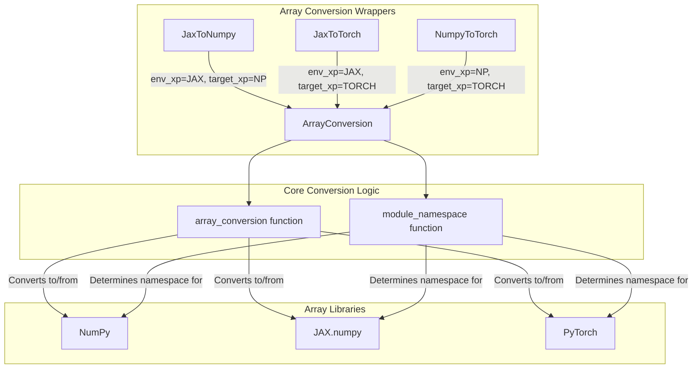

<!-- source: DeepWiki mcp.deepwiki.com · repo Farama-Foundation/Gymnasium · extra page Array Conversion Wrappers (Jax/Torch/NumPy) · fetched 2026-10-14 -->

# Array Conversion Wrappers (Jax/Torch/NumPy)

<details>
<summary>Relevant source files</summary>

The following files were used as context for generating this wiki page:

- [docs/api/vector/wrappers.md](docs/api/vector/wrappers.md)
- [gymnasium/wrappers/array_conversion.py](gymnasium/wrappers/array_conversion.py)
- [gymnasium/wrappers/jax_to_numpy.py](gymnasium/wrappers/jax_to_numpy.py)
- [gymnasium/wrappers/jax_to_torch.py](gymnasium/wrappers/jax_to_torch.py)
- [gymnasium/wrappers/numpy_to_torch.py](gymnasium/wrappers/numpy_to_torch.py)
- [gymnasium/wrappers/vector/jax_to_numpy.py](gymnasium/wrappers/vector/jax_to_numpy.py)
- [gymnasium/wrappers/vector/numpy_to_torch.py](gymnasium/wrappers/vector/numpy_to_torch.py)
- [tests/wrappers/test_array_conversion.py](tests/wrappers/test_array_conversion.py)
- [tests/wrappers/test_jax_to_numpy.py](tests/wrappers/test_jax_to_numpy.py)
- [tests/wrappers/test_jax_to_torch.py](tests/wrappers/test_jax_to_torch.py)
- [tests/wrappers/test_numpy_to_torch.py](tests/wrappers/test_numpy_to_torch.py)
- [tests/wrappers/test_record_constructor_args.py](tests/wrappers/test_record_constructor_args.py)
- [tests/wrappers/vector/test_array_conversion.py](tests/wrappers/vector/test_array_conversion.py)

</details>


This page documents Gymnasium's array conversion wrappers, which facilitate interoperability between environments implemented using different array manipulation libraries like NumPy, JAX, and PyTorch. These wrappers allow users to interact with an environment using their preferred array type, regardless of the environment's native implementation. The core of this functionality is provided by the generic `ArrayConversion` wrapper, with specialized wrappers like `JaxToNumpy`, `JaxToTorch`, and `NumpyToTorch` offering convenient interfaces for common conversions.

## The `ArrayConversion` Wrapper

The `ArrayConversion` wrapper [gymnasium/wrappers/array_conversion.py:48-292]() is a generic wrapper designed to convert array inputs and outputs between any two Array API compatible frameworks. This is achieved using the `array-api-compat` package, which provides a compatibility layer for various array libraries.

### Implementation Details

The `ArrayConversion` class [gymnasium/wrappers/array_conversion.py:48-292]() inherits from `gymnasium.Wrapper`. Its constructor takes three key arguments:
- `env`: The environment to wrap.
- `env_xp`: The array module (e.g., `numpy`, `jax.numpy`, `torch`) that the wrapped environment natively uses for its arrays.
- `target_xp`: The desired array module for interaction with the wrapped environment.
- `target_device`: An optional device specification (e.g., `"cpu"`, `"cuda:0"`) for the target array module.

The wrapper overrides the `reset()` and `step()` methods of the `gym.Env` class to perform the necessary conversions.

#### Data Flow

When `reset()` [gymnasium/wrappers/array_conversion.py:200-204]() or `step()` [gymnasium/wrappers/array_conversion.py:210-220]() is called on an `ArrayConversion` wrapped environment:
1. **Action Conversion (for `step`)**: The incoming `action` (which is in `target_xp` format) is converted to `env_xp` format using `array_conversion(action, xp=self._env_xp)` [gymnasium/wrappers/array_conversion.py:212]().
2. **Environment Interaction**: The converted action is passed to the underlying environment's `step()` method.
3. **Observation/Reward/Termination/Truncation/Info Conversion**: The outputs from the underlying environment (`observation`, `reward`, `terminated`, `truncated`, `info`) (which are in `env_xp` format) are then converted to `target_xp` format using `array_conversion(value, xp=self._target_xp, device=self._target_device)` [gymnasium/wrappers/array_conversion.py:215-219]().

The `render()` method [gymnasium/wrappers/array_conversion.py:222-225]() also uses `array_conversion` to ensure that rendered frames are returned in the `target_xp` format, unless the output is `None`.

#### The `array_conversion` Function

The core conversion logic resides in the `array_conversion` singledispatch function [gymnasium/wrappers/array_conversion.py:73-76](). This function is responsible for converting various data types (numbers, mappings, iterables, and Array API compatible objects) to the specified target array module (`xp`) and device.

- **Numbers**: Python numbers are converted to arrays of the target `xp` module [gymnasium/wrappers/array_conversion.py:80-85]().
- **Mappings (Dictionaries)**: Dictionaries are recursively processed, converting their values [gymnasium/wrappers/array_conversion.py:88-93]().
- **Iterables (Tuples, Lists)**: Iterables are recursively processed, converting their elements. Special handling is included for `namedtuple` [gymnasium/wrappers/array_conversion.py:96-111]().
- **Array API Objects**: Array API compatible objects are converted using `xp.from_dlpack()` [gymnasium/wrappers/array_conversion.py:114-146](). This function handles potential issues with device placement and read-only buffers.
- **None**: `None` values are passed through without conversion [gymnasium/wrappers/array_conversion.py:148-153]().

#### `module_namespace` Utility

The `module_namespace` function [gymnasium/wrappers/array_conversion.py:60-66]() determines the Array API compatible namespace of a given module. This is crucial for ensuring that the correct array functions (e.g., `asarray`, `from_dlpack`) are used for conversion.

```mermaid
graph TD
    subgraph "Gymnasium Environment Interaction"
        A[User calls env.step(action_target_xp)] --> B{ArrayConversion Wrapper};
        B -- "action (target_xp)" --> C[array_conversion(action, env_xp)];
        C -- "action (env_xp)" --> D[Underlying env.step(action_env_xp)];
        D -- "obs, rew, term, trunc, info (env_xp)" --> E[array_conversion(outputs, target_xp, target_device)];
        E -- "obs, rew, term, trunc, info (target_xp)" --> F[Return to User];
    end

    subgraph "array_conversion Function (Singledispatch)"
        G[Input Value] --> H{Type of Value?};
        H -- "Number" --> I[xp.asarray(value)];
        H -- "Mapping" --> J[Recursively convert values];
        H -- "Iterable" --> K[Recursively convert elements];
        H -- "Array API Object" --> L[xp.from_dlpack(value) + to_device];
        H -- "None" --> M[Return None];
        I --> N[Converted Value];
        J --> N;
        K --> N;
        L --> N;
        M --> N;
    end

    B -- "Uses" --> G;
    E -- "Uses" --> G;
```
**Diagram: Array Conversion Wrapper Data Flow**
Sources: [gymnasium/wrappers/array_conversion.py:73-76](), [gymnasium/wrappers/array_conversion.py:80-85](), [gymnasium/wrappers/array_conversion.py:88-93](), [gymnasium/wrappers/array_conversion.py:96-111](), [gymnasium/wrappers/array_conversion.py:114-146](), [gymnasium/wrappers/array_conversion.py:148-153](), [gymnasium/wrappers/array_conversion.py:200-204](), [gymnasium/wrappers/array_conversion.py:210-220]()

## Specialized Array Conversion Wrappers

Gymnasium provides specialized wrappers built on top of `ArrayConversion` for common conversions between JAX, NumPy, and PyTorch. These wrappers simplify usage by pre-configuring the `env_xp` and `target_xp` arguments.

### `JaxToNumpy`

The `JaxToNumpy` wrapper [gymnasium/wrappers/jax_to_numpy.py:33-79]() converts a JAX-based environment to interact with NumPy arrays.

- **Input**: Actions are expected as NumPy arrays.
- **Output**: Observations, rewards, terminations, and truncations are returned as NumPy arrays.
- **Constructor**: `JaxToNumpy(env: gym.Env)` [gymnasium/wrappers/jax_to_numpy.py:65-79](). It automatically sets `env_xp=jnp` and `target_xp=np`.
- **Note**: JAX does not support non-array values, so a roundtrip (JAX -> NumPy -> JAX) might not preserve exact types for scalar values (e.g., `int_32(5)` becomes `DeviceArray([5], dtype=jnp.int32)`). [gymnasium/wrappers/jax_to_numpy.py:39-42]()

**Example Usage**:
```python
import gymnasium as gym
from gymnasium.wrappers import JaxToNumpy
# env = gym.make("JaxEnv-vx") # Assuming a JAX-based environment
# env = JaxToNumpy(env)
# obs, _ = env.reset(seed=123)
# type(obs) # <class 'numpy.ndarray'>
```
Sources: [gymnasium/wrappers/jax_to_numpy.py:33-79](), [gymnasium/wrappers/jax_to_numpy.py:39-42](), [gymnasium/wrappers/jax_to_numpy.py:44-59](), [gymnasium/wrappers/jax_to_numpy.py:65-79]()

### `JaxToTorch`

The `JaxToTorch` wrapper [gymnasium/wrappers/jax_to_torch.py:49-93]() converts a JAX-based environment to interact with PyTorch Tensors.

- **Input**: Actions are expected as PyTorch Tensors.
- **Output**: Observations, rewards, terminations, and truncations are returned as PyTorch Tensors.
- **Constructor**: `JaxToTorch(env: gym.Env, device: Device | None = None)` [gymnasium/wrappers/jax_to_torch.py:81-93](). It sets `env_xp=jnp` and `target_xp=torch`. An optional `device` argument allows specifying the PyTorch device.
- **Note**: Rendered frames are returned as NumPy arrays, not PyTorch Tensors. [gymnasium/wrappers/jax_to_torch.py:56-57]()

**Example Usage**:
```python
import torch
import gymnasium as gym
from gymnasium.wrappers import JaxToTorch
# env = gym.make("JaxEnv-vx") # Assuming a JAX-based environment
# env = JaxToTorch(env)
# obs, _ = env.reset(seed=123)
# type(obs) # <class 'torch.Tensor'>
```
Sources: [gymnasium/wrappers/jax_to_torch.py:49-93](), [gymnasium/wrappers/jax_to_torch.py:56-57](), [gymnasium/wrappers/jax_to_torch.py:59-75](), [gymnasium/wrappers/jax_to_torch.py:81-93]()

### `NumpyToTorch`

The `NumpyToTorch` wrapper [gymnasium/wrappers/numpy_to_torch.py:35-77]() converts a NumPy-based environment to interact with PyTorch Tensors.

- **Input**: Actions are expected as PyTorch Tensors.
- **Output**: Observations, rewards, terminations, and truncations are returned as PyTorch Tensors.
- **Constructor**: `NumpyToTorch(env: gym.Env, device: Device | None = None)` [gymnasium/wrappers/numpy_to_torch.py:67-76](). It sets `env_xp=np` and `target_xp=torch`. An optional `device` argument allows specifying the PyTorch device.
- **Note**: Rendered frames are returned as NumPy arrays, not PyTorch Tensors. [gymnasium/wrappers/numpy_to_torch.py:41-42]()

**Example Usage**:
```python
import torch
import gymnasium as gym
from gymnasium.wrappers import NumpyToTorch
env = gym.make("CartPole-v1")
env = NumpyToTorch(env)
obs, _ = env.reset(seed=123)
# type(obs) # <class 'torch.Tensor'>
```
Sources: [gymnasium/wrappers/numpy_to_torch.py:35-77](), [gymnasium/wrappers/numpy_to_torch.py:41-42](), [gymnasium/wrappers/numpy_to_torch.py:44-60](), [gymnasium/wrappers/numpy_to_torch.py:67-76]()

## Vectorized Array Conversion Wrappers

Similar array conversion wrappers are available for `VectorEnv` instances, located in `gymnasium.wrappers.vector`. These include `gymnasium.wrappers.vector.JaxToNumpy` [gymnasium/wrappers/vector/jax_to_numpy.py:15-39]() and `gymnasium.wrappers.vector.NumpyToTorch` [gymnasium/wrappers/vector/numpy_to_torch.py:15-49](). They function identically to their single-environment counterparts but operate on batched observations and actions.

## Roundtripping and Type Preservation

The conversion functions aim to preserve data equivalence during roundtrips (e.g., NumPy -> JAX -> NumPy). However, due to differences in how frameworks handle data types (e.g., JAX's strict array-only policy, or precision differences), perfect type preservation is not always guaranteed, especially for scalar values or specific precision levels. The `test_roundtripping` functions in the test suite [tests/wrappers/test_jax_to_torch.py:103-106](), [tests/wrappers/test_jax_to_numpy.py:80-87](), [tests/wrappers/test_numpy_to_torch.py:81-84]() verify the equivalence of data after a roundtrip.


**Diagram: Array Conversion Wrapper System Overview**
Sources: [gymnasium/wrappers/array_conversion.py:48-292](), [gymnasium/wrappers/array_conversion.py:60-66](), [gymnasium/wrappers/array_conversion.py:73-76](), [gymnasium/wrappers/jax_to_numpy.py:33-79](), [gymnasium/wrappers/jax_to_torch.py:49-93](), [gymnasium/wrappers/numpy_to_torch.py:35-77]()

---

