<!-- source: DeepWiki mcp.deepwiki.com · repo Farama-Foundation/Gymnasium · extra page MuJoCo v5 and v4 Environment Implementations · fetched 2026-10-14 -->

# MuJoCo v5 and v4 Environment Implementations

<details>
<summary>Relevant source files</summary>

The following files were used as context for generating this wiki page:

- [gymnasium/envs/mujoco/ant_v4.py](gymnasium/envs/mujoco/ant_v4.py)
- [gymnasium/envs/mujoco/ant_v5.py](gymnasium/envs/mujoco/ant_v5.py)
- [gymnasium/envs/mujoco/assets/hopper.xml](gymnasium/envs/mujoco/assets/hopper.xml)
- [gymnasium/envs/mujoco/assets/walker2d.xml](gymnasium/envs/mujoco/assets/walker2d.xml)
- [gymnasium/envs/mujoco/half_cheetah_v4.py](gymnasium/envs/mujoco/half_cheetah_v4.py)
- [gymnasium/envs/mujoco/half_cheetah_v5.py](gymnasium/envs/mujoco/half_cheetah_v5.py)
- [gymnasium/envs/mujoco/hopper_v4.py](gymnasium/envs/mujoco/hopper_v4.py)
- [gymnasium/envs/mujoco/hopper_v5.py](gymnasium/envs/mujoco/hopper_v5.py)
- [gymnasium/envs/mujoco/humanoid_v4.py](gymnasium/envs/mujoco/humanoid_v4.py)
- [gymnasium/envs/mujoco/humanoid_v5.py](gymnasium/envs/mujoco/humanoid_v5.py)
- [gymnasium/envs/mujoco/humanoidstandup_v4.py](gymnasium/envs/mujoco/humanoidstandup_v4.py)
- [gymnasium/envs/mujoco/humanoidstandup_v5.py](gymnasium/envs/mujoco/humanoidstandup_v5.py)
- [gymnasium/envs/mujoco/inverted_double_pendulum_v4.py](gymnasium/envs/mujoco/inverted_double_pendulum_v4.py)
- [gymnasium/envs/mujoco/inverted_double_pendulum_v5.py](gymnasium/envs/mujoco/inverted_double_pendulum_v5.py)
- [gymnasium/envs/mujoco/inverted_pendulum_v4.py](gymnasium/envs/mujoco/inverted_pendulum_v4.py)
- [gymnasium/envs/mujoco/inverted_pendulum_v5.py](gymnasium/envs/mujoco/inverted_pendulum_v5.py)
- [gymnasium/envs/mujoco/pusher_v4.py](gymnasium/envs/mujoco/pusher_v4.py)
- [gymnasium/envs/mujoco/pusher_v5.py](gymnasium/envs/mujoco/pusher_v5.py)
- [gymnasium/envs/mujoco/reacher_v4.py](gymnasium/envs/mujoco/reacher_v4.py)
- [gymnasium/envs/mujoco/reacher_v5.py](gymnasium/envs/mujoco/reacher_v5.py)
- [gymnasium/envs/mujoco/swimmer_v4.py](gymnasium/envs/mujoco/swimmer_v4.py)
- [gymnasium/envs/mujoco/swimmer_v5.py](gymnasium/envs/mujoco/swimmer_v5.py)
- [gymnasium/envs/mujoco/walker2d_v4.py](gymnasium/envs/mujoco/walker2d_v4.py)
- [gymnasium/envs/mujoco/walker2d_v5.py](gymnasium/envs/mujoco/walker2d_v5.py)

</details>


This page provides detailed documentation for the specific MuJoCo environments available in Gymnasium, focusing on their v4 and v5 implementations. It covers the Ant, Humanoid, Walker2d, Hopper, HalfCheetah, Swimmer, Reacher, Pusher, Inverted Pendulum, and Inverted Double Pendulum environments, highlighting their action and observation spaces, reward functions, starting states, episode termination/truncation conditions, and the XML assets that define their physical models.

## Ant

The Ant environment simulates a 3D quadruped robot. The goal is to make the ant move forward as fast as possible.

### Ant-v5

The `AntEnv` class in v5 is defined in [gymnasium/envs/mujoco/ant_v5.py]().
The Ant robot consists of a torso with four legs, each having two body parts. Torque is applied to eight hinge joints.

#### Action Space (Ant-v5)
The action space is a `Box(-1, 1, (8,), float32)`. Each element represents torque applied to a specific hinge joint.
| Num | Action | Control Min | Control Max | Name (in corresponding XML file) | Joint | Type (Unit) |
|---|---|---|---|---|---|---|
| 0 | Torque applied on the rotor between the torso and back right hip | -1 | 1 | hip_4 (right_back_leg) | hinge | torque (N m) |
| 1 | Torque applied on the rotor between the back right two links | -1 | 1 | angle_4 (right_back_leg) | hinge | torque (N m) |
| 2 | Torque applied on the rotor between the torso and front left hip | -1 | 1 | hip_1 (front_left_leg) | hinge | torque (N m) |
| 3 | Torque applied on the rotor between the front left two links | -1 | 1 | angle_1 (front_left_leg) | hinge | torque (N m) |
| 4 | Torque applied on the rotor between the torso and front right hip | -1 | 1 | hip_2 (front_right_leg) | hinge | torque (N m) |
| 5 | Torque applied on the rotor between the front right two links | -1 | 1 | angle_2 (front_right_leg) | hinge | torque (N m) |
| 6 | Torque applied on the rotor between the torso and back left hip | -1 | 1 | hip_3 (back_leg) | hinge | torque (N m) |
| 7 | Torque applied on the rotor between the back left two links | -1 | 1 | angle_3 (back_leg) | hinge | torque (N m) |
Sources: [gymnasium/envs/mujoco/ant_v5.py:23-39]()

#### Observation Space (Ant-v5)
The observation space is a `Box(-Inf, Inf, (105,), float64)` by default, excluding the x and y coordinates of the torso. If `exclude_current_positions_from_observation=False`, the space is `Box(-Inf, Inf, (107,), float64)`. It includes:
- `qpos` (13 elements): Position values of body parts.
- `qvel` (14 elements): Velocities of body parts.
- `cfrc_ext` (78 elements): Center of mass based external forces.
Sources: [gymnasium/envs/mujoco/ant_v5.py:42-56]()

#### Rewards (Ant-v5)
The total reward is `forward_reward - ctrl_cost - contact_cost + healthy_reward`.
- `forward_reward`: $w_{forward} \times \frac{dx}{dt}$ where $w_{forward}$ is `forward_reward_weight` (default 1).
- `ctrl_cost`: $w_{control} \times \|action\|_2^2$ where $w_{control}$ is `ctrl_cost_weight` (default 0.5).
- `contact_cost`: $w_{contact} \times \sum (contact\_forces)^2$ where $w_{contact}$ is `contact_cost_weight` (default 5e-4).
- `healthy_reward`: Fixed value `healthy_reward` (default 1.0) if the ant is healthy.
Sources: [gymnasium/envs/mujoco/ant_v5.py:159-160]()

#### Starting State (Ant-v5)
Initial `qpos` and `qvel` are sampled from uniform and normal distributions respectively, with noise scaled by `reset_noise_scale` (default 0.1).
Sources: [gymnasium/envs/mujoco/ant_v5.py:200-206]()

#### Episode End (Ant-v5)
- **Termination**: The environment terminates if the ant is unhealthy. An ant is unhealthy if its z-coordinate is outside `healthy_z_range` (default `(0.2, 1.0)`) or if any observation element is non-finite.
- **Truncation**: The default duration is 1000 timesteps.
Sources: [gymnasium/envs/mujoco/ant_v5.py:170-171]()

### Ant-v4

The `AntEnv` class in v4 is defined in [gymnasium/envs/mujoco/ant_v4.py]().
The v4 implementation is largely similar to v5, with some differences in observation space size and reward calculation.

#### Action Space (Ant-v4)
The action space is identical to v5: `Box(-1, 1, (8,), float32)`.
Sources: [gymnasium/envs/mujoco/ant_v4.py:23-39]() (similar structure, not shown in full)

#### Observation Space (Ant-v4)
The observation space is `Box(-Inf, Inf, (27,), float64)` by default. If `exclude_current_positions_from_observation=False`, it's `(29,)`. If `use_contact_forces=True`, it adds 84 elements.
Sources: [gymnasium/envs/mujoco/ant_v4.py:69-77]()

#### Rewards (Ant-v4)
The total reward is `forward_reward + healthy_reward - ctrl_cost - contact_cost`.
- `forward_reward`: $x\_velocity$.
- `healthy_reward`: Fixed value `healthy_reward` (default 1.0) if the ant is healthy.
- `ctrl_cost`: `_ctrl_cost_weight * np.sum(np.square(action))` (default `_ctrl_cost_weight` is 0.5).
- `contact_cost`: `_contact_cost_weight * np.sum(np.square(self.contact_forces))` (default `_contact_cost_weight` is 5e-4).
Sources: [gymnasium/envs/mujoco/ant_v4.py:133-138](), [gymnasium/envs/mujoco/ant_v4.py:153-158]()

#### Starting State (Ant-v4)
Initial `qpos` and `qvel` are sampled with noise scaled by `reset_noise_scale` (default 0.1).
Sources: [gymnasium/envs/mujoco/ant_v4.py:182-188]()

#### Episode End (Ant-v4)
- **Termination**: The environment terminates if the ant is unhealthy. An ant is unhealthy if its z-coordinate is outside `healthy_z_range` (default `(0.2, 1.0)`) or if any state element is non-finite.
- **Truncation**: The time limit is handled by a `TimeLimit` wrapper.
Sources: [gymnasium/envs/mujoco/ant_v4.py:114-117](), [gymnasium/envs/mujoco/ant_v4.py:122-123]()

### XML Asset
The Ant environment uses `ant.xml` for its physical model.
Sources: [gymnasium/envs/mujoco/ant_v4.py:25](), [gymnasium/envs/mujoco/ant_v5.py:18]()

## Humanoid

The Humanoid environment simulates a 3D bipedal robot. The goal is to walk forward as fast as possible without falling over.

### Humanoid-v5

The `HumanoidEnv` class in v5 is defined in [gymnasium/envs/mujoco/humanoid_v5.py]().

#### Action Space (Humanoid-v5)
The action space is a `Box(-0.4, 0.4, (17,), float32)`. Actions represent torques applied at hinge joints.
| Num | Action | Control Min | Control Max | Name (in corresponding XML file) | Joint | Type (Unit) |
|---|---|---|---|---|---|---|
| 0 | Torque applied on the hinge in the y-coordinate of the abdomen | -0.4 | 0.4 | abdomen_y | hinge | torque (N m) |
| ... | ... | ... | ... | ... | ... | ... |
| 16 | Torque applied on the rotor between the left upper arm and left lower arm | -0.4 | 0.4 | left_elbow | hinge | torque (N m) |
Sources: [gymnasium/envs/mujoco/humanoid_v5.py:34-59]()

#### Observation Space (Humanoid-v5)
The observation space is a `Box(-Inf, Inf, (348,), float64)` by default, excluding the x and y coordinates of the torso. If `exclude_current_positions_from_observation=False`, the space is `Box(-Inf, Inf, (350,), float64)`. It includes:
- `qpos` (22 elements): Position values.
- `qvel` (23 elements): Velocities.
- `cinert` (130 elements): Mass and inertia.
- `cvel` (78 elements): Center of mass based velocity.
- `qfrc_actuator` (17 elements): Actuator forces.
- `cfrc_ext` (78 elements): External forces.
Sources: [gymnasium/envs/mujoco/humanoid_v5.py:62-81]()

#### Rewards (Humanoid-v5)
The total reward is `forward_reward + healthy_reward - ctrl_cost - contact_cost`.
- `forward_reward`: $w_{forward} \times x\_velocity$ where $w_{forward}$ is `forward_reward_weight` (default 1.25).
- `healthy_reward`: Fixed value `healthy_reward` (default 5.0) if the humanoid is healthy.
- `ctrl_cost`: $w_{control} \times \|action\|_2^2$ where $w_{control}$ is `ctrl_cost_weight` (default 0.1).
- `contact_cost`: $w_{contact} \times \sum (contact\_forces)^2$ where $w_{contact}$ is `contact_cost_weight` (default 5e-4).
Sources: [gymnasium/envs/mujoco/humanoid_v5.py:160-161]()

#### Starting State (Humanoid-v5)
Initial `qpos` and `qvel` are sampled with noise scaled by `reset_noise_scale` (default 0.01).
Sources: [gymnasium/envs/mujoco/humanoid_v5.py:201-207]()

#### Episode End (Humanoid-v5)
- **Termination**: The environment terminates if the humanoid is unhealthy. An unhealthy humanoid has its z-coordinate outside `healthy_z_range` (default `(1.0, 2.0)`) or if any observation element is non-finite.
- **Truncation**: The default duration is 1000 timesteps.
Sources: [gymnasium/envs/mujoco/humanoid_v5.py:171-172]()

### Humanoid-v4

The `HumanoidEnv` class in v4 is defined in [gymnasium/envs/mujoco/humanoid_v4.py]().

#### Action Space (Humanoid-v4)
The action space is identical to v5: `Box(-0.4, 0.4, (17,), float32)`.
Sources: [gymnasium/envs/mujoco/humanoid_v4.py:34-59]() (similar structure, not shown in full)

#### Observation Space (Humanoid-v4)
The observation space is `Box(-Inf, Inf, (376,), float64)` by default. If `exclude_current_positions_from_observation=False`, it's `(378,)`. It includes:
- `qpos` (22 elements): Position values.
- `qvel` (23 elements): Velocities.
- `cinert` (130 elements): Mass and inertia.
- `cvel` (78 elements): Center of mass based velocity.
- `qfrc_actuator` (17 elements): Actuator forces.
- `cfrc_ext` (78 elements): External forces.
Sources: [gymnasium/envs/mujoco/humanoid_v4.py:68-75](), [gymnasium/envs/mujoco/humanoid_v4.py:110-131]()

#### Rewards (Humanoid-v4)
The total reward is `forward_reward + healthy_reward - ctrl_cost`.
- `forward_reward`: `_forward_reward_weight * x_velocity` (default `_forward_reward_weight` is 1.25).
- `healthy_reward`: Fixed value `healthy_reward` (default 5.0) if the humanoid is healthy.
- `ctrl_cost`: `_ctrl_cost_weight * np.sum(np.square(self.data.ctrl))` (default `_ctrl_cost_weight` is 0.1).
Sources: [gymnasium/envs/mujoco/humanoid_v4.py:143-145](), [gymnasium/envs/mujoco/humanoid_v4.py:149]()

#### Starting State (Humanoid-v4)
Initial `qpos` and `qvel` are sampled with noise scaled by `reset_noise_scale` (default 0.01).
Sources: [gymnasium/envs/mujoco/humanoid_v4.py:168-177]()

#### Episode End (Humanoid-v4)
- **Termination**: The environment terminates if the humanoid is unhealthy. An unhealthy humanoid has its z-coordinate outside `healthy_z_range` (default `(1.0, 2.0)`).
- **Truncation**: The time limit is handled by a `TimeLimit` wrapper.
Sources: [gymnasium/envs/mujoco/humanoid_v4.py:98-100](), [gymnasium/envs/mujoco/humanoid_v4.py:105-106]()

### XML Asset
The Humanoid environment uses `humanoid.xml` for its physical model.
Sources: [gymnasium/envs/mujoco/humanoid_v4.py:79](), [gymnasium/envs/mujoco/humanoid_v5.py:150]()

## HumanoidStandup

The HumanoidStandup environment is similar to Humanoid, but the goal is to stand up from a lying position and maintain balance.

### HumanoidStandup-v5

The `HumanoidStandupEnv` class in v5 is defined in [gymnasium/envs/mujoco/humanoidstandup_v5.py]().

#### Action Space (HumanoidStandup-v5)
The action space is identical to Humanoid-v5: `Box(-0.4, 0.4, (17,), float32)`.
Sources: [gymnasium/envs/mujoco/humanoidstandup_v5.py:31-52]()

#### Observation Space (HumanoidStandup-v5)
The observation space is identical to Humanoid-v5: `Box(-Inf, Inf, (348,), float64)` by default.
Sources: [gymnasium/envs/mujoco/humanoidstandup_v5.py:55-81]()

#### Rewards (HumanoidStandup-v5)
The total reward is `standing_reward + healthy_reward - ctrl_cost - contact_cost`.
- `standing_reward`: $w_{standing} \times (z\_position - z_{target})$ where $w_{standing}$ is `standing_reward_weight` (default 5.0) and $z_{target}$ is `target_z_position` (default 1.2).
- `healthy_reward`: Fixed value `healthy_reward` (default 1.0) if the humanoid is healthy.
- `ctrl_cost`: $w_{control} \times \|action\|_2^2$ where $w_{control}$ is `ctrl_cost_weight` (default 0.1).
- `contact_cost`: $w_{contact} \times \sum (contact\_forces)^2$ where $w_{contact}$ is `contact_cost_weight` (default 5e-4).
Sources: [gymnasium/envs/mujoco/humanoidstandup_v5.py:159-160]()

#### Starting State (HumanoidStandup-v5)
Initial `qpos` and `qvel` are sampled with noise scaled by `reset_noise_scale` (default 0.01). The initial `qpos` is set to a lying position.
Sources: [gymnasium/envs/mujoco/humanoidstandup_v5.py:200-206]()

#### Episode End (HumanoidStandup-v5)
- **Termination**: The environment terminates if the humanoid is unhealthy. An unhealthy humanoid has its z-coordinate outside `healthy_z_range` (default `(1.0, 2.0)`) or if any observation element is non-finite.
- **Truncation**: The default duration is 1000 timesteps.
Sources: [gymnasium/envs/mujoco/humanoidstandup_v5.py:170-171]()

### HumanoidStandup-v4

The `HumanoidStandupEnv` class in v4 is defined in `gymnasium/envs/mujoco/humanoidstandup_v4.py`.

#### Action Space (HumanoidStandup-v4)
The action space is identical to v5: `Box(-0.4, 0.4, (17,), float32)`.

#### Observation Space (HumanoidStandup-v4)
The observation space is `Box(-Inf, Inf, (376,), float64)` by default. If `exclude_current_positions_from_observation=False`, it's `(378,)`. It includes:
- `qpos` (22 elements): Position values.
- `qvel` (23 elements): Velocities.
- `cinert` (130 elements): Mass and inertia.
- `cvel` (78 elements): Center of mass based velocity.
- `qfrc_actuator` (17 elements): Actuator forces.
- `cfrc_ext` (78 elements): External forces.

#### Rewards (HumanoidStandup-v4)
The total reward is `standing_reward + healthy_reward - ctrl_cost`.
- `standing_reward`: `_standing_reward_weight * (z_position - _target_z_position)` (default `_standing_reward_weight` is 5.0, `_target_z_position` is 1.2).
- `healthy_reward`: Fixed value `healthy_reward` (default 1.0) if the humanoid is healthy.
- `ctrl_cost`: `_ctrl_cost_weight * np.sum(np.square(self.data.ctrl))` (default `_ctrl_cost_weight` is 0.1).

#### Starting State (HumanoidStandup-v4)
Initial `qpos` and `qvel` are sampled with noise scaled by `reset_noise_scale` (default 0.01). The initial `qpos` is set to a lying position.

#### Episode End (HumanoidStandup-v4)
- **Termination**: The environment terminates if the humanoid is unhealthy. An unhealthy humanoid has its z-coordinate outside `healthy_z_range` (default `(1.0, 2.0)`).
- **Truncation**: The time limit is handled by a `TimeLimit` wrapper.

### XML Asset
The HumanoidStandup environment uses `humanoid.xml` for its physical model.

## Walker2d

The Walker2d environment simulates a 2D bipedal robot. The goal is to walk forward.

### Walker2d-v5

The `Walker2dEnv` class in v5 is defined in [gymnasium/envs/mujoco/walker2d_v5.py]().

#### Action Space (Walker2d-v5)
The action space is a `Box(-1, 1, (6,), float32)`. Actions represent torques applied at hinge joints.
| Num | Action | Control Min | Control Max | Name (in corresponding XML file) | Joint | Type (Unit) |
|---|---|---|---|---|---|---|
| 0 | Torque applied on the thigh rotor | -1 | 1 | thigh_joint | hinge | torque (N m) |
| ... | ... | ... | ... | ... | ... | ... |
| 5 | Torque applied on the left foot rotor | -1 | 1 | foot_left_joint | hinge | torque (N m) |
Sources: [gymnasium/envs/mujoco/walker2d_v5.py:31-40]()

#### Observation Space (Walker2d-v5)
The observation space is a `Box(-Inf, Inf, (17,), float64)` by default, excluding the x-coordinate. If `exclude_current_positions_from_observation=False`, the space is `Box(-Inf, Inf, (18,), float64)`. It includes:
- `qpos` (8 elements): Position values.
- `qvel` (9 elements): Velocities.
Sources: [gymnasium/envs/mujoco/walker2d_v5.py:43-54]()

#### Rewards (Walker2d-v5)
The total reward is `healthy_reward + forward_reward - ctrl_cost`.
- `healthy_reward`: Fixed value `healthy_reward` (default 1.0) if the walker is healthy.
- `forward_reward`: $w_{forward} \times \frac{dx}{dt}$ where $w_{forward}$ is `forward_reward_weight` (default 1).
- `ctrl_cost`: $w_{control} \times \|action\|_2^2$ where $w_{control}$ is `ctrl_cost_weight` (default 1e-3).
Sources: [gymnasium/envs/mujoco/walker2d_v5.py:79-91]()

#### Starting State (Walker2d-v5)
Initial `qpos` and `qvel` are sampled from uniform and normal distributions respectively, with noise scaled by `reset_noise_scale` (default 0.005).
Sources: [gymnasium/envs/mujoco/walker2d_v5.py:120-126]()

#### Episode End (Walker2d-v5)
- **Termination**: The environment terminates if the walker is unhealthy. An unhealthy walker has its z-coordinate outside `healthy_z_range` (default `(0.8, 2.0)`) or its angle outside `healthy_angle_range` (default `(-1.0, 1.0)`) or if any observation element is non-finite.
- **Truncation**: The default duration is 1000 timesteps.
Sources: [gymnasium/envs/mujoco/walker2d_v5.py:109-110]()

### Walker2d-v4

The `Walker2dEnv` class in v4 is defined in `gymnasium/envs/mujoco/walker2d_v4.py`.

#### Action Space (Walker2d-v4)
The action space is identical to v5: `Box(-1, 1, (6,), float32)`.

#### Observation Space (Walker2d-v4)
The observation space is `Box(-Inf, Inf, (17,), float64)` by default. If `exclude_current_positions_from_observation=False`, it's `(18,)`. It includes:
- `qpos` (8 elements): Position values.
- `qvel` (9 elements): Velocities.

#### Rewards (Walker2d-v4)
The total reward is `healthy_reward + forward_reward - ctrl_cost`.
- `healthy_reward`: Fixed value `healthy_reward` (default 1.0) if the walker is healthy.
- `forward_reward`: `_forward_reward_weight * x_velocity` (default `_forward_reward_weight` is 1).
- `ctrl_cost`: `_ctrl_cost_weight * np.sum(np.square(action))` (default `_ctrl_cost_weight` is 1e-3).

#### Starting State (Walker2d-v4)
Initial `qpos` and `qvel` are sampled with noise scaled by `reset_noise_scale` (default 0.005).

#### Episode End (Walker2d-v4)
- **Termination**: The environment terminates if the walker is unhealthy. An unhealthy walker has its z-coordinate outside `healthy_z_range` (default `(0.8, 2.0)`) or its angle outside `healthy_angle_range` (default `(-1.0, 1.0)`).
- **Truncation**: The time limit is handled by a `TimeLimit` wrapper.

### XML Asset
The Walker2d environment uses `walker2d.xml` for its physical model.
Sources: [gymnasium/envs/mujoco/assets/walker2d.xml]()

## Hopper

The Hopper environment simulates a 2D one-legged figure. The goal is to make hops that move in the forward direction.

### Hopper-v5

The `HopperEnv` class in v5 is defined in [gymnasium/envs/mujoco/hopper_v5.py]().

#### Action Space (Hopper-v5)
The action space is a `Box(-1, 1, (3,), float32)`. Actions represent torques applied at hinge joints.
| Num | Action | Control Min | Control Max | Name (in corresponding XML file) | Joint | Type (Unit) |
|---|---|---|---|---|---|---|
| 0 | Torque applied on the thigh rotor | -1 | 1 | thigh_joint | hinge | torque (N m) |
| 1 | Torque applied on the leg rotor | -1 | 1 | leg_joint | hinge | torque (N m) |
| 2 | Torque applied on the foot rotor | -1 | 1 | foot_joint | hinge | torque (N m) |
Sources: [gymnasium/envs/mujoco/hopper_v5.py:31-37]()

#### Observation Space (Hopper-v5)
The observation space is a `Box(-Inf, Inf, (11,), float64)` by default, excluding the x-coordinate. If `exclude_current_positions_from_observation=False`, the space is `Box(-Inf, Inf, (12,), float64)`. It includes:
- `qpos` (5 elements): Position values.
- `qvel` (6 elements): Velocities.
Sources: [gymnasium/envs/mujoco/hopper_v5.py:40-51]()

#### Rewards (Hopper-v5)
The total reward is `healthy_reward + forward_reward - ctrl_cost`.
- `healthy_reward`: Fixed value `healthy_reward` (default 1.0) if the hopper is healthy.
- `forward_reward`: $w_{forward} \times \frac{dx}{dt}$ where $w_{forward}$ is `forward_reward_weight` (default 1).
- `ctrl_cost`: $w_{control} \times \|action\|_2^2$ where $w_{control}$ is `ctrl_cost_weight` (default 1e-3).
Sources: [gymnasium/envs/mujoco/hopper_v5.py:70-86]()

#### Starting State (Hopper-v5)
Initial `qpos` is `[0, 1.25, 0, 0, 0, 0]` plus uniform noise. Initial `qvel` is uniform noise. Noise is scaled by `reset_noise_scale` (default 0.005).
Sources: [gymnasium/envs/mujoco/hopper_v5.py:92-95]()

#### Episode End (Hopper-v5)
- **Termination**: The environment terminates if the hopper is unhealthy. An unhealthy hopper has its z-coordinate outside `healthy_z_range` (default `(0.7, Inf)`) or its angle outside `healthy_angle_range` (default `(-0.2, 0.2)`) or if any observation element is outside `healthy_state_range` (default `[-100, 100]`) or if any observation element is non-finite.
- **Truncation**: The default duration is 1000 timesteps.
Sources: [gymnasium/envs/mujoco/hopper_v5.py:100-105]()

### Hopper-v4

The `HopperEnv` class in v4 is defined in `gymnasium/envs/mujoco/hopper_v4.py`.

#### Action Space (Hopper-v4)
The action space is identical to v5: `Box(-1, 1, (3,), float32)`.

#### Observation Space (Hopper-v4)
The observation space is `Box(-Inf, Inf, (11,), float64)` by default. If `exclude_current_positions_from_observation=False`, it's `(12,)`. It includes:
- `qpos` (5 elements): Position values.
- `qvel` (6 elements): Velocities.

#### Rewards (Hopper-v4)
The total reward is `healthy_reward + forward_reward - ctrl_cost`.
- `healthy_reward`: Fixed value `healthy_reward` (default 1.0) if the hopper is healthy.
- `forward_reward`: `_forward_reward_weight * x_velocity` (default `_forward_reward_weight` is 1).
- `ctrl_cost`: `_ctrl_cost_weight * np.sum(np.square(action))` (default `_ctrl_cost_weight` is 1e-3).

#### Starting State (Hopper-v4)
Initial `qpos` is `[0, 1.25, 0, 0, 0, 0]` plus uniform noise. Initial `qvel` is uniform noise. Noise is scaled by `reset_noise_scale` (default 0.005).

#### Episode End (Hopper-v4)
- **Termination**: The environment terminates if the hopper is unhealthy. An unhealthy hopper has its z-coordinate outside `healthy_z_range` (default `(0.7, Inf)`) or its angle outside `healthy_angle_range` (default `(-0.2, 0.2)`) or if any observation element is outside `healthy_state_range` (default `[-100, 100]`).
- **Truncation**: The time limit is handled by a `TimeLimit` wrapper.

### XML Asset
The Hopper environment uses `hopper.xml` for its physical model.
Sources: [gymnasium/envs/mujoco/assets/hopper.xml]()

## HalfCheetah

The HalfCheetah environment simulates a 2D robot. The goal is to run forward as fast as possible.

### HalfCheetah-v5

The `HalfCheetahEnv` class in v5 is defined in [gymnasium/envs/mujoco/half_cheetah_v5.py]().

#### Action Space (HalfCheetah-v5)
The action space is a `Box(-1, 1, (6,), float32)`. Actions represent torques applied at hinge joints.
| Num | Action | Control Min | Control Max | Name (in corresponding XML file) | Joint | Type (Unit) |
|---|---|---|---|---|---|---|
| 0 | Torque applied on the back thigh rotor | -1 | 1 | bthigh | hinge | torque (N m) |
| ... | ... | ... | ... | ... | ... | ... |
| 5 | Torque applied on the front foot rotor | -1 | 1 | ffoot | hinge | torque (N m) |
Sources: [gymnasium/envs/mujoco/half_cheetah_v5.py:28-37]()

#### Observation Space (HalfCheetah-v5)
The observation space is a `Box(-Inf, Inf, (17,), float64)` by default, excluding the x-coordinate. If `exclude_current_positions_from_observation=False`, the space is `Box(-Inf, Inf, (18,), float64)`. It includes:
- `qpos` (8 elements): Position values.
- `qvel` (9 elements): Velocities.
Sources: [gymnasium/envs/mujoco/half_cheetah_v5.py:40-51]()

#### Rewards (HalfCheetah-v5)
The total reward is `forward_reward - ctrl_cost`.
- `forward_reward`: $w_{forward} \times \frac{dx}{dt}$ where $w_{forward}$ is `forward_reward_weight` (default 1).
- `ctrl_cost`: $w_{control} \times \|action\|_2^2$ where $w_{control}$ is `ctrl_cost_weight` (default 0.1).
Sources: [gymnasium/envs/mujoco/half_cheetah_v5.py:77-90]()

#### Starting State (HalfCheetah-v5)
Initial `qpos` and `qvel` are sampled from uniform distributions with noise scaled by `reset_noise_scale` (default 0.1).
Sources: [gymnasium/envs/mujoco/half_cheetah_v5.py:96-99]()

#### Episode End (HalfCheetah-v5)
- **Termination**: The HalfCheetah environment never terminates.
- **Truncation**: The default duration is 1000 timesteps.
Sources: [gymnasium/envs/mujoco/half_cheetah_v5.py:104-105]()

### HalfCheetah-v4

The `HalfCheetahEnv` class in v4 is defined in `gymnasium/envs/mujoco/half_cheetah_v4.py`.

#### Action Space (HalfCheetah-v4)
The action space is identical to v5: `Box(-1, 1, (6,), float32)`.

#### Observation Space (HalfCheetah-v4)
The observation space is `Box(-Inf, Inf, (17,), float64)` by default. If `exclude_current_positions_from_observation=False`, it's `(18,)`. It includes:
- `qpos` (8 elements): Position values.
- `qvel` (9 elements): Velocities.

#### Rewards (HalfCheetah-v4)
The total reward is `forward_reward - ctrl_cost`.
- `forward_reward`: `_forward_reward_weight * x_velocity` (default `_forward_reward_weight` is 1).
- `ctrl_cost`: `_ctrl_cost_weight * np.sum(np.square(action))` (default `_ctrl_cost_weight` is 0.1).

#### Starting State (HalfCheetah-v4)
Initial `qpos` and `qvel` are sampled from uniform distributions with noise scaled by `reset_noise_scale` (default 0.1).

#### Episode End (HalfCheetah-v4)
- **Termination**: The HalfCheetah environment never terminates.
- **Truncation**: The time limit is handled by a `TimeLimit` wrapper.

### XML Asset
The HalfCheetah environment uses `half_cheetah.xml` for its physical model.

## Swimmer

The Swimmer environment simulates a multi-segment swimmer in a 2D pool. The goal is to move forward as fast as possible.

### Swimmer-v5

The `SwimmerEnv` class in v5 is defined in [gymnasium/envs/mujoco/swimmer_v5.py]().

#### Action Space (Swimmer-v5)
The action space is a `Box(-1, 1, (2,), float32)`. Actions represent torques applied between links.
| Num | Action | Control Min | Control Max | Name (in corresponding XML file) | Joint | Type (Unit) |
|---|---|---|---|---|---|---|
| 0 | Torque applied on the first rotor | -1 | 1 | motor1_rot | hinge | torque (N m) |
| 1 | Torque applied on the second rotor | -1 | 1 | motor2_rot | hinge | torque (N m) |
Sources: [gymnasium/envs/mujoco/swimmer_v5.py:37-42]()

#### Observation Space (Swimmer-v5)
The observation space is a `Box(-Inf, Inf, (8,), float64)` by default, excluding the x and y coordinates of the front tip. If `exclude_current_positions_from_observation=False`, the space is `Box(-Inf, Inf, (10,), float64)`. It includes:
- `qpos` (3 elements): Position values.
- `qvel` (5 elements): Velocities.
Sources: [gymnasium/envs/mujoco/swimmer_v5.py:46-56]()

#### Rewards (Swimmer-v5)
The total reward is `forward_reward - ctrl_cost`.
- `forward_reward`: $w_{forward} \times \frac{dx}{dt}$ where $w_{forward}$ is `forward_reward_weight` (default 1).
- `ctrl_cost`: $w_{control} \times \|action\|_2^2$ where $w_{control}$ is `ctrl_cost_weight` (default 1e-4).
Sources: [gymnasium/envs/mujoco/swimmer_v5.py:73-86]()

#### Starting State (Swimmer-v5)
Initial `qpos` and `qvel` are sampled from uniform distributions with noise scaled by `reset_noise_scale` (default 0.1).
Sources: [gymnasium/envs/mujoco/swimmer_v5.py:92-93]()

#### Episode End (Swimmer-v5)
- **Termination**: The Swimmer environment never terminates.
- **Truncation**: The default duration is 1000 timesteps.
Sources: [gymnasium/envs/mujoco/swimmer_v5.py:99-100]()

### Swimmer-v4

The `SwimmerEnv` class in v4 is defined in `gymnasium/envs/mujoco/swimmer_v4.py`.

#### Action Space (Swimmer-v4)
The action space is identical to v5: `Box(-1, 1, (2,), float32)`.

#### Observation Space (Swimmer-v4)
The observation space is `Box(-Inf, Inf, (8,), float64)` by default. If `exclude_current_positions_from_observation=False`, it's `(10,)`. It includes:
- `qpos` (3 elements): Position values.
- `qvel` (5 elements): Velocities.

#### Rewards (Swimmer-v4)
The total reward is `forward_reward - ctrl_cost`.
- `forward_reward`: `_forward_reward_weight * x_velocity` (default `_forward_reward_weight` is 1).
- `ctrl_cost`: `_ctrl_cost_weight * np.sum(np.square(action))` (default `_ctrl_cost_weight` is 1e-4).

#### Starting State (Swimmer-v4)
Initial `qpos` and `qvel` are sampled from uniform distributions with noise scaled by `reset_noise_scale` (default 0.1).

#### Episode End (Swimmer-v4)
- **Termination**: The Swimmer environment never terminates.
- **Truncation**: The time limit is handled by a `TimeLimit` wrapper.

### XML Asset
The Swimmer environment uses `swimmer.xml` for its physical model.

## Reacher

The Reacher environment simulates a two-jointed robot arm. The goal is to move the end effector close to a random target.

### Reacher-v5

The `ReacherEnv` class in v5 is defined in [gymnasium/envs/mujoco/reacher_v5.py]().

#### Action Space (Reacher-v5)
The action space is a `Box(-1, 1, (2,), float32)`. Actions represent torques applied at hinge joints.
| Num | Action | Control Min | Control Max | Name (in corresponding XML file) | Joint | Type (Unit) |
|---|---|---|---|---|---|---|
| 0 | Torque applied at the first hinge | -1 | 1 | joint0 | hinge | torque (N m) |
| 1 | Torque applied at the second hinge | -1 | 1 | joint1 | hinge | torque (N m) |
Sources: [gymnasium/envs/mujoco/reacher_v5.py:26-31]()

#### Observation Space (Reacher-v5)
The observation space is a `Box(-Inf, Inf, (10,), float64)`. It includes:
- `cos(qpos)` (2 elements): Cosine of arm angles.
- `sin(qpos)` (2 elements): Sine of arm angles.
- `qpos` (2 elements): Target coordinates.
- `qvel` (2 elements): Angular velocities.
- `xpos` (2 elements): Vector from target to fingertip.
Sources: [gymnasium/envs/mujoco/reacher_v5.py:35-43]()

#### Rewards (Reacher-v5)
The total reward is `reward_distance + reward_control`.
- `reward_distance`: $-w_{near} \|(P_{fingertip} - P_{target})\|_2$ where $w_{near}$ is `reward_near_weight` (default 1).
- `reward_control`: $-w_{control} \|action\|_2^2$ where $w_{control}$ is `reward_control_weight` (default 0.1).
Sources: [gymnasium/envs/mujoco/reacher_v5.py:73-83]()

#### Starting State (Reacher-v5)
Initial arm `qpos` is uniform noise scaled by 0.1. Initial goal position is sampled from a uniform spherical distribution with radius 0.2. Initial arm `qvel` is uniform noise scaled by 0.005.
Sources: [gymnasium/envs/mujoco/reacher_v5.py:88-91]()

#### Episode End (Reacher-v5)
- **Termination**: The Reacher environment never terminates.
- **Truncation**: The default duration is 50 timesteps.
Sources: [gymnasium/envs/mujoco/reacher_v5.py:100-103]()

### Reacher-v4

The `ReacherEnv` class in v4 is defined in `gymnasium/envs/mujoco/reacher_v4.py`.

#### Action Space (Reacher-v4)
The action space is identical to v5: `Box(-1, 1, (2,), float32)`.

#### Observation Space (Reacher-v4)
The observation space is `Box(-Inf, Inf, (11,), float64)`. It includes:
- `qpos` (4 elements): Position values (angles of two arms, x/y of target).
- `qvel` (4 elements): Velocities (angular velocities of arms, x/y velocity of target).
- `fingertip_to_target_vector` (3 elements): Vector from fingertip to target.

#### Rewards (Reacher-v4)
The total reward is `reward_dist + reward_ctrl`.
- `reward_dist`: $-w_{dist} \|(P_{fingertip} - P_{target})\|_2$ (default `w_dist` is 1).
- `reward_ctrl`: $-w_{ctrl} \|action\|_2^2$ (default `w_ctrl` is 0.1).

#### Starting State (Reacher-v4)
Initial arm `qpos` is uniform noise scaled by 0.1. Initial goal position is sampled from a uniform spherical distribution with radius 0.2. Initial arm `qvel` is uniform noise scaled by 0.005.

#### Episode End (Reacher-v4)
- **Termination**: The Reacher environment never terminates.
- **Truncation**: The time limit is handled by a `TimeLimit` wrapper.

### XML Asset
The Reacher environment uses `reacher.xml` for its physical model.

## Pusher

The Pusher environment simulates a multi-jointed robot arm. The goal is to move a target cylinder to a goal position using the robot's end effector.

### Pusher-v5

The `PusherEnv` class in v5 is defined in [gymnasium/envs/mujoco/pusher_v5.py]().

#### Action Space (Pusher-v5)
The action space is a `Box(-2, 2, (7,), float32)`. Actions represent torques applied at hinge joints.
| Num | Action | Control Min | Control Max | Name (in corresponding XML file) | Joint | Type (Unit) |
|---|---|---|---|---|---|---|
| 0 | Rotation of the panning the shoulder | -2 | 2 | r_shoulder_pan_joint | hinge | torque (N m) |
| ... | ... | ... | ... | ... | ... | ... |
| 6 | Rotation of rolling the wrist | -2 | 2 | r_wrist_roll_joint | hinge | torque (N m) |
Sources: [gymnasium/envs/mujoco/pusher_v5.py:28-38]()

#### Observation Space (Pusher-v5)
The observation space is a `Box(-Inf, Inf, (23,), float64)`. It includes:
- `qpos` (7 elements): Position values of robot parts.
- `qvel` (7 elements): Velocities of robot parts.
- `xpos` (3 elements): Coordinates of fingertip.
- `xpos` (3 elements): Coordinates of object.
- `xpos` (3 elements): Coordinates of goal.
Sources: [gymnasium/envs/mujoco/pusher_v5.py:42-50]()

#### Rewards (Pusher-v5)
The total reward is `reward_dist + reward_ctrl + reward_near`.
- `reward_dist`: $-w_{dist} \|(P_{object} - P_{target})\|_2$ where $w_{dist}$ is `reward_dist_weight` (default 1).
- `reward_ctrl`: $-w_{control} \|action\|_2^2$ where $w_{control}$ is `reward_ctrl_weight` (default 1e-3).
- `reward_near`: $-w_{near} \|(P_{fingertip} - P_{object})\|_2$ where $w_{near}$ is `reward_near_weight` (default 0.5).
Sources: [gymnasium/envs/mujoco/pusher_v5.py:81-93]()

#### Starting State (Pusher-v5)
Initial `qpos` and `qvel` are sampled from uniform distributions with noise scaled by `reset_noise_scale` (default 0.1). The object and goal positions are also randomized.
Sources: [gymnasium/envs/mujoco/pusher_v5.py:110-113]()

#### Episode End (Pusher-v5)
- **Termination**: The Pusher environment never terminates.
- **Truncation**: The default duration is 100 timesteps.
Sources: [gymnasium/envs/mujoco/pusher_v5.py:120-121]()

### Pusher-v4

The `PusherEnv` class in v4 is defined in `gymnasium/envs/mujoco/pusher_v4.py`.

#### Action Space (Pusher-v4)
The action space is identical to v5: `Box(-2, 2, (7,), float32)`.

#### Observation Space (Pusher-v4)
The observation space is `Box(-Inf, Inf, (23,), float64)`. It includes:
- `qpos` (7 elements): Position values of robot parts.
- `qvel` (7 elements): Velocities of robot parts.
- `xpos` (3 elements): Coordinates of fingertip.
- `xpos` (3 elements): Coordinates of object.
- `xpos` (3 elements): Coordinates of goal.

#### Rewards (Pusher-v4)
The total reward is `reward_dist + reward_ctrl + reward_near`.
- `reward_dist`: $-w_{dist} \|(P_{object} - P_{target})\|_2$ (default `w_dist` is 1).
- `reward_ctrl`: $-w_{ctrl} \|action\|_2^2$ (default `w_ctrl` is 1e-3).
- `reward_near`: $-w_{near} \|(P_{fingertip} - P_{object})\|_2$ (default `w_near` is 0.5).

#### Starting State (Pusher-v4)
Initial `qpos` and `qvel` are sampled from uniform distributions with noise scaled by `reset_noise_scale` (default 0.1). The object and goal positions are also randomized.

#### Episode End (Pusher-v4)
- **Termination**: The Pusher environment never terminates.
- **Truncation**: The time limit is handled by a `TimeLimit` wrapper.

### XML Asset
The Pusher environment uses `pusher.xml` for its physical model.

## Inverted Pendulum

The Inverted Pendulum environment simulates a cart with a pole attached. The goal is to balance the pole upright.

### InvertedPendulum-v5

The `InvertedPendulumEnv` class in v5 is defined in `gymnasium/envs/mujoco/inverted_pendulum_v5.py`.

#### Action Space (InvertedPendulum-v5)
The action space is a `Box(-1, 1, (1,), float32)`. The action represents the force applied to the cart.
| Num | Action | Control Min | Control Max | Name (in corresponding XML file) | Joint | Type (Unit) |
|---|---|---|---|---|---|---|
| 0 | Force applied on the cart | -1 | 1 | slider | slide | Force (N) |

#### Observation Space (InvertedPendulum-v5)
The observation space is a `Box(-Inf, Inf, (4,), float64)`. It includes:
- `qpos` (2 elements): Position of cart and angle of pole.
- `qvel` (2 elements): Velocity of cart and angular velocity of pole.

#### Rewards (InvertedPendulum-v5)
The total reward is `healthy_reward`.
- `healthy_reward`: Fixed value `healthy_reward` (default 1.0) if the pendulum is healthy.

#### Starting State (InvertedPendulum-v5)
Initial `qpos` and `qvel` are sampled from uniform distributions with noise scaled by `reset_noise_scale` (default 0.1).

#### Episode End (InvertedPendulum-v5)
- **Termination**: The environment terminates if the pendulum is unhealthy. An unhealthy pendulum has its angle outside `healthy_angle_range` (default `(-0.2, 0.2)`) or its x-coordinate outside `healthy_x_range` (default `(-Inf, Inf)`).
- **Truncation**: The default duration is 1000 timesteps.

### InvertedPendulum-v4

The `InvertedPendulumEnv` class in v4 is defined in `gymnasium/envs/mujoco/inverted_pendulum_v4.py`.

#### Action Space (InvertedPendulum-v4)
The action space is identical to v5: `Box(-1, 1, (1,), float32)`.

#### Observation Space (InvertedPendulum-v4)
The observation space is `Box(-Inf, Inf, (4,), float64)`. It includes:
- `qpos` (2 elements): Position of cart and angle of pole.
- `qvel` (2 elements): Velocity of cart and angular velocity of pole.

#### Rewards (InvertedPendulum-v4)
The total reward is `healthy_reward`.
- `healthy_reward`: Fixed value `healthy_reward` (default 1.0) if the pendulum is healthy.

#### Starting State (InvertedPendulum-v4)
Initial `qpos` and `qvel` are sampled from uniform distributions with noise scaled by `reset_noise_scale` (default 0.1).

#### Episode End (InvertedPendulum-v4)
- **Termination**: The environment terminates if the pendulum is unhealthy. An unhealthy pendulum has its angle outside `healthy_angle_range` (default `(-0.2, 0.2)`) or its x-coordinate outside `healthy_x_range` (default `(-Inf, Inf)`).
- **Truncation**: The time limit is handled by a `TimeLimit` wrapper.

### XML Asset
The Inverted Pendulum environment uses `inverted_pendulum.xml` for its physical model.

## Inverted Double Pendulum

The Inverted Double Pendulum environment simulates a cart with two poles attached. The goal is to balance both poles upright.

### InvertedDoublePendulum-v5

The `InvertedDoublePendulumEnv` class in v5 is defined in [gymnasium/envs/mujoco/inverted_double_pendulum_v5.py]().

#### Action Space (InvertedDoublePendulum-v5)
The action space is a `Box(-1, 1, (1,), float32)`. The action represents the force applied to the cart.
| Num | Action | Control Min | Control Max | Name (in corresponding XML file) | Joint | Type (Unit) |
|---|---|---|---|---|---|---|
| 0 | Force applied on the cart | -1 | 1 | slider | slide | Force (N) |
Sources: [gymnasium/envs/mujoco/inverted_double_pendulum_v5.py:26-33]()

#### Observation Space (InvertedDoublePendulum-v5)
The observation space is a `Box(-Inf, Inf, (9,), float64)`. It includes:
- `qpos` (1 element): Position of cart.
- `sin(qpos)` (2 elements): Sine of pole angles.
- `cos(qpos)` (2 elements): Cosine of pole angles.
- `qvel` (3 elements): Velocities of cart and angular velocities of poles.
- `qfrc_constraint` (1 element): Constraint force of the cart.
Sources: [gymnasium/envs/mujoco/inverted_double_pendulum_v5.py:37-47]()

#### Rewards (InvertedDoublePendulum-v5)
The total reward is `alive_bonus - distance_penalty - velocity_penalty`.
- `alive_bonus`: Fixed value `healthy_reward` (default 10) if the pendulum is healthy.
- `distance_penalty`: $0.01 x_{pole2-tip}^2 + (y_{pole2-tip}-2)^2$.
- `velocity_penalty`: $10^{-3} \omega_1 + 5 \times 10^{-3} \omega_2$.
Sources: [gymnasium/envs/mujoco/inverted_double_pendulum_v5.py:66-78]()

#### Starting State (InvertedDoublePendulum-v5)
Initial `qpos` is uniform noise scaled by `reset_noise_scale` (default 0.1). Initial `qvel` is normal noise scaled by `reset_noise_scale`.
Sources: [gymnasium/envs/mujoco/inverted_double_pendulum_v5.py:84-85]()

#### Episode End (InvertedDoublePendulum-v5)
- **Termination**: The environment terminates if the y-coordinate of the tip of the second pole is $\leq 1$.
- **Truncation**: The default duration is 1000 timesteps.
Sources: [gymnasium/envs/mujoco/inverted_double_pendulum_v5.py:92-95]()

### InvertedDoublePendulum-v4

The `InvertedDoublePendulumEnv` class in v4 is defined in `gymnasium/envs/mujoco/inverted_double_pendulum_v4.py`.

#### Action Space (InvertedDoublePendulum-v4)
The action space is identical to v5: `Box(-1, 1, (1,), float32)`.

#### Observation Space (InvertedDoublePendulum-v4)
The observation space is `Box(-Inf, Inf, (11,), float64)`. It includes:
- `qpos` (3 elements): Position of cart and angles of poles.
- `qvel` (3 elements): Velocity of cart and angular velocities of poles.
- `qfrc_constraint` (5 elements): Constraint forces.

#### Rewards (InvertedDoublePendulum-v4)
The total reward is `alive_bonus - distance_penalty - velocity_penalty`.
- `alive_bonus`: Fixed value `healthy_reward` (default 10) if the pendulum is healthy.
- `distance_penalty`: $0.01 x_{pole2-tip}^2 + (y_{pole2-tip}-2)^2$.
- `velocity_penalty`: $10^{-3} \omega_1 + 5 \times 10^{-3} \omega_2$.

#### Starting State (InvertedDoublePendulum-v4)
Initial `qpos` is uniform noise scaled by `reset_noise_scale` (default 0.1). Initial `qvel` is normal noise scaled by `reset_noise_scale`.

#### Episode End (InvertedDoublePendulum-v4)
- **Termination**: The environment terminates if the y-coordinate of the tip of the second pole is $\leq 1$.
- **Truncation**: The time limit is handled by a `TimeLimit` wrapper.

### XML Asset
The Inverted Double Pendulum environment uses `inverted_double_pendulum.xml` for its physical model.

## MuJoCo Environment Class Structure

The following diagram illustrates the inheritance and key components of the MuJoCo environments.

```mermaid
classDiagram
    direction BT
    MujocoEnv <|-- AntEnv
    MujocoEnv <|-- HumanoidEnv
    MujocoEnv <|-- HumanoidStandupEnv
    MujocoEnv <|-- Walker2dEnv
    MujocoEnv <|-- HopperEnv
    MujocoEnv <|-- HalfCheetahEnv
    MujocoEnv <|-- SwimmerEnv
    MujocoEnv <|-- ReacherEnv
    MujocoEnv <|-- PusherEnv
    MujocoEnv <|-- InvertedPendulumEnv
    MujocoEnv <|-- InvertedDoublePendulumEnv

    class MujocoEnv {
        +model
        +data
        +init_qpos
        +init_qvel
        +dt
        +frame_skip
        +do_simulation(action, n_frames)
        +set_state(qpos, qvel)
        +_get_obs()
        +reset_model()
        +step(action)
        +render()
    }
    class AntEnv {
        -_ctrl_cost_weight
        -_contact_cost_weight
        -_healthy_reward
        -_terminate_when_unhealthy
        -_healthy_z_range
        -_contact_force_range
        -_reset_noise_scale
        -_use_contact_forces
        -_exclude_current_positions_from_observation
        +healthy_reward()
        +control_cost(action)
        +contact_forces()
        +contact_cost()
        +is_healthy()
        +terminated()
        +step(action)
        +_get_obs()
        +reset_model()
    }
    class HumanoidEnv {
        -_forward_reward_weight
        -_ctrl_cost_weight
        -_healthy_reward
        -_terminate_when_unhealthy
        -_healthy_z_range
        -_reset_noise_scale
        -_exclude_current_positions_from_observation
        +healthy_reward()
        +control_cost(action)
        +is_healthy()
        +terminated()
        +_get_obs()
        +step(action)
        +reset_model()
    }
    class HumanoidStandupEnv {
        -_standing_reward_weight
        -_target_z_position
        -_contact_cost_weight
        -_healthy_reward
        -_terminate_when_unhealthy
        -_healthy_z_range
        -_contact_force_range
        -_reset_noise_scale
        -_exclude_current_positions_from_observation
        +healthy_reward()
        +control_cost(action)
        +contact_cost()
        +is_healthy()
        +terminated()
        +step(action)
        +_get_obs()
        +reset_model()
    }
    class Walker2dEnv {
        -_forward_reward_weight
        -_ctrl_cost_weight
        -_healthy_reward
        -_terminate_when_unhealthy
        -_healthy_z_range
        -_healthy_angle_range
        -_reset_noise_scale
        -_exclude_current_positions_from_observation
        +healthy_reward()
        +control_cost(action)
        +is_healthy()
        +terminated()
        +step(action)
        +_get_obs()
        +reset_model()
    }
    class HopperEnv {
        -_forward_reward_weight
        -_ctrl_cost_weight
        -_healthy_reward
        -_terminate_when_unhealthy
        -_healthy_z_range
        -_healthy_angle_range
        -_healthy_state_range
        -_reset_noise_scale
        -_exclude_current_positions_from_observation
        +healthy_reward()
        +control_cost(action)
        +is_healthy()
        +terminated()
        +step(action)
        +_get_obs()
        +reset_model()
    }
    class HalfCheetahEnv {
        -_forward_reward_weight
        -_ctrl_cost_weight
        -_reset_noise_scale
        -_exclude_current_positions_from_observation
        +control_cost(action)
        +step(action)
        +_get_obs()
        +reset_model()
    }
    class SwimmerEnv {
        -_forward_reward_weight
        -_ctrl_cost_weight
        -_reset_noise_scale
        -_exclude_current_positions_from_observation
        +control_cost(action)
        +step(action)
        +_get_obs()
        +reset_model()
    }
    class ReacherEnv {
        -_reward_near_weight
        -_reward_control_weight
        -_reset_noise_scale
        +control_cost(action)
        +step(action)
        +_get_obs()
        +reset_model()
    }
    class PusherEnv {
        -_reward_dist_weight
        -_reward_ctrl_weight
        -_reward_near_weight
        -_reset_noise_scale
        +control_cost(action)
        +step(action)
        +_get_obs()
        +reset_model()
    }
    class InvertedPendulumEnv {
        -_healthy_reward
        -_terminate_when_unhealthy
        -_healthy_angle_range
        -_healthy_x_range
        -_reset_noise_scale
        +healthy_reward()
        +is_healthy()
        +terminated()
        +step(action)
        +_get_obs()
        +reset_model()
    }
    class InvertedDoublePendulumEnv {
        -_healthy_reward
        -_distance_penalty_weight
        -_velocity_penalty_weight
        -_reset_noise_scale
        +step(action)
        +_get_obs()
        +reset_model()
    }
```


Title: "MuJoCo Environment Class Hierarchy"
Sources:
- [gymnasium/envs/mujoco/ant_v5.py]()
- [gymnasium/envs/mujoco/humanoid_v5.py]()
- [gymnasium/envs/mujoco/humanoidstandup_v5.py]()
- [gymnasium/envs/mujoco/walker2d_v5.py]()
- [gymnasium/envs/mujoco/hopper_v5.py]()
- [gymnasium/envs/mujoco/half_cheetah_v5.py]()
- [gymnasium/envs/mujoco/swimmer_v5.py]()
- [gymnasium/envs/mujoco/reacher_v5.py]()
- [gymnasium/envs/mujoco/pusher_v5.py]()
- [gymnasium/envs/mujoco/inverted_pendulum_v5.py]()
- [gymnasium/envs/mujoco/inverted_double_pendulum_v5.py]()

## MuJoCo Environment Data Flow

The following diagram illustrates the data flow within a typical MuJoCo environment during a `step` operation.

```mermaid
graph TD
    A[Agent Action] --> B{Env.step(action)}
    B --> C{self.do_simulation(action, self.frame_skip)}
    C --> D[MuJoCo Physics Engine]
    D --> E[Update self.data (qpos, qvel, cfrc_ext, etc.)]
    E --> F{Calculate Rewards}
    E --> G{Check Termination Conditions}
    E --> H{self._get_obs()}
    F --> I[Reward]
    G --> J[Terminated]
    H --> K[Observation]
    E --> L[Info (x_position, y_position, etc.)]
    B --> M(Return Observation, Reward, Terminated, Truncated, Info)
```
Title: "MuJoCo Environment Step Data Flow"
Sources:
- [gymnasium/envs/mujoco/ant_v5.py:159-163]()
- [gymnasium/envs/mujoco/humanoid_v5.py:160-166]()
- [gymnasium/envs/mujoco/walker2d_v5.py:109-110]()
- [gymnasium/envs/mujoco/hopper_v5.py:100-105]()
- [gymnasium/envs/mujoco/half_cheetah_v5.py:104-105]()
- [gymnasium/envs/mujoco/swimmer_v5.py:99-100]()
- [gymnasium/envs/mujoco/reacher_v5.py:100-103]()
- [gymnasium/envs/mujoco/pusher_v5.py:120-121]()
- [gymnasium/envs/mujoco/inverted_pendulum_v5.py:92-95]()
- [gymnasium/envs/mujoco/inverted_double_pendulum_v5.py:92-95]()

---

