<!-- source: DeepWiki mcp.deepwiki.com · repo HKUDS/AI-Researcher · page 2 System Architecture · fetched 2026-11-09 -->

# System Architecture

Relevant source files

The following files were used as context for generating this wiki page:

- [README.md](README.md)
- [assets/AI-Researcher-Framework.pdf](assets/AI-Researcher-Framework.pdf)
- [assets/AI-Researcher-Framework.png](assets/AI-Researcher-Framework.png)

## Purpose and Scope

This document describes the overall architecture of the AI-Researcher system, detailing the core components, their interactions, and the technical implementation that enables autonomous scientific research. The system provides end-to-end research automation from literature review through algorithm implementation to academic paper generation.

For specific workflow details, see [Research Workflow](#2.1). For agent implementation patterns, see [Agent Framework](#2.2).

## High-Level Architecture Overview

The AI-Researcher system implements a modular, containerized architecture that automates the complete scientific research lifecycle. The core orchestration is handled by the `MetaChain` class [research_agent/inno/core.py:79-664](), which coordinates specialized agents, manages LLM communications, and executes research workflows through Docker containers.

### Overall System Architecture

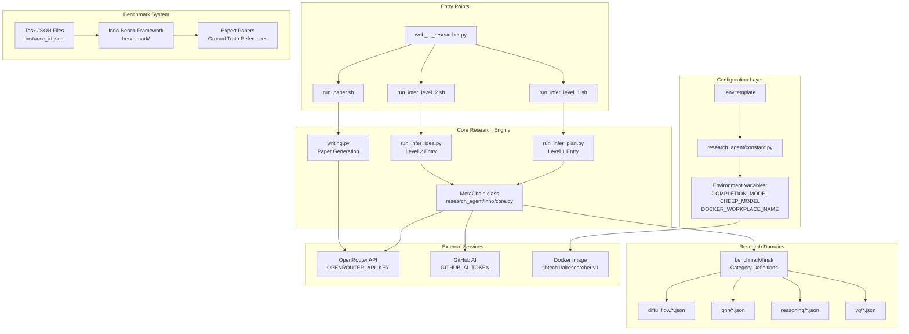

Sources: [README.md:108-210](), [research_agent/inno/core.py:79-664](), [research_agent/run_infer_plan.py:1-100](), [research_agent/run_infer_idea.py:1-100](), [paper_agent/writing.py:1-50](), [.env.template:151-210]()

### Three-Phase Research Pipeline

The system orchestrates research through three distinct phases:

| Phase | Components | Key Functions |
|-------|------------|---------------|
| **Literature Review & Idea Generation** | Resource Collector, Resource Filter, Idea Generator | Automated literature collection, quality assessment, novel concept generation |
| **Algorithm Design & Implementation** | Design Agent, Implementation Agent, Validation Agent | Conceptual development, code implementation, experimental validation |
| **Paper Writing** | Paper Agent | Academic manuscript generation, structured writing, citation management |

Sources: [README.md:42-49](), [README.md:924-947]()

## Core Components

### MetaChain Orchestration System

The `MetaChain` class serves as the central execution engine that coordinates all research activities, manages agent interactions, and handles language model communications.

### MetaChain Class Architecture

The `MetaChain` class serves as the central orchestration engine, managing agent execution loops, tool calling, and LLM communication. It implements three execution modes: synchronous, asynchronous, and streaming.

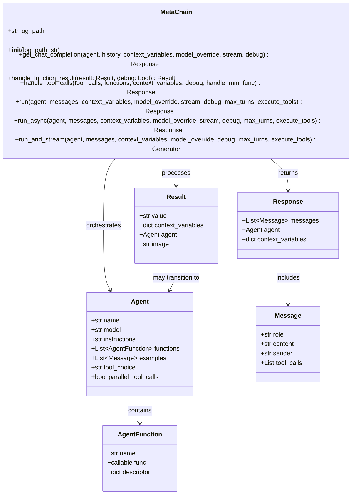

**Key Methods:**
- `get_chat_completion()`: Invokes LLM with retry logic [research_agent/inno/core.py:93-142]()
- `handle_tool_calls()`: Executes agent functions in Docker container [research_agent/inno/core.py:162-248]()
- `handle_function_result()`: Processes function results and manages agent transitions [research_agent/inno/core.py:144-160]()
- `run()`: Synchronous execution loop with turn limits [research_agent/inno/core.py:250-340]()

Sources: [research_agent/inno/core.py:79-664](), [research_agent/inno/types.py:1-100]()

### Research Agent Framework

The research agent framework provides specialized agents for different research tasks, each with domain-specific capabilities and tool functions.

### Agent Execution Flow

This diagram illustrates the execution flow from script invocation through `MetaChain` orchestration to tool execution in the Docker container.

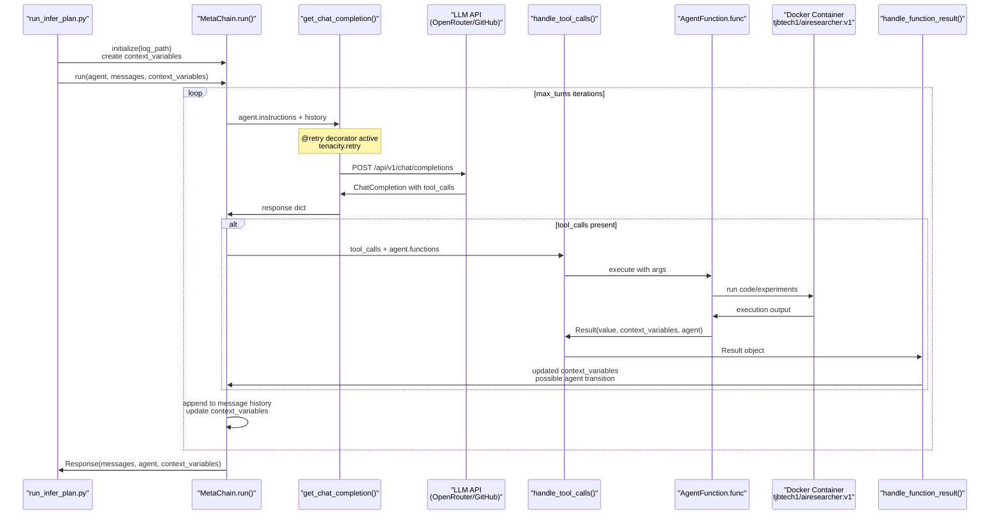

**Key Components:**
- `run_infer_plan.py`: Level 1 task entry point [research_agent/run_infer_plan.py:1-150]()
- `MetaChain.run()`: Main execution loop [research_agent/inno/core.py:250-340]()
- `get_chat_completion()`: LLM invocation with retry [research_agent/inno/core.py:93-142]()
- `handle_tool_calls()`: Tool execution dispatcher [research_agent/inno/core.py:162-248]()
- `AgentFunction`: Callable wrapper for tools [research_agent/inno/types.py:1-50]()

Sources: [research_agent/run_infer_plan.py:1-150](), [research_agent/inno/core.py:79-664](), [research_agent/inno/types.py:1-100]()

### Configuration and Environment Management

The system uses a hierarchical configuration approach with environment variables, constants, and runtime parameters.

### Configuration Architecture

The configuration system uses environment variables defined in `.env.template` and accessed via `os.environ` throughout the codebase. The `research_agent/constant.py` module centralizes configuration constants.

```mermaid
graph TD
    subgraph "Configuration Files"
        EnvTemplate[".env.template<br/>Configuration Blueprint"]
        EnvFile[".env<br/>(git-ignored)"]
        ConstantsModule["research_agent/constant.py<br/>Configuration Constants"]
        SetupCfg["setup.cfg<br/>Package Config"]
    end
    
    subgraph "Container Configuration"
        DockerWorkplace["DOCKER_WORKPLACE_NAME<br/>Default: workplace_paper"]
        BaseImages["BASE_IMAGES<br/>tjbtech1/airesearcher:v1"]
        ContainerName["CONTAINER_NAME<br/>Default: paper_eval"]
        GPUs["GPUS<br/>device=0 | all | None"]
        Port["PORT<br/>Default: 7020"]
        Platform["PLATFORM<br/>linux/amd64"]
    end
    
    subgraph "LLM Configuration"
        CompletionModel["COMPLETION_MODEL<br/>openrouter/google/gemini-2.5-pro"]
        CheepModel["CHEEP_MODEL<br/>openrouter/google/gemini-2.5-pro"]
        OpenRouterKey["OPENROUTER_API_KEY"]
        OpenRouterBase["OPENROUTER_API_BASE<br/>https://openrouter.ai/api/v1"]
        GitHubToken["GITHUB_AI_TOKEN"]
    end
    
    subgraph "Task Configuration"
        Category["CATEGORY<br/>diffu_flow|gnn|reasoning|vq"]
        InstanceID["INSTANCE_ID<br/>JSON filename"]
        TaskLevel["TASK_LEVEL<br/>task1|task2"]
        MaxIterTimes["MAX_ITER_TIMES<br/>Iteration limit"]
        WorkplaceName["WORKPLACE_NAME<br/>Default: workplace"]
        CachePath["CACHE_PATH<br/>Default: cache"]
    end
    
    subgraph "Runtime Access"
        OsEnviron["os.environ.get()"]
        RunScripts["run_infer_*.sh"]
        WebGUI["web_ai_researcher.py"]
    end
    
    EnvTemplate -.->|template for| EnvFile
    EnvFile --> OsEnviron
    ConstantsModule --> OsEnviron
    
    OsEnviron --> DockerWorkplace
    OsEnviron --> BaseImages
    OsEnviron --> ContainerName
    OsEnviron --> GPUs
    OsEnviron --> Port
    OsEnviron --> Platform
    
    OsEnviron --> CompletionModel
    OsEnviron --> CheepModel
    OsEnviron --> OpenRouterKey
    OsEnviron --> OpenRouterBase
    OsEnviron --> GitHubToken
    
    OsEnviron --> Category
    OsEnviron --> InstanceID
    OsEnviron --> TaskLevel
    OsEnviron --> MaxIterTimes
    OsEnviron --> WorkplaceName
    OsEnviron --> CachePath
    
    RunScripts --> OsEnviron
    WebGUI --> OsEnviron
```

**Configuration Flow:**
1. User copies `.env.template` to `.env` [.env.template:151-210]()
2. Sets API keys and task parameters in `.env`
3. Scripts read via `os.environ.get()` in `constant.py` [research_agent/constant.py:1-50]()
4. Configuration propagates to `MetaChain`, Docker container, and LLM clients

Sources: [.env.template:151-210](), [research_agent/constant.py:1-50](), [setup.cfg:1-85](), [research_agent/run_infer_level_1.sh:1-20]()

### Research Domain Architecture

The system supports multiple research domains, each with specialized benchmark tasks and evaluation criteria.

### Domain and Task Structure

The benchmark system organizes tasks by research domain, with each task defined as a JSON file in `benchmark/final/{category}/{instance_id}.json`. These JSON files specify the task description, reference papers, and evaluation criteria.

```mermaid
graph TB
    subgraph "Benchmark Directory Structure"
        BenchmarkRoot["benchmark/final/"]
        Categories["Category Directories"]
        TaskJSONs["Task JSON Files"]
    end
    
    subgraph "Research Domains"
        DiffuFlow["diffu_flow/<br/>4 tasks"]
        GNN["gnn/<br/>9 tasks"]
        Reasoning["reasoning/<br/>1 task"]
        VQ["vq/<br/>3 tasks"]
    end
    
    subgraph "Diffusion & Flow Tasks"
        CF["con_flowmatching.json<br/>Consistency Flow Matching"]
        IRF["i_rect_flow.json<br/>Improved Rectified Flow"]
        ID["immiscible_diffusion.json<br/>Immiscible Diffusion"]
        MMDIT["mmdit.json<br/>MMDiT Transformers"]
    end
    
    subgraph "GNN Tasks"
        AIO["allinone.json<br/>Multi-task Prompting"]
        EXP["exphormer.json<br/>Sparse Transformers"]
        DIF["gnn_difformer.json<br/>Energy Diffusion"]
        FRAC["gnn_fractional.json<br/>Fractional Dynamics"]
        GEN["gnn_generalization.json<br/>Generalization Study"]
        NODE["gnn_nodeformer.json<br/>Structure Learning"]
        POLY["gnn_poly_gcl.json<br/>Spectral Filters"]
        UNIV["gnn_universal.json<br/>Universal Principles"]
        GRAPH["graphgpt.json<br/>Instruction Tuning"]
    end
    
    subgraph "Reasoning Tasks"
        ANALOG["analog_reasoner.json<br/>Analogical Prompting"]
    end
    
    subgraph "Vector Quantization Tasks"
        OneLayer["one_layer_vq.json"]
        RotatedVQ["rotated_vq.json"]
        FSQ["fsq.json"]
    end
    
    BenchmarkRoot --> Categories
    Categories --> DiffuFlow
    Categories --> GNN
    Categories --> Reasoning
    Categories --> VQ
    
    DiffuFlow --> CF
    DiffuFlow --> IRF
    DiffuFlow --> ID
    DiffuFlow --> MMDIT
    
    GNN --> AIO
    GNN --> EXP
    GNN --> DIF
    GNN --> FRAC
    GNN --> GEN
    GNN --> NODE
    GNN --> POLY
    GNN --> UNIV
    GNN --> GRAPH
    
    Reasoning --> ANALOG
    
    VQ --> OneLayer
    VQ --> RotatedVQ
    VQ --> FSQ
```

**Task Configuration:**
- `CATEGORY`: Directory name under `benchmark/final/` [.env.template:194]()
- `INSTANCE_ID`: JSON filename without extension [.env.template:202]()
- Task JSON contains: research description, reference papers, evaluation criteria
- Scripts load tasks via `--instance_path ../benchmark/final/${category}/${instance_id}.json`

Sources: [.env.template:194-203](), [benchmark/final/diffu_flow/](), [benchmark/final/gnn/](), [benchmark/final/reasoning/](), [benchmark/final/vq/](), [research_agent/run_infer_plan.py:50-70]()

### Benchmark Evaluation System (Inno-Bench)

The Inno-Bench system provides comprehensive evaluation of research outputs across multiple dimensions.

### Evaluation Framework Architecture

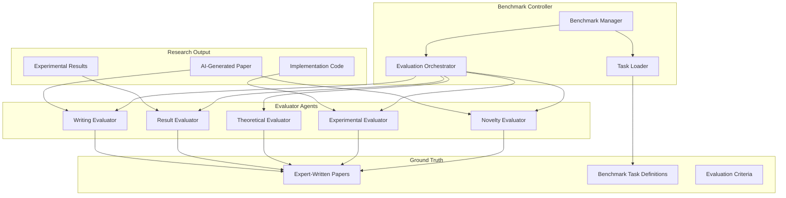

Sources: [README.md:951-962](), [benchmark/]()

## System Execution Flow

### Complete Research Lifecycle

The system follows a well-defined execution flow from task initiation through paper generation.

### End-to-End Research Workflow

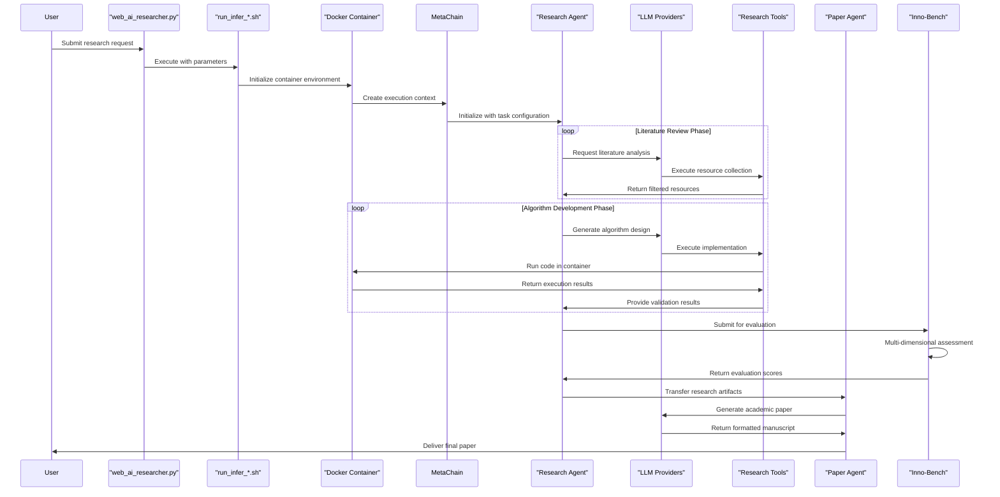

Sources: [web_ai_researcher.py:1-50](), [research_agent/run_infer_plan.py:1-50](), [research_agent/run_infer_idea.py:1-50]()

### Task Execution Modes

The system supports two primary execution modes based on input complexity.

| Mode | Script | Input | Process |
|------|---------|-------|---------|
| **Level 1** | `run_infer_level_1.sh` → `run_infer_plan.py` | Detailed research idea description | Direct implementation and validation |
| **Level 2** | `run_infer_level_2.sh` → `run_infer_idea.py` | Reference papers only | Idea generation → implementation → validation |

Sources: [README.md:982-1019](), [research_agent/run_infer_plan.py:1-50](), [research_agent/run_infer_idea.py:1-50]()

## Language Model Integration Layer

The system integrates with multiple LLM providers through a unified interface that handles authentication, rate limiting, and model-specific formatting.

### LLM Provider Architecture

The system supports multiple LLM providers through a unified interface in `MetaChain.get_chat_completion()`. Provider selection is controlled via `COMPLETION_MODEL` and `CHEEP_MODEL` environment variables.

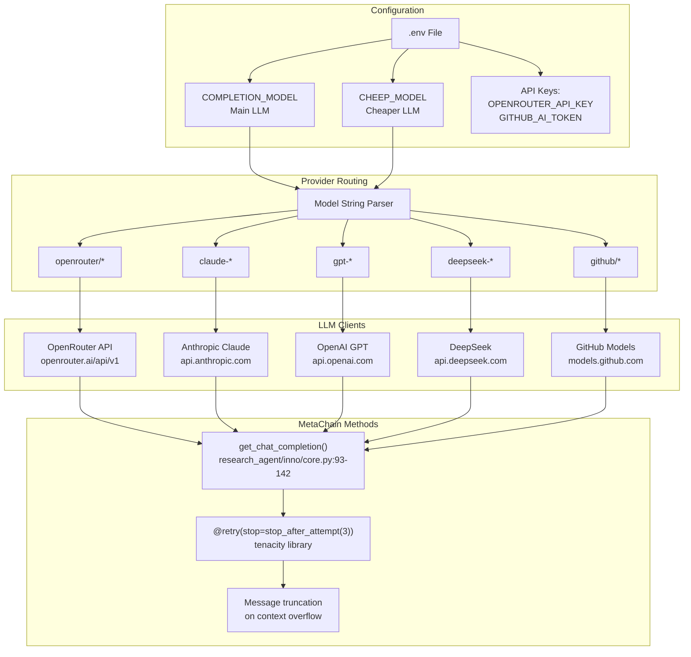

**LLM Integration Details:**
- Model strings follow pattern: `provider/model-name` (e.g., `openrouter/google/gemini-2.5-pro`)
- `get_chat_completion()` uses retry decorator for transient failures [research_agent/inno/core.py:40-62]()
- API authentication via environment variables in `.env` [.env.template:177-191]()
- Context overflow triggers message truncation [research_agent/inno/core.py:413-554]()
- Default models specified in `.env.template`: Gemini 2.5 Pro via OpenRouter [.env.template:165-167]()

Sources: [.env.template:165-191](), [research_agent/inno/core.py:40-142](), [research_agent/inno/core.py:413-554]()

### Tool Calling and Function Execution

The system implements a sophisticated tool calling mechanism that allows agents to execute specialized research functions.

### Tool Calling and Execution Architecture

The tool calling system enables agents to execute specialized functions through the `AgentFunction` class. The `MetaChain.handle_tool_calls()` method orchestrates parallel or sequential execution of tools returned by the LLM.

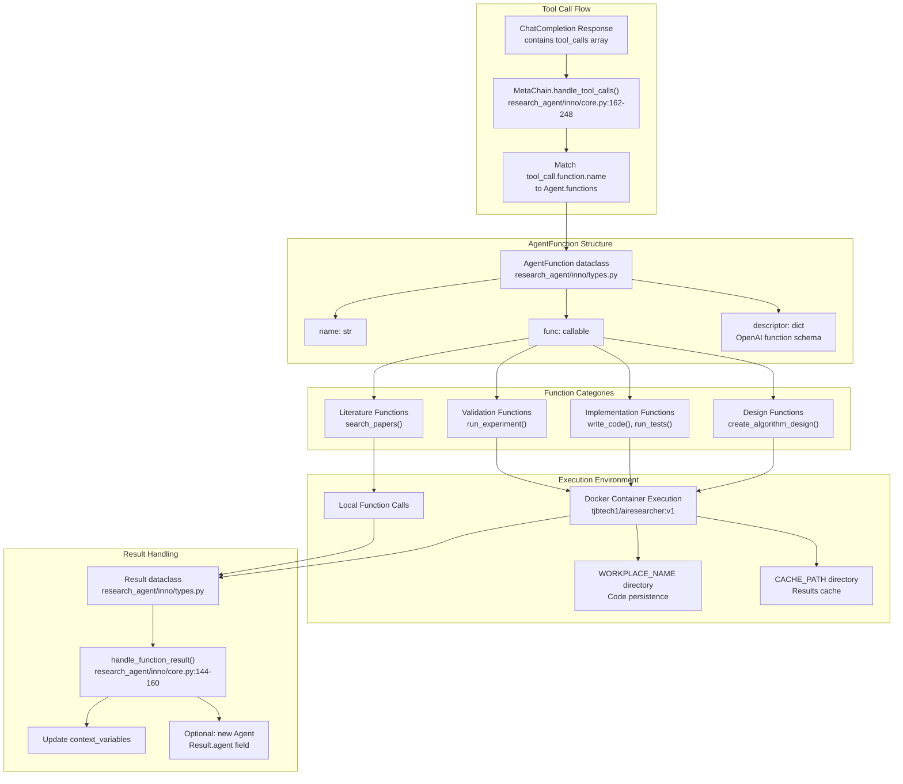

**Tool Call Mechanism:**
1. LLM returns `tool_calls` array in ChatCompletion response
2. `handle_tool_calls()` iterates over calls, looks up functions in `Agent.functions` [research_agent/inno/core.py:162-248]()
3. Each `AgentFunction.func` is invoked with parsed arguments
4. Functions execute in Docker container (implementation/validation) or locally (literature search)
5. Returns `Result(value, context_variables, agent)` [research_agent/inno/types.py:50-80]()
6. `handle_function_result()` processes result, may transition to new agent [research_agent/inno/core.py:144-160]()

**Key Data Structures:**
- `AgentFunction`: Wrapper for callable with OpenAI function schema [research_agent/inno/types.py:20-40]()
- `Result`: Return value with optional agent transition [research_agent/inno/types.py:50-80]()
- `context_variables`: Dict persisted across agent calls, contains workspace paths

Sources: [research_agent/inno/core.py:144-248](), [research_agent/inno/types.py:1-100]()

## Containerization and Deployment

The system uses Docker containerization to provide consistent execution environments across different platforms and to isolate research processes.

### Docker Container Architecture

The system uses Docker containers to provide isolated execution environments for code implementation and experiments. The container image `tjbtech1/airesearcher:v1` includes Python dependencies and research tools.

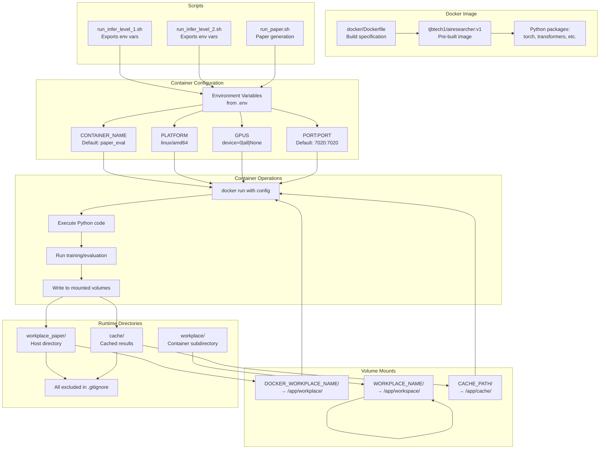

**Container Lifecycle:**
1. Scripts export environment variables from `.env` [research_agent/run_infer_level_1.sh:1-20]()
2. `MetaChain` creates Docker container with mounted volumes
3. Agent functions execute code inside container via `docker exec`
4. Results persisted to mounted volumes (`workplace_paper/`, `cache/`)
5. Container cleaned up after execution (or persisted with `CONTAINER_NAME`)

**Key Configuration:**
- Image: `tjbtech1/airesearcher:v1` [.env.template:163]()
- GPU allocation: `GPUS='"device=0"'` for first GPU [.env.template:173]()
- Workplace mount: `DOCKER_WORKPLACE_NAME` → container `/app/workplace/` [.env.template:161]()
- Platform: `linux/amd64` for cross-platform compatibility [.env.template:183]()

Sources: [docker/Dockerfile:1-100](), [.env.template:161-183](), [README.md:137-149](), [.gitignore:1-50]()

### Paper Generation Pipeline

The paper writing system operates as a separate component that processes research artifacts to generate academic manuscripts.

### Paper Writing Agent Architecture

The paper writing agent (`paper_agent/writing.py`) generates academic manuscripts from research artifacts produced by the research agent. It uses LLM-based hierarchical generation to produce structured papers.

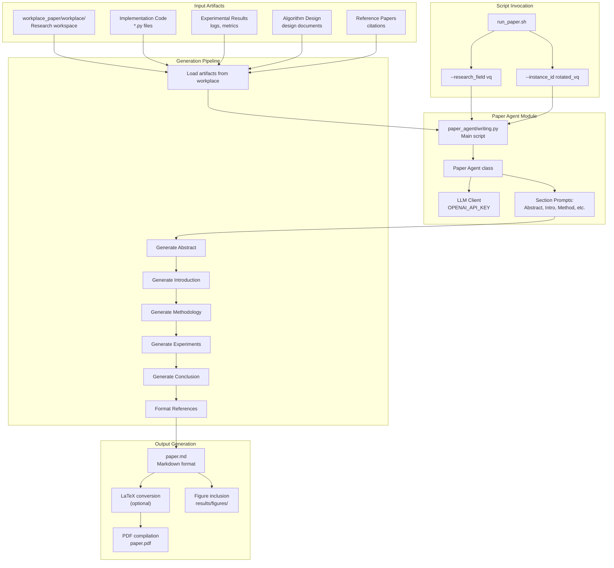

**Paper Generation Process:**
1. `run_paper.sh` invokes `writing.py` with research field and instance ID [paper_agent/run_paper.sh:1-20]()
2. Script loads artifacts from `workplace_paper/workplace/` directory
3. Paper Agent generates each section using LLM with section-specific prompts
4. Hierarchical generation: Abstract → Intro → Method → Experiments → Conclusion
5. Citations formatted from reference papers in workspace
6. Output saved as `paper.md` and optionally compiled to `paper.pdf`

**Key Parameters:**
- `--research_field`: Category (e.g., `vq`, `gnn`) [paper_agent/writing.py:20-40]()
- `--instance_id`: Task identifier (e.g., `rotated_vq`) [paper_agent/writing.py:20-40]()
- `OPENAI_API_KEY`: API key for LLM [paper_agent/run_paper.sh:5]()

Sources: [paper_agent/writing.py:1-100](), [paper_agent/run_paper.sh:1-20](), [README.md:1030-1045]()

## Error Handling and Resilience

The system implements comprehensive error handling and retry mechanisms to ensure reliable operation across distributed components.

### Error Handling Architecture

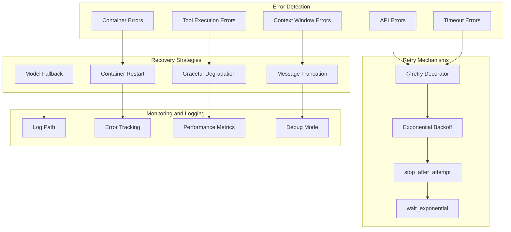

Sources: [research_agent/inno/core.py:40-62](), [research_agent/inno/core.py:413-554]()

### Web Interface Integration

The `web_ai_researcher.py` provides a Gradio-based web interface that integrates all system components into a user-friendly interface.

### Web Interface Architecture

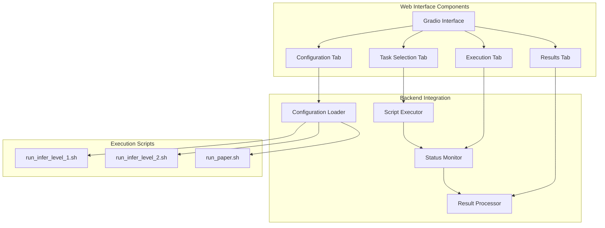

Sources: [web_ai_researcher.py:1-50](), [README.md:204-222]()

## Execution Modes and Task Levels

The AI-Researcher system supports two task levels and three execution modes to accommodate different research workflows and interaction patterns.

### Task Levels

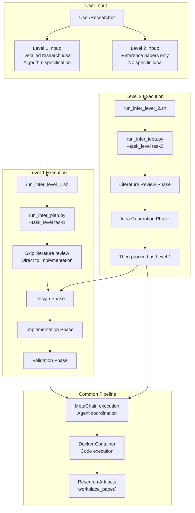

**Level 1 (Detailed Idea) [README.md:38-40]():**
- User provides: Detailed research idea, algorithm description, implementation requirements
- Script: `run_infer_level_1.sh` → `run_infer_plan.py` [research_agent/run_infer_level_1.sh:1-20]()
- Process: Direct to Design → Implementation → Validation phases
- Use case: Researcher has specific idea to implement and validate

**Level 2 (Reference Papers) [README.md:41-43]():**
- User provides: List of reference papers, general research direction
- Script: `run_infer_level_2.sh` → `run_infer_idea.py` [research_agent/run_infer_level_2.sh:1-20]()
- Process: Literature Review → Idea Generation → then Level 1 pipeline
- Use case: Researcher wants system to generate novel research directions

### MetaChain Execution Modes

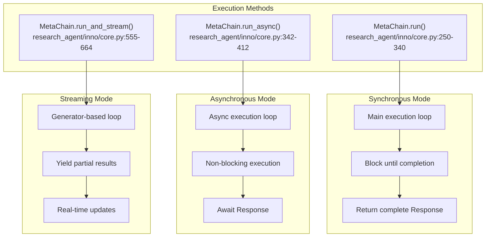

**Synchronous Execution (`run()`):**
- Default mode for research tasks
- Blocks until completion
- Returns complete `Response` object [research_agent/inno/core.py:250-340]()
- Used by: `run_infer_plan.py`, `run_infer_idea.py`

**Asynchronous Execution (`run_async()`):**
- Non-blocking execution using `asyncio`
- Enables concurrent research tasks
- Returns awaitable `Response` [research_agent/inno/core.py:342-412]()
- Use case: Running multiple experiments in parallel

**Streaming Execution (`run_and_stream()`):**
- Generator-based execution
- Yields partial results in real-time
- Enables live progress updates [research_agent/inno/core.py:555-664]()
- Used by: `web_ai_researcher.py` for interactive UI updates

Sources: [README.md:36-43](), [README.md:983-1027](), [research_agent/inno/core.py:250-664](), [research_agent/run_infer_level_1.sh:1-20](), [research_agent/run_infer_level_2.sh:1-20]()

## Error Handling and Resilience

The system includes robust error handling and retry mechanisms to ensure reliability.

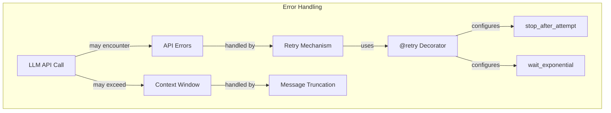

Sources: [research_agent/inno/core.py:40-62](), [research_agent/inno/core.py:413-554]()

Key error handling features:

1. **Retry Logic**: Exponential backoff for transient errors
2. **Error Classification**: Intelligent handling of different error types
3. **Context Management**: Adaptive truncation of messages when context limits are exceeded
4. **Recovery Mechanisms**: Ability to resume processing after errors

---

