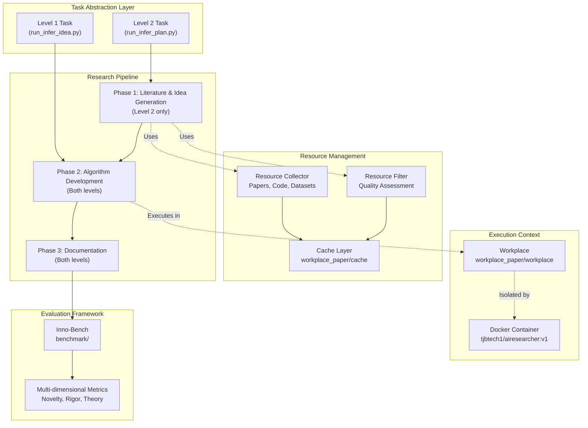
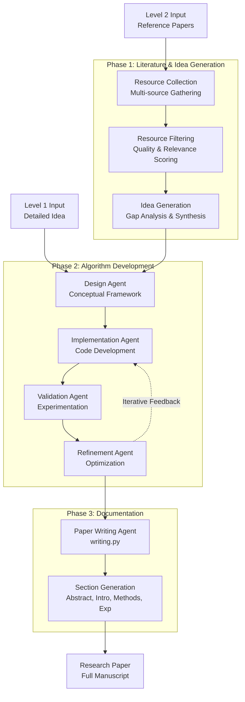
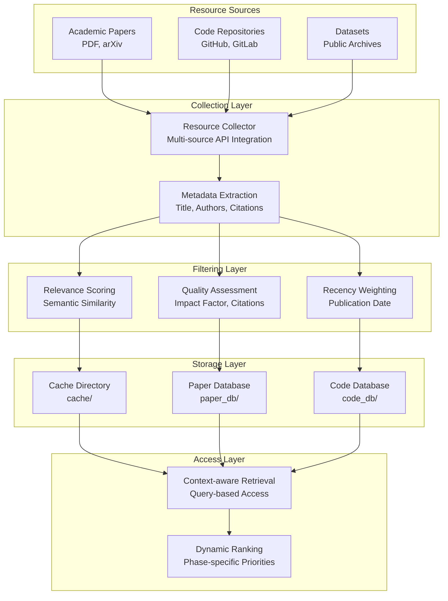
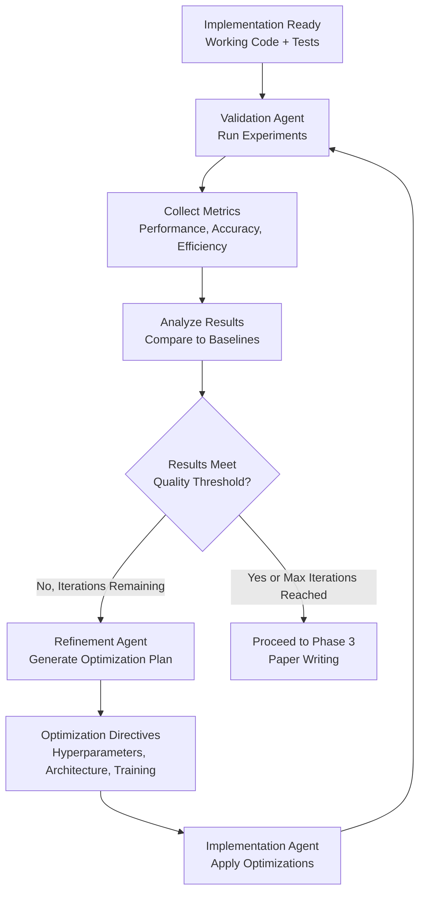
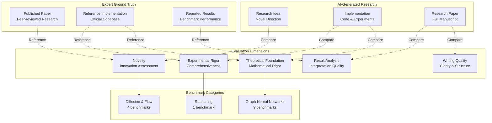

<!-- source: DeepWiki mcp.deepwiki.com · repo HKUDS/AI-Researcher · page 2.1 Research Framework Concepts · fetched 2026-11-09 -->

# Research Framework Concepts

Relevant source files

The following files were used as context for generating this wiki page:

- [assets/AI-Researcher-Framework.pdf](assets/AI-Researcher-Framework.pdf)
- [assets/AI-Researcher-Framework.png](assets/AI-Researcher-Framework.png)

## Purpose and Scope

This document explains the conceptual framework underlying the AI-Researcher system, including the two-level task abstraction model, the three-phase research pipeline, and the principles governing resource management, iterative refinement, and evaluation. 

For specific implementation details of the research agents, see [Research Agent](#3.1). For the complete workflow execution sequence, see [Research Workflow](#2.2). For benchmark evaluation specifics, see [Benchmark System](#3.3).

**Sources:** High-level system architecture diagrams, README.md

## Conceptual Overview

The AI-Researcher framework is built on the principle of **autonomous end-to-end research execution**, transforming either user-provided ideas or reference papers into complete research artifacts including implementations, experiments, and publication-ready manuscripts. The framework abstracts the research process into clearly defined phases that mirror human research methodology while leveraging AI capabilities for acceleration and automation.

**Diagram: AI-Researcher Conceptual Framework**

The framework distinguishes between two task complexity levels, processes research through three distinct phases, manages resources through collection and caching mechanisms, provides isolated execution environments, and evaluates outputs against expert-level benchmarks.

**Sources:** run_infer_plan.py, run_infer_idea.py, README.md, .env.template

## Two-Level Task Abstraction

The AI-Researcher framework supports two levels of task abstraction, each representing different starting points in the research process:

### Level 1: Idea-Driven Research

**Entry Point:** User provides a detailed research idea or concept  
**Execution Script:** `run_infer_idea.py`  
**Pipeline Entry:** Phase 2 (Algorithm Development)

Level 1 tasks assume the research direction is already determined. The system bypasses literature review and idea generation, proceeding directly to algorithm design, implementation, validation, and refinement. This mode is suitable when:

- The research direction has been pre-determined through manual literature review
- The user has domain expertise and wants to accelerate implementation
- The focus is on rapid prototyping of a specific concept

### Level 2: Reference-Driven Research

**Entry Point:** User provides reference papers  
**Execution Script:** `run_infer_plan.py`  
**Pipeline Entry:** Phase 1 (Literature & Idea Generation)

Level 2 tasks perform autonomous research direction discovery. The system:

1. Collects relevant papers, code repositories, and datasets
2. Filters resources for quality and relevance
3. Analyzes research gaps and trends
4. Generates novel research directions
5. Proceeds to full algorithm development

This mode represents the most autonomous operation, suitable when:

- Exploring new research domains without predetermined direction
- Seeking novel combinations of existing techniques
- Requiring comprehensive literature synthesis

**Configuration:**

| Parameter | Level 1 | Level 2 |
|-----------|---------|---------|
| `TASK_LEVEL` | `task1` | `task2` |
| Entry Script | `run_infer_idea.py` | `run_infer_plan.py` |
| Literature Phase | Skipped | Executed |
| Initial Input | Detailed idea text | Reference paper paths |

**Sources:** run_infer_plan.py, run_infer_idea.py, .env.template, README.md

## Three-Phase Research Pipeline

The research pipeline consists of three sequential phases that transform inputs into complete research outputs:

**Diagram: Three-Phase Research Pipeline with Agent Coordination**

**Sources:** README.md, writing.py, run_infer_plan.py, run_infer_idea.py

### Phase 1: Literature & Idea Generation

**Active for:** Level 2 tasks only  
**Primary Goal:** Transform reference papers into novel research directions

**Key Operations:**

1. **Resource Collection:** Gathers papers, code repositories, and datasets from multiple sources relevant to the reference papers
2. **Resource Filtering:** Applies quality assessment criteria to prioritize high-impact resources
3. **Idea Generation:** Performs gap analysis, identifies trends, and synthesizes novel research directions

This phase produces a **research proposal** containing:
- Identified research gaps
- Proposed novel approach
- Theoretical justification
- Expected contributions

**Sources:** README.md, run_infer_plan.py

### Phase 2: Algorithm Development

**Active for:** Both Level 1 and Level 2 tasks  
**Primary Goal:** Transform research ideas into validated implementations

**Four-Stage Iterative Cycle:**

| Stage | Agent | Input | Output |
|-------|-------|-------|--------|
| **Design** | Design Agent | Research idea/proposal | Conceptual framework, theoretical foundation, algorithm pseudocode |
| **Implementation** | Implementation Agent | Design specifications | Working code, test infrastructure, documentation |
| **Validation** | Validation Agent | Implementation | Experimental results, performance metrics, comparative analysis |
| **Refinement** | Refinement Agent | Validation results | Optimization recommendations, hyperparameter tuning, ablation studies |

**Iterative Refinement Loop:**

The validation-to-implementation feedback loop enables continuous improvement. The refinement agent analyzes validation results and either:
- Returns to implementation with specific optimization directives
- Proceeds to paper writing if results meet quality thresholds

The iteration count is controlled by the `MAX_ITER` configuration parameter (default: 0, meaning one complete cycle without iteration).

**Workspace Isolation:**

All algorithm development occurs within isolated workspaces:
- `workplace_paper/workplace/` for code development
- `cache/` for intermediate results and resource storage

**Sources:** README.md, .env.template, .gitignore

### Phase 3: Documentation

**Active for:** Both Level 1 and Level 2 tasks  
**Primary Goal:** Generate publication-ready manuscripts

**Script:** `writing.py`

The paper writing agent synthesizes all outputs from Phase 2 into a structured academic paper:

1. **Abstract:** Research motivation, approach, and key results
2. **Introduction:** Background, problem statement, and contributions
3. **Related Work:** Literature review and positioning
4. **Methodology:** Detailed algorithm description and theoretical analysis
5. **Experiments:** Experimental setup, results, and analysis
6. **Conclusion:** Summary and future work

The agent generates LaTeX source code, processes figures and tables, and produces a complete manuscript.

**Sources:** writing.py, README.md

## Resource Management Architecture

The framework implements a sophisticated resource management system to support efficient research execution:

**Diagram: Resource Management Architecture**

**Key Principles:**

1. **Multi-source Integration:** Aggregates resources from diverse sources to ensure comprehensive coverage
2. **Quality-first Filtering:** Prioritizes high-impact resources to reduce noise in AI analysis
3. **Persistent Caching:** Stores processed resources to avoid redundant API calls and processing
4. **Context-aware Retrieval:** Adapts resource selection based on current research phase needs

**Storage Locations:**

- `cache/`: Temporary storage for intermediate processing results
- `paper_db/`: Persistent paper metadata and content
- `code_db/`: Code repository metadata and snippets

All storage directories are excluded from version control via `.gitignore` to maintain repository cleanliness.

**Sources:** .gitignore, .env.template, README.md

## Iterative Refinement Mechanism

The framework implements a feedback-driven refinement loop within Phase 2 (Algorithm Development) that mirrors the human research process of experimentation, analysis, and optimization:

**Diagram: Iterative Refinement Loop**

**Iteration Control:**

The `MAX_ITER` parameter in `.env` configuration controls the refinement cycle:

| MAX_ITER | Behavior |
|----------|----------|
| 0 | Single pass (Design → Implement → Validate → Refine → Complete) |
| N > 0 | Up to N refinement cycles before proceeding to documentation |
| -1 | Iterate until quality threshold met (not recommended for production) |

**Refinement Strategies:**

The refinement agent employs multiple optimization strategies:

1. **Hyperparameter Tuning:** Learning rates, batch sizes, regularization
2. **Architecture Modifications:** Layer configurations, attention mechanisms, skip connections
3. **Training Procedure Changes:** Loss functions, optimization algorithms, scheduling
4. **Data Augmentation:** Preprocessing, augmentation strategies, sampling techniques
5. **Ablation Studies:** Component importance analysis

**Sources:** .env.template, README.md

## Evaluation Framework

The framework evaluates research outputs through the **Inno-Bench** system, which compares AI-generated research against expert-level ground truth across multiple dimensions:

**Diagram: Evaluation Framework Structure**

**Multi-dimensional Assessment:**

| Dimension | Focus | Evaluation Criteria |
|-----------|-------|---------------------|
| **Novelty** | Innovation degree | Originality of approach, differentiation from existing work |
| **Theoretical Foundation** | Mathematical rigor | Formal definitions, proofs, theoretical guarantees |
| **Experimental Rigor** | Comprehensiveness | Dataset diversity, baseline comparisons, ablation studies |
| **Result Analysis** | Interpretation quality | Insight depth, failure case analysis, limitations discussion |
| **Writing Quality** | Clarity & structure | Logical flow, technical precision, reproducibility details |

**Benchmark Coverage:**

The framework is evaluated across 14 expert-curated benchmarks spanning three major research domains:

- **Diffusion & Flow Models** (4 tasks): Generative modeling for images/videos
- **Graph Neural Networks** (9 tasks): Graph representation learning with diverse architectures
- **Reasoning** (1 task): LLM reasoning enhancement

For detailed benchmark specifications, see [Benchmark System](#3.3) and domain-specific pages ([Diffusion & Flow](#5.1), [Graph Neural Networks](#5.2), [Reasoning](#5.3)).

**Sources:** benchmark/README.md, README.md

## Code-Concept Mapping

The following table maps high-level framework concepts to specific code entities:

| Concept | Code Entity | File Location | Description |
|---------|-------------|---------------|-------------|
| **Level 1 Task** | `run_infer_idea.py` | [run_infer_idea.py:1-500]() | Entry point for idea-driven research |
| **Level 2 Task** | `run_infer_plan.py` | [run_infer_plan.py:1-500]() | Entry point for reference-driven research |
| **Paper Writing** | `writing.py` | [writing.py:1-500]() | Manuscript generation agent |
| **Web Interface** | `web_ai_researcher.py` | [web_ai_researcher.py:1-500]() | GUI for system interaction |
| **Workspace Root** | `workplace_paper/workplace` | Directory | Isolated algorithm development environment |
| **Cache Storage** | `cache/` | Directory | Resource and intermediate result storage |
| **Paper Database** | `paper_db/` | Directory | Academic paper metadata storage |
| **Code Database** | `code_db/` | Directory | Code repository metadata storage |
| **Benchmark Root** | `benchmark/` | Directory | Inno-Bench evaluation framework |
| **Container Config** | `.env` | [.env:1-50]() | System configuration parameters |
| **Task Category** | `TASK_CATEGORY` | [.env:15-15]() | Research domain selection (diffu_flow, gnn, reasoning) |
| **Task Instance** | `TASK_INSTANCE` | [.env:16-16]() | Specific benchmark task identifier |
| **Task Level** | `TASK_LEVEL` | [.env:17-17]() | Abstraction level (task1/task2) |
| **Max Iterations** | `MAX_ITER` | [.env:18-18]() | Refinement cycle limit |
| **Completion Model** | `COMPLETION_MODEL` | [.env:5-5]() | Primary LLM for generation (gemini-2.5-pro-preview) |
| **Cheap Model** | `CHEEP_MODEL` | [.env:10-10]() | Cost-optimized LLM for lightweight tasks |

**Sources:** run_infer_plan.py, run_infer_idea.py, writing.py, web_ai_researcher.py, .env.template, .gitignore

## Framework Design Principles

The AI-Researcher framework is built on several core design principles:

### 1. Phase Separation

Each research phase operates independently with clear inputs and outputs, enabling:
- Parallel development and testing of phase-specific improvements
- Easy substitution of alternative implementations (e.g., different idea generation strategies)
- Clear debugging boundaries when issues arise

### 2. Resource Efficiency

The framework minimizes computational waste through:
- Persistent caching of collected resources
- Dual-model LLM strategy (expensive models for critical tasks, cheap models for routine operations)
- Iteration limits to prevent runaway experimentation

### 3. Reproducibility

Docker containerization ensures consistent execution environments:
- Fixed base image (`tjbtech1/airesearcher:v1`)
- Isolated workspaces prevent cross-contamination
- Configuration-as-code via `.env` files

### 4. Extensibility

The modular architecture supports extension:
- New benchmark tasks can be added to `benchmark/` without code changes
- Alternative LLM providers integrate through configuration
- Custom agents can be injected into the pipeline

### 5. Evaluation-Driven

The Inno-Bench framework provides objective quality assessment:
- Multi-dimensional evaluation prevents gaming single metrics
- Expert ground truth comparison ensures research-grade standards
- Category-specific benchmarks reflect domain requirements

**Sources:** README.md, .env.template, benchmark/README.md, docker-compose.yaml

## Configuration-Driven Behavior

The framework's behavior is extensively controlled through `.env` configuration, enabling deployment flexibility without code modification:

```mermaid
graph TB
    ENV["Environment Configuration<br/>.env file"]
    
    subgraph "Container Configuration"
        DOCKER_CFG["DOCKER_NAME<br/>DOCKER_PLATFORM<br/>DOCKER_IMAGE"]
        GPU_CFG["GPU_ID<br/>Device Allocation"]
        PORT_CFG["PORT<br/>Network Exposure"]
    end
    
    subgraph "LLM Configuration"
        COMP_CFG["COMPLETION_MODEL<br/>High-quality Generation"]
        CHEAP_CFG["CHEEP_MODEL<br/>Cost Optimization"]
        API_CFG["OPENROUTER_KEY<br/>GITHUB_TOKEN"]
    end
    
    subgraph "Task Configuration"
        CAT_CFG["TASK_CATEGORY<br/>Domain Selection"]
        INST_CFG["TASK_INSTANCE<br/>Benchmark Task"]
        LVL_CFG["TASK_LEVEL<br/>task1 vs task2"]
        ITER_CFG["MAX_ITER<br/>Refinement Cycles"]
    end
    
    subgraph "Workspace Configuration"
        WORK_CFG["WORKPLACE<br/>Code Development Path"]
        CACHE_CFG["Cache Directories<br/>Resource Storage"]
    end
    
    ENV --> DOCKER_CFG
    ENV --> GPU_CFG
    ENV --> PORT_CFG
    
    ENV --> COMP_CFG
    ENV --> CHEAP_CFG
    ENV --> API_CFG
    
    ENV --> CAT_CFG
    ENV --> INST_CFG
    ENV --> LVL_CFG
    ENV --> ITER_CFG
    
    ENV --> WORK_CFG
    ENV --> CACHE_CFG
    
    DOCKER_CFG --> RUNTIME["Runtime Execution<br/>Docker Container"]
    GPU_CFG --> RUNTIME
    PORT_CFG --> RUNTIME
    
    COMP_CFG --> AGENTS["Research Agents<br/>Generation Logic"]
    CHEAP_CFG --> AGENTS
    API_CFG --> AGENTS
    
    CAT_CFG --> PIPELINE["Research Pipeline<br/>Phase Execution"]
    INST_CFG --> PIPELINE
    LVL_CFG --> PIPELINE
    ITER_CFG --> PIPELINE
    
    WORK_CFG --> STORAGE["Storage Management<br/>File Organization"]
    CACHE_CFG --> STORAGE
```

**Diagram: Configuration-Driven Framework Behavior**

This configuration architecture enables:

- **Multi-tenancy:** Run multiple research tasks with different configurations simultaneously
- **A/B Testing:** Compare different LLM models or hyperparameters
- **Resource Management:** Allocate GPU resources per-task
- **Cost Optimization:** Switch between high-quality and cheap models based on budget

For detailed configuration parameters, see [Environment Configuration](#4.1).

**Sources:** .env.template, README.md

## Summary

The AI-Researcher framework implements a comprehensive conceptual model for autonomous research that:

1. **Abstracts task complexity** through two levels (idea-driven vs. reference-driven)
2. **Structures research** into three sequential phases (literature/idea generation, algorithm development, documentation)
3. **Manages resources** through collection, filtering, caching, and retrieval mechanisms
4. **Enables iteration** through validation-refinement feedback loops
5. **Evaluates quality** against expert benchmarks across multiple dimensions
6. **Configures behavior** through environment variables for deployment flexibility

This conceptual foundation supports the complete research automation capability while maintaining modularity, reproducibility, and extensibility.

**Sources:** README.md, .env.template, run_infer_plan.py, run_infer_idea.py, writing.py, benchmark/README.md

---

