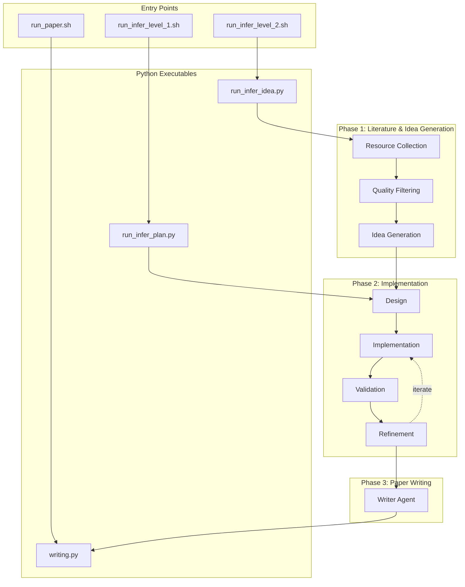
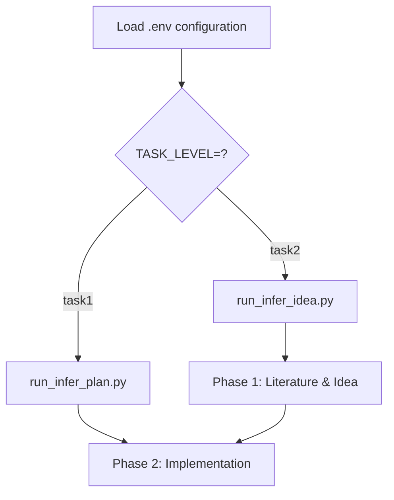
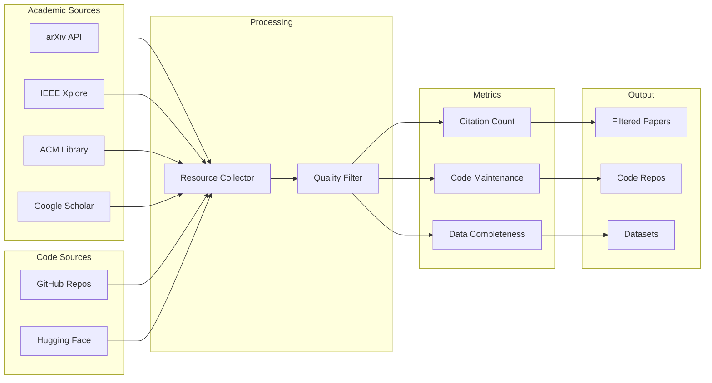
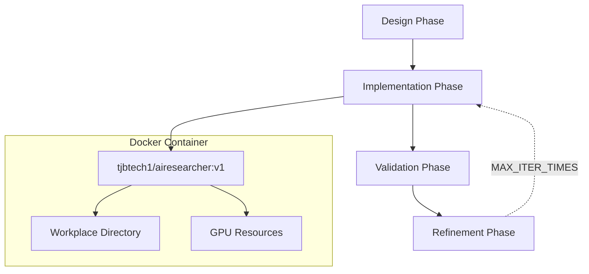
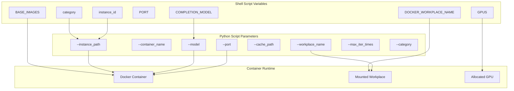
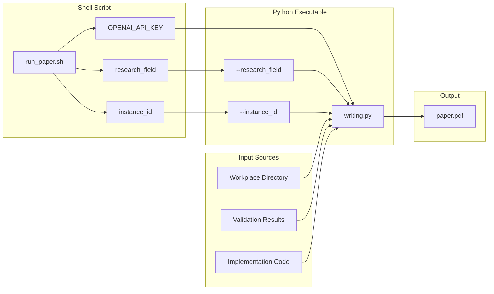
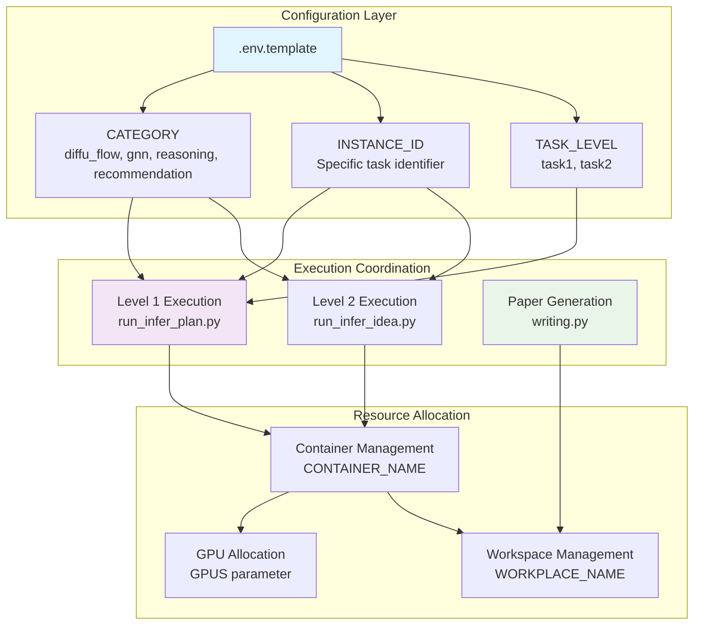
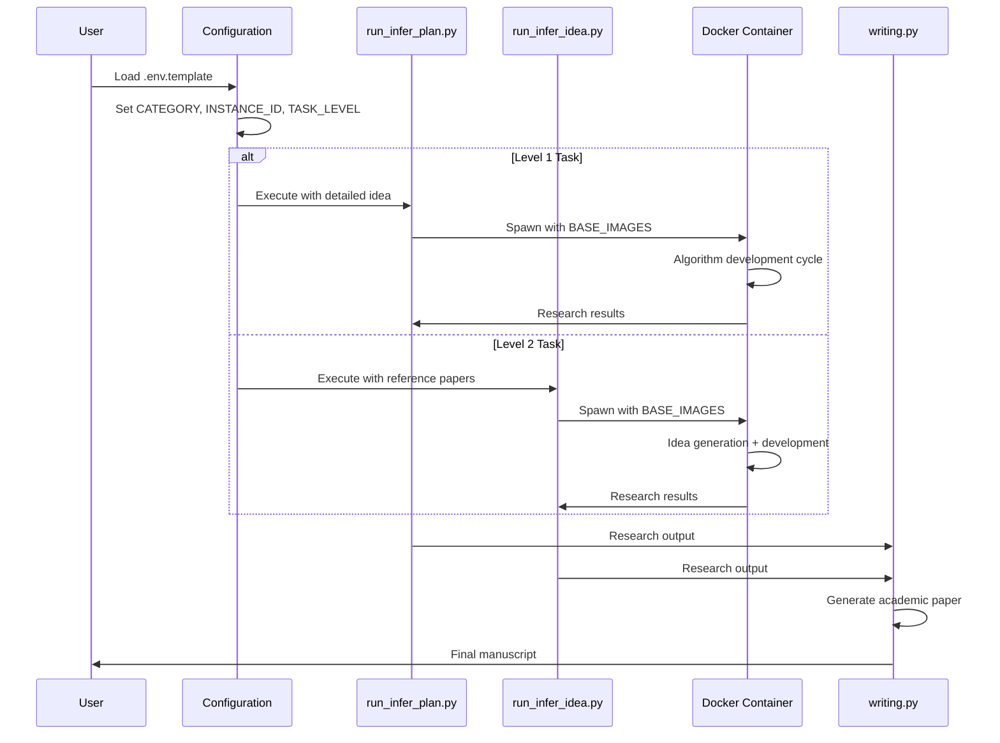

<!-- source: DeepWiki mcp.deepwiki.com · repo HKUDS/AI-Researcher · page 2.2 Research Workflow · fetched 2026-11-09 -->

# Research Workflow

<details>
<summary>Relevant source files</summary>

The following files were used as context for generating this wiki page:

- [README.md](README.md)
- [assets/AI-Researcher-Framework.pdf](assets/AI-Researcher-Framework.pdf)
- [assets/researchagent.svg](assets/researchagent.svg)

</details>


This document describes the three-phase research lifecycle that forms the core of the AI-Researcher system's autonomous scientific discovery capabilities. It covers the sequential workflow from initial literature analysis through algorithm development to final paper generation, including the orchestration between different agent components and execution modes.

For information about the individual agent components, see [Agent Framework](#2.2). For details on specific benchmark tasks and domains, see [Benchmark Tasks & Domains](#5). For configuration and deployment specifics, see [Configuration & Deployment](#4).

## Overview

The AI-Researcher system executes a three-phase research workflow that processes research tasks from literature analysis through implementation to paper generation. The workflow operates in two modes based on task level configuration: Level 1 (idea-provided) and Level 2 (reference-based autonomous research).

### Three-Phase Research Pipeline

**Workflow execution flow with code entry points**



**Sources:** [README.md:932-947](), [research_agent/run_infer_level_1.sh:986-1004](), [research_agent/run_infer_level_2.sh:1009-1024](), [paper_agent/run_paper.sh:1028-1042]()

### Task Level Configuration

The workflow diverges at the entry point based on the `TASK_LEVEL` environment variable:

| Task Level | Entry Script | Python Executable | Starting Phase | User Input |
|------------|--------------|-------------------|----------------|------------|
| `task1` | `run_infer_level_1.sh` | `run_infer_plan.py` | Phase 2 (Design) | Detailed idea + references |
| `task2` | `run_infer_level_2.sh` | `run_infer_idea.py` | Phase 1 (Collection) | Reference papers only |

**Sources:** [README.md:33-39](), [README.md:986-1024]()

## Phase 1: Literature Review & Idea Generation

Phase 1 executes only for Level 2 tasks (`task2`), activated when users provide reference papers without detailed ideas. The phase consists of three sequential operations: resource collection, quality filtering, and idea generation. Level 1 tasks bypass this phase entirely.

### Execution Trigger

**Phase 1 activation logic**



**Sources:** [README.md:33-39](), [README.md:986-1024]()

### Resource Collection Pipeline

The resource collector gathers materials from academic databases and code repositories. Quality filtering applies citation count, code maintenance status, and dataset completeness metrics to select high-impact resources.

**Data sources and filtering workflow**



**Sources:** [README.md:933-936]()

### Idea Generation Component

The idea generator analyzes filtered resources to identify methodological limitations and formulate novel research directions. This component outputs structured research concepts that feed into Phase 2's design stage.

| Component | Input | Output | Purpose |
|-----------|-------|--------|---------|
| Resource Collector | Reference papers (user-provided) | Raw materials from databases | Systematic gathering |
| Resource Filter | Raw materials | Curated high-impact resources | Quality evaluation |
| Idea Generator | Curated resources | Research concepts and directions | Novel direction formulation |

**Sources:** [README.md:933-938]()

## Phase 2: Algorithm Design & Implementation

Phase 2 executes for both task levels, implementing a four-stage cycle: Design → Implementation → Validation → Refinement. This phase runs inside Docker containers with GPU allocation managed by the `GPUS` environment variable.

### Development Cycle Stages

**Four-stage iterative cycle**



| Stage | Activities | Output |
|-------|-----------|--------|
| Design | Conceptual development, theoretical foundations, implementation strategy | Algorithm design specification |
| Implementation | Functional module development, testing environment setup, infrastructure configuration | Executable code |
| Validation | Systematic experimentation, metrics collection, findings documentation | Performance metrics |
| Refinement | Improvement identification, code optimization, enhancement implementation | Optimized implementation |

**Sources:** [README.md:939-947]()

### Container Configuration and Execution

Both `run_infer_plan.py` (Level 1) and `run_infer_idea.py` (Level 2) spawn Docker containers using configuration from shell script environment variables.

**Environment variable propagation to container execution**



**Sources:** [research_agent/run_infer_level_1.sh:986-1004](), [research_agent/run_infer_level_2.sh:1009-1024]()

### Iteration Control

The refinement loop executes up to `MAX_ITER_TIMES` iterations, defaulting to 0 (no refinement) as shown in the example scripts. Each iteration returns to the implementation stage.

```bash
# From run_infer_level_1.sh
python run_infer_plan.py \
  --instance_path ../benchmark/final/${category}/${instance_id}.json \
  --max_iter_times 0 \
  --category ${category}
```

**Sources:** [research_agent/run_infer_level_1.sh:1004](), [research_agent/run_infer_level_2.sh:1023]()

### GPU Resource Allocation

The `GPUS` variable accepts multiple formats:

| GPUS Value | Allocation |
|------------|------------|
| `'"device=0"'` | Single GPU (device 0) |
| `'"device=0,1"'` | Multiple GPUs (devices 0 and 1) |
| `'"all"'` | All available GPUs |
| `None` | CPU-only execution |

**Sources:** [README.md:165-169]()

## Phase 3: Paper Writing

Phase 3 executes after Phase 2 completion, invoking `writing.py` to generate publication-ready academic papers. The Writer Agent reads research outputs from the workplace directory and synthesizes them into structured manuscripts.

### Paper Generation Script

The paper agent executes independently via `run_paper.sh`, which sets environment variables and calls `writing.py` with research field and instance parameters.

**Paper generation execution flow**



**Sources:** [paper_agent/run_paper.sh:1028-1042]()

### Configuration Parameters

```bash
# From run_paper.sh
export OPENAI_API_KEY=sk-SKlupNntta4WPmvDCRo7uuPbYGwOnUQcb25Twn8c718tPpXN

research_field=vq
instance_id=rotated_vq

python path/to/AI-Researcher/paper_agent/writing.py \
  --research_field ${research_field} \
  --instance_id ${instance_id}
```

| Parameter | Purpose | Valid Values |
|-----------|---------|--------------|
| `--research_field` | Research category specification | `vq`, `gnn`, `reasoning`, `recommendation`, `diffu_flow` |
| `--instance_id` | Task instance identifier | Matches instance filename (e.g., `rotated_vq`, `one_layer_vq`) |
| `OPENAI_API_KEY` | LLM API authentication | API key string |

**Sources:** [paper_agent/run_paper.sh:1035-1041]()

### Writer Agent Output

The Writer Agent generates a hierarchically structured manuscript integrating:
- Research motivation and problem statement
- Algorithm design and theoretical foundations
- Implementation details
- Experimental results and analysis
- Conclusions and future work

Output location: `{workplace_directory}/{research_field}/{instance_id}/paper.pdf`

**Sources:** [README.md:949-950]()

## Workflow Orchestration

The complete research workflow is orchestrated through configuration-driven execution that coordinates between phases and manages resource allocation across the containerized environment.

### Configuration-Driven Execution



**Sources:** [README.md:147-202](), [research_agent/run_infer_level_1.sh:995-999](), [research_agent/run_infer_level_2.sh:1014-1018]()

### Execution Flow Control

The workflow execution follows a controlled sequence with proper phase transitions and resource management:



**Sources:** [research_agent/run_infer_level_1.sh:986-999](), [research_agent/run_infer_level_2.sh:1005-1018](), [paper_agent/run_paper.sh:1026-1036]()

---

