<!-- source: DeepWiki mcp.deepwiki.com · repo HKUDS/AI-Researcher · page 2.3 Agent Framework · fetched 2026-11-09 -->

# Agent Framework

<details>
<summary>Relevant source files</summary>

The following files were used as context for generating this wiki page:

- [README.md](README.md)
- [assets/AI-Researcher-Framework.pdf](assets/AI-Researcher-Framework.pdf)
- [assets/researchagent.svg](assets/researchagent.svg)

</details>


## Purpose and Scope

This document describes the multi-agent architecture that powers the AI-Researcher system. It explains how specialized agents coordinate to perform autonomous scientific research, from literature review through implementation to publication. This framework orchestrates the three-phase research pipeline by decomposing complex research tasks into manageable agent responsibilities.

**Related Pages:**
- For conceptual framework details, see [Research Framework Concepts](#2.1)
- For workflow execution details, see [Research Workflow](#2.2)  
- For Research Agent implementation, see [Research Agent](#3.1)
- For Paper Writing Agent implementation, see [Paper Writing Agent](#3.2)

**Sources:** [README.md:1-1170]()

---

## Multi-Agent Architecture Overview

The AI-Researcher system employs a **hierarchical multi-agent architecture** where specialized agents handle distinct phases of the research lifecycle. The framework coordinates five primary agent categories across three research phases, with each agent maintaining specific responsibilities and inter-agent communication protocols.

### Agent Type Taxonomy

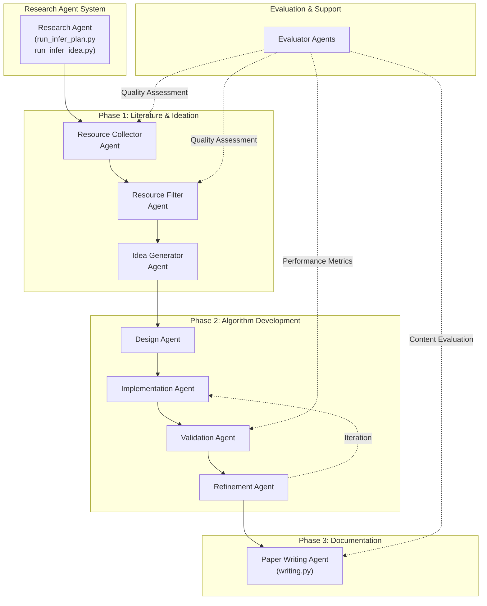

**Sources:** [README.md:27-56](), [README.md:935-956]()

---

## Agent Execution Modes

The system supports two execution modes determined by input type, with different agent activation patterns:

| Execution Mode | Entry Point | Phase 1 Agents | Phase 2 Agents | Phase 3 Agents | Input Requirements |
|----------------|-------------|----------------|----------------|----------------|-------------------|
| **Level 1** | `run_infer_plan.py` | Inactive | Active | Active | Detailed research idea provided |
| **Level 2** | `run_infer_idea.py` | Active | Active | Active | Reference papers only |

### Mode Selection Logic

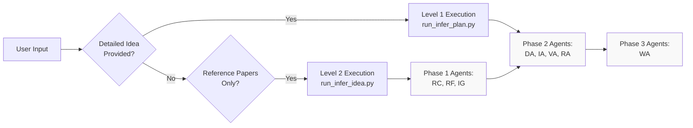

**Sources:** [README.md:38-43](), [README.md:990-1027]()

---

## Phase 1: Literature & Idea Generation Agents

Phase 1 agents activate only for Level 2 tasks where users provide reference papers without specific research ideas. These agents perform autonomous literature review and ideation.

### Resource Collector Agent

**Purpose:** Systematically gathers research materials from multiple scientific repositories and platforms.

**Key Responsibilities:**
- Query academic databases (arXiv, IEEE Xplore, ACM Digital Library, Google Scholar)
- Collect code repositories from GitHub and Hugging Face
- Identify relevant datasets across scientific domains
- Aggregate papers, code, and data into structured collections

**Output Artifacts:**
- Comprehensive paper collections with metadata
- Code repository references
- Dataset inventory

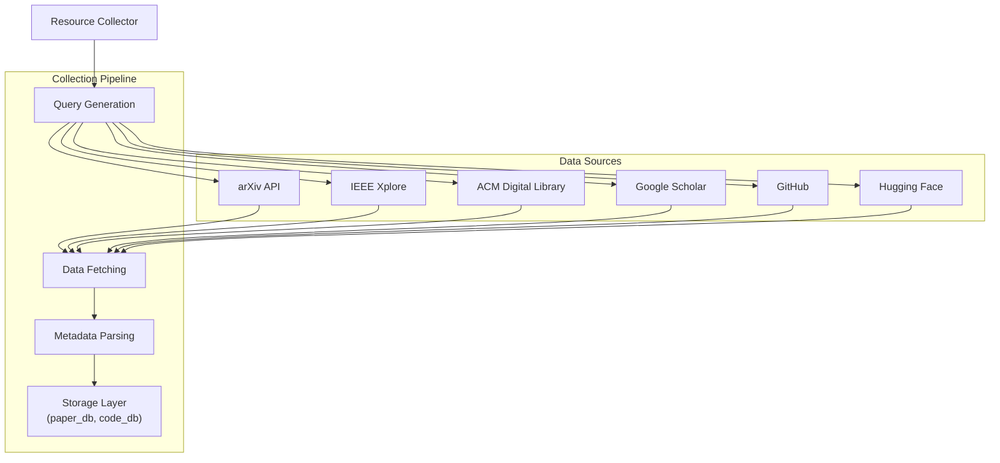

**Sources:** [README.md:936-938]()

---

### Resource Filter Agent

**Purpose:** Evaluates collected resources for quality and relevance, selecting high-impact materials for further analysis.

**Key Responsibilities:**
- Assess paper quality via citation metrics
- Evaluate code repository maintenance status
- Verify dataset completeness and documentation
- Score relevance to research domain
- Filter low-quality or irrelevant resources

**Evaluation Criteria:**

| Resource Type | Quality Metrics | Relevance Metrics |
|---------------|----------------|-------------------|
| **Papers** | Citation count, venue tier, recency | Domain match, methodology alignment |
| **Code** | Stars, commits, maintenance activity | Implementation completeness, documentation |
| **Datasets** | Size, documentation quality | Domain applicability, benchmark status |

**Output Artifacts:**
- Curated high-quality paper set
- Validated code repositories
- Benchmark-quality datasets

**Sources:** [README.md:938-939]()

---

### Idea Generator Agent

**Purpose:** Analyzes curated resources to formulate novel research directions by identifying gaps and emerging trends.

**Key Responsibilities:**
- Analyze methodological limitations in existing work
- Map emerging technological trends
- Identify unexplored research territories
- Synthesize novel research directions
- Generate detailed research proposals

**Analysis Pipeline:**

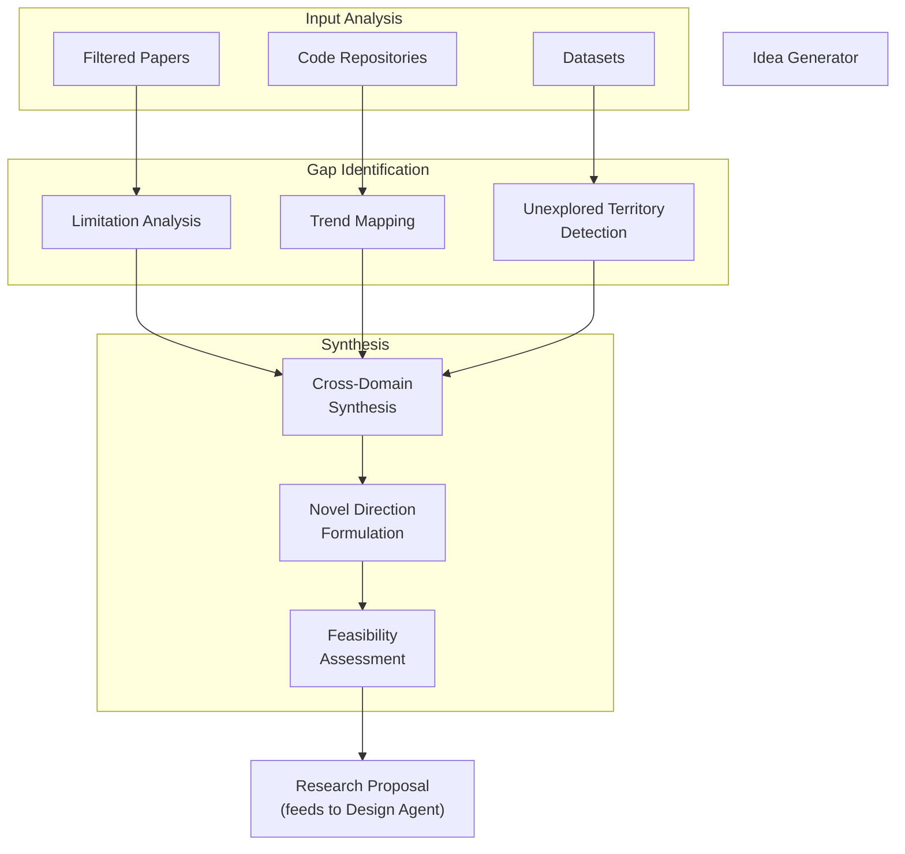

**Output Artifacts:**
- Research proposals with identified gaps
- Methodological innovation suggestions
- Feasibility assessments

**Sources:** [README.md:940-941]()

---

## Phase 2: Algorithm Development Agents

Phase 2 agents execute for both Level 1 and Level 2 tasks, implementing an iterative design-implement-validate-refine cycle.

### Design Agent

**Purpose:** Transforms research ideas into concrete algorithmic designs with theoretical foundations.

**Key Responsibilities:**
- Develop conceptual frameworks
- Establish theoretical foundations
- Define algorithmic structure
- Plan implementation strategy
- Specify component interfaces

**Design Process:**

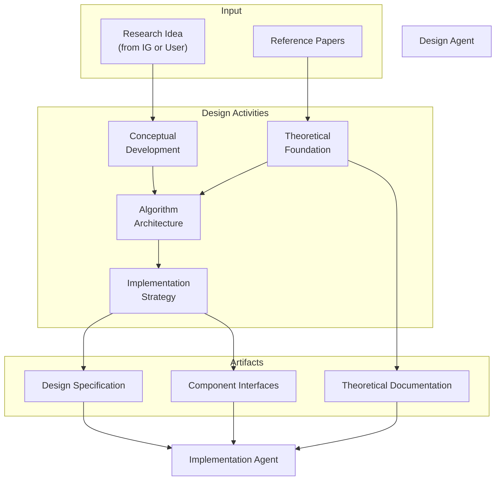

**Output Artifacts:**
- Design specifications
- Component interface definitions
- Theoretical documentation
- Implementation roadmap

**Sources:** [README.md:944](), [README.md:944-945]()

---

### Implementation Agent

**Purpose:** Translates design specifications into functional code with comprehensive testing infrastructure.

**Key Responsibilities:**
- Develop functional modules based on specifications
- Create testing infrastructure
- Implement unit and integration tests
- Document code with inline comments
- Manage dependencies and environment setup

**Implementation Environment:**

| Component | Location | Purpose |
|-----------|----------|---------|
| **Workplace** | `workplace_paper/workplace/` | Isolated execution environment |
| **Docker Container** | `paper_eval` | Standardized runtime environment |
| **Cache** | `cache/` | Intermediate results storage |
| **Code Base** | `code_db/` | Implemented modules |

**Code Generation Pipeline:**

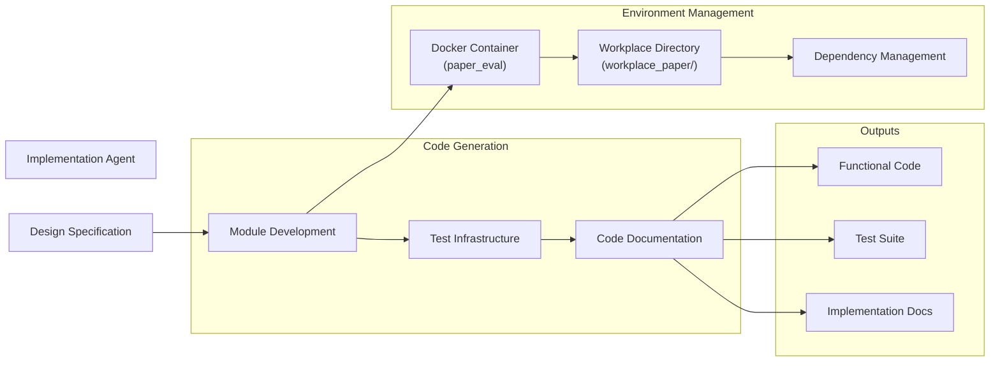

**Sources:** [README.md:946-947](), [README.md:160-183]()

---

### Validation Agent

**Purpose:** Executes systematic experimentation to evaluate algorithm performance and collect metrics.

**Key Responsibilities:**
- Design experimental protocols
- Execute comprehensive test suites
- Collect performance metrics
- Document experimental results
- Verify implementation correctness
- Generate performance reports

**Validation Workflow:**

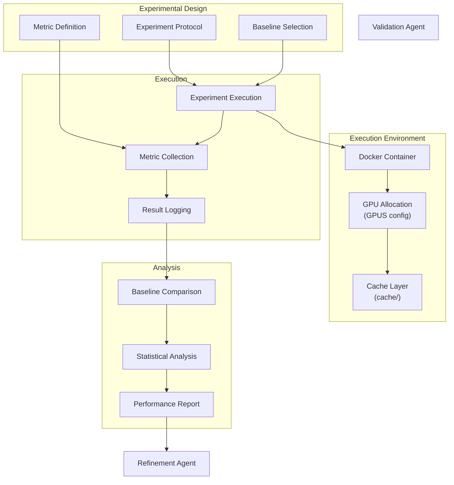

**Metrics Storage:**
- Results directory: `results/`
- Evaluation data: `eval_data/`
- Logs: `*.log` files in workspace

**Sources:** [README.md:948-949]()

---

### Refinement Agent

**Purpose:** Analyzes validation results to identify improvements and orchestrates iterative optimization.

**Key Responsibilities:**
- Analyze performance bottlenecks
- Identify optimization opportunities
- Plan strategic improvements
- Optimize code efficiency
- Implement enhancements
- Determine iteration completion

**Refinement Loop:**

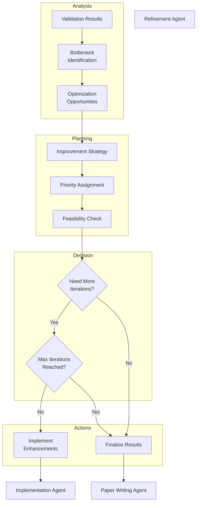

**Iteration Control:**
- Maximum iterations: `MAX_ITER_TIMES` environment variable
- Default: 0 (no iterations)
- Iteration tracking: Stored in cache layer

**Sources:** [README.md:950-951](), [README.md:209]()

---

## Phase 3: Documentation Agent

### Paper Writing Agent

**Purpose:** Synthesizes all research outputs into publication-ready academic manuscripts.

**Key Responsibilities:**
- Integrate research ideas and motivations
- Document algorithm frameworks
- Present validation results
- Generate literature review
- Format manuscript to academic standards
- Create figures and tables

**Code Entity:** `writing.py` in `paper_agent/` directory

**Writing Pipeline:**

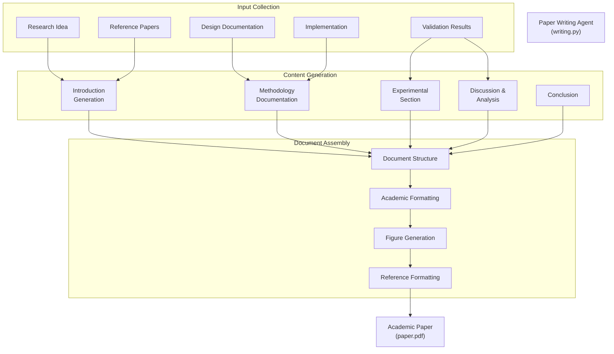

**Execution Command:**
```bash
python writing.py --research_field <category> --instance_id <instance>
```

**Output Artifacts:**
- Full-length academic paper (PDF format)
- LaTeX source files
- Generated figures and tables

**Sources:** [README.md:952-954](), [README.md:1030-1045]()

---

## Agent Coordination Mechanisms

### Communication Architecture

Agents communicate through a **shared workspace architecture** using file-based message passing and structured data exchange.

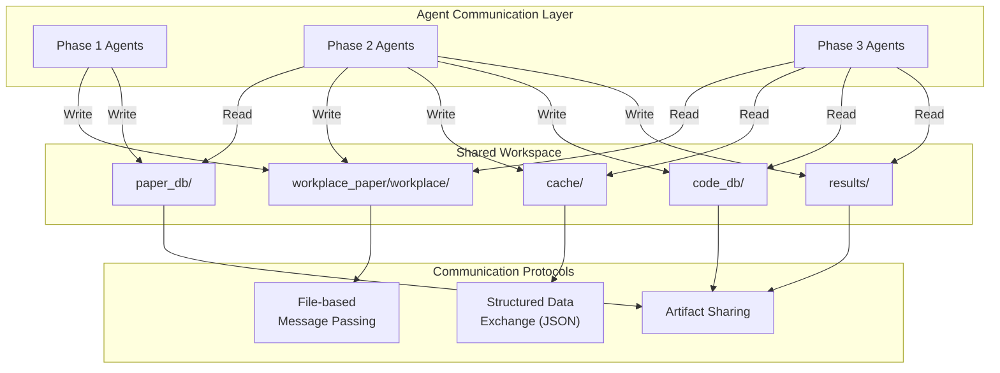

**Sources:** [README.md:160-183]()

---

### State Management

Each agent maintains execution state through the workspace and cache layers:

| State Component | Storage Location | Purpose |
|-----------------|------------------|---------|
| **Execution Context** | `workplace_paper/workplace/` | Current agent working directory |
| **Intermediate Results** | `cache/` | Cached computations and partial outputs |
| **Knowledge Base** | `paper_db/`, `code_db/` | Persistent knowledge storage |
| **Final Outputs** | `results/`, `eval_data/` | Completed agent outputs |
| **Logs** | `*.log` files | Execution traces and debugging info |

**Sources:** [README.md:160-183]()

---

### Orchestration Flow

The Research Agent serves as the primary orchestrator, coordinating agent execution based on task level:

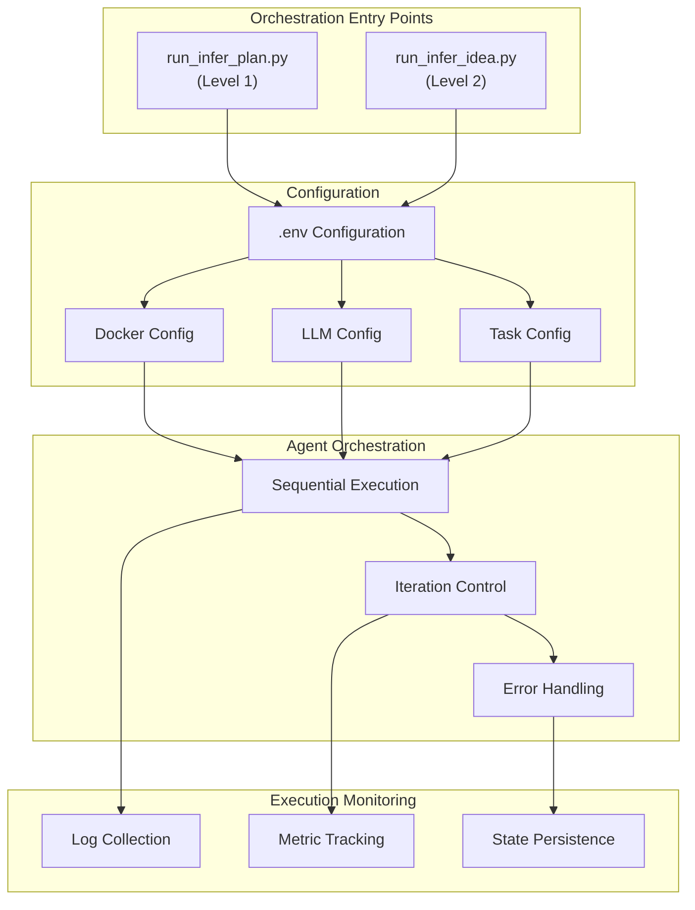

**Configuration Parameters:**

| Parameter | Environment Variable | Purpose |
|-----------|---------------------|---------|
| **Container** | `CONTAINER_NAME` | Docker container identifier |
| **Workplace** | `WORKPLACE_NAME` | Agent workspace directory |
| **Cache** | `CACHE_PATH` | Cache storage location |
| **Port** | `PORT` | API/communication port |
| **GPU** | `GPUS` | GPU allocation for agents |
| **Model** | `COMPLETION_MODEL`, `CHEEP_MODEL` | LLM providers for agents |
| **Iterations** | `MAX_ITER_TIMES` | Refinement iteration limit |

**Sources:** [README.md:158-210](), [README.md:990-1027]()

---

## Agent-LLM Integration

All agents leverage Large Language Models (LLMs) for intelligent decision-making through a **dual-model strategy**:

### Model Assignment Strategy

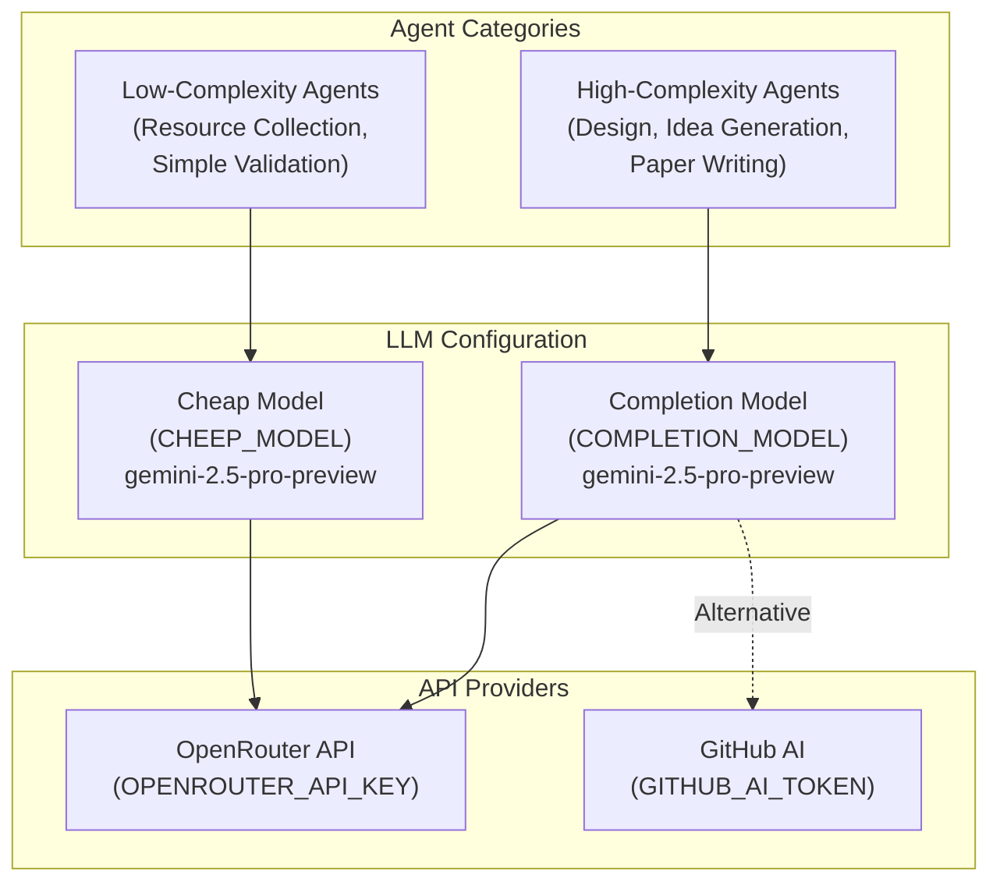

**Model Configuration:**
- **Completion Model:** High-capability model for complex reasoning tasks
- **Cheap Model:** Cost-optimized model for routine operations
- **Default:** Both use `gemini-2.5-pro-preview` via OpenRouter
- **Alternative:** GitHub AI services as backup provider

**Sources:** [README.md:165-191]()

---

## Evaluator Agents

**Evaluator Agents** provide quality assessment across multiple dimensions, supporting other agents with feedback signals.

### Evaluation Dimensions

| Dimension | Purpose | Target Agents |
|-----------|---------|---------------|
| **Novelty** | Innovation assessment | Idea Generator, Design Agent |
| **Experimental Rigor** | Comprehensiveness evaluation | Validation Agent |
| **Theoretical Foundation** | Mathematical strength verification | Design Agent |
| **Result Analysis** | Interpretation quality | Validation Agent, Refinement Agent |
| **Writing Quality** | Clarity and structure assessment | Paper Writing Agent |

### Evaluation Architecture

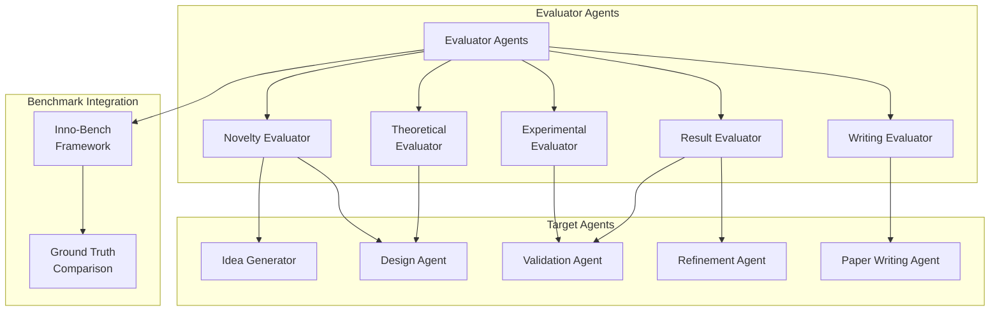

**Sources:** [README.md:959-969]()

---

## Agent Execution Examples

### Level 1 Task Execution (Given Idea)

**Entry Point:** `run_infer_plan.py`

**Parameters:**
- `--instance_path`: Path to task specification JSON
- `--container_name`: Docker container identifier
- `--task_level`: Task level (task1 for Level 1)
- `--model`: Completion model identifier
- `--workplace_name`: Workspace directory name
- `--cache_path`: Cache storage path
- `--port`: Communication port
- `--max_iter_times`: Maximum refinement iterations
- `--category`: Research domain category

**Agent Activation:** Phase 2 + Phase 3 agents only

**Sources:** [README.md:990-1008]()

---

### Level 2 Task Execution (Reference-Based)

**Entry Point:** `run_infer_idea.py`

**Parameters:**
- `--instance_path`: Path to reference papers specification
- `--container_name`: Docker container identifier
- `--model`: Completion model identifier
- `--workplace_name`: Workspace directory name
- `--cache_path`: Cache storage path
- `--port`: Communication port
- `--max_iter_times`: Maximum refinement iterations
- `--category`: Research domain category

**Agent Activation:** Phase 1 + Phase 2 + Phase 3 agents

**Sources:** [README.md:1010-1027]()

---

## Summary

The AI-Researcher agent framework implements a sophisticated multi-agent system that decomposes autonomous research into specialized agent responsibilities:

- **Phase 1 Agents** (Resource Collector, Resource Filter, Idea Generator) handle literature review and ideation
- **Phase 2 Agents** (Design, Implementation, Validation, Refinement) execute iterative algorithm development
- **Phase 3 Agents** (Paper Writing) synthesize outputs into publications
- **Evaluator Agents** provide quality assessment throughout the pipeline

Agents coordinate through shared workspace architecture with file-based communication, orchestrated by Research Agent entry points (`run_infer_plan.py`, `run_infer_idea.py`) based on task level. This modular design enables flexible, autonomous execution of the complete research lifecycle.

**Sources:** [README.md:1-1170]()

---

