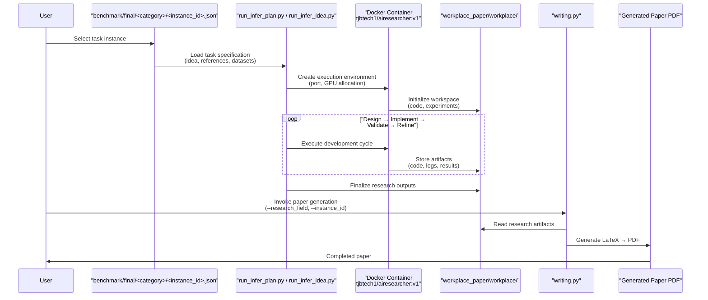
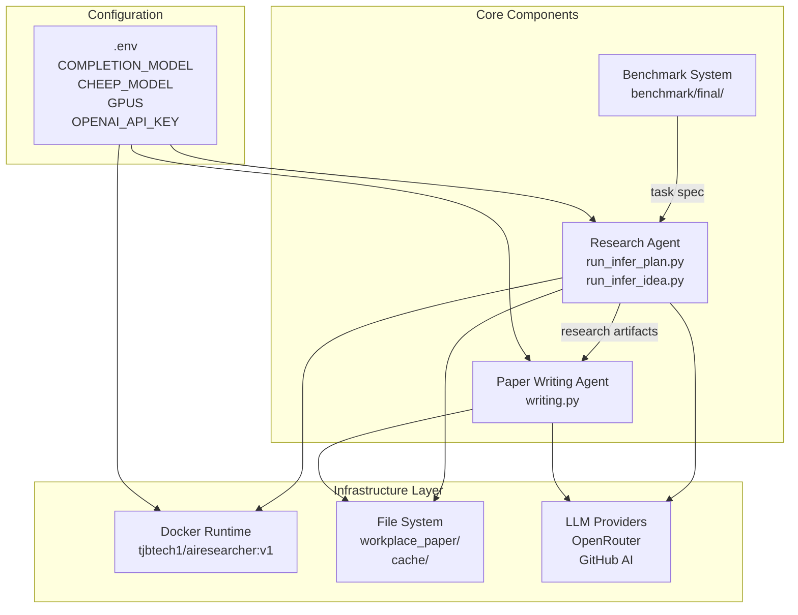

<!-- source: DeepWiki mcp.deepwiki.com · repo HKUDS/AI-Researcher · page 3 Core Components · fetched 2026-11-09 -->

# Core Components

<details>
<summary>Relevant source files</summary>

The following files were used as context for generating this wiki page:

- [README.md](README.md)
- [benchmark/README.md](benchmark/README.md)

</details>


This document provides an overview of the three primary system components that comprise the AI-Researcher platform: the Research Agent, the Paper Writing Agent, and the Benchmark Evaluation Framework (Inno-Bench). These components work together to automate the complete research lifecycle from ideation through implementation to evaluation and publication.

For detailed implementation information about each component, see:
- Research Agent implementation details: [Research Agent](#3.1)
- Paper Writing Agent implementation details: [Paper Writing Agent](#3.2)
- Benchmark evaluation details: [Benchmark System (Inno-Bench)](#3.3)

For information about the overall system architecture and workflow, see [System Architecture](#2). For configuration and deployment details, see [Configuration & Deployment](#4).

---

## System Component Architecture

The AI-Researcher platform consists of three main components that operate sequentially in the research automation pipeline. Each component is implemented as a separate subsystem with distinct entry points and execution models.

```mermaid
graph TB
    subgraph "Component 1: Research Agent"
        L1["Level 1: Given Ideas<br/>run_infer_plan.py"]
        L2["Level 2: Reference-Based<br/>run_infer_idea.py"]
        RC["Resource Collector"]
        IG["Idea Generator"]
        IMPL["Implementation Loop"]
    end
    
    subgraph "Component 2: Paper Writing Agent"
        WRITER["writing.py"]
        LATEX["LaTeX Generation"]
        PDF["PDF Compilation"]
    end
    
    subgraph "Component 3: Benchmark System"
        BENCH["Inno-Bench Framework"]
        TASKS["benchmark/final/<category>/*.json"]
        EVAL["Evaluation Agents"]
    end
    
    subgraph "Shared Infrastructure"
        DOCKER["Docker Container<br/>tjbtech1/airesearcher:v1"]
        WORKPLACE["workplace_paper/workplace/"]
        CACHE["cache/"]
        MODELS["LLM Integration<br/>COMPLETION_MODEL<br/>CHEEP_MODEL"]
    end
    
    L1 --> IMPL
    L2 --> RC
    RC --> IG
    IG --> IMPL
    
    IMPL --> WRITER
    WRITER --> LATEX
    LATEX --> PDF
    
    TASKS -.->"|Input|" L1
    TASKS -.->"|Input|" L2
    PDF -.->"|Output|" EVAL
    
    L1 -.-> DOCKER
    L2 -.-> DOCKER
    IMPL -.-> WORKPLACE
    IMPL -.-> CACHE
    WRITER -.-> MODELS
    IMPL -.-> MODELS
```

**Sources:** [README.md:27-56](), [README.md:932-984](), [README.md:987-1027]()

---

## Component File Structure

The following table maps each core component to its implementation files and key execution entry points:

| Component | Primary Files | Entry Points | Configuration |
|-----------|--------------|--------------|---------------|
| **Research Agent** | `research_agent/run_infer_plan.py`<br/>`research_agent/run_infer_idea.py` | `python run_infer_plan.py --instance_path ...`<br/>`python run_infer_idea.py --instance_path ...` | `COMPLETION_MODEL`<br/>`CHEEP_MODEL`<br/>`GPUS`<br/>`DOCKER_WORKPLACE_NAME` |
| **Paper Writing Agent** | `paper_agent/writing.py` | `python writing.py --research_field ... --instance_id ...` | `OPENAI_API_KEY` |
| **Benchmark System** | `benchmark/final/<category>/*.json`<br/>`benchmark/README.md` | N/A (Data files) | `CATEGORY`<br/>`INSTANCE_ID`<br/>`TASK_LEVEL` |

**Sources:** [README.md:987-1027](), [README.md:1029-1045](), [README.md:1047-1052]()

---

## Component Interaction Flow

The three components operate in a sequential pipeline, with data flowing from benchmark specifications through research execution to paper generation. The following diagram shows the concrete file paths and execution flow:



**Sources:** [README.md:987-1027](), [README.md:1029-1045]()

---

## Research Agent Component

The Research Agent automates the algorithm development lifecycle from initial concept through validated implementation. It operates in two modes corresponding to different task levels.

### Execution Modes

**Mode 1: Given Ideas (Level 1 Tasks)**
- **Entry Point:** `run_infer_plan.py`
- **Input:** Detailed research idea specification from benchmark JSON
- **Process:** Skips literature review, directly implements provided algorithm design
- **Output:** Implemented algorithm with experimental validation

**Mode 2: Reference-Based (Level 2 Tasks)**
- **Entry Point:** `run_infer_idea.py`
- **Input:** List of reference papers
- **Process:** Performs literature review, generates novel ideas, then implements
- **Output:** Novel research direction + implementation + validation

```mermaid
graph LR
    subgraph "run_infer_plan.py (Level 1)"
        JSON1["benchmark JSON<br/>with detailed idea"]
        DESIGN1["Design Phase"]
        IMPL1["Implementation Phase"]
        VALID1["Validation Phase"]
        REFINE1["Refinement Phase"]
    end
    
    subgraph "run_infer_idea.py (Level 2)"
        JSON2["benchmark JSON<br/>with references"]
        COLLECT["Resource Collection"]
        FILTER["Resource Filtering"]
        IDEAGEN["Idea Generation"]
        DESIGN2["Design Phase"]
        IMPL2["Implementation Phase"]
        VALID2["Validation Phase"]
        REFINE2["Refinement Phase"]
    end
    
    JSON1 --> DESIGN1
    DESIGN1 --> IMPL1
    IMPL1 --> VALID1
    VALID1 --> REFINE1
    REFINE1 -.->"|iterate|" IMPL1
    
    JSON2 --> COLLECT
    COLLECT --> FILTER
    FILTER --> IDEAGEN
    IDEAGEN --> DESIGN2
    DESIGN2 --> IMPL2
    IMPL2 --> VALID2
    VALID2 --> REFINE2
    REFINE2 -.->"|iterate|" IMPL2
```

### Key Parameters

| Parameter | Purpose | Example Values |
|-----------|---------|----------------|
| `--instance_path` | Path to benchmark task JSON | `../benchmark/final/vq/one_layer_vq.json` |
| `--container_name` | Docker container identifier | `paper_eval` |
| `--task_level` | Task complexity level (Level 1 only) | `task1`, `task2` |
| `--model` | Completion model name | `claude-3-5-sonnet-20241022`<br/>`openrouter/google/gemini-2.5-pro-preview-05-20` |
| `--workplace_name` | Workspace directory name | `workplace` |
| `--cache_path` | Cache directory for artifacts | `cache` |
| `--port` | Container port binding | `12372`, `7020` |
| `--max_iter_times` | Maximum refinement iterations | `0` (unlimited) |
| `--category` | Research domain category | `vq`, `gnn`, `diffu_flow`, `reasoning` |

**Sources:** [README.md:987-1027](), [README.md:156-210]()

---

## Paper Writing Agent Component

The Paper Writing Agent transforms completed research artifacts into publication-ready academic manuscripts. It operates after the Research Agent completes its development cycle.

### Execution Specification

**Entry Point:** `paper_agent/writing.py`

**Command Structure:**
```bash
python writing.py --research_field <category> --instance_id <instance_id>
```

**Input Sources:**
- Research artifacts from `workplace_paper/workplace/<instance_id>/`
- Experimental results and logs
- Code implementations
- Validation metrics

**Output:**
- Complete LaTeX source files
- Compiled PDF manuscript
- Structured sections: Abstract, Introduction, Methodology, Experiments, Results, Conclusion

### Required Environment Variables

| Variable | Purpose | Example |
|----------|---------|---------|
| `OPENAI_API_KEY` | API authentication for LLM | `sk-...` |

**Sources:** [README.md:1029-1045]()

---

## Benchmark System Component

The Benchmark System (Inno-Bench) provides standardized evaluation tasks with expert-level ground truth for assessing AI-Researcher capabilities across multiple research domains.

### Data Structure

**Location:** `benchmark/final/<category>/<instance_id>.json`

**Supported Categories:**
- `diffu_flow` - Diffusion and flow matching models (4 tasks)
- `gnn` - Graph neural networks (9 tasks)
- `reasoning` - LLM reasoning enhancement (1 task)
- `vq` - Vector quantization methods
- `recommendation` - Recommendation systems

### Benchmark JSON Schema

Each benchmark task is defined in a JSON file containing:

```
{
  "task_description": "<detailed algorithm specification>",
  "reference_papers": ["<paper1>", "<paper2>", ...],
  "datasets": ["<dataset1>", "<dataset2>", ...],
  "evaluation_metrics": ["<metric1>", "<metric2>", ...],
  "ground_truth": "<expert implementation reference>"
}
```

### Task Levels

| Level | Description | Idea Source | Evaluation Focus |
|-------|-------------|-------------|------------------|
| **task1** | Given detailed ideas | User/benchmark provides complete algorithm specification | Implementation quality, experimental rigor, result analysis |
| **task2** | Reference-based ideation | System generates novel ideas from papers | Novelty, theoretical foundation, comprehensiveness, writing quality |

**Sources:** [README.md:959-970](), [benchmark/README.md:1](), [README.md:156-210]()

---

## Component Dependencies

The following diagram illustrates how the three core components depend on shared infrastructure and each other:



**Sources:** [README.md:156-210](), [README.md:987-1045]()

---

## Execution Environment

All components execute within a containerized Docker environment that provides:

- **Base Image:** `tjbtech1/airesearcher:v1`
- **Platform:** `linux/amd64`
- **GPU Access:** Configurable via `GPUS` environment variable
  - `'"device=0"'` - Single GPU
  - `'"device=0,1"'` - Multiple GPUs
  - `'"all"'` - All available GPUs
  - `None` - CPU-only execution
- **Network:** Exposed port (default 7020 or 12372)
- **Volumes:** Mounted workspace and cache directories

**Sources:** [README.md:137-149](), [README.md:156-183]()

---

## Data Flow Summary

The complete data flow through all three components:

1. **Input Stage:** User selects benchmark task from `benchmark/final/<category>/<instance_id>.json`
2. **Research Stage:** Research Agent (`run_infer_plan.py` or `run_infer_idea.py`) executes in Docker container, writing artifacts to `workplace_paper/workplace/`
3. **Writing Stage:** Paper Writing Agent (`writing.py`) reads artifacts from workspace and generates PDF manuscript
4. **Evaluation Stage:** Benchmark framework compares generated paper against expert ground truth across multiple dimensions

**Sources:** [README.md:27-84](), [README.md:932-984](), [README.md:987-1052]()

---

