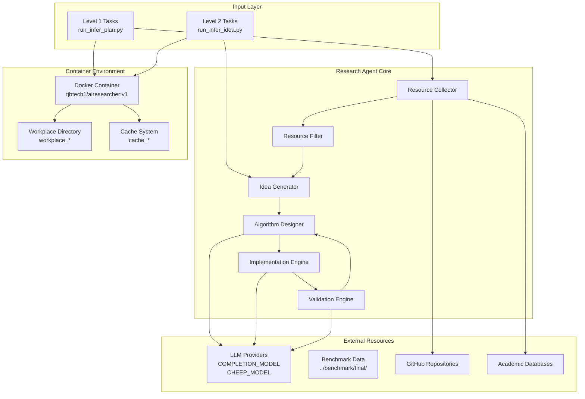
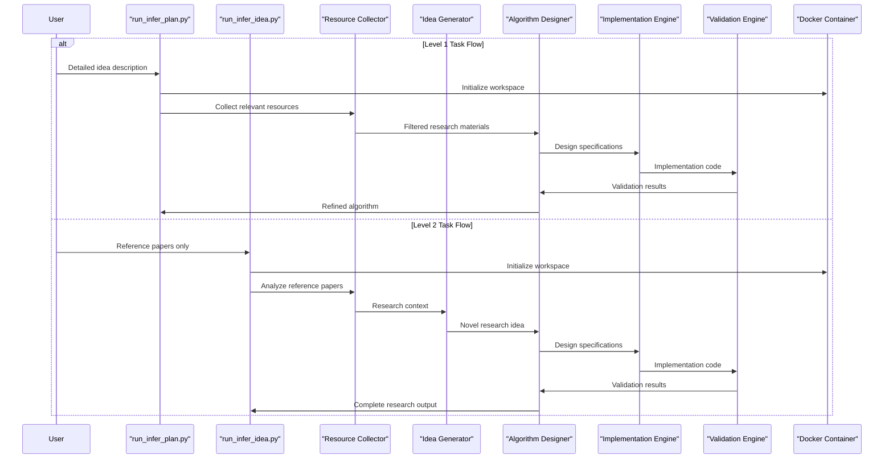
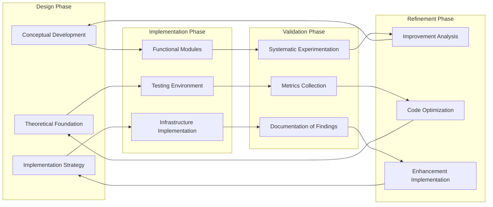

<!-- source: DeepWiki mcp.deepwiki.com · repo HKUDS/AI-Researcher · page 3.1 Research Agent · fetched 2026-11-09 -->

# Research Agent

<details>
<summary>Relevant source files</summary>

The following files were used as context for generating this wiki page:

- [.env.template](.env.template)
- [.gitignore](.gitignore)
- [README.md](README.md)
- [assets/researchagent.svg](assets/researchagent.svg)

</details>


## Purpose and Scope

The Research Agent is the core autonomous research component of the AI-Researcher system, responsible for conducting end-to-end scientific research from idea conception to algorithm implementation and validation. This document covers the Research Agent's architecture, task execution capabilities, workflow processes, and integration patterns.

For information about paper generation after research completion, see [Paper Writing Agent](#3.2). For details about the evaluation framework, see [Benchmark Suite (Inno-Bench)](#3.3).

## Architecture Overview

The Research Agent operates as a containerized system that orchestrates the complete research lifecycle through three primary phases: Literature Review & Idea Generation, Algorithm Design & Implementation, and Validation & Refinement.

### Research Agent System Architecture



Sources: [README.md:32-36](), [README.md:925-947](), [README.md:983-1019]()

## Task Execution Models

The Research Agent supports two distinct task execution models, each designed for different research scenarios and user expertise levels.

### Level 1 Tasks: Detailed Idea Description

Level 1 tasks accept comprehensive research idea descriptions from users and focus on implementation strategy development and experimental validation.

**Execution Command Structure:**
```bash
python run_infer_plan.py --instance_path ../benchmark/final/${category}/${instance_id}.json \
    --container_name paper_eval --task_level task1 --model $COMPLETION_MODEL \
    --workplace_name workplace --cache_path cache --port 12372 \
    --max_iter_times 0 --category ${category}
```

**Key Parameters:**
- `instance_path`: Path to task configuration JSON
- `task_level`: Set to `task1` for Level 1 execution
- `model`: Primary LLM model for research operations
- `workplace_name`: Container workspace directory
- `max_iter_times`: Maximum refinement iterations

### Level 2 Tasks: Reference-Based Ideation

Level 2 tasks generate novel research ideas from provided reference papers and proceed with full research implementation.

**Execution Command Structure:**
```bash
python run_infer_idea.py --instance_path ../benchmark/final/${category}/${instance_id}.json \
    --container_name paper_eval --model $COMPLETION_MODEL \
    --workplace_name workplace --cache_path cache --port 12372 \
    --max_iter_times 0 --category ${category}
```

**Key Differences:**
- Uses `run_infer_idea.py` instead of `run_infer_plan.py`
- No `task_level` parameter (defaults to idea generation mode)
- Focuses on novel concept development from reference materials

Sources: [README.md:983-1000](), [README.md:1002-1019]()

### Research Agent Workflow Process



Sources: [README.md:925-947]()

## Core Research Components

### Resource Collector

The Resource Collector systematically gathers research materials from multiple sources including academic databases, code repositories, and datasets.

**Data Sources:**
- arXiv, IEEE Xplore, ACM Digital Library, Google Scholar
- GitHub repositories and Hugging Face models
- Open datasets across scientific domains

**Quality Metrics:**
- Citation count analysis
- Code maintenance status
- Data completeness assessment
- Relevance scoring

### Resource Filter

Evaluates collected materials using quality metrics and relevance assessment to select high-impact resources for research development.

**Filtering Criteria:**
- Publication venue impact factors
- Repository maintenance activity
- Dataset usage statistics
- Technical relevance alignment

### Idea Generator

Formulates novel research directions through comprehensive analysis of filtered resources, identifying methodological limitations and emerging technological trends.

**Generation Process:**
- Gap analysis in current methodologies
- Trend mapping across research domains
- Novel combination identification
- Feasibility assessment

Sources: [README.md:927-933]()

## Algorithm Development Pipeline

The Research Agent implements a four-phase algorithm development cycle designed for iterative improvement and validation.

### Development Phase Architecture



Sources: [README.md:934-943]()

## Configuration and Environment Setup

### Container Configuration

The Research Agent operates within a Docker container environment with specific GPU and resource configurations.

**Core Environment Variables:**
- `DOCKER_WORKPLACE_NAME`: Container workspace identifier
- `BASE_IMAGES`: Docker image specification (`tjbtech1/airesearcher:v1`)
- `COMPLETION_MODEL`: Primary LLM model endpoint
- `CHEEP_MODEL`: Secondary/fallback LLM model
- `GPUS`: GPU device allocation specification
- `CONTAINER_NAME`: Container instance identifier

**Resource Allocation:**
- `GPUS='"device=0,1"'`: Multi-GPU allocation
- `PORT`: Container communication port (default: 12372)
- `WORKPLACE_NAME`: Workspace directory name
- `CACHE_PATH`: Caching directory path

### Model Configuration

The Research Agent supports multiple LLM providers through standardized model configuration.

**Supported Models:**
- Claude models: `claude-3-5-sonnet-20241022`, `claude-3-5-haiku-20241022`
- OpenRouter models: `openrouter/google/gemini-2.5-pro-preview-05-20`
- OpenAI models and other compatible providers

**Configuration Pattern:**
```bash
export COMPLETION_MODEL=claude-3-5-sonnet-20241022
export CHEEP_MODEL=claude-3-5-haiku-20241022
```

Sources: [README.md:986-1000](), [README.md:1005-1019]()

## Task Categories and Benchmarks

The Research Agent processes tasks across multiple research domains, each with specialized benchmark configurations.

### Supported Research Categories

| Category | Directory Path | Focus Area |
|----------|----------------|------------|
| `diffu_flow` | `../benchmark/final/diffu_flow/` | Diffusion & Flow Matching |
| `gnn` | `../benchmark/final/gnn/` | Graph Neural Networks |
| `reasoning` | `../benchmark/final/reasoning/` | Reasoning Systems |
| `recommendation` | `../benchmark/final/recommendation/` | Recommendation Systems |
| `vq` | `../benchmark/final/vq/` | Vector Quantization |

### Instance Configuration

Each research task is defined by a JSON configuration file containing:
- Task specification and constraints
- Reference paper lists
- Evaluation criteria
- Expected output formats

**Configuration Path Pattern:**
```
../benchmark/final/${category}/${instance_id}.json
```

Sources: [README.md:995-996](), [README.md:1014-1015]()

## Integration Points

### Paper Writing Agent Integration

Upon completion of the research phase, the Research Agent outputs can be processed by the Paper Writing Agent for manuscript generation.

**Integration Workflow:**
1. Research Agent completes algorithm development and validation
2. Results stored in workspace directory structure
3. Paper Writing Agent accesses research outputs
4. Automated manuscript generation initiated

### Benchmark System Integration

The Research Agent operates within the Inno-Bench evaluation framework, receiving task specifications and submitting results for comprehensive assessment.

**Evaluation Dimensions:**
- Novelty assessment
- Experimental comprehensiveness
- Theoretical foundation strength
- Result analysis depth
- Implementation quality

Sources: [README.md:1021-1037](), [README.md:951-961]()

---

