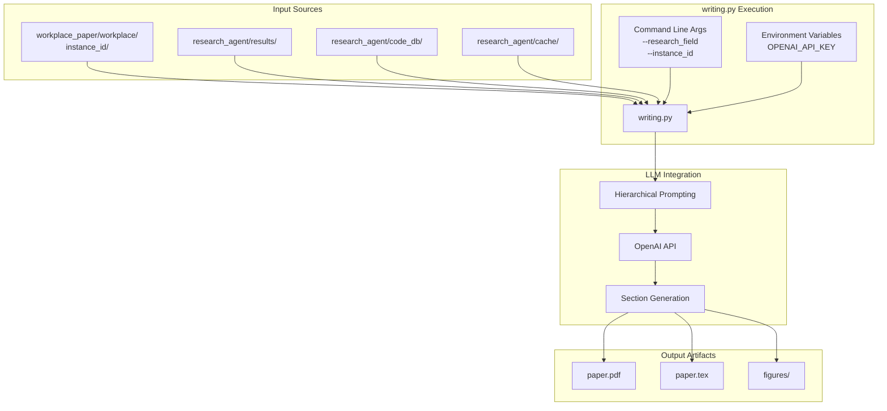
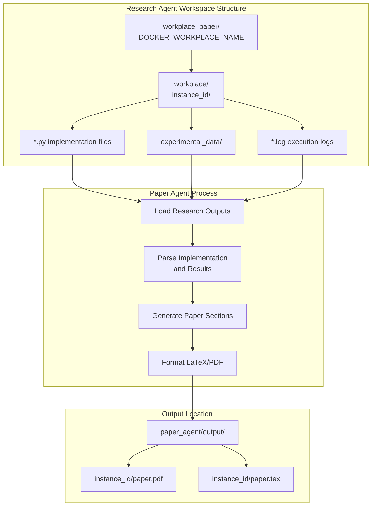
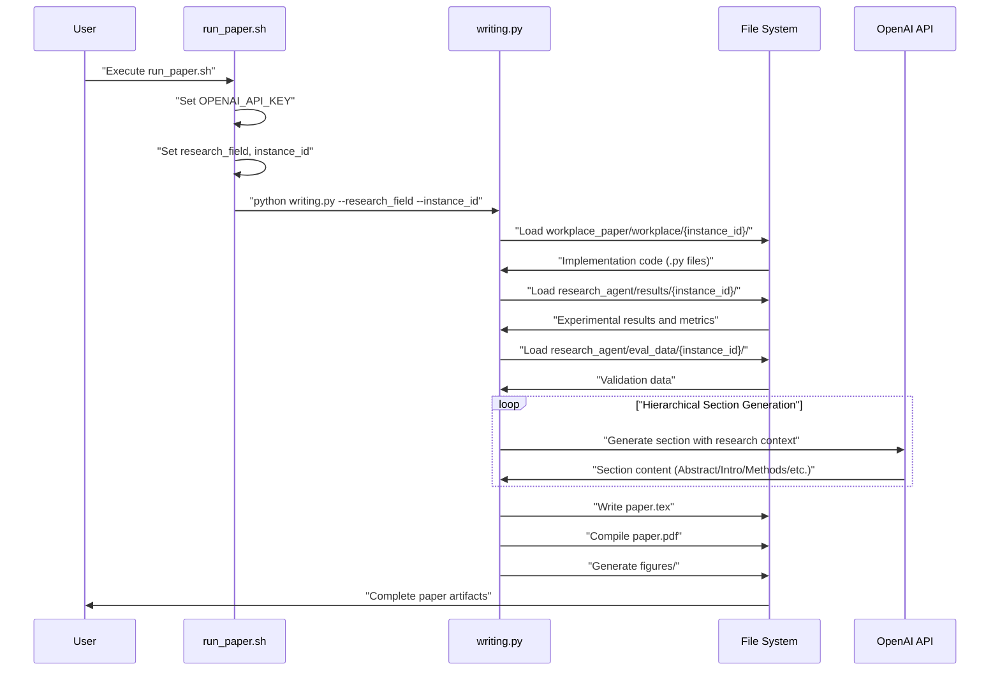

<!-- source: DeepWiki mcp.deepwiki.com · repo HKUDS/AI-Researcher · page 3.2 Paper Writing Agent · fetched 2026-11-09 -->

# Paper Writing Agent

<details>
<summary>Relevant source files</summary>

The following files were used as context for generating this wiki page:

- [.gitignore](.gitignore)
- [README.md](README.md)

</details>


The Paper Writing Agent (`writing.py`) is the automated academic manuscript generation component of the AI-Researcher system. It transforms research outputs from the Research Agent—including algorithmic implementations, experimental results, and validation data—into complete, publication-ready academic papers. The agent implements a hierarchical writing approach that systematically generates structured manuscripts with standard academic sections.

For information about the research pipeline that precedes paper generation, see [Research Agent](#3.1). For details on the overall system architecture, see [System Architecture](#2).

Sources: [README.md:944-946](), [README.md:1029-1045]()
</thinking>

## Core Implementation

The Paper Writing Agent is implemented as a standalone Python script that processes structured research workspace data to generate academic manuscripts.

### Main Script

The primary entry point is [`paper_agent/writing.py`](), which orchestrates the paper generation process. The script accepts research field and instance identifiers to locate and process the corresponding research outputs.

Sources: [README.md:1036]()

## Execution Flow

### Paper Generation Pipeline



Sources: [README.md:1029-1045](), [.gitignore:1-32]()

### Integration with Research Agent Workspace

The Paper Writing Agent reads from the Research Agent's workspace structure:



Sources: [.gitignore:1-6](), [README.md:161](), [README.md:1033-1036]()

## Input Specifications

### Command Line Parameters

The Paper Writing Agent accepts the following command line arguments:

| Parameter | Type | Required | Description | Example Values |
|-----------|------|----------|-------------|----------------|
| `--research_field` | String | Yes | Research domain category from benchmark | `vq`, `gnn`, `reasoning`, `diffu_flow`, `recommendation` |
| `--instance_id` | String | Yes | Specific research instance identifier | `one_layer_vq`, `rotated_vq`, `gnn_nodeformer` |

Sources: [README.md:1033-1036]()

### Environment Variables

| Variable | Purpose | Required |
|----------|---------|----------|
| `OPENAI_API_KEY` | Authentication for LLM provider API | Yes |

Sources: [README.md:1030]()

### Workspace Data Sources

The agent reads from Research Agent output directories:

| Data Source | Location Pattern | Content |
|-------------|------------------|---------|
| Implementation Code | `workplace_paper/workplace/{instance_id}/*.py` | Algorithm implementations |
| Experimental Results | `research_agent/results/{instance_id}/` | Performance metrics and logs |
| Validation Data | `research_agent/eval_data/{instance_id}/` | Evaluation outputs |
| Execution Logs | `workplace_paper/workplace/{instance_id}/*.log` | Runtime information |

Sources: [.gitignore:1-18](), [README.md:161-177]()

## Paper Generation Process

### Sequential Execution Flow



Sources: [README.md:1025-1045](), [.gitignore:1-32]()

### Hierarchical Writing Methodology

The agent implements a hierarchical writing approach that generates academic papers through structured prompting:

1. **Data Aggregation**: Collects implementation code, experimental results, and validation metrics from workspace directories
2. **Context Preparation**: Structures research outputs into LLM-readable format with research field and instance context
3. **Section-by-Section Generation**: Generates standard academic sections (Abstract, Introduction, Related Work, Methodology, Experiments, Results, Conclusion) using hierarchical prompting
4. **Content Integration**: Combines generated sections with proper academic formatting and cross-references
5. **LaTeX Compilation**: Produces formatted `.tex` source and compiles to PDF
6. **Figure Generation**: Creates visualizations from experimental data

This approach ensures "polished manuscripts with precision and clarity" by leveraging LLM capabilities with structured research context.

Sources: [README.md:944-946]()

## Usage Guide

### Shell Script Execution

The recommended approach is to use the provided shell script [`paper_agent/run_paper.sh`]():

```bash
#!/bin/bash

cd path/to/AI-Researcher/paper_agent

export OPENAI_API_KEY=sk-your_api_key_here

research_field=vq
instance_id=rotated_vq

python path/to/AI-Researcher/paper_agent/writing.py \
    --research_field ${research_field} \
    --instance_id ${instance_id}
```

Sources: [README.md:1025-1036]()

### Direct Python Execution

Alternatively, execute `writing.py` directly:

```bash
cd AI-Researcher/paper_agent

export OPENAI_API_KEY=your_api_key

python writing.py \
    --research_field gnn \
    --instance_id gnn_nodeformer
```

### Example Invocations

| Research Field | Instance ID | Description |
|----------------|-------------|-------------|
| `vq` | `rotated_vq` | Vector quantization with rotation transformation |
| `vq` | `one_layer_vq` | Single-layer VQ-VAE implementation |
| `gnn` | `gnn_nodeformer` | NodeFormer scalable structure learning |
| `gnn` | `gnn_difformer` | DIFFormer energy-constrained diffusion |
| `diffu_flow` | `con_flowmatching` | Consistency flow matching |
| `reasoning` | `analog_reasoner` | Analogical prompting for LLMs |

Sources: [README.md:1033-1036](), [README.md:194-208]()

## System Integration

### Research Agent Coupling

The Paper Writing Agent operates on Research Agent outputs through directory-based data exchange:

**Input Dependencies:**
- [`workplace_paper/workplace/{instance_id}/`]() - Research workspace containing implementation code
- [`research_agent/results/{instance_id}/`]() - Experimental validation data and performance metrics
- [`research_agent/eval_data/{instance_id}/`]() - Evaluation outputs and analysis
- [`research_agent/cache/`]() - Cached intermediate results (if applicable)

**Data Flow:**
1. Research Agent completes execution via `run_infer_plan.py` or `run_infer_idea.py`
2. Outputs written to workspace directories (`workplace_*/`, `workspace_*/`)
3. Results stored in `results/`, `eval_data/` directories
4. Paper Writing Agent reads these structured outputs
5. Generates manuscript integrating all research artifacts

Sources: [.gitignore:1-27](), [README.md:991-1027]()

### LLM Provider Configuration

The agent currently integrates with OpenAI API for content generation:

**Authentication:**
- Requires `OPENAI_API_KEY` environment variable
- API key used for all LLM interactions during paper generation

**Extension Points:**
The architecture is designed to support additional LLM providers following the pattern used in the Research Agent, which supports:
- OpenRouter (`OPENROUTER_API_KEY`, `OPENROUTER_API_BASE`)
- GitHub AI (`GITHUB_AI_TOKEN`)
- Multiple model configurations (`COMPLETION_MODEL`, `CHEEP_MODEL`)

Sources: [README.md:1030](), [README.md:186-191]()

## Output Artifacts

### Generated Paper Components

The Paper Writing Agent produces comprehensive academic manuscripts including:

- **Complete PDF Document**: Publication-ready academic paper
- **LaTeX Source**: Editable manuscript source files  
- **Integrated Figures**: Generated visualizations and result charts
- **Structured Content**: Standard academic sections (Abstract, Introduction, Methodology, Experiments, Results, Conclusion)
- **References**: Properly formatted citation integration

### Quality Standards

The generated papers maintain academic quality through:

- **Standard Formatting**: Adherence to academic paper conventions
- **Coherent Structure**: Logical flow from motivation to conclusions
- **Experimental Integration**: Comprehensive inclusion of validation results
- **Technical Accuracy**: Precise representation of algorithmic contributions

Sources: [README.md:944-946]()

---

