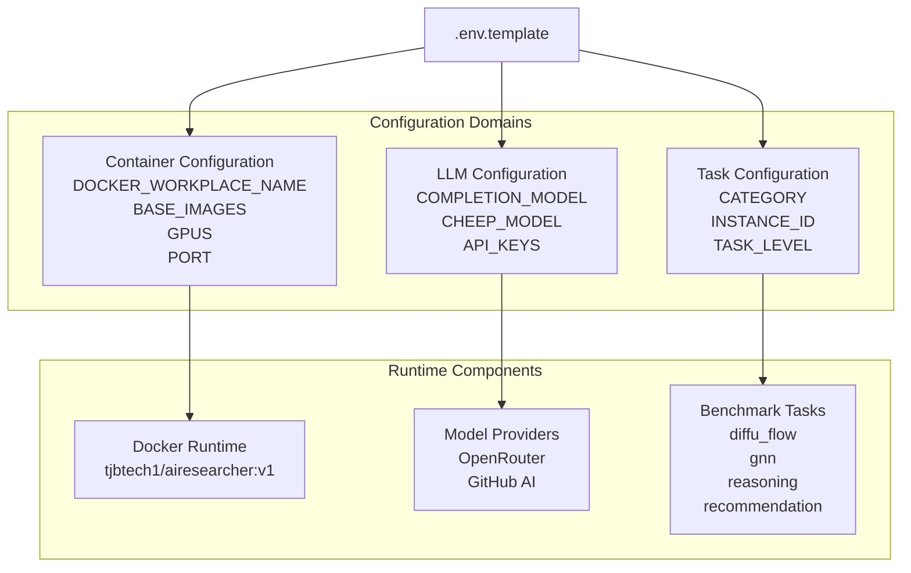
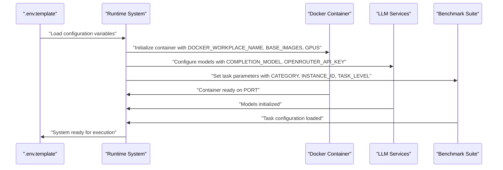
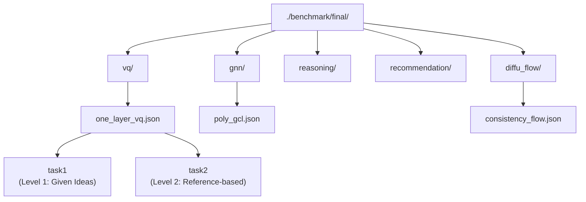

<!-- source: DeepWiki mcp.deepwiki.com · repo HKUDS/AI-Researcher · page 4.1 Environment Configuration · fetched 2026-11-09 -->

# Environment Configuration

Relevant source files

The following files were used as context for generating this wiki page:

- [.env.template](.env.template)

## Purpose and Scope

This document provides comprehensive guidance for configuring the AI-Researcher system through environment variables, LLM provider settings, and task-specific parameters. The configuration system controls container deployment, model selection, GPU allocation, and research task execution parameters.

For information about Docker containerization and deployment, see [Docker Containerization](#4.2). For LLM provider integration details, see [LLM Integration](#4.3).

## Configuration Architecture

The AI-Researcher system uses a centralized environment configuration approach through the `.env.template` file, which defines three primary configuration domains:

**Configuration Flow and System Integration**

Sources: [.env.template:1-53]()

## Container Configuration

The container configuration section manages Docker deployment parameters, resource allocation, and workspace setup.

| Variable | Purpose | Example Values | Description |
|----------|---------|----------------|-------------|
| `DOCKER_WORKPLACE_NAME` | Container workspace identifier | `workplace_paper` | Name of the working directory inside container |
| `BASE_IMAGES` | Docker base image | `tjbtech1/airesearcher:v1` | Pre-built container image with dependencies |
| `GPUS` | GPU allocation specification | `"device=0"`, `"device=0,1"`, `"all"`, `None` | Controls GPU access for computational tasks |
| `CONTAINER_NAME` | Docker container identifier | `paper_eval` | Unique name for the running container instance |
| `WORKPLACE_NAME` | Host workspace directory | `workplace` | Local directory mounted to container |
| `CACHE_PATH` | Cache storage location | `cache` | Directory for storing temporary and cached data |
| `PORT` | Container port mapping | `7020` | Port for accessing container services |
| `PLATFORM` | Target platform architecture | `linux/amd64` | Container platform specification |

### GPU Configuration Patterns

The `GPUS` variable supports multiple allocation strategies:

- **Single GPU**: `"device=0"` - Allocates the first available GPU
- **Multiple GPUs**: `"device=0,1"` - Allocates specific GPU devices  
- **All GPUs**: `"all"` - Allocates all available GPU resources
- **No GPU**: `None` - CPU-only execution mode

Sources: [.env.template:2-26]()

## LLM Configuration

The LLM configuration section manages API credentials and model selection for the research agents.

| Variable | Purpose | Configuration Details |
|----------|---------|----------------------|
| `COMPLETION_MODEL` | Primary model for complex reasoning tasks | Uses LiteLLM format: `openrouter/google/gemini-2.5-pro-preview-05-20` |
| `CHEEP_MODEL` | Cost-efficient model for basic operations | Same format as completion model |
| `GITHUB_AI_TOKEN` | GitHub AI services authentication | Required for GitHub-based AI features |
| `OPENROUTER_API_KEY` | OpenRouter service access key | Authentication for OpenRouter model access |
| `OPENROUTER_API_BASE` | OpenRouter API endpoint | Default: `https://openrouter.ai/api/v1` |

### Model Selection Strategy

The system employs a dual-model approach:
- **Completion Model**: High-capability model for research-intensive tasks
- **Cheap Model**: Cost-optimized model for routine operations

Both models follow the LiteLLM naming convention, enabling integration with multiple providers through a unified interface.

Sources: [.env.template:28-34]()

## Task Configuration

The task configuration section defines research domain parameters and execution settings for benchmark tasks.

| Variable | Purpose | Available Options | Description |
|----------|---------|-------------------|-------------|
| `CATEGORY` | Research domain selection | `diffu_flow`, `gnn`, `reasoning`, `recommendation`, `vq` | Maps to benchmark directory structure |
| `INSTANCE_ID` | Specific task instance | `one_layer_vq` | References JSON configuration file |
| `TASK_LEVEL` | Task complexity level | `task1`, `task2` | Corresponds to Level 1 and Level 2 execution modes |
| `MAX_ITER_TIMES` | Maximum iteration limit | `0` (unlimited), positive integers | Controls research iteration cycles |

### Task Hierarchy Structure

### Category-Instance Mapping

Each `CATEGORY` corresponds to a directory under `./benchmark/final/`, and each `INSTANCE_ID` references a specific JSON configuration file within that category:

- **Category Path**: `./benchmark/final/{CATEGORY}/`
- **Instance File**: `./benchmark/final/{CATEGORY}/{INSTANCE_ID}.json`
- **Task Levels**: `task1` (detailed ideas), `task2` (reference-based ideation)

Sources: [.env.template:36-52]()

## Configuration Validation and Dependencies

The environment configuration system requires specific variable dependencies and validation patterns:

### Required Variables
- **Container**: `DOCKER_WORKPLACE_NAME`, `BASE_IMAGES`, `CONTAINER_NAME`
- **LLM**: At least one of `GITHUB_AI_TOKEN` or `OPENROUTER_API_KEY` must be configured
- **Task**: `CATEGORY`, `INSTANCE_ID`, `TASK_LEVEL` must form a valid benchmark path

### Optional Variables
- `GPUS` (defaults to no GPU if not specified)
- `MAX_ITER_TIMES` (defaults to unlimited iterations)
- `CACHE_PATH` (defaults to standard cache location)

### Configuration File Template

The `.env.template` file serves as the authoritative configuration template. To use the system:

1. Copy `.env.template` to `.env`
2. Replace placeholder values with actual credentials and preferences
3. Ensure the specified `CATEGORY`/`INSTANCE_ID` combination exists in the benchmark directory
4. Verify GPU availability matches the `GPUS` specification

Sources: [.env.template:1-53]()

---

