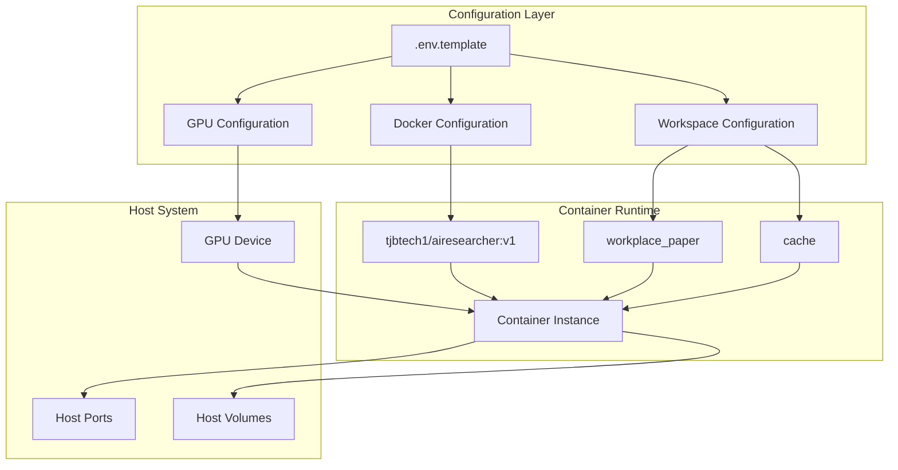
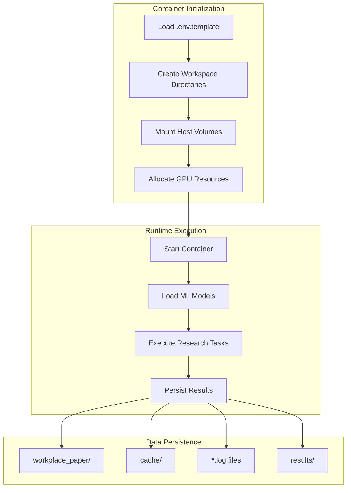

<!-- source: DeepWiki mcp.deepwiki.com · repo HKUDS/AI-Researcher · page 4.2 Docker Containerization · fetched 2026-11-09 -->

# Docker Containerization

<details>
<summary>Relevant source files</summary>

The following files were used as context for generating this wiki page:

- [.env.template](.env.template)
- [.gitignore](.gitignore)
- [README.md](README.md)

</details>


## Purpose and Scope

This document covers the Docker containerization implementation for the AI-Researcher system, including container configuration, GPU setup, volume management, and deployment parameters. The containerization layer provides isolated execution environments for research tasks while maintaining access to computational resources and persistent storage.

For environment variable configuration details, see [Environment Configuration](#4.1). For LLM provider integration within containers, see [LLM Integration](#4.3).

## Container Architecture Overview

The AI-Researcher system uses a containerized architecture with dedicated workspaces and GPU access for computational research tasks.

**Container Architecture and Configuration Flow**


Sources: [.env.template:2-26]()

## Base Image Configuration

The system uses a pre-built Docker image that contains the necessary research environment and dependencies.

### Base Image Specification

The primary container image is defined in the configuration:

| Configuration Parameter | Value | Purpose |
|------------------------|-------|---------|
| `BASE_IMAGES` | `tjbtech1/airesearcher:v1` | Core research environment image |
| `PLATFORM` | `linux/amd64` | Target platform architecture |
| `CONTAINER_NAME` | `paper_eval` | Container instance identifier |

The base image `tjbtech1/airesearcher:v1` provides the complete research environment including Python dependencies, ML frameworks, and research tools necessary for autonomous research execution.

Sources: [.env.template:5-6](), [.env.template:18](), [.env.template:26]()

## GPU Configuration

The system supports flexible GPU allocation for computational research tasks through Docker's GPU runtime.

### GPU Allocation Options

The `GPUS` parameter supports multiple allocation strategies:

| GPU Configuration | Value | Description |
|------------------|-------|-------------|
| Single GPU | `"device=0"` | Allocates first GPU device |
| Multiple GPUs | `"device=0,1"` | Allocates specific GPU devices |
| All GPUs | `"all"` | Allocates all available GPUs |
| No GPU | `None` | CPU-only execution |

**GPU Configuration Flow**
```mermaid
graph LR
    subgraph "GPU Configuration"
        GPUS_ENV["GPUS environment variable"]
        DEVICE_SINGLE['"device=0"']
        DEVICE_MULTI['"device=0,1"']
        DEVICE_ALL['"all"']
        DEVICE_NONE["None"]
    end
    
    subgraph "Docker Runtime"
        GPU_RUNTIME["Docker GPU Runtime"]
        CONTAINER_GPU["Container GPU Access"]
    end
    
    subgraph "Research Tasks"
        ML_TRAINING["ML Model Training"]
        INFERENCE["Model Inference"]
        EVALUATION["Benchmark Evaluation"]
    end
    
    GPUS_ENV --> DEVICE_SINGLE
    GPUS_ENV --> DEVICE_MULTI
    GPUS_ENV --> DEVICE_ALL
    GPUS_ENV --> DEVICE_NONE
    
    DEVICE_SINGLE --> GPU_RUNTIME
    DEVICE_MULTI --> GPU_RUNTIME
    DEVICE_ALL --> GPU_RUNTIME
    
    GPU_RUNTIME --> CONTAINER_GPU
    CONTAINER_GPU --> ML_TRAINING
    CONTAINER_GPU --> INFERENCE
    CONTAINER_GPU --> EVALUATION
```

The default configuration allocates the first GPU device: `GPUS='"device=0"'`

Sources: [.env.template:11-16]()

## Workspace and Volume Management

The containerization system manages persistent storage through workspace directories and cache volumes.

### Workspace Directory Structure

| Directory Type | Configuration Variable | Purpose |
|---------------|----------------------|---------|
| Docker Workplace | `DOCKER_WORKPLACE_NAME=workplace_paper` | Primary container workspace |
| General Workplace | `WORKPLACE_NAME=workplace` | Secondary workspace directory |
| Cache Directory | `CACHE_PATH=cache` | Persistent cache storage |

### Excluded Directories

The system excludes several directories from version control to maintain clean repository state:

- Workspace directories: `workplace_*/`, `workspace_*/`
- Log files: `*.log`
- Cache directories: `cache/*`, `cache_*/*`
- Temporary directories: `*_tmp/*`
- Evaluation data: `eval_data/*`, `evaluation_results/*`

These exclusions ensure that runtime artifacts and large datasets remain local to each deployment instance.

Sources: [.env.template:4](), [.env.template:20](), [.env.template:22](), [.gitignore:1-31]()

## Port and Network Configuration

The container exposes services through configurable port mapping for external access.

### Network Configuration

| Parameter | Default Value | Purpose |
|-----------|---------------|---------|
| `PORT` | `7020` | Primary service port |
| Host Binding | Configurable | External access port |

The port configuration enables access to web interfaces and API endpoints running within the container environment.

Sources: [.env.template:24]()

## Container Lifecycle Management

The system manages container lifecycle through configuration-driven deployment and workspace persistence.

**Container Lifecycle and Data Flow**


### Environment Variables Integration

The container runtime integrates with environment variables for:

- LLM API configurations (`GITHUB_AI_TOKEN`, `OPENROUTER_API_KEY`)
- Task parameters (`CATEGORY`, `INSTANCE_ID`, `TASK_LEVEL`)
- Runtime limits (`MAX_ITER_TIMES`)

This configuration approach ensures containers can be deployed with different research parameters while maintaining consistent base functionality.

Sources: [.env.template:29-52](), [.gitignore:1-31]()

## Platform and Deployment Considerations

The system targets Linux AMD64 architecture for consistent deployment across research infrastructure.

### Platform Specification

The `PLATFORM=linux/amd64` configuration ensures compatibility with:
- Standard research computing environments
- Cloud computing platforms
- GPU-enabled infrastructure
- Container orchestration systems

### Resource Requirements

The containerized environment requires:
- CUDA-compatible GPU drivers (for GPU configurations)
- Sufficient disk space for workspace directories and cache
- Network access for LLM API communications
- Memory allocation for ML model loading and inference

Sources: [.env.template:26]()

---

