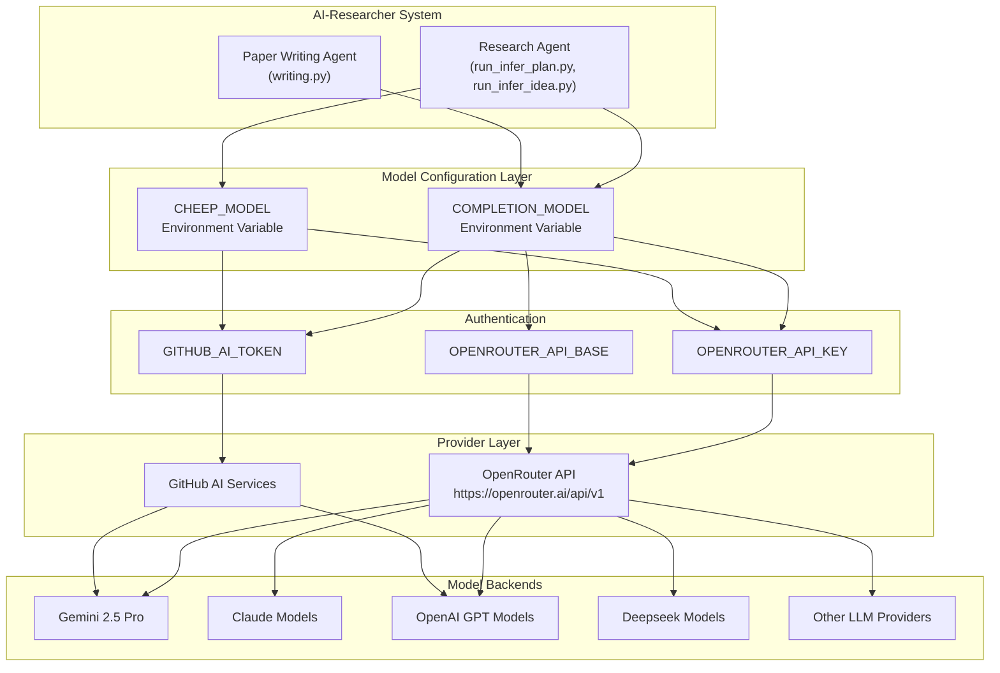
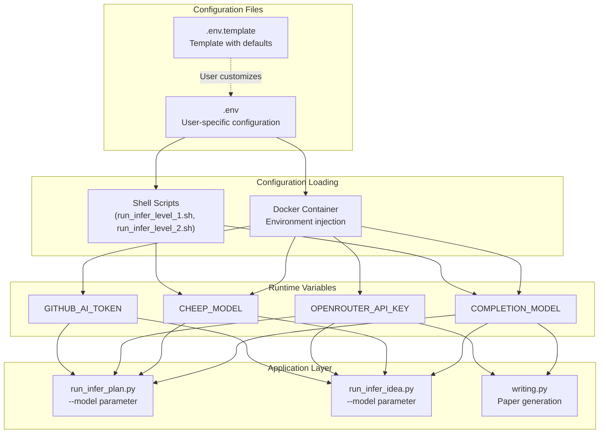
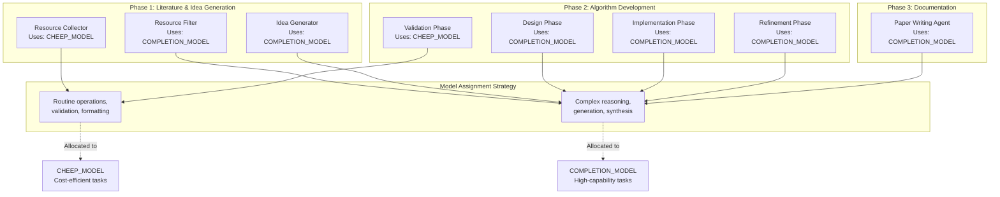

<!-- source: DeepWiki mcp.deepwiki.com · repo HKUDS/AI-Researcher · page 4.3 LLM Integration · fetched 2026-11-09 -->

# LLM Integration

<details>
<summary>Relevant source files</summary>

The following files were used as context for generating this wiki page:

- [.env.template](.env.template)
- [README.md](README.md)

</details>


## Purpose and Scope

This document describes the Large Language Model (LLM) integration architecture within the AI-Researcher system. It covers the dual-model strategy, provider configuration, API key management, and how LLMs are invoked throughout the research pipeline. For information about how these LLMs are used in specific research workflows, see [Research Agent](#3.1) and [Paper Writing Agent](#3.2). For overall environment configuration, see [Environment Configuration](#4.1).

**Sources:** [.env.template:1-53](), [README.md:1-1101]()

---

## Dual-Model Strategy

The AI-Researcher system employs a **dual-model architecture** that designates two distinct LLM roles to optimize both performance and cost:

| Model Type | Configuration Variable | Purpose | Typical Use Cases |
|------------|----------------------|---------|-------------------|
| **Completion Model** | `COMPLETION_MODEL` | High-capability model for complex reasoning and generation tasks | Algorithm design, paper writing, complex code generation, research idea synthesis |
| **Cheap Model** | `CHEEP_MODEL` | Cost-effective model for simpler tasks | Routine operations, simple queries, validation checks, code formatting |

This strategy enables intelligent cost management by routing computationally expensive operations to premium models while handling routine tasks with more economical alternatives. Both models default to `openrouter/google/gemini-2.5-pro-preview-05-20` in the template configuration, but can be independently configured for different providers and model variants.

**Sources:** [.env.template:7-10](), [README.md:163-167]()

---

## Provider Architecture

### Provider Integration Model



**Sources:** [.env.template:7-10](), [.env.template:28-34](), [README.md:185-191]()

---

## Configuration Parameters

### Environment Variables

The LLM integration is configured through environment variables defined in `.env` (generated from `.env.template`):

#### Model Selection

```bash
# Completion model name, configuration details see: https://docs.litellm.ai/docs/
COMPLETION_MODEL=openrouter/google/gemini-2.5-pro-preview-05-20

# Cheep model name, configuration details see: https://docs.litellm.ai/docs/
CHEEP_MODEL=openrouter/google/gemini-2.5-pro-preview-05-20
```

The model names follow the **LiteLLM** convention (referenced at [.env.template:7]()), which uses the format `provider/model-name`. This allows seamless swapping between providers without code changes.

**Sources:** [.env.template:7-10]()

#### Authentication Configuration

```bash
# github ai token of the research agent
GITHUB_AI_TOKEN=your_github_ai_token

# openrouter api key of the research agent
OPENROUTER_API_KEY=your_openrouter_api_key

# openrouter api base url of the research agent
OPENROUTER_API_BASE=https://openrouter.ai/api/v1
```

**Authentication Requirements:**
- **OpenRouter**: Requires `OPENROUTER_API_KEY` for access to multi-provider models
- **GitHub AI**: Requires `GITHUB_AI_TOKEN` for GitHub-hosted AI services
- Both credentials can be configured simultaneously for provider redundancy

**Sources:** [.env.template:28-34](), [README.md:185-191]()

---

## Provider Options

### OpenRouter Integration

**OpenRouter** serves as the primary LLM gateway, providing unified access to multiple model providers through a single API:

- **Base URL**: `https://openrouter.ai/api/v1` (configurable via `OPENROUTER_API_BASE`)
- **Authentication**: API key authentication via `OPENROUTER_API_KEY`
- **Supported Models**: Gemini, Claude, GPT-4, Deepseek, and numerous other providers
- **Default Configuration**: Both completion and cheap models default to Gemini 2.5 Pro via OpenRouter

**Advantages:**
- Single API key for multiple model providers
- Automatic failover and load balancing
- Cost tracking and usage analytics
- Consistent API interface regardless of backend model

**Sources:** [.env.template:31-34](), [README.md:188-191]()

### GitHub AI Integration

**GitHub AI Services** provides an alternative LLM access pathway:

- **Authentication**: Token-based authentication via `GITHUB_AI_TOKEN`
- **Use Case**: Alternative provider when OpenRouter is unavailable or for specific model access
- **Configuration**: Set model names without the `openrouter/` prefix when using GitHub AI

**Sources:** [.env.template:29-30]()

---

## Model Selection Matrix

### Supported Model Configurations

The following table shows common model configurations referenced in the codebase:

| Model Provider | Model Name | Configuration String | Use Cases |
|----------------|------------|---------------------|-----------|
| **Gemini 2.5 Pro** (via OpenRouter) | gemini-2.5-pro-preview-05-20 | `openrouter/google/gemini-2.5-pro-preview-05-20` | Default for both completion and cheap |
| **Claude 3.5 Sonnet** | claude-3-5-sonnet-20241022 | `claude-3-5-sonnet-20241022` | High-capability completion model |
| **Claude 3.5 Haiku** | claude-3-5-haiku-20241022 | `claude-3-5-haiku-20241022` | Cost-effective cheap model |
| **GPT-4** (via OpenRouter) | gpt-4 | `openrouter/openai/gpt-4` | Alternative completion model |
| **Deepseek** (via OpenRouter) | deepseek-chat | `openrouter/deepseek/deepseek-chat` | Cost-effective alternative |

**Model Selection Guidelines:**
1. For **completion models**: Prioritize reasoning capability and generation quality
2. For **cheap models**: Balance cost efficiency with adequate performance for routine tasks
3. **Cross-provider redundancy**: Configure both OpenRouter and GitHub AI credentials to ensure availability

**Sources:** [.env.template:7-10](), [README.md:163-167](), [README.md:999-1001](), [README.md:1017-1020]()

---

## Configuration Workflow

### Model Configuration Flow



**Sources:** [.env.template:1-53](), [README.md:990-1027]()

---

## Shell Script Configuration Examples

### Level 1 Task Configuration (Given Ideas)

The completion and cheap models are configured through environment variables in shell scripts that invoke the research agent:

```bash
# From run_infer_level_1.sh
export COMPLETION_MODEL=claude-3-5-sonnet-20241022
export CHEEP_MODEL=claude-3-5-haiku-20241022

python run_infer_plan.py \
    --instance_path ../benchmark/final/${category}/${instance_id}.json \
    --model $COMPLETION_MODEL \
    --task_level task1
```

In this configuration:
- `COMPLETION_MODEL` is passed to `run_infer_plan.py` via the `--model` parameter
- `CHEEP_MODEL` is available as an environment variable for cost-optimized operations
- The script sets these before invoking the Python entry point

**Sources:** [README.md:990-1008]()

### Level 2 Task Configuration (Reference-Based)

```bash
# From run_infer_level_2.sh
export COMPLETION_MODEL=claude-3-5-sonnet-20241022
export CHEEP_MODEL=claude-3-5-haiku-20241022

python run_infer_idea.py \
    --instance_path ../benchmark/final/${category}/${instance_id}.json \
    --model $COMPLETION_MODEL
```

The same pattern applies for Level 2 tasks where the system generates research ideas from reference papers.

**Sources:** [README.md:1010-1027]()

### Paper Writing Agent Configuration

```bash
# From run_paper.sh
export OPENAI_API_KEY=sk-...

python writing.py \
    --research_field ${research_field} \
    --instance_id ${instance_id}
```

The paper writing agent uses `OPENAI_API_KEY` for authentication, demonstrating the flexibility of the configuration system to support different credential naming schemes.

**Sources:** [README.md:1031-1045]()

---

## Integration Points in Research Pipeline

### LLM Usage Mapping



**Model Assignment Rationale:**

1. **COMPLETION_MODEL** (High-capability) tasks:
   - Research direction synthesis and gap analysis
   - Algorithm conceptual design and theoretical foundation
   - Complex code generation and implementation
   - Result interpretation and insight extraction
   - Academic paper composition and structuring

2. **CHEEP_MODEL** (Cost-efficient) tasks:
   - Initial resource collection and scanning
   - Experimental validation and test execution
   - Code formatting and style checking
   - Simple query responses and confirmations

**Sources:** [README.md:933-956]()

---

## Model Swapping and Provider Failover

### Switching Providers

To change model providers, update the model configuration variables in `.env`:

**Example: Switching from OpenRouter to Direct Provider**

```bash
# Original (via OpenRouter)
COMPLETION_MODEL=openrouter/google/gemini-2.5-pro-preview-05-20
OPENROUTER_API_KEY=your_openrouter_key

# Switch to Claude directly
COMPLETION_MODEL=claude-3-5-sonnet-20241022
# Remove openrouter/ prefix for direct provider access
```

**Example: Mixed Provider Strategy**

```bash
# Use Claude for completion (direct access)
COMPLETION_MODEL=claude-3-5-sonnet-20241022

# Use Gemini via OpenRouter for cheap operations
CHEEP_MODEL=openrouter/google/gemini-2.5-pro-preview-05-20
OPENROUTER_API_KEY=your_openrouter_key
```

### Provider Selection Decision Matrix

| Consideration | OpenRouter | Direct Provider (Claude, OpenAI, etc.) |
|--------------|------------|----------------------------------------|
| **Setup Complexity** | Single API key for multiple models | Separate keys per provider |
| **Model Availability** | Broad selection across providers | Limited to provider's models |
| **Cost Management** | Unified billing and tracking | Separate billing per provider |
| **Latency** | Additional routing overhead | Direct connection |
| **Failover** | Built-in provider redundancy | Manual configuration required |
| **Rate Limits** | Shared across OpenRouter | Provider-specific limits |

**Sources:** [.env.template:7-10](), [.env.template:28-34]()

---

## Docker Container Model Configuration

The Docker containerization system inherits model configuration from environment variables:

```bash
# From .env.template - Container configuration section
DOCKER_WORKPLACE_NAME=workplace_paper
BASE_IMAGES=tjbtech1/airesearcher:v1
COMPLETION_MODEL=openrouter/google/gemini-2.5-pro-preview-05-20
CHEEP_MODEL=openrouter/google/gemini-2.5-pro-preview-05-20
```

The Docker container (`BASE_IMAGES=tjbtech1/airesearcher:v1`) receives these variables at runtime, ensuring consistent model configuration across isolated execution environments.

**Container-Level Model Access:**
- Models are accessed from within the container via injected environment variables
- API credentials are securely passed without hardcoding
- Container isolation prevents credential leakage across experiments

**Sources:** [.env.template:2-10](), [README.md:137-149]()

---

## LiteLLM Integration

The AI-Researcher system leverages **LiteLLM** as the underlying abstraction layer for multi-provider LLM access. This is referenced in the configuration comments:

```bash
# completion model name, configuration details see: https://docs.litellm.ai/docs/
COMPLETION_MODEL=openrouter/google/gemini-2.5-pro-preview-05-20
```

**LiteLLM Benefits:**
- **Unified Interface**: Consistent API regardless of backend provider
- **Provider Abstraction**: Change providers without code modifications
- **Format Standardization**: Automatic conversion between provider-specific formats
- **Error Handling**: Standardized error responses across providers

**Model Naming Convention:**
- Format: `provider/organization/model-name` or `model-name` for direct access
- Examples:
  - `openrouter/google/gemini-2.5-pro-preview-05-20` (via OpenRouter)
  - `claude-3-5-sonnet-20241022` (direct access)
  - `openrouter/openai/gpt-4` (GPT-4 via OpenRouter)

**Sources:** [.env.template:7-10]()

---

## Security Considerations

### Credential Management

1. **Git Exclusion**: The `.env` file is excluded from version control via `.gitignore` to prevent credential leakage
2. **Template Pattern**: `.env.template` provides a safe blueprint with placeholder values
3. **User Responsibility**: Users must populate actual credentials in their local `.env` file

### Best Practices

| Practice | Implementation |
|----------|----------------|
| **Never commit credentials** | Keep `.env` in `.gitignore` |
| **Use environment-specific files** | Maintain separate `.env` files for dev/staging/prod |
| **Rotate keys regularly** | Update API keys periodically |
| **Minimize token scope** | Use provider-specific scoping when available |
| **Monitor usage** | Track API calls through provider dashboards |

**Sources:** [.env.template:1-53]()

---

## Command-Line Model Override

Both research agent entry points support model specification via command-line arguments:

```bash
# run_infer_plan.py for Level 1 tasks
python run_infer_plan.py \
    --instance_path ../benchmark/final/${category}/${instance_id}.json \
    --model $COMPLETION_MODEL \
    --task_level task1

# run_infer_idea.py for Level 2 tasks  
python run_infer_idea.py \
    --instance_path ../benchmark/final/${category}/${instance_id}.json \
    --model $COMPLETION_MODEL
```

The `--model` parameter allows runtime override of the `COMPLETION_MODEL` environment variable, providing flexibility for experimentation with different models without modifying configuration files.

**Sources:** [README.md:990-1027]()

---

## Troubleshooting

### Common Configuration Issues

| Issue | Symptom | Solution |
|-------|---------|----------|
| **Missing API Key** | Authentication errors on LLM calls | Verify `OPENROUTER_API_KEY` or `GITHUB_AI_TOKEN` is set in `.env` |
| **Invalid Model Name** | Model not found errors | Check model name format follows LiteLLM convention |
| **Base URL Misconfiguration** | Connection timeouts | Verify `OPENROUTER_API_BASE` is set to `https://openrouter.ai/api/v1` |
| **Provider Rate Limits** | 429 Too Many Requests errors | Implement backoff or switch to alternative provider |
| **Cost Overruns** | Unexpected API charges | Review `CHEEP_MODEL` usage and optimize task routing |

### Validation Steps

1. **Test API Connectivity**: Verify credentials work with a simple API call
2. **Check Model Availability**: Confirm selected models are accessible through your provider
3. **Monitor First Request**: Observe initial LLM invocation for authentication issues
4. **Review Logs**: Check application logs for model initialization messages

**Sources:** [.env.template:1-53](), [README.md:153-210]()

---

