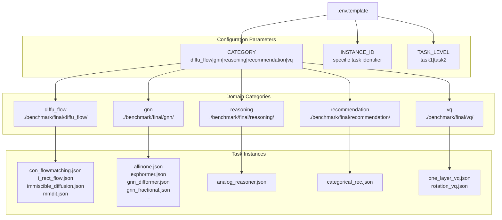
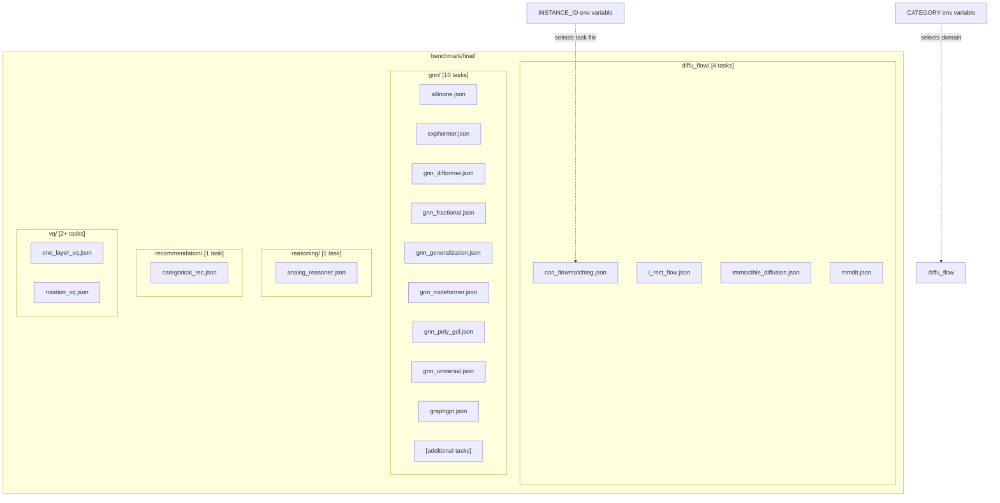
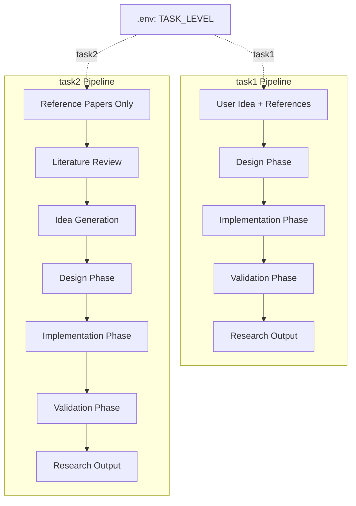
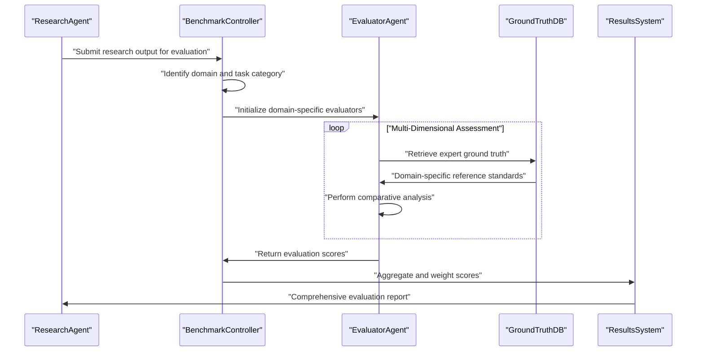

<!-- source: DeepWiki mcp.deepwiki.com · repo HKUDS/AI-Researcher · page 5 Benchmark Tasks & Domains · fetched 2026-11-09 -->

# Benchmark Tasks & Domains

Relevant source files

The following files were used as context for generating this wiki page:

- [README.md](README.md)
- [benchmark/README.md](benchmark/README.md)

## Overview

The AI-Researcher benchmark system, Inno-Bench, provides systematic evaluation across 16+ research tasks organized into 5 distinct research domains. Each domain represents a different area of machine learning research and contains multiple benchmark instances with expert-written ground truth papers.

The benchmark system is configured through the `CATEGORY` parameter in [.env.template:37-46](), which determines which research domain to evaluate. This page documents the task organization, domain structure, and configuration mechanisms.

For detailed information about specific research domains, see: [Diffusion & Flow Matching](#5.1), [Graph Neural Networks](#5.2), [Reasoning](#5.3), [Recommendation Systems](#5.4), and [Vector Quantization](#5.5). For information about the evaluation framework, see page 3.3.

## Benchmark Configuration System

The benchmark system is configured through environment variables that specify the domain, task instance, and execution level. The primary configuration parameters are defined in [.env.template:36-52]().

**Category Configuration**

The `CATEGORY` environment variable determines which research domain to execute:
- `diffu_flow` - Diffusion and flow matching models (4 tasks)
- `gnn` - Graph neural networks (10 tasks)
- `reasoning` - Analogical reasoning tasks (1 task)
- `recommendation` - Recommendation systems (1 task)
- `vq` - Vector quantization methods (2+ tasks)

**Task Instance Selection Diagram**

Sources: [.env.template:36-52](), [README.md:190-207]()

## Domain Distribution and Task Counts

The benchmark contains 16+ tasks distributed across 5 research domains. Each domain tests different aspects of autonomous research capabilities.

| Domain | Task Count | Directory Path | Example Instance IDs |
|--------|-----------|----------------|---------------------|
| **Diffusion & Flow** | 4 | `./benchmark/final/diffu_flow/` | `con_flowmatching`, `i_rect_flow`, `immiscible_diffusion`, `mmdit` |
| **Graph Neural Networks** | 10 | `./benchmark/final/gnn/` | `allinone`, `exphormer`, `gnn_difformer`, `gnn_fractional`, `gnn_generalization`, `gnn_nodeformer`, `gnn_poly_gcl`, `gnn_universal`, `graphgpt` |
| **Reasoning** | 1 | `./benchmark/final/reasoning/` | `analog_reasoner` |
| **Recommendation** | 1 | `./benchmark/final/recommendation/` | `categorical_rec` |
| **Vector Quantization** | 2+ | `./benchmark/final/vq/` | `one_layer_vq`, `rotation_vq` |

**Benchmark Task Distribution Diagram**

Sources: [.env.template:37-46](), [README.md:1000-1024]()

## Task Execution Levels

Each benchmark task supports two execution levels configured via the `TASK_LEVEL` environment variable in [.env.template:47-50]():

**Level 1 (task1): Direct Implementation**
- User provides detailed research idea and implementation specifications
- System bypasses literature review and idea generation phases
- Executes design, implementation, validation, and refinement phases
- Entry point: `research_agent/run_infer_level_1.sh` or `research_agent/run_infer_plan.py`

**Level 2 (task2): Full Autonomous Pipeline**
- User provides only reference papers without specific ideas
- System performs complete research cycle: literature review → idea generation → implementation → validation
- Tests full autonomous research capabilities
- Entry point: `research_agent/run_infer_level_2.sh` or `research_agent/run_infer_idea.py`

**Task Level Execution Flow**

Sources: [.env.template:47-50](), [README.md:988-1024]()

## Benchmark Task Execution Workflow

The benchmark system integrates with the AI-Researcher's core components to provide systematic evaluation of research outputs across all supported domains.

**Benchmark Execution Sequence**

Sources: [benchmark/README.md:1]()

The benchmark tasks serve as the foundation for validating AI-Researcher's autonomous research capabilities, ensuring that generated research meets rigorous academic standards across diverse scientific domains. Each domain contains carefully curated tasks that represent current research frontiers and methodological challenges in their respective fields.

---

