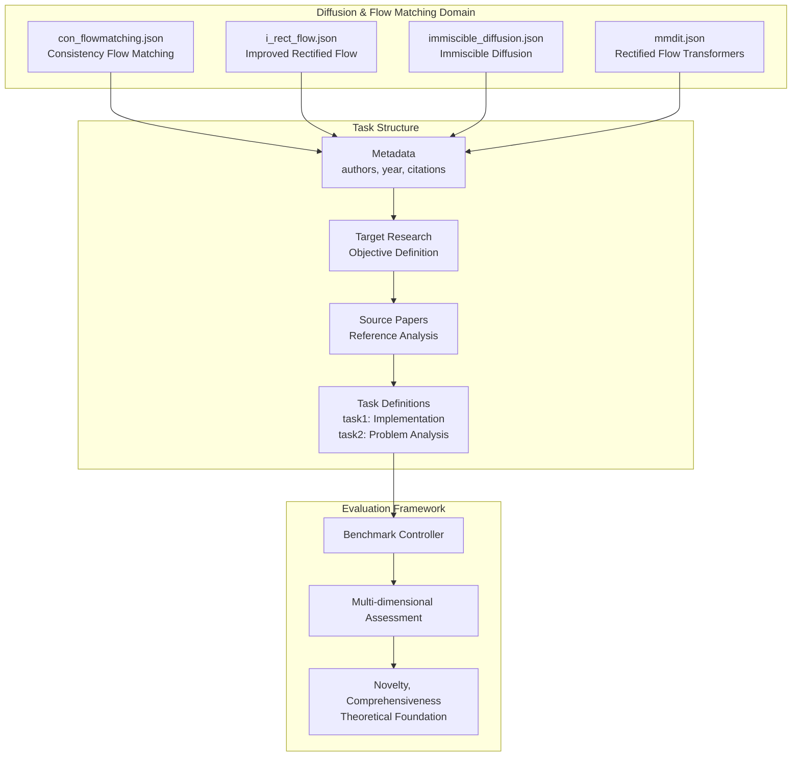
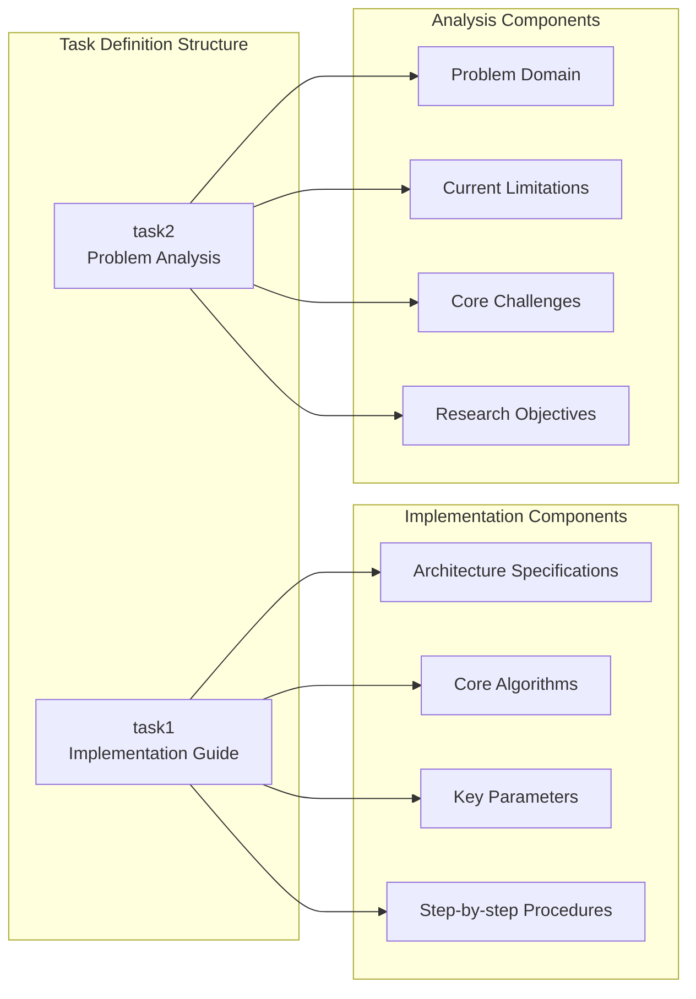

<!-- source: DeepWiki mcp.deepwiki.com · repo HKUDS/AI-Researcher · page 5.1 Diffusion & Flow Matching · fetched 2026-11-09 -->

# Diffusion & Flow Matching

Relevant source files

The following files were used as context for generating this wiki page:

- [benchmark/final/diffu_flow/con_flowmatching.json](benchmark/final/diffu_flow/con_flowmatching.json)
- [benchmark/final/diffu_flow/i_rect_flow.json](benchmark/final/diffu_flow/i_rect_flow.json)
- [benchmark/final/diffu_flow/immiscible_diffusion.json](benchmark/final/diffu_flow/immiscible_diffusion.json)
- [benchmark/final/diffu_flow/mmdit.json](benchmark/final/diffu_flow/mmdit.json)

This document covers the diffusion and flow matching benchmark tasks available in the AI-Researcher system. These tasks evaluate autonomous research capabilities in generative modeling, specifically focusing on diffusion models, flow matching techniques, and related optimization approaches.

For graph-related generative models, see [Graph Neural Networks](#5.2). For general reasoning about generative processes, see [Reasoning](#5.3).

## Domain Overview

The diffusion and flow matching domain encompasses research tasks related to probabilistic generative models that transform noise distributions into data distributions through learned trajectories. The AI-Researcher system includes four primary benchmark tasks in this domain, each targeting different aspects of generative modeling research.

**Sources:** [`benchmark/final/diffu_flow/`]()

## Benchmark Task Architecture

The diffusion and flow matching tasks are organized as JSON configuration files within the benchmark system, each containing comprehensive metadata, source paper analysis, and task specifications.

**Sources:** [`benchmark/final/diffu_flow/con_flowmatching.json:1-91`](), [`benchmark/final/diffu_flow/i_rect_flow.json:1-103`](), [`benchmark/final/diffu_flow/immiscible_diffusion.json:1-79`](), [`benchmark/final/diffu_flow/mmdit.json:1-117`]()

## Task Categories

### Consistency Flow Matching

**Instance ID:** `con_flowmatching`
**Target:** "Consistency Flow Matching: Defining Straight Flows with Velocity Consistency"

This task focuses on enforcing self-consistency in velocity fields for flow matching models. The approach directly defines straight flows from different time points to the same endpoint while imposing velocity constraints.

| Attribute | Details |
|-----------|---------|
| Authors | Ling Yang, Zixiang Zhang, Zhilong Zhang, et al. |
| Year | 2024 |
| Citations | 5 |
| URL | http://arxiv.org/abs/2407.02398v1 |

**Key Technical Components:**
- Velocity consistency loss with exponential moving average
- Multi-segment training for enhanced expressiveness
- Straight flow definition with endpoint constraints
- 4.4x faster convergence than consistency models

**Sources:** [`benchmark/final/diffu_flow/con_flowmatching.json:14-23`](), [`benchmark/final/diffu_flow/con_flowmatching.json:89-90`]()

### Improved Rectified Flow

**Instance ID:** `i_rect_flow`
**Target:** "Improving the Training of Rectified Flows"

This task targets optimization of rectified flow training through enhanced techniques that reduce the number of function evaluations (NFEs) while maintaining generation quality.

| Attribute | Details |
|-----------|---------|
| Authors | Sangyun Lee, Zinan Lin, Giulia Fanti |
| Year | 2024 |
| Citations | 7 |
| URL | http://arxiv.org/abs/2405.20320v2 |

**Key Technical Components:**
- U-shaped timestep distribution for focused training
- LPIPS-Huber premetric for perceptual quality
- Single-iteration Reflow algorithm optimization
- 75% FID improvement in 1 NFE setting on CIFAR-10

**Sources:** [`benchmark/final/diffu_flow/i_rect_flow.json:8-17`](), [`benchmark/final/diffu_flow/i_rect_flow.json:101-102`]()

### Immiscible Diffusion

**Instance ID:** `immiscible_diffusion`
**Target:** "Immiscible Diffusion: Accelerating Diffusion Training with Noise Assignment"

This task addresses suboptimal noise-data mapping in diffusion training through physics-inspired assignment strategies that minimize image-noise pair distances.

| Attribute | Details |
|-----------|---------|
| Authors | Yiheng Li, Heyang Jiang, Akio Kodaira, et al. |
| Year | 2024 |
| Citations | 2 |
| URL | http://arxiv.org/abs/2406.12303v2 |

**Key Technical Components:**
- Assignment-then-diffusion training strategy
- Hungarian method for optimal noise-image pairing
- Quantization for computational efficiency
- 3x faster training for Consistency Models on CIFAR

**Sources:** [`benchmark/final/diffu_flow/immiscible_diffusion.json:10-20`](), [`benchmark/final/diffu_flow/immiscible_diffusion.json:77-78`]()

### Rectified Flow Transformers (MMDiT)

**Instance ID:** `mmdit`
**Target:** "Scaling Rectified Flow Transformers for High-Resolution Image Synthesis"

This task focuses on transformer-based architectures for text-to-image generation using rectified flow, with emphasis on scaling and multimodal information flow.

| Attribute | Details |
|-----------|---------|
| Authors | Patrick Esser, Sumith Kulal, Andreas Blattmann, et al. |
| Year | 2024 |
| Citations | 450 |
| Venue | International Conference on Machine Learning |

**Key Technical Components:**
- Bidirectional text-image transformer architecture
- Perceptually-biased noise sampling techniques
- Separate modality weights for improved comprehension
- Predictable scaling laws correlation

**Sources:** [`benchmark/final/diffu_flow/mmdit.json:23-31`](), [`benchmark/final/diffu_flow/mmdit.json:115-116`]()

## Task Implementation Framework

Each benchmark task provides two primary evaluation components accessible through standardized JSON fields:

**Sources:** [`benchmark/final/diffu_flow/con_flowmatching.json:89-91`](), [`benchmark/final/diffu_flow/i_rect_flow.json:101-103`](), [`benchmark/final/diffu_flow/immiscible_diffusion.json:77-79`](), [`benchmark/final/diffu_flow/mmdit.json:115-117`]()

## Source Paper Analysis

Each task includes comprehensive analysis of foundational papers through the `source_papers` field, categorizing references by their methodological contribution:

| Reference Type | Purpose | Example Usage |
|---------------|---------|---------------|
| `methodological` | Core algorithmic foundations | Flow matching frameworks, diffusion model architectures |
| `conceptual` | Theoretical background | Consistency model principles, generative modeling concepts |
| `component` | Specific technical elements | Rectified flow trajectories, optimal transport methods |
| `critical components` | Essential implementation details | Training procedures, loss functions |

The ranking system (1-9) indicates relative importance to the research contribution, with detailed justification and usage descriptions for each reference.

**Sources:** [`benchmark/final/diffu_flow/con_flowmatching.json:24-88`](), [`benchmark/final/diffu_flow/i_rect_flow.json:18-100`](), [`benchmark/final/diffu_flow/immiscible_diffusion.json:21-76`](), [`benchmark/final/diffu_flow/mmdit.json:32-114`]()

## Evaluation Integration

The diffusion and flow matching tasks integrate with the broader AI-Researcher evaluation framework through the Inno-Bench system. Each task's `instance_id` serves as a unique identifier for automated evaluation routing.

**Common Evaluation Metrics:**
- Novelty assessment of proposed methodologies
- Experimental comprehensiveness and validation
- Theoretical foundation strength
- Implementation quality and reproducibility
- Performance improvements over baseline methods

Tasks are selected through the `topic` and `field` selectors, both set to `"selected"` for active evaluation within the benchmark suite.

**Sources:** [`benchmark/final/diffu_flow/con_flowmatching.json:21-22`](), [`benchmark/final/diffu_flow/i_rect_flow.json:15-16`](), [`benchmark/final/diffu_flow/immiscible_diffusion.json:18-19`](), [`benchmark/final/diffu_flow/mmdit.json:29-30`]()

---

