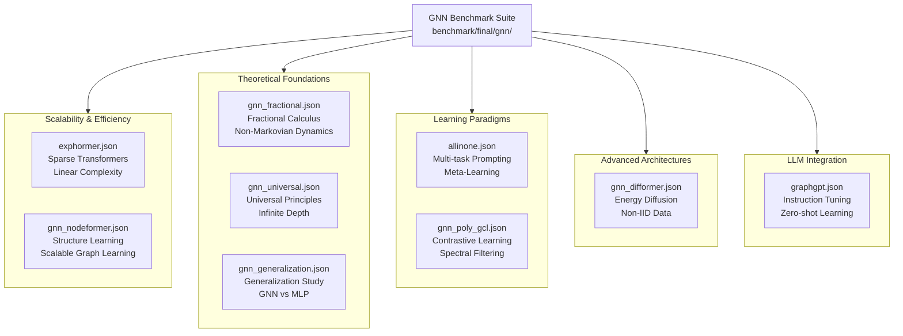
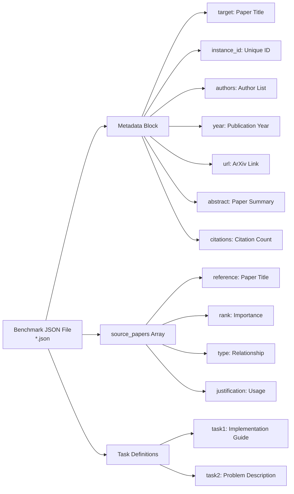
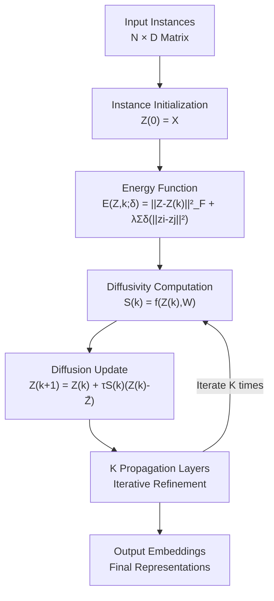
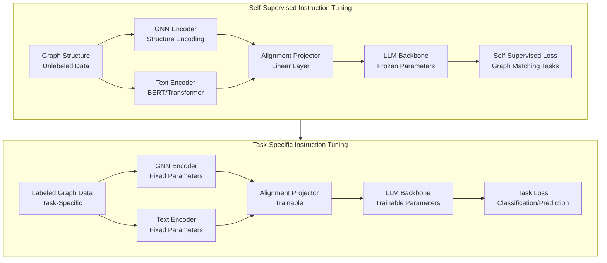
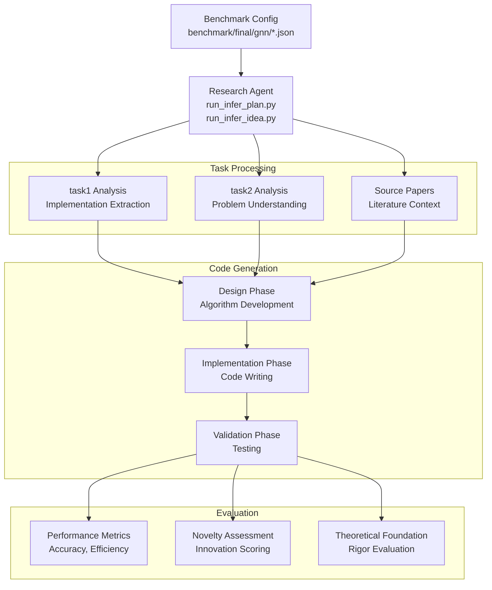

<!-- source: DeepWiki mcp.deepwiki.com · repo HKUDS/AI-Researcher · page 5.2 Graph Neural Networks · fetched 2026-11-09 -->

# Graph Neural Networks

Relevant source files

The following files were used as context for generating this wiki page:

- [benchmark/final/gnn/allinone.json](benchmark/final/gnn/allinone.json)
- [benchmark/final/gnn/exphormer.json](benchmark/final/gnn/exphormer.json)
- [benchmark/final/gnn/gnn_difformer.json](benchmark/final/gnn/gnn_difformer.json)
- [benchmark/final/gnn/gnn_fractional.json](benchmark/final/gnn/gnn_fractional.json)
- [benchmark/final/gnn/gnn_generalization.json](benchmark/final/gnn/gnn_generalization.json)
- [benchmark/final/gnn/gnn_nodeformer.json](benchmark/final/gnn/gnn_nodeformer.json)
- [benchmark/final/gnn/gnn_poly_gcl.json](benchmark/final/gnn/gnn_poly_gcl.json)
- [benchmark/final/gnn/gnn_universal.json](benchmark/final/gnn/gnn_universal.json)
- [benchmark/final/gnn/graphgpt.json](benchmark/final/gnn/graphgpt.json)

## Purpose and Scope

This section provides an overview of the Graph Neural Network (GNN) benchmark suite within the AI-Researcher evaluation framework (Inno-Bench). The GNN category represents the largest benchmark collection in the system, comprising 9 distinct research challenges that span scalability, theoretical foundations, learning paradigms, and integration with large language models.

These benchmarks evaluate the AI-Researcher system's ability to autonomously develop novel GNN architectures and methodologies across diverse problem domains. Each benchmark compares AI-generated approaches against expert-level ground truth from published research papers.

For information about specific GNN benchmarks, see the subsections [5.2.1](#5.2.1) through [5.2.9](#5.2.9). For benchmarks in other domains, see [Diffusion & Flow Matching](#5.1) and [Reasoning](#5.3).

---

## Benchmark Collection Architecture

The GNN benchmark suite is organized within the repository under `benchmark/final/gnn/`, with each benchmark defined as a JSON configuration file that specifies the research target, evaluation criteria, and implementation requirements.

**GNN Benchmark Taxonomy**

**Sources:** [benchmark/final/gnn/exphormer.json:1-87](), [benchmark/final/gnn/gnn_nodeformer.json:1-155](), [benchmark/final/gnn/gnn_fractional.json:1-157](), [benchmark/final/gnn/gnn_universal.json:1-147](), [benchmark/final/gnn/gnn_generalization.json:1-198](), [benchmark/final/gnn/allinone.json:1-96](), [benchmark/final/gnn/gnn_poly_gcl.json:1-143](), [benchmark/final/gnn/gnn_difformer.json:1-191](), [benchmark/final/gnn/graphgpt.json:1-99]()

---

## Research Challenge Domains

The nine GNN benchmarks address five major research challenge domains, each testing different aspects of autonomous scientific innovation:

| Domain | Benchmarks | Core Challenges | Key Techniques |
|--------|-----------|-----------------|----------------|
| **Scalability & Efficiency** | Exphormer, NodeFormer | Quadratic complexity, large graphs (>2M nodes) | Sparse attention, kernelized operators |
| **Theoretical Foundations** | FROND, Universal Learning, Generalization | Oversmoothing, convergence, intrinsic capabilities | Fractional derivatives, graph filters, NTK analysis |
| **Learning Paradigms** | All-in-One, PolyGCL | Multi-task adaptation, heterophily | Prompt tuning, spectral polynomial filters |
| **Advanced Architectures** | DIFFormer | Non-IID data, energy constraints | Diffusion processes, progressive information flow |
| **LLM Integration** | GraphGPT | Graph-language alignment, zero-shot transfer | Instruction tuning, dual-stage adaptation |

**Sources:** [benchmark/final/gnn/exphormer.json:78-87](), [benchmark/final/gnn/gnn_nodeformer.json:150-155](), [benchmark/final/gnn/gnn_fractional.json:151-157](), [benchmark/final/gnn/gnn_universal.json:141-147](), [benchmark/final/gnn/gnn_generalization.json:192-198](), [benchmark/final/gnn/allinone.json:88-96](), [benchmark/final/gnn/gnn_poly_gcl.json:137-143](), [benchmark/final/gnn/gnn_difformer.json:185-191](), [benchmark/final/gnn/graphgpt.json:90-99]()

---

## Benchmark JSON Structure

Each GNN benchmark is defined using a standardized JSON schema that specifies the research target, implementation requirements, and evaluation criteria:

**Benchmark Configuration Schema**

**Sources:** [benchmark/final/gnn/allinone.json:1-96](), [benchmark/final/gnn/exphormer.json:1-87](), [benchmark/final/gnn/gnn_difformer.json:1-191]()

### Key JSON Fields

The benchmark JSON files contain the following critical fields:

- **`target`**: The full title of the research paper being benchmarked
- **`instance_id`**: A unique identifier used throughout the system (e.g., `allinone`, `exphormer`, `gnn_difformer`)
- **`source_papers`**: A ranked list of influential papers with justification for their relevance
- **`task1`**: Detailed implementation instructions for reproducing the methodology
- **`task2`**: Problem domain description and research motivations
- **`abstract`**: The original paper's abstract
- **`citations`**: Citation count indicating research impact
- **`field`**: Research field categorization (typically `graph_neural_networks`)

**Sources:** [benchmark/final/gnn/allinone.json:2-3](), [benchmark/final/gnn/exphormer.json:2-3](), [benchmark/final/gnn/gnn_nodeformer.json:2-3]()

---

## Scalability Challenges

Two benchmarks focus on addressing the computational complexity barriers that limit GNN application to large-scale graphs:

### Exphormer: Sparse Transformers

**Instance ID:** `exphormer`

Addresses the quadratic complexity bottleneck in graph transformers through sparse attention mechanisms based on expander graphs and virtual global nodes. The benchmark tests the system's ability to design architectures with linear complexity O(N) while maintaining competitive accuracy.

**Key Technical Components:**
- Expander graph construction for sparse connectivity
- Virtual global node mechanisms
- Linear complexity attention with O(N) scaling
- Integration with GraphGPS framework

**Sources:** [benchmark/final/gnn/exphormer.json:2-3](), [benchmark/final/gnn/exphormer.json:78-87](), [benchmark/final/gnn/exphormer.json:85-86]()

### NodeFormer: Structure Learning

**Instance ID:** `gnn_nodeformer`

Evaluates scalable graph structure learning using kernelized Gumbel-Softmax operators for learning latent graph structures from large, potentially fully-connected graphs. Tests handling graphs with up to 2M nodes.

**Key Technical Components:**
- Kernelized Gumbel-Softmax operator for discrete structure learning
- All-pair message passing with linear complexity
- Transformer-style architecture for node classification
- Differentiable graph structure optimization

**Sources:** [benchmark/final/gnn/gnn_nodeformer.json:2-3](), [benchmark/final/gnn/gnn_nodeformer.json:150-155](), [benchmark/final/gnn/gnn_nodeformer.json:153-154]()

---

## Theoretical Foundations

Three benchmarks examine fundamental theoretical questions about GNN behavior, convergence, and generalization:

### FROND: Fractional-Order Dynamics

**Instance ID:** `gnn_fractional`

Tests the integration of fractional calculus (Caputo fractional derivatives) into GNNs to capture long-term dependencies and non-Markovian processes. Evaluates whether the system can move beyond traditional integer-order differential equations.

**Key Technical Components:**
- Caputo fractional derivative: `D^β_t X(t)` where `0 < β ≤ 1`
- Non-local feature update mechanisms with memory effects
- Predictor-corrector numerical methods for discretization
- Oversmoothing mitigation through fractional dynamics

**Sources:** [benchmark/final/gnn/gnn_fractional.json:2-3](), [benchmark/final/gnn/gnn_fractional.json:151-157](), [benchmark/final/gnn/gnn_fractional.json:155-156]()

### Universal Learning Principles

**Instance ID:** `gnn_universal`

Establishes criteria for graph filter convergence under infinite-depth scenarios and develops a scalable regularized learning principle for designing infinitely deep GNNs.

**Key Technical Components:**
- Power series graph filters with convergence guarantees
- Exponentially decaying aggregation weights
- Lipschitz continuity constraints for stability
- Adaptive Power GNN (APGNN) architecture

**Sources:** [benchmark/final/gnn/gnn_universal.json:2-3](), [benchmark/final/gnn/gnn_universal.json:141-147](), [benchmark/final/gnn/gnn_universal.json:145-146]()

### Generalization Study

**Instance ID:** `gnn_generalization`

Investigates the intrinsic generalization capabilities of GNNs versus MLPs by introducing P(ropagational)MLP, which uses MLP architecture during training but adopts GNN message passing during testing.

**Key Technical Components:**
- P(ropagational)MLP architecture bridging GNN and MLP
- Neural Tangent Kernel (NTK) analysis at infinite width
- Extrapolation behavior on out-of-distribution samples
- Theoretical generalization bounds

**Sources:** [benchmark/final/gnn/gnn_generalization.json:2-3](), [benchmark/final/gnn/gnn_generalization.json:192-198](), [benchmark/final/gnn/gnn_generalization.json:196-197]()

---

## Learning Paradigm Innovations

Two benchmarks explore novel learning strategies for GNNs:

### All-in-One: Multi-task Prompting

**Instance ID:** `allinone`

Tests the system's ability to develop unified prompting frameworks that bridge pre-training and diverse downstream tasks (node-level, edge-level, graph-level) using meta-learning strategies.

**Key Technical Components:**
- Prompt graph design with learnable tokens
- Token structure and inserting patterns
- Meta-learning for prompt initialization
- Task reformulation to graph-level format

**Sources:** [benchmark/final/gnn/allinone.json:2-3](), [benchmark/final/gnn/allinone.json:88-96](), [benchmark/final/gnn/allinone.json:94-95]()

### PolyGCL: Spectral Contrastive Learning

**Instance ID:** `gnn_poly_gcl`

Evaluates graph contrastive learning with learnable spectral polynomial filters that can adapt to both homophilic and heterophilic graphs by incorporating high-pass information.

**Key Technical Components:**
- Chebyshev polynomial filters for spectral filtering
- Low-pass and high-pass view generation
- Linear combination of spectral views
- Binary Cross-Entropy (BCE) contrastive loss

**Sources:** [benchmark/final/gnn/gnn_poly_gcl.json:2-3](), [benchmark/final/gnn/gnn_poly_gcl.json:137-143](), [benchmark/final/gnn/gnn_poly_gcl.json:141-142]()

---

## Advanced Architectural Innovations

### DIFFormer: Energy-Constrained Diffusion

**Instance ID:** `gnn_difformer`

Challenges the system to develop diffusion-based transformers that encode batches of instances with complex inter-dependencies, suitable for non-IID data scenarios.

**Key Technical Components:**
- Energy-constrained diffusion modeled as PDE
- Explicit Euler scheme for numerical solutions
- Adaptive diffusivity functions based on energy minimization
- All-pair feature propagation among instances

**Technical Architecture:**

**Sources:** [benchmark/final/gnn/gnn_difformer.json:2-3](), [benchmark/final/gnn/gnn_difformer.json:185-191](), [benchmark/final/gnn/gnn_difformer.json:189-190]()

---

## LLM-GNN Integration

### GraphGPT: Instruction Tuning

**Instance ID:** `graphgpt`

Tests the frontier of GNN research by evaluating the system's ability to integrate large language models with graph structural knowledge through instruction tuning for zero-shot generalization.

**Dual-Stage Training Pipeline:**

**Key Technical Components:**
- Text-graph grounding component for modality alignment
- Dual-stage instruction tuning (self-supervised + task-specific)
- Lightweight graph-text alignment projector
- Chain-of-Thought (CoT) distillation for reasoning

**Sources:** [benchmark/final/gnn/graphgpt.json:2-3](), [benchmark/final/gnn/graphgpt.json:90-99](), [benchmark/final/gnn/graphgpt.json:97-98]()

---

## Evaluation Methodology

All GNN benchmarks share a common evaluation framework that assesses AI-generated research across multiple dimensions:

### Task Definitions

Each benchmark provides two complementary task definitions:

**Task 1: Implementation Instructions (`task1` field)**
- Detailed step-by-step methodology for reproducing the research
- Core techniques and algorithms with specific parameter settings
- Component interactions and data flow specifications
- Critical implementation details affecting performance

**Task 2: Problem Context (`task2` field)**
- Primary research problem and domain
- Current limitations motivating the work
- Core challenges to overcome
- Key objectives and intended contributions

**Sources:** [benchmark/final/gnn/allinone.json:94-96](), [benchmark/final/gnn/exphormer.json:85-87](), [benchmark/final/gnn/gnn_difformer.json:189-191]()

### Source Paper Analysis

Each benchmark includes a ranked list of influential source papers with:
- **Rank**: Importance level (1 = most influential)
- **Type**: Relationship category (methodological, conceptual, component)
- **Justification**: Explanation of how the paper influenced the research
- **Usage**: Specific ways the paper was utilized

This structure helps the AI-Researcher system understand the research lineage and methodological foundations.

**Sources:** [benchmark/final/gnn/allinone.json:4-77](), [benchmark/final/gnn/exphormer.json:4-68](), [benchmark/final/gnn/gnn_nodeformer.json:4-141]()

---

## Common Technical Patterns

Across the nine GNN benchmarks, several common technical patterns and architectural principles emerge:

| Pattern | Benchmarks | Purpose |
|---------|-----------|---------|
| **Message Passing** | All benchmarks | Information propagation between graph nodes |
| **Attention Mechanisms** | Exphormer, NodeFormer, DIFFormer | Adaptive neighbor weighting |
| **Spectral Filtering** | PolyGCL, Universal Learning | Frequency-domain feature processing |
| **Differentiable Optimization** | NodeFormer, All-in-One | Learning discrete structures end-to-end |
| **Energy/Loss Functions** | DIFFormer, PolyGCL | Constraining representations to desired properties |
| **Multi-layer Aggregation** | FROND, Universal Learning | Capturing long-range dependencies |
| **Self-supervised Learning** | PolyGCL, GraphGPT | Pre-training without labels |

**Sources:** [benchmark/final/gnn/exphormer.json:85-86](), [benchmark/final/gnn/gnn_poly_gcl.json:141-142](), [benchmark/final/gnn/gnn_universal.json:145-146]()

---

## Integration with Research Agent

The GNN benchmarks are processed by the AI-Researcher system's research agent through a standardized evaluation pipeline:

**Research Agent Workflow for GNN Benchmarks**

**Sources:** [benchmark/final/gnn/allinone.json:1-96](), [benchmark/final/gnn/exphormer.json:1-87]()

The research agent uses the `instance_id` field to identify benchmarks and the `task1`/`task2` fields to guide autonomous research development. The system compares its generated solutions against the ground truth methodology described in the benchmark papers.

---

## Benchmark Statistics

Summary statistics across the nine GNN benchmarks:

| Metric | Value |
|--------|-------|
| Total Benchmarks | 9 |
| Average Citation Count | ~67 citations (median) |
| Publication Years | 2023-2024 |
| Total Source Papers Referenced | 139 unique papers |
| Average Source Papers per Benchmark | ~15 references |
| Primary Venues | ICML, ICLR, NeurIPS, KDD |

**Citation Distribution:**
- High Impact (>100 citations): DIFFormer (102), NodeFormer (227)
- Medium Impact (50-100 citations): Exphormer (70), All-in-One (86), Generalization Study (70)
- Emerging Research (<50 citations): FROND (3), PolyGCL (11), Universal Learning (0), GraphGPT (0)

**Sources:** [benchmark/final/gnn/gnn_difformer.json:188](), [benchmark/final/gnn/gnn_nodeformer.json:152](), [benchmark/final/gnn/exphormer.json:82](), [benchmark/final/gnn/allinone.json:91](), [benchmark/final/gnn/gnn_generalization.json:195](), [benchmark/final/gnn/gnn_fractional.json:154](), [benchmark/final/gnn/gnn_poly_gcl.json:140](), [benchmark/final/gnn/gnn_universal.json:142](), [benchmark/final/gnn/graphgpt.json:94]()

---

## Research Frontiers Covered

The GNN benchmark suite comprehensively covers current research frontiers in graph neural networks:

### Computational Challenges
- **Scalability**: Reducing complexity from O(N²) to O(N) for large graphs
- **Memory Efficiency**: Handling graphs with millions of nodes
- **Training Speed**: Efficient optimization algorithms

### Theoretical Understanding
- **Convergence**: Guarantees for deep and infinite-depth networks
- **Generalization**: Understanding why GNNs outperform MLPs
- **Expressivity**: Theoretical limits and capabilities

### Practical Applications
- **Heterophily**: Handling graphs where connected nodes are dissimilar
- **Multi-task Learning**: Adapting to diverse downstream tasks
- **Zero-shot Learning**: Generalizing to unseen graph structures

### Emerging Paradigms
- **Fractional Calculus**: Non-Markovian dynamics and memory effects
- **Energy-based Models**: Constrained diffusion processes
- **LLM Integration**: Combining language understanding with graph structure

**Sources:** [benchmark/final/gnn/exphormer.json:78-87](), [benchmark/final/gnn/gnn_fractional.json:151-157](), [benchmark/final/gnn/gnn_difformer.json:185-191](), [benchmark/final/gnn/graphgpt.json:90-99]()

---

