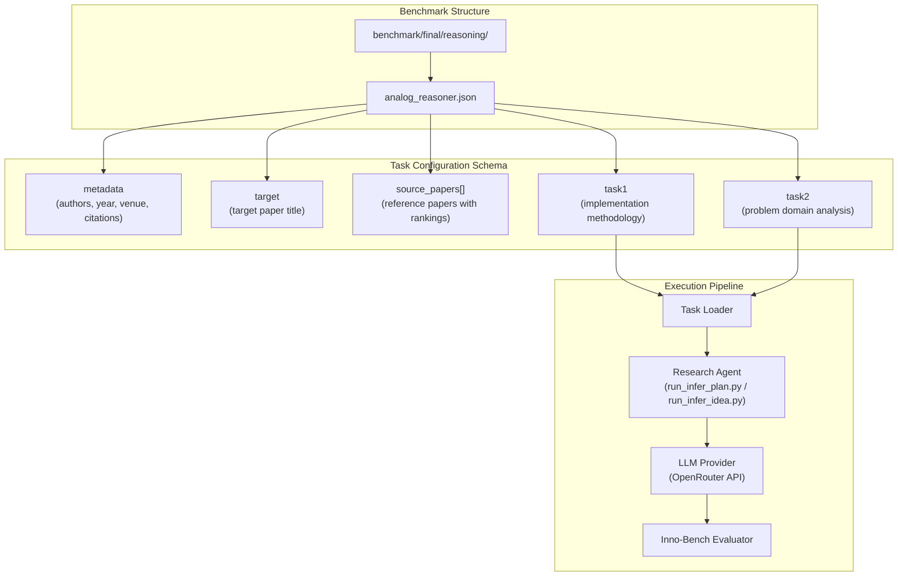
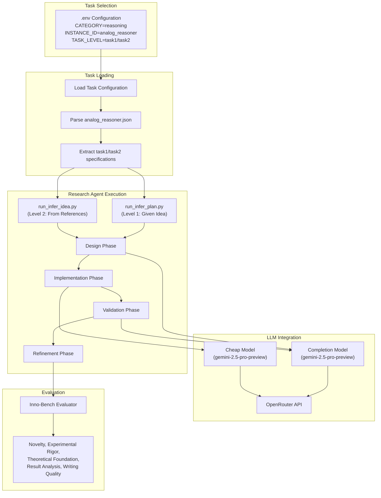

<!-- source: DeepWiki mcp.deepwiki.com · repo HKUDS/AI-Researcher · page 5.3 Reasoning · fetched 2026-11-09 -->

# Reasoning

<details>
<summary>Relevant source files</summary>

The following files were used as context for generating this wiki page:

- [benchmark/final/reasoning/analog_reasoner.json](benchmark/final/reasoning/analog_reasoner.json)

</details>


This page provides an overview of the reasoning domain within the AI-Researcher benchmark suite (Inno-Bench). The reasoning domain evaluates AI systems' capabilities in enhancing Large Language Model (LLM) reasoning through analogical prompting techniques. This domain focuses on testing the ability to self-generate relevant exemplars and knowledge without requiring manually labeled examples, thereby improving reasoning performance across mathematical problem solving, code generation, and logical reasoning tasks.

For information about other benchmark domains, see [Diffusion & Flow Matching](#5.1) and [Graph Neural Networks](#5.2).

## Domain Overview

The reasoning domain in the AI-Researcher system contains one primary benchmark task:

**Analogical Reasoner** (`analog_reasoner`) - Evaluates the implementation of analogical prompting for LLMs, which enables self-generation of relevant exemplars to enhance reasoning without labeled examples.

### Reasoning Domain Architecture



**Sources:** [benchmark/final/reasoning/analog_reasoner.json:1-81]()

## Analogical Reasoner Benchmark

The `analog_reasoner` benchmark evaluates the system's ability to implement and reproduce the analogical prompting methodology from "Large Language Models as Analogical Reasoners" (Yasunaga et al., 2023). This task tests whether the AI-Researcher system can autonomously implement a prompting technique that enables LLMs to self-generate relevant exemplars for problem-solving.

### Benchmark Metadata

| Field | Value |
|-------|-------|
| **Instance ID** | `analog_reasoner` |
| **Target Paper** | "Large Language Models as Analogical Reasoners" |
| **Authors** | Michihiro Yasunaga, Xinyun Chen, Yujia Li, Panupong Pasupat, Jure Leskovec, Percy Liang, Ed H. Chi, Denny Zhou |
| **Year** | 2023 |
| **Venue** | International Conference on Learning Representations |
| **Citations** | 50 |
| **URL** | http://arxiv.org/abs/2310.01714v3 |

**Sources:** [benchmark/final/reasoning/analog_reasoner.json:2-19]()

### Problem Domain

The benchmark addresses the following research challenges:

**Primary Task**: Enhance reasoning capabilities of LLMs by developing a prompting method that leverages analogical reasoning to self-generate relevant exemplars.

**Current Limitations**: 
- Few-shot chain-of-thought (CoT) prompting requires costly labeled exemplars
- Zero-shot CoT methods lack specificity for complex tasks
- Manual exemplar curation is time-consuming and not scalable

**Research Objectives**:
- Develop automated exemplar generation without manual labeling
- Create tailored, task-specific reasoning guidance
- Enable LLMs to draw from relevant past experiences (analogical reasoning)
- Improve performance on mathematical problem solving (GSM8K, MATH), code generation (Codeforces), and reasoning tasks (BIG-Bench)

**Sources:** [benchmark/final/reasoning/analog_reasoner.json:80]()

### Referenced Source Papers

The benchmark configuration includes six key reference papers that inform the methodology:

| Rank | Reference | Type | Usage |
|------|-----------|------|-------|
| 1 | "Language models are few-shot learners" | Methodological | Foundational work for few-shot learning |
| 2 | "Chain of thought prompting elicits reasoning in large language models" | Methodological | Informed limitations of existing prompting |
| 3 | "Execution-guided neural program synthesis" | Methodological | In-context learning abilities |
| 4 | "Teaching large language models to self-debug" | Methodological | Self-generation techniques |
| 5 | "Program synthesis with large language models" | Conceptual | Reasoning processes for program-related tasks |
| 6 | "Palm 2 technical report" | Methodological | Performance benchmarking |

**Sources:** [benchmark/final/reasoning/analog_reasoner.json:23-77]()

### Task Specifications

The benchmark defines two task levels:

**Task 1 (Implementation)**: Provides detailed implementation methodology including prompt construction, parameter configuration, and component interactions. This specification guides the Research Agent in implementing the analogical prompting approach.

**Task 2 (Research Analysis)**: Describes the problem domain, limitations of existing approaches, core challenges, and research objectives. This helps the system understand the research context and innovation.

For detailed implementation specifications, see [Analogical Prompting](#5.3.1).

**Sources:** [benchmark/final/reasoning/analog_reasoner.json:79-80]()

## Reasoning Task Execution

The analogical reasoner benchmark integrates with the AI-Researcher execution pipeline through the Research Agent system. The execution flow demonstrates how task configurations drive autonomous research implementation.

### Execution Workflow



**Sources:** [benchmark/final/reasoning/analog_reasoner.json:1-81](), `.env.template` (referenced in system architecture)

### Research Agent Integration

The Research Agent processes the analogical reasoner task through two entry points:

**Level 1 (Given Idea)**: The `run_infer_plan.py` script receives the `task1` field from `analog_reasoner.json`, which contains detailed implementation instructions. The agent uses this specification to guide the design and implementation phases.

**Level 2 (From References)**: The `run_infer_idea.py` script uses the `task2` field to understand the research problem domain. It analyzes the `source_papers` array to identify methodological foundations and develops novel approaches based on the research context.

Both execution paths proceed through the four-phase algorithm development cycle (Design → Implementation → Validation → Refinement) as described in the system architecture.

**Sources:** [benchmark/final/reasoning/analog_reasoner.json:79-80](), README documentation

## Configuration Integration

The reasoning benchmark integrates with the AI-Researcher configuration system through environment variables that specify task selection and execution parameters.

### Environment Configuration

To execute the analogical reasoner benchmark, the `.env` file must specify:

```
CATEGORY=reasoning
INSTANCE_ID=analog_reasoner
TASK_LEVEL=task1  # or task2
```

The `CATEGORY` value maps to the directory path `benchmark/final/reasoning/`, while `INSTANCE_ID` selects the specific JSON configuration file (`analog_reasoner.json`).

### Docker Workspace Integration

During execution, the system creates workspace directories:

- `workplace_paper/workplace/` - Main execution workspace
- `cache/` - Intermediate result caching

These directories are excluded from version control via `.gitignore` patterns: `workplace_*`, `workspace_*`, and `cache/`.

**Sources:** [benchmark/final/reasoning/analog_reasoner.json:12](), `.env.template`, `.gitignore` patterns

## JSON Configuration Schema

The reasoning benchmark follows a standardized JSON configuration schema defined in `analog_reasoner.json`:

### Top-Level Fields

| Field | Type | Description |
|-------|------|-------------|
| `instance_id` | string | Unique identifier (`analog_reasoner`) |
| `authors` | array[string] | List of paper authors (8 authors) |
| `year` | integer | Publication year (2023) |
| `url` | string | ArXiv paper URL |
| `abstract` | string | Complete paper abstract |
| `venue` | string | Publication venue |
| `venue_source` | string | Venue information source |
| `venue_lookup_time` | string | ISO timestamp of venue lookup |
| `citations` | integer | Citation count (50) |
| `topic` | string | Research topic classification |
| `field` | string | Research field classification |
| `target` | string | Target paper title |
| `source_papers` | array[object] | Referenced papers (6 papers) |
| `task1` | string | Implementation methodology specification |
| `task2` | string | Problem domain and research objectives |

**Sources:** [benchmark/final/reasoning/analog_reasoner.json:1-81]()

### Source Papers Schema

Each entry in the `source_papers` array contains:

| Field | Type | Description |
|-------|------|-------------|
| `reference` | string | Paper title |
| `rank` | integer | Priority ranking (1-6) |
| `type` | array[string] | Paper type (methodological/conceptual) |
| `justification` | string | Explanation of relevance |
| `usage` | string | How the paper was used |

**Sources:** [benchmark/final/reasoning/analog_reasoner.json:23-77]()

## Evaluation Metrics

The reasoning domain evaluates several key dimensions:

- **Methodological Implementation**: Accuracy of algorithm implementation according to paper specifications
- **Reasoning Quality**: Sophistication and correctness of generated reasoning chains
- **Computational Efficiency**: Inference computation requirements relative to performance gains
- **Generalization**: Ability to transfer reasoning patterns across different problem types
- **Innovation**: Novel insights or improvements over baseline approaches

**Sources:** [benchmark/final/reasoning/analog_reasoner.json:79-81](), [benchmark/final/reasoning/self_discover.json:108-110]()

---

