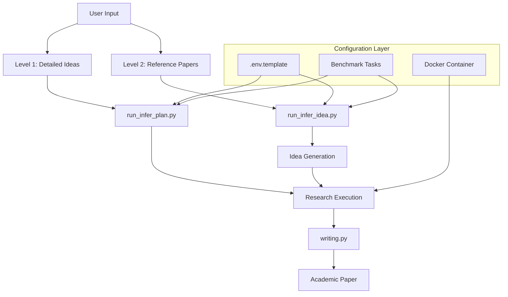
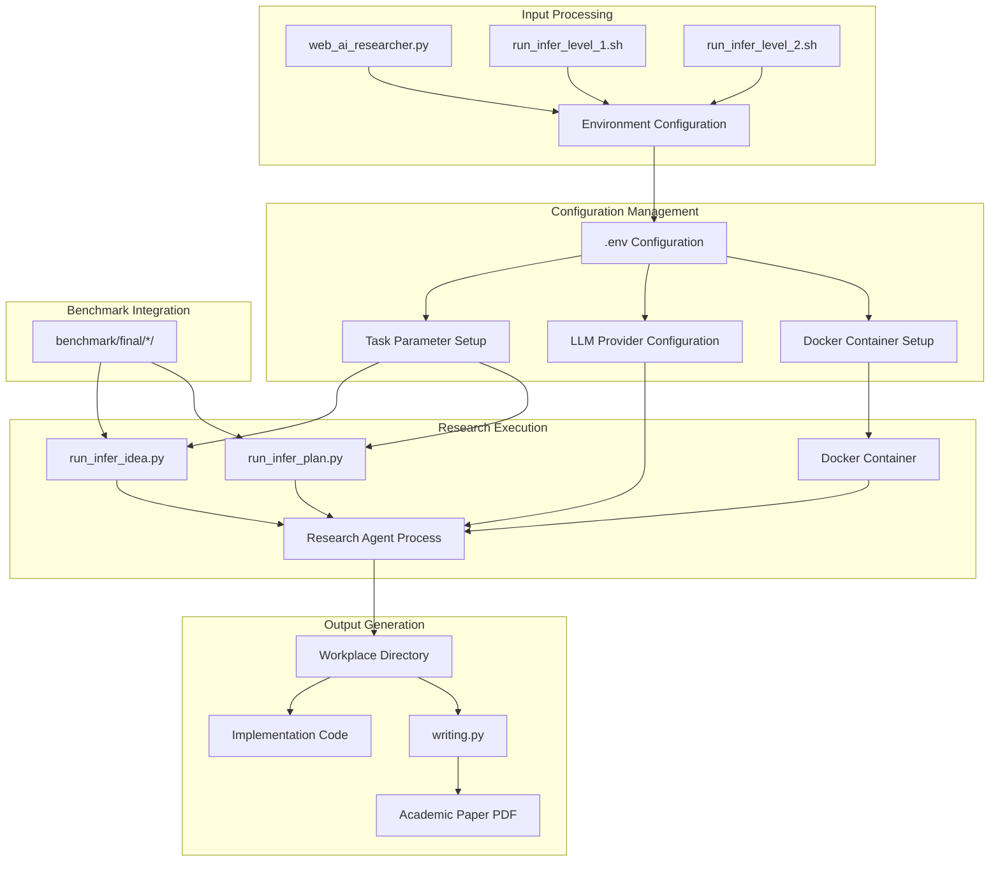
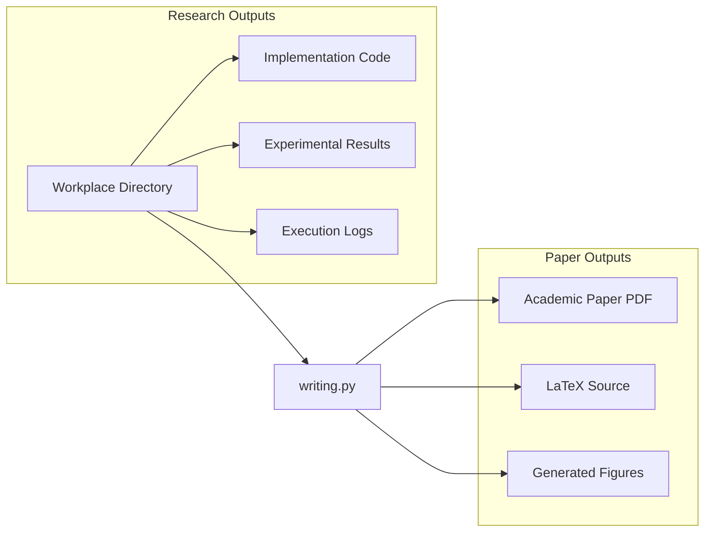

<!-- source: DeepWiki mcp.deepwiki.com · repo HKUDS/AI-Researcher · page 6 Usage Guide · fetched 2026-11-09 -->

# Usage Guide

<details>
<summary>Relevant source files</summary>

The following files were used as context for generating this wiki page:

- [.env.template](.env.template)
- [README.md](README.md)

</details>


## Purpose and Scope

This document provides comprehensive guidance for using the AI-Researcher system in practice. It covers the essential usage patterns, configuration requirements, and execution modes available to users conducting automated scientific research. 

For detailed installation procedures, see [Installation & Setup](#6.1). For task-specific execution guides, see [Level 1 Tasks (Given Ideas)](#6.2) and [Level 2 Tasks (Reference-based)](#6.3). For web-based interaction, see [Web Interface](#6.4).

## Usage Patterns Overview

The AI-Researcher system supports three primary usage patterns, each designed for different user preferences and research scenarios:

### Interactive Web Interface
The web-based interface provides a user-friendly graphical environment for configuring and executing research tasks through `web_ai_researcher.py`.

### Command-Line Execution
Direct command-line execution offers programmatic control over research workflows through shell scripts and Python modules.

### Containerized Research Environment
Docker-based execution ensures consistent research environments with GPU support and isolated workspaces.

## Research Input Modes

AI-Researcher accepts research inputs at two distinct levels, each targeting different stages of research conceptualization:



Sources: [README.md:32-36](), [README.md:983-1000](), [README.md:1002-1019]()

### Level 1: Detailed Idea Processing

Level 1 tasks accept comprehensive research idea descriptions and focus on implementation and validation. Users provide specific methodological details, implementation requirements, and expected outcomes.

### Level 2: Reference-Based Ideation

Level 2 tasks accept collections of reference papers without predefined ideas. The system analyzes provided references to generate novel research concepts and implement them autonomously.

## System Execution Flow

The following diagram illustrates the complete execution flow from user input to final output, highlighting key code entities and their interactions:



Sources: [README.md:206-210](), [README.md:983-1000](), [README.md:1002-1019](), [README.md:1023-1037]()

## Configuration Architecture

The system's configuration architecture relies on environment variables and containerization to manage complex research environments:

| Configuration Component | File/Location | Purpose |
|-------------------------|---------------|---------|
| Environment Template | `.env.template` | Master configuration template |
| Container Settings | `DOCKER_WORKPLACE_NAME`, `BASE_IMAGES` | Docker environment setup |
| LLM Configuration | `COMPLETION_MODEL`, `OPENROUTER_API_KEY` | Language model integration |
| Task Parameters | `CATEGORY`, `INSTANCE_ID`, `TASK_LEVEL` | Research task specification |
| GPU Configuration | `GPUS` | Hardware resource allocation |

### Essential Configuration Variables

```bash
# Container Configuration
DOCKER_WORKPLACE_NAME=workplace_paper
BASE_IMAGES=tjbtech1/airesearcher:v1
CONTAINER_NAME=paper_eval
GPUS='"device=0,1"'

# LLM Configuration  
COMPLETION_MODEL=openrouter/google/gemini-2.5-pro-preview-05-20
OPENROUTER_API_KEY=your_openrouter_api_key

# Task Configuration
CATEGORY=vq
INSTANCE_ID=one_layer_vq
TASK_LEVEL=task1
```

Sources: [README.md:147-202]()

## Execution Environments

### Web Interface Execution

The web interface provides a unified entry point for all research operations:

```bash
python web_ai_researcher.py
```

This launches a Gradio-based interface that handles configuration management, task execution, and output visualization in a single environment.

### Command-Line Execution

#### Level 1 Research Tasks

Execute research with detailed ideas using the Level 1 workflow:

```bash
# From research_agent directory
./run_infer_level_1.sh
```

This script invokes `run_infer_plan.py` with benchmark task specifications and container orchestration.

#### Level 2 Research Tasks

Execute reference-based research using the Level 2 workflow:

```bash
# From research_agent directory  
./run_infer_level_2.sh
```

This script invokes `run_infer_idea.py` for automated idea generation from reference materials.

#### Paper Generation

Generate academic papers from completed research:

```bash
# From paper_agent directory
./run_paper.sh
```

This script executes `writing.py` to transform research outputs into formatted academic papers.

Sources: [README.md:983-1000](), [README.md:1002-1019](), [README.md:1023-1037]()

## Input and Output Specifications

### Input Requirements

| Input Type | Level 1 | Level 2 |
|------------|---------|---------|
| Primary Input | Detailed idea description | Reference paper collection |
| Format | Structured text with implementation details | List of academic paper titles/references |
| Benchmark Integration | JSON task specification from `benchmark/final/` | JSON task specification from `benchmark/final/` |
| Configuration | `.env` file with task parameters | `.env` file with task parameters |

### Output Formats

The system generates multiple output artifacts:



Sources: [README.md:316-328](), [README.md:414-427]()

## Integration Patterns

### LLM Provider Integration

The system supports multiple LLM providers through a unified configuration interface:

- **OpenRouter**: Multi-model access through `OPENROUTER_API_KEY`
- **Claude**: Direct integration via API keys
- **OpenAI**: Standard OpenAI API integration
- **GitHub AI**: Integration through `GITHUB_AI_TOKEN`

### Benchmark Integration

Research tasks integrate with the benchmark suite through standardized JSON specifications located in `benchmark/final/`. Each category contains task definitions that specify:

- Research domain (`diffu_flow`, `gnn`, `reasoning`, `recommendation`)
- Task instance identifiers
- Input specifications and expected outputs
- Evaluation criteria

### Container Orchestration

Docker containers provide isolated research environments with:

- GPU access configuration through `GPUS` parameter
- Workspace persistence via volume mounting
- Base image specification (`tjbtech1/airesearcher:v1`)
- Port mapping for service access

Sources: [README.md:147-202](), [README.md:1041-1044]()

---

