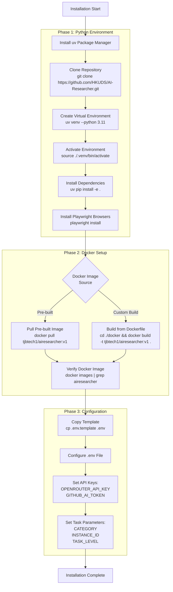
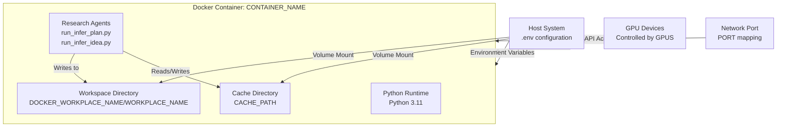
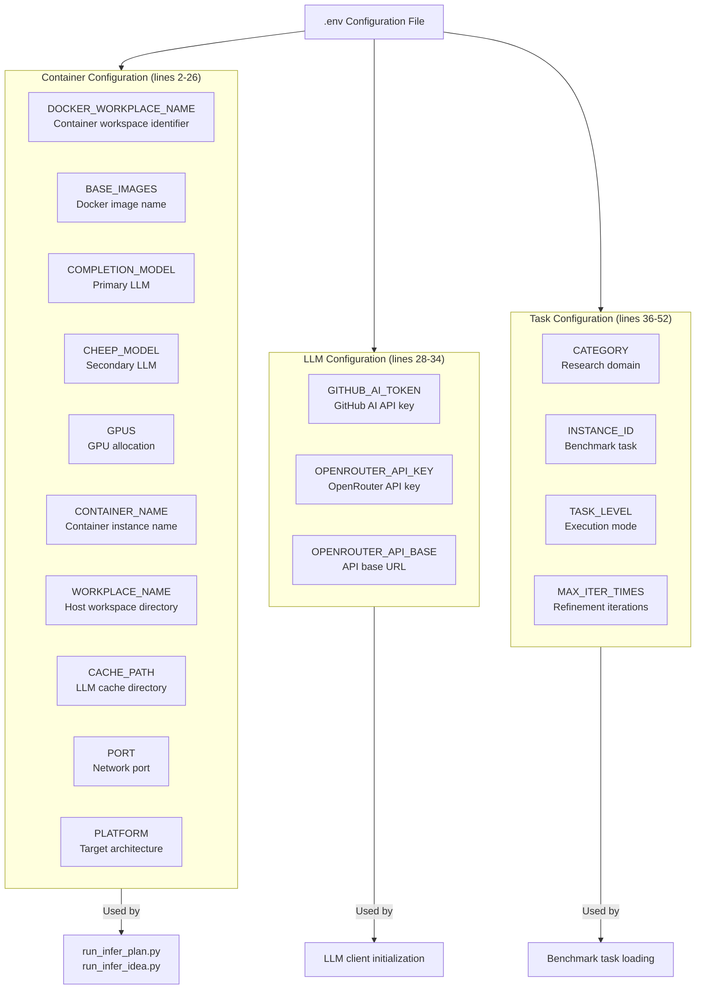
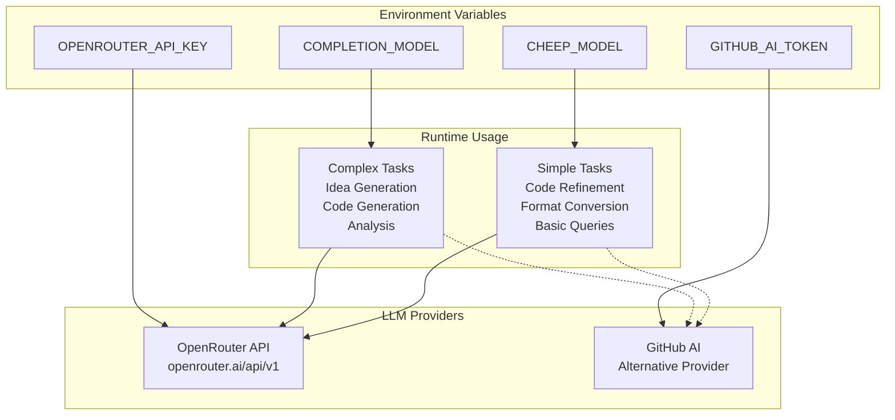

<!-- source: DeepWiki mcp.deepwiki.com · repo HKUDS/AI-Researcher · page 6.1 Installation & Setup · fetched 2026-11-09 -->

# Installation & Setup

<details>
<summary>Relevant source files</summary>

The following files were used as context for generating this wiki page:

- [.env.template](.env.template)
- [README.md](README.md)

</details>


This page provides step-by-step instructions for installing AI-Researcher dependencies, configuring the Docker execution environment, and preparing the system for running research tasks. The installation process involves setting up a Python environment, preparing Docker containers, and configuring API keys and system parameters.

For information about running Level 1 tasks (with provided ideas), see page 6.2. For information about running Level 2 tasks (reference-based ideation), see page 6.3.

## Prerequisites

Before installation, ensure the following requirements are met:

| Requirement | Version/Specification | Purpose |
|-------------|----------------------|---------|
| Operating System | Linux (recommended) or macOS | Host environment |
| Python | 3.11 | Core runtime |
| Docker | Latest stable | Container execution |
| GPU (optional) | CUDA-compatible | Accelerated computation |
| Internet | Stable connection | API access and package downloads |

**Sources:** [README.md:110-146]()

## Installation Workflow Overview



**Sources:** [README.md:110-208]()

## Python Environment Setup

### Method 1: Using uv (Recommended)

The `uv` package manager provides significantly faster dependency resolution and installation compared to traditional tools like pip or conda.

**Installation Steps:**

1. **Install uv package manager:**
```bash
curl -LsSf https://astral.sh/uv/install.sh | sh
source ~/.bashrc
```

2. **Clone the repository:**
```bash
git clone https://github.com/HKUDS/AI-Researcher.git
cd AI-Researcher
```

3. **Create and activate virtual environment:**
```bash
uv venv --python 3.11
source ./.venv/bin/activate
```

4. **Install project dependencies:**
```bash
uv pip install -e .
```

This installs the package defined in `setup.py` or `pyproject.toml` in editable mode (`-e` flag), allowing code modifications without reinstallation.

5. **Install Playwright browsers:**
```bash
playwright install
```

Playwright is required for the resource collection agent to scrape academic papers from web sources like arXiv, Google Scholar, and IEEE Xplore.

**Sources:** [README.md:117-135]()

### Method 2: Using Conda (Alternative)

While not explicitly documented in the repository, standard conda installation is supported:

```bash
conda create -n airesearcher python=3.11
conda activate airesearcher
pip install -e .
playwright install
```

**Sources:** [README.md:116]()

## Docker Environment Setup

AI-Researcher executes research tasks within isolated Docker containers to ensure reproducibility and environment consistency. The system uses the base image specified in `BASE_IMAGES` environment variable, defaulting to `tjbtech1/airesearcher:v1`.

### Container Architecture



**Sources:** [.env.template:2-26](), [README.md:138-149]()

### Pulling Pre-built Image

The fastest setup method uses the pre-built Docker image:

```bash
docker pull tjbtech1/airesearcher:v1
```

This image contains:
- Python 3.11 runtime environment
- PyTorch, TensorFlow, and common ML frameworks
- System libraries for scientific computing
- Dependencies for research agent execution
- Tools for code generation and testing

**Sources:** [README.md:139-143](), [.env.template:6]()

### Building Custom Image

For custom modifications or to verify the build process, construct the image from the provided Dockerfile:

```bash
cd ./docker
docker build -t tjbtech1/airesearcher:v1 .
```

The Dockerfile location: [docker/Dockerfile]()

Custom builds allow you to:
- Modify base dependencies
- Add domain-specific libraries
- Customize Python package versions
- Optimize for specific hardware

**Sources:** [README.md:145-149]()

### Verification

Verify the Docker image is available:

```bash
docker images | grep airesearcher
```

Expected output:
```
tjbtech1/airesearcher    v1    <image_id>    <created_time>    <size>
```

The image ID should appear in the output, confirming successful pull or build.

## Environment Configuration

All system configuration is centralized in the `.env` file, which controls container settings, LLM providers, and task parameters. This file is loaded by research agent scripts (`run_infer_plan.py`, `run_infer_idea.py`) and paper writing scripts (`writing.py`).

### Configuration File Structure

The `.env.template` file [.env.template:1-53]() defines three configuration sections:



**Sources:** [.env.template:1-53]()

### Step-by-Step Configuration

1. **Create configuration file:**
```bash
cp .env.template .env
```

2. **Edit container configuration** [.env.template:2-26]():

| Parameter | Description | Example Value | Notes | Source Line |
|-----------|-------------|---------------|-------|-------------|
| `DOCKER_WORKPLACE_NAME` | Container workspace identifier | `workplace_paper` | Internal container path prefix | [.env.template:4]() |
| `BASE_IMAGES` | Docker base image | `tjbtech1/airesearcher:v1` | Must match pulled/built image | [.env.template:6]() |
| `COMPLETION_MODEL` | Primary LLM for complex tasks | `openrouter/google/gemini-2.5-pro-preview-05-20` | LiteLLM format, used in `run_infer_plan.py` | [.env.template:8]() |
| `CHEEP_MODEL` | Secondary LLM for simple tasks | `openrouter/google/gemini-2.5-pro-preview-05-20` | LiteLLM format, cost optimization | [.env.template:10]() |
| `GPUS` | GPU allocation | `"device=0"` or `"device=0,1"` or `"all"` or `None` | Quote marks required for non-None values | [.env.template:16]() |
| `CONTAINER_NAME` | Container instance name | `paper_eval` | Must be unique per instance | [.env.template:18]() |
| `WORKPLACE_NAME` | Host workspace directory | `workplace` | Stores code, logs, results | [.env.template:20]() |
| `CACHE_PATH` | Cache directory path | `cache` | Stores LLM response cache for reuse | [.env.template:22]() |
| `PORT` | Container port mapping | `7020` | Must be available on host, used for agent API | [.env.template:24]() |
| `PLATFORM` | Target platform | `linux/amd64` | Container architecture specification | [.env.template:26]() |

3. **Configure LLM providers** [.env.template:28-34]():

```bash
# GitHub AI (alternative LLM provider)
GITHUB_AI_TOKEN=your_github_ai_token

# OpenRouter (primary LLM aggregator)
OPENROUTER_API_KEY=your_openrouter_api_key
OPENROUTER_API_BASE=https://openrouter.ai/api/v1
```

**Obtaining API Keys:**

- **OpenRouter API Key**: 
  1. Register at https://openrouter.ai
  2. Navigate to API Keys section in dashboard
  3. Create new API key and copy to `.env`
  4. Ensure account has sufficient credits for LLM usage
  
- **GitHub AI Token**: 
  1. Go to GitHub Settings → Developer settings → Personal access tokens
  2. Generate new token with AI/Copilot permissions
  3. Copy token to `.env` file
  4. Used as fallback LLM provider when OpenRouter is unavailable

4. **Set task parameters** [.env.template:36-52]():

| Parameter | Valid Values | Purpose | Script Usage |
|-----------|--------------|---------|--------------|
| `CATEGORY` | `diffu_flow`, `gnn`, `reasoning`, `recommendation`, `vq` | Research domain selection | Determines benchmark path: `./benchmark/final/${CATEGORY}/` |
| `INSTANCE_ID` | Any valid instance name | Specific benchmark task identifier | Loads task file: `${CATEGORY}/${INSTANCE_ID}.json` |
| `TASK_LEVEL` | `task1`, `task2` | Execution mode | `task1` → `run_infer_plan.py`, `task2` → `run_infer_idea.py` |
| `MAX_ITER_TIMES` | Integer ≥ 0 | Maximum refinement iterations | Controls validation-refinement loop cycles |

**Task Level Details:**
- **`task1`**: Level 1 execution [.env.template:50]()
  - Uses `run_infer_plan.py` script
  - Detailed idea and references provided in benchmark JSON
  - Bypasses literature review and idea generation phases
  - Directly proceeds to design → implementation → validation → refinement
  
- **`task2`**: Level 2 execution [.env.template:50]()
  - Uses `run_infer_idea.py` script
  - Only reference papers provided in benchmark JSON
  - Performs full autonomous pipeline including resource collection, filtering, and idea generation
  - Then proceeds to design → implementation → validation → refinement

**Valid CATEGORY values correspond to subdirectories in** `./benchmark/final/`:
- `diffu_flow`: Diffusion and flow matching benchmarks
- `gnn`: Graph neural network benchmarks
- `reasoning`: LLM reasoning benchmarks
- `recommendation`: Recommender system benchmarks
- `vq`: Vector quantization benchmarks

**Sources:** [.env.template:36-52](), [README.md:36-42]()

## GPU Configuration

The `GPUS` parameter controls GPU allocation for containerized execution. Proper configuration is critical for performance.

### GPU Allocation Options

```mermaid
flowchart TB
    GPUConfig["GPUS Configuration"]
    
    SingleGPU["Single GPU<br/>GPUS='\"device=0\"'"]
    MultiGPU["Multiple GPUs<br/>GPUS='\"device=0,1\"'"]
    AllGPU["All GPUs<br/>GPUS='\"all\"'"]
    NoGPU["CPU Only<br/>GPUS=None"]
    
    SingleGPU --> Use1["Uses first GPU<br/>Suitable for most tasks"]
    MultiGPU --> Use2["Uses specified GPUs<br/>Parallel execution"]
    AllGPU --> Use3["Uses all available GPUs<br/>Maximum parallelism"]
    NoGPU --> Use4["CPU execution only<br/>Slower, no CUDA required"]
    
    GPUConfig --> SingleGPU
    GPUConfig --> MultiGPU
    GPUConfig --> AllGPU
    GPUConfig --> NoGPU
```

**Important Notes:**
- The value must be enclosed in **double quotes wrapped in single quotes**: `'"device=0"'`
- For multiple GPUs, use comma separation without spaces: `'"device=0,1"'`
- Setting `GPUS=None` disables GPU usage entirely (useful for testing)

**Sources:** [.env.template:11-16](), [README.md:165-170]()

## LLM Model Configuration

AI-Researcher supports multiple LLM providers through the LiteLLM abstraction layer. Model names follow the LiteLLM naming convention.

### Model Naming Format

```
<provider>/<organization>/<model-name>
```

**Examples:**
- `openrouter/google/gemini-2.5-pro-preview-05-20`
- `openrouter/anthropic/claude-3-5-sonnet-20241022`
- `openrouter/deepseek/deepseek-chat`

### Configuration Mapping



**Cost Optimization Strategy:**
- `COMPLETION_MODEL`: Used for complex reasoning tasks (idea generation, algorithm design)
- `CHEEP_MODEL`: Used for simpler tasks (code formatting, basic validation)
- Both can point to the same model for consistency, or different models for cost optimization

**Sources:** [.env.template:7-10](), [.env.template:28-34](), [README.md:161-164]()

## Configuration Validation

### Validation Checklist

Before running AI-Researcher, verify the following:

**File System:**
- [ ] `.env` file exists in repository root
- [ ] Benchmark task file exists: `./benchmark/final/${CATEGORY}/${INSTANCE_ID}.json`
- [ ] `WORKPLACE_NAME` directory has write permissions (or will be created automatically)
- [ ] `CACHE_PATH` directory has write permissions (or will be created automatically)

**Docker:**
- [ ] Docker daemon is running: `docker ps`
- [ ] `BASE_IMAGES` matches available image: `docker images | grep airesearcher`
- [ ] `PORT` is available: `netstat -tuln | grep ${PORT}` (should return empty)
- [ ] GPU access configured if using GPUs: `docker run --rm --gpus all nvidia/cuda:11.0-base nvidia-smi`

**API Configuration:**
- [ ] `OPENROUTER_API_KEY` is set (not `your_openrouter_api_key`)
- [ ] `GITHUB_AI_TOKEN` is set (not `your_github_ai_token`)
- [ ] API keys have sufficient credits/quota

**Task Configuration:**
- [ ] `CATEGORY` is one of: `diffu_flow`, `gnn`, `reasoning`, `recommendation`, `vq`
- [ ] `INSTANCE_ID` matches a filename (without `.json` extension) in `./benchmark/final/${CATEGORY}/`
- [ ] `TASK_LEVEL` is either `task1` or `task2`
- [ ] `GPUS` value is properly quoted if not `None` (e.g., `'"device=0"'`)

### Configuration Test Script

Create a validation script to test your configuration:

```bash
#!/bin/bash
# validate_config.sh

# Load environment variables
if [ ! -f .env ]; then
    echo "❌ .env file not found"
    exit 1
fi
source .env

# Verify key variables are set
echo "=== Configuration Summary ==="
echo "Base Image: $BASE_IMAGES"
echo "Completion Model: $COMPLETION_MODEL"
echo "Cheap Model: $CHEEP_MODEL"
echo "GPU Config: $GPUS"
echo "Category: $CATEGORY"
echo "Instance: $INSTANCE_ID"
echo "Task Level: $TASK_LEVEL"
echo ""

# Check Docker image
echo "=== Docker Validation ==="
if docker images | grep -q "airesearcher"; then
    echo "✓ Docker image found"
else
    echo "❌ Docker image not found. Run: docker pull $BASE_IMAGES"
    exit 1
fi

# Check benchmark file
echo ""
echo "=== Benchmark Validation ==="
BENCHMARK_FILE="./benchmark/final/${CATEGORY}/${INSTANCE_ID}.json"
if [ -f "$BENCHMARK_FILE" ]; then
    echo "✓ Benchmark file exists: $BENCHMARK_FILE"
else
    echo "❌ Benchmark file not found: $BENCHMARK_FILE"
    exit 1
fi

# Check API keys
echo ""
echo "=== API Key Validation ==="
if [ "$OPENROUTER_API_KEY" = "your_openrouter_api_key" ]; then
    echo "⚠️  OpenRouter API key not set"
else
    echo "✓ OpenRouter API key configured"
fi

if [ "$GITHUB_AI_TOKEN" = "your_github_ai_token" ]; then
    echo "⚠️  GitHub AI token not set"
else
    echo "✓ GitHub AI token configured"
fi

echo ""
echo "=== Validation Complete ==="
```

Make the script executable and run it:

```bash
chmod +x validate_config.sh
./validate_config.sh
```

### Manual Environment Variable Test

Test configuration loading directly:

```bash
# Load environment variables
set -a
source .env
set +a

# Verify critical variables
echo "Base Image: $BASE_IMAGES"
echo "Completion Model: $COMPLETION_MODEL"
echo "GPU Config: $GPUS"
echo "Category: $CATEGORY"
echo "Instance: $INSTANCE_ID"

# Check if benchmark file exists
ls -la "./benchmark/final/${CATEGORY}/${INSTANCE_ID}.json"

# Check Docker image
docker images | grep airesearcher
```

**Sources:** [.env.template:1-53](), [README.md:155-210]()

## Directory Structure After Installation

After successful installation and configuration, the repository structure should contain:

```
AI-Researcher/
├── .env                          # Your configuration file (created from template)
├── .env.template                 # Configuration template
├── .venv/                        # Python virtual environment (created by uv)
│   ├── bin/                      # Executables (python, pip, playwright)
│   └── lib/                      # Installed packages
├── benchmark/                    # Benchmark tasks and evaluation data
│   ├── final/                    # Production benchmark tasks
│   │   ├── diffu_flow/          # Diffusion/flow matching benchmarks
│   │   │   ├── con_flowmatching.json
│   │   │   ├── i_rect_flow.json
│   │   │   ├── immiscible_diffusion.json
│   │   │   └── mmdit.json
│   │   ├── gnn/                 # Graph neural network benchmarks
│   │   │   ├── allinone.json
│   │   │   ├── exphormer.json
│   │   │   ├── gnn_difformer.json
│   │   │   └── ...
│   │   ├── reasoning/           # Reasoning benchmarks
│   │   │   └── analog_reasoner.json
│   │   ├── recommendation/      # Recommender system benchmarks
│   │   └── vq/                  # Vector quantization benchmarks
│   │       └── one_layer_vq.json
│   └── README.md                # Benchmark documentation
├── docker/                       # Docker configuration
│   └── Dockerfile               # Base image definition
├── research_agent/               # Research agent implementation
│   ├── run_infer_plan.py        # Level 1 task execution (task1)
│   ├── run_infer_idea.py        # Level 2 task execution (task2)
│   ├── run_infer_level_1.sh     # Example Level 1 launch script
│   └── run_infer_level_2.sh     # Example Level 2 launch script
├── paper_agent/                  # Paper writing agent
│   ├── writing.py               # Main paper generation script
│   └── run_paper.sh             # Example paper generation script
├── web_ai_researcher.py          # Web GUI entry point (Gradio-based)
├── workplace/                    # Execution workspace (created on first run)
│   └── ${INSTANCE_ID}/          # Task-specific workspace directories
├── cache/                        # LLM response cache (created on first run)
│   └── *.cache                  # Cached LLM responses
├── setup.py                      # Package installation configuration
└── README.md                     # Main documentation
```

**Key Directories:**
- **`benchmark/final/`**: Contains JSON task definitions for all benchmark categories
- **`research_agent/`**: Core research automation scripts (`run_infer_plan.py`, `run_infer_idea.py`)
- **`paper_agent/`**: Paper writing automation (`writing.py`)
- **`workplace/`**: Runtime directory containing generated code, logs, and experiment results
- **`cache/`**: LLM response cache for improved performance and reduced API costs

**Sources:** [README.md:126-149](), [.env.template:4-22]()

## Next Steps

After completing installation and setup:

1. **For Level 1 Tasks (with provided ideas)**: Proceed to page 6.2
   - Execute research with detailed idea descriptions already provided
   - Uses `run_infer_plan.py` script
   - Bypasses literature review and idea generation

2. **For Level 2 Tasks (reference-based ideation)**: Proceed to page 6.3
   - Execute research starting from reference papers only
   - Uses `run_infer_idea.py` script
   - Includes full pipeline with autonomous idea generation

3. **For Web Interface usage**: See page 6.4
   - Launch Gradio-based web GUI with `web_ai_researcher.py`
   - Configure and run experiments through browser interface
   - Monitor progress in real-time

4. **For paper writing after research completion**: See page 3.2
   - Generate publication-ready manuscripts with `writing.py`
   - Integrates research outputs into structured academic papers

**Sources:** [README.md:212-228](), [README.md:989-1027]()

## Troubleshooting Common Issues

| Issue | Symptom | Solution |
|-------|---------|----------|
| Docker image not found | `Error: No such image: tjbtech1/airesearcher:v1` | Run `docker pull tjbtech1/airesearcher:v1` or build from Dockerfile |
| GPU allocation error | Container fails with CUDA errors | Verify NVIDIA Docker runtime: `docker run --rm --gpus all nvidia/cuda:11.0-base nvidia-smi` |
| Port already in use | Container start fails with port conflict | Change `PORT` in `.env` to an available port (e.g., 7021) |
| API authentication failure | LLM calls return 401/403 errors | Verify API keys are valid and have sufficient credits |
| Invalid instance ID | File not found error | Check that `./benchmark/final/${CATEGORY}/${INSTANCE_ID}.json` exists |
| Playwright installation fails | Browser download errors | Run with sudo: `sudo playwright install` or check internet connectivity |
| Permission denied on workplace | Cannot create files in workspace | Ensure workspace directories have write permissions: `chmod -R u+w workplace cache` |

**Sources:** [README.md:110-208](), [.env.template:1-53]()

---

