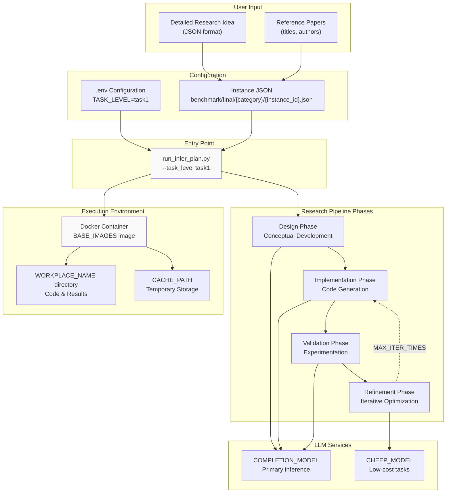
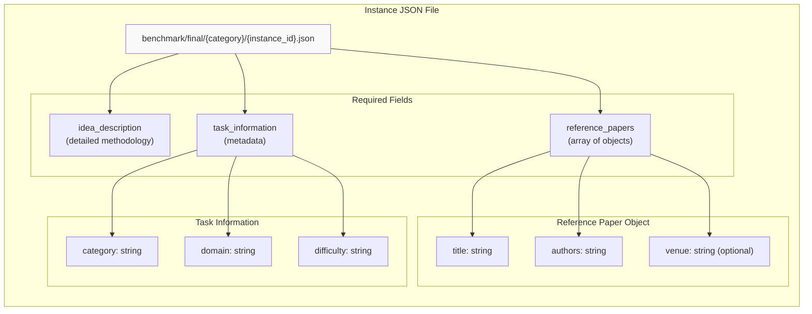
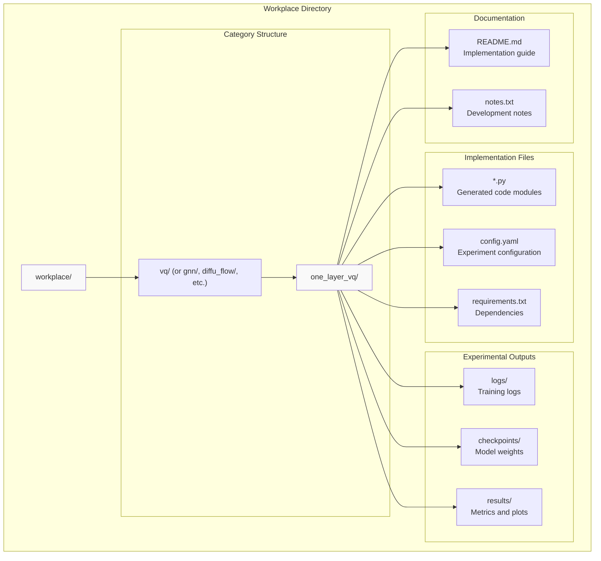
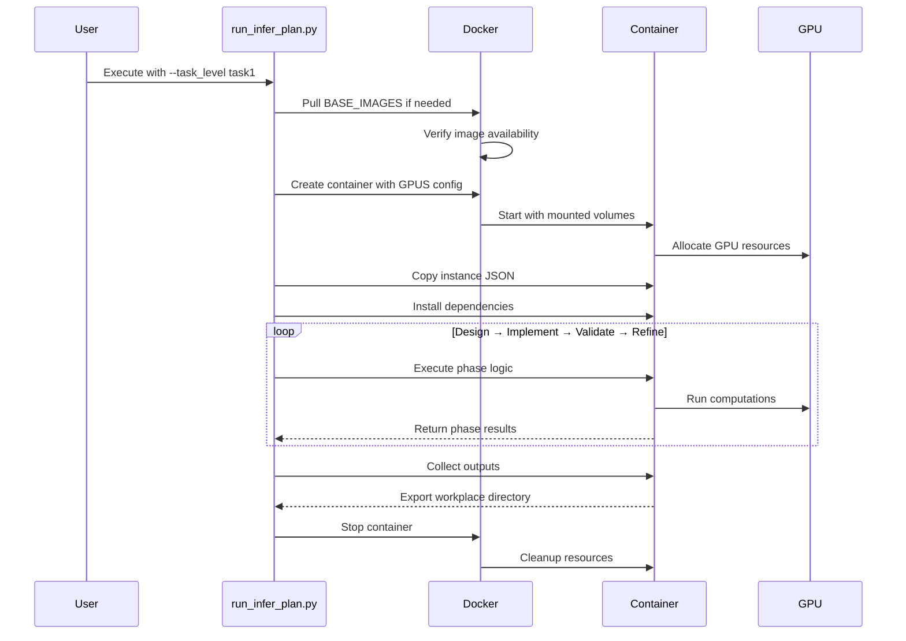

<!-- source: DeepWiki mcp.deepwiki.com · repo HKUDS/AI-Researcher · page 6.2 Level 1 Tasks (Given Ideas) · fetched 2026-11-09 -->

# Level 1 Tasks (Given Ideas)

<details>
<summary>Relevant source files</summary>

The following files were used as context for generating this wiki page:

- [.env.template](.env.template)
- [README.md](README.md)

</details>


## Purpose and Scope

This document describes how to execute **Level 1 Tasks** in the AI-Researcher system, where users provide a detailed research idea along with reference papers. Level 1 tasks bypass the autonomous literature review and idea generation phases, proceeding directly to algorithm design, implementation, validation, and refinement. This mode is optimal when researchers have a specific methodology in mind and want AI-Researcher to focus on implementation and experimental validation.

For autonomous research starting from reference papers only, see [Level 2 Tasks (Reference-based)](#6.3). For initial system setup, see [Installation & Setup](#6.1).

---

## Level 1 Task Characteristics

Level 1 tasks are distinguished by the following properties:

| Characteristic | Description |
|---------------|-------------|
| **Input Requirements** | Detailed research idea description + reference papers |
| **Autonomous Phases** | Design → Implementation → Validation → Refinement |
| **Skipped Phases** | Resource Collection, Resource Filtering, Idea Generation |
| **Primary Use Case** | Implementing and validating a specific algorithmic concept |
| **Configuration Flag** | `TASK_LEVEL=task1` |
| **Entry Point** | `run_infer_plan.py` |

The system assumes the user has already:
- Identified the research problem
- Formulated a novel approach
- Gathered relevant reference literature
- Specified implementation details

Sources: [README.md:35-39](), [.env.template:47-50]()

---

## System Architecture for Level 1 Tasks



**Level 1 Task Execution Flow**: User-provided ideas bypass autonomous discovery phases and enter directly at the Design Phase. The system executes within an isolated Docker container, using configured LLM services for code generation and analysis.

Sources: [README.md:988-1005](), [.env.template:1-53]()

---

## Configuration Requirements

### Environment Variables

Level 1 tasks require specific configuration in the `.env` file or environment variables:

| Parameter | Required Value | Purpose |
|-----------|---------------|---------|
| `TASK_LEVEL` | `task1` | Activates Level 1 mode |
| `CATEGORY` | `diffu_flow`, `gnn`, `reasoning`, `recommendation`, or `vq` | Task domain |
| `INSTANCE_ID` | e.g., `one_layer_vq` | Specific task identifier |
| `COMPLETION_MODEL` | LLM identifier | Primary model for code generation |
| `CHEEP_MODEL` | LLM identifier | Cost-effective model for auxiliary tasks |
| `BASE_IMAGES` | `tjbtech1/airesearcher:v1` | Docker base image |
| `GPUS` | `"device=0"`, `"device=0,1"`, `"all"`, or `None` | GPU allocation |
| `MAX_ITER_TIMES` | Integer ≥ 0 | Maximum refinement iterations |

### Example Configuration

```bash
# Task Configuration
CATEGORY=vq
INSTANCE_ID=one_layer_vq
TASK_LEVEL=task1
MAX_ITER_TIMES=0

# LLM Configuration
COMPLETION_MODEL=openrouter/google/gemini-2.5-pro-preview-05-20
CHEEP_MODEL=openrouter/google/gemini-2.5-pro-preview-05-20
OPENROUTER_API_KEY=your_openrouter_api_key

# Container Configuration
BASE_IMAGES=tjbtech1/airesearcher:v1
GPUS='"device=0"'
DOCKER_WORKPLACE_NAME=workplace_paper
```

Sources: [.env.template:36-53](), [README.md:155-207]()

---

## Input Format: Instance JSON Structure



**Instance JSON Structure**: The input file must contain a detailed idea description, reference papers array, and task metadata.

### Idea Description Components

The `idea_description` field should include:

1. **Problem Statement**: What task the model addresses
2. **Core Techniques**: Algorithms and methodologies employed
3. **Component Purposes**: Function of each major technical component
4. **Implementation Details**: Key parameters, input/output specifications, constraints
5. **Integration Steps**: Step-by-step interaction of components
6. **Critical Details**: Performance-affecting implementation specifics

### Example Instance JSON

```json
{
  "idea_description": [
    "The proposed model designed in this paper is designed to improve the performance of Vector Quantized Variational AutoEncoders (VQ-VAEs)...",
    "The core methodologies utilized include:",
    "- Rotation and Rescaling Transformation: A linear transformation...",
    "Implementation details for each component:",
    "- Key Parameters: Codebook size should be configured based on dataset complexity..."
  ],
  "reference_papers": [
    {
      "title": "Neural discrete representation learning",
      "authors": "van den Oord et al."
    },
    {
      "title": "Straightening out the straight-through estimator",
      "authors": "Ramapuram et al."
    }
  ],
  "task_information": {
    "category": "vq",
    "domain": "Computer Vision",
    "difficulty": "medium"
  }
}
```

Sources: [README.md:237-297]()

---

## Execution Process

### Phase-by-Phase Workflow

```mermaid
stateDiagram-v2
    [*] --> LoadConfig: Load .env + Instance JSON
    LoadConfig --> InitContainer: Create Docker Container
    InitContainer --> DesignPhase: task_level=task1
    
    state DesignPhase {
        [*] --> ParseIdea: Parse idea_description
        ParseIdea --> FormulateStrategy: Develop implementation plan
        FormulateStrategy --> DefineArchitecture: Define code structure
        DefineArchitecture --> [*]
    }
    
    state ImplPhase {
        [*] --> GenerateCode: LLM-driven code generation
        GenerateCode --> SetupEnv: Configure dependencies
        SetupEnv --> CreateTests: Generate test cases
        CreateTests --> [*]
    }
    
    state ValidPhase {
        [*] --> RunExperiments: Execute in container
        RunExperiments --> CollectMetrics: Performance analysis
        CollectMetrics --> LogResults: Store outputs
        LogResults --> [*]
    }
    
    state RefinePhase {
        [*] --> AnalyzePerf: Evaluate results
        AnalyzePerf --> IdentifyIssues: Detect bottlenecks
        IdentifyIssues --> DecideIteration: Check MAX_ITER_TIMES
        DecideIteration --> [*]
    }
    
    DesignPhase --> ImplPhase: Design Complete
    ImplPhase --> ValidPhase: Code Ready
    ValidPhase --> RefinePhase: Experiments Complete
    
    RefinePhase --> ImplPhase: iteration < MAX_ITER_TIMES
    RefinePhase --> WritePaper: iteration >= MAX_ITER_TIMES
    
    WritePaper --> [*]: Final Output
```



**Level 1 Execution State Machine**: The system progresses through four phases with optional iterative refinement controlled by `MAX_ITER_TIMES`.

### Phase Details

#### 1. Design Phase
- Parses the detailed idea description
- Identifies core algorithms and data structures
- Plans module architecture and interfaces
- Defines experimental validation strategy

**Key LLM Role**: Translate conceptual methodology into implementable design

#### 2. Implementation Phase
- Generates Python code based on design specifications
- Creates necessary data processing pipelines
- Implements model architectures and training loops
- Sets up logging and monitoring infrastructure

**Key LLM Role**: Code generation using `COMPLETION_MODEL`

#### 3. Validation Phase
- Executes experiments within Docker container
- Runs training and evaluation procedures
- Collects performance metrics (accuracy, loss, etc.)
- Generates visualizations and logs

**Container Role**: Isolated execution environment with GPU access

#### 4. Refinement Phase
- Analyzes validation results
- Identifies optimization opportunities
- Decides whether to iterate based on `MAX_ITER_TIMES`
- Plans next iteration improvements if needed

**Key LLM Role**: Performance analysis using `CHEEP_MODEL`

Sources: [README.md:939-952]()

---

## Command-Line Execution

### Primary Execution Script

The main entry point for Level 1 tasks is [research_agent/run_infer_plan.py]():

```bash
python run_infer_plan.py \
  --instance_path ../benchmark/final/${category}/${instance_id}.json \
  --container_name paper_eval \
  --task_level task1 \
  --model $COMPLETION_MODEL \
  --workplace_name workplace \
  --cache_path cache \
  --port 12372 \
  --max_iter_times 0 \
  --category ${category}
```

### Parameter Reference

| Parameter | Type | Description |
|-----------|------|-------------|
| `--instance_path` | Path | JSON file containing idea and references |
| `--container_name` | String | Docker container identifier |
| `--task_level` | String | Must be `task1` for Level 1 |
| `--model` | String | LLM identifier (overrides env var) |
| `--workplace_name` | String | Directory for code and results |
| `--cache_path` | String | Temporary storage directory |
| `--port` | Integer | Container port mapping |
| `--max_iter_times` | Integer | Maximum refinement iterations |
| `--category` | String | Task category for organization |

### Shell Script Wrapper

The recommended approach uses [research_agent/run_infer_level_1.sh]():

```bash
#!/bin/bash
current_dir=$(dirname "$(readlink -f "$0")")
cd $current_dir

export DOCKER_WORKPLACE_NAME=workplace_paper
export BASE_IMAGES=tjbtech1/airesearcher:v1
export COMPLETION_MODEL=claude-3-5-sonnet-20241022
export CHEEP_MODEL=claude-3-5-haiku-20241022

category=vq
instance_id=one_layer_vq
export GPUS='"device=0,1"'

python run_infer_plan.py \
  --instance_path ../benchmark/final/${category}/${instance_id}.json \
  --container_name paper_eval \
  --task_level task1 \
  --model $COMPLETION_MODEL \
  --workplace_name workplace \
  --cache_path cache \
  --port 12372 \
  --max_iter_times 0 \
  --category ${category}
```

Sources: [README.md:988-1005]()

---

## Output Structure

### Workspace Organization



**Output Directory Structure**: All generated artifacts are organized hierarchically by category and instance ID.

### Typical File Contents

| File/Directory | Contents |
|----------------|----------|
| `model.py` | Main model architecture implementation |
| `train.py` | Training loop and optimization logic |
| `data.py` | Dataset loading and preprocessing |
| `utils.py` | Helper functions and utilities |
| `config.yaml` | Hyperparameters and experiment settings |
| `logs/` | Training curves, loss values, metrics over time |
| `checkpoints/` | Saved model states at various epochs |
| `results/` | Final evaluation metrics, plots, tables |
| `README.md` | Generated documentation of the implementation |

Sources: [README.md:323-334]()

---

## Docker Container Integration

### Container Lifecycle



**Container Lifecycle Sequence**: The Docker container is created, executes the research pipeline, and is cleaned up after completion.

### Volume Mounts

The system mounts several directories between host and container:

| Host Path | Container Path | Purpose |
|-----------|----------------|---------|
| `workplace/` | `/workspace/workplace/` | Code and results persistence |
| `cache/` | `/workspace/cache/` | Temporary files and downloads |
| Instance JSON | `/workspace/instance.json` | Input specification |

### GPU Configuration

GPU allocation is controlled by the `GPUS` environment variable:

```bash
# Single GPU
GPUS='"device=0"'

# Multiple GPUs
GPUS='"device=0,1,2,3"'

# All available GPUs
GPUS='"all"'

# CPU-only mode
GPUS=None
```

Sources: [.env.template:11-16](), [README.md:135-147]()

---

## Complete Example: Vector Quantization Task

### Task Definition

This example demonstrates implementing a rotation-based vector quantization approach for VQ-VAEs.

**Instance File**: `benchmark/final/vq/one_layer_vq.json`

### Step 1: Configure Environment

Create `.env` file:

```bash
# Task Configuration
CATEGORY=vq
INSTANCE_ID=one_layer_vq
TASK_LEVEL=task1
MAX_ITER_TIMES=0

# LLM Configuration
COMPLETION_MODEL=openrouter/google/gemini-2.5-pro-preview-05-20
CHEEP_MODEL=openrouter/google/gemini-2.5-pro-preview-05-20
OPENROUTER_API_KEY=sk-or-v1-your-key-here
OPENROUTER_API_BASE=https://openrouter.ai/api/v1

# Container Configuration
BASE_IMAGES=tjbtech1/airesearcher:v1
GPUS='"device=0"'
DOCKER_WORKPLACE_NAME=workplace_paper
WORKPLACE_NAME=workplace
CACHE_PATH=cache
PORT=7020
PLATFORM=linux/amd64
```

### Step 2: Prepare Instance JSON

The instance JSON contains the detailed idea:

```json
{
  "idea_description": [
    "The proposed model is designed to improve Vector Quantized Variational AutoEncoders by addressing gradient propagation issues.",
    "Core methodologies include:",
    "- Rotation and Rescaling Transformation: Linear transformation aligning encoder output with codebook vectors",
    "- Gradient Propagation Method: Ensures gradients flow while preserving angle with codebook",
    "Implementation details:",
    "- Codebook size: 1024 or 8192 based on dataset complexity",
    "- Commitment loss coefficient β: range [0.25, 2]",
    "Step-by-step integration:",
    "1. Encode input to continuous representation",
    "2. Find nearest codebook vector",
    "3. Compute rotation matrix for alignment",
    "4. Apply transformation for decoder input",
    "..."
  ],
  "reference_papers": [
    {"title": "Neural discrete representation learning", "authors": "van den Oord et al."},
    {"title": "Straightening out the straight-through estimator", "authors": "Ramapuram et al."}
  ]
}
```

### Step 3: Execute Research Pipeline

```bash
cd research_agent
bash run_infer_level_1.sh
```

This executes:
1. **Design Phase**: Plans VQ-VAE architecture with rotation mechanism
2. **Implementation Phase**: Generates Python code for model, training, evaluation
3. **Validation Phase**: Runs experiments on configured dataset
4. **Refinement Phase**: Analyzes results (no iterations if `MAX_ITER_TIMES=0`)

### Step 4: Review Outputs

Generated workspace structure:

```
workplace/
└── vq/
    └── one_layer_vq/
        ├── model.py              # VQ-VAE with rotation quantizer
        ├── train.py              # Training script
        ├── data.py               # Dataset loaders
        ├── config.yaml           # Hyperparameters
        ├── logs/
        │   └── training.log      # Training progress
        ├── checkpoints/
        │   └── best_model.pt     # Saved weights
        └── results/
            ├── metrics.json      # Final performance
            └── reconstruction.png # Visualizations
```

### Expected Outputs

- Implemented VQ-VAE model with rotation-based quantization
- Training logs showing convergence
- Evaluation metrics (reconstruction error, codebook utilization)
- Visualization of reconstructed samples

Sources: [README.md:235-334]()

---

## Comparison: Level 1 vs Level 2

```mermaid
graph TB
    subgraph "Level 1: Given Ideas"
        L1Input["User Input:<br/>Detailed Idea + References"]
        L1Skip["SKIP:<br/>Literature Review<br/>Idea Generation"]
        L1Start["START: Design Phase"]
        L1Phases["Design → Implement<br/>→ Validate → Refine"]
        L1Output["Output:<br/>Implementation + Results"]
        
        L1Input --> L1Skip
        L1Skip --> L1Start
        L1Start --> L1Phases
        L1Phases --> L1Output
    end
    
    subgraph "Level 2: Reference-based"
        L2Input["User Input:<br/>Reference Papers Only"]
        L2Full["EXECUTE:<br/>Resource Collection<br/>Resource Filtering<br/>Idea Generation"]
        L2Start["START: Design Phase"]
        L2Phases["Design → Implement<br/>→ Validate → Refine"]
        L2Output["Output:<br/>Novel Idea + Implementation"]
        
        L2Input --> L2Full
        L2Full --> L2Start
        L2Start --> L2Phases
        L2Phases --> L2Output
    end
    
    style L1Skip fill:#f9f9f9
    style L2Full fill:#f9f9f9
```



**Task Level Comparison**: Level 1 skips autonomous discovery phases, while Level 2 executes the full research pipeline.

| Aspect | Level 1 (task1) | Level 2 (task2) |
|--------|-----------------|-----------------|
| **User Input** | Detailed methodology + references | References only |
| **Autonomy Level** | Implementation-focused | End-to-end research |
| **Resource Collection** | ❌ Skipped | ✅ Executed |
| **Idea Generation** | ❌ Skipped | ✅ Executed |
| **Design Phase** | ✅ Executed | ✅ Executed |
| **Implementation** | ✅ Executed | ✅ Executed |
| **Entry Script** | `run_infer_plan.py` | `run_infer_idea.py` |
| **Typical Use Case** | Testing specific algorithms | Exploratory research |
| **Time to Complete** | Shorter (fewer phases) | Longer (full pipeline) |

Sources: [README.md:33-40](), [README.md:988-1024]()

---

## Troubleshooting

### Common Issues

| Issue | Possible Cause | Solution |
|-------|---------------|----------|
| Container fails to start | Docker image not pulled | Run `docker pull tjbtech1/airesearcher:v1` |
| GPU not detected | Incorrect `GPUS` configuration | Verify GPU availability with `nvidia-smi` |
| LLM API errors | Invalid API key | Check `OPENROUTER_API_KEY` or `GITHUB_AI_TOKEN` |
| Instance not found | Wrong path or ID | Verify file exists at `benchmark/final/{category}/{instance_id}.json` |
| Permission denied | Volume mount issues | Ensure workplace and cache directories are writable |
| Out of memory | Insufficient GPU memory | Reduce batch size in generated config or use CPU mode |

### Debugging Commands

```bash
# Verify Docker image
docker images | grep airesearcher

# Check container status
docker ps -a | grep paper_eval

# Inspect container logs
docker logs paper_eval

# Access container shell
docker exec -it paper_eval /bin/bash

# Verify GPU access in container
docker exec paper_eval nvidia-smi

# Check workplace contents
ls -la workplace/${CATEGORY}/${INSTANCE_ID}/
```

### Configuration Validation

Before execution, verify:

1. ✅ `.env` file exists with `TASK_LEVEL=task1`
2. ✅ Instance JSON exists and is valid
3. ✅ Docker daemon is running
4. ✅ GPU drivers installed (if using GPU)
5. ✅ LLM API credentials are valid
6. ✅ Sufficient disk space in workplace and cache directories

Sources: [README.md:135-147](), [.env.template:1-53]()

---

## Performance Considerations

### Iteration Count

The `MAX_ITER_TIMES` parameter controls refinement iterations:

- `MAX_ITER_TIMES=0`: Single-pass execution (fastest)
- `MAX_ITER_TIMES=1`: One refinement cycle (balanced)
- `MAX_ITER_TIMES=3+`: Multiple refinements (highest quality)

**Trade-off**: More iterations improve result quality but increase execution time and LLM API costs.

### GPU Utilization

Optimal GPU configuration depends on task complexity:

| Task Type | Recommended GPU Config | Rationale |
|-----------|------------------------|-----------|
| Small models (< 10M params) | Single GPU | Sufficient capacity |
| Medium models (10M-100M) | Single high-memory GPU | Fits in VRAM |
| Large models (> 100M) | Multiple GPUs | Distributed training |
| CPU-compatible tasks | `GPUS=None` | Cost savings |

### LLM Model Selection

Balance cost and capability:

```bash
# High-capability (expensive)
COMPLETION_MODEL=claude-3-5-sonnet-20241022

# Medium-capability (balanced)
COMPLETION_MODEL=openrouter/google/gemini-2.5-pro-preview-05-20

# Cost-effective (cheaper)
COMPLETION_MODEL=openrouter/deepseek/deepseek-chat
```

Use `COMPLETION_MODEL` for critical code generation, `CHEEP_MODEL` for analysis tasks.

Sources: [.env.template:7-10](), [README.md:995-1003]()

---

